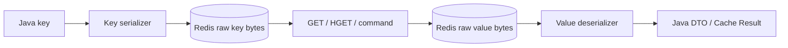

# Serializers for Keys, Values, and Cross-Version Data Compatibility

In **SPRING_BOOT_INTEGRATION**, Spring Boot often uses Redis to cache HTTP client responses, store short-lived synchronization state, enforce rate limits, support Spring Integration, or hold intermediate data between adapters. A Redis record written by yesterday's application version may be read by today's new version. If the two versions use **different serializers**, the same key in Redis can appear "not found," become "unreadable," or worse, **decode with the wrong business meaning**.

This lesson belongs to the **Redis** chapter and focuses on **serializers for keys, values, and cross-version data compatibility**. We will examine Redis data at the byte level, distinguish serializers across `RedisTemplate`, `StringRedisTemplate`, and Spring Cache, design versioned keyspaces and value schemas, choose explicit typed JSON strategies, handle existing keys/values during upgrades, and test against real Redis. Examples sit within Spring Boot integration across HTTP clients, databases, caches, message brokers, and Spring Integration, emphasizing data contracts, errors, deduplication, transactions, and observability.

> Examples target **Java 17+, Spring Boot 3.x, Spring Data Redis 3.x, Spring Data Redis with Lettuce, and Jackson 2.x** per the project BOM. Redis servers may run standalone or clustered; exact serializer API compatibility depends on library versions. Code uses fictitious domains, keys, and payloads, not real customer data.

## 1. Learning Objectives

After this lesson, you will be able to:

1. Explain why **Redis stores bytes**, not Java objects, and why the key serializer matters just as much as the value serializer.
2. Distinguish `StringRedisSerializer`, `JdkSerializationRedisSerializer`, typed JSON, polymorphic JSON, and binary codecs, and know when to use each.
3. Configure `RedisTemplate<String, T>` with explicit **key, value, hash key, and hash value serializers**.
4. Understand that `StringRedisTemplate`, `RedisTemplate`, and Spring Cache/`RedisCacheManager` **have separate serialization paths** and do not automatically share configuration.
5. Design a keyspace with namespace/tenant/version and values containing **`schemaVersion`** under a testable contract.
6. Read older data using a **version-aware decoder/upcaster** or migrate safely via bounded dual-read/dual-write.
7. Choose TTL, invalidation, fallbacks, and rollouts that prevent data leaks, cache loss, or overwriting newer info with older schemas.
8. Test byte representations, missing/mismatched types, failover, races, duplicates, and observability when Redis runs alongside databases and brokers.

## 2. Redis Does Not Store Java Objects: Both Keys and Values Are Bytes

Fundamentally, Redis works with **binary-safe strings** and structures such as Hash, List, Set, Sorted Set, or Stream. A `SET` command takes a key and value as byte sequences, even though `redis-cli` usually displays them as text.

```text
Java: "cache:order:v2:tenant-7:ORD-42"
    -- StringRedisSerializer UTF-8 -->
Redis key bytes: 63 61 63 68 65 3a 6f 72 64 65 72 ...

Java: OrderCacheEntryV2(...)
    -- JSON serializer -->
Redis value bytes:
{"schemaVersion":2,"orderId":"ORD-42","status":"PAID",...}
```

When reading:



The serializer is **part of the storage contract**, not merely convenience configuration:

- If the **key serializer changes**, key bytes differ for the same Java `String`. An app may read `null` and think it is a cache miss while the old key still exists under different bytes.
- If the **value serializer changes**, the app finds the key but may fail to decode the value.
- If the JSON codec stays the same while **schema or field semantics change**, the app may still parse successfully yet return wrong data.
- If a Redis Hash stores field names and field values, those two parts have separate **`hashKeySerializer`/`hashValueSerializer`** settings.
- If using Spring Cache abstraction, `@Cacheable`/`RedisCacheManager` controls how keys and values are serialized; configuring another `RedisTemplate` does not automatically alter them.

### 2.1. Inspect Real Bytes Rather Than Guessing from Redis CLI

Suppose app A writes `cache:order:v2:tenant-7:ORD-42` using UTF-8, while app B uses JDK serialization for keys. The two keys exist as completely different byte sequences. Running:

```bash
redis-cli --raw GET 'cache:order:v2:tenant-7:ORD-42'
```

only shows a value if the matching **raw key bytes** exist; it does not prove app B produces the same bytes. With binary formats like JDK serialization, terminal output may be unreadable or garbled; use safe tooling, hex dumps, or tests in dev environments and **never log Redis data containing PII/secrets**.

### 2.2. Redis Data Format Differs from Java Schema

| Layer | Can Change Independently? | Example Breaking Change |
| --- | --- | --- |
| Java DTO | Yes | Renaming class/package, record fields, enum values |
| Serializer/codec | Yes | JDK binary → JSON, Jackson typing strategy |
| Key format | Yes | `cache:order:123` → `cache:order:v2:123` |
| Value schema | Yes | `total` → `amount`, adding `schemaVersion` |
| Redis TTL | Yes | 60 seconds → 10 minutes, changing freshness contract |
| Business semantics | Yes, must be governed | Monetary amounts from major units → minor units |
| Redis deployment | Yes | Standalone → Cluster, changing database index/prefix |

**Byte compatibility is not enough.** JSON v1 and v2 are both UTF-8 yet do not necessarily share semantics. Conversely, renaming a Java package does not break JSON data if the codec omits class names and keeps the schema stable.

## 3. Key Serializers: The Most Frequently Overlooked Piece

For applications sharing caches across versions and needing `redis-cli` inspectability, **stable UTF-8 string keys** are typically the easiest to operate:

```text
cache:order:v2:tenant-7:ORD-42
cache:catalog:v3:partner-a:product-991
integration:rate-limit:v1:client-7:20261121
```

Java example:

```java
import org.springframework.data.redis.serializer.StringRedisSerializer;
import java.nio.charset.StandardCharsets;

StringRedisSerializer serializer = new StringRedisSerializer();
byte[] rawKey = serializer.serialize(
        "cache:order:v2:tenant-7:ORD-42");
String key = serializer.deserialize(rawKey);
```

`StringRedisSerializer` uses UTF-8 and does not add schema, escaping, or tenant logic automatically. Choosing a key format alone is not enough; explicitly specify:

1. **Namespace**: cache, lock, rate-limit, integration work state, stream, and business status must never accidentally share prefixes.
2. **Entity/operation**: `order`, `catalog`, `sync-checkpoint`.
3. **Version**: represents key-format/value compatibility per policy, not the Java app release number.
4. **Tenant/source/partner**: included whenever business IDs are not globally unique or authorization isolation requires it.
5. **Identifier**: validated value; never let callers inject arbitrary delimiters.
6. **TTL**: defined cache lifetime, negative entries, and freshness bounds.

### 3.1. Key Collisions and Delimiters

If you simply concatenate:

```java
String key = "cache:order:" + tenantId + ":" + orderId;
```

then `tenant="a:b", orderId="c"` and `tenant="a", orderId="b:c"` produce the identical string `cache:order:a:b:c`. Furthermore, overly long keys, Unicode normalization quirks, or attacker-controlled keys can inflate RAM usage.

Helper example **for a character-restricted ID contract**:

```java
import java.util.regex.Pattern;

public final class OrderCacheKeys {
    private static final Pattern SAFE_PART =
            Pattern.compile("[A-Za-z0-9._-]{1,128}");

    private OrderCacheKeys() {}

    public static String v2(String tenantId, String orderId) {
        requirePart(tenantId, "tenant");
        requirePart(orderId, "order");
        return "cache:order:v2:" + tenantId + ":" + orderId;
    }

    private static void requirePart(String part, String field) {
        if (part == null || !SAFE_PART.matcher(part).matches()) {
            throw new IllegalArgumentException("Invalid " + field + " key");
        }
    }
}
```

This is an **application convention**, not a mandatory Redis restriction. If real IDs contain colons, Unicode, or spaces, design explicit escaping, length-prefixing, or deterministic encoded components under a documented contract. **Never** lowercase or case-fold an order ID if a partner treats it as case-sensitive, and never use raw email/tokens/PII in keys visible in operational tools.

### 3.2. Keyspace Version Is Not the Same as Value schemaVersion

| Where Version Lives | Purpose | Example |
| --- | --- | --- |
| Key prefix | Isolates data of two formats so old/new apps do not misread each other | `cache:order:v1:...` and `cache:order:v2:...` |
| Field inside value | Tells decoder which schema the payload follows | `"schemaVersion":2` |
| Spring Cache name | Separates cache regions/contracts | `orderLookupV2` |
| Broker event schema version | Version of emitted messages | `OrderChangedV2` |

You can use **both key version and value `schemaVersion`**: the key version assists routing and retiring old data, while the value version detects content mismatches during migrations, invalidation, or miswrites by another system. Relying solely on the key name to guess schema lets a misplaced write into a v2 key slip past parsers silently.

## 4. Comparing Common Serializers

| Serializer / Codec | Representation | Pros | Risks and Limitations |
| --- | --- | --- | --- |
| `StringRedisSerializer` | UTF-8 string | Easy to inspect; stable for keys/counters/plain text | Cannot represent typed DTOs or schemas by itself. |
| `JdkSerializationRedisSerializer` | Java Object Serialization binary | Can deserialize compatible Java objects when both sides are trusted | Coupled to class/`serialVersionUID`, poor cross-language support, byte overhead, deserialization vulnerabilities; **avoid for new cache contracts**. |
| `Jackson2JsonRedisSerializer<T>` | JSON for a specific Java type | Easy DTO control; avoids arbitrary class metadata when configured right | Field/schema/class changes can break; requires managing JavaTime/enum/null/unknown-field policies. |
| `GenericJackson2JsonRedisSerializer` | Polymorphic JSON with configured type metadata | Useful when a cache holds multiple Java object types | Type info such as `@class` and default typing create class/package coupling and gadget/unsafe-polymorphism risks on untrusted data. |
| Custom `RedisSerializer<T>` | Defined JSON envelope or binary schema | Can read v1/v2 with explicit validation and error classification | Must maintain migration/schema tests and avoid burying excessive logic in the codec. |
| Protobuf/Avro/CBOR/MessagePack | Corresponding binary/schema formats | Compact, fast, or schema-registry friendly when properly designed | Does not remain compatible across semantic changes; requires versioning/codecs/migrations and tooling. |

### 4.1. Why Native Java Serialization Is Unsuitable as a Long-Term Contract?

An unconfigured `RedisTemplate` may fall back to **default JDK serialization** for parts where it is allowed to auto-create serializers, depending on class/version/config. When a value is `com.example.v1.OrderCache`, the bytes embed class names and serialization metadata. If v2 refactors the package/class or changes `serialVersionUID`, deserialization can fail even though business fields did not change.

Moreover, Java deserialization on untrusted bytes carries **gadget-chain execution risks** depending on classpath libraries—a different security threat class than parsing typed JSON DTOs. Never use `JdkSerializationRedisSerializer` as a "rescue reader" for Redis bytes modifiable by external systems or attackers. When migrating legacy JDK bytes, run an offline/isolated process on trusted inputs with strict class filters, and migrate once to a declared format.

### 4.2. JSON Is Not Automatically Compatible

Suppose v1 stored:

```json
{"orderId":"ORD-42","total":"125.00","state":"PAID"}
```

and the v2 Java DTO renames `total` to `amount` and `state` to `status`. `Jackson2JsonRedisSerializer<OrderCacheV2>` might still instantiate an object with `null` or ignored unknown fields depending on `ObjectMapper`; without validation, the service might interpret `null` as "no order" or default status to `NEW`. **Successful deserialization does not guarantee business semantic validity**.

### 4.3. Do Not Enable Default Typing Indiscriminately

If JSON values embed type metadata like `"@class":"com.example.SecretType"` and the decoder dynamically instantiates classes from payload data, an attacker or poisoned cache entry can trigger unexpected Java class instantiation. When polymorphism is genuinely required, enforce a subtype allowlist/`PolymorphicTypeValidator` and a fixed contract; for single-DTO caches, **prefer typed serializers** or a version-aware codec that parses a JSON tree and maps exclusively into code-approved types.

## 5. Spring Boot Connection Config Is Distinct from Serialization Policy

Dependency for Redis access:

```xml
<dependency>
    <groupId>org.springframework.boot</groupId>
    <artifactId>spring-boot-starter-data-redis</artifactId>
</dependency>
```

Gradle Groovy DSL example:

```groovy
dependencies {
    implementation 'org.springframework.boot:spring-boot-starter-data-redis'
    implementation 'org.springframework.boot:spring-boot-starter-validation'
    testImplementation 'org.springframework.boot:spring-boot-starter-test'
}
```

With Spring Boot 3.x, the starter typically places **Spring Data Redis + Lettuce** on the classpath. When auto-configuration conditions match, Boot may create `RedisConnectionFactory`, a `RedisTemplate<Object,Object>`, and `StringRedisTemplate`. Cache abstraction additionally depends on `@EnableCaching` and cache settings. Those beans **do not mean Boot has selected a versioned JSON DTO serializer matching your business contract**.

Example Redis connection and timeout configuration:

```yaml
spring:
  data:
    redis:
      host: ${REDIS_HOST:localhost}
      port: ${REDIS_PORT:6379}
      username: ${REDIS_USERNAME:}
      password: ${REDIS_PASSWORD:}
      connect-timeout: 2s
      timeout: 2s
      client-type: lettuce
```

This illustrates standalone Redis. In Redis Cluster/Sentinel/managed cloud setups, configure topology, TLS, authentication, database index, and reconnect policy per deployment. Never assume `spring.data.redis.database` selects a non-zero logical database in Redis Cluster; most Redis Cluster deployments support only DB 0. Confirm properties against your exact Boot version and connector configuration.

### 5.1. Three Common Ways to Call Redis

| API | Where Serializers Are Configured | Common Confusion |
| --- | --- | --- |
| `StringRedisTemplate` | Spring Data Redis preconfigures UTF-8 string serializers for keys/values/hashes | Writes `"123"` as UTF-8 bytes; does not store typed Java objects without manual JSON encoding. |
| `RedisTemplate<K,V>` | `setKeySerializer`, `setValueSerializer`, `setHashKeySerializer`, `setHashValueSerializer` | Produces different key/value bytes from `StringRedisTemplate` unless set consistently. |
| Spring Cache (`@Cacheable`/`RedisCacheManager`) | Per-cache or default `RedisCacheConfiguration` | Does not inherit value serializers configured on a separate `RedisTemplate` bean. |

In Spring Data Redis, paths such as Redis Streams, Pub/Sub listener containers, Redis message converters, and Spring Integration Redis adapters each have **their own serialization contracts** governed by their configured converters/adapters. Never assume "Redis uses JSON everywhere" simply because one `RedisTemplate` sets a JSON value serializer.

### 5.2. Redis TTL Is Not a Serializer

`EXPIRE` or `opsForValue().set(key, value, Duration)` sets an expiration on the **key**, independent of any JSON fields inside the value. Having an `expiresAt` field in JSON does not make Redis delete the key on time; having a Redis TTL does not guarantee cached values reflect recent database writes.

If caching user permissions or group memberships, TTL and freshness must account for permission revocation. If Redis is unavailable, never default to "every user is an admin" or grant access from indefinitely stale cache entries.

## 6. Designing Explicitly Typed and Versioned Value Schemas

For caching an order projection sourced from PostgreSQL or an HTTP partner, define a **Redis-specific DTO** rather than serializing a JPA entity:

```java
import java.math.BigDecimal;
import java.time.Instant;

public record OrderCacheEntryV2(
        int schemaVersion,
        String orderId,
        String status,
        BigDecimal amount,
        String currency,
        Instant updatedAt
) {}
```

A value:

```json
{
  "schemaVersion": 2,
  "orderId": "ORD-42",
  "status": "PAID",
  "amount": 125.00,
  "currency": "USD",
  "updatedAt": "2026-11-20T10:30:00Z"
}
```

This is a **cache projection**: it contains only the fields the application needs to read fast, with an explicit schema and source of truth. Never include internal JPA fields such as lazy relationship graphs, Hibernate proxies, or database credentials inside `OrderCacheEntryV2`. If an HTTP response needs a different shape, map from cache/domain into a separate public DTO.

### 6.1. Value Contract Must Define Every Field

| Field | Semantics | Key Validation |
| --- | --- | --- |
| `schemaVersion` | Redis payload version, not app release | Accept only supported versions. |
| `orderId` | Order business ID within the keyspace | Non-blank; must match requested key; tenant-scoped per context. |
| `status` | Projection state, e.g., `NEW/PAID/CANCELLED` | Policy-governed enum/vocabulary; unknown state must not silently become `NEW`. |
| `amount` | Confirmed monetary amount in major units, decimal representation | `BigDecimal`, scale/precision and sign rules per business operation. |
| `currency` | ISO 4217 code from system allowlist | Do not accept arbitrary three-letter strings. |
| `updatedAt` | Update timestamp from source of truth or projection | Never substitute `Instant.now()` at cache read time if ordering comparisons are needed. |

**Do not treat `updatedAt` as TTL.** TTL lives on the Redis key and reflects cache retention policy. Conversely, refreshing a payload's Redis TTL does not mean the underlying business data became newer.

### 6.2. Why Avoid Java Class Names Inside Payloads?

Suppose cache v1 contains:

```json
{"@class":"com.example.orders.v1.CachedOrder","orderId":"ORD-42"}
```

After refactoring, the class moves to `com.example.integration.cache.OrderSnapshot`. A decoder relying on the old class name fails once the old class disappears. If the codec instead checks `schemaVersion` and selects DTOs **explicitly in code**, renaming Java packages need not break v1 payload readability.

Therefore, for caches shared across releases, a **published schema** matters more than letting serializers embed implementation class metadata. Use polymorphic type metadata only when strictly necessary and guarded by a safe allowlist.

### 6.3. Separating Format Versioning from Semantic Changes

Adding an *optional* field that older consumers safely ignore may not require bumping `v2` → `v3`. However, changing `amount` from major units to minor units or altering the meaning of `status="S"` is a **semantic breaking change** even though JSON still parses cleanly. In such cases, bump the version and write migration tests; never rely on Jackson's "ignore unknown properties" to claim backward compatibility.

## 7. Configuring `RedisTemplate<String, OrderCacheEntryV2>` with Complete Serializers

In applications using Spring Data Redis 3.x with Jackson 2.x, use `Jackson2JsonRedisSerializer<T>` for a **specific DTO type** alongside `StringRedisSerializer` for all key and field names.

```java
import com.fasterxml.jackson.databind.ObjectMapper;
import org.springframework.context.annotation.Bean;
import org.springframework.context.annotation.Configuration;
import org.springframework.data.redis.connection.RedisConnectionFactory;
import org.springframework.data.redis.core.RedisTemplate;
import org.springframework.data.redis.serializer.Jackson2JsonRedisSerializer;
import org.springframework.data.redis.serializer.StringRedisSerializer;

@Configuration(proxyBeanMethods = false)
public class OrderRedisTemplateConfiguration {

    @Bean("orderCacheRedisTemplate")
    RedisTemplate<String, OrderCacheEntryV2> orderCacheRedisTemplate(
            RedisConnectionFactory connectionFactory,
            ObjectMapper objectMapper) {

        var keys = new StringRedisSerializer();
        var values = new Jackson2JsonRedisSerializer<>(
                objectMapper, OrderCacheEntryV2.class);

        RedisTemplate<String, OrderCacheEntryV2> template =
                new RedisTemplate<>();
        template.setConnectionFactory(connectionFactory);
        template.setKeySerializer(keys);
        template.setValueSerializer(values);
        template.setHashKeySerializer(keys);
        template.setHashValueSerializer(values);
        template.afterPropertiesSet();
        return template;
    }
}
```

**Key points:**

1. The Boot-managed `RedisConnectionFactory` handles connections, clustering, and TLS; it **does not dictate business JSON schemas**.
2. Boot's auto-configured `ObjectMapper` typically includes JavaTime support when required dependencies exist; **actually test** round-tripping `Instant`, `BigDecimal`, and enums. Never casually replace it with `new ObjectMapper()` and forget `JavaTimeModule`.
3. Keys and hash field names are UTF-8; `HGETALL`, `GET`, and tooling agree on wire bytes when key formats match.
4. Both value and hash value use **`OrderCacheEntryV2`** JSON. Never reuse this specialized template for Redis counters, lock tokens, arbitrary Hash fields, or other message types.
5. Even with a typed DTO, values are **not automatically valid just because they deserialized**. Validate schemas and business invariants explicitly and classify errors.

In newer library versions, constructors/APIs or Jackson serializer names may change; keep code aligned with the Spring Data Redis version in your project's BOM. Never bump Spring Data or Jackson independently just for a single constructor overload.

### 7.1. Writing, Reading, Validating, and Setting TTL

```java
import java.time.Duration;
import java.time.Instant;
import org.springframework.beans.factory.annotation.Qualifier;
import org.springframework.data.redis.core.RedisTemplate;
import org.springframework.stereotype.Repository;

@Repository
public final class OrderCacheAdapter {
    private static final Duration TTL = Duration.ofMinutes(5);
    private final RedisTemplate<String, OrderCacheEntryV2> redis;

    public OrderCacheAdapter(
            @Qualifier("orderCacheRedisTemplate")
            RedisTemplate<String, OrderCacheEntryV2> redis) {
        this.redis = redis;
    }

    public void put(String tenantId, OrderCacheEntryV2 order) {
        if (order == null
                || order.schemaVersion() != 2
                || order.orderId() == null) {
            throw new IllegalArgumentException("Invalid v2 cache value");
        }
        redis.opsForValue().set(
                OrderCacheKeys.v2(tenantId, order.orderId()),
                order, TTL);
    }

    public OrderCacheEntryV2 find(
            String tenantId, String orderId) {
        var value = redis.opsForValue().get(
                OrderCacheKeys.v2(tenantId, orderId));

        if (value == null) {
            return null; // Cache miss, not proof the order does not exist.
        }
        if (value.schemaVersion() != 2
                || !orderId.equals(value.orderId())
                || value.status() == null
                || value.updatedAt() == null) {
            throw new InvalidCachedOrderException(
                    "Invalid cached order projection");
        }
        return value;
    }
}

class InvalidCachedOrderException extends RuntimeException {
    InvalidCachedOrderException(String message) {
        super(message);
    }
}
```

In a real project, each top-level `public` type in these snippets belongs in its own `.java` file. The code above illustrates lifecycle and contracts; production systems need full validation of amount/currency/status and service-layer tenant authorization. **Attaching TTL on the write command** avoids leaving eternal cache entries if the app crashes before a separate `expire` call.

If a key holds incompatible v1 data while v2 reads the same key, `Jackson2JsonRedisSerializer<OrderCacheEntryV2>` will not upcast automatically. That is why this example **isolates a v2 key**. When reading multiple versions under one key is needed, use the dedicated codec shown next.

### 7.2. Why Not Serialize JPA Entities Directly?

A JPA entity carries lazy collections, Hibernate proxies, bidirectional links, and internal fields. Jackson may trigger unintended lazy loads or emit persistence-coupled JSON. Cache a stable **projection DTO** with its own field contract and TTL—never an `EntityManager`-managed entity or proxy. When entities evolve, the mapping adapter into `OrderCacheEntryV2` can preserve the JSON schema across rolling deployments.

## 8. `StringRedisTemplate` as a Useful Tool for Intentional JSON Protocols

In some systems, instead of letting a typed `RedisTemplate` serialize values, the application prefers to **own the codec in a separate layer** to support v1/v2. You can use `StringRedisTemplate` for UTF-8 keys and **JSON string** values, parsing explicitly through a versioned codec.

```java
import java.time.Duration;
import org.springframework.data.redis.core.StringRedisTemplate;

public final class RawJsonOrderCache {
    private final StringRedisTemplate redis;
    private final VersionedOrderCacheCodec codec;

    public RawJsonOrderCache(
            StringRedisTemplate redis,
            VersionedOrderCacheCodec codec) {
        this.redis = redis;
        this.codec = codec;
    }

    public void put(String tenantId, OrderCacheEntryV2 value) {
        String key = OrderCacheKeys.v2(tenantId, value.orderId());
        redis.opsForValue().set(
                key, codec.encode(value), Duration.ofMinutes(5));
    }

    public OrderCacheEntryV2 read(String tenantId, String orderId) {
        String raw = redis.opsForValue().get(
                OrderCacheKeys.v2(tenantId, orderId));
        return raw == null ? null : codec.decode(raw);
    }
}
```

`VersionedOrderCacheCodec` is an **application-owned component**, defined below. This approach makes raw JSON trivial to inspect in Redis CLI and easy to test across migrations, provided **only this codec writes into that keyspace**. If another app uses `StringRedisTemplate` to write raw integers or Java serialization into the same keys, no magic reliably auto-detects arbitrary formats.

### 8.1. How Do String Storage and Typed JSON Differ?

| Aspect | `StringRedisTemplate` + Codec | Typed `RedisTemplate` |
| --- | --- | --- |
| Key byte format | String serializer (UTF-8) | Controlled by `setKeySerializer` |
| JSON schema control | Application codec | Value `RedisSerializer` |
| Reading v1 and upcasting | Straightforward inside `codec.decode` | Needs a custom `RedisSerializer` or prior migration |
| Inspecting with Redis CLI | Readable JSON text | Readable if typed JSON serializer avoids binary wrappers |
| Pre-decode type safety | Raw string managed by codec | `RedisTemplate` is generic, though runtime decode can still fail |
| Performance | Extra String ↔ bytes/JSON step per runtime path | Serializer operates directly on bytes; benchmark per workload |

Neither choice fits every cache. For a single typed DTO with an isolated v2 keyspace, a typed template is concise. For caches needing **multi-version data transitions**, an explicit codec keeps policies and tests clearer.

## 9. Redis Hashes Have Separate Serializers for **Field Names** and **Field Values**

For a Redis Hash:

```text
Redis key      = cache:order-hash:v2:tenant-7:ORD-42
Hash field     = snapshot
Hash field val = {"schemaVersion":2,...}
```

All three byte sequences matter:

- `keySerializer` for the Redis key name.
- `hashKeySerializer` for the field name `snapshot`.
- `hashValueSerializer` for the field's value.

The `RedisTemplate<String, OrderCacheEntryV2>` configured in Section 7 can use `opsForHash()` to store `snapshot` as typed JSON:

```java
String redisHashKey = "cache:order-hash:v2:tenant-7:ORD-42";
redis.opsForHash().put(redisHashKey, "snapshot", orderEntry);
redis.expire(redisHashKey, java.time.Duration.ofMinutes(5));
```

**Separate `HSET` and `EXPIRE` commands do not form an atomic transaction**; crashing between them leaves a Hash without a TTL. When initializing a Hash with a guaranteed TTL, use an appropriate script/transaction and test atomicity, or prefer a simple String `SET key value EX` for a single snapshot. In standard Redis versions, TTL applies to the **entire Hash key**, not individual fields; newer server-specific field-expiration features require managing a separate contract.

### 9.1. Do Not Apply One Typed Hash Value Serializer to Heterogeneous Fields

If a Hash contains:

```text
field=status        -> plain string "PAID"
field=attemptCount  -> decimal integer "3"
field=snapshot      -> JSON OrderCacheEntryV2
```

then a `hashValueSerializer` typed to `OrderCacheEntryV2` **cannot read all three fields**. Instead, design one of:

1. Use `StringRedisTemplate` and standardize every field as text with an explicit schema; or
2. Restrict each dedicated Hash to a single value type; or
3. Use per-field converters/codecs with an allowlist, keeping type information outside untrusted payloads if needed.

Avoid turning a Hash into a "grab bag of arbitrary Java objects" with unguarded generic polymorphic deserialization. When storing multi-field structures accessed via Redis Hash operations, design formats, TTLs, and invariants specifically for Redis Hash semantics rather than copying JSON document patterns blindly.

## 10. Version-Aware Codec: Reading v1 and Upcasting to DTO v2

When multiple app versions run concurrently or Redis holds cached entries across deployments, a codec must distinguish **payload schema** from the new codebase version. Here the source of truth (PostgreSQL) can rebuild the cache, so older entries are an optimization; still, reading v1 when valid prevents a sudden cache-miss spike.

Suppose v1 previously stored:

```json
{
  "schemaVersion": 1,
  "orderId": "ORD-42",
  "state": "PAID",
  "total": "125.00",
  "currency": "USD",
  "updatedAt": "2026-11-20T10:30:00Z"
}
```

Version 2 renames `state` to `status` and `total` to `amount`, **without changing currency units**. We define an explicit mapping:

```text
v1.state     -> v2.status
v1.total     -> v2.amount (decimal major units)
v1.currency  -> v2.currency
v1.updatedAt -> v2.updatedAt
v1.orderId   -> v2.orderId
v2.schemaVersion = 2
```

Because v1 carries full amount/currency/timestamp data, this upcast **is safe after validation**. If v1 lacked currency while the new system supports multiple currencies, never "default to USD" merely because most legacy records were USD.

### 10.1. Codec Independent of Class Names in JSON

```java
import com.fasterxml.jackson.core.JsonProcessingException;
import com.fasterxml.jackson.databind.JsonNode;
import com.fasterxml.jackson.databind.ObjectMapper;
import java.math.BigDecimal;
import java.math.RoundingMode;
import java.time.Instant;
import java.time.OffsetDateTime;
import java.time.format.DateTimeParseException;
import java.util.Currency;
import java.util.Locale;
import java.util.Set;
import java.util.regex.Pattern;
import org.springframework.stereotype.Component;

@Component
public final class VersionedOrderCacheCodec {
    private static final Set<String> STATUSES =
            Set.of("NEW", "PAID", "CANCELLED");
    private static final Set<String> CURRENCIES =
            Set.of("USD", "VND");
    private static final Pattern ORDER_ID =
            Pattern.compile("[A-Za-z0-9._-]{1,128}");

    private final ObjectMapper mapper;

    public VersionedOrderCacheCodec(ObjectMapper mapper) {
        this.mapper = mapper;
    }

    public String encode(OrderCacheEntryV2 value) {
        validate(value);
        try {
            return mapper.writeValueAsString(value);
        } catch (JsonProcessingException error) {
            throw new InvalidOrderCachePayloadException(
                    "Cannot encode v2 cache payload", error);
        }
    }

    public OrderCacheEntryV2 decode(String json) {
        if (json == null || json.isBlank()) {
            throw new InvalidOrderCachePayloadException(
                    "Empty cache payload");
        }

        try {
            JsonNode root = mapper.readTree(json);
            if (root == null || !root.isObject()) {
                throw new InvalidOrderCachePayloadException(
                        "Cache payload is not an object");
            }

            JsonNode version = root.get("schemaVersion");
            if (version == null || !version.isInt()) {
                throw new InvalidOrderCachePayloadException(
                        "Missing or invalid cache schema version");
            }

            OrderCacheEntryV2 result = switch (version.intValue()) {
                case 1 -> new OrderCacheEntryV2(
                        2,
                        requiredText(root, "orderId"),
                        requiredText(root, "state"),
                        requiredDecimal(root, "total"),
                        requiredText(root, "currency"),
                        requiredInstant(root, "updatedAt"));
                // Bind BigDecimal directly from the original JSON tokens,
                // not from a JsonNode that may have converted decimals
                // into double precision under a default mapper policy.
                case 2 -> mapper.readValue(
                        json, OrderCacheEntryV2.class);
                default -> throw new InvalidOrderCachePayloadException(
                        "Unsupported cache schema version");
            };

            validate(result);
            return result;
        } catch (JsonProcessingException
                 | NumberFormatException
                 | DateTimeParseException error) {
            throw new InvalidOrderCachePayloadException(
                    "Malformed cache payload", error);
        }
    }

    private static String requiredText(
            JsonNode root, String name) {
        JsonNode node = root.get(name);
        if (node == null || !node.isTextual()
                || node.textValue().isBlank()) {
            throw new InvalidOrderCachePayloadException(
                    "Invalid cache field: " + name);
        }
        return node.textValue();
    }

    private static BigDecimal requiredDecimal(
            JsonNode root, String name) {
        JsonNode node = root.get(name);
        if (node == null
                || !(node.isTextual() || node.isNumber())) {
            throw new InvalidOrderCachePayloadException(
                    "Invalid cache decimal field: " + name);
        }
        return new BigDecimal(node.asText());
    }

    private static Instant requiredInstant(
            JsonNode root, String name) {
        return OffsetDateTime.parse(
                requiredText(root, name)).toInstant();
    }

    private static void validate(OrderCacheEntryV2 value) {
        if (value == null || value.schemaVersion() != 2
                || value.orderId() == null
                || !ORDER_ID.matcher(value.orderId()).matches()
                || value.status() == null
                || !STATUSES.contains(value.status())
                || value.currency() == null
                || !CURRENCIES.contains(value.currency())
                || value.amount() == null
                || value.amount().signum() <= 0
                || value.amount().precision() > 19
                || value.updatedAt() == null) {
            throw new InvalidOrderCachePayloadException(
                    "Invalid canonical cache value");
        }

        int fractionDigits = Currency
                .getInstance(value.currency())
                .getDefaultFractionDigits();
        try {
            value.amount().setScale(
                    fractionDigits, RoundingMode.UNNECESSARY);
        } catch (ArithmeticException error) {
            throw new InvalidOrderCachePayloadException(
                    "Unsupported money scale", error);
        }
    }
}
```

```java
public final class InvalidOrderCachePayloadException
        extends RuntimeException {
    public InvalidOrderCachePayloadException(String message) {
        super(message);
    }

    public InvalidOrderCachePayloadException(
            String message, Throwable cause) {
        super(message, cause);
    }
}
```

**Codec characteristics:**

- Supports only schema versions `1` and `2`; unknown versions are **rejected**, never defaulted to v1.
- Never reads `@class` or Java class names from payloads to instantiate objects.
- Fields are read explicitly; wrong types or missing fields fail as contract errors.
- Mapping `total` to `amount` and `state` to `status` is an **upcast** that preserves business meaning.
- `Instant` is parsed from an offset string; missing timestamps are never replaced with the current clock.
- `BigDecimal` preserves precision; invalid amounts or mismatched scales are rejected rather than silently rounded.

In the v2 branch, the codec deserializes **directly from raw JSON into the `BigDecimal`-typed field** to avoid precision loss when a default Jackson tree configuration parses JSON numbers into `DoubleNode`. If reading decimals through `JsonNode` across all versions, configure the tree parser to use `BigDecimal` and add round-trip tests for large, high-precision values; never convert money through `double`.

**Implementation boundaries:** this code uses simple status/currency policies for positive order projections; refunds or financial adjustments follow different rules and should not be forced into this DTO. Extra JSON fields are currently ignored because the code reads only allowlisted fields; if strict schemas are desired, validate the full field-name set per version. For historical replay, retain golden fixtures and version the **upcast rules** themselves.

### 10.2. Never Default a Missing Version to v1

Suppose before `schemaVersion` existed, the app stored `{"state":"PAID"}`. Writing a heuristic "if version is missing, assume 1" is dangerous if unrelated payloads ever land in that keyspace.

A better approach:

1. Identify the exact **legacy key prefix** (e.g., `cache:order:legacy:...`) and which writers produced it.
2. Run a **dedicated legacy decoder** strictly on that prefix, tested against real raw bytes.
3. Upcast to v2 through an audited migration step preserving appropriate TTLs.
4. Once the compatibility window ends, delete legacy code and retire the old keyspace on schedule.

Never build a "try every serializer until one succeeds" loop on production data—it obscures error classification and can accidentally trigger unsafe Java deserialization paths.

## 11. Spring Cache/`@Cacheable` Has Its Own Serializer Configuration

If your code uses:

```java
@Cacheable(cacheNames = "orderLookupV2")
public OrderCacheEntryV2 findOrder(...) {
    // ...
}
```

then values are serialized by **`CacheManager`**, **not** by `orderCacheRedisTemplate` from Section 7. For Redis caches, configure `RedisCacheConfiguration` for each specific cache name.

### 11.1. Dedicated CacheManager for Order V2

```java
import com.fasterxml.jackson.databind.ObjectMapper;
import java.time.Duration;
import java.util.Map;
import org.springframework.cache.annotation.EnableCaching;
import org.springframework.context.annotation.Bean;
import org.springframework.context.annotation.Configuration;
import org.springframework.data.redis.cache.RedisCacheConfiguration;
import org.springframework.data.redis.cache.RedisCacheManager;
import org.springframework.data.redis.connection.RedisConnectionFactory;
import org.springframework.data.redis.serializer.Jackson2JsonRedisSerializer;
import org.springframework.data.redis.serializer.RedisSerializationContext;
import org.springframework.data.redis.serializer.StringRedisSerializer;

@Configuration(proxyBeanMethods = false)
@EnableCaching
public class OrderCacheManagerConfiguration {

    @Bean("orderCacheManager")
    RedisCacheManager orderCacheManager(
            RedisConnectionFactory factory,
            ObjectMapper objectMapper) {

        var keySerializer = new StringRedisSerializer();
        var valueSerializer =
                new Jackson2JsonRedisSerializer<>(
                        objectMapper, OrderCacheEntryV2.class);

        RedisCacheConfiguration ordersV2 =
                RedisCacheConfiguration.defaultCacheConfig()
                        .entryTtl(Duration.ofMinutes(5))
                        .disableCachingNullValues()
                        .computePrefixWith(
                                name -> "cache:" + name + ":")
                        .serializeKeysWith(
                                RedisSerializationContext.SerializationPair
                                        .fromSerializer(keySerializer))
                        .serializeValuesWith(
                                RedisSerializationContext.SerializationPair
                                        .fromSerializer(valueSerializer));

        return RedisCacheManager.builder(factory)
                .cacheDefaults(ordersV2)
                .withInitialCacheConfigurations(
                        Map.of("orderLookupV2", ordersV2))
                .disableCreateOnMissingCache()
                .build();
    }
}
```

This defines only cache `orderLookupV2` with value schema `OrderCacheEntryV2`. **Never** use this `CacheManager` for caches returning `ProductDto`, `UserProfile`, or unrelated collections: the typed serializer will fail or misparse. For multiple cache names, register per-cache configurations/serializers, or use a shared JSON envelope with an allowlisted type discriminator and explicit schema.

### 11.2. Tenant-Scoped Cache Keys and Spring Proxy Invocation

```java
import org.springframework.cache.annotation.Cacheable;
import org.springframework.stereotype.Service;

@Service
public final class OrderLookupService {
    private final OrderReadRepository source;

    public OrderLookupService(OrderReadRepository source) {
        this.source = source;
    }

    @Cacheable(
        cacheManager = "orderCacheManager",
        cacheNames = "orderLookupV2",
        key = "#tenantId + ':' + #orderId",
        unless = "#result == null")
    public OrderCacheEntryV2 findOrder(
            String tenantId, String orderId) {

        // This method is only invoked after authorization in an outer service.
        // On cache HIT, @Cacheable skips THIS ENTIRE method body.
        return source.findProjection(tenantId, orderId);
    }
}

public interface OrderReadRepository {
    OrderCacheEntryV2 findProjection(
            String tenantId, String orderId);
}
```

Each top-level `public` type goes in its own Java file. With `@Cacheable`, calls must pass **through the Spring proxy**; self-invocation within the same class typically bypasses cache advice. When compiled without Java parameter names, SpEL `#tenantId`/`#orderId` may require `-parameters` metadata or `#p0`/`#p1`, so add integration tests verifying actual cache keys.

**Never treat a cache key as authorization.** With `@Cacheable`, a **cache hit skips the entire method body**, meaning an authorization check inside `source.findProjection(...)` is **not sufficient** to protect cache hits. Enforce authorization **before calling the `@Cacheable` bean**, in a separate Spring service invoked by controllers/consumers:

```java
import org.springframework.stereotype.Service;

@Service
public final class AuthorizedOrderReadService {
    private final TenantAccessPolicy policy;
    private final OrderLookupService cache;

    public AuthorizedOrderReadService(
            TenantAccessPolicy policy, OrderLookupService cache) {
        this.policy = policy;
        this.cache = cache;
    }

    public OrderCacheEntryV2 findOrder(
            String tenantId, String orderId) {
        // tenantId must come from verified auth, not a raw query parameter.
        policy.requireReadOrder(tenantId, orderId);
        // Call THROUGH another Spring proxy bean so @Cacheable applies.
        return cache.findOrder(tenantId, orderId);
    }
}

public interface TenantAccessPolicy {
    void requireReadOrder(String tenantId, String orderId);
}
```

Controllers and consumers must call `AuthorizedOrderReadService`, never `OrderLookupService` directly. Permissions derive from a trusted principal/context, and backend sources can also enforce tenant scope in depth. When access policies change, plan corresponding TTLs/invalidation; stale cache entries must never bypass updated authorization decisions.

### 11.3. `spring.cache.redis.*` Does Not Automatically Affect All RedisTemplates

Boot exposes properties such as:

```yaml
spring:
  cache:
    type: redis
    redis:
      time-to-live: 5m
      cache-null-values: false
      use-key-prefix: true
```

These properties target **cache abstraction auto-configuration** and do not modify custom `RedisTemplate` beans. When declaring a custom `RedisCacheManager`, check whether Boot's cache properties still apply; never set TTL in YAML assuming a custom manager honors it automatically. Write unit/integration tests verifying actual key prefixes, TTLs, and wire value bytes.

## 12. Choosing a Compatibility Strategy for Rolling Deployments

During a rolling deployment, **v1 and v2 pods share Redis simultaneously** for minutes or longer. Distinguish **both read/write directions**:

| Writer | Reader | Success Condition |
| --- | --- | --- |
| v1 writes key v1/schema1 | v1 reads key v1/schema1 | Existing path continues working. |
| v1 writes key v1/schema1 | v2 reads key v1/schema1 | v2 includes a legacy decoder/upcaster and policy allows it. |
| v2 writes key v2/schema2 | v2 reads key v2/schema2 | Typed JSON or v2-compatible codec. |
| v2 writes schema2 into **v1** key | v1 reads schema2 | **Can break** if v1 misunderstands new fields or semantics. |
| v2 writes key v2 | v1 looks only at key v1 | v1 does not read v2 data, but can still rebuild v1 cache if source tolerates load. |

### 12.1. Three Primary Strategies

**A. Versioned keys + lazy refill (fits rebuildable caches):**

```text
v1: GET cache:order:v1:tenant:ORD-42
v2: GET cache:order:v2:tenant:ORD-42
          miss -> read PostgreSQL/source -> write JSON v2 with TTL
```

Pros: no need to deserialize legacy formats; versions never overwrite each other. Cons: **cold-cache miss spike after rollout**, raising DB/partner HTTP load; mitigate with warm-up, rate limits, bulkheads, and monitoring.

**B. Dual-read + upcast (when v1 data remains usable):**

```text
v2 GET key v2
     found -> validate v2
     miss  -> GET key v1
              found -> decode v1, upcast, validate
                       -> optionally write key v2
              miss  -> source-of-truth read
```

Pros: reduces cold misses during rollout. Cons: legacy decoder stays in code; requires careful TTL/migration correctness and corrupted-v1 testing.

**C. Time-bounded dual-write:**

```text
v2 application writes:
   cache:order:v1:* -> old format (only when old contract can express it)
   cache:order:v2:* -> new format
```

Pros: v1 readers stay warm during rollout. Cons: two Redis writes are **not atomic by default**, risking inconsistency; if v2 semantics cannot safely downcast, **never fake a v1 write**. When correctness matters rather than pure cache speedups, rely on the source of truth and reconciliation rather than assuming two cache keys stay synchronized.

### 12.2. Choosing by Data Type

| Redis Data Type | Usually Appropriate Strategy | Reason |
| --- | --- | --- |
| Catalog cache from DB/partner | v2 keys and lazy refill or dual-read | Rebuildable; favors simplicity and TTL. |
| Sensitive token/permission cache | Version separation + strict freshness, fail-safe policy | Old schemas must never grant unintended elevated access. |
| Rate-limit counters | Keep key format and numeric representation stable across deploys | Changing prefixes can unexpectedly reset quotas. |
| Distributed locks | Never change serializer/token format mid-flight while old workers run | Altering key/owner semantics breaks mutual exclusion. |
| Inbox/checkpoints needing durability | Keep in authoritative DB/inbox or proven durable store | Cache migrations must never lose progress or uniqueness. |
| Redis Stream events | Versioned event payloads and consumer compatibility | Never treat cache key v2 rules as stream offset/ack copies. |

### 12.3. Expand → Migrate → Contract Rollout Procedure

1. **Contract:** define v2 schema, v2 keys, golden samples, tenant scoping, and TTL.
2. **Expand readers:** deploy v2 readers capable of v1/v2 if planning dual-read; never alter v1 key formats while old readers still run.
3. **Migrate lazily or warm up:** rate-limit warming; monitor CPU, network, memory, and decode errors.
4. **Switch writers:** write v2 keys; dual-write v1 only if lossless downcast is proven.
5. **Observe:** track v1 fallback rates, decode errors, stale reads, origin DB load, and cache misses.
6. **Retire:** once all old readers have stopped and sufficient TTL lifetime has elapsed, remove v1 read/write code.
7. **Clean up:** remove v1 keyspace via controlled policy; never run `FLUSHDB`/`KEYS *` on shared Redis.

**Never delete v1 keys immediately when releasing v2** if v1 pods are still serving. Equally, never keep support indefinitely for insecure legacy JDK-serialized bytes if untrusted components can modify them.

## 13. TTL During Migration: Do Not Accidentally "Rejuvenate" Stale Data

In a cache, **schema compatibility** and **data freshness** are independent constraints. If a v1 entry only had 10 seconds left to live, and migration upcasts it and writes v2 with a fresh 30-minute TTL, stale data stays live far past the freshness contract.

### 13.1. Simple Handling: Legacy Read Without Extending TTL

When v1 data is still acceptable, a v2 reader can **fall back to reading v1 without immediately writing v2**:

```java
import org.springframework.data.redis.core.StringRedisTemplate;
import org.springframework.stereotype.Repository;

@Repository
public final class CompatibleOrderCacheReader {
    private final StringRedisTemplate redis;
    private final VersionedOrderCacheCodec codec;

    public CompatibleOrderCacheReader(
            StringRedisTemplate redis,
            VersionedOrderCacheCodec codec) {
        this.redis = redis;
        this.codec = codec;
    }

    public OrderCacheEntryV2 get(
            String tenantId, String orderId) {
        String v2 = redis.opsForValue().get(
                OrderCacheKeys.v2(tenantId, orderId));
        if (v2 != null) {
            return verifyOrderId(orderId, codec.decode(v2));
        }

        String v1 = redis.opsForValue().get(
                OrderCacheKeys.v1(tenantId, orderId));
        if (v1 != null) {
            // Only use the legacy payload for this read.
            // Do not extend TTL or rewrite blindly.
            return verifyOrderId(orderId, codec.decode(v1));
        }
        return null; // Caller reads from the authoritative source.
    }

    private static OrderCacheEntryV2 verifyOrderId(
            String expectedId, OrderCacheEntryV2 cached) {
        if (!expectedId.equals(cached.orderId())) {
            throw new InvalidOrderCachePayloadException(
                    "Cache key/payload order identity mismatch");
        }
        return cached;
    }
}
```

Add to `OrderCacheKeys` (Section 3) with the same component validation rules:

```java
public static String v1(String tenantId, String orderId) {
    requirePart(tenantId, "tenant");
    requirePart(orderId, "order");
    return "cache:order:v1:" + tenantId + ":" + orderId;
}
```

The `v1` method above belongs **inside the `OrderCacheKeys` class**, not as a standalone top-level Java method. Prerequisite: the v1 keyspace genuinely uses **UTF-8 Strings + v1 JSON**. If legacy code wrote JDK-serialized keys/values, `StringRedisTemplate` will **not** read them just by calling the v1 prefix; a dedicated raw-byte migration with strict security checks is needed.

**Why not write v2 yet?** Upcasting a nearly expired record and writing it with a new TTL **unintentionally extends freshness**. Here the v1 value is served only while the v1 key remains valid at `GET` time. If strict freshness is required even across processing delays, enforce a **freshness timestamp** policy or atomic read checks rather than relying solely on the `GET` snapshot.

### 13.2. When Migration Must Copy Data and Preserve TTL

Redis exposes `TTL`/`PTTL`:

```text
PTTL key > 0   : milliseconds remaining until expiration
PTTL key = -1  : key exists with no expiration
PTTL key = -2  : key does not exist
```

Conceptually safe copy procedure:

1. Read old value and remaining time-to-live.
2. Upcast only if format, schema, identity, and authorization pass validation.
3. **Never** turn a v1 key with 5 seconds left into a v2 key living 1 hour without **freshness validation from the source of truth**.
4. Set v2 TTL no larger than `min(oldRemainingTtl, newCacheTtl)` when simply copying old data.
5. Account for races: the v1 key can expire between `GET` and `PTTL`; if atomic copying is required, evaluate topology-compatible Lua scripts/transactions.
6. Handle `PTTL=-1` explicitly by policy (migrate with a new TTL, or force origin reload?) rather than blindly treating `-1` as "valid forever."

**Redis Cluster caveat:** multi-key scripts/transactions require all touched keys to live in the **same hash slot**. If v1 and v2 keys map to different slots, a multi-key Lua script cannot run atomically cross-slot; design hash tags up front or prefer lazy refill from the source of truth over cross-shard transactions.

### 13.3. When Old Writers Keep Writing v1

During a rolling deployment, v1 pods can update v1 keys after v2 pods already populated v2 keys. If v2 always checks v2 first, it may read a **version older than v1**. This is not a deserialization error—it is **cache coherence under mixed-version writers**.

Mitigations depending on system design:

- Treat Redis strictly as a cache; on source-of-truth updates, invalidate both v1 and v2 keys.
- Include a **database version/watermark** inside values and reject older versions when the origin supplies monotonic versions.
- During rollouts, assign cache writes to a single owner or coordinate invalidation.
- Read from the source of truth when out-of-order writes are suspected.
- Keep TTLs short as a safety net, without mistaking TTLs for transactions.

**Never** rely on `updatedAt` timestamps from independent machine clocks as an absolute "larger always wins" rule if clock skew can occur. Prefer versions or sequences issued by the authoritative database or aggregate.

## 14. Handling Cache Misses, Decode Errors, and Redis Unavailability Properly

A classic bug:

```java
try {
    return redis.opsForValue().get(key);
} catch (RuntimeException error) {
    return null;
}
```

This **collapses every error into a cache miss**, blinding the application to Redis disconnects, schema mismatches, cache poisoning, or permission failures. It can overload the database during a Redis outage and hide a broken rollout.

### 14.1. Distinguishing Scenarios

| Redis Read Outcome | Meaning | Action to Consider |
| --- | --- | --- |
| Key does not exist | Normal cache miss | Read DB/HTTP source, populate cache if valid. |
| Key exists, valid v2 schema | Cache hit | Validate identity/tenant and serve per freshness policy. |
| Key exists, supported v1 schema | Legacy hit | Upcast/dual-read, track legacy metric, preserve TTL. |
| Key exists, unsupported schema | Cache contract mismatch | Record metric, fail safe or quarantine/invalidate **owned keyspace only**. |
| Key exists, corrupted JSON | Corruption/serialization error | Never treat as success; audit without leaking payload; optionally refetch. |
| Redis timeout/unavailable | Infrastructure failure | Bounded fallback/bulkhead/circuit breaker per policy; avoid retry storms. |
| Cache value contradicts key | Identity/tenant mismatch | Reject value; alert on security/contract violation. |
| Value older than business version | Stale data | Invalidate/reload from source of truth; do not merely extend TTL. |

### 14.2. Bounded DB Fallback

A read-through service can follow:

```text
GET Redis v2
  -> Valid HIT: return cached projection
  -> MISS: load DB (authorized) -> cache SET with TTL -> return
  -> DECODE_ERROR: metric + invalidate owned key (if policy allows)
                   -> load DB -> refresh v2 -> return
  -> REDIS_UNAVAILABLE: DB fallback with bulkhead/rate limit
                       -> return or fail per SLA
```

Deciding whether to fall back to DB on Redis failure **depends on the use case**. Low-sensitivity catalog caches can fall back; abuse-prevention rate limiters or authorization caches need dedicated fail-open/fail-closed security policies. Never allow all requests unconditionally when Redis holds quotas/rate limits and goes down.

**Cache stampede:** if 1,000 concurrent requests miss after a v2 deploy, all can stampede the DB/partner. Use single-flight/per-key locks (with safe TTL/ownership), bounded concurrency, jittered TTLs, or rate-limited warm-up. Never rely on a Redis lock lacking atomic release and assume races are eliminated.

### 14.3. Never Wipe All Keys When Changing Serializers

`FLUSHALL`, `FLUSHDB`, or running `KEYS cache:*` followed by mass `DEL` on a shared Redis can wipe sessions, rate limiters, locks, delayed jobs, or pending work belonging to other systems. When retiring an old keyspace:

- Target an **explicitly owned prefix**, version, and tenant policy.
- Use bounded/rate-limited `SCAN` if scanning is required; `SCAN` is not a consistent snapshot, and Redis Cluster requires scanning across shards/nodes.
- Let short-TTL caches expire naturally whenever possible.
- Use `UNLINK` or batched deletion per Redis version/ops policy when avoiding blocking deletions.
- Log deleted counts and keyspace scope, never raw keys containing PII.

Cache cleanup is a **risky operational action**, not a brute-force fix for serializer bugs.

## 15. Serializers for Counters, Locks, and Idempotency Keys Differ from JSON DTOs

Not every Redis value should be serialized as a JSON object. Several Redis commands expect **specific byte formats**:

### 15.1. Counters Must Be Redis-Readable Integer Strings

Example rate-limit counter:

```java
import java.time.Duration;
import org.springframework.data.redis.core.StringRedisTemplate;

String key = "integration:rate-limit:v1:client-7:20261121";
Long count = redis.opsForValue().increment(key);
// Redis INCR operates on string-encoded integers understood by Redis.
```

If a key holds Java serialization or a quoted JSON string like `"123"`, `INCR` fails with "value is not an integer or out of range." Use `StringRedisTemplate`/string integer formats for counters, and isolate DTO caches into separate templates and namespaces.

**TTL note:** `INCR` does not automatically assign expiration to a new key; separate `INCR` and `EXPIRE` commands have a race/crash window. For consistent limiters, use a Lua script, Redis Function, or verified algorithm to **increment and set initial TTL atomically**. Do not reset TTL on every `INCR` if implementing a fixed window starting at first request; that changes the algorithm.

### 15.2. Lock Tokens Are Not Cache Projections

A distributed lock typically runs:

```text
SET lock:order:ORD-42 <random-owner-token> NX PX <leaseMillis>
```

Tokens must be unique per owner and preserve exact bytes for unlock comparison. Never serialize a token as a Java object embedding class metadata that a newer app release might fail to read. Use string/byte tokens and **delete the lock only if the stored value matches the owner**, executed atomically (via script/server function); separate `GET` and `DEL` have a race.

**Never** treat a lock lease as a long-lived transaction protecting arbitrary side effects. Leases can expire while a worker pauses, letting another worker enter the critical section. For high-integrity business updates, enforce invariants via fencing tokens, conditional DB updates, or unique constraints.

### 15.3. Redis `SETNX` Does Not Replace a Database Transactional Inbox

`opsForValue().setIfAbsent(key, token, Duration)` can act as a temporary claim, yet:

1. The Redis key can expire before the DB transaction commits.
2. The process can crash after claiming and before executing side effects.
3. Redis persistence and failover have separate durability and consistency limits.
4. An operation can commit to the DB and crash before writing or deleting Redis state.

Therefore, **never use a single `processed:true` cache key as proof of exactly-once payment processing**. For Kafka/RabbitMQ/HTTP replays, enforce durable inboxes/unique constraints within the authoritative transaction; Redis only assists optimization or rate limiting under separate guarantees.

## 16. Redis Streams, Pub/Sub, and Spring Integration: Do Not Mix Event Contracts with Cache Serializers

Redis can act as a **message transport** alongside caching. An event in a Redis Stream might carry fields:

```text
XADD integration:orders:events:v1 * \
  schemaVersion 1 \
  eventId evt-42 \
  orderId ORD-42 \
  state PAID
```

Stream field/value bytes are governed by producer/consumer converters and serializers. **Never** confuse them with a cache DTO's `RedisTemplate.setValueSerializer` and assume every Stream reader parses Java objects automatically. Define dedicated event schemas and converters preserving `eventId`, `schemaVersion`, and contract idempotency.

### 16.1. Streams and Pub/Sub Have Different Semantics

| Mechanism | Key Behavior | Serializer Implications |
| --- | --- | --- |
| Redis Pub/Sub | Delivers directly to connected subscribers; **no replay backlog** if a subscriber is offline | Producers and consumers must agree on format without a built-in schema registry. |
| Redis Streams | Retains entries per retention/trimming policy; supports consumer groups and pending entries | Running v1 consumers can encounter v2 events if sharing a stream. |
| Spring Integration Redis adapters | Bridges Redis and Spring Integration `Message<?>` per adapter/converter | Message headers/payloads have independent lifecycles; never deserialize arbitrary Java classes from untrusted inputs. |
| Redis keyspace notifications | Server-config notifications, not a durable event log | Never rely on them to guarantee business event delivery. |

### 16.2. Version Messages Separately from Cache Keys

In a Redis Stream:

```text
Stream key: integration:orders:events:v1
Message field: schemaVersion=1
Message ID: Redis Stream entry ID
Business event ID: evt-42
```

**A Redis Stream ID is not a business idempotency ID** if the same business operation can be republished as two distinct entries. Consumers must deduplicate by `eventId` or aggregate business keys per contract. When evolving event schemas, expand readers, version streams/keys, add backward-compatible fields, or run explicit migrations—never rely solely on changing order cache serializers.

In Spring Integration flows, route payloads through strongly typed transformers and dedicated error channels. Never blindly forward all Redis/Kafka headers to partner HTTP calls if they leak internal metadata; allowlist only correlation IDs and required business headers. When a Redis Stream consumer fails processing, handle ack/reclaim/DLT/retry via durable processing rules—never acknowledge success just because JSON decoding passed.

## 17. Testing Byte Formats and Cross-Version Readability

A unit test calling `mapper.writeValueAsString` does not verify Spring Data Redis has configured **the right key and hash serializers**. Conversely, a basic Redis `GET`/`SET` test does not verify that v1 JSON upcasts properly when DTO fields change. You need at least three test layers:

1. **Codec/unit tests:** raw v1/v2 fixtures, unknown versions, missing/wrong-type fields, money/time precision.
2. **Serializer compatibility tests:** UTF-8 key bytes and JSON value bytes, confirming no JDK serialization or unwanted `@class`.
3. **Integration tests on real Redis:** Spring Boot context, `RedisTemplate` and `StringRedisTemplate` agreeing on key bytes, TTLs, CacheManager, concurrent rollouts, and fallbacks.

### 17.1. JUnit Golden Fixtures for v1/v2 Codec

```java
import static org.junit.jupiter.api.Assertions.*;

import com.fasterxml.jackson.databind.ObjectMapper;
import com.fasterxml.jackson.databind.SerializationFeature;
import com.fasterxml.jackson.databind.json.JsonMapper;
import com.fasterxml.jackson.datatype.jsr310.JavaTimeModule;
import java.math.BigDecimal;
import java.time.Instant;
import org.junit.jupiter.api.Test;

class VersionedOrderCacheCodecTest {
    private final ObjectMapper mapper = JsonMapper.builder()
            .addModule(new JavaTimeModule())
            .disable(SerializationFeature.WRITE_DATES_AS_TIMESTAMPS)
            .build();
    private final VersionedOrderCacheCodec codec =
            new VersionedOrderCacheCodec(mapper);

    @Test
    void readsLegacyV1AndUpcastsWithoutLosingMoney() {
        String v1 = """
                {
                  "schemaVersion": 1,
                  "orderId": "ORD-42",
                  "state": "PAID",
                  "total": "125.00",
                  "currency": "USD",
                  "updatedAt": "2026-11-20T17:30:00+07:00"
                }
                """;

        OrderCacheEntryV2 result = codec.decode(v1);

        assertEquals(2, result.schemaVersion());
        assertEquals("ORD-42", result.orderId());
        assertEquals("PAID", result.status());
        assertEquals(new BigDecimal("125.00"), result.amount());
        assertEquals("USD", result.currency());
        assertEquals(
                Instant.parse("2026-11-20T10:30:00Z"),
                result.updatedAt());
    }

    @Test
    void typedV2RoundTripRetainsDecimalScaleAndInstant() {
        var value = new OrderCacheEntryV2(
                2, "ORD-42", "PAID",
                new BigDecimal("125.00"), "USD",
                Instant.parse("2026-11-20T10:30:00Z"));

        String json = codec.encode(value);
        assertTrue(json.contains("\"schemaVersion\":2"));
        assertFalse(json.contains("\"@class\""));
        assertEquals(value, codec.decode(json));
    }

    @Test
    void rejectsUnsupportedSchemaInsteadOfGuessing() {
        String v3 = """
                {"schemaVersion":3,"orderId":"ORD-42"}
                """;
        assertThrows(InvalidOrderCachePayloadException.class,
                () -> codec.decode(v3));
    }

    @Test
    void rejectsMissingBusinessFieldAndUnknownStatus() {
        String bad = """
                {
                  "schemaVersion": 1,
                  "orderId": "ORD-42",
                  "state": "SHIPPED",
                  "total": "125.00",
                  "currency": "USD",
                  "updatedAt": "2026-11-20T10:30:00Z"
                }
                """;
        assertThrows(InvalidOrderCachePayloadException.class,
                () -> codec.decode(bad));
    }
}
```

This test uses `JavaTimeModule` and `WRITE_DATES_AS_TIMESTAMPS=false` to lock down ISO-8601 output. Tests should run against an **`ObjectMapper` configured consistently with the Spring Boot bean**, not just a standalone mapper constructed in unit tests; add a context test to catch production `ObjectMapper` modules or features diverging.

### 17.2. Verifying Key Serializer Produces Exact UTF-8 Bytes

```java
import static org.junit.jupiter.api.Assertions.*;

import java.nio.charset.StandardCharsets;
import org.junit.jupiter.api.Test;
import org.springframework.data.redis.serializer.StringRedisSerializer;

class RedisKeyContractTest {
    @Test
    void orderKeyBytesStayStable() {
        String key = OrderCacheKeys.v2("tenant-7", "ORD-42");
        byte[] encoded = new StringRedisSerializer().serialize(key);

        assertEquals("cache:order:v2:tenant-7:ORD-42", key);
        assertArrayEquals(
                key.getBytes(StandardCharsets.UTF_8),
                encoded);
    }
}
```

This is a **byte-level contract test**. It catches seemingly tiny regressions like adding a colon, altering prefixes, non-UTF-8 encoding, or accidentally enabling a JDK key serializer. If business rules allow Unicode IDs, add golden byte fixtures and Unicode normalization/escaping rules; this lesson's helper permits only safe ASCII characters.

### 17.3. Testcontainers: Testing RedisTemplate and StringRedisTemplate Agreement on Bytes

Gradle dependency example:

```groovy
dependencies {
    testImplementation 'org.springframework.boot:spring-boot-starter-test'
    testImplementation 'org.testcontainers:junit-jupiter'
}
```

Integration test using a real Redis container:

```java
import static org.junit.jupiter.api.Assertions.*;

import java.math.BigDecimal;
import java.time.Duration;
import java.time.Instant;
import org.junit.jupiter.api.Test;
import org.springframework.beans.factory.annotation.Autowired;
import org.springframework.beans.factory.annotation.Qualifier;
import org.springframework.boot.test.context.SpringBootTest;
import org.springframework.data.redis.core.RedisTemplate;
import org.springframework.data.redis.core.StringRedisTemplate;
import org.springframework.test.context.DynamicPropertyRegistry;
import org.springframework.test.context.DynamicPropertySource;
import org.testcontainers.containers.GenericContainer;
import org.testcontainers.junit.jupiter.Container;
import org.testcontainers.junit.jupiter.Testcontainers;
import org.testcontainers.utility.DockerImageName;

@SpringBootTest
@Testcontainers
class OrderRedisSerializationIT {
    @Container
    static final GenericContainer<?> redisServer =
            new GenericContainer<>(
                    DockerImageName.parse("redis:7-alpine"))
                    .withExposedPorts(6379);

    @DynamicPropertySource
    static void redisProperties(DynamicPropertyRegistry registry) {
        registry.add("spring.data.redis.host",
                redisServer::getHost);
        registry.add("spring.data.redis.port",
                () -> redisServer.getMappedPort(6379));
    }

    @Autowired
    @Qualifier("orderCacheRedisTemplate")
    RedisTemplate<String, OrderCacheEntryV2> typed;

    @Autowired
    StringRedisTemplate strings;

    @Test
    void typedAndStringAccessAgreeOnKeyAndJsonFormat() {
        String key = OrderCacheKeys.v2(
                "tenant-7", "ORD-42");
        OrderCacheEntryV2 entry = new OrderCacheEntryV2(
                2, "ORD-42", "PAID",
                new BigDecimal("125.00"),
                "USD",
                Instant.parse("2026-11-20T10:30:00Z"));

        try {
            typed.opsForValue().set(
                    key, entry, Duration.ofSeconds(45));

            assertEquals(entry,
                    typed.opsForValue().get(key));

            String rawJson = strings.opsForValue().get(key);
            assertNotNull(rawJson);
            assertTrue(rawJson.contains("\"schemaVersion\":2"));
            assertTrue(rawJson.contains("\"orderId\":\"ORD-42\""));

            Long ttl = strings.getExpire(
                    key, java.util.concurrent.TimeUnit.SECONDS);
            assertNotNull(ttl);
            assertTrue(ttl > 0 && ttl <= 45);
        } finally {
            strings.delete(key);
        }
    }
}
```

This test assumes `OrderRedisTemplateConfiguration` is loaded in the Spring context and both templates share the same connection factory. `@SpringBootTest` loads the full application context, which may boot unrelated services; when isolation is preferred, slice with a test configuration importing only Redis auto-configuration and the serializer beans. For Redis Cluster, add multi-node topology tests covering keyslots and TTLs matching production.

**Limitation:** this verifies Redis serialization and TTLs; it **does not automatically prove** Redis Cluster failover, TLS, Redis ACLs, multi-writer consistency, DB rollback behavior, Spring `CacheManager`, or broker redelivery. Every critical property needs dedicated verification.

### 17.4. Testing Spring Cache Separately

For `@Cacheable` and `RedisCacheManager` in Section 11, an integration test should invoke the service **via its Spring bean proxy** twice and verify the repository is called only once on the second call. Also read the actual Redis key via `StringRedisTemplate` to verify:

```text
cache:orderLookupV2:tenant-7:ORD-42
```

and confirm the stored value is v2 JSON. Never assert only the method's return value; if `RedisCacheManager` is still using default JDK serialization, tests within a single Java version can pass yet break after deployment. For SpEL cache keys, verify `tenantId`/`orderId` are extracted cleanly from the method signature.

### 17.5. Cross-Version Compatibility Test Matrix

| Writer / Reader | Fixture | Expectation |
| --- | --- | --- |
| v1 JSON writer → v1 reader | Real legacy key + payload | Continues working during rolling rollout. |
| v1 JSON writer → v2 codec | `schemaVersion=1` | Upcasts amount/status/time accurately without precision loss. |
| v2 typed writer → v2 reader | `schemaVersion=2` | Exact round-trip with no `@class` or JDK bytes. |
| v2 writer → v1 reader | v1 key not overwritten by v2 schema | Old readers never misread new payloads. |
| Unknown v3 → v2 reader | `schemaVersion=3` | Fails with explicit error code; never defaults silently. |
| Missing/wrong-type JSON fields | null, boolean, malformed decimal | Signals contract error; never treated as a valid cache hit. |
| Divergent key bytes | String serializer vs. legacy JDK key | Detects namespace/serializer mismatch rather than treating as cache miss. |
| Heterogeneous Redis Hash fields | counter/plain text inside typed hash | Never read arbitrary fields with a typed DTO serializer. |
| Nearly expired legacy TTL | v1 fallback then migration | Does not extend freshness beyond policy. |
| Mixed-version pods | Rolling rollout + live updates | No stale v2 reads after v1 writes; invalidation works properly. |
| Redis unavailable | Real disconnect/timeout | Bounded DB fallback or fail-closed per use case. |
| Consumer replay | Kafka/RabbitMQ redelivery | Durable inbox/idempotency does not rely on cache serializers. |

When testing legacy **JDK-serialized values**, use binary fixtures generated in a trusted environment with class allowlists/serialization filters; never expose an endpoint that deserializes arbitrary user-supplied bytes.

## 18. Security When Deserializing Redis Data

Redis is a datastore with ACL/authentication/TLS controls often shared across applications. Never treat Redis contents as **implicitly trusted** simply because the cache sits behind a firewall.

### 18.1. Primary Risks

| Risk | Mitigation |
| --- | --- |
| Java deserialization gadget attacks | Never use JDK serialization for untrusted cache payloads; run legacy migrations in isolated environments with allowlists/serialization filters. |
| Uncontrolled Jackson polymorphic/default typing | Use typed DTOs or explicit `schemaVersion` with subtype allowlists; never instantiate classes from raw `@class`. |
| Cache poisoning | Validate key–value identity, business schema, tenant scope, and write permissions. |
| Cross-tenant key collisions | Validate namespace/tenant keys; enforce authorization in sources/services. |
| Oversized JSON/XML/CSV payloads | Bound raw bytes, nesting depth, number length, and parse time; never log full payloads. |
| Secrets or PII in keys | Avoid raw tokens/emails/PII in Redis keys; restrict access to `SCAN`/monitoring. |
| Writing into wrong namespace | Enforce Redis ACLs per app/command/key prefix where supported, paired with code policies. |
| Unencrypted connections | Enable TLS, verify certificates, and manage secrets/rotation per Redis deployment. |
| Stale cache granting permissions | Enforce short TTLs, invalidation, and fail-safe authorization policies. |
| Redis outage bypassing quotas/locks | Design fail-open/fail-closed policies and fallbacks per security impact of each operation. |

### 18.2. Key Names Leak More Easily Than You Think

Redis keys appear in metrics/logs, CLIs, APM, monitoring, error traces, and `SCAN` output. If an identifier is an email, phone number, or token, the key leaks sensitive data even when values are encrypted. Use **opaque IDs or keyed hashes** with namespaces when needed, while defining rotation, collision, and lookup strategies; plain unsalted hashes of emails do not guarantee anonymity.

### 18.3. Invalidation and Isolation

A consumer receiving an `OrderChanged` broker message might evict the order cache. Never take a raw `cacheKey` directly from a message and call `redis.delete(rawKey)`, because an external producer could target another tenant's or namespace's key. Extract validated business fields and **reconstruct keys** via `OrderCacheKeys` and tenant policies. In Spring Integration, pass messages through typed transformers/handlers with bounded inputs rather than mapping arbitrary headers into Redis commands.

**Never** call `RedisTemplate.execute(RedisScript, keys, args)` with script text from an HTTP client, nor let requests pick arbitrary Redis commands from a JSON field. External input is strictly data; command syntax and keyspaces belong exclusively to trusted code and configuration.

## 19. Observability and Production Diagnostics for Serializer Failures

A release can drop the cache hit rate from 95% to 20% with zero HTTP exceptions. The cause may simply be a **changed key serializer or prefix**, not Redis data loss. Conversely, a high hit rate returning wrong status values due to schema drift is equally an incident.

### 19.1. Signals to Measure

| Signal | Meaning | Alert Condition |
| --- | --- | --- |
| Cache hits/misses by **cache name + version** | Shows whether v1/v2 rollout caused cold caches | Sudden miss spike after deployment. |
| Legacy v1 fallback count | How many reads still upcast v1 | Fails to decline per TTL/deprecation schedule. |
| Deserialization error count | Corrupted payloads, unknown schemas, JSON type mismatches | Sudden spike or elevated error rate. |
| Key/payload identity mismatches | Misbehaving writer on wrong key/tenant or cache poisoning | High-priority alert. |
| Redis connection/command latency p95/p99 | Server, network, or client pool slowdowns | Command timeouts or connection pool saturation. |
| Redis memory, evictions, expirations | Whether entries evict on `maxmemory` vs. expiring on TTL | High evictions driving downstream DB/HTTP load. |
| DB/source fallback latency | Cost when Redis misses or goes unavailable | Cache outage pushing DB/broker pipelines past SLA. |
| Stale cache reads / invalidation lag | Projections lagging behind source of truth | Stale state served despite clean deserialization. |
| Serialized payload size | Whether v2 JSON schema bloated | Unexpected memory/network growth. |
| Active cache schema versions | Which v1/v2 entries remain | Indicates when legacy decoders/namespaces can retire. |
| Rate limiter / lock failures | Wrong Redis value type or TTL | Business concurrency or security affected. |
| Broker/Stream consumer lag | Event converter/schema mismatch | Sync flow stalled by poison messages. |

**Never use `orderId`, raw keys, JSON payloads, tokens, or unbounded tenant IDs as metric tags**: time-series cardinality explodes and leaks data. Use bounded tags for cache name, operation, version, and error category; keep correlation IDs in protected traces and logs.

### 19.2. Classifying Errors with Stable Error Codes

```text
component=redis_order_cache
cache=orderLookupV2
operation=decode
outcome=error
error_code=UNSUPPORTED_SCHEMA_VERSION
expected_schema=2
observed_schema=3
fallback=authoritative_db
elapsed_ms=5
correlation_id=trace-123
```

You do not need to log raw JSON to know the decoder hit version 3. Example error codes:

```text
KEY_SERIALIZER_MISMATCH
VALUE_SERIALIZER_MISMATCH
UNSUPPORTED_SCHEMA_VERSION
MISSING_REQUIRED_FIELD
INVALID_MONEY_PRECISION
KEY_PAYLOAD_IDENTITY_MISMATCH
REDIS_UNAVAILABLE
CACHE_STALE
CACHE_MISS
```

These codes form an application taxonomy. A parser exception alone does not automatically prove `VALUE_SERIALIZER_MISMATCH`; it could be corrupted bytes or another writer misusing the namespace. Never diagnose solely from exception messages; inspect **wire bytes and writer provenance** in an authorized environment.

### 19.3. Runbook When a Rollout Breaks Caching

1. **Confirm connection**: which Redis instance, cluster, or database index is the app hitting? Are host/TLS/auth right?
2. **Confirm key bytes**: `StringRedisSerializer` or JDK serializer? Do v1/v2 prefixes, tenants, and delimiters match the contract?
3. **Confirm Redis data type**: is the value String, Hash, or Stream? Calling `GET` on a Hash returns `WRONGTYPE`, not a deserialization error.
4. **Confirm raw value format**: UTF-8 JSON, JDK binary, or custom codec? Never expose secrets/PII in unprotected logs or terminals.
5. **Confirm `schemaVersion`**: is the decoder confusing v1/v2, hitting missing fields, or hitting semantic changes?
6. **Confirm `ObjectMapper`**: `JavaTimeModule`, `BigDecimal`, enum coercion, polymorphic typing/unknown-field rules, and BOM versions.
7. **Confirm TTL/freshness**: do keys have expirations, are they stale, did migration extend TTLs, and what are Redis eviction stats?
8. **Confirm `CacheManager`**: is `@Cacheable` using a `RedisCacheManager`/serializer distinct from your `RedisTemplate`, and are Spring proxies and key generators active?
9. **Confirm multi-writer behavior**: are old pods still writing v1/v2 keys, or do partner updates/invalidations arrive out of order?
10. **Recover per cache policy**: bounded fallback, clear only owned versioned namespaces, lazy refill/controlled warm-up; never run `FLUSHALL` reflexively.

### 19.4. Common Error Reference Table

| Symptom | Possible Cause | Resolution |
| --- | --- | --- |
| `GET` returns null though key appears in Redis CLI | Key was JDK-serialized while string key differs in bytes | Inspect key serializer settings and actual keyspace. |
| `SerializationException` or `InvalidClassException` after deploy | Legacy JDK-serialized class/version incompatible | Never decode blindly; migrate safely or refill from DB. |
| `ClassCastException` from `LinkedHashMap` to DTO | Generic JSON deserialized into a `Map` instead of target type | Use typed serializers/explicit DTO mapping and subtype policy. |
| JSON payloads include old `@class` | Generic Jackson polymorphic type metadata coupled to packages | Move to stable schema envelopes with controlled migration. |
| `Instant` serialized as number or fails parse | `ObjectMapper` missing `JavaTimeModule` or date settings | Standardize JSON format and golden tests via Boot bean. |
| `125.00` parsed as imprecise double | Parsed via `double`/`DoubleNode` | Deserialize directly into `BigDecimal` or BigDecimal-enabled parser. |
| Value parses into object with `status=null` | v1 `state` mapped straight into v2 `status` | Versioned upcasting with required-field validation. |
| `INCR` reports integer error | Key contains JSON or JDK binary instead of numeric string | Use string serializer and isolated counter keyspace. |
| `HGET` cannot read field | `hashKeySerializer` differs from String; field bytes mismatch | Configure `hashKeySerializer`/`hashValueSerializer` explicitly. |
| Keys never expire | Called `SET` without `EXPIRE`; Hash `HSET` lacks TTL | `SET` atomically with TTL or enforce atomic lifecycle scripts. |
| `@Cacheable` writes different format than `RedisTemplate` | `RedisCacheManager` is configured independently | Configure `RedisCacheConfiguration` and test wire bytes. |
| V2 cache goes stale after rolling update | Old app updates v1 while v2 retains older projection | Invalidate both versions or compare source versions. |
| DB overloaded after release | Key prefix changed → mass cache misses | Warm-up, rate limits, bulkheads, lazy migration. |
| Migration extended key TTLs | Copied v1 value to v2 with a fresh full TTL | Preserve remaining TTL or reload from source of truth. |
| Cluster script cross-slot error | v1 and v2 keys map to different hash slots | Avoid cross-slot multi-key atomic claims; adjust key design or workflow. |
| Stream consumer throws deserialization errors | Event converter/schema differs from cache serializer | Separate event contracts and adapter converters from cache templates. |

**Never increase connection pools or timeouts to fix a value serializer mismatch.** And never switch `FAIL_ON_UNKNOWN_PROPERTIES` to ignore globally just to silence cache schema errors—that lets bad data slip past validation.

## 20. Serializer and Cross-Version Compatibility Checklist

Before releasing a Spring Boot Integration service using Redis, confirm:

1. **Ownership:** Which Redis keyspaces belong to caches, counters, locks, rate limits, Streams, or integration checkpoints? Are permissions/prefixes isolating applications?
2. **Key bytes:** Are key serializers explicit? Do UTF-8/escaping/namespace/tenant/identifier formats have golden tests?
3. **Value codec:** Are String/typed Jackson/custom JSON/legacy JDK/binary codecs chosen deliberately and documented?
4. **Hash serialization:** Are `keySerializer`, `valueSerializer`, `hashKeySerializer`, and `hashValueSerializer` all properly understood, without applying typed DTOs to heterogeneous hash fields?
5. **Cache abstraction:** Does `@Cacheable` actually use the configured `RedisCacheManager` rather than assuming a `RedisTemplate` bean applies?
6. **Schema contract:** Do values carry `schemaVersion`, field semantics, required/optional rules, enums, monetary scale/timezones, and unknown-field policies?
7. **Security:** Is Java native serialization banned for untrusted inputs, default polymorphic typing disabled, and Redis TLS/ACL/secret isolation enforced?
8. **Key/value identity:** Does the order ID inside values match the key, and is `tenantId` taken from verified server context rather than caller input?
9. **Versioning:** Do Java package renames preserve payloads, and do breaking semantic changes have dedicated key/value versions and upcasters/migrations?
10. **Rolling deployments:** How do v1/v2 readers/writers coexist; can old apps still read v1 keys without v2 overwriting v1 or creating stale caches?
11. **TTL:** Is TTL attached atomically on writes, are negative caches/freshness defined, and do migrations avoid extending stale lifetimes?
12. **Fallbacks:** Are Redis misses, decode errors, Redis outages, and stale values distinguished with bounded fallbacks matching SLA/security policy?
13. **Data correctness:** Caches never replace the source of truth; idempotency, unique keys, DB transactions, and outbox/inbox protect HTTP/broker redeliveries.
14. **Redis operations:** Do `INCR`, locks, `SETNX`, Hash, and Stream commands use matching byte formats, TTLs, and atomicity?
15. **Testing:** Do tests cover v1/v2 codecs, unknown versions, monetary precision, JavaTime, raw key bytes, typed templates, Spring Cache, Hashes, and Testcontainers?
16. **Multi-instance:** Are v1/v2 rollouts, invalidation races, Redis Cluster hash slots, TTLs, eviction, and failover verified in matching environments?
17. **Observability:** Are metrics broken down by cache/version/error category, legacy hits, decode failures, evictions, and fallback DB load, without logging raw keys or PII?
18. **Migration runbook:** Are expand/readers, refill/dual-read, writer cutover, v1 retirement, prefix-scoped cleanup, and rollback steps documented?
19. **Data retention:** Do Redis keys, backups, and quarantine data have proper TTLs, permissions, encryption/retention, avoiding excess token/secret persistence?
20. **Downstream events:** Do Redis Streams/PubSub and Spring Integration maintain separate event schemas, acks, and retries unmixed with cache DTO serializers?

**Takeaway:** Redis stores **bytes**, making the serializers for **keys, values, hash fields, and hash values** the storage contract across releases. Configuring `RedisConnectionFactory` in Spring Boot does not automatically align these contracts; `StringRedisTemplate`, typed `RedisTemplate`, and `RedisCacheManager` must each be verified explicitly. Prefer **UTF-8 keys with explicit namespace/tenant/version**, **DTO/JSON values carrying `schemaVersion`**, explicit validation, and codecs/upcasters restricted to approved versions. Across upgrades, govern **rolling reads/writes, TTLs, invalidation, cold caches, and fallbacks**; successfully parsing bytes does not mean the data is semantically valid. In Spring Boot flows combining HTTP, databases, Redis, Kafka/RabbitMQ, and Spring Integration, clean serializers keep data readable across releases, while **transactions, idempotency, authorization, and observability** protect end-to-end system correctness.
