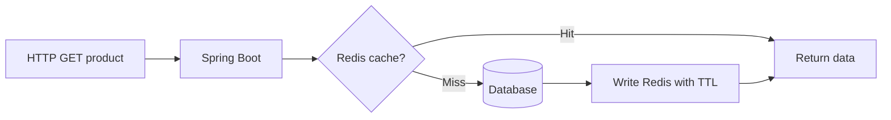

# TTL, Atomic Operations, and Data Lifecycle Management in Redis

In integration systems built with Spring Boot, Redis typically stores short-lived data: cached query results, rate-limiting counters, request-processing states, verification codes, or coordination locks across instances. Three questions must be answered for every category of data: **how long it lives**, **which operations must be atomic**, and **what the system does when data expires, is deleted, or Redis becomes unavailable**.

This lesson focuses on TTL (time to live), atomicity of Redis commands, and data lifecycle design when integrating Redis with HTTP, databases, and asynchronous flows in Spring Boot. Examples use Redis with Spring Data Redis's `StringRedisTemplate`; durations are illustrative rather than universal defaults.

## 1. Distinguishing Expiration, Deletion, and Eviction

**TTL** is the remaining duration before a key is considered expired. Redis supports millisecond precision, though memory reclamation and notifications may occur slightly after that timestamp. TTL applies to the **key**: entries inside a standard hash, list, or set share the lifecycle of their enclosing key.

| Mechanism | Trigger Condition | Impact on Application |
| --- | --- | --- |
| Expiration | Key has an expiration time and Redis determines it has passed | Key is no longer valid; subsequent reads return non-existent |
| Explicit deletion | Application invokes `DEL`/`UNLINK` or overwrites/clears data | Data disappears per business decision or operational command |
| Eviction | Redis hits its memory limit and `maxmemory-policy` permits removing keys | Keys can vanish **before their TTL**; TTL cannot be treated as a retention guarantee |
| Data loss or recovery | Redis crashes or behaves per persistence/replication/failover settings | State retention depends on deployment architecture and configured durability |

Do not use Redis TTL as a precise business timer, sole audit record, or guarantee that data will always survive for a fixed number of seconds. For instance, a Redis deduplication TTL cannot replace a database unique constraint if orders must strictly never duplicate.

## 2. TTL Commands and Lifetime Mutation Rules

Basic commands to try in `redis-cli`:

```redis
SET catalog:item:42 '{"name":"Keyboard"}' EX 300
TTL catalog:item:42
PTTL catalog:item:42

EXPIRE catalog:item:42 600
PERSIST catalog:item:42

SET checkout:token:abc "PENDING" NX EX 120
GET checkout:token:abc
```

| Command | Meaning |
| --- | --- |
| `EXPIRE key seconds`, `PEXPIRE key milliseconds` | Sets a relative lifetime starting from command execution |
| `EXPIREAT key unix-seconds`, `PEXPIREAT key unix-milliseconds` | Sets an absolute expiration timestamp |
| `TTL key`, `PTTL key` | Reads remaining lifetime in seconds or milliseconds |
| `PERSIST key` | Removes expiration, making the key non-expiring |
| `SET key value EX seconds` or `PX milliseconds` | Writes value and TTL in **one command** |
| `SET key value NX EX seconds` | Creates only if key does not exist, attaching TTL atomically |
| `SET key value KEEPTTL` | Replaces value while retaining existing TTL, if supported by Redis version |
| `GETEX key EX seconds` | Reads and refreshes expiration in one command; suits certain sliding-access patterns |

Return values of `TTL`/`PTTL` are critical:

- `-2`: key does not exist (including already expired).
- `-1`: key exists but has **no TTL**.
- `0` or positive integer: remaining lifetime; `0` may occur due to rounding or imminent expiration.

Never interpret `-1` as "one second left"; for caches or leases meant to expire, `-1` usually signals a lifecycle bug.

### 2.1. Which Commands Preserve TTL and Which Wipe It?

For a key with an active TTL, commands that **replace the entire value** such as `SET key value` wipe the previous TTL by default unless a new TTL or `KEEPTTL` is supplied. Conversely, **in-place update commands** such as `INCR`, `HSET`, and `LPUSH` typically preserve the existing TTL.

```redis
SET counters:views 5 EX 60
INCR counters:views
TTL counters:views
# Still has TTL (counted down over time)

SET counters:views 10
TTL counters:views
# -1: plain SET removed the TTL
```

**Design rule:** creating temporary keys must attach a lifetime immediately; updating temporary keys must explicitly decide whether to **preserve**, **extend**, or **reset** the lifetime. Never assume "every write automatically refreshes TTL."

### 2.2. Absolute vs. Sliding Expiration

**Absolute/fixed expiration:** a verification code issued at 10:00 stays valid only for 5 minutes regardless of how often it is checked. Reads do not extend TTL.

**Sliding/idle expiration:** a session expires after 20 minutes of inactivity. The application updates the lifetime upon valid activity, for example via `GETEX` or an equivalent atomic operation.

For login sessions, consider pairing **idle timeout** with an **absolute maximum lifetime**. Pure sliding renewal can keep a compromised session alive indefinitely. A single Redis TTL cannot enforce both limits unless the application also stores and checks an absolute expiration timestamp.

### 2.3. Expiration Does Not Guarantee On-Time Events

Redis clears expired keys lazily on access (lazy expiration) and via background sweeps (active expiration). Never design payment tasks, returns, or notifications around receiving an `expired` event at the exact instant TTL hits zero.

Keyspace notifications can be enabled with suitable configuration, such as `notify-keyspace-events Ex`, to emit expiration events on keyevent channels. However, those are Pub/Sub messages without durable replay; disconnected consumers miss them. In Redis Cluster, individual nodes also emit events separately. Business deadlines require durable storage paired with independent scheduling/scanning and retries.

## 3. Atomicity at the Redis Command Scope

Redis executes each standard command atomically over its affected data. However, **two consecutive commands from an application do not automatically form an atomic transaction**. Other requests can interleave between commands, or the application can fail after the first command.

| Approach | Risk | Better Approach |
| --- | --- | --- |
| `GET` then `SET` to increment a counter | Two requests read the same count and overwrite each other | `INCR`/`INCRBY` |
| `SETNX` then `EXPIRE` to create an expiring lock | Process crash between commands leaves a key without TTL | `SET key token NX PX ttl` |
| `INCR` then `EXPIRE` to start a rate-limit window | Crash between commands leaves a counter that never expires | Lua script or atomic design executing the logic as one unit |
| `GET` to check token then `DEL` to release lock | Lock can expire and belong to another worker before `DEL` runs | Lua comparing token and deleting inside one script |
| Checking cache miss then querying DB | Multiple concurrent misses hit DB simultaneously | Tolerate minor duplicate load, or use single-flight/bounded leases and fallbacks |

Atomic tools have distinct scopes:

- **Single commands:** preferred when Redis already provides a matching primitive (`INCR`, `SET ... NX EX`, `HINCRBY`, `SADD`).
- **Lua scripts:** group multi-step checks and mutations into one atomic Redis operation. Scripts must be short, bounded in runtime, and respect deployment constraints.
- **`MULTI`/`EXEC`:** queues commands to execute sequentially without interleaving from other clients; does not support conditional branching based on earlier results inside the same transaction. Unlike SQL transactions, Redis does not roll back already-executed commands if a command fails at runtime.
- **`WATCH` + `MULTI`/`EXEC`:** optimistic locking for concurrency control; the application must retry when watched keys change.

In Redis Cluster, multi-key operations inside a script or transaction require all keys to reside in the same hash slot. When grouping keys is genuinely required, use intentional hash tags like `order:{123}:state` and `order:{123}:lock`. Avoid packing excessive unrelated data into one slot to prevent hotspots.

An atomic Redis script **never equates to** an atomic distributed transaction across Redis, PostgreSQL, partner HTTP APIs, and message brokers. If a request updates the DB and Redis then fails, business-layer idempotency, reconciliation, or retries are still required.

## 4. Spring Boot Integration: Creating Keys with TTL Properly

A Spring Boot application can use `spring-boot-starter-data-redis` (typically Lettuce) and inject `StringRedisTemplate`. Example dev connection config:

```yaml
spring:
  data:
    redis:
      host: localhost
      port: 6379
      timeout: 2s
```

Attach TTL atomically alongside the write operation:

```java
@Service
public class VerificationCodeStore {
    private final StringRedisTemplate redis;

    public VerificationCodeStore(StringRedisTemplate redis) {
        this.redis = redis;
    }

    public void save(String requestId, String hashedCode) {
        redis.opsForValue().set(
                "verify:v1:" + requestId,
                hashedCode,
                Duration.ofMinutes(5));
    }

    public boolean reserveOnce(String requestId) {
        Boolean created = redis.opsForValue().setIfAbsent(
                "verify:used:v1:" + requestId,
                "1",
                Duration.ofMinutes(10));
        return Boolean.TRUE.equals(created);
    }
}
```

`opsForValue().set(key, value, Duration)` sends an expiring write; `setIfAbsent(key, value, Duration)` corresponds to `SET ... NX` with TTL. `Boolean.TRUE.equals(...)` guards against `null` returns in special pipeline/transaction contexts. Still, the "reserve once" check here manages only a Redis flag: if uniqueness must survive Redis data loss, persist durable state in the DB.

Name keys with clear scopes such as `service:feature:v1:entity-id`, accounting for environment and tenant. Never place verification codes, raw tokens, or sensitive personal data in **key names**. Key names appear in logs, monitoring tools, and admin commands. Bound key lengths and key cardinality derived from HTTP inputs.

## 5. Case A: Expiring Caches, Updates, and Invalidation

Example product read API: on cache miss, the service queries the DB, caches the result in Redis with a TTL, and returns data. When a product changes, the service deletes or updates affected cache entries.



With Spring Cache, TTLs can be assigned per cache name rather than invoking Redis manually everywhere:

```java
@Configuration
@EnableCaching
public class CacheTtlConfig {
    @Bean
    RedisCacheManagerBuilderCustomizer redisCacheTtls() {
        return builder -> builder.withCacheConfiguration(
                "catalog",
                RedisCacheConfiguration.defaultCacheConfig()
                        .entryTtl(Duration.ofMinutes(5))
                        .disableCachingNullValues());
    }
}
```

```java
@Cacheable(cacheNames = "catalog", key = "#productId")
public ProductView findProduct(String productId) {
    return repository.loadProductView(productId);
}
```

This assumes Spring Cache is enabled, Redis Cache libraries are present, and serializers match `ProductView`. The `catalog` cache expires five minutes after write; Spring Cache does not turn reads into sliding renewals automatically. Exact configuration details vary by Spring Boot/Spring Data Redis version.

For timely freshness, combine TTLs with invalidation such as `@CacheEvict` after successful updates. When DB writes run inside a transaction, account for **when cache eviction occurs relative to commit**; evicting before commit allows concurrent reads to repopulate stale data. When syncing caches across multiple services, define data ownership, change propagation, and recovery when invalidation events are lost.

Short TTLs bound staleness while increasing cache misses and DB load. Long TTLs reduce load while delaying updates. When many keys are created simultaneously, add **jitter** (a bounded random offset to TTL) on manually created cache entries to prevent synchronized expiration. TTL alone does not prevent cache stampedes on hot keys.

## 6. Case B: Expiring Counters and Preventing Race Conditions

Suppose an API counts requests within a window starting at the first call. An unsafe implementation:

```java
Long count = redis.opsForValue().increment(key);
if (count != null && count == 1L) {
    redis.expire(key, Duration.ofMinutes(1));
}
```

`INCR` itself is atomic, yet the client can disconnect after `INCR` and before `EXPIRE`, leaving a key with no expiration. The Lua script below executes both in one pass and also heals existing keys that accidentally lack a TTL:

```lua
local count = redis.call('INCR', KEYS[1])
if count == 1 or redis.call('PTTL', KEYS[1]) == -1 then
    redis.call('PEXPIRE', KEYS[1], ARGV[1])
end
return count
```

From Spring Data Redis, execute the script via `StringRedisTemplate`:

```java
@Service
public class FixedWindowCounter {
    private static final DefaultRedisScript<Long> COUNT_SCRIPT =
            new DefaultRedisScript<>(
                    """
                    local count = redis.call('INCR', KEYS[1])
                    if count == 1 or redis.call('PTTL', KEYS[1]) == -1 then
                        redis.call('PEXPIRE', KEYS[1], ARGV[1])
                    end
                    return count
                    """,
                    Long.class);

    private final StringRedisTemplate redis;

    public FixedWindowCounter(StringRedisTemplate redis) {
        this.redis = redis;
    }

    public long increment(String clientId, Duration window) {
        long milliseconds = window.toMillis();
        if (milliseconds < 1) {
            throw new IllegalArgumentException("window must be >= 1 ms");
        }

        String key = "rate:requests:v1:" + clientId;
        Long count = redis.execute(
                COUNT_SCRIPT,
                List.of(key),
                Long.toString(milliseconds));
        if (count == null) {
            throw new IllegalStateException("No counter result from Redis");
        }
        return count;
    }
}
```

Import `org.springframework.data.redis.core.script.DefaultRedisScript`, `org.springframework.data.redis.core.StringRedisTemplate`, `java.time.Duration`, and `java.util.List`, plus Spring annotations. Normalize or hash `clientId` if identifiers can be sensitive.

For a `100 requests / 60s` limit, the application rejects calls once the returned count exceeds `100`. This is a fixed window **anchored at the first request**; it still permits boundary bursts across adjacent windows and is not a sliding window or token bucket. If strict enforcement is needed, pick the right algorithm and consider storage overhead, node clock skew, and failure behavior when Redis errors.

Do not equate "atomic Lua" with "each HTTP request is counted once": if Redis increments the counter and the client loses connection before receiving the response and retries, the count increments again. Exactly-once accounting requires request identification and durable state.

## 7. Case C: Request Deduplication (Idempotency)

An HTTP client or message broker consumer may retry on timeout. For creating payments or orders, Redis helps reject concurrent duplicates, yet **authoritative business outcomes** need a complete lifecycle:

1. Client sends `Idempotency-Key`; server binds the key to the user, endpoint, and payload fingerprint. Different payloads reusing the same key must be rejected as conflicts.
2. Server attempts to create a `PROCESSING` marker via `SET ... NX EX`. Only the winning request proceeds; concurrent callers inspect state and receive the stored result, wait, or get an in-progress status per API contract.
3. The DB transaction commits business results with a **unique constraint** or durable idempotency table to block duplicates even if Redis drops the key or the lease expires.
4. Post-commit, record `COMPLETED` with a safe reference/result to replay on retries. Result TTL must exceed the client's maximum retry window based on actual SLAs.
5. On failure, distinguish retryable errors, permanent business rejections, and uncertain outcomes where DB commit status is unknown. Never blindly delete someone else's `PROCESSING` flag via unconditional `DEL`.

Example key layout:

```text
idem:checkout:v1:<tenant>:<request-id> -> PROCESSING/<owner-token>, short TTL
idem:checkout-result:v1:<tenant>:<request-id> -> reference/result, TTL matching retry window
Database: unique(tenant_id, idempotency_key) + durable state/result
```

This is a **conceptual design**: using two Redis keys requires defining transition order and races, because writing two keys separately is not atomic. State transitions in Redis can be wrapped in Lua, yet still do not merge with DB transactions. If Redis `PROCESSING` expires during slow processing, another request may proceed; the DB unique constraint and pre-execution outcome checks remain the primary safeguard.

When updating a DB and publishing broker events, use a **transactional outbox** to persist events in the same DB transaction and publish with bounded retries. Consumers must be idempotent by event ID; Redis reduces short-term duplicates rather than serving as sole proof of completion.

## 8. Case D: Short-Lived Leases and Owner-Verified Release

Expiring Redis leases reduce duplicate work, such as letting only one instance warm a cache. Acquiring uses `SET lock-key random-token NX PX ttl`. Each holder must generate a **unique, unpredictable token**, never a static value like `"LOCKED"`.

```java
@Service
public class RedisLease {
    private static final DefaultRedisScript<Long> RELEASE =
            new DefaultRedisScript<>(
                    """
                    if redis.call('GET', KEYS[1]) == ARGV[1] then
                        return redis.call('DEL', KEYS[1])
                    end
                    return 0
                    """,
                    Long.class);

    private final StringRedisTemplate redis;

    public RedisLease(StringRedisTemplate redis) {
        this.redis = redis;
    }

    public boolean acquire(String lockKey, String ownerToken, Duration lease) {
        if (lease.toMillis() < 1) {
            throw new IllegalArgumentException("Lease must be positive");
        }
        return Boolean.TRUE.equals(
                redis.opsForValue().setIfAbsent(lockKey, ownerToken, lease));
    }

    public boolean release(String lockKey, String ownerToken) {
        Long removed = redis.execute(RELEASE, List.of(lockKey), ownerToken);
        return Long.valueOf(1L).equals(removed);
    }
}
```

The caller generates a unique `ownerToken`, such as `UUID.randomUUID().toString()`, and releases only with that same token. Lua verifies the token before deleting so Worker A—whose lease expired while Worker B acquired a new lease—cannot accidentally delete Worker B's lock.

Even with owner-verified release, **leases do not guarantee absolute mutual exclusion**: A can pause past TTL and resume writing to the DB after B has acquired the lock. For high-integrity updates, add optimistic versioning, **monotonically increasing fencing tokens checked by the target resource**, or DB transactions/unique constraints. If renewing a lease, token verification and expiration extension must also be atomic, with explicit handling when renewal fails.

Never hold a lease across unbounded tasks such as partner HTTP calls with no timeout. HTTP timeouts, lease TTLs, retry budgets, and observability must be designed together.

## 9. Lifecycle Design by Key Category

Every key should have explicit properties: **owner**, **creation method**, **renewal condition**, **lifetime**, **deletion/invalidation rules**, and **Redis failure fallback**.

| Data | Sample TTL Policy | Update/Delete Rules | If Key Vanishes Early |
| --- | --- | --- | --- |
| Catalog cache | Tens of seconds to a few minutes per staleness tolerance | Set with TTL; delete after DB update; optionally add jitter | Reload from DB and repopulate cache |
| Sessions or verification codes | Idle timeout and/or absolute cap per security policy | Renew on valid activity; one-time codes checked and consumed safely | Require re-authentication or reissue per workflow |
| Rate-limiting counters | Matches counting window length | Increment and attach expiration atomically; avoid unintended resets | Explicit fail-open/fail-closed policy required |
| Request-in-flight flags | Short lease covering bounded task timeout | State belongs to token; reconcile against DB outcome | Query DB before deciding to rerun |
| Idempotency results | At least as long as published retry window | Store outcome tied to validated key and payload | DB acts as source of truth preventing duplicates |
| Coordination leases | Short lease with safe renewal if needed | Release only when owner token matches | Concurrent execution possible; target-side guard required |
| Audit/transaction logs | Per business retention rules | Persist durably in appropriate datastore | Never rely on Redis TTL as sole storage |

Values above are **selection guidelines**, not mandatory settings. If a partner's maximum retry window is 24 hours, keeping idempotency results for 5 minutes violates the contract. If product prices can be stale for at most 30 seconds, a 10-minute TTL is too long unless backed by reliable invalidation.

Decide Redis unavailability policies based on feature criticality:

- Lookup caches: may query the DB directly with load limits to avoid overloading origin systems.
- Rate limiting or abuse protection: consider temporary local limits or fallback controls; failing open can create security exposure.
- Financial idempotency: verify durable DB state; never permit duplicate creation merely because Redis failed.
- Optimization locks: switch to DB locks or defer work depending on the cost of duplicate execution.

When sharing Redis across caches, counters, temporary brokers, and leases, separate prefixes, TTL rules, and ACLs. At scale, consider separate Redis deployments so memory-heavy caches never trigger eviction of critical coordination state.

## 10. Observing and Testing Edge States

Redis exposes useful counters via `INFO stats` and metrics: `expired_keys`, `evicted_keys`, `keyspace_hits`, `keyspace_misses`. Combine them with used memory, command latency, connection errors, timeouts, cache hit rates, and lease acquire/release failures. Distinguish **expired** (TTL elapsed) from **evicted** (dropped due to memory pressure), because remediation differs.

Avoid `KEYS *` in production to inspect data. Use bounded `SCAN` when inspecting prefixes, and sample representative keys when auditing TTLs. Never log values or keys holding secrets. For Lua scripts, monitor execution duration and bound per-call work, as long scripts stall other Redis clients.

Test scenarios to include in integration tests against real Redis (e.g., Testcontainers) rather than only mocking `RedisTemplate`:

| Scenario | Expectation |
| --- | --- |
| Write cache with TTL, read before and after expiry | Reads hit before expiry, miss afterward; reloads from DB |
| Overwrite temporary key with plain `SET` without TTL | Detects `TTL = -1`, confirming wrong write command |
| Two concurrent requests increment a counter | No lost increments; key retains expiration |
| Client disconnects after Redis write before response | Retries do not trigger unintended duplicate business side effects |
| Two instances compete for a lease | Only one wins while the key exists |
| Lease A expires, B acquires, then A releases | A cannot delete B's lease |
| Redis flag expires mid-request | DB unique constraint/idempotency blocks duplicate writes |
| Redis unreachable or evicting keys | App follows defined failure policy with metrics and alerts |
| Many hot cache keys expire simultaneously | DB load and latency stay bounded; stampede protections hold |

Quick `redis-cli` sanity check on TTL preservation during increments:

```redis
SET demo:count 0 EX 15
INCR demo:count
TTL demo:count
SET demo:count 99
TTL demo:count
# Final result is -1 because plain SET wiped the TTL
DEL demo:count
```

## 11. Deployment Checklist

Before shipping an integration flow to production, verify you can answer:

1. **Lifecycle:** Which keys are temporary, what are their TTLs, who owns them, and when are they deleted or extended?
2. **Atomicity:** Which multi-command sequences risk races? Can they be replaced by a single Redis command, Lua, or proper concurrency control?
3. **Correctness:** If Redis drops keys early, fails over, or clients retry, do the DB and broker still preserve idempotency and consistency?
4. **Errors and recovery:** Do operations have timeouts, bounded retries, uncertain-outcome handling, and fallback paths?
5. **Operations:** Are there metrics for expiration/eviction, latency, memory, miss ratios, and tests covering contention, TTLs, and Redis outages?

The core takeaway is that **TTL manages temporary validity**, **atomic commands or scripts manage contention within Redis**, and **correctness across HTTP, databases, and message brokers** must be enforced by transactions, data constraints, idempotency, and recovery mechanisms at the appropriate system layers.
