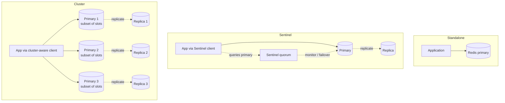

# Standalone, Sentinel, or Cluster by Environment

## 1. The Redis Deployment Problem in Spring Boot Integration

Redis often sits in the middle of Spring Boot integration flows: caching HTTP client calls, offloading databases, holding short-lived state, throttling traffic, or assisting Kafka/RabbitMQ consumers and Spring Integration adapters. When choosing Redis infrastructure, the first question is not merely **where Redis runs**, but **what happens if a node goes down, how much data must fit, how many operations per second are expected, and whether any data loss is tolerable**.

Three common deployment topologies are:

1. **Standalone:** a single independent Redis server, typically simple for development or small workloads that tolerate downtime.
2. **Sentinel:** one Redis primary with replicas, monitored by Redis Sentinel processes coordinating failover. This improves availability without sharding data across multiple primaries.
3. **Redis Cluster:** multiple primaries partitioning the keyspace into hash slots, optionally with replicas and automatic failover within the cluster. This enables horizontal capacity/throughput scaling alongside constraints on multi-key operations.

**Core principle:** Sentinel and Cluster solve different problems. Sentinel primarily automates failure detection and primary replacement for one dataset; Cluster adds **sharding**. Neither turns Redis into a strongly consistent database nor guarantees zero data loss during failover. Choose topology based on business properties and operational goals, not simply on `dev`, `staging`, or `production` labels.

### Learning Objectives

- Explain the differences among Standalone, Sentinel, and Cluster, including failover, scaling, replication, and risks.
- Choose topologies for local/CI, staging, production, and services with differing requirements.
- Configure Spring Boot with Spring Data Redis/Lettuce for each topology via profiles and environment variables.
- Understand Redis Cluster hash slots, hash tags, multi-key command limits, and `MOVED`/`ASK` redirections.
- Design timeouts, fallbacks, observability, and testing so HTTP, database, cache, and broker integrations withstand Redis incidents.

## 2. Comparing the Three Topologies

| Criterion | Standalone | Sentinel | Cluster |
| --- | --- | --- | --- |
| Primary goal | Operational simplicity | High availability for a single dataset | High availability and data sharding |
| Key distribution | One primary | One primary for the whole keyspace; replicas copy data | 16,384 hash slots distributed across multiple primaries |
| Automatic failover | None for a single server | Yes, when Sentinel achieves election quorum and a suitable replica exists | Yes, when cluster achieves failover conditions and quorum |
| Write scaling | Limited to one primary | Still bounded by one primary | Write load split across shards |
| Data memory scaling | Single node | Bounded by primary (replicas hold full copies) | Total capacity spans multiple primaries |
| Client connection style | Host/port or endpoint | Master name and list of Sentinel nodes | Seed node list with cluster-aware support |
| Multi-key commands | No sharding constraints | No sharding constraints | Multi-key operations typically require same hash slot |
| Operational complexity | Low | Moderate: quorum, replicas, and discovery | Higher: slots, partitioning, rebalancing, networking |
| Data loss during failover | All data may be lost without persistence/backups | Writes not yet replicated can still be lost | Writes not yet replicated can still be lost |

**Replicas do not automatically mean failover.** A Standalone setup with a read replica still needs primary promotion and client discovery for automatic recovery. **Sentinel is not a proxy:** the app queries Sentinel to locate the current primary, and the Redis client then talks directly to the primary/replicas. **Cluster is not a single endpoint either:** cluster-aware clients connect directly to whichever nodes own the target slots.



The diagram illustrates roles, not a complete production topology. Sentinels typically run multiple processes across separate failure domains; Cluster also distributes primaries and replicas across distinct hosts or availability zones.

## 3. Choosing by Environment and Business Requirements

### 3.1. Questions to Answer Before Deciding

1. Is Redis a **rebuildable cache** or an **authoritative state store** such as sessions, coordination locks, or core business state?
2. What are total RAM usage, key growth rate, value sizes, peak commands/sec, and write rates?
3. During a 30-second Redis outage, can APIs serve from origin, degrade features, or must they reject requests?
4. Have **RTO** (recovery time objective) and **RPO** (acceptable data loss) targets been defined?
5. Are multi-key transactions/Lua scripts needed, or can keys be designed to share hash slots?
6. Does infrastructure span multiple availability zones with client-reachable hostnames/ports and proper node discovery?
7. Is a managed Redis service preferable to self-operating Redis processes?

### 3.2. Recommendation Matrix

| Environment / Scenario | Reasonable Starting Topology | What to Verify |
| --- | --- | --- |
| Local developer | Standalone in container or local instance | Serializers, TTLs, key naming, timeouts, and Redis-down handling |
| Basic unit/contract tests | Standalone or scope-appropriate fake | Business logic; do not infer failover was tested |
| CI testing HA | Real Sentinel topology or equivalent test fixture | Client discovers new primary; read/write recovery after failover |
| CI testing sharding | Multi-node Redis Cluster with reachable addresses | Cross-slot handling, redirections, rebalancing, serializers |
| Pre-production staging | Match production topology, network, and auth as closely as possible | Failover, ACL/TLS, DNS, latency, connection limits |
| Production, dataset fits one primary, needs auto-failover | Sentinel or managed service with equivalent HA | Quorum, single-primary capacity, write-loss window at failover |
| Production, memory/write throughput exceeds one primary | Cluster or managed service in cluster mode | Hash slots, hot keys, scale-out, cluster-aware client |
| Production small cache tolerating brief loss | Standalone may suffice if SLOs allow | Fallbacks, restarts, warm-up without stampeding the database |

Never apply a rigid rule like `dev = Standalone, prod = Cluster`. A 100 MB cache might serve production cleanly on a simple topology, whereas a multi-hundred-GB dataset may need Cluster in staging to reproduce production risks accurately. With managed Redis, check how the provider exposes endpoints, failover, cluster mode, TLS, and maintenance; a provider-managed HA endpoint might **not** require Sentinel configuration in the client.

## 4. Spring Boot and Lettuce: Choosing the Right Configuration

The examples below target **Spring Boot 3.2+** and matching Spring Data Redis. Property names use Spring Boot 3's `spring.data.redis.*` namespace. Cross-check with your actual version if running another Spring Boot release.

### 4.1. Dependencies

```kotlin
// build.gradle.kts — versions managed by Spring Boot dependency management
implementation("org.springframework.boot:spring-boot-starter-data-redis")
implementation("org.springframework.boot:spring-boot-starter-actuator")

// Add only when using Spring Cache abstraction (@Cacheable, @CacheEvict...)
implementation("org.springframework.boot:spring-boot-starter-cache")

// Add only when Lettuce connection pooling is needed
implementation("org.apache.commons:commons-pool2")
```

`spring-boot-starter-data-redis` defaults to Lettuce in standard Spring Boot configurations. Lettuce supports Standalone, Sentinel, and Cluster; application code normally depends only on `RedisConnectionFactory`, `StringRedisTemplate`, `RedisTemplate`, or `CacheManager`. Spring Boot auto-configures the connection factory based on whichever of the three property groups is active.

For non-blocking `GET`/`SET` commands, Lettuce shares a thread-safe native connection; **large pools are not needed automatically**. Connection pooling helps primarily for dedicated-connection operations like transactions or blocking commands, or when metrics demonstrate contention. Oversized pools raise client connection counts and pressure Redis.

### 4.2. Local: Standalone

```yaml
# application-local.yml
spring:
  data:
    redis:
      host: localhost
      port: 6379
      connect-timeout: 1s
      timeout: 2s
```

Run locally with the `local` profile. With Docker Compose, hostnames must resolve **from where the app executes**: an app on the host uses `localhost` via published ports, whereas an app inside the same Docker network uses the Redis service name. Never deploy localhost configuration to Kubernetes or remote servers.

Standalone works well for testing reads/writes, TTLs, and serializers, but Standalone tests **do not** verify Sentinel failover or Cluster redirection handling.

### 4.3. Staging/Production Needing HA Without Sharding: Sentinel

```yaml
# application-sentinel.yml
spring:
  data:
    redis:
      username: ${REDIS_DATA_USERNAME}
      password: ${REDIS_DATA_PASSWORD}
      connect-timeout: 1s
      timeout: 2s
      sentinel:
        master: mymaster
        nodes:
          - ${REDIS_SENTINEL_1}  # e.g., sentinel-a.internal:26379
          - ${REDIS_SENTINEL_2}
          - ${REDIS_SENTINEL_3}
        username: ${REDIS_SENTINEL_USERNAME}
        password: ${REDIS_SENTINEL_PASSWORD}
```

Here `mymaster` is the **logical master name monitored by Sentinel**, not the primary's hostname. `sentinel.nodes` lists Sentinel endpoints (`host:port`, typically 26379), **not** Redis primary/replica nodes. Every Sentinel must agree on the same master name, and the Redis addresses announced by Sentinel must be reachable from the application.

`spring.data.redis.username/password` authenticate against Redis data nodes; `sentinel.username/password` authenticate against Sentinel when Sentinel enforces ACLs. Which credential properties to set depends on your security setup; environment variables must never contain hardcoded real-password defaults. If Sentinel does not use ACLs, omit the Sentinel credential properties instead of guessing with empty strings.

Sentinel is typically deployed with at least **three Sentinels across separate failure domains**. For example, `quorum=2` with three Sentinels: enough Sentinels must agree the primary is unreachable to mark it objectively down, while a majority of voting Sentinels is still needed to elect a leader and complete failover. Redis replication is asynchronous; after a primary failure, recently acknowledged writes can still be lost.

### 4.4. Production Needing Sharding: Cluster

```yaml
# application-cluster.yml
spring:
  data:
    redis:
      username: ${REDIS_CLUSTER_USERNAME}
      password: ${REDIS_CLUSTER_PASSWORD}
      connect-timeout: 1s
      timeout: 2s
      cluster:
        nodes:
          - ${REDIS_CLUSTER_SEED_1}  # e.g., redis-a.internal:6379
          - ${REDIS_CLUSTER_SEED_2}
          - ${REDIS_CLUSTER_SEED_3}
        max-redirects: 5
      lettuce:
        cluster:
          refresh:
            adaptive: true
            period: 30s
```

`cluster.nodes` are merely **seed nodes** for discovering cluster topology; the client must reach every actual node address advertised by the cluster, including after resharding and failovers. On TLS-enabled Redis Clusters, include corresponding TLS configuration such as `spring.data.redis.ssl.enabled: true` on supported Boot versions. Behind NAT, Docker port mapping, or cluster-unaware proxies, clients frequently receive internal node addresses and fail to connect.

`max-redirects` caps redirection hops per operation; cranking it high will not fix broken DNS or topology routing. Lettuce topology refresh detects slot distribution changes; it does not fix misconfigured or unreachable node announcements. Verify refresh property names against your exact Lettuce and Spring Boot versions.

A minimal Redis Cluster can run with three primaries, yet surviving primary failures requires replicas (commonly **3 primaries + 3 replicas** spread across failure domains). Availability under faults depends on primary quorum, replica placement, and reachable nodes—not total node count alone.

### 4.5. Choosing Profiles and Secrets

```bash
# Illustrative startup examples; secrets injected by runtime/secret manager
java -jar app.jar --spring.profiles.active=local
java -jar app.jar --spring.profiles.active=sentinel
java -jar app.jar --spring.profiles.active=cluster
```

These profiles are **mutually exclusive alternatives** for a single Redis connection factory; avoid activating Sentinel and Cluster properties simultaneously for the same connection. If an application needs both a standalone/clustered cache and a separate Redis instance for state, configure **multiple connection factories with explicit qualifiers**, each with its own topology, credentials, and timeouts. Never commit secrets into Git or copyable deployment samples; use a secret manager, environment variables, or protected config mechanisms.

If managed Redis exposes a single DNS-backed HA endpoint, the app may configure `host/port` like a regular endpoint **per provider documentation**. That connection style does not imply the backend runs only one standalone node.

## 5. Java Code Uses the Same Abstraction

With Spring Data Redis, business logic typically does not care which primary holds the data. Example TTL-bounded inventory availability cache:

```java
import java.time.Duration;
import java.util.Optional;

import org.springframework.data.redis.core.StringRedisTemplate;
import org.springframework.stereotype.Service;

@Service
public class InventoryCache {
    private static final Duration TTL = Duration.ofSeconds(45);
    private final StringRedisTemplate redis;

    public InventoryCache(StringRedisTemplate redis) {
        this.redis = redis;
    }

    public void put(String tenantId, String sku, boolean available) {
        redis.opsForValue().set(key(tenantId, sku),
                available ? "1" : "0", TTL);
    }

    public Optional<Boolean> find(String tenantId, String sku) {
        String cached = redis.opsForValue().get(key(tenantId, sku));
        if (cached == null) {
            return Optional.empty();
        }
        return switch (cached) {
            case "1" -> Optional.of(true);
            case "0" -> Optional.of(false);
            default -> Optional.empty(); // treat as invalid cached entry
        };
    }

    private String key(String tenantId, String sku) {
        // Use only verified tenantId and normalized/validated sku.
        return "inventory:v1:" + tenantId + ":" + sku;
    }
}
```

Here `StringRedisTemplate` is auto-configured per the active profile. Keys include namespace/version and tenant to avoid collisions. TTL limits staleness; for fast-changing inventory, pair this with post-update cache invalidation and evaluate staleness tolerance. A cache miss **never** means an item is out of stock. Unexpected values should trigger metrics/cleanup rather than becoming valid business states.

When Redis is a rebuildable cache, callers encountering Redis errors can fall back to the origin under **load limits** and recover per policy. However, if Redis holds API rate limits, coordination locks, balances, or monetary idempotency keys, silently bypassing Redis breaks correctness: choose fail-open vs. fail-closed and durable state stores per business requirements.

Never use default JDK serialization for data shared across services or languages without assessing security, compatibility, and operability. Prefer versioned String/JSON contracts where appropriate. `@Cacheable` and `RedisCacheManager` must align serializers, per-cache TTLs, and key prefixes to avoid conflicts.

## 6. Sentinel: Replication, Quorum, and Bounded Failover

A Sentinel setup usually comprises one primary, one or more replicas, and multiple Sentinels monitoring health. Simplified flow:

1. The Redis client queries Sentinels for the primary address of a logical master name (e.g., `mymaster`).
2. The application sends writes to the primary, which asynchronously replicates updates to replicas.
3. Once enough Sentinels confirm the primary is unresponsive per threshold, they coordinate failover.
4. Sentinels elect and promote an eligible replica to primary; remaining replicas reconfigure to follow the new primary.
5. Sentinel-aware clients update endpoints, reconnect, and resume commands; in-flight operations during transition can time out or fail.

### Constraints to Account For

- **No sharding:** all writes still hit one primary; adding replicas does not scale writes for that dataset.
- **Not strictly zero-downtime:** brief connection errors, `READONLY` errors, timeouts, or outages can occur during failover.
- **No zero-data-loss guarantee:** writes acknowledged by the old primary may not have replicated before promotion. AOF/RDB assist recovery in certain scenarios, but do not turn replication synchronous.
- **Quorum requires proper placement:** three Sentinels on one VM do not survive that VM failing. Separate failure domains and test network partitions.
- **Replica reads can be stale:** if actively reading from replicas, accept eventual consistency. Immediate read-after-write may miss recent updates.

Spring Data Redis/Lettuce supports reading from replicas when explicitly configured, though default read behavior and read preferences must be verified. Route only **staleness-tolerant** reads/caches to replicas; operations requiring read-your-writes need another strategy.

A Sentinel primary must also have enough memory, CPU, and network capacity to carry the **entire** workload after failover. If a replica is smaller than the primary, role promotion succeeds while the service immediately overloads.

## 7. Cluster: Hash Slots, Hash Tags, and Multi-Key Operations

Redis Cluster divides the keyspace into **16,384 hash slots**. Each primary owns a subset of slots and replicas mirror that primary. Cluster-aware clients compute a key's slot, route commands to the owning primary, and follow redirections on topology changes.

### 7.1. Key Placement Examples

```text
order:100:status       # Not guaranteed same slot as order:100:items
order:100:items

order:{100}:status     # Hash tag {100} -> same slot
order:{100}:items      # Hash tag {100} -> same slot

order:{101}:status     # Hash tag {101} -> likely different slot
```

Redis Cluster hashes keys using CRC16 modulo 16,384; if a key contains a valid `{...}` hash tag, only the substring inside braces is hashed. Multi-key commands like `MGET`, `MSET`, multi-key transactions, or Lua scripts touching multiple keys typically require all keys in the **same slot**; otherwise Redis returns `CROSSSLOT`.

```redis
MGET order:{100}:status order:{100}:items
# Works because both keys share the same slot.

MGET order:{100}:status order:{101}:status
# Can fail with CROSSSLOT if the two tags hash to different slots.
```

Hash tags let you group keys for single-slot atomic operations, yet **never** force all keys of a huge tenant into one hash tag if it creates a hotspot. For instance, `tenant:{t1}:*` pins all of tenant t1 onto one slot; a more balanced per-aggregate pattern is `tenant:t1:order:{100}:status` and `tenant:t1:order:{100}:items`, provided `100` does not collide across tenants. If order IDs are not globally unique, tag with `{t1:100}` to preserve key-group isolation.

### 7.2. Redirections and Rebalancing

- `MOVED` indicates another node permanently owns the slot. Clients route to that node and update their slot map per driver capabilities.
- `ASK` occurs transiently while migrating a slot; clients perform an `ASKING` step on the target node per Cluster protocol.
- Adding/removing nodes and resharding shift slot ownership. Every Redis endpoint must be network-reachable from the app; succeeding `PING` on seed nodes alone does not prove all slots are reachable.
- Redis Cluster runs strictly on logical database **0**; never design around `SELECT 1` or per-tenant database indexes. Use key namespaces and deployment/ACL isolation instead.
- Multi-key atomicity cannot span slots; redesign keys or move strongly consistent transactions to the authoritative database.

In Spring Boot, use `RedisTemplate`, `StringRedisTemplate`, or cluster-aware drivers configured by Spring Data Redis. Never manage a raw single TCP connection assuming it understands all hash slots. Audit existing cache keys and Lua scripts when migrating from Standalone/Sentinel to Cluster.

## 8. Durability and Data Safety Across All Topologies

Replication, persistence, and backups serve distinct goals:

| Mechanism | What It Solves | What It Does Not Guarantee |
| --- | --- | --- |
| Replica | Data copy and failover candidate | 100% synchronous replication or fresh reads everywhere |
| Sentinel/Cluster failover | Automatic discovery/promotion of a new primary when eligible | Zero downtime, zero write loss, or zero transient errors |
| RDB snapshot | Point-in-time recovery from periodic snapshot | Keeping writes made after the last snapshot |
| AOF | Append-only operation log for recovery per fsync policy | Zero data loss across all crashes/partitions |
| Off-cluster backups | Recovery from total cluster loss or operator error | Skippable restore drills or retention management |
| TTL/eviction | Key lifecycle and RAM caps | Retaining all data when memory fills up |

Configure `maxmemory` and `maxmemory-policy` per data tier. Caches tolerate eviction; when Redis holds sessions, deduplication keys, or locks, premature eviction alters correctness. When mixing caches with critical state, consider separate Redis instances for isolation and permissions. Size total memory accounting for fragmentation, replication buffers, AOF overhead, and headroom for failover and growth.

If Redis prevents duplicate events, signals payments, or coordinates DB writes, carefully evaluate **failover write loss**. A `SET NX PX` lock in Redis does not guarantee absolute safety for external resources if a client pauses, TTL expires, or primaries fail over. For strict correctness, rely on unique constraints/transactions in the source DB, target idempotency, or target-enforced fencing tokens.

## 9. Timeouts, Retries, and Fallbacks in Integration Flows

Redis can slow down or disconnect during primary promotion, network partitions, resharding, or overload. Applications must define clear policies per workload:

- **Optional cache lookup:** on Redis error, fall back to origin DB/HTTP while capping concurrency, rate, and timeouts to prevent cache stampedes.
- **Auxiliary cache write:** log/record metrics and proceed with the business flow if authoritative data already saved cleanly.
- **Idempotency/lock/quota:** handle errors per business policy; never skip checks if doing so allows duplicate orders, double charges, or duplicate message processing.
- **Broker consumers:** separate transient Redis errors from poisoned data; apply bounded backoff retries, idempotency, and dead-lettering where needed. Never acknowledge a broker message simply because a cache/guard step failed before work completed.
- **HTTP APIs:** return meaningful errors (e.g., 503 when a mandatory dependency is unavailable) or explicit degraded responses; never return fake defaults that mislead callers into thinking a transaction succeeded.

### 9.1. Avoiding Excessive Retries

Set `connect-timeout`, command `timeout`, concurrency limits, and an **end-to-end deadline** for APIs or consumers. If each retry waits 2 seconds and 500 concurrent requests retry immediately, a Redis hiccup exhausts threads, pools, and overloads the database. Retry only transient errors with backoff + jitter, and only when repeating the command is safe.

**Distinction example:** Retrying `GET` after a timeout carries low side-effect risk; retrying `INCR`, `LPUSH`, lock state transitions, or mutating scripts after a timeout can execute twice if Redis processed the first request before the response dropped. Use request IDs, idempotency, or reconciliation when the business requires exactness.

### 9.2. Cache Stampede After Failover

After a Redis restart or failover, cache misses spike abruptly. When many concurrent requests look up the same SKU, keep them from flooding the origin DB/HTTP API:

1. Cap concurrent misses or coalesce requests/single-flight per key.
2. Add jitter to TTLs so keys do not expire en masse.
3. Consider stale-while-revalidate when data and business rules permit.
4. Warm caches smoothly after deploys/restores rather than firing thousands of background reads at once.
5. Monitor Redis p95/p99, miss rates, DB connections, and uncached API latency.

## 10. Connectivity Checks and Operations

The commands below are **diagnostic examples for authorized environments**. When TLS, authentication, or managed endpoints are enabled, pass matching connection flags and avoid putting passwords in shell history.

```bash
# Standalone: is the Redis node responding?
redis-cli -h redis-dev.internal -p 6379 PING

# Sentinel: which Sentinel is being queried and which primary does it see?
redis-cli -h sentinel-a.internal -p 26379 SENTINEL get-master-addr-by-name mymaster
redis-cli -h sentinel-a.internal -p 26379 SENTINEL masters

# Cluster: connect cluster-aware and inspect slot health
redis-cli -c -h redis-a.internal -p 6379 CLUSTER INFO
redis-cli -c -h redis-a.internal -p 6379 CLUSTER NODES
```

When verifying Sentinel/Cluster, test **from the same network where application pods or VMs run**. `PING` succeeding against a seed node does not guarantee all node addresses returned by Sentinel or Cluster are reachable. Verify network policies, firewalls, DNS, NAT, and TLS against every target node.

### Metrics and Warning Signals

| Group | Metrics / Signals to Track | Meaning |
| --- | --- | --- |
| Application | Redis command latency p95/p99, timeouts, connection errors, pool wait | Health of the app-to-Redis path |
| Cache | Hit/miss ratio, fallback counts, origin load increase | Cache effectiveness and degradation impact |
| Redis server | `used_memory`, fragmentation, `evicted_keys`, `expired_keys` | Capacity, eviction, and data lifecycle |
| Client/server | `connected_clients`, `blocked_clients`, rejected connections | Connection exhaustion, blocking commands, anomalies |
| Sentinel | Primary status, replica lag/link, failover events, quorum | Self-healing readiness and write-loss exposure |
| Cluster | `cluster_state`, slots ok/pfail/fail, redirections, topology refreshes | Keyspace completeness and slot ownership shifts |
| Whole system | DB pool, broker lag, HTTP dependency latency, API error rates | Whether a Redis outage is cascading elsewhere |

Actuator can expose a Redis health contributor when Spring Boot auto-configures Redis. Decide whether Redis is **mandatory** for readiness or strictly an optional cache: if an API can still serve via DB fallback when the cache drops, marking all pods unready can trigger cascading restarts. Conversely, if Redis holds mandatory state, readiness must reflect actual capability. Never tie liveness solely to Redis health if doing so restarts healthy pods during a Redis outage.

## 11. Testing Across Environments

| Scenario | Setup | Expectation |
| --- | --- | --- |
| Standalone local | Single-node Testcontainers Redis, GET/SET + TTL | Keys/values, serializers, TTLs, and fallbacks work |
| Redis completely down | Stop server during cache misses | API degrades or fails per contract without hanging |
| Sentinel failover | Stop primary in a real Sentinel test topology | Client discovers new primary; transient errors bounded; no permanent disconnect |
| Sentinel loses quorum | Isolate multiple Sentinels/replicas | System surfaces errors properly without assuming failover always succeeds |
| Cluster cross-slot | Run `MGET` across different slots vs. same hash tag | Observes `CROSSSLOT` and enforces proper key rules |
| Cluster reshard | Migrate slots from one primary to another | Client handles `MOVED`/`ASK` instead of sticking to stale topology |
| Cluster node failure | Stop a primary that has a replica in test | Failover succeeds under quorum; latency/error budget measured |
| Network/TLS/ACL | Wrong credentials, certs, DNS, or announced address | Fails clearly without logging secrets or hanging |
| Multiple app replicas | Scale instances sharing Redis | Pools, connections, memory, and throughput stay within budget |
| Write timeout | Drop response after Redis executes write | No blind retries on commands with side effects |
| Simultaneous cache expiry | Align TTLs and send concurrent traffic | Origin DB/HTTP does not collapse; miss rate bounded |
| Broker consumer using Redis | Redelivery across Redis down/up cycle | No bad ACKs, no duplicate side effects, durable idempotency holds |

**A single Standalone Redis Testcontainer is not enough to claim Sentinel or Cluster support.** HA topologies require multi-process/multi-node fixtures with proper announced addresses and genuine failover/resharding tests. Staging tests closely matching production are equally crucial because cluster issues more commonly stem from networking, DNS, ACLs, or discovery than basic `GET`/`SET` commands.

### Practical Acceptance Criteria

- For Standalone: app detects connection loss, enforces timeouts, and falls back properly.
- For Sentinel: after primary failure, app discovers the new primary without manual host edits.
- For Cluster: all slots are reachable; multi-key patterns follow hash-slot rules; clients stay healthy across slot migrations.
- For all three: no credential leaks, versioned TTL and serializer contracts, no duplicate side effects on retries, and metrics clearly surface degradation.

## 12. Migrating Topologies Without Breaking Data Contracts

Moving from Standalone to Sentinel requires setting up replication and Sentinels, then switching how clients discover the primary. However, **editing YAML does not create replicas or quorum**. Server topology, ACLs, networking, and promotion procedures must be prepared first.

Moving from Standalone/Sentinel to Cluster is more involved because you must **partition the keyspace** and audit all multi-key commands, Lua scripts, transactions, database index usage (`database: 0`), key prefixes, and slot hotspots. Merely populating `spring.data.redis.cluster.nodes` does not turn a standalone server into a Redis Cluster.

### Suggested Migration Steps

1. **Inventory:** classify rebuildable caches vs. preserved sessions/state, TTLs, serializers, key prefixes, Lua/multi-key operations, and peak traffic.
2. **Define rollback:** snapshots/backups and restore drills; document RPO/RTO and cutover abort criteria.
3. **Prepare target topology:** hostnames/ports/DNS/TLS/ACL, announced addresses, and memory/CPU quotas, verifying reachability from the same app network.
4. **Data:** pure caches can populate a fresh cluster with controlled warming; preserved state needs validated migration/sync avoiding write loss.
5. **Application:** verify Sentinel/Cluster client support, key prefixes, hash tags, transactions, timeouts, and fallbacks before shifting traffic.
6. **Cutover:** shift traffic gradually with observability on latency, hit rate, errors, and DB load. Define when writes to the old instance stop or how sync avoids split-brain.
7. **Post-cutover:** monitor failover/resharding, reconcile preserved data, and decommission old infrastructure after a safe soak window.

When Redis holds business-significant data, never treat it as an expendable cache that can be wiped. TTLs, key versions, serializers, permissions, and idempotency rules must remain intact after migration.

## 13. Common Design Mistakes

- **Using Sentinel to scale write throughput horizontally:** all writes still hit one primary; exceeding single-node capacity requires Cluster or workload redesign.
- **Using Cluster with inseparable multi-key operations:** commands fail with `CROSSSLOT` or pile into a hot slot; revisit the key model and architecture.
- **Treating replicas as backups:** accidental deletions or logic bugs replicate too; independent snapshots and restore drills are still required.
- **Believing failover loses zero writes:** asynchronous replication can drop recent writes around failure time; critical operations need business-layer guarantees.
- **Testing PING only on seed nodes:** apps can still fail reaching nodes advertised later by Cluster or Sentinel.
- **Increasing pools and retries without bounds:** when Redis slows down, client connections and queued work explode.
- **Using Redis as an idempotency store while permitting eviction:** early key eviction allows duplicate execution of operations/events.
- **Setting timeouts without fallbacks:** APIs still fail unpredictably or shift traffic storms straight onto the DB.
- **Putting secrets inside repo YAML files:** risks exposure via source control, logs, or build artifacts.
- **Treating a Redis cache as the source of truth:** cache misses must never be interpreted as proof of negative business state.

## 14. Selection and Operations Checklist

Before deployment, the integration team should confirm:

- [ ] Redis usage is classified: rebuildable cache, sessions, queue/coordination, idempotency, or critical state.
- [ ] RPO/RTO, throughput, keyspace size, and latency targets are measured and documented.
- [ ] Standalone, Sentinel, or Cluster is chosen based on HA and sharding needs; replica/quorum/slot topology verified.
- [ ] Spring Boot profiles and credentials match the endpoint type; conflicting topology configs are not enabled together.
- [ ] Lettuce connect timeout, command timeout, and retry/fallback policies fit each business flow.
- [ ] TLS/ACL, secret management, network policies, and announced node addresses work end-to-end from the application.
- [ ] Caches have explicit TTLs, namespaces, serializers, invalidation, and memory/eviction policies.
- [ ] Redis Cluster hash tags, multi-key commands, Lua scripts, and slot migrations are verified if using Cluster.
- [ ] Persistence, backups, restores, and migration plans protect data per classification.
- [ ] Dashboards and alerts track Redis server health, client latency, and downstream DB, HTTP, and broker impact.
- [ ] Redis outages, Sentinel failovers, Cluster resharding, auth errors, and traffic spikes have been rehearsed in matching environments.

**Desired outcome:** the same integration code using `StringRedisTemplate`, `RedisTemplate`, or `CacheManager` runs cleanly across each environment's chosen Redis topology; the team knows what changes in config and infrastructure, what failover **does not** guarantee, and has verified the application preserves business correctness when Redis slows down or fails.
