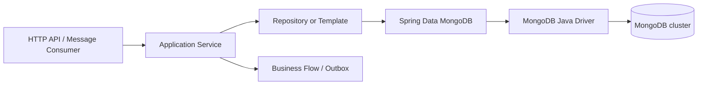

# spring-boot-starter-data-mongodb and Driver Selection

When integrating MongoDB into a Spring Boot application, the first critical decision is **whether to use Spring Data MongoDB or call the MongoDB Java Driver directly**, followed by **choosing a synchronous or reactive driver**. Making the right choice ensures the data access model aligns with your processing flow, connection management, transactions, error handling, and testing. Choosing poorly often leads to blocking reactive threads, creating excessive connections, or inconsistent handling when a message is redelivered.

This lesson belongs to the **SPRING_BOOT_INTEGRATION** module: organizing system integration in Spring Boot via HTTP clients, databases, caches, message brokers, and Spring Integration adapters. Therefore, MongoDB is treated as **an external system that must be integrated in a controlled manner**, complete with data contracts, configuration, transactions, error handling, duplicate prevention, testing, and operational observability.

After this lesson, you will be able to:

- Explain the relationship between the Spring Boot starter, Spring Data MongoDB, the Java driver, and the MongoDB server.
- Distinguish between `spring-boot-starter-data-mongodb`, `spring-boot-starter-data-mongodb-reactive`, and using the raw driver directly.
- Choose `MongoRepository`/`MongoTemplate` or `ReactiveMongoRepository`/`ReactiveMongoTemplate` based on your actual architecture.
- Configure URIs, connections, timeouts, pools, security, and dependency version management.
- Understand transaction boundaries, indexes, duplicate message handling, and required integration tests.

> **Version scope:** Java/YAML examples follow the conventions of **Spring Boot 3.x, the corresponding Spring Data MongoDB version, and Java 17+**. Some property names/auto-configuration behaviors may change across major Spring Boot versions; verify the configuration metadata and dependency BOM of your project version before applying. Imports are omitted in some snippets to focus on the core mechanism.

## 1. Distinguishing Starter, Spring Data, and MongoDB Java Driver

Three layers are often loosely grouped together as the “MongoDB driver”, yet each has a distinct responsibility:

| Component | Role | Examples |
|---|---|---|
| **MongoDB server/cluster** | Stores BSON documents, executes queries, manages indexes, replication/transactions | Replica set, sharded cluster, MongoDB Atlas |
| **MongoDB Java Driver** | Implements the connection protocol and MongoDB operations, manages topology/connection pool | `mongodb-driver-sync`, `mongodb-driver-reactivestreams` |
| **Spring Data MongoDB** | Mapping between Java objects and BSON, repository abstraction, `MongoTemplate`, and transaction support | `MongoRepository`, `ReactiveMongoTemplate` |
| **Spring Boot starter** | Bundles compatible dependencies; works with Boot auto-configuration to create beans when conditions match | `spring-boot-starter-data-mongodb` |

`spring-boot-starter-data-mongodb` **is not an embedded MongoDB server**, nor does it automatically provision a database for the application. At startup, the application still needs to connect to a real MongoDB instance or a dedicated test instance.

Typical integration diagram:



If your code uses a Spring Data repository, the driver still runs underneath. Conversely, using the raw driver directly means taking on much of the mapping, error classification, query organization, and Spring ecosystem integration yourself.

## 2. Three Dependency Options and Selection Rules

### 2.1. Synchronous starter: `spring-boot-starter-data-mongodb`

Gradle (Groovy DSL):

```groovy
dependencies {
    implementation 'org.springframework.boot:spring-boot-starter-data-mongodb'
}
```

Maven:

```xml
<dependency>
    <groupId>org.springframework.boot</groupId>
    <artifactId>spring-boot-starter-data-mongodb</artifactId>
</dependency>
```

This starter provides Spring Data MongoDB and the **MongoDB synchronous driver** via the compatible dependency tree managed by Spring Boot. Common operations include:

- `MongoRepository<T, ID>`: CRUD, derived queries, pagination, and aggregations via the repository API.
- `MongoTemplate`: flexible queries with `Query`/`Criteria`, updates, bulk operations, and aggregations.
- `com.mongodb.client.MongoClient`: the synchronous driver client, which can be used directly for specialized cases.

For Spring MVC applications, scheduled jobs, batch processes, or message consumers running on blocking threads, **this is usually the sensible default choice**.

### 2.2. Reactive starter: `spring-boot-starter-data-mongodb-reactive`

Gradle:

```groovy
dependencies {
    implementation 'org.springframework.boot:spring-boot-starter-data-mongodb-reactive'
}
```

The reactive starter uses the **MongoDB Reactive Streams Driver** (artifact `mongodb-driver-reactivestreams`), along with Spring Data's reactive abstractions:

- `ReactiveMongoRepository<T, ID>` and `ReactiveMongoTemplate`.
- Results are typically represented as Reactor `Mono<T>` or `Flux<T>`.
- The driver communicates using Reactive Streams `Publisher<T>`; Spring Data adapts this into a more ergonomic Reactor API.

Choose this option when the processing pipeline is designed reactively from controller/consumer down to the data access layer, especially when performing high-concurrency I/O without blocking event-loop threads.

**Reactive does not mean every operation runs faster.** A slow MongoDB cluster or a small connection pool will still make requests wait. Reactive helps utilize threads more efficiently while waiting for I/O, but it also requires managing concurrency, backpressure, and error propagation.

### 2.3. Using the MongoDB Java Driver directly

When you do not want Spring Data's abstractions, you can declare the low-level dependency directly:

```groovy
// Choose one driver depending on your execution model:
implementation 'org.mongodb:mongodb-driver-sync'
// or:
implementation 'org.mongodb:mongodb-driver-reactivestreams'
```

Applications managing dependencies through the Spring Boot BOM typically get compatible driver versions managed automatically. If you do not use a BOM/dependency management, you must specify explicit versions and keep the BSON/driver-core artifacts aligned. Avoid manually overriding a single driver artifact while leaving related artifacts behind.

The raw driver is appropriate when you need specific MongoDB APIs/codecs that Spring Data does not cover well, want fine-grained BSON control, or are building a Spring-independent library. In return, repositories, mapping, and Spring Data configuration do not appear automatically just by having `mongodb-driver-sync` on the classpath.

### 2.4. Decision matrix

| Scenario | Preferred Choice | Reason |
|---|---|---|
| Spring MVC + other JPA/JDBC stores + storing MongoDB documents | **Synchronous** MongoDB starter | Keeps an imperative model consistent; repositories/templates are easy to read |
| Batch job or consumer processing messages one by one | **Synchronous** MongoDB starter | Integrates cleanly with blocking threads, controlled timeouts, and retries |
| WebFlux + reactive downstream services | **Reactive** MongoDB starter | Propagates `Mono`/`Flux` across application layers, minimizing blocking |
| Streaming many MongoDB changes with Reactive Streams | **Reactive** starter, evaluating change streams | Fits publisher APIs and asynchronous processing |
| Need custom BSON codecs or driver-specific commands | Raw driver, or access the driver via Spring Data | Controls low-level APIs when genuinely needed |
| Existing codebase stably using raw MongoDB driver | Keep the driver; migrate adapter by adapter where clear value exists | Avoids abrupt changes to mapping and error semantics |
| Module containing both blocking and reactive code | Separate adapters/repositories and configure explicitly | Prevents mixing `MongoClient`/transaction managers across models |

Do not choose a driver based solely on the starter name or raw request volume. Look at where data enters, what kind of threads the application uses, downstream capabilities, and how callers consume results.

## 3. MongoDB Auto-Configuration in Spring Boot

### 3.1. A single central URI

Example with Spring Boot 3.x:

```yaml
# application.yml (local/development environment)
spring:
  data:
    mongodb:
      uri: ${MONGODB_URI:mongodb://127.0.0.1:27017/order_integration}
```

The illustrative URI points to the `order_integration` database. In production environments, supply `MONGODB_URI` via a secret manager or secure environment variable mechanism; require the URI to be present rather than falling back to localhost MongoDB by default.

Common URI forms:

```text
mongodb://127.0.0.1:27017/order_integration

mongodb://db1.example:27017,db2.example:27017/order_integration?replicaSet=rs0&tls=true

mongodb+srv://cluster.example.mongodb.net/order_integration?retryWrites=true&w=majority
```

`mongodb+srv://` uses DNS SRV records to discover hosts (commonly seen with MongoDB Atlas). TLS usage, authentication mechanisms, host lists, replica sets, and options depend on the actual MongoDB infrastructure. Never embed real usernames/passwords in source code or logs. If a password appears in a URI, percent-encode special characters according to URI rules and mask that value in error messages.

With the synchronous starter, when auto-configuration conditions are met, Spring Boot can create:

- A `com.mongodb.client.MongoClient` bean to manage connections.
- `MongoDatabaseFactory`, `MongoTemplate`, and mapping infrastructure.
- Repository implementations for interfaces extending `MongoRepository` within scanned packages.

With the reactive starter, the corresponding bean/abstraction types use `com.mongodb.reactivestreams.client.MongoClient`, `ReactiveMongoDatabaseFactory`, `ReactiveMongoTemplate`, and reactive repositories. The two `MongoClient` types belong to **two different packages**; an incorrect IDE auto-import can cause compilation errors or lead to using the unintended execution model.

Typically, there is no need to create `MongoClient` manually if you only want to connect via a URI. Leaving Spring Boot auto-configuration intact maintains a single configuration point, manages bean lifecycles, and applies declared customizers/observability.

### 3.2. Do not confuse database, collection, and cluster

- **Cluster/replica set:** the set of servers from which the driver selects nodes to connect to.
- **Database:** a logical namespace, such as `order_integration`.
- **Collection:** a group of documents within a database, such as `inventory_snapshots`.
- **Document:** BSON data with an `_id` key; differs from relational rows in how nested fields and flexible schemas are represented.

The URI specifies the application's default database, while the collection is determined by the collection name, the `@Document` annotation, or query code. Avoid setting the database simultaneously in both the URI and a separate property unless you clearly understand the precedence rules of your Boot version.

### 3.3. Timeouts and connection pool

The MongoDB Java Driver manages connection pools and server selection. Common timeouts to distinguish:

| Setting/Concept | What does it bound? |
|---|---|
| `serverSelectionTimeoutMS` | Time spent waiting to select a MongoDB server matching topology and read/write conditions |
| `connectTimeoutMS` | Time allowed to open a TCP connection |
| `socketTimeoutMS` | Socket I/O wait time in the synchronous driver; not equivalent to the overall business deadline |
| `maxPoolSize` | Maximum number of connections in a pool to each eligible server for the driver |
| `waitQueueTimeoutMS` | Time a request can wait to acquire a connection from the pool |
| Business deadline | Total time for the operation, including sub-operations and retries; must be enforced at the application layer when needed |

Illustrative local example with bounded settings (do not treat these as universal recommended values):

```text
mongodb://127.0.0.1:27017/order_integration?serverSelectionTimeoutMS=3000&connectTimeoutMS=2000&socketTimeoutMS=5000&maxPoolSize=30
```

Evaluate values based on concurrent load, replica/node count, network latency, application resources, and MongoDB's capacity. Timeout semantics can vary between synchronous and reactive drivers or across driver versions; check the documentation for your driver. When the application is bottlenecked, increasing the pool size unboundedly usually just shifts pressure onto the database.

## 4. Working with Synchronous Spring Data MongoDB

### 4.1. Document mapping and data contract design

A MongoDB document might store inventory snapshot data received by the Order Service over HTTP or a broker:

```json
{
  "_id": "snapshot-SKU-42",
  "sku": "SKU-42",
  "available": 12,
  "updatedAt": "2026-11-21T03:00:00Z"
}
```

The actual data is stored in BSON; `Instant` is handled by the mapper into the corresponding time representation. The JSON above illustrates the content, not a literal representation of the BSON format or Extended JSON export format.

It can be mapped to a Java record:

```java
import java.time.Instant;
import org.springframework.data.annotation.Id;
import org.springframework.data.mongodb.core.mapping.Document;

@Document(collection = "inventory_snapshots")
public record InventorySnapshot(
        @Id String id,
        String sku,
        long available,
        Instant updatedAt
) {}
```

In Spring Data MongoDB, the identifier field can use `@Id`, `@MongoId`, and identifier conversion rules. For business IDs that must be stored strictly as strings—especially when strings resemble ObjectIds—consider `@MongoId(FieldType.STRING)` to control the BSON type. Field naming conventions, nulls/missing fields, numbers, timestamps, and nested objects must be part of the data contract between producer and consumer.

Do not use a MongoDB entity/document directly as an HTTP DTO or broker payload if those contracts evolve independently. Place a mapper at the boundary between transport data and the storage model.

### 4.2. Repository for CRUD and simple queries

```java
import java.util.Optional;
import org.springframework.data.mongodb.repository.MongoRepository;

public interface InventorySnapshotRepository
        extends MongoRepository<InventorySnapshot, String> {

    Optional<InventorySnapshot> findBySku(String sku);
}
```

Spring Data generates the implementation from the method name. Callers use it via an adapter:

```java
import java.util.Optional;
import org.springframework.stereotype.Service;

@Service
public class InventorySnapshotQueryService {

    private final InventorySnapshotRepository repository;

    public InventorySnapshotQueryService(InventorySnapshotRepository repository) {
        this.repository = repository;
    }

    public Optional<InventorySnapshot> findBySku(String sku) {
        return repository.findBySku(sku);
    }
}
```

`Optional.empty()` here means no document was found; it **does not represent a connection error**. Server selection, timeout, authentication, or query failures are typically translated by Spring into subtypes of `DataAccessException`. The business service can map a missing result to domain semantics; never swallow infrastructure errors and return “out of stock”.

### 4.3. `MongoTemplate` for flexible queries

Repositories are convenient for straightforward use cases; `MongoTemplate` is useful for dynamic queries, projections, bulk operations, aggregations, or conditional updates:

```java
import org.springframework.data.mongodb.core.MongoTemplate;
import org.springframework.data.mongodb.core.query.Criteria;
import org.springframework.data.mongodb.core.query.Query;

public class InventorySnapshotLookup {

    private final MongoTemplate mongoTemplate;

    public InventorySnapshotLookup(MongoTemplate mongoTemplate) {
        this.mongoTemplate = mongoTemplate;
    }

    public InventorySnapshot findBySku(String sku) {
        Query query = Query.query(Criteria.where("sku").is(sku));
        return mongoTemplate.findOne(query, InventorySnapshot.class);
    }
}
```

`findOne` can return `null` when no record is found; if the adapter exposes `Optional`, wrap the result with `Optional.ofNullable(...)`. For concurrent modifications, prefer conditional database update operations (such as `findAndModify` or update operators) instead of always doing “read then save”, which can cause updates to overwrite one another.

### 4.4. Indexes and queries are part of the integration contract

If `sku` must be unique, create a unique index:

```javascript
// mongosh — run as a controlled migration or administrative task
db.inventory_snapshots.createIndex(
  { sku: 1 },
  { unique: true, name: "ux_inventory_snapshots_sku" }
);
```

A unique index enforces the constraint **at the database**, even when two instances write concurrently. `findBySku` does not make `sku` unique on its own. If duplicate values already exist in the data, creating the unique index will fail until the data is cleaned up.

Spring Data supports `@Indexed`, `@CompoundIndex`, and configurable auto index creation. For production systems, manage index changes via a dedicated migration/deployment process to control index build timing, resource impact, rollback, and version compatibility; do not rely on every application instance automatically creating indexes at startup.

Metrics to inspect include `explain()`, documents examined, index size, query latency, pagination, and data growth rate. The document model reduces some joins, but it does not replace index design.

## 5. Working with Reactive Spring Data MongoDB

With the same `InventorySnapshot`, a reactive repository looks similar, yet **its return types and execution timing differ**:

```java
import org.springframework.data.mongodb.repository.ReactiveMongoRepository;
import reactor.core.publisher.Mono;

public interface ReactiveInventorySnapshotRepository
        extends ReactiveMongoRepository<InventorySnapshot, String> {

    Mono<InventorySnapshot> findBySku(String sku);
}
```

A reactive adapter can preserve these reactive signals:

```java
import org.springframework.stereotype.Service;
import reactor.core.publisher.Mono;

@Service
public class ReactiveInventorySnapshotQueryService {

    private final ReactiveInventorySnapshotRepository repository;

    public ReactiveInventorySnapshotQueryService(
            ReactiveInventorySnapshotRepository repository) {
        this.repository = repository;
    }

    public Mono<InventorySnapshot> requireSku(String sku) {
        return repository.findBySku(sku)
                .switchIfEmpty(Mono.error(
                        new IllegalArgumentException("SKU not found: " + sku)));
    }
}
```

`Mono<T>` represents a result with at most one element or an error; `Flux<T>` is for multiple elements. A reactive pipeline typically executes only when subscribed to. In WebFlux, the framework manages the subscription when a controller returns a `Mono`/`Flux`. Do not call `subscribe()` inside a service just to trigger a query while ignoring error signals.

In particular, avoid:

```java
// Wrong inside an event loop/reactive pipeline:
InventorySnapshot snapshot = reactiveRepository.findBySku("SKU-42").block();
```

`block()` forces the current thread to wait and may even be rejected on Reactor threads that forbid blocking. If the application fundamentally uses Spring MVC, JDBC, and thread-per-request blocking processing, the synchronous starter usually leads to a clearer design. If you must combine reactive Mongo with other blocking tasks, thread/scheduler boundaries must be carefully designed and tested; merely adding `publishOn`/`subscribeOn` does not turn a blocking API into a non-blocking one.

For complex reactive queries, use `ReactiveMongoTemplate` instead of `MongoTemplate`:

```java
return reactiveMongoTemplate.findOne(
        Query.query(Criteria.where("sku").is(sku)),
        InventorySnapshot.class
);
```

This method returns `Mono<InventorySnapshot>`. When composing many queries, bound concurrency; do not create an unbounded `flatMap` over thousands of messages if the pool and MongoDB cannot sustain the load.

## 6. When Do You Need the Raw Java Driver?

The direct driver exposes granular BSON/collection APIs, useful for specialized operations or libraries that do not depend on Spring Data. Standalone synchronous example:

```java
import com.mongodb.client.MongoClient;
import com.mongodb.client.MongoClients;
import com.mongodb.client.MongoCollection;
import org.bson.Document;
import static com.mongodb.client.model.Filters.eq;

public class RawMongoExample {
    public static void main(String[] args) {
        String uri = System.getenv("MONGODB_URI");

        try (MongoClient client = MongoClients.create(uri)) {
            MongoCollection<Document> collection = client
                    .getDatabase("order_integration")
                    .getCollection("inventory_snapshots");

            Document found = collection.find(eq("sku", "SKU-42")).first();
            System.out.println(found == null ? "SKU not found" : "Snapshot found");
        }
    }
}
```

`try-with-resources` is appropriate here only because this is a standalone program. **In Spring Boot, use `MongoClient` as a lifecycle-managed singleton/bean**, rather than opening and closing a client per request or per message. Each client maintains its own internal resources and connection pool.

If you need low-level MongoDB access inside an application that already uses the starter, inject the Boot-managed `MongoClient` bean to share connections. Do not call `MongoClients.create(...)` inside every custom repository method.

Note the two packages:

```java
// Synchronous driver
com.mongodb.client.MongoClient

// Reactive Streams driver
com.mongodb.reactivestreams.client.MongoClient
```

The reactive driver returns Reactive Streams publishers; you cannot swap the sync import for the reactive one and keep `collection.find(...).first()`. Nor should you add the legacy `mongodb-driver-async` (old callback-based async driver) dependency for a new reactive integration; use the Reactive Streams driver from the current stack.

## 7. Driver, Transactions, and Duplicate Handling in Integration

### 7.1. MongoDB transactions have their own scope

MongoDB supports multi-document transactions on an eligible topology (such as a replica set or qualified sharded cluster). Transactions must go through the session/transaction manager matching the driver type and Spring Data configuration.

With **synchronous** Spring Data, example configuration:

```java
import org.springframework.context.annotation.Bean;
import org.springframework.context.annotation.Configuration;
import org.springframework.data.mongodb.MongoDatabaseFactory;
import org.springframework.data.mongodb.MongoTransactionManager;

@Configuration
class MongoTransactionConfiguration {

    @Bean
    MongoTransactionManager mongoTransactionManager(
            MongoDatabaseFactory databaseFactory) {
        return new MongoTransactionManager(databaseFactory);
    }
}
```

Then use `@Transactional("mongoTransactionManager")` on the business service when multiple MongoDB operations truly require a single transaction; verify that the MongoDB environment supports transactions and test rollback paths as well. The reactive counterpart requires `ReactiveMongoTransactionManager` and a reactive transaction context; do not blindly apply a blocking manager to `Mono`/`Flux`.

Key limitations:

- `@Transactional` for MongoDB **does not make an HTTP call to Inventory or a broker publish participate in the same ACID transaction**.
- A JPA SQL transaction and a MongoDB transaction do not automatically form a distributed transaction either.
- Multi-document transactions add overhead; whenever possible, prefer document modeling and atomic updates on **a single document**.
- Do not hold a transaction open while waiting on HTTP, a broker, or heavy CPU processing.

When coordinating MongoDB and a broker, consider an **outbox**, processing state, bounded retries, and compensating actions rather than assuming commits happen simultaneously across two systems.

### 7.2. Preventing duplicate processing when consuming messages

For example, Order Service receives an `InventoryUpdated` event from a broker and stores a snapshot in MongoDB. The broker may redeliver the message after the consumer has written successfully but before it could acknowledge (ack). The consumer must enforce idempotency rules, especially for quantity increment/decrement operations.

A common design:

1. Attach an immutable `eventId` from the producer to each event.
2. Create a unique index on `eventId` in a `processed_events` collection, or apply conditional updates based on the event version.
3. Within an appropriate MongoDB transaction, record the processed marker and update business data; if the event is a duplicate, handle it under safe skip rules.
4. Ack the message according to consumption policy only after the required data writes succeed. If downstream events must be emitted, use an outbox or an appropriate recovery mechanism.

For tasks that only update a snapshot, a **conditional upsert on a unique key** can be used, but out-of-order events must be accounted for: an older event must not overwrite newer state. A `find-then-insert` sequence unprotected by a unique index can produce duplicates under concurrency. Catch `DuplicateKeyException` to identify a valid duplicate only after verifying that the exact idempotency key constraint was violated.

Do not promise “end-to-end exactly-once” guarantees simply because the driver sets `retryWrites=true`. MongoDB retryable writes and business idempotency solve different problems; duplicate handling must still rely on the data contract and durably stored state.

### 7.3. Write concern, read concern, and read preference

| Concept | What to understand during integration |
|---|---|
| **Write concern** | Level of write acknowledgment; affects durability and write latency |
| **Read concern** | Read consistency/visibility guarantees for returned data |
| **Read preference** | Node selection preference for reads, such as primary or secondary; can affect data freshness and latency |
| **Retryable reads/writes** | Driver may automatically retry certain eligible operations; does not replace service-level retries/idempotency |

An HTTP 200 after a write does not automatically guarantee that another consumer reading from a secondary replica sees the new version if read preference/read concern are misconfigured. Define the business requirements: read-your-writes, lag-tolerant reporting, or financial state needing stronger consistency. Configure these together with the MongoDB operations team.

## 8. Errors, Resource Limits, and Security

Spring Data typically translates driver exceptions into the `org.springframework.dao.DataAccessException` hierarchy. Several scenarios need distinct handling:

| Situation | Recommended Handling |
|---|---|
| Document not found | Return `Optional.empty()` or `Mono.empty()`; map to “not found” per domain rules |
| Unique index violation | Inspect `DuplicateKeyException`; may be a valid duplicate or a key bug |
| Server selection timeout, lost connection | Dependency unavailable state; bounded retry if the operation is safe |
| Authentication/authorization error | Fix secrets, roles, and configuration; do not retry continuously with the same credentials |
| Slow query, pool exhaustion | Check indexes, concurrency, pool metrics, server capacity, and deadlines |
| Document schema/codec mismatch | Check data version, mapper, and migrations; do not silently assign wrong defaults |
| Transaction conflict/write conflict | Consider retrying the **entire transaction** within limits, ensuring external side effects do not duplicate |

Retries at the driver, repository, consumer, and broker layers can multiply execution attempts. Establish a **unified retry budget**, apply exponential backoff with jitter, define retryable errors, and stop when the deadline expires. Do not unconditionally retry writes that trigger side effects outside MongoDB.

Minimum security baseline for MongoDB integration:

- Use TLS for connections across untrusted networks as appropriate, authenticating with a dedicated least-privilege account.
- Provide secrets via a secret manager/environment variables; keep URIs containing passwords out of Git, logs, and outward-facing stack traces.
- Never accept dynamic URIs from user HTTP input; MongoDB endpoints are trusted configuration.
- Configure network allowlists, credential rotation policies, backup/restore procedures, and environment-isolated access controls.
- For personal or sensitive data, enforce retention rules, query-level authorization, and encryption at the appropriate layers.

## 9. Testing and Operational Observability

### 9.1. Recommended test levels

| Level | Goal | How to Test |
|---|---|---|
| Service unit test | Business decisions on present/missing snapshot, write failures, duplicate events | Fake repository or mock adapter abstraction |
| Repository test | BSON mapping, derived queries, unique indexes, conditional updates | `@DataMongoTest` against a real test MongoDB |
| Integration test | URI, authentication, connection pool, transactions, timeouts, retries | Testcontainers or a managed test instance |
| Integration flow | Event → consumer → MongoDB → ack/outbox, replay/reordering | Broker + MongoDB test, sending the same event multiple times |

`@DataMongoTest` creates a Spring Data MongoDB slice, but **does not guarantee a test MongoDB server is already running**. You can use Testcontainers for an isolated environment; example for Spring Boot 3.x and compatible Testcontainers APIs:

```java
import java.time.Instant;
import org.junit.jupiter.api.Test;
import org.springframework.beans.factory.annotation.Autowired;
import org.springframework.boot.test.autoconfigure.data.mongo.DataMongoTest;
import org.springframework.test.context.DynamicPropertyRegistry;
import org.springframework.test.context.DynamicPropertySource;
import org.testcontainers.containers.MongoDBContainer;
import org.testcontainers.junit.jupiter.Container;
import org.testcontainers.junit.jupiter.Testcontainers;
import static org.assertj.core.api.Assertions.assertThat;

@Testcontainers
@DataMongoTest
class InventorySnapshotRepositoryTest {

    @Container
    static final MongoDBContainer mongo = new MongoDBContainer("mongo:7.0");

    @DynamicPropertySource
    static void mongodbProperties(DynamicPropertyRegistry registry) {
        registry.add("spring.data.mongodb.uri", mongo::getReplicaSetUrl);
    }

    @Autowired
    InventorySnapshotRepository repository;

    @Test
    void findsSnapshotBySku() {
        repository.save(new InventorySnapshot(
                "snapshot-SKU-42", "SKU-42", 12L, Instant.now()));

        assertThat(repository.findBySku("SKU-42"))
                .get()
                .extracting(InventorySnapshot::available)
                .isEqualTo(12L);
    }
}
```

Ensure appropriate test dependencies (Spring Boot Test, Testcontainers MongoDB, and JUnit integration) and a compatible Docker/container runtime. The test above only proves that saved data can be queried back; add tests that create the unique index and intentionally insert duplicates, verify date/BSON mapping, test transactions on a replica set, simulate connection errors, and verify duplicate event handling per project requirements. Never infer production transaction safety from a happy-path repository test alone.

Reactive tests can use `StepVerifier` to verify `Mono`/`Flux` and Testcontainers MongoDB to verify real driver behavior; test error signals, subscriptions, cancellation, and concurrency limits.

### 9.2. System observability

Spring Boot Actuator/Micrometer and the MongoDB Java Driver's instrumentation can measure health, command timing, and pool usage when configured properly for your version/stack. Do not assume that merely adding the starter gives you complete dashboards.

At a minimum, monitor:

- Connectivity status, server selection errors, authentication failures, timeouts, and query latency distributions.
- Active/waiting connection counts, pool saturation, slow operation counts, and retry counts.
- Duplicate key errors, transaction conflicts, and deduplicated event counts tagged by **event type**, never using `eventId` as a metric tag.
- MongoDB resources: CPU, memory, disk, replication lag, index size, and collection size.
- Correlation ID/trace ID propagation across HTTP consumers, message listeners, and repository adapters when tracing is integrated.

Do not place URIs with credentials, queries containing personal data, or high-cardinality values like `eventId`/`sku`/`orderId` into metric tags. Logs should include collection name, operation, duration, error code, and correlation ID, with sensitive data masked.

## 10. Common Pitfalls and How to Avoid Them

1. **Installing both starters out of habit:** Spring Boot may wire multiple client/template beans; it is easy to mix up bean types and repository scanning. Install only the stack you need or configure each adapter explicitly.
2. **Using a reactive repository and calling `block()` on the event loop:** loses non-blocking benefits and can cause runtime failures. Keep the pipeline reactive end-to-end or use the synchronous driver.
3. **Calling `MongoClients.create` on every request:** creates unnecessary pools and resources. Manage the client as a singleton bean reused for the application's lifetime.
4. **Assuming repositories automatically enforce uniqueness:** query method `findBySku` does not guarantee uniqueness. Define, deploy, and test the unique index.
5. **Not standardizing the `_id` type:** a String can be mapped to an ObjectId if it matches the hex format. Decide the identifier's BSON type strategy upfront.
6. **Returning “not found” for every MongoDB error:** obscures the difference between infrastructure errors and missing data. Classify exceptions and propagate appropriate context to the business layer.
7. **Assuming `@Transactional` synchronizes MongoDB with SQL/HTTP/brokers:** use workflows/outbox/compensation for cross-system consistency.
8. **Confusing retryable writes with message deduplication:** driver-level retries do not replace a stable event ID, unique index, and idempotency rules.
9. **Not testing against real MongoDB:** mocked repositories miss BSON mapping, index, transaction/topology, and network issues.
10. **Tuning pools without measuring indexes/queries:** query/replication bottlenecks remain and can overload the database when connections are increased.

## 11. Practical Application Scenarios

**Scenario A — Inventory snapshot in Order Service.** A Spring MVC application calls Inventory over HTTP and caches a snapshot in MongoDB for fast lookups. The synchronous starter + `MongoRepository` suffices for simple CRUD; add an index on `sku`, explicit connection timeouts, and TTL only if data policy allows.

**Scenario B — Projection from a broker.** A consumer receives inventory update events, writes a projection record to MongoDB, and acks. Choose the driver matching the consumer model. Most critical are event IDs, event ordering, unique indexes, and recovery rules after failures.

**Scenario C — WebFlux API reading multiple documents.** The controller returns `Flux<InventorySnapshot>`, the service uses `ReactiveMongoRepository`, and the pipeline stays reactive. Apply projections, pagination/limits, backpressure, and pool monitoring; avoid returning an unbounded entire collection in a single request.

**Scenario D — Specialized MongoDB operations.** An adapter requires a specialized command or BSON codec not conveniently exposed by repositories/templates. Use the raw `MongoClient` inside that adapter, reusing the Boot-managed singleton client where available and keeping error/timeout contracts consistent with the rest of the application.

### Self-check questions

1. How does a MongoDB Spring Boot starter differ from the raw Java Driver? Why does adding the starter not mean a MongoDB server is available?
2. Should a Spring MVC project using JDBC pick the synchronous or reactive starter for typical MongoDB access?
3. How do `MongoRepository` and `MongoTemplate` differ in intended usage?
4. Why does `ReactiveMongoRepository` return `Mono`/`Flux`, and why should `block()` not be called on the event loop?
5. How do `_id` and `sku` differ in role? Why is a unique index needed for a business key?
6. Why can broker redelivery still produce duplicate writes even when MongoDB driver retryable writes are enabled?
7. Does `@Transactional` guarantee atomicity between MongoDB and an HTTP request to Inventory?
8. Which metrics and tests help detect pool exhaustion, unindexed queries, and duplicate event processing?

**Key takeaway:** `spring-boot-starter-data-mongodb` fits synchronous flows; `spring-boot-starter-data-mongodb-reactive` fits reactive pipelines; the raw driver is for lower-level control beyond Spring Data. Successful MongoDB integration further depends on proper configuration, document/index modeling, transaction semantics, idempotency, error handling, and production observability.
