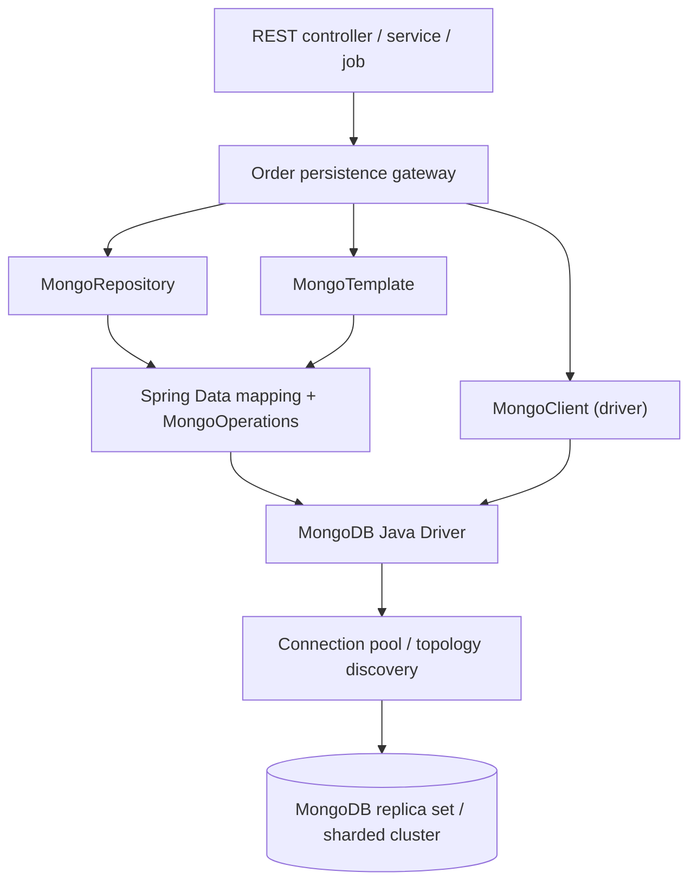
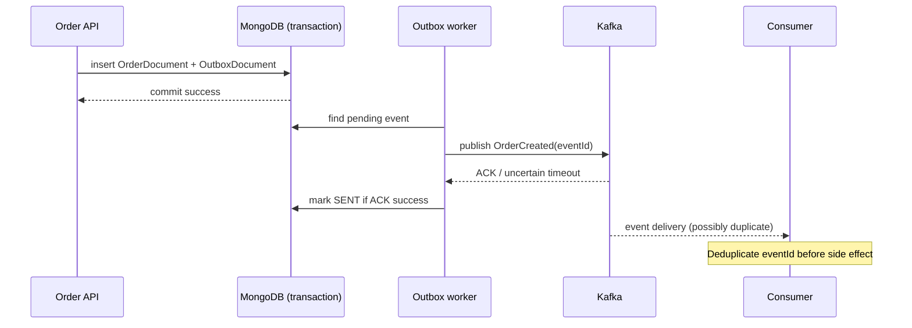
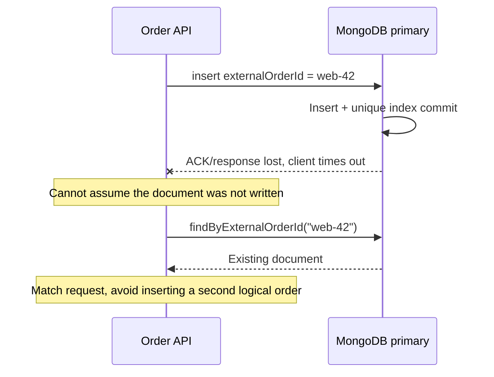
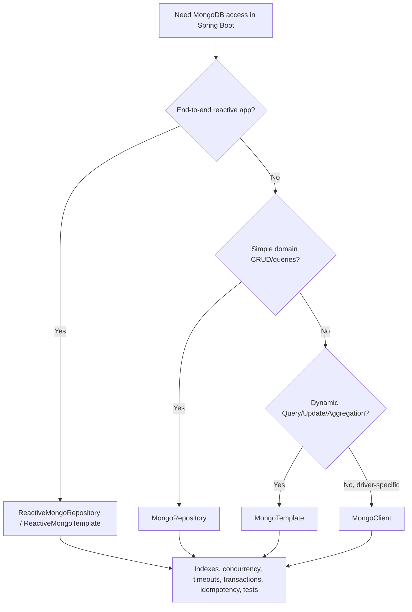

# MongoClient, MongoTemplate, and MongoRepository

> **Chapter:** MongoDB  
> **Scope:** SPRING_BOOT_INTEGRATION — connecting and integrating Spring Boot systems with databases, HTTP clients, caches, message brokers, and Spring Integration; emphasizing configuration, data contracts, transactions, error handling, deduplication, testing, and observability.

## 1. Problem: Three Ways to Access the Same MongoDB

An order service receives an HTTP `POST /orders`, persists order state in MongoDB, reads data for lookup APIs, and publishes `OrderCreated` to Kafka. When reading/writing MongoDB, Spring Boot developers encounter three abstractions:

- **`MongoClient`** — the official MongoDB Java Driver client. Provides low-level access to databases, collections, BSON, commands, sessions, and specialized APIs. In blocking applications, its type is `com.mongodb.client.MongoClient`.
- **`MongoTemplate`** — a **Spring Data MongoDB** class wrapping the driver; supports `Query`, `Criteria`, `Update`, entity mapping, exception translation, callbacks, and MongoDB-specific operations.
- **`MongoRepository<T, ID>`** — Spring Data's repository abstraction, suited to CRUD and common queries derived from method names or `@Query`. Repositories generally rely on the underlying MongoDB/Spring Data infrastructure; they are not a separate kind of MongoDB connection.



**Choose the abstraction by responsibility, not by assumed speed:** repositories for CRUD queries with stable contracts; templates for atomic updates, aggregations, or dynamic queries; the driver for low-level capabilities not yet covered by a convenient abstraction. All three remain subject to the same MongoDB connection limits, topology, privileges, read/write concerns, and errors.

### 1.1. Learning objectives

After this lesson, you will be able to:

1. Add the right starter and configure `spring.data.mongodb.*` for your Spring Boot line.
2. Distinguish `MongoClient`, `MongoDatabaseFactory`, `MongoTemplate`, and repository beans.
3. Map documents with `@Document`, `@Id`, `@Field`, `@Indexed`, and `@Version`; understand schema/index boundaries.
4. Write queries/updates using the driver, template, and repository, choosing each API by need.
5. Design unique keys, optimistic locking, idempotency, and appropriate MongoDB transactions.
6. Avoid confusing MongoDB transactions with PostgreSQL, Kafka, or HTTP transactions.
7. Test with Testcontainers and monitor connection errors, slow queries, pools, and replication.

## 2. MongoDB Fundamentals: Document, Collection, BSON, and Atomicity

MongoDB stores data as **BSON documents** inside **collections**, rather than rows in tables. An example document:

```json
{
  "_id": "order-7f63",
  "externalOrderId": "web-2026-042",
  "customerId": "customer-17",
  "status": "NEW",
  "createdAt": {"$date": "2026-11-21T08:00:00Z"},
  "version": 0
}
```

`{"$date": ...}` is **Extended JSON** illustrating a BSON Date, not a structure you necessarily send from Java. `_id` is the document identifier, whereas `externalOrderId` is a business key used to prevent duplicate order creation.

| Component | Meaning | Design Implication |
| --- | --- | --- |
| Database | Top-level namespace containing multiple collections | Configure the right database per environment |
| Collection | Group of documents, e.g. `integration_orders` | Requires indexes, privileges, and schema change processes |
| Document | BSON record supporting nested fields/arrays | Document shape must have controlled versions/contracts |
| `_id` | Unique identifier within a collection | Not necessarily a `String`; drivers may use `ObjectId` |
| Secondary index | Accelerates queries or enforces uniqueness | `@Indexed` is metadata; the index must **actually be created** |
| Atomic single-document write | Writing a single document is atomic under MongoDB semantics | Fits updating state/counters of a single aggregate |
| Multi-document transaction | Groups multiple commands across documents/collections | Requires supporting topology, session, and transaction manager |

MongoDB allows document structures to evolve over time, but **“flexible schema” does not mean “no data contract”**. Producers/consumers, Java mappings, validation, and indexes must still agree on required fields, types, and versions.

### 2.1. Consistency boundaries do not automatically span multiple systems

A single-document update may be atomic, but the following workflow is not automatically atomic:

```text
1. Save OrderDocument in MongoDB
2. Call payment API over HTTP
3. Publish OrderCreated to Kafka
```

If step 1 succeeds and step 3 fails, MongoDB does not automatically roll back step 1. In the transaction/outbox section later, this lesson distinguishes **MongoDB transactions** from **cross-system consistency**.

## 3. Dependencies, Connection Configuration, and Auto-Configuration

The examples below target **Spring Boot 3.2–3.5, the BOM-compatible Spring Data MongoDB version, and Java 17+**. Some starter names, properties, and APIs change in Boot 4; if using a different release line, check its exact documentation rather than mixing dependencies arbitrarily.

### 3.1. Starter for the blocking model

Gradle (project already applies the Spring Boot plugin/BOM):

```groovy
dependencies {
    implementation 'org.springframework.boot:spring-boot-starter-data-mongodb'
    testImplementation 'org.springframework.boot:spring-boot-starter-test'
}
```

Maven (Boot dependency management):

```xml
<dependency>
    <groupId>org.springframework.boot</groupId>
    <artifactId>spring-boot-starter-data-mongodb</artifactId>
</dependency>
```

The starter supplies the blocking driver and Spring Data MongoDB, allowing Boot to auto-configure the Mongo client, factory, template, and repositories when conditions match.

**You do not need `@EnableMongoRepositories` just to use repositories in default-scanned packages.** That annotation is useful when customizing scan roots or multiple MongoDB configurations. Likewise, you do not need to create `MongoTemplate` manually just to inject it.

### 3.2. `application.yml` — environment-based configuration

```yaml
spring:
  data:
    mongodb:
      uri: ${MONGODB_URI}
      auto-index-creation: false
```

An illustrative URI without secrets:

```text
mongodb://mongo1.example.invalid:27017,mongo2.example.invalid:27017/orders_db?replicaSet=rs0
```

With authentication, the URI may need a username/password and `authSource`; `MONGODB_URI` should be supplied via a secret manager or protected environment variables. **Do not commit URIs with real credentials to Git, logs, or exceptions returned to HTTP callers.** Inside containers, `localhost` refers to the container itself; the URI must use hostnames reachable from the actual runtime network. For MongoDB Atlas, `mongodb+srv://...` can be used when DNS SRV and TLS match the cluster configuration.

Key principles:

- `spring.data.mongodb.uri` is a complete declaration of hosts, database, authentication, and replica set. Do not simultaneously configure a URI and conflicting standalone host/port/username properties.
- The database in the URI must match the environment; distinguish the active database from `authSource` (the authentication database).
- `spring.data.mongodb.auto-index-creation: false` enforces proactive index management. Auto-index creation is off by default in Spring Data MongoDB 3.x+; verify against your deployed version.
- TLS, truststores/SSL bundles, timeouts, and pools should be configured per infrastructure policy; do not disable certificate validation to “fix” DNS/TLS issues.
- A client can list multiple replica set hosts, yet permissions and topology do not automatically become valid just because the URI includes multiple servers.

### 3.3. Where do the beans live in Spring Boot?

| Bean/Type | Function | Owner |
| --- | --- | --- |
| `com.mongodb.client.MongoClient` | Blocking driver, topology discovery, connection pool, raw commands | MongoDB Java Driver / Boot auto-config |
| `MongoDatabaseFactory` | Selects the database and provides MongoDB operations/sessions | Spring Data MongoDB |
| `MongoTemplate` | CRUD, queries, updates, aggregations, mapping | Spring Data MongoDB |
| `MappingMongoConverter` | Converts BSON documents ↔ Java domain objects | Spring Data MongoDB |
| `MongoRepository<...>` bean | Query methods/CRUD generated from interfaces | Spring Data MongoDB repositories |
| `MongoTransactionManager` | Binds MongoDB sessions/transactions to the thread | Only when explicitly configured by the application |

The Mongo client is created from Boot configuration when classpath/conditions match. **If you declare your own `MongoClient`**, Boot uses that bean for `MongoDatabaseFactory` and you become responsible for its settings. If you supply `MongoClientSettings`, check the customizer/property mechanism of your Boot version: some customizations can bypass `spring.data.mongodb.*`.

When templates or repositories are missing, inspect the classpath, custom beans, package scanning, and the Conditions Evaluation Report rather than creating extra clients ad hoc. **Successful bean creation does not prove the server is up**, because the driver may open the actual connection on the first query.

### 3.4. Blocking and reactive models do not swap types

| Blocking (imperative) | Reactive |
| --- | --- |
| `spring-boot-starter-data-mongodb` | `spring-boot-starter-data-mongodb-reactive` |
| `com.mongodb.client.MongoClient` | `com.mongodb.reactivestreams.client.MongoClient` |
| `MongoTemplate` | `ReactiveMongoTemplate` |
| `MongoRepository<T, ID>` | `ReactiveMongoRepository<T, ID>` |
| `T` / `Optional<T>` / `List<T>` | `Mono<T>` / `Flux<T>` |

Choose reactive when the entire pipeline (HTTP/WebFlux, MongoDB, cache, and other I/O steps) genuinely operates non-blocking. **Do not call blocking `MongoTemplate`/`MongoRepository` directly on the Reactor Netty event loop**; conversely, a blocking MVC/JDBC application does not need to rewrite everything to reactive just to use MongoDB.

## 4. Domain Document Model and Mapping

A consistent example throughout this lesson: storing an order with `externalOrderId` (key from the source system), `customerId`, `status`, creation/update timestamps, and a version.

### 4.1. `OrderDocument` entity

```java
// OrderDocument.java
import java.time.Instant;
import org.springframework.data.annotation.Id;
import org.springframework.data.annotation.Version;
import org.springframework.data.mongodb.core.index.Indexed;
import org.springframework.data.mongodb.core.mapping.Document;

@Document(collection = "integration_orders")
public class OrderDocument {
    @Id
    private String id;

    @Indexed(unique = true)
    private String externalOrderId;

    private String customerId;
    private String status;
    private Instant createdAt;
    private Instant updatedAt;

    @Version
    private Long version;

    public OrderDocument() {
    }

    public OrderDocument(String externalOrderId, String customerId,
                         String status, Instant createdAt) {
        this.externalOrderId = externalOrderId;
        this.customerId = customerId;
        this.status = status;
        this.createdAt = createdAt;
        this.updatedAt = createdAt;
    }

    public String getId() { return id; }
    public String getExternalOrderId() { return externalOrderId; }
    public String getCustomerId() { return customerId; }
    public String getStatus() { return status; }
    public Instant getCreatedAt() { return createdAt; }
    public Instant getUpdatedAt() { return updatedAt; }
    public Long getVersion() { return version; }

    public void setStatus(String status) { this.status = status; }
    public void setUpdatedAt(Instant updatedAt) {
        this.updatedAt = updatedAt;
    }
}
```

Here:

- `@Document` selects the collection; repository/template mapping automatically targets that collection.
- `@Id` maps to `_id`. With `String id`, Spring Data has rules that convert valid ObjectId-formatted strings; do not guess the actual BSON type without verifying the mapping.
- `@Indexed(unique = true)` **declares the intent** to have a unique index on `externalOrderId`; it does not prove the index already exists in MongoDB.
- `@Version` supports optimistic locking on Spring Data-supported operations, particularly when calling `save` on a previously loaded entity. This is not a JPA entity and has no Hibernate-style persistence context/dirty checking.
- `Instant` fields are supported by Spring Data/driver date/time converters; if producers use different timezones, standardize on UTC instants.

For more complex documents, you can use `@Field("external_order_id")` to map a Java field to a different BSON name, `@Transient` for non-persisted fields, custom converters for value objects, or nested documents. Every mapping change **must stay synchronized with fields used in indexes and queries**. Do not expose the entire entity directly over an API if it holds internal fields or sensitive data.

### 4.2. Creating indexes through a deployment workflow

Illustrative MongoDB Shell commands (executed as a controlled migration/operations task, not by worker code):

```javascript
use orders_db

db.integration_orders.createIndex(
  { externalOrderId: 1 },
  { name: "ux_integration_orders_external", unique: true }
)

db.integration_orders.createIndex(
  { status: 1, createdAt: -1 },
  { name: "ix_integration_orders_status_created" }
)
```

**Note:** an index on `externalOrderId` succeeds only if existing data contains no duplicate or invalid values under uniqueness rules; clean up data before applying the index. A single-field unique index also constrains documents missing the field as `null/missing`; for mandatory business keys, validate before writing or consider an appropriate partial index.

Spring Data MongoDB **does not auto-create indexes by default** in modern versions. For production, prefer reviewed migrations/index management and verify the index exists **before accepting concurrent writes**. You can set `spring.data.mongodb.auto-index-creation=true` in controlled environments, but do not treat it as a guarantee that migrations, rollbacks, and index impact analysis have been handled.

### 4.3. Why checking `existsBy...` alone cannot prevent duplicates

Two concurrent requests with `externalOrderId=web-42` can both receive `false` from `existsByExternalOrderId` and both insert. Only an **atomic unique index** at the database reliably blocks the race.

```text
Request A: findByExternalOrderId("web-42") -> empty
Request B: findByExternalOrderId("web-42") -> empty
Request A: insert -> success
Request B: insert -> duplicate key (unique index)
```

The application must interpret the duplicate according to its contract: either an **idempotent replay** if it has the same request identity/payload, or a conflict if `externalOrderId` was already used for different data.

## 5. MongoClient: Working Directly with the MongoDB Java Driver

`MongoClient` is the low-level client for accessing databases and collections; it should be used as a **Spring Boot-managed singleton bean**. The driver manages connection pooling and topology; never create/close a client per request.

### 5.1. Injecting `MongoClient` without opening extra connections

```java
import com.mongodb.client.MongoClient;
import com.mongodb.client.MongoCollection;
import com.mongodb.client.MongoDatabase;
import com.mongodb.client.model.Filters;
import com.mongodb.client.model.Projections;
import org.bson.Document;
import org.springframework.data.mongodb.MongoDatabaseFactory;
import org.springframework.stereotype.Component;

@Component
public class RawOrderLookup {
    private final MongoClient client;
    private final MongoDatabaseFactory databaseFactory;

    public RawOrderLookup(MongoClient client,
                          MongoDatabaseFactory databaseFactory) {
        this.client = client;
        this.databaseFactory = databaseFactory;
    }

    public boolean existsByExternalOrderId(String externalId) {
        String databaseName = databaseFactory.getMongoDatabase().getName();
        MongoDatabase db = client.getDatabase(databaseName);
        MongoCollection<Document> collection =
                db.getCollection("integration_orders");

        Document match = collection
                .find(Filters.eq("externalOrderId", externalId))
                .projection(Projections.include("_id"))
                .limit(1)
                .first();

        return match != null;
    }
}
```

This example uses `MongoDatabaseFactory` to obtain the configured database name, avoiding hardcoding a database that might differ between staging and prod. However, the raw driver **does not apply Spring Data mappings/converters, optimistic-lock checks, or domain callbacks**: BSON field names in filters must match the actual field names in the collection. If the entity changes to `@Field("external_order_id")`, the raw driver must use `"external_order_id"`.

**Do not use this example's `exists...` method to guarantee uniqueness**: see the two-request race in section 4.3. It is only suitable for lookups/supporting logic that do not require an atomic uniqueness check.

### 5.2. When should you use the raw driver?

| Case | Is Raw Driver Suitable? | Notes |
| --- | --- | --- |
| `ping`, specialized command/collection checks | Yes | Restrict command execution privileges; do not leak connection details |
| Uncommon operations not conveniently supported by Spring Data | Yes | Manage BSON, sessions, errors, and mapping yourself |
| Everyday CRUD with `OrderDocument` | Usually unnecessary | `MongoTemplate`/repositories reduce boilerplate |
| Complex projection/aggregation queries | Possible; check template APIs first | Avoid manual BSON parsing when converters already handle it |
| Creating a new `MongoClient` per request | **No** | Causes multiple pools, topology threads, and connection exhaustion |

The native driver throws MongoDB driver exceptions; through `MongoTemplate`/repositories, Spring Data may translate them into Spring `DataAccessException` hierarchies. Error classifiers **must not assume a single exception type** across every layer.

## 6. MongoTemplate: Dynamic Queries and Atomic Updates

`MongoTemplate` implements `MongoOperations`, providing a convenient abstraction for MongoDB operations without writing raw BSON everywhere. The template is especially useful when queries have dynamic criteria or require atomic updates instead of read-modify-save of the whole document.

### 6.1. `findOne`, sorting, and limiting results

```java
import java.util.List;
import java.util.Optional;
import org.springframework.data.domain.Sort;
import org.springframework.data.mongodb.core.MongoTemplate;
import org.springframework.data.mongodb.core.query.Criteria;
import org.springframework.data.mongodb.core.query.Query;
import org.springframework.stereotype.Repository;

@Repository
public class OrderTemplateQueryGateway {
    private final MongoTemplate template;

    public OrderTemplateQueryGateway(MongoTemplate template) {
        this.template = template;
    }

    public Optional<OrderDocument> findByExternalId(String externalId) {
        Query query = Query.query(
                Criteria.where("externalOrderId").is(externalId));
        return Optional.ofNullable(
                template.findOne(query, OrderDocument.class));
    }

    public List<OrderDocument> newestByStatus(String status) {
        Query query = Query.query(Criteria.where("status").is(status))
                .with(Sort.by(Sort.Direction.DESC, "createdAt"))
                .limit(20);
        return template.find(query, OrderDocument.class);
    }
}
```

Spring Data maps Java field names to BSON using metadata and invokes converters to materialize `OrderDocument`. `limit(20)` avoids loading an entire collection in one HTTP request; however, multi-criteria queries still need proper indexes to avoid collection scans. When sorting/paginating very large datasets, consider a stable sort with a tie-breaker and keyset/cursor pagination instead of deep `skip`.

### 6.2. Conditional `updateFirst` and optimistic concurrency

Suppose a consumer may transition an order from `NEW` to `CONFIRMED` only if its version still matches what was read. You can run a **compare-and-set** directly in a single MongoDB update:

```java
import java.time.Instant;
import com.mongodb.client.result.UpdateResult;
import org.springframework.data.mongodb.core.MongoTemplate;
import org.springframework.data.mongodb.core.query.Criteria;
import org.springframework.data.mongodb.core.query.Query;
import org.springframework.data.mongodb.core.query.Update;
import org.springframework.stereotype.Repository;

@Repository
public class OrderStateGateway {
    private final MongoTemplate template;

    public OrderStateGateway(MongoTemplate template) {
        this.template = template;
    }

    public boolean confirm(String externalOrderId, long expectedVersion) {
        Query query = Query.query(
                Criteria.where("externalOrderId").is(externalOrderId)
                        .and("status").is("NEW")
                        .and("version").is(expectedVersion));
        Update update = new Update()
                .set("status", "CONFIRMED")
                .set("updatedAt", Instant.now());

        UpdateResult result =
                template.updateFirst(query, update, OrderDocument.class);
        return result.getMatchedCount() == 1;
    }
}
```

The filter criteria and update run as **one atomic operation on a single document**. If nothing matches, returning `false` could mean the order does not exist, has a different status, or its version has already changed; the domain layer must distinguish these per policy rather than retrying blindly forever.

When an entity has `@Version` and the `Update` does not explicitly set the version, Spring Data MongoDB can **auto-increment the version** in supported template operations, yet it **does not automatically append the expected version filter to arbitrary custom queries**. Thus `.and("version").is(expectedVersion)` is intentional to prevent concurrent requests from overwriting state. Write tests verifying that the version actually increments in your Spring Data version.

### 6.3. When to choose `save`, `insert`, `updateFirst`, `findAndModify`?

| API | Semantics | Risks to Control |
| --- | --- | --- |
| `template.insert(entity)` | Creates a new document; duplicate `_id`/unique key fails | Needs indexes and business-level duplicate handling |
| `template.save(entity)` | Inserts/updates by identifier; supports `@Version` on eligible operations | Do not use as a substitute for partial updates without knowing which fields get overwritten |
| `template.updateFirst(query, update, ...)` | Updates one matching document | Filter with proper concurrency/status guards; inspect `matchedCount` |
| `template.updateMulti(query, update, ...)` | Updates all matching documents | Can generate heavy load; the batch is not a single transaction by default |
| `template.findAndModify(query, update, options, ...)` | Atomic find + modify returning pre/post document per options | Useful when returning the new state or claiming processing ownership |
| `template.aggregate(...)` | Aggregation and projection pipeline | Control indexes, memory, result limits, and compatibility |

**Do not equate** “a single `updateMulti` call” with a “multi-document transaction”. Each document is updated atomically, whereas a business requirement that all succeed or roll back together requires a real MongoDB transaction on a supporting topology.

## 7. MongoRepository: CRUD by Domain Contract

When business logic needs to look up orders by ID or `externalOrderId`, list orders by status, and save documents, a repository is concise and clean. Spring Data derives queries from method names and binds domain entities using mapping metadata.

### 7.1. Defining a repository

```java
import java.util.Optional;
import org.springframework.data.domain.Page;
import org.springframework.data.domain.Pageable;
import org.springframework.data.mongodb.repository.MongoRepository;

public interface OrderRepository
        extends MongoRepository<OrderDocument, String> {

    Optional<OrderDocument> findByExternalOrderId(String externalOrderId);

    boolean existsByExternalOrderId(String externalOrderId);

    Page<OrderDocument> findByStatus(String status, Pageable pageable);
}
```

`MongoRepository<OrderDocument, String>` uses `String` as the Java type of `@Id`, not the type of `externalOrderId`. Methods such as `save`, `insert`, `findById`, `deleteById`, and `count` are provided by Spring Data infrastructure. No manual implementation class is needed when the interface is in a scanned package.

`Page<T>` includes total element counts, which typically requires an extra count query; for flows that only need “is there a next page?”, consider `Slice<T>` or cursor pagination to reduce overhead on large collections.

### 7.2. Service accepting business input and saving a document

```java
import java.time.Instant;
import java.util.Objects;
import org.springframework.dao.DuplicateKeyException;
import org.springframework.stereotype.Service;

@Service
public class OrderRegistrationService {
    private final OrderRepository repository;

    public OrderRegistrationService(OrderRepository repository) {
        this.repository = repository;
    }

    public OrderDocument createOrGet(String externalId, String customerId) {
        if (externalId == null || externalId.isBlank()
                || customerId == null || customerId.isBlank()) {
            throw new IllegalArgumentException("Invalid order request");
        }

        OrderDocument newOrder = new OrderDocument(
                externalId, customerId, "NEW", Instant.now());

        try {
            return repository.insert(newOrder);
        } catch (DuplicateKeyException duplicate) {
            OrderDocument existing = repository
                    .findByExternalOrderId(externalId)
                    .orElseThrow(() -> duplicate);

            if (!Objects.equals(existing.getCustomerId(), customerId)) {
                throw new IllegalStateException(
                        "externalOrderId belongs to a different request",
                        duplicate);
            }
            return existing;
        }
    }
}
```

This is a **simplified example of idempotent creation** keyed by `externalOrderId` and `customerId`; it is valid only if the contract defines those two fields as uniquely identifying a logical request and the collection has a unique index. In real applications, compare **all relevant business parameters** or a canonical request fingerprint/hash—never treat two orders with different amounts or shipping addresses as identical merely because the customer ID matches.

**Do not blindly catch every `DuplicateKeyException` and treat it as “already succeeded”.** The error might originate from another constraint; if the post-duplicate lookup finds no matching entry, raise an error and investigate. Retrying an insert after a timeout with a newly generated ID can also create duplicate documents if no unique business key exists.

### 7.3. Optimistic locking with `repository.save`

```java
import java.time.Instant;
import org.springframework.stereotype.Service;

@Service
public class OrderConfirmationService {
    private final OrderRepository repository;

    public OrderConfirmationService(OrderRepository repository) {
        this.repository = repository;
    }

    public OrderDocument confirmById(String id) {
        OrderDocument order = repository.findById(id).orElseThrow();
        if (!"NEW".equals(order.getStatus())) {
            throw new IllegalStateException(
                    "Only NEW orders can be confirmed");
        }
        order.setStatus("CONFIRMED");
        order.setUpdatedAt(Instant.now());
        return repository.save(order);
    }
}
```

When two threads both read `version=0` and call `save`, Spring Data MongoDB with `@Version` typically lets one thread succeed while the other receives `OptimisticLockingFailureException`. This mechanism requires write acknowledgment to detect a matched count of 0; do not use `WriteConcern.UNACKNOWLEDGED` and still expect conflict detection.

Retrying after an optimistic lock failure **is not always appropriate**: you must re-read the latest state and re-evaluate domain rules; an `OrderCancelled` event may have already changed the state before `confirmById` retries.

### 7.4. Comparing the three API tiers

| Criterion | MongoClient | MongoTemplate | MongoRepository |
| --- | --- | --- | --- |
| Abstraction level | Low-level driver | Spring Data operations | High-level domain repository |
| Primary data types | `MongoDatabase`, `MongoCollection`, `Document`, BSON | `Query`, `Update`, Java entities | Java entities, `Optional`, `Page` |
| Simple queries | Manual BSON/filter construction | `Criteria`/`Query` construction | Derived query methods |
| Dynamic/complex queries | Low-level flexibility | Very well suited | `@Query` or custom fragment when needed |
| Atomic updates/aggregations | Direct driver APIs | Very well suited | Can delegate to custom methods/template |
| Mapping/optimistic locking | Self-managed | Supported per operation | Supported via Spring Data |
| Fine-grained session/command control | High | Via template/driver APIs | Abstracted; not every need is convenient |
| Boilerplate | High | Medium | Low for CRUD |

You do not have to choose **only one API for the entire project**. A domain adapter can use a repository for CRUD and a template for compare-and-set, keeping both behind the same **persistence port/gateway** so business services stay decoupled from MongoDB details.

## 8. MongoDB Transactions and Integration Boundaries

### 8.1. Single-document atomicity is often better than large transactions

Before reaching for a multi-document transaction, check whether an aggregate can be modeled as a single document updated with an atomic conditional command. For example, marking a status and incrementing a processing counter in **the same** `updateFirst` typically does not require a multi-document transaction.

Transactions across multiple documents/collections add overhead and require a supporting MongoDB deployment. MongoDB transactions run on compatible replica set/sharded deployments; **do not assume a simple standalone MongoDB test instance provides full transaction semantics**.

### 8.2. Registering `MongoTransactionManager`

With imperative Spring Data MongoDB:

```java
import org.springframework.context.annotation.Bean;
import org.springframework.context.annotation.Configuration;
import org.springframework.data.mongodb.MongoDatabaseFactory;
import org.springframework.data.mongodb.MongoTransactionManager;

@Configuration(proxyBeanMethods = false)
public class MongoTransactionConfiguration {
    @Bean
    MongoTransactionManager mongoTransactionManager(
            MongoDatabaseFactory databaseFactory) {
        return new MongoTransactionManager(databaseFactory);
    }
}
```

Spring Data MongoDB does not automatically join transactions merely because the starter or `@Transactional` is present. You need the appropriate transaction manager and supporting topology, and templates/repositories must use **the same `MongoDatabaseFactory`** to bind the session to the transaction.

If a project has both `JpaTransactionManager` and `MongoTransactionManager`, specify the manager explicitly on the service; bare `@Transactional` is ambiguous across two data stores.

### 8.3. Writing an order and outbox record in the same MongoDB transaction

Suppose an order creation event must be published to Kafka without losing the intent to emit it if the broker is temporarily unavailable. Introduce an outbox document:

```java
import java.time.Instant;
import org.springframework.data.annotation.Id;
import org.springframework.data.mongodb.core.mapping.Document;

@Document(collection = "order_outbox")
public class OutboxDocument {
    @Id
    private String eventId;
    private String aggregateId;
    private String eventType;
    private String payloadJson;
    private String status;
    private Instant createdAt;

    public OutboxDocument() {
    }

    public OutboxDocument(String eventId, String aggregateId,
                          String eventType, String payloadJson,
                          Instant createdAt) {
        this.eventId = eventId;
        this.aggregateId = aggregateId;
        this.eventType = eventType;
        this.payloadJson = payloadJson;
        this.status = "PENDING";
        this.createdAt = createdAt;
    }
}
```

```java
import java.time.Instant;
import java.util.UUID;
import org.bson.Document;
import org.springframework.data.mongodb.core.MongoTemplate;
import org.springframework.stereotype.Service;
import org.springframework.transaction.annotation.Transactional;

@Service
public class OrderWithOutboxService {
    private final OrderRepository orders;
    private final MongoTemplate mongoTemplate;

    public OrderWithOutboxService(OrderRepository orders,
                                 MongoTemplate mongoTemplate) {
        this.orders = orders;
        this.mongoTemplate = mongoTemplate;
    }

    @Transactional(transactionManager = "mongoTransactionManager")
    public String createOrder(String externalId, String customerId) {
        OrderDocument order = orders.insert(new OrderDocument(
                externalId, customerId, "NEW", Instant.now()));

        String eventId = UUID.randomUUID().toString();
        String payload = new Document("eventId", eventId)
                .append("externalOrderId", externalId)
                .toJson();
        mongoTemplate.insert(new OutboxDocument(
                eventId, externalId, "OrderCreated",
                payload, Instant.now()));

        return order.getId();
    }
}
```

Notice the example intentionally **does not** call Kafka inside the MongoDB transaction. A separate worker reads `order_outbox` entries with `status=PENDING`, publishes by event ID, and marks them `SENT` **after receiving the Kafka producer ACK**. The worker can still publish duplicates if the ACK is lost or it crashes before marking `SENT`; consumers must deduplicate by `eventId`. You can use polling with conditional leases/claims or change streams/CDC if infrastructure supports it, accounting for resume tokens and crash windows.

**Do not treat this example as production-ready out of the box**: collections/indexes must be created **before** transactions run, alongside business key validation, duplicate rules, HTTP idempotency, transaction privileges, and retry bounds. MongoDB does not permit freely creating collections/indexes inside a transaction like regular CRUD operations.

### 8.4. MongoDB transactions do not include HTTP, Kafka, or PostgreSQL



A MongoDB transaction only protects MongoDB operations **within the same session/manager**. If the app also updates PostgreSQL/JDBC, sends HTTP requests, or writes to Kafka, no distributed atomic transaction appears automatically. The solution requires a state machine, outbox/inbox, idempotency, and business reconciliation.

### 8.5. Read concern, write concern, and read preference

| Option | Decision | Risk if Misunderstood |
| --- | --- | --- |
| Write concern | Level of write acknowledgment (e.g. `ACKNOWLEDGED`, `MAJORITY`) | ACK does not mean downstream systems have processed it |
| Read concern | Visibility commitment for read data (e.g. `local`, `majority`, `snapshot` where supported) | Concurrent requests across replicas may see different views of data |
| Read preference | Preference for primary/secondary per topology conditions | Reading from secondary may miss recent writes due to replication lag |
| Retryable writes | Driver can retry eligible operations | Not every multi-step business operation is idempotent |
| Transaction lifetime | How long a transaction holds resources | Long transactions risk conflicts/timeouts and strain the replica set |

Effective options should be chosen according to data consistency SLAs and MongoDB topology, rather than blindly picking `MAJORITY` “to be safe” while ignoring latency, timeouts, and real consistency behavior. For documents representing mutable order state, read and write against appropriate targets so you do not return stale data in violation of the contract.

## 9. Error Classification, Timeouts, and Safe Retries

In practice, a request path might look like `HTTP → OrderService → MongoRepository → MongoDB → Kafka`. A MongoDB error must be interpreted by its root cause rather than catching `Exception` and blindly repeating the call.

| Error/Signal | Common Category | Action |
| --- | --- | --- |
| `DuplicateKeyException` / MongoDB code 11000 | Data constraint/duplicate key | Check unique key and compare logical request; return existing idempotent result or conflict |
| `OptimisticLockingFailureException` | Concurrent state update | Re-read document and evaluate business transition; retry only if safe |
| `MongoTimeoutException` during server selection | Potentially transient due to topology/network/overload | Bounded retry; inspect DNS/replica/connection pool and deadline |
| `MongoSocketException` / connection reset | Potentially transient transport error | Classify by phase; write outcome may be unknown |
| `MongoSecurityException`, insufficient privileges | Credential or ACL fix required | Do not retry blindly; resolve secret rotation/permissions |
| BSON/converter/schema parse error | Incompatible data contract | Fix mapper/migration; quarantine malformed data |
| Invalid query/command | Permanent for current code/config | Fix command, index/topology; do not increase retry attempts endlessly |
| Transaction error with transient label | May require retrying the entire transaction | Follow MongoDB driver guidance; avoid duplicating external side effects |

**Exception types vary across layers:** the raw driver can throw `MongoWriteException`, `MongoCommandException`, or socket errors; Spring Data through templates/repositories can translate them into Spring `DataAccessException`. Inspect `cause`, error codes, error labels, and which operations preceded the error. Never assume every Mongo timeout means “the record was not written”.

### 9.1. Timeout after a write has an unknown outcome



With a unique business key and a real index, retries can safely resolve via lookup/comparison per the contract. If the prior operation's outcome is unknown, never generate a new `externalOrderId`/`eventId` and resend; doing so turns a retry into a second business event.

**Retry only eligible operations:** simple reads can usually be retried within limits; `insert` requires a unique key/idempotency; `$inc` updates on balances or counters should not be retried arbitrarily at the **application layer**, even though certain retryable writes are supported by the driver at the protocol layer.

### 9.2. Transaction retries require understanding error labels

The MongoDB driver supports retryable reads/writes and error labels. Inside transactions, labels such as `TransientTransactionError` or `UnknownTransactionCommitResult` have specific meanings:

- `TransientTransactionError` may warrant retrying the **entire transaction**, depending on operations and server conditions.
- `UnknownTransactionCommitResult` means the commit outcome is uncertain; follow driver guidance for retrying the commit/reconciling rather than issuing a new business command blindly.
- A transaction callback containing an HTTP payment call, Kafka publish, or email send **is not safe to re-execute automatically** if those side effects are not idempotent.

Design a single **retry owner** with max attempts, exponential backoff + jitter, and an overall deadline; do not let the driver, template advice, HTTP service, and message broker each retry independently without bounds.

### 9.3. Applications must distinguish business outcomes from infrastructure failures

For example:

- `findByExternalOrderId` returning `Optional.empty()`: a valid **not found** result.
- `findByExternalOrderId` timing out because no primary can be selected: **dependency unavailable**—must not be converted into `Optional.empty()`.
- `confirm` matching 0 documents because status is already `CANCELLED`: a **business conflict**, not a network failure.
- `confirm` matching 0 documents because version changed from 1 to 2: a **concurrency conflict**; re-read state and apply domain rules.

If a consumer reads from Kafka and writes to MongoDB, ack/commit offsets only after required side effects are durably persisted or recovery is handled per contract. An idempotent consumer is essential because events can be redelivered by the broker after the DB commits but before the ACK completes.

## 10. Configuring MongoClient for Production

Spring Boot auto-configures `MongoClient` from `spring.data.mongodb.*`. In most applications connecting to a single MongoDB deployment, **prefer a URI + customizer** rather than creating a custom `MongoClient` bean with separate TLS/pooling logic.

### 10.1. Connection limits to measure

| Group | Meaning | What to Avoid |
| --- | --- | --- |
| Server selection timeout | Time to locate a server matching the read/write operation | Waiting too long when a replica set lacks a primary |
| Connect timeout | Limit for establishing a TCP connection | Hanging requests due to network blackholes |
| Socket/read timeout | I/O wait per driver mechanism | Confusing with the end-to-end business deadline |
| Max pool size | Maximum connections per pool/server | Each application replica opening too many connections |
| Max wait time | Time spent waiting for an idle connection | Queue buildup and rising tail latency |
| Read preference/concern | Policy for node selection and read visibility | Stale reads from secondaries when read-your-writes is required |
| Write concern | Write acknowledgment policy | Treating ACK as downstream processing or full backup |

If 20 pods each set max pool size to 100, total potential connections to the cluster can grow very large (depending on topology and per-server pools). Size against MongoDB/cluster limits and competing workloads; do not raise pool size indefinitely to mask unindexed queries.

### 10.2. Spring Boot 3.x customizer

Example limiting pool and server selection at the driver layer:

```java
import java.util.concurrent.TimeUnit;
import org.springframework.boot.autoconfigure.mongo.MongoClientSettingsBuilderCustomizer;
import org.springframework.context.annotation.Bean;
import org.springframework.context.annotation.Configuration;

@Configuration(proxyBeanMethods = false)
public class MongoDriverSettingsConfiguration {

    @Bean
    MongoClientSettingsBuilderCustomizer tuneMongoClient() {
        return builder -> builder
                .applyToClusterSettings(cluster ->
                        cluster.serverSelectionTimeout(5, TimeUnit.SECONDS))
                .applyToConnectionPoolSettings(pool -> pool
                        .maxSize(40)
                        .maxWaitTime(2, TimeUnit.SECONDS))
                .applyToSocketSettings(socket -> socket
                        .connectTimeout(3, TimeUnit.SECONDS)
                        .readTimeout(5, TimeUnit.SECONDS));
    }
}
```

This is a Boot **3.x** example, with no guarantee that customization packages remain identical in Boot 4. These limits are **reference values** to be tuned against real SLAs/queries and how they interact with `serverSelectionTimeoutMS`, `retryWrites`, `socketTimeoutMS`, and outer timeouts.

**Do not**:

- Call `MongoClients.create(...)` in every controller request, spawning excessive pools and monitor threads.
- Close the Boot-owned singleton `MongoClient` after completing a single operation.
- Hardcode credentials in code or log raw URIs containing passwords.
- Use `localhost` as a production endpoint inside containers when Mongo runs elsewhere.
- Grant admin roles or disable TLS certificate validation to resolve connection failures.

### 10.3. TLS, authentication, and topology

Some clusters use a URI like:

```text
mongodb+srv://<username>:<password>@cluster.example.invalid/orders_db?retryWrites=true&w=majority
```

This shows syntax only, not real credentials. SRV URIs depend on DNS, TLS, server capabilities, and MongoDB cluster policies. If the password in a URI contains special characters, percent-encode them per URI rules; avoid unescaped string concatenation.

In production, verify:

1. Does DNS/SRV resolve from **the pod's network**?
2. Does the truststore/SSL bundle trust the CA, and does the certificate hostname match?
3. Does the user have read/write privileges on the target database/collection, or is it authenticating against the wrong `authSource`?
4. Are replica set/sharded topology, primary elections, and connectivity to all members healthy?
5. Do roles and privileges cover transactions, indexes, and change streams as required?

Do not confuse MongoDB driver endpoints with HTTP APIs. If MongoDB runs across multiple environments, isolate credentials/namespaces and network policies so staging cannot write to production.

## 11. ReactiveMongoTemplate and ReactiveMongoRepository

When an application uses Spring WebFlux, reactive Redis, and non-blocking downstreams, Spring Data MongoDB offers the reactive branch. The difference is not just wrapping return types in `Mono`: **the reactive driver is a distinct type and implementation from the blocking driver**.

### 11.1. Dependency

```groovy
dependencies {
    implementation 'org.springframework.boot:spring-boot-starter-data-mongodb-reactive'
    testImplementation 'org.springframework.boot:spring-boot-starter-test'
    testImplementation 'io.projectreactor:reactor-test'
}
```

Let the Boot BOM manage the reactive driver and Reactor versions. If an app includes both blocking and reactive MongoDB starters, understand clearly which beans are created and route adapters to the appropriate ones.

### 11.2. Reactive repository

```java
import reactor.core.publisher.Flux;
import reactor.core.publisher.Mono;
import org.springframework.data.mongodb.repository.ReactiveMongoRepository;

public interface ReactiveOrderRepository
        extends ReactiveMongoRepository<OrderDocument, String> {
    Mono<OrderDocument> findByExternalOrderId(String externalOrderId);
    Flux<OrderDocument> findByStatus(String status);
}
```

`Mono<OrderDocument>` emits one document or completes empty; `Flux<OrderDocument>` can emit multiple documents. Do not call `subscribe()` inside a service and return a dummy result; return the publisher to the caller or compose it into a pipeline so WebFlux/the framework manages subscription.

### 11.3. ReactiveMongoTemplate

```java
import reactor.core.publisher.Mono;
import org.springframework.data.mongodb.core.ReactiveMongoTemplate;
import org.springframework.data.mongodb.core.query.Criteria;
import org.springframework.data.mongodb.core.query.Query;
import org.springframework.stereotype.Service;

@Service
public class ReactiveOrderLookup {
    private final ReactiveMongoTemplate template;

    public ReactiveOrderLookup(ReactiveMongoTemplate template) {
        this.template = template;
    }

    public Mono<OrderDocument> findByExternalId(String externalId) {
        Query query = Query.query(
                Criteria.where("externalOrderId").is(externalId));
        return template.findOne(query, OrderDocument.class);
    }
}
```

Do not call `reactiveLookup.findByExternalId(id).block()` on the event loop to fetch an entity synchronously; doing so can block the event loop. If the application has no true reactive pipeline, choosing the blocking branch from the start is simpler.

**Reactive transactions are separate too**: they require `ReactiveMongoTransactionManager` and Reactor Context-based publishers/transaction operators—do not reuse a thread-bound `MongoTransactionManager` for reactive pipelines. Within a transaction, ensure operations on the same session execute sequentially within driver constraints rather than running arbitrary parallel `flatMap` operations on the same session.

### 11.4. Choose the model by architecture, not by the “fast” label

| Architecture | Default Choice | Warning |
| --- | --- | --- |
| Spring MVC + MongoDB + JDBC/JPA | Blocking `MongoRepository`/`MongoTemplate` | Configure pool/timeouts; avoid transactions spanning HTTP |
| Spring MVC + Java 21 virtual threads | Blocking Mongo works well | Virtual threads reduce thread-waiting overhead, not Mongo pool limits |
| WebFlux + end-to-end reactive Mongo | `ReactiveMongoRepository`/`ReactiveMongoTemplate` | Never invoke blocking JPA/`MongoTemplate` on the event loop |
| Highly specialized driver commands | Matching blocking/reactive raw client | Manage sessions, serialization, and resource lifecycles |
| Heavy batch processing across many documents | Appropriate template/driver bulk operations | Bulk operations are not a single transaction; handle partial success/ordering |

## 12. Testing Against Real MongoDB: Testcontainers and Spring Data

MongoDB has its own driver, topology, and BSON semantics. A unit test mocking a repository with Mockito cannot verify unique indexes, date mapping, optimistic locking versions, or transactions. Separate tests by layer:

| Test Level | Tooling | What It Proves | What It Does Not Prove |
| --- | --- | --- | --- |
| Unit | Fake/Mockito repository or persistence port | Business validation, duplicate policy, retry predicates | Real MongoDB indexes, BSON, network |
| Slice | `@DataMongoTest` + `MongoDBContainer` | Repository/template mapping, queries, unique indexes | HTTP/broker layers, full app wiring |
| Integration | `@SpringBootTest` + `MongoDBContainer` | Bean wiring, Mongo operations, certain transactions | Automatically matching production topology/TLS/ACLs |
| End-to-end | HTTP → MongoDB → outbox → Kafka → consumer | Side effects, retry/crash windows, idempotency | Every production failover case unless simulated |

### 12.1. Test dependencies for Boot 3.x

```groovy
dependencies {
    testImplementation 'org.springframework.boot:spring-boot-starter-test'
    testImplementation 'org.springframework.boot:spring-boot-testcontainers'
    testImplementation 'org.testcontainers:junit-jupiter'
    testImplementation 'org.testcontainers:mongodb'
}
```

Testcontainers dependencies and supporting modules change across **major versions** of Testcontainers/Boot; this example targets Boot 3.2–3.5 managed by the BOM. CI must provide a working Docker/container runtime; adding dependencies alone is not enough.

### 12.2. Testing repositories, unique indexes, and optimistic locking

```java
import java.time.Instant;
import org.junit.jupiter.api.BeforeEach;
import org.junit.jupiter.api.Test;
import org.junit.jupiter.api.extension.ExtendWith;
import org.springframework.beans.factory.annotation.Autowired;
import org.springframework.boot.test.autoconfigure.data.mongo.DataMongoTest;
import org.springframework.boot.testcontainers.service.connection.ServiceConnection;
import org.springframework.dao.DuplicateKeyException;
import org.springframework.dao.OptimisticLockingFailureException;
import org.springframework.data.domain.Sort;
import org.springframework.data.mongodb.core.MongoTemplate;
import org.springframework.data.mongodb.core.index.Index;
import org.testcontainers.containers.MongoDBContainer;
import org.testcontainers.junit.jupiter.Container;
import org.testcontainers.junit.jupiter.Testcontainers;

import static org.assertj.core.api.Assertions.assertThat;
import static org.assertj.core.api.Assertions.assertThatThrownBy;

@Testcontainers
@DataMongoTest
class OrderRepositoryMongoIntegrationTest {
    @Container
    @ServiceConnection
    static final MongoDBContainer mongo =
            new MongoDBContainer("mongo:7.0");

    @Autowired
    MongoTemplate mongoTemplate;

    @Autowired
    OrderRepository repository;

    @BeforeEach
    void prepareCollection() {
        mongoTemplate.indexOps(OrderDocument.class).ensureIndex(
                new Index()
                        .on("externalOrderId", Sort.Direction.ASC)
                        .unique());
        repository.deleteAll();
    }

    @Test
    void uniqueBusinessKeyPreventsDuplicateInsert() {
        repository.insert(new OrderDocument(
                "web-42", "customer-A", "NEW", Instant.now()));

        assertThatThrownBy(() -> repository.insert(
                new OrderDocument(
                        "web-42", "customer-B", "NEW", Instant.now())))
                .isInstanceOf(DuplicateKeyException.class);
    }

    @Test
    void versionRejectsStaleDocumentSave() {
        OrderDocument inserted = repository.insert(
                new OrderDocument(
                        "web-43", "customer-A", "NEW", Instant.now()));
        OrderDocument first = repository
                .findById(inserted.getId()).orElseThrow();
        OrderDocument stale = repository
                .findById(inserted.getId()).orElseThrow();

        first.setStatus("CONFIRMED");
        repository.save(first);

        stale.setStatus("CANCELLED");
        assertThatThrownBy(() -> repository.save(stale))
                .isInstanceOf(OptimisticLockingFailureException.class);

        assertThat(repository.findById(inserted.getId()).orElseThrow()
                .getStatus()).isEqualTo("CONFIRMED");
    }
}
```

**Assumptions:** the repository/document is within the slice test's scan scope, the test image is available, and Testcontainers supports a MongoDB replica set. `@ServiceConnection` wires connection details into Boot when `spring-boot-testcontainers` is on the classpath, avoiding hardcoded localhost ports. Calling `ensureIndex` in tests is only for the **test** collection, not a production migration mechanism.

If the test environment injects a production `spring.data.mongodb.uri` via an environment variable, ensure `@ServiceConnection` overrides it properly and that the test **does not** use a custom `MongoClient` bean that ignores connection details. Always isolate CI credentials/networks from production.

### 12.3. Testing `MongoTemplate.updateFirst` with a version guard

To test `OrderStateGateway.confirm(...)` from section 6, you can `@Import(OrderStateGateway.class)` in the slice test and assert:

```java
// Test pseudocode, assuming injected gateway and saved entity:
long expected = saved.getVersion();
boolean first = orderStateGateway.confirm(
        saved.getExternalOrderId(), expected);
boolean second = orderStateGateway.confirm(
        saved.getExternalOrderId(), expected);

assertThat(first).isTrue();
assertThat(second).isFalse();
```

This is an **illustrative assertion snippet**; you must declare/inject `saved`, `orderStateGateway`, and configure the test setup per your codebase. The goal is to prove the second operation does not overwrite after the state/version changes, rather than merely counting method invocations.

### 12.4. Testing transactions and outbox

To verify atomicity of `OrderWithOutboxService`:

1. Provision a replica set/sharded MongoDB test environment supporting transactions; do not use standalone MongoDB if the topology lacks support.
2. Pre-create `integration_orders`, `order_outbox`, and unique indexes before starting the transaction.
3. When both writes succeed, verify both the order and outbox documents exist after commit.
4. Intentionally throw an exception **after inserting the order but before inserting the outbox**, and verify rollback leaves no leftover order document.
5. Simulate connection errors/unknown ACKs; preserve `eventId` and verify deduplication when the worker replays.
6. After Kafka ACKs and the worker crashes before marking `SENT`, verify the consumer does not execute side effects twice.

Do not treat a unit test calling a `@Transactional` method through a mocked `MongoTemplate` as proof of transaction behavior: you need a **real `MongoTransactionManager`** and a compatible server topology.

## 13. Observing and Protecting MongoDB Data

### 13.1. Signals to monitor

| Metric or Log | Purpose |
| --- | --- |
| MongoDB operation latency p50/p95/p99 by collection/operation | Detect slow queries and HTTP SLA impact |
| Connection pool in-use/available, checkout wait | Detect pool saturation and queueing |
| Server selection timeouts/topology changes | Detect primary elections, DNS, or broker/network instability |
| Query examined/returned, index usage | Detect collection scans, missing indexes, or expensive sorts |
| Duplicate key errors by operation | Distinguish idempotent replays from data conflicts |
| Optimistic lock conflict rate | Measure write contention/state transition races |
| Transaction commits/aborts/retries, unknown outcomes | Detect failed transactions and recovery windows |
| Outbox pending count/oldest age, publish retries | Detect events not reaching Kafka or stalled recovery |
| Change stream resume failures/lag (if used) | Detect CDC falling behind or lost resume tokens |

Spring Boot Actuator, Micrometer, and the MongoDB Java Driver can provide metrics/observations depending on version, listeners, and enabled registries. **Do not assume all metrics appear automatically just because the MongoDB starter is present**; verify what your ops tooling collects and add instrumentation at the persistence adapter when needed.

Avoid using `externalOrderId`, `customerId`, document IDs, or free-form query parameters as **metric labels** due to high cardinality and potential PII. In diagnostic logs, retain only trace/correlation IDs and standardized error codes per policy; never log URIs with passwords, private keys, or full documents.

### 13.2. Inspecting indexes and slow queries

An illustrative Mongo Shell command in test/staging environments:

```javascript
db.integration_orders.find(
  { status: "NEW" }
).sort(
  { createdAt: -1 }
).limit(20).explain("executionStats")
```

Inspect stages/indexes, documents/keys examined relative to documents returned, and verify sort/index alignment. Do not enable logging of all raw queries with sensitive payloads in production without controlling cost and access permissions.

Manage indexes as **deployment contracts**: adding a unique index when duplicate data exists will fail; building an index on a huge collection consumes resources; migrations require testing and rollout plans.

### 13.3. Access control and sensitive data

- Each environment should have dedicated databases/credentials; staging must not have write access to production.
- Service accounts should only have permissions on the required collections/commands; never use an admin account for an HTTP service.
- TLS connections and certificate validation must be properly configured, especially between Kubernetes pods and the MongoDB cluster.
- In API responses, separate DTOs from Mongo documents; do not expose arbitrary internal fields, internal `_id` values, or credentials.
- When storing personal data, enforce retention, encryption, backup/restore, and deletion policies per legal and business requirements.
- Replication, TTL indexes, and backups have different semantics. TTL does not guarantee deletion at exact millisecond boundaries; never rely on TTL as a critical transactional deadline without an explicit check.

### 13.4. Quick troubleshooting table

| Symptom | Causes to Check |
| --- | --- |
| Missing `MongoTemplate` bean | Missing starter, scan/auto-config mismatch, custom `MongoClient`/`DatabaseFactory` bean |
| Connect timeout despite valid initial URI host | Replica set advertises unreachable addresses, DNS/TLS/firewall |
| Insert fails with code 11000 | Duplicate unique index value or null/missing unique field |
| `@Indexed(unique=true)` present yet duplicates exist | Index not created, creation failed, or wrong collection |
| `@Version` fails to catch conflicts | Raw driver/unguarded custom update, write concern, or mapping issue |
| Simple query drives high Mongo CPU | Missing index, large sort/scan, unbounded projection |
| `@Transactional` does not roll back | Missing/wrong manager, standalone MongoDB, mismatched factory, self-invocation bypassing proxy |
| API errors after timeout yet document exists in Mongo | Outcome unknown; needs idempotent key/lookup instead of generating a new operation |
| Event missing in Kafka despite Mongo write | Missing outbox, crash window between commit and publish |
| WebFlux stalls when calling Mongo | Blocking driver/template invoked on the event loop |

During development, read the **Conditions Evaluation Report** by running Spring Boot with `--debug` to see which auto-configurations took effect. It does not replace integration tests covering DB connectivity, queries, index creation, and real transactions.

## 14. Decision Tree, Exercises, and Self-Check Questions

### 14.1. Choosing an API in seconds



### 14.2. Pre-production checklist

- [ ] Selected the right starter/BOM and matching blocking/reactive branch?
- [ ] `spring.data.mongodb.uri` uses secure secrets, targets the right environment database, and leaks no passwords?
- [ ] Replica set/sharded topology, TLS/ACLs, DNS, server selection, and pools verified from the application's network?
- [ ] Document mapping, ID types, field names, date/time handling, and schema evolution have explicit contracts?
- [ ] Unique and compound indexes actually exist and were created via reviewed migrations?
- [ ] Create operations by request ID have an idempotency key; duplicates are distinguished from business conflicts?
- [ ] Concurrency uses `@Version` or atomic conditional updates with verified semantics?
- [ ] Multi-document transactions are used only on supporting topologies with a configured transaction manager?
- [ ] Mongo transactions are not held open waiting on HTTP/Kafka; outbox/inbox ensures recovery?
- [ ] Retries are bounded and distinguish permanent errors, transient errors, and unknown commit outcomes?
- [ ] Unit + MongoDB integration tests cover mapping, indexes, optimistic locking, transactions, and crash windows?
- [ ] Metrics cover connection pools, query latency, errors, and outbox pending counts, and traces do not leak data?

### 14.3. Hands-on exercise

**Task:** Build a `POST /orders` API using Spring MVC, MongoDB, and Kafka. Clients pass a stable `externalOrderId`. If two identical requests arrive concurrently or a prior request times out after MongoDB has already written, the application must not create two logical orders. An `OrderCreated` event is published to Kafka and can be replayed safely.

Steps:

1. Add `spring-boot-starter-data-mongodb` and configure a test MongoDB via `MONGODB_URI`.
2. Create `OrderDocument` with `@Id`, `externalOrderId`, and `@Version`; create a real unique index on `externalOrderId`.
3. Use `MongoRepository` for CRUD and `externalOrderId` lookup; use `MongoTemplate` for the `NEW → CONFIRMED` status transition with a version guard.
4. Try reading a projection via raw `MongoClient`; observe the difference between BSON field names and Spring Data mapping.
5. Configure `MongoTransactionManager` and persist an outbox record in the same MongoDB transaction (on a supporting replica set).
6. Have a worker publish outbox records to Kafka with a stable `eventId`, marking `SENT` only after ACK; have the consumer deduplicate using a unique event ID.
7. Test cases: two concurrent requests with the same ID, conflicting payload with the same ID, optimistic lock conflict, Mongo timeout after insert, Mongo transaction rollback, lost Kafka ACK, and consumer redelivery.
8. Measure API latency, pool wait, duplicate-key rate, optimistic-lock failures, and oldest outbox record age.

### 14.4. Self-check questions

1. How do `MongoClient` and `MongoTemplate` differ regarding driver access, mapping, and connection lifecycles?
2. In Spring Boot 3.x, when does Boot auto-create `MongoRepository` beans without needing `@EnableMongoRepositories`?
3. Why does `@Indexed(unique=true)` not guarantee duplicate prevention if the index has not been created?
4. How do `MongoRepository.save` and `MongoTemplate.updateFirst` differ in write scope?
5. If `updateFirst` lacks a version condition, does `@Version` automatically prevent all lost updates?
6. Why can two requests calling `existsByExternalOrderId` before `insert` still trigger a race condition?
7. When an insert times out after the primary has already written, how should the application handle the unknown outcome?
8. Can a MongoDB multi-document transaction include a Kafka publish in the same atomic commit?
9. When should you use blocking `MongoRepository` versus `ReactiveMongoRepository`?
10. Can a `@DataMongoTest` that mocks the repository prove unique indexes or transactions?

**Key takeaway:** `MongoClient` is the driver; `MongoTemplate` is the operations/mapping API; `MongoRepository` is the domain CRUD API. Reliability comes not from the highest abstraction, but from **real schemas and indexes, write concerns, concurrency control, retries/idempotency, topology-appropriate transactions, outbox/inbox, integration tests, and observability**.

### References

- [Spring Boot 3.5 — MongoDB](https://docs.spring.io/spring-boot/3.5/reference/data/nosql.html#data.nosql.mongodb)
- [Spring Data MongoDB — Reference](https://docs.spring.io/spring-data/mongodb/reference/)
- [Spring Data MongoDB — MongoTemplate CRUD Operations](https://docs.spring.io/spring-data/mongodb/reference/mongodb/template-crud-operations.html)
- [Spring Data MongoDB — Index Creation](https://docs.spring.io/spring-data/mongodb/reference/mongodb/mapping/mapping-index-management.html)
- [Spring Data MongoDB — Sessions and Transactions](https://docs.spring.io/spring-data/mongodb/reference/mongodb/client-session-transactions.html)
- [Spring Boot 3.5 — Testcontainers](https://docs.spring.io/spring-boot/3.5/reference/testing/testcontainers.html)
- [MongoDB — Connection String](https://www.mongodb.com/docs/manual/reference/connection-string/)
- [MongoDB — Transactions](https://www.mongodb.com/docs/manual/core/transactions/)
