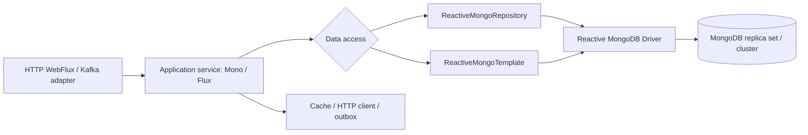
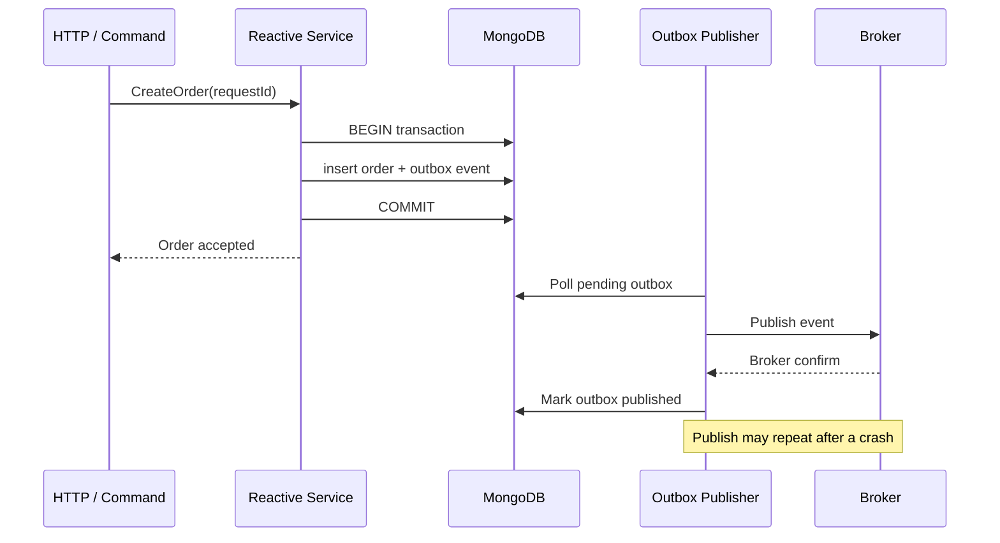

# ReactiveMongoTemplate and Reactive Repositories

In **SPRING_BOOT_INTEGRATION**, a request might originate from HTTP, query MongoDB, check state in a cache, emit an event to a broker, or pass through a Spring Integration adapter. If that path is built on a **reactive** model, the MongoDB access layer must also remain asynchronous rather than introducing blocking operations onto the event loop. Spring Data MongoDB provides two core tools: **`ReactiveMongoRepository`** for repository-abstraction queries and **`ReactiveMongoTemplate`** when the application needs direct control over `Query`, `Criteria`, `Update`, atomic writes, or aggregations.

This lesson belongs to the **MongoDB** chapter and focuses on choosing and using these two APIs in Spring Boot—from dependencies and auto-configuration to document schemas, indexing, transactions, error handling, duplicate prevention, testing, and observability. The goal is an integration flow that **does not block the event loop, enforces clear data contracts, and knows exactly what it guarantees**.

> Examples target **Java 17+, Spring Boot 3.x, Spring Data MongoDB 4.x, and Reactor 3.x**. Use the Spring Boot BOM to align Spring Data, MongoDB Java driver, and Reactor versions. Different Spring Boot/Spring Data generations may use different APIs or packages; do not mix incompatible guidance across generations.

## 1. Learning Objectives

After this lesson, you will be able to:

1. Distinguish blocking `MongoRepository`/`MongoTemplate` from `ReactiveMongoRepository`/`ReactiveMongoTemplate`.
2. Configure `spring-boot-starter-data-mongodb-reactive` and understand which beans Boot auto-configures when conditions match.
3. Design Mongo documents and separate DTOs, choosing `@Id`, `@Version`, `@Indexed`, and appropriate BSON types.
4. Write queries using reactive repositories, `Mono`, `Flux`, derived method-name queries, and `Pageable`.
5. Use `ReactiveMongoTemplate` for dynamic queries, conditional updates, `findAndModify`, aggregations, and index management.
6. Apply unique indexes, optimistic locking, MongoDB transactions, and outbox within their proper scope to protect business side effects.
7. Manage backpressure, timeouts, retries, connection pools, change streams, and subscription lifecycles.
8. Test with `StepVerifier`/Testcontainers and recognize the practical boundaries of a reactive MongoDB flow.

## 2. How Does Reactive MongoDB Work?

**Reactive MongoDB** uses the **Reactive Streams MongoDB Java Driver** and integrates via Reactor. Instead of calling the database and blocking a thread until the result arrives, the application describes a pipeline that executes asynchronously according to subscriber demand.

| API | Typical Return Types | Characteristics |
| --- | --- | --- |
| `MongoRepository<OrderDocument, String>` | `OrderDocument`, `List<OrderDocument>`, `Optional`, etc. | Blocking; fits synchronous Spring MVC/JDBC flows if that architecture is chosen. |
| `MongoTemplate` | Direct results or collections | Blocking; provides a flexible query/update API. |
| `ReactiveMongoRepository<OrderDocument, String>` | `Mono<OrderDocument>`, `Flux<OrderDocument>`, `Mono<Boolean>` | Reactive repository; Spring Data implements CRUD and derived queries. |
| `ReactiveMongoTemplate` | `Mono<T>`, `Flux<T>`, `Mono<UpdateResult>` | Lower-level reactive operations for dynamic queries, updates, and aggregations. |
| Synchronous driver `MongoClient` | Synchronous driver API | Does not magically become non-blocking just because it is called inside a `Mono`. |
| `com.mongodb.reactivestreams.client.MongoClient` | Reactive Streams publishers | Reactive transport used by `ReactiveMongoTemplate`/repositories. |



**Reactive does not mean the database processes queries faster:** MongoDB still has to read indexes, scan documents, satisfy write concerns, and potentially wait for resources. Reactive primarily prevents the caller from **holding a blocked thread during each I/O wait**, while providing a publisher model to compose data and error signals.

### 2.1. *Lazy* execution and subscription behavior

In most cases, a publisher returned by a reactive repository/template only begins executing the MongoDB operation when **subscribed to**. For example:

```java
Mono<OrderDocument> operation = repository.findById("order-123");
// No subscriber yet; only an operation description has been created.
```

In Spring WebFlux, the framework subscribes to the publisher returned by the controller. In background tasks (such as Kafka consumers or schedulers), **the application must own the execution lifecycle**, ensuring completion and errors are tracked. Never call `subscribe()` arbitrarily and report “processed successfully” before the database commits.

A **cold** publisher can also re-execute if subscribed to a second time. If a publisher writes to MongoDB:

```java
Mono<OrderDocument> write = repository.insert(order);
```

two independent subscribers can trigger **two write attempts**. Therefore, never store a side-effecting publisher in a variable and share it across multiple subscribers without understanding subscription semantics; use business keys/unique constraints and intentional result-sharing policies when genuinely required.

## 3. Dependencies and Auto-Configuration in Spring Boot

To use reactive MongoDB in a Spring Boot 3.x project, the exact dependency is:

```xml
<dependency>
    <groupId>org.springframework.boot</groupId>
    <artifactId>spring-boot-starter-data-mongodb-reactive</artifactId>
</dependency>
```

If the application **serves reactive HTTP**, add:

```xml
<dependency>
    <groupId>org.springframework.boot</groupId>
    <artifactId>spring-boot-starter-webflux</artifactId>
</dependency>
```

With Gradle Groovy DSL:

```groovy
dependencies {
    implementation 'org.springframework.boot:spring-boot-starter-data-mongodb-reactive'
    implementation 'org.springframework.boot:spring-boot-starter-webflux'
    testImplementation 'org.springframework.boot:spring-boot-starter-test'
    testImplementation 'io.projectreactor:reactor-test'
}
```

**`spring-boot-starter-webflux` is not required solely to use reactive repositories** in a Kafka consumer or batch service. Conversely, merely adding `spring-boot-starter-webflux` does not turn legacy blocking/JDBC repositories reactive. If an application has both MVC and WebFlux on the classpath, how Boot chooses the web application type depends on the dependency set and configuration; never assume the server runs reactively from a single dependency line.

### 3.1. Environment-based connection configuration

```yaml
spring:
  data:
    mongodb:
      uri: ${MONGODB_URI:mongodb://localhost:27017/order_integration}
```

URI parameters can specify the replica set, read preference, write concern, authentication source, and TLS depending on deployment, for example:

```text
mongodb://mongo-a:27017,mongo-b:27017/order_integration?replicaSet=rs0&retryWrites=true&w=majority
```

This is an **illustrative URI**, not a production cluster or real password. Credentials/TLS keys must come from a secret manager or proper environment configuration; never commit passwords directly into the repository. For MongoDB Atlas/SRV, use a `mongodb+srv://...` URI and ensure DNS/TLS match the deployment.

When the reactive MongoDB driver and valid connection settings are present, Spring Boot can auto-configure:

| Infrastructure | What Boot/Spring Data Can Provide | What the Application Must Still Decide |
| --- | --- | --- |
| Reactive `MongoClient` | Client/driver and Mongo connection settings when conditions match | URI, TLS, pool, tenant isolation, and privileges. |
| `ReactiveMongoDatabaseFactory` | Database selection and session infrastructure | Database per environment/tenant, authentication policy. |
| `ReactiveMongoTemplate` | Reactive operations with mapping converter | Queries, updates, indexes, transaction boundaries, timeouts. |
| Reactive repositories | Proxies for repository interfaces found via component scan | Models, query methods, domain rules, and unique constraints. |
| Mongo mapping converter | Java ↔ BSON mapping via Spring Data | Decimal/time/ID types, DTO separation, schema migrations. |
| Health/metrics when Actuator is added | Certain infrastructure/driver indicators when conditions match | Business metrics, error classification, correlation IDs. |

**Auto-configuration is conditional.** If you manually declare a `MongoClient`, `ReactiveMongoTemplate`, converter, or multiple database factories, Boot may back off or pick a different bean. When the application fails to connect, inspect the condition evaluation report and current context configuration rather than assuming every bean always exists.

### 3.2. When should you avoid mixing blocking and reactive?

A service may contain both reactive MongoDB and blocking JDBC, provided it respects **thread boundaries**. Inside WebFlux/Reactor Netty, never call `MongoTemplate.findOne(...)` or blocking JDBC queries directly on the event loop; they can stall unrelated requests. If a blocking library must be used within a reactive pipeline, isolate it onto `Schedulers.boundedElastic()` intentionally while evaluating whether maintaining a clear blocking architecture would be better than complex mixing.

Never wrap a blocking client with `Mono.just(blockingCall())` because the blocking call **executes eagerly** before the publisher is even subscribed to. Likewise, never call `block()` inside a WebFlux handler to wait on a reactive repository: doing so defeats non-blocking execution and can throw errors on non-blocking threads.

## 4. MongoDB Models, DTOs, and BSON Are Not the Same Contract

Spring Data MongoDB uses annotations such as `@Document`, `@Id`, `@Field`, `@Indexed`, and `@Version` to map Java objects to BSON documents. This is the **storage model**, not the JSON contract that HTTP clients or brokers should depend on directly.

Example of an immutable document using a Java record:

```java
import java.math.BigDecimal;
import java.time.Instant;
import org.springframework.data.annotation.Id;
import org.springframework.data.annotation.Version;
import org.springframework.data.mongodb.core.index.Indexed;
import org.springframework.data.mongodb.core.mapping.Document;
import org.springframework.data.mongodb.core.mapping.Field;
import org.springframework.data.mongodb.core.mapping.FieldType;

@Document(collection = "orders")
public record OrderDocument(
        @Id String id,
        @Indexed(unique = true) String businessKey,
        String customerId,
        @Field(targetType = FieldType.DECIMAL128) BigDecimal totalAmount,
        String status,
        Instant createdAt,
        @Version Long version
) {}
```

Meaning of key elements:

| Attribute | Purpose | Caveat |
| --- | --- | --- |
| `@Document(collection = "orders")` | Maps to the `orders` Mongo collection | Does not automatically define schema validation or all indexes. |
| `@Id String id` | Maps to MongoDB's `_id` field | May use ObjectId or another ID; understand `String`/`ObjectId` conversion rules. |
| `@Indexed(unique = true)` | Declares **intent** to have a unique index on the business key | Does not prove the index exists in production. |
| `@Field(targetType = DECIMAL128)` | Stores `BigDecimal` as BSON Decimal128 per mapping | You must still define currency, precision, scale, and rounding. |
| `Instant createdAt` | UTC creation timestamp in the domain | BSON Date stores milliseconds; check precision if contracts require nanoseconds. |
| `@Version Long version` | Supports optimistic locking for supported Spring Data operations | Does not make arbitrary `updateMulti`/native driver queries check the old version automatically. |

With records, each component is initialized via the constructor, and Spring Data can construct an updated immutable copy when managing properties like ID/version. Use **compatible Spring Data APIs/versions and test real mapping**; never attempt to mutate final fields as if they were mutable objects.

**Important regarding unique indexes:** `@Indexed(unique = true)` **is insufficient to guarantee uniqueness if MongoDB does not yet have the index**. Spring Data MongoDB does not create indexes from annotations by default across all configurations/versions (in newer Spring Data generations, auto-index creation is typically off by default). In production, create indexes via migrations/Infrastructure as Code or a controlled schema process, verify the index list, and clean up existing duplicates beforehand.

Mongo shell example:

```javascript
db.orders.createIndex(
  { businessKey: 1 },
  { unique: true, name: "uq_orders_business_key" }
);
```

One way to verify:

```javascript
db.orders.getIndexes();
```

Never let multiple application replicas simultaneously create or alter complex indexes at production startup without a migration plan. Mongo indexes affect write latency, memory, disk usage, and the query planner; measure before and after changes.

### 4.1. DTOs for HTTP and events

```java
import jakarta.validation.constraints.NotBlank;
import jakarta.validation.constraints.NotNull;
import jakarta.validation.constraints.Positive;
import java.math.BigDecimal;
import java.time.Instant;

public record CreateOrderRequest(
        @NotBlank String requestId,
        @NotBlank String customerId,
        @NotNull @Positive BigDecimal totalAmount
) {}

public record OrderResponse(
        String id,
        String businessKey,
        String status,
        BigDecimal totalAmount,
        Instant createdAt
) {}
```

`OrderDocument` belongs strictly to the persistence adapter, whereas `CreateOrderRequest`/`OrderResponse` belong to the HTTP contract. When publishing Kafka events, define a separate `OrderAcceptedEventV1` with explicit `eventId` and `schemaVersion`; never send raw `OrderDocument` (especially `_id`, `version`, or sensitive fields) merely because a serializer can read the record.

In subsequent Java examples, each top-level `public` type belongs in its own file per standard Java convention.

## 5. Reactive Repository: CRUD and Derived Queries

For most CRUD cases, `ReactiveMongoRepository` reduces MongoDB boilerplate. Spring Data generates implementations from the interface, maps results to entities, and returns appropriate publishers:

```java
import org.springframework.data.domain.Pageable;
import org.springframework.data.mongodb.repository.Query;
import org.springframework.data.mongodb.repository.ReactiveMongoRepository;
import reactor.core.publisher.Flux;
import reactor.core.publisher.Mono;

public interface OrderRepository
        extends ReactiveMongoRepository<OrderDocument, String> {

    Mono<OrderDocument> findByBusinessKey(String businessKey);

    Flux<OrderDocument> findByCustomerIdOrderByCreatedAtDesc(
            String customerId);

    Flux<OrderDocument> findByCustomerId(
            String customerId, Pageable pageable);

    Mono<Long> countByCustomerId(String customerId);

    @Query("{ 'customerId': ?0, 'status': ?1 }")
    Flux<OrderDocument> findByCustomerAndStatus(
            String customerId, String status);
}
```

| Method | Reactive Return | Notes |
| --- | --- | --- |
| `findById(id)` | `Mono<OrderDocument>` | **Empty** Mono when not found; does not mean a database error. |
| `findByBusinessKey(key)` | `Mono<OrderDocument>` | Expects at most one result only if a proper unique constraint exists. |
| `findByCustomerIdOrderByCreatedAtDesc(id)` | `Flux<OrderDocument>` | May return many documents; consider indexes, ordering, and result bounds. |
| `countByCustomerId(id)` | `Mono<Long>` | Counting incurs a separate query cost; not automatically bundled with list queries. |
| `insert(entity)` | `Mono<OrderDocument>` | Use when the intent is **creating new**, not silently upserting. |
| `save(entity)` | `Mono<OrderDocument>` | Can insert or update depending on entity/ID state; watch `@Version`. |
| `deleteById(id)` | `Mono<Void>` | Completion does not guarantee the document existed beforehand. |

### 5.1. `Mono.empty()` is a valid result

With a repository:

```java
public Mono<OrderDocument> requireOrder(String id) {
    return repository.findById(id)
            .switchIfEmpty(Mono.error(
                    new OrderNotFoundException(id)));
}
```

`switchIfEmpty` turns “no document” into a domain error when an API must distinguish 404 from a valid empty result. For list searches, `Flux.empty()` can simply mean “no orders” without returning an error.

`Mono<Void>` completion only signals stream termination; never use `Mono.just(null)`. In Reactor, `null` is not a valid `onNext` value. With `zip`, if one source is `Mono.empty()`, the combined result can be empty; keep this in mind when combining DB queries with HTTP/Redis calls.

### 5.2. Pagination in reactive repositories

Example:

```java
import org.springframework.data.domain.PageRequest;
import org.springframework.data.domain.Sort;
import reactor.core.publisher.Flux;

public Flux<OrderDocument> recentOrders(
        String customerId, int page, int size) {

    if (page < 0 || size < 1 || size > 100) {
        return Flux.error(new IllegalArgumentException(
                "Invalid pagination arguments"));
    }

    var pageable = PageRequest.of(
            page, size, Sort.by(Sort.Direction.DESC, "createdAt"));
    return repository.findByCustomerId(customerId, pageable);
}
```

Reactive repositories typically return **`Flux<T>`** rather than `Page<T>` as blocking repositories do, because a full `Page` requires a total element count and metadata. If the API needs `totalElements`, run `countByCustomerId(...)` separately, keeping in mind that data may change between the two queries. For very large or rapidly changing datasets, **keyset/cursor pagination** is usually better than deep-page `skip/limit`.

Add the right index for list queries, for example:

```javascript
db.orders.createIndex(
  { customerId: 1, createdAt: -1 },
  { name: "idx_orders_customer_created" }
);
```

Do not infer index existence from repository method names: **Spring Data translates the method name into a query, while MongoDB still needs a matching index** to avoid collection scans and server resource contention.

## 6. Application Service Example with a Reactive Repository

Suppose HTTP clients send a stable `requestId`. In this example, it serves as `businessKey` to create exactly **one order per logical request**. Never generate a fresh random ID as the deduplication key on every client retry.

```java
import java.time.Instant;
import java.util.Objects;
import org.springframework.dao.DuplicateKeyException;
import org.springframework.stereotype.Service;
import reactor.core.publisher.Mono;

@Service
public class ReactiveOrderService {
    private final OrderRepository repository;

    public ReactiveOrderService(OrderRepository repository) {
        this.repository = repository;
    }

    public Mono<OrderResponse> create(CreateOrderRequest request) {
        return Mono.defer(() -> {
            validate(request);

            var newOrder = new OrderDocument(
                    null,
                    request.requestId(),
                    request.customerId(),
                    request.totalAmount(),
                    "PENDING",
                    Instant.now(),
                    null);

            return repository.insert(newOrder)
                    .onErrorResume(
                            DuplicateKeyException.class,
                            ignored -> repository
                                    .findByBusinessKey(request.requestId())
                                    .switchIfEmpty(Mono.error(ignored))
                                    .flatMap(existing -> {
                                        if (sameCommand(existing, request)) {
                                            return Mono.just(existing);
                                        }
                                        return Mono.error(
                                                new OrderIdentityConflictException());
                                    }))
                    .map(this::toResponse);
        });
    }

    public Mono<OrderResponse> findById(String id) {
        return repository.findById(id).map(this::toResponse);
    }

    private void validate(CreateOrderRequest request) {
        if (request == null
                || request.requestId() == null
                || request.requestId().isBlank()
                || request.customerId() == null
                || request.customerId().isBlank()
                || request.totalAmount() == null
                || request.totalAmount().signum() <= 0) {
            throw new IllegalArgumentException("Invalid order request");
        }
    }

    private boolean sameCommand(
            OrderDocument existing, CreateOrderRequest request) {
        return Objects.equals(existing.customerId(), request.customerId())
                && existing.totalAmount()
                        .compareTo(request.totalAmount()) == 0;
    }

    private OrderResponse toResponse(OrderDocument order) {
        return new OrderResponse(
                order.id(), order.businessKey(),
                order.status(), order.totalAmount(),
                order.createdAt());
    }
}

class OrderIdentityConflictException extends RuntimeException {
    OrderIdentityConflictException() {
        super("Same requestId with different order data");
    }
}

class OrderNotFoundException extends RuntimeException {
    OrderNotFoundException(String id) {
        super("Order not found: " + id);
    }
}
```

**Why use `Mono.defer`?** Input validation, `Instant.now()`, and entity instantiation occur when the subscriber actually begins execution. If a publisher is constructed at one time and subscribed to later, capturing the timestamp at assembly time would reflect the wrong business time. `defer` also ensures synchronous exceptions from `validate` flow through Reactor's error signal.

**Why `insert` instead of `save`?** When creating a new order, the intent is **not to overwrite an existing document with the same ID**. `save` carries insert/update semantics depending on entity state and version; `insert` expresses creation intent clearly. Yet `insert` alone is insufficient: the unique index on `businessKey` is what protects against two concurrent requests carrying distinct Mongo IDs.

**Why compare payload on duplicate?** If two requests share `requestId` yet differ in `customerId` or `totalAmount`, that is a **contract conflict**, not a valid retry. The sample code compares only two business fields; production must define all fields to compare, normalize inputs, and scope by tenant in multi-tenant systems.

**Example limitation:** `DuplicateKeyException` could also stem from **another** unique index. The code looks up by `requestId`; if nothing is found, it re-emits the original exception rather than falsely assuming every duplicate key is an already-processed event. For collections with multiple indexes/invariants, classify causes explicitly and emit metrics.

### 6.1. Why `existsByBusinessKey` before `insert` is not enough

Two requests can execute concurrently:

```text
Client A: existsByBusinessKey("req-10") = false
Client B: existsByBusinessKey("req-10") = false
Client A: insert(...)  -> succeeds
Client B: insert(...)  -> also attempts insert
```

Without a **unique index in MongoDB**, both documents can be saved. Placing a mutex inside a single Java instance does not protect across multiple pods. Use atomic writes and database unique constraints, then translate conflict errors into meaningful business responses.

## 7. ReactiveMongoTemplate: Flexible Queries and Conditional Updates

`ReactiveMongoTemplate` fits when building dynamic `Query` objects, querying projections/aggregations, updating with multiple predicates, or running MongoDB operations awkward to express via repository method names.

```java
import org.springframework.data.domain.Sort;
import org.springframework.data.mongodb.core.ReactiveMongoTemplate;
import org.springframework.data.mongodb.core.query.Criteria;
import org.springframework.data.mongodb.core.query.Query;
import org.springframework.stereotype.Component;
import reactor.core.publisher.Flux;

@Component
public class OrderQueryAdapter {
    private final ReactiveMongoTemplate mongo;

    public OrderQueryAdapter(ReactiveMongoTemplate mongo) {
        this.mongo = mongo;
    }

    public Flux<OrderDocument> pendingByCustomer(
            String customerId, int limit) {
        if (limit < 1 || limit > 100) {
            return Flux.error(
                    new IllegalArgumentException("Invalid limit"));
        }

        Query query = Query.query(
                Criteria.where("customerId").is(customerId)
                        .and("status").is("PENDING"))
                .with(Sort.by(Sort.Direction.DESC, "createdAt"))
                .limit(limit);

        return mongo.find(query, OrderDocument.class);
    }
}
```

**Explanation:**

- `Criteria` defines conditions; `Query` carries filters, sort, limit, projections, and query options.
- `mongo.find(...)` returns `Flux<OrderDocument>`; the application controls consumption, streaming, and response bounds.
- When allowing clients to supply dynamic filter/sort fields, **allowlist field names and operator types**. Never build BSON queries by concatenating user-supplied JSON strings; that invites operator injection and unintended queries.
- A query with `limit` does not guarantee fast responses if an appropriate index is missing. Use `explain`/execution stats to measure rather than guessing from Java method names.

### 7.1. Atomic state updates with `findAndModify`

Suppose an order may transition from `PENDING` to `ACCEPTED` only once. Instead of `findById` → mutate object → `save` without a state guard, combine the **precondition and update into a single Mongo operation**:

```java
import org.springframework.data.mongodb.core.FindAndModifyOptions;
import org.springframework.data.mongodb.core.ReactiveMongoTemplate;
import org.springframework.data.mongodb.core.query.Criteria;
import org.springframework.data.mongodb.core.query.Query;
import org.springframework.data.mongodb.core.query.Update;
import org.springframework.stereotype.Component;
import reactor.core.publisher.Mono;

@Component
public class OrderTransitionAdapter {
    private final ReactiveMongoTemplate mongo;

    public OrderTransitionAdapter(ReactiveMongoTemplate mongo) {
        this.mongo = mongo;
    }

    public Mono<OrderDocument> acceptPending(String businessKey) {
        Query query = Query.query(
                Criteria.where("businessKey").is(businessKey)
                        .and("status").is("PENDING"));
        Update update = new Update().set("status", "ACCEPTED");

        return mongo.findAndModify(
                query, update,
                FindAndModifyOptions.options().returnNew(true),
                OrderDocument.class);
    }
}
```

In MongoDB, **modifications to a single document are atomic** for a single update operation. If two concurrent requests filter on `status=PENDING`, only one can transition the status from `PENDING` to `ACCEPTED`; the subsequent one receives `Mono.empty()` because the condition no longer holds.

**Important distinctions:**

- `Mono.empty()` here does not tell you whether the document **does not exist** or **was already processed**. If the API must distinguish these, re-read the state and map to an appropriate result/409.
- `@Version` may be incremented by Spring Data on certain update operations; **never assume every `updateFirst` or native update automatically checks the old version**. For explicit optimistic checks, put the expected version into the filter or use `save` with `@Version` support.
- With `updateMulti`, atomicity applies **per document**, not across the entire matched set as a single transaction.
- An operation completing in MongoDB does not mean a Kafka message was published or Redis was updated.

### 7.2. `upsert` and avoiding duplicate records

`upsert` updates a document matching the query or inserts a new one if none matches. It works well for configuration/cached materialized views, provided you know the exact **unique identifier** and filter fields.

For example, running `upsert` by `businessKey` **without a unique index**: two concurrent requests can both see no document and insert two records. A unique index and `DuplicateKeyException` handling are still required. Never run `upsert` with an overly broad filter or one containing fields that mutate over time, as that can accidentally insert a new document instead of updating the existing entity.

### 7.3. Aggregations and projecting data

`ReactiveMongoTemplate` supports MongoDB aggregation pipelines. Example counting accepted orders per customer:

```java
import static org.springframework.data.mongodb.core.aggregation.Aggregation.*;

import org.bson.Document;
import org.springframework.data.domain.Sort;
import org.springframework.data.mongodb.core.ReactiveMongoTemplate;
import org.springframework.data.mongodb.core.query.Criteria;
import reactor.core.publisher.Flux;

public Flux<Document> acceptedOrdersByCustomer(
        ReactiveMongoTemplate mongo) {
    var pipeline = newAggregation(
            match(Criteria.where("status").is("ACCEPTED")),
            group("customerId").count().as("orderCount"),
            sort(Sort.Direction.DESC, "orderCount"));

    return mongo.aggregate(pipeline, "orders", Document.class);
}
```

The result consists of BSON `Document` objects containing the group key and `orderCount`, **not public HTTP DTOs**. Before returning over an API, map to a dedicated response type, bound groups/pages appropriately, and enforce authorization. Aggregations can consume substantial MongoDB resources; measure execution plans/indexes, narrow scope with early `$match` filters, and avoid streaming huge result sets into `collectList()`.

## 8. Unique Indexes, Optimistic Locking, and Different Consistency Levels

In MongoDB, three distinct needs are frequently confused:

| Problem | Appropriate Mechanism | What Not to Expect |
| --- | --- | --- |
| No two orders with the same `businessKey` | Unique index on `businessKey` | Application-level `existsBy...` does not replace a unique index. |
| Two writers editing one order without silent overwrites | `@Version`/optimistic locking or conditional updates | Unique `businessKey` does not prevent lost updates. |
| A change spanning multiple documents together | MongoDB transaction on a supporting topology | Single-document atomicity does not cover multiple documents. |
| Mongo writes data and broker must receive an event | Transactional outbox or designed coordination mechanism | Mongo transactions do not include Kafka/RabbitMQ by default. |
| Read-after-write or reducing lost writes | Appropriate read/write concerns and session/replica semantics | Reading from a secondary under eventual consistency does not always reflect recent writes immediately. |

### 8.1. Optimistic locking with `@Version`

When a model has `@Version Long version`, supported repository `save` operations check the previously read version. If someone else modified the document first, updating from the stale version throws `OptimisticLockingFailureException`:

```java
import org.springframework.dao.OptimisticLockingFailureException;
import org.springframework.stereotype.Service;
import reactor.core.publisher.Mono;

@Service
public class OrderVersionedService {
    private final OrderRepository repository;

    public OrderVersionedService(OrderRepository repository) {
        this.repository = repository;
    }

    public Mono<OrderDocument> markAccepted(String id) {
        return repository.findById(id)
                .switchIfEmpty(Mono.error(
                        new OrderNotFoundException(id)))
                .flatMap(existing -> {
                    if (!"PENDING".equals(existing.status())) {
                        return Mono.error(
                                new IllegalStateException(
                                        "Invalid state transition"));
                    }

                    var changed = new OrderDocument(
                            existing.id(),
                            existing.businessKey(),
                            existing.customerId(),
                            existing.totalAmount(),
                            "ACCEPTED",
                            existing.createdAt(),
                            existing.version());
                    return repository.save(changed);
                });
    }
}
```

If two clients read version `3`, only one valid update to the new version can succeed under optimistic locking; the other must **re-read the state and decide**. Never retry blindly by overwriting the latest state. Ensure appropriate write concern/acknowledged writes; optimistic lock detection cannot work reliably if writes are unacknowledged under the relevant semantics.

**`@Version` does not replace business state rules.** If an order is already `ACCEPTED`, a `CANCEL` command must enforce state transitions, permissions, and event ordering—not merely bump the version and let any state overwrite another.

### 8.2. Read concern, write concern, and replica consistency

- **Write concern** specifies how many MongoDB servers/members must acknowledge a write, e.g., `w: "majority"` for stronger durability across the topology.
- **Read concern** specifies what data visibility is permitted for reads; `majority`, `local`, and `snapshot` carry distinct guarantees.
- **Read preference** selects which node serves reads (primary/secondary); secondary reads can experience replication lag.
- **Causal consistency** matters when a session must observe causal ordering across operations.

These are **consistency contract decisions**, not arbitrary flags to make an entire distributed workflow “strongly consistent”. For example, if a consumer updates the MongoDB primary and another API reads from a secondary immediately afterward, it may see stale data depending on topology/settings. For financial operations or read-after-write flows, define the desired semantics, test against real deployments, and accept the latency/throughput trade-offs.

## 9. Reactive Transactions: Multiple Documents Within the Same MongoDB

MongoDB supports **multi-document transactions** on an eligible topology, such as a **replica set or sharded cluster** configured for transactions. A standalone MongoDB server does not support this type of transaction in the replica-set manner; attempting a transaction on standalone can raise an error requiring a replica set. Configure Testcontainers and deployment environments accordingly.

In reactive Spring Data MongoDB, register `ReactiveMongoTransactionManager` and use `TransactionalOperator`:

```java
import org.springframework.context.annotation.Bean;
import org.springframework.context.annotation.Configuration;
import org.springframework.data.mongodb.ReactiveMongoDatabaseFactory;
import org.springframework.data.mongodb.ReactiveMongoTransactionManager;
import org.springframework.transaction.ReactiveTransactionManager;
import org.springframework.transaction.reactive.TransactionalOperator;

@Configuration(proxyBeanMethods = false)
public class ReactiveMongoTxConfiguration {

    @Bean
    ReactiveMongoTransactionManager reactiveMongoTransactionManager(
            ReactiveMongoDatabaseFactory factory) {
        return new ReactiveMongoTransactionManager(factory);
    }

    @Bean
    TransactionalOperator mongoTransactionalOperator(
            ReactiveTransactionManager manager) {
        return TransactionalOperator.create(manager);
    }
}
```

**Reactive transaction context travels via Reactor Context**, not via `ThreadLocal` as commonly assumed for blocking transactions. When Mongo operations remain inside the same reactive pipeline/transaction operator, Spring Data attaches the appropriate session. If you break out into a separate `subscribe()`, jump across callbacks that drop the context, or run operations outside the pipeline, do not assume they still belong to the same transaction.

### 9.1. MongoDB transactional outbox example

Suppose an order must be persisted alongside the **intent to emit an event**, so if the process dies before sending to Kafka/RabbitMQ, an outbox record remains for a publisher to recover.

```java
import java.time.Instant;
import org.springframework.data.annotation.Id;
import org.springframework.data.mongodb.core.mapping.Document;

@Document(collection = "order_outbox")
public record OrderOutboxDocument(
        @Id String id,
        String eventType,
        int schemaVersion,
        String payloadJson,
        String publishStatus,
        Instant createdAt
) {}
```

`id` here can be chosen as a **stable logical event ID**, so retries do not create duplicate equivalent outbox events when the application checks idempotency by business key.

```java
import org.springframework.data.mongodb.core.ReactiveMongoTemplate;
import org.springframework.stereotype.Service;
import org.springframework.transaction.reactive.TransactionalOperator;
import reactor.core.publisher.Mono;

@Service
public class MongoOrderOutboxWriter {
    private final ReactiveMongoTemplate mongo;
    private final TransactionalOperator tx;

    public MongoOrderOutboxWriter(
            ReactiveMongoTemplate mongo,
            TransactionalOperator tx) {
        this.mongo = mongo;
        this.tx = tx;
    }

    public Mono<OrderDocument> insertOrderAndOutbox(
            OrderDocument order, OrderOutboxDocument outbox) {

        return mongo.insert(order)
                .flatMap(saved ->
                        mongo.insert(outbox).thenReturn(saved))
                .as(tx::transactional);
    }
}
```

Both `insert` operations share the same MongoDB transaction if the factory, session, topology, and transaction manager are configured properly. If writing the outbox fails, the order write must roll back. Never keep the transaction open **waiting for a Kafka ACK, HTTP response, or Redis update**; systems outside MongoDB **do not** participate in the MongoDB transaction.



**An outbox does not prevent the broker from receiving the same event twice.** The publisher can send the event and crash before marking `PUBLISHED`; on restart it will send again. Consumers must use **inbox/unique keys/idempotency** keyed on `eventId` to avoid duplicating side effects. In MongoDB, a unique index on `eventId` in an inbox collection helps if recording the inbox entry and the business effect occur inside an appropriate transaction; for side effects in external systems like PostgreSQL/HTTP, design dedicated reconciliation.

### 9.2. `@Transactional` with reactive methods

`@Transactional` can be placed on methods returning `Mono`/`Flux` when a reactive transaction manager is configured, the method is invoked via a Spring proxy, and **the returned publisher encapsulates the operations to enlist**:

```java
import org.springframework.stereotype.Service;
import org.springframework.transaction.annotation.Transactional;
import reactor.core.publisher.Mono;

@Service
public class OrderTxFacade {
    private final ReactiveMongoTemplate mongo;

    public OrderTxFacade(ReactiveMongoTemplate mongo) {
        this.mongo = mongo;
    }

    @Transactional
    public Mono<OrderDocument> insertBoth(
            OrderDocument order, OrderOutboxDocument outbox) {
        return mongo.insert(order)
                .flatMap(saved ->
                        mongo.insert(outbox).thenReturn(saved));
    }
}
```

Never put `@Transactional` on a method and then **manually call `subscribe()` and return `Mono.empty()`**: that detaches the work from the intended transaction boundary. Never use transactions on unbounded infinite streams, because transactions must commit and are constrained by server session/resource limits. Complex transactions need a **whole-transaction** retry strategy for transient errors per driver/session rules; retrying arbitrary individual writes breaks correctness.

### 9.3. When a transaction is not needed

MongoDB natively guarantees single-document atomicity. For a command updating only **one order's** status via a conditional `findAndModify`, a multi-document transaction is usually unnecessary. Transactions add latency/overhead and hold resources longer; reserve them when an **invariant truly spans multiple documents**.

## 10. Consuming Mono/Flux Properly in a WebFlux Controller

Reactive MongoDB is commonly paired with Spring WebFlux when the entire HTTP stack is non-blocking:

```java
import jakarta.validation.Valid;
import org.springframework.http.HttpStatus;
import org.springframework.http.ResponseEntity;
import org.springframework.web.bind.annotation.GetMapping;
import org.springframework.web.bind.annotation.PathVariable;
import org.springframework.web.bind.annotation.PostMapping;
import org.springframework.web.bind.annotation.RequestBody;
import org.springframework.web.bind.annotation.RequestMapping;
import org.springframework.web.bind.annotation.RestController;
import reactor.core.publisher.Mono;

@RestController
@RequestMapping("/api/orders")
public class ReactiveOrderController {
    private final ReactiveOrderService service;

    public ReactiveOrderController(ReactiveOrderService service) {
        this.service = service;
    }

    @PostMapping
    public Mono<ResponseEntity<OrderResponse>> create(
            @Valid @RequestBody Mono<CreateOrderRequest> request) {
        return request.flatMap(service::create)
                .map(saved -> ResponseEntity
                        .status(HttpStatus.CREATED)
                        .body(saved));
    }

    @GetMapping("/{id}")
    public Mono<ResponseEntity<OrderResponse>> get(
            @PathVariable String id) {
        return service.findById(id)
                .map(ResponseEntity::ok)
                .defaultIfEmpty(ResponseEntity.notFound().build());
    }
}
```

Spring WebFlux subscribes to the returned publisher. `@Valid` on the request body requires the validation module, and WebFlux binder/validation errors should be mapped via proper exception handling; `ReactiveOrderService.validate` still protects **calls from Kafka/schedulers/other adapters** that bypass HTTP.

**Never call `service.create(request).subscribe()` inside a controller and return `200 OK` immediately**: the write may not be finished, errors vanish from the response path, and client retries can cause duplicate writes. Never call `block()` on the event loop to turn a `Mono` into a synchronous value.

When returning multiple documents to a client:

```java
import org.springframework.web.bind.annotation.GetMapping;
import org.springframework.web.bind.annotation.RequestParam;
import org.springframework.web.bind.annotation.RestController;
import reactor.core.publisher.Flux;

@RestController
public class CustomerOrdersController {
    private final OrderRepository repository;

    public CustomerOrdersController(OrderRepository repository) {
        this.repository = repository;
    }

    @GetMapping("/api/customer-orders")
    public Flux<OrderResponse> list(
            @RequestParam String customerId) {
        return repository
                .findByCustomerIdOrderByCreatedAtDesc(customerId)
                .take(100)
                .map(order -> new OrderResponse(
                        order.id(),
                        order.businessKey(),
                        order.status(),
                        order.totalAmount(),
                        order.createdAt()));
    }
}
```

This example places `take(100)` as a Reactor safeguard; **push `limit(100)` down into the MongoDB query/repository from the start** when the limit is known, rather than fetching excessive documents only to truncate them. In real APIs, add pagination, tenant authorization filtering, indexes, and ordering contracts so callers cannot dump an entire collection.

### 10.1. Reactive MongoDB does not require reactive HTTP

A Kafka consumer or Spring Integration adapter can use `ReactiveMongoTemplate` inside a service without a WebFlux server. What matters is that **the caller awaits/ties the publisher to the message lifecycle**. For a consumer receiving a record and acking after the DB write:

```text
Receive broker message
  -> map/validate JSON event
  -> subscribe/await Mongo reactive operation under managed processing
  -> observe successful DB commit
  -> ack/commit offset under broker policy
```

If the listener cannot manage reactive publishers natively, build a deliberate adapter bridging reactive completion to the ack; never fire-and-forget. In a blocking Kafka/RabbitMQ listener, calling `block()` on a managed listener thread **can serve as an intentional bridge** at that boundary—with a timeout and never on a Netty event loop—though it does not make the consumer non-blocking and requires sizing thread counts, timeouts, batches, and load.

## 11. Connections, Connection Pool, Timeouts, and Backpressure

**Reactive does not mean “no pool”.** The reactive MongoDB driver still manages sockets/connections to MongoDB servers along with connection pools, selection timeouts, server monitoring, and concurrency constraints. Even without blocking the event loop, too many concurrent queries can saturate MongoDB or the pool.

| Resource / Limit | Function | Consequence if Misconfigured |
| --- | --- | --- |
| MongoDB connection pool max size | Ceiling on connections per server/cluster per driver settings | Too small causes queueing; too large overloads the server with connections. |
| Pool wait timeout | Time spent waiting to acquire a connection | Long waits can blow the overall flow deadline. |
| Server selection timeout | Max wait to pick a MongoDB server matching topology/read preference | Fails when no primary is available or during cluster failover. |
| Socket/connect timeout | Bounds specific driver network phases | Not equivalent to an overall operation timeout. |
| Query `maxTimeMS` where applicable | Bounds server-side execution time for an operation | Does not include queue/acquire, mapping, or other downstream steps. |
| Reactor `timeout` operator | Bounds how long a subscriber waits for a signal | Cancellation does not guarantee MongoDB aborts or rolls back an already committed write. |
| Request/Flux concurrency | Number of in-flight operations generated by the app | Unbounded concurrency grows queues, latency, and memory pressure. |

Example configuring the reactive driver via a Spring Boot 3.x customizer:

```java
import java.util.concurrent.TimeUnit;
import org.springframework.boot.autoconfigure.mongo.MongoClientSettingsBuilderCustomizer;
import org.springframework.context.annotation.Bean;
import org.springframework.context.annotation.Configuration;

@Configuration(proxyBeanMethods = false)
public class MongoPoolConfiguration {

    @Bean
    MongoClientSettingsBuilderCustomizer mongoPoolCustomizer() {
        return settings -> {
            settings.applyToConnectionPoolSettings(pool -> pool
                    .maxSize(60)
                    .minSize(0)
                    .maxWaitTime(500, TimeUnit.MILLISECONDS));

            settings.applyToClusterSettings(cluster -> cluster
                    .serverSelectionTimeout(2, TimeUnit.SECONDS));
        };
    }
}
```

Depending on driver version, some pool/timeout APIs may be renamed or deprecated; use the Boot BOM and inspect effective settings. Spring Boot applies `MongoClientSettingsBuilderCustomizer` to its auto-configured client, but **if you manually construct a custom `MongoClient` bypassing Boot**, you must apply settings directly to that client.

**Do not size max connections solely by event-loop thread count.** A reactive pipeline can have many more in-flight I/O operations than active threads. Across multiple instances, total connections and throughput hitting MongoDB equal the sum across **all instances**. Coordinate query bounds, HTTP concurrency, Kafka/AMQP listeners, and MongoDB server capacity.

### 11.1. Flux backpressure does not fix expensive queries

`Flux` supports Reactive Streams demand: downstream subscribers can request items incrementally. However:

- `limitRate(n)` shapes Reactor demand; it does not automatically add an index or `limit n` to a Mongo query.
- `take(n)` stops after n elements, yet the server may have already scanned/prepared data or cursors; prefer `Query.limit(n)` when the contract permits.
- `collectList()` buffers all items into memory; never use it on queries returning millions of documents or infinite change streams.
- MongoDB cursors/batches, driver prefetch, and server-side sorting/aggregations still consume resources.
- Unbounded `flatMap` concurrency can fire too many concurrent writes/requests.

Example bounding concurrency when enriching 200 orders from an HTTP service:

```java
import reactor.core.publisher.Flux;

public Flux<OrderResponse> enrichOrders(
        Flux<OrderDocument> orders,
        PartnerEnrichmentService enrichment) {
    return orders.flatMap(
            order -> enrichment.enrich(order),
            8 /* at most 8 concurrent enrichment operations */);
}
```

`PartnerEnrichmentService.enrich` is an application contract returning `Mono<OrderResponse>` that must define its own timeouts/bulkheads for the partner HTTP call. `flatMap` may emit results out of input order; if order must be preserved, use bounded `concatMap` or `flatMapSequential` and account for throughput trade-offs.

### 11.2. A connection pool is not a cache

A MongoDB pool holds **network connections**, not query results. Redis/Spring Cache has its own TTL, invalidation, and consistency semantics. Even when MongoDB responds quickly thanks to indexes or internal server caching, the application must still design cache keys and authoritative data sources; never assume “a big pool means data is always fresh”.

## 12. Timeouts, Retries, Data Errors, and Business Responses

A reactive pipeline has three kinds of signals: **value**, **completion without a value**, or **error**. Never use `onErrorResume(e -> Mono.empty())` as a blanket handler; doing so turns a serious database failure into “record not found”, causing controllers to return 404 or consumers to ack as if processing succeeded.

| Scenario | Recommended Response | What Not to Do |
| --- | --- | --- |
| `findById` returns `Mono.empty()` | 404 or absent result per contract | Treat it as a MongoDB outage. |
| `DuplicateKeyException` on `businessKey` | Re-read and verify payload/idempotency, or return 409 | Retry inserts endlessly with a new ID. |
| `OptimisticLockingFailureException` | Re-read, validate transition/version, bounded retry if valid | Overwrite current data without checking state. |
| Mongo server selection/connection timeout | Classify as transient, monitor pool/cluster, retry if safe | Crank up every timeout and let requests hang indefinitely. |
| Query exceeds deadline or heavy aggregation | Fix query/indexes and concurrency | Only slap a client `timeout` onto a collection scan. |
| Malformed JSON/BSON against contract | Return contract error or route poison message to quarantine | Retry as if it were a network drop. |
| Mongo write succeeded yet caller timed out | Look up by business key; preserve idempotency key | Conclude definitively “not written”. |
| Mongo committed yet broker publish failed | Outbox publisher recovers; idempotent consumer | Assume Mongo transactions roll back Kafka. |

### 12.1. Publisher timeouts and the Mongo driver

Example:

```java
import java.time.Duration;
import reactor.core.publisher.Mono;

public Mono<OrderDocument> findWithDeadline(
        OrderRepository orders, String id, Duration budget) {
    return orders.findById(id).timeout(budget);
}
```

`timeout(Duration)` limits how long **the subscriber waits** for a signal. On expiration, Reactor emits `TimeoutException` and cancels upstream where supported, yet **does not guarantee MongoDB aborts every server-side operation or rolls back a committed write**. Set appropriate limits at both driver and server layers—such as server selection, pool wait, and `maxTimeMS` on supported operations—alongside an **overall deadline** for the entire flow.

In a multi-step system:

```text
HTTP inbound -> Mongo query -> HTTP partner -> Redis -> outbox/broker
```

if each step independently gets a 2-second timeout, total elapsed time can breach the SLA. Track a per-request time budget, compute remaining time before Mongo/HTTP calls and each retry, and never grant a fresh full deadline at every adapter.

### 12.2. Bounded retries only for appropriate errors

`retryWhen` can fit **transient infrastructure errors** or safe read operations. Example demonstrating conditional retry syntax:

```java
import java.time.Duration;
import org.springframework.dao.DataAccessResourceFailureException;
import reactor.core.publisher.Mono;
import reactor.util.retry.Retry;

public Mono<OrderDocument> loadWithRetry(
        OrderRepository repository, String id) {

    return repository.findById(id)
            .retryWhen(
                    Retry.backoff(2, Duration.ofMillis(100))
                            .maxBackoff(Duration.ofMillis(500))
                            .filter(error ->
                                    error instanceof
                                            DataAccessResourceFailureException))
            .timeout(Duration.ofSeconds(2));
}
```

This snippet illustrates syntax only: MongoDB driver errors can translate into several different Spring Data exception types, and the filter must reflect the **application's actual error policy**. Retries never replace observability, circuit breakers, pool/concurrency limits, and overall deadline checks.

**Do not apply this same retry blindly to every write.** If an insert/upsert committed and the response was lost, retrying can execute a second write. Commands with side effects require business keys, unique indexes, transactional outbox, or state lookups to make retries safe. For multi-document transactions, check MongoDB's retryable transaction error labels and retry the **entire transaction** per driver docs rather than retrying individual steps inside a broken session.

### 12.3. HTTP errors and broker errors need distinct mapping

When a repository is called from a WebFlux controller, invalid input maps to `400`, business key conflicts to `409`, not-found to `404`, and MongoDB unavailability typically to `503` or a server error per contract. Never expose database exceptions containing URIs, credentials, sensitive queries, or stack traces directly in HTTP responses.

When called from Kafka/AMQP, JSON/schema errors **must not** retry forever; route them to a DLT/DLQ or quarantine with safe metadata. For transient MongoDB errors, design retry/backoff/ack policies carefully, acknowledging a command only after the business effect or a **durable job** is properly committed. Never swallow errors with `onErrorComplete()` and report success to the broker.

## 13. Change Streams: Observing Changes Rather Than Replacing a Broker

MongoDB **change streams** allow applications to watch changes in a collection or database on supporting deployments (typically a replica set or sharded cluster). Spring Data provides a reactive API for consuming change event streams:

```java
import org.springframework.data.mongodb.core.ChangeStreamEvent;
import org.springframework.data.mongodb.core.ReactiveMongoTemplate;
import org.springframework.data.mongodb.core.ChangeStreamOptions;
import reactor.core.publisher.Flux;

public final class OrderChangeReader {
    private final ReactiveMongoTemplate mongo;

    public OrderChangeReader(ReactiveMongoTemplate mongo) {
        this.mongo = mongo;
    }

    public Flux<ChangeStreamEvent<OrderDocument>> listen() {
        return mongo.changeStream(
                "orders",
                ChangeStreamOptions.builder().build(),
                OrderDocument.class);
    }
}
```

A change event can carry operation type, resume token, and document details depending on configuration and change type. **Never assume every event contains the full document**: for deletes or updates, full document behavior depends on options and operation semantics. Inspect the operation type and available fields before mapping to a domain event.

### 13.1. Consumer lifecycle and resume tokens

A `Flux` from a change stream can be **long-lived**. It requires:

1. A component managing the subscription across the application lifecycle—never spin up a new listener per HTTP request.
2. Reconnect/backoff handling across cluster failovers or network drops.
3. **Persisting the resume token** after downstream processing succeeds if progress recovery is needed.
4. A fallback plan when oplog/change-stream history can no longer honor an old resume token: reconcile/backfill or start from a defined point per policy.
5. Duplicate protection: crashing after a side effect but before saving the resume token causes the same change to be read again.
6. Concurrency/memory bounds when forwarding events to HTTP clients, brokers, or Spring Integration flows.

**Change streams are not a Kafka topic with identical consumer groups and retention.** Resume tokens allow resuming within MongoDB's available oplog window; they do not inherently provide broker acks, DLTs, or indefinite replay. When publishing business events to multiple independent consumers, consider an outbox + broker with explicit contracts and consumer IDs.

### 13.2. Change streams and outbox

Change streams can detect new outbox documents and wake up a publisher instead of frequent polling. Yet you must still address:

- A message sent to the broker before MongoDB was marked `PUBLISHED` when the process crashes.
- Duplicate change events/resumes after reconnecting.
- Persisting stream progress correlated with publisher outcomes.
- Broker overload and backpressure between the stream and downstream.
- Error states for investigating outbox events that fail delivery.

Outbox + change streams can reduce discovery latency for new work, but **do not automatically provide exactly-once business effects** across MongoDB and a broker.

## 14. Security, Schema Validation, and Multi-Tenancy

MongoDB stores flexible documents; that flexibility does not mean all incoming fields should be written straight into the database.

| Threat | Control |
| --- | --- |
| HTTP client sends restricted fields like `approved`/`internalRole` | Use typed request DTOs with allowlisted fields, mapping intentionally to documents. |
| Query/operator injection | Never turn client-supplied JSON strings into raw `Query`/BSON; allowlist filters/sorts/operators. |
| Tenant A reads Tenant B's documents | Enforce tenant scoping in queries and unique indexes; verify tenant from authenticated security context. |
| Schema drift across application versions | Versioned documents, migrations/backfills, MongoDB JSON schema validators where appropriate. |
| Internal IDs/sensitive fields leaked to HTTP/brokers | Separate response/event DTOs, serializer policies, and authorization checks. |
| Over-privileged MongoDB accounts | Least-privilege roles, TLS/mTLS/secret managers, and regular rotation. |
| Unbounded queries or heavy aggregations | Indexes, limits/timeouts, authorization, rate limits, and max payload sizes. |

### 14.1. Unique keys in multi-tenant systems

If the same `businessKey` can legitimately exist under two different tenants, a unique index on `businessKey` alone will **falsely block valid requests**. Use a compound unique index instead:

```javascript
db.orders.createIndex(
  { tenantId: 1, businessKey: 1 },
  { unique: true, name: "uq_orders_tenant_business" }
);
```

The schema/model in section 4 intentionally modeled a **single-tenant** application; to move to multi-tenant, add `tenantId` to the document/internal DTO, every query, and every idempotency comparison, while **removing any standalone unique index on `businessKey`** that conflicts with per-tenant uniqueness. Never trust tenant isolation from an unverified field in a JSON body: derive tenant identity from a trusted authentication/authorization source.

### 14.2. Indexes and document migrations

MongoDB does not force every document in a collection to share identical fields/types unless schema validation is configured. After adding a new field, older documents can still lack it. Therefore:

- Define explicit defaults/binding behavior for absent fields rather than turning legacy data into unrecoverable errors.
- For newly required fields, backfill first and roll out strict validators/logic in phases.
- Deploy new indexes carefully; unique indexes fail if legacy duplicates exist.
- During rolling deployments, old and new app versions must coexist and read data cleanly during the transition.
- Verify BSON Decimal128/`Instant`/ObjectId and naming policies before changing schemas or drivers.

Do not treat `@Document`/`@Indexed` as a comprehensive production migration tool. Existing data, indexes, and MongoDB validators are part of the storage contract and require explicit management.

## 15. Testing ReactiveMongoRepository and ReactiveMongoTemplate

Testing reactive MongoDB must prove both **business rules** and **real database semantics**. Mocking repositories works for mapper/service unit tests, yet cannot prove unique indexes, BSON Decimal128, optimistic locking, transactions, or race conditions.

| Test Level | Tools | What to Verify |
| --- | --- | --- |
| Unit logic tests | JUnit, Mockito, or fake publishers | Validation, DTO mapping, retry/idempotency policy, domain errors. |
| Reactor operator tests | `reactor-test` and `StepVerifier` | Signal ordering, empty/error signals, timeouts, retries, cancellation. |
| MongoDB integration tests | MongoDB Testcontainers, real `ReactiveMongoTemplate`/repository | Mapping, indexes, atomic updates, duplicate keys, optimistic locking. |
| Transaction integration tests | MongoDB replica set test + reactive transaction manager | Order and outbox commit or roll back together. |
| WebFlux slice/API tests | `WebTestClient` with matching Spring context | JSON, validation, status/error mapping, backpressure/streaming. |
| Integration/E2E | MongoDB + HTTP + broker/cache within stated scope | Business outcomes after crashes/retries, outbox records, consumer inbox. |

### 15.1. Dependencies for Testcontainers and StepVerifier

Maven example (versions managed via Boot BOM/Testcontainers BOM):

```xml
<dependencies>
    <dependency>
        <groupId>org.springframework.boot</groupId>
        <artifactId>spring-boot-starter-test</artifactId>
        <scope>test</scope>
    </dependency>
    <dependency>
        <groupId>io.projectreactor</groupId>
        <artifactId>reactor-test</artifactId>
        <scope>test</scope>
    </dependency>
    <dependency>
        <groupId>org.springframework.boot</groupId>
        <artifactId>spring-boot-testcontainers</artifactId>
        <scope>test</scope>
    </dependency>
    <dependency>
        <groupId>org.testcontainers</groupId>
        <artifactId>mongodb</artifactId>
        <scope>test</scope>
    </dependency>
    <dependency>
        <groupId>org.testcontainers</groupId>
        <artifactId>junit-jupiter</artifactId>
        <scope>test</scope>
    </dependency>
</dependencies>
```

In Spring Boot 3.1+, `@ServiceConnection` wires MongoDB container connection details into auto-configuration when the supporting modules are present. That avoids hardcoding `localhost:27017` or sharing a single local MongoDB across test suites.

### 15.2. Testing unique indexes, BSON mapping, and idempotency

Example integration test using real MongoDB:

```java
import static org.junit.jupiter.api.Assertions.assertEquals;

import java.math.BigDecimal;
import java.time.Instant;
import java.util.UUID;
import org.junit.jupiter.api.BeforeEach;
import org.junit.jupiter.api.Test;
import org.springframework.beans.factory.annotation.Autowired;
import org.springframework.boot.test.context.SpringBootTest;
import org.springframework.boot.testcontainers.service.connection.ServiceConnection;
import org.springframework.dao.DuplicateKeyException;
import org.springframework.data.domain.Sort;
import org.springframework.data.mongodb.core.ReactiveMongoTemplate;
import org.springframework.data.mongodb.core.index.Index;
import org.testcontainers.containers.MongoDBContainer;
import org.testcontainers.junit.jupiter.Container;
import org.testcontainers.junit.jupiter.Testcontainers;
import reactor.test.StepVerifier;

@SpringBootTest
@Testcontainers
class ReactiveOrderMongoIT {

    @Container
    @ServiceConnection
    static final MongoDBContainer mongo =
            new MongoDBContainer("mongo:7.0");

    @Autowired ReactiveMongoTemplate template;
    @Autowired ReactiveOrderService service;

    @BeforeEach
    void createBusinessKeyIndex() {
        StepVerifier.create(
                template.indexOps(OrderDocument.class)
                        .ensureIndex(new Index()
                                .on("businessKey", Sort.Direction.ASC)
                                .unique()))
                .expectNextCount(1)
                .verifyComplete();
    }

    @Test
    void rejectsDuplicateBusinessKeyAtDatabaseBoundary() {
        String key = "req-" + UUID.randomUUID();
        var first = new OrderDocument(
                null, key, "customer-A",
                new BigDecimal("125.50"), "PENDING", Instant.now(), null);
        var second = new OrderDocument(
                null, key, "customer-B",
                new BigDecimal("999.00"), "PENDING", Instant.now(), null);

        StepVerifier.create(
                template.insert(first)
                        .then(template.insert(second)))
                .expectError(DuplicateKeyException.class)
                .verify();
    }

    @Test
    void repeatedRequestReturnsSameLogicalOrder() {
        String key = "req-" + UUID.randomUUID();
        var request = new CreateOrderRequest(
                key, "customer-A", new BigDecimal("125.50"));

        StepVerifier.create(
                service.create(request)
                        .flatMap(first ->
                                service.create(request)
                                        .map(second ->
                                                first.id().equals(second.id()))))
                .expectNext(true)
                .verifyComplete();
    }

    @Test
    void differentPayloadWithSameRequestIdIsAConflict() {
        String key = "req-" + UUID.randomUUID();
        var first = new CreateOrderRequest(
                key, "customer-A", new BigDecimal("125.50"));
        var conflicting = new CreateOrderRequest(
                key, "customer-B", new BigDecimal("125.50"));

        StepVerifier.create(
                service.create(first)
                        .then(service.create(conflicting)))
                .expectError(OrderIdentityConflictException.class)
                .verify();
    }
}
```

**What this test demonstrates:** it explicitly creates the unique index rather than relying on auto-created `@Indexed` annotations. Two independent inserts with the same business key raise a duplicate key error; the service returns an idempotent result for identical requests and rejects identical IDs with differing payloads.

**Limitations:** this is an illustrative test suite; it requires a container engine and all supporting application components/beans. It does not by itself prove MongoDB transactions, optimistic locking, or broker redelivery. In parallel test runs, use randomized keys and isolated databases/collections rather than sharing state across tests. As schemas evolve, ensure production indexes and migrations enforce the same rules.

### 15.3. Unit testing Reactor timeouts without MongoDB

For pure Reactor operators, virtual time avoids waiting on wall-clock timers:

```java
import static java.time.Duration.ofSeconds;
import java.util.concurrent.TimeoutException;
import org.junit.jupiter.api.Test;
import reactor.core.publisher.Mono;
import reactor.test.StepVerifier;

class ReactiveTimeoutTest {
    @Test
    void stopsWaitingWhenPublisherNeverSignals() {
        StepVerifier.withVirtualTime(
                () -> Mono.<String>never().timeout(ofSeconds(2)))
                .thenAwait(ofSeconds(2))
                .expectError(TimeoutException.class)
                .verify();
    }
}
```

Virtual time tests **the Reactor operator**, not real network latency, TCP, or MongoDB server selection. Real timeout tests must use MongoDB/containers/controlled fault injection; avoid brittle millisecond-exact assertions on loaded CI runners.

### 15.4. Error and concurrency test matrix to add

| Scenario | Test Action | Required Business Outcome |
| --- | --- | --- |
| Two concurrent requests with the same `businessKey` | Send concurrently via WebFlux/service against Mongo with unique index | Only one order is created; the other receives the idempotent result or payload conflict. |
| Two writers updating the same stale version | Read same version, `save` two distinct edits | One update succeeds; the stale update receives an optimistic locking failure. |
| `findAndModify` state transition race | Two concurrent `PENDING → ACCEPTED` transitions | Only one transition succeeds. |
| Order write succeeds, outbox write fails | Inject failure on outbox write inside reactive transaction | No orphaned order remains committed if contract requires atomicity. |
| Standalone vs replica set Mongo | Enable transactions in an unsupported environment | Test exposes clear topology error rather than silently dropping transaction semantics. |
| Outbox duplicates after crash | Publish event then lose ACK/`PUBLISHED` mark | Consumer applies side effect at most once per event ID. |
| Secondary read lag | Write primary, read secondary per config | Behavior matches configured read preference/consistency contract. |
| Event loop blocking | Inject controlled blocking call or run a blocking detector in tests | Flags blocking API invocation on forbidden threads. |
| Lost Mongo connection | Stop/failover container within test scope | Bounded retries, no swallowed errors, timeout outcomes reconciled. |
| Infinite stream / dead subscriber | Open then cancel change stream | Proper cleanup/cancellation and resume lifecycle. |

When testing transactions, assert **committed state after the publisher completes**, not just repository method calls. Never call `block()` inside production pipelines to make tests “pass”; in unit/integration tests, `StepVerifier` is the right tool for awaiting and asserting reactive signals.

## 16. Observability, Monitoring, and Query Diagnostics

An application might return HTTP 200 for fast requests while other requests queue on the connection pool, fail with server selection timeouts, or stall in slow aggregations. Checking HTTP status codes alone is not enough.

| Signal | Question It Helps Answer |
| --- | --- |
| Mongo driver active/available/checked-out connections | Is the pool nearing its ceiling or holding connections too long? |
| Pool wait / checkout latency and failures | Does saturation happen before or after a query starts? |
| MongoDB server selection/connect errors | Are cluster failover, DNS/TLS, or primary/secondary nodes unhealthy? |
| Query latency p50/p95/p99 by operation | Which `find`, `update`, or `aggregate` is slow and why? |
| MongoDB query plan / `COLLSCAN` / index stats | Are queries slow due to missing indexes or growing data? |
| Optimistic locking conflicts, duplicate key counts | Is there write contention or excessive client retries on the same business key? |
| Transaction commits/aborts, retries | Are transactions failing or hitting topology/session limits? |
| Reactive in-flight ops, retry/backoff, timeouts | Is the pipeline generating excessive concurrent operations? |
| Outbox pending age, Kafka/RabbitMQ lag | Has Mongo committed while downstream fails to keep up? |
| Change stream resume failures/age | Is the change-stream consumer falling behind the resume window? |

The MongoDB driver provides monitoring hooks such as `ConnectionPoolListener` and `CommandListener`; Spring Boot Actuator/Micrometer may expose partial metrics/health depending on dependencies and configuration. **Do not assume** all metrics exist automatically just because `spring-boot-starter-data-mongodb-reactive` is present. Verify metrics with a test query and inspect the application's actual registry/endpoints.

### 16.1. `explain` and index design

Example query:

```javascript
db.orders.find(
  { customerId: "CUS-100", status: "PENDING" }
).sort({ createdAt: -1 }).limit(20).explain("executionStats");
```

If filters routinely include both `customerId` and `status` sorted by `createdAt`, evaluate a compound index:

```javascript
db.orders.createIndex(
  { customerId: 1, status: 1, createdAt: -1 },
  { name: "idx_orders_customer_status_created" }
);
```

This index is a **starting candidate to measure**, not a guarantee for every workload. Order fields according to filter/sort/selectivity and real query plans; each index adds write cost and storage overhead. On large collections, deep `skip` pagination is expensive; keyset pagination paired with a matching index is usually more efficient.

### 16.2. Safe tracing and logging

Logs/traces can carry `operation`, `collection`, `queryName`, `durationMs`, `resultCount`, `retryAttempt`, and `correlationId`. Never include raw Mongo queries with personal data, access tokens, or `customerId` as high-cardinality metric tags. When tracing a single flow across HTTP → Mongo → Kafka, preserve correlation IDs in traces/logs and `eventId` per contract—**do not conflate them as idempotency keys** when their semantics differ.

In reactive pipelines switching threads/schedulers, traditional MDC does not automatically propagate; use Reactor context/observability hooks supported by your Boot version rather than copying thread-locals assuming blocking execution.

## 17. Common Errors and How to Distinguish Them

| Symptom | Possible Cause | Fix |
| --- | --- | --- |
| Missing `ReactiveMongoTemplate` in context | Wrong starter, missing connection config, or custom bean replaced auto-config | Check dependencies, condition report, and `ReactiveMongoDatabaseFactory`. |
| Repository called yet no query executes | Publisher was never subscribed to | Return pipeline to WebFlux/framework or subscribe in a managed lifecycle worker. |
| “Blocking not supported” error on event loop | `block()` or blocking `MongoTemplate` in a reactive handler | Use reactive APIs end-to-end or isolate blocking libraries intentionally. |
| Two records share `businessKey` despite `@Indexed(unique=true)` | Unique index was not created or field/index differs from schema | Check `getIndexes()`, migrations, and legacy data. |
| Lost response after insert causes client to create a second order | Retry generated a new request ID or lacks a unique business key | Keep idempotency keys, unique indexes, and payload comparison on duplicates. |
| Stale update overwrites newer state | Missing expected version/status in filter | Use `@Version` with repository `save` or atomic conditional updates. |
| Transaction fails with “replica set required” | Standalone MongoDB does not support multi-document transactions | Run an appropriate replica set/sharded topology and test properly. |
| Transaction fails to cover two writes | One operation ran outside the reactive pipeline/context/session | Keep operations inside the same transaction operator/proxy without calling `subscribe()` separately. |
| MongoDB write succeeded yet broker lacks the event | DB commit and broker publish do not share a transaction | Transactional outbox + publisher retries + consumer inbox. |
| `Flux` emits unbounded documents, memory spikes | Query lacks `limit`, `collectList()`, or unbounded stream | Bound at the query level, paginate/cursor, apply backpressure. |
| Pool/connection timeouts spike at peak traffic | Too many in-flight queries, weak indexes, saturated cluster | Bound concurrency, tune pools sensibly, check `explain`/latency. |
| Read-after-write returns stale data | Secondary read preference / replication lag | Pick consistency/read preference and sessions matching the contract. |
| Change stream reprocesses duplicates | Resume token saved after side effect or after reconnect | Persist progress durably with idempotency and a backfill plan. |
| BSON Decimal128 or precision error | `BigDecimal`/Decimal128 mapping diverges from contract | Declare target BSON type, test precision/scale, and migrate legacy data. |

## 18. Checklist for Deploying Reactive MongoDB in Spring Boot

Before running `ReactiveMongoTemplate` or reactive repositories in production, verify:

1. **Justification for reactive:** Does the caller genuinely have a non-blocking pipeline, or is it calling blocking JDBC/HTTP on the event loop?
2. **Right dependencies:** `spring-boot-starter-data-mongodb-reactive`, Spring WebFlux only if serving reactive HTTP, compatible BOM/driver?
3. **Clear auto-configuration:** Which reactive `MongoClient`, factory, template, and repository beans does Boot create, and which are overridden?
4. **Schema/DTOs:** Are `@Document` and BSON mappings accurate, HTTP/event DTOs decoupled from persistence, and sensitive fields kept out of serialization?
5. **Indexes actually exist:** Unique business keys, compound query indexes, index migrations/rollbacks, and legacy duplicate cleanup verified?
6. **Bounded queries/streams:** Filters, sorts, projections, limits, cursor pagination—avoiding `collectList()` and unbounded queries?
7. **Reactive lifecycle:** No `block()` on event loops, no fire-and-forget `subscribe()`, cancellation and error signals managed?
8. **Consistency:** Unique indexes, conditional updates, `@Version`, read/write concerns, and replica set transactions aligned with domain invariants?
9. **Outbox/inbox:** MongoDB commits and broker publishing coordinated with stable event IDs/idempotency keys and redelivery-safe consumers?
10. **Transaction scope:** All Mongo writes within the same reactive session when needed; never holding transactions open waiting on HTTP/Kafka/Redis?
11. **Pool/timeouts:** Mongo pool wait, server selection, query timeouts, concurrency, backpressure, and overall flow deadlines measured and tuned under load?
12. **Change streams:** If used, resume tokens/checkpoints, reconnect policies, backfill, and duplicate handling implemented?
13. **Security:** Least-privilege roles, TLS/secrets, tenant scoping, query allowlists, PII redaction in logs, and result authorization?
14. **Real tests:** `StepVerifier`, MongoDB Testcontainers, duplicate keys, optimistic locking, transaction rollbacks, failovers, retries/replays, and E2E within stated scope?
15. **Observability:** Pool/driver metrics, slow queries/index stats, errors, transaction aborts, outbox backlogs, and business outcomes tracked?

**Key takeaway:** `ReactiveMongoRepository` expresses common CRUD/queries with `Mono` and `Flux`; `ReactiveMongoTemplate` provides flexible MongoDB operations when `Criteria`, `Update`, aggregations, and atomic updates are required. Both use the **reactive MongoDB driver**, yet neither automatically creates unique indexes, makes requests idempotent, replaces transactions/outboxes, or unifies HTTP/broker/Redis into a single commit. In Spring Boot Integration, correctness comes from **explicit DTO contracts, real indexes, clear transaction boundaries, controlled error handling, proper subscriber lifecycles, and testing against real MongoDB**.
