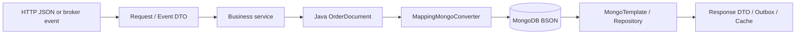
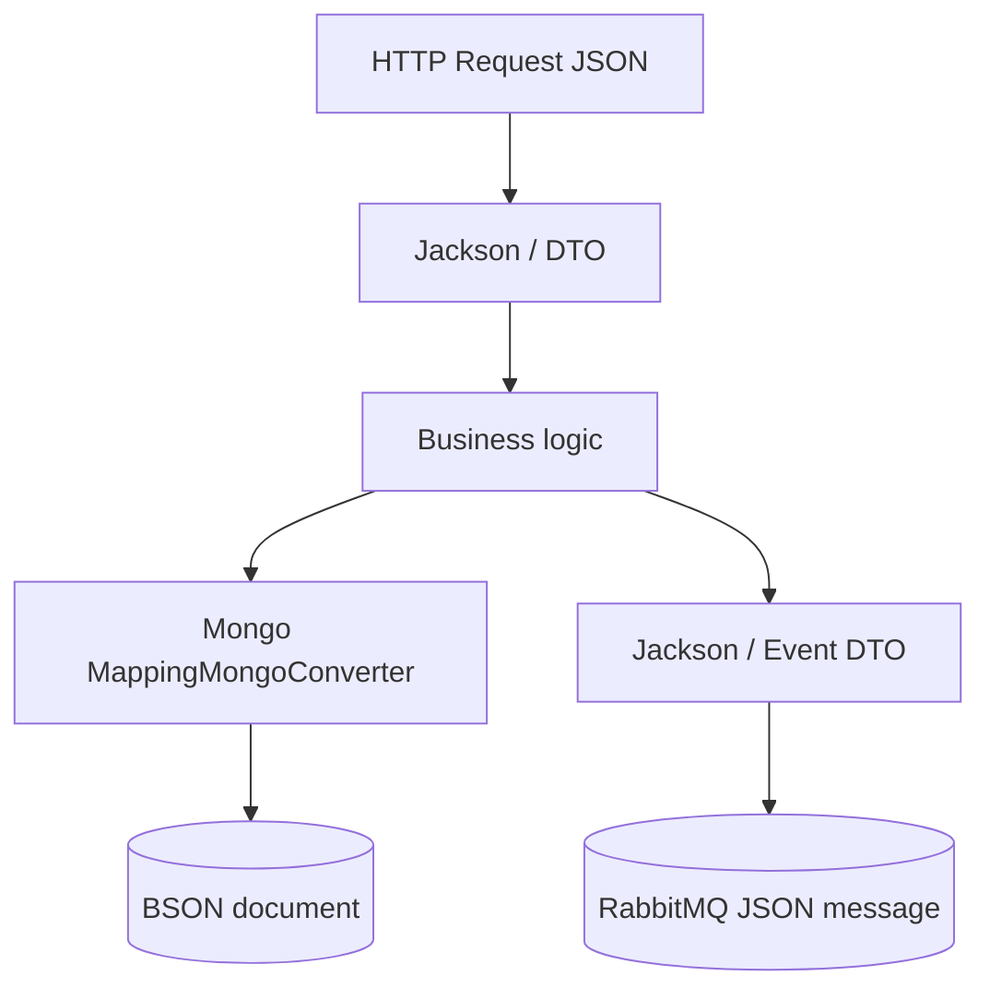
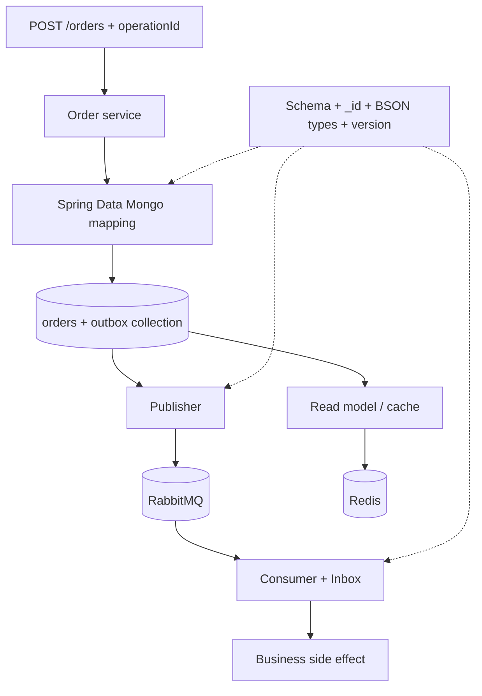

# Document Mapping, Identifiers, and Data Type Conversions

## 1. MongoDB Mapping Is a Data Contract

In the **SPRING_BOOT_INTEGRATION** module, a Spring Boot application connects HTTP APIs, databases, Redis caches, message brokers, and Spring Integration adapters. MongoDB may store orders as documents, partner snapshots, synchronization state, or data serving asynchronous consumers.

Saving a Java object to MongoDB is not simply dropping that object into the database. Spring Data MongoDB converts between **Java objects** and **BSON documents**. When an application also exchanges JSON over HTTP or brokers, there are at least three distinct contracts:

- **Java mapping**: classes, constructors, property types, and Spring Data annotations.
- **BSON storage**: collections, `_id`, physical field names, ObjectId, Decimal128, Date, Binary, and nested structures.
- **Wire contract**: HTTP JSON/event schemas, versions, idempotency keys, and number/timestamp formats expected by consumers.



Critical mapping bugs often surface late: a writer stores `_id` as a BSON String while a reader queries with ObjectId; monetary amounts are stored as Strings and range queries behave unexpectedly; timestamps suffer timezone drift; or a new entity fails to deserialize legacy documents. Therefore, **“Document Mapping, Identifiers, and Data Type Conversions”** treats mapping as part of transaction management, contract design, and integration testing—not merely annotation syntax.

Examples use **Java 17+, Spring Boot 3.x, Spring Data MongoDB 4.x**, and compatible MongoDB versions. Certain APIs and default conversions can vary across versions; choices affecting BSON types must be verified against a real database.

## 2. Java Objects, BSON, and JSON Are Not Identical

| Layer | Example | Primary Converter |
| --- | --- | --- |
| HTTP DTO | `{"orderId":"ord-1024","total":"49.90"}` | Jackson HTTP codec/converter |
| Persistence object | `OrderDocument.id: String`, `totalAmount: BigDecimal` | Spring Data mapping metadata |
| BSON document | `_id: "ord-1024"`, `total_amount: Decimal128("49.90")` | `MappingMongoConverter` + MongoDB driver |
| Event JSON | `{"eventId":"evt-10","schemaVersion":1,...}` | Broker serializer/Jackson |

A Java `String` used for an ID may become a BSON `ObjectId` or a BSON `String` depending on annotations. `BigDecimal` can be stored as `Decimal128` when selecting `FieldType.DECIMAL128`, whereas an HTTP JSON response might deliberately return amounts as strings for JavaScript consumer compatibility.

**`@Field("total_amount")` does not rename fields in HTTP JSON.** To change JSON field names, use dedicated DTOs and Jackson rules. Likewise, renaming a Java class does not automatically migrate existing BSON documents.

An Extended JSON representation to inspect BSON types:

```json
{
  "_id": "ord-1024",
  "total_amount": { "$numberDecimal": "49.90" },
  "created_at": { "$date": "2026-11-21T04:00:00Z" }
}
```

Wrappers like `$numberDecimal` and `$date` represent BSON types when displayed as JSON; they do not imply your REST API should return them.

## 3. Setting Up Spring Data MongoDB in Spring Boot

Basic Maven dependency for imperative repositories/`MongoTemplate`:

```xml
<dependency>
  <groupId>org.springframework.boot</groupId>
  <artifactId>spring-boot-starter-data-mongodb</artifactId>
</dependency>
```

Local configuration:

```yaml
spring:
  data:
    mongodb:
      uri: ${MONGODB_URI:mongodb://localhost:27017/orders_db}
```

In production, supply URIs/credentials via a secret/config provider and apply appropriate TLS, replica set, read/write concerns, timeouts, and connection pooling. Never commit credentials or log full connection strings. If using `spring-boot-starter-data-mongodb-reactive`, you obtain reactive APIs such as `ReactiveMongoTemplate`/`ReactiveMongoRepository`; do not label an imperative blocking repository “reactive”.

Key components:

| Component | Role |
| --- | --- |
| `@Document` | Associates a Java class with a collection |
| `@Id` | Marks the ID field, with implicit ObjectId conversion rules |
| `@MongoId` | Provides explicit control over how `_id` is stored |
| `@Field` | Sets a field alias and/or target BSON type |
| `@Transient` | Excludes a property from persistence |
| `@Version` | Enables optimistic locking on supported Spring Data operations |
| `@TypeAlias` | Manages type-hint aliases |
| `@PersistenceCreator` | Selects the constructor/factory used on read |
| `MongoTemplate` | Query and document manipulation API with mapping |
| `MongoRepository` | Repository abstraction driven by entity metadata |
| `MongoCustomConversions` | Registers converters for custom types |

Annotations only take effect on code paths using the **Spring Data mapping context**. The raw MongoDB Java driver operating on `org.bson.Document` and raw BSON does not interpret POJO mapping annotations automatically unless you configure a corresponding POJO codec.

## 4. Intentional Document Mapping for Order Service

Suppose Order Service needs to store business order IDs as BSON Strings, preserve total-amount precision, and load orders along with their line items.

```java
package example.integration.orders;

import java.math.BigDecimal;
import java.time.Instant;
import java.util.List;

import org.springframework.data.annotation.Version;
import org.springframework.data.mongodb.core.mapping.Document;
import org.springframework.data.mongodb.core.mapping.Field;
import org.springframework.data.mongodb.core.mapping.FieldType;
import org.springframework.data.mongodb.core.mapping.MongoId;

@Document(collection = "orders")
public class OrderDocument {

    @MongoId(FieldType.STRING)
    private String id;

    @Field("tenant_id")
    private String tenantId;

    @Field("external_order_id")
    private String externalOrderId;

    @Field(value = "total_amount", targetType = FieldType.DECIMAL128)
    private BigDecimal totalAmount;

    @Field("created_at")
    private Instant createdAt;

    private List<OrderLineDocument> lines;

    @Version
    private Long version;

    protected OrderDocument() {}

    public OrderDocument(
            String id,
            String tenantId,
            String externalOrderId,
            BigDecimal totalAmount,
            Instant createdAt,
            List<OrderLineDocument> lines) {
        this.id = id;
        this.tenantId = tenantId;
        this.externalOrderId = externalOrderId;
        this.totalAmount = totalAmount;
        this.createdAt = createdAt;
        this.lines = List.copyOf(lines);
    }

    public String getId() { return id; }
    public String getTenantId() { return tenantId; }
    public String getExternalOrderId() { return externalOrderId; }
    public BigDecimal getTotalAmount() { return totalAmount; }
    public Instant getCreatedAt() { return createdAt; }
    public List<OrderLineDocument> getLines() { return lines; }
    public Long getVersion() { return version; }
}
```

Nested value object:

```java
package example.integration.orders;

public record OrderLineDocument(
    String sku,
    int quantity
) {}
```

Equivalent BSON, shown in Extended JSON:

```json
{
  "_id": "ord-1024",
  "tenant_id": "tenant-17",
  "external_order_id": "erp-881",
  "total_amount": { "$numberDecimal": "49.90" },
  "created_at": { "$date": "2026-11-21T04:00:00Z" },
  "lines": [
    { "sku": "sku-123", "quantity": 2 }
  ],
  "version": 0
}
```

This is an illustrative representation; verify the initial version value and actual persisted data after `save` on MongoDB. `List.copyOf` rejects null lists and creates only a shallow copy; validate DTOs before passing them into the mapping layer.

**Two key choices:** `@MongoId(FieldType.STRING)` guarantees the business identifier stays a String, and `@Field(targetType = FieldType.DECIMAL128)` specifies BSON decimal storage for monetary totals. `@Version` detects concurrent updates, not duplicate business keys.

## 5. `_id`, `@Id`, `@MongoId`, and `ObjectId`

Every MongoDB document has a unique `_id` within its collection. Spring Data MongoDB has ID conversion rules that easily cause mismatches between Java clients and scripts/raw drivers.

### 5.1. `@Id String` performs implicit `ObjectId` conversion

```java
import org.springframework.data.annotation.Id;
import org.springframework.data.mongodb.core.mapping.Document;

@Document("products")
class ProductDocument {
    @Id
    private String id;
}
```

With `@Id String`, Spring Data can convert valid hex strings to BSON `ObjectId`:

```text
Java id = "507f1f77bcf86cd799439011"
  -> BSON ObjectId("507f1f77bcf86cd799439011")

Java id = "ord-1024"
  -> BSON String "ord-1024" (not converted to ObjectId)
```

Consequently, a raw driver query using a String will not match a BSON `ObjectId` holding the exact same hex digits. MongoDB distinguishes BSON types.

### 5.2. `@MongoId` for explicit storage types

```java
import org.springframework.data.mongodb.core.mapping.MongoId;
import org.springframework.data.mongodb.core.mapping.FieldType;

// Option 1: _id is always a BSON String.
@MongoId(FieldType.STRING)
private String id;

// Option 2: store _id as a BSON ObjectId.
@MongoId(FieldType.OBJECT_ID)
private String idAsObjectId;
```

These are **two mutually exclusive alternatives**, not two IDs to declare on the same document. With `FieldType.OBJECT_ID`, values must be convertible to `ObjectId`. `@MongoId` without a target type generally preserves the declared Java type more strictly than `@Id`'s implicit conversion.

With Java `ObjectId`:

```java
@org.springframework.data.annotation.Id
private org.bson.types.ObjectId id;
```

This is the natural representation for technical MongoDB keys. When exposing it over HTTP, convert via a DTO/String contract rather than serializing raw driver types.

### 5.3. Rules for choosing an ID

| Use Case | Choice | Required Test |
| --- | --- | --- |
| MongoDB-generated technical ID | `@Id ObjectId` or intentional `@Id String` | ID generation and round-trip |
| Business ID `ord-1024` | `@MongoId(FieldType.STRING)` | Raw BSON is always a String |
| 24-character hex string | Avoid implicit conversion if it is a business ID | Assert raw BSON type with raw driver |
| Business UUID | Canonical String or agreed BSON Binary representation | Cross-language representation check |
| Tenant-scoped composite identity | Business ID or compound unique index | Concurrent duplicate insert |

**Do not rely solely on naming the Java field `id`.** Spring Data has conventions recognizing `id`, but explicit annotations prevent surprises during refactoring or type changes.

### 5.4. ID generation is not idempotency

If an order creation POST times out after DB commit and the caller retries, generating a new ID on every attempt creates two orders. You need a fixed **logical operation ID** and a database/API idempotency policy, not just auto-generated ObjectIds.

## 6. `insert`, `save`, Unique Indexes, and Duplicate Handling

The APIs have distinct semantics:

- `MongoTemplate.insert(...)`: inserts a new document; duplicate `_id` or unique index keys fail.
- `MongoTemplate.save(...)`: inserts or updates based on mapping, also governed by `@Version` and entity state.
- `MongoRepository.save(...)`: repository abstraction; does not automatically establish business-operation deduplication contracts.
- Upsert/update operations: carry semantics distinct from entity `save` and do not automatically enforce the same optimistic locking.

Example index for a tenant-scoped business key:

```javascript
db.orders.createIndex(
  { tenant_id: 1, external_order_id: 1 },
  { unique: true, name: "uq_orders_tenant_external" }
);
```

If two requests simultaneously check “does not exist” and then insert, both can pass the check; a **database unique index** handles that race condition. If historical duplicates exist, index creation will be rejected; perform a migration and duplicate audit first.

For sharded collections, uniqueness must also satisfy the topology's shard key/index restrictions. Do not assume an index from an unsharded database guarantees identical semantics on every cluster.

### 6.1. Retries must not generate a new business ID

```text
Logical operation: create-order:tenant-17:req-45
  attempt 1 -> DB commit, HTTP response lost
  attempt 2 -> same operation ID
  server    -> returns stored result or reconciles
```

Never call `new ObjectId()` on each retry and treat a successful insert as idempotent. Even when using `save`, check the request fingerprint/payload and optimistic locking; updating a document with different content is not “returning the previous request's result”.

## 7. `@Field`, Aliases, and Naming Strategies

`@Field` decouples Java property names from BSON field names:

```java
@Field("external_order_id")
private String externalOrderId;

@Field("created_at")
private java.time.Instant createdAt;
```

When querying via a Spring Data repository/`MongoTemplate` with the mapped class, property names are translated using metadata. However, the raw driver and Mongo shell must use actual BSON names.

```javascript
// Correct when the collection uses @Field("external_order_id"):
db.orders.find({
  tenant_id: "tenant-17",
  external_order_id: "erp-881"
});

// Incorrect for this schema:
db.orders.find({ externalOrderId: "erp-881" });
```

If a project uses a global field naming strategy (snake_case or otherwise), review annotation precedence, nested field mapping, and behavior in raw queries/aggregations. **Renaming a Java property does not migrate BSON fields.**

### 7.1. Field renaming is a multi-phase migration

Suppose old documents store `customer_name`, and the new entity wants `display_name`:

1. Expand: new readers understand both names, and writers follow a compatible strategy.
2. Backfill: update old documents in chunks and verify counts.
3. Validate: check for documents missing the new field or holding null/invalid data.
4. Switch: retire old writers, switch readers to the new field.
5. Contract: drop the old field after the rolling window and after batch jobs/raw queries have updated.

Simply changing `@Field("display_name")` and deploying does not rewrite historical database records.

### 7.2. `@Transient`

```java
@org.springframework.data.annotation.Transient
private String displayLabel;
```

Transient properties are not persisted and must be recomputed after reload. Never use `@Transient` for business state that must survive restarts. Read-only properties can use `@ReadOnlyProperty` under Spring Data semantics, but test interactions with `@Version`/converters and never treat the annotation as a security boundary.

## 8. Embedded Documents, Arrays, and References

A `List<OrderLineDocument>` is typically stored as a **BSON array of nested documents**:

```json
{
  "_id": "ord-1024",
  "lines": [
    {"sku":"sku-123","quantity":2},
    {"sku":"sku-456","quantity":1}
  ]
}
```

Benefits: reads the order and its lines in a single query, with single-document atomicity per MongoDB rules. Risks: unbounded array growth, large updates, index/memory overhead, and the BSON document size limit (typically **16 MiB**).

When an entity has an independent lifecycle, store an ID reference:

```java
@Field("customer_id")
private String customerId;
```

Spring Data also supports `@DBRef` and `@DocumentReference`, though they do not turn MongoDB into JPA lazy SQL joins or provide cross-collection atomic transactions. Resolving references can trigger extra queries/N+1 overhead and requires handling missing references, performance, and permissions.

| Pattern | When to Use | Trade-off |
| --- | --- | --- |
| Embedded line items | Shared lifecycle / read together with the order | Document size growth |
| Plain business ID | Owner lives in another service/collection | Application-level resolution / referential integrity |
| `@DocumentReference` | Want mapping-assisted dereferencing | Extra queries / lookup semantics |
| `@DBRef` | Legacy DBRef compatibility | Format and overhead |
| Snapshot from another service | Fast reads, eventual consistency | Can become stale; needs refresh/versioning |

Never embed entire HTTP requests, tokens, attachments, or arbitrary Java entity graphs into a document simply because NoSQL is flexible.

## 9. BSON Types and Java Implications

| Java Type | Common BSON Type | What to Verify |
| --- | --- | --- |
| `String` | String; IDs may become ObjectId | Raw `_id` type |
| `ObjectId` | ObjectId | JSON representation |
| `Integer` | Int32 | Overflow/range |
| `Long` | Int64 | JSON consumers with integer precision limits |
| `Double` | Double | Binary floating-point rounding |
| `BigDecimal` | String or Decimal128 depending on mapping | Numeric range queries/precision |
| `Instant` | BSON Date | Millisecond resolution |
| `LocalDateTime` | Date via conversion rules | Timezone ambiguity |
| `Date` | BSON Date | UI timezone formatting |
| `byte[]` | Binary | Size/security |
| `List<T>` | Array | Element mapping |
| POJO/record | Embedded document | Constructors, missing fields |
| Enum | Usually String | Renaming/unknown values |
| `Map<String, ?>` | Document | Dynamic keys and escaping |

A single collection can contain documents storing the same field with different BSON types, yet queries/indexes do not automatically unify their semantics. For instance:

```javascript
{ total_amount: "100.00" }
{ total_amount: NumberDecimal("100.00") }
```

Both documents have the same field name, yet one is a String and the other is Decimal128. Range queries, aggregations, sorting, or indexes can yield wrong business results when types are mixed. **Standardizing representation is a schema migration responsibility.**

## 10. `BigDecimal` → `Decimal128` and Monetary Data

For money, `double` is unsuitable due to binary representation inaccuracies. Use `BigDecimal` in Java and BSON `Decimal128` when numeric range queries or aggregations are needed.

```java
import java.math.BigDecimal;
import org.springframework.data.mongodb.core.mapping.Field;
import org.springframework.data.mongodb.core.mapping.FieldType;

@Field(value = "total_amount", targetType = FieldType.DECIMAL128)
private BigDecimal totalAmount;
```

Mongo shell query:

```javascript
db.orders.find({
  total_amount: { $gte: NumberDecimal("20.00") }
});
```

Depending on version, `BigDecimal` may default to String unless the target type is specified. Tests must assert the raw BSON type, not just that the repository round-trips the same Java value.

**Decimal128 has limits**: roughly 34 significant digits and an IEEE 754 decimal128 exponent range. A `BigDecimal` with excessive precision/scale may fail conversion. Validate business precision, scale, and currency rather than silently rounding.

```java
import java.math.BigDecimal;
import java.math.RoundingMode;

public final class MoneyRules {
    private MoneyRules() {}

    public static BigDecimal exactCents(BigDecimal amount) {
        if (amount == null || amount.signum() < 0) {
            throw new IllegalArgumentException("Invalid amount");
        }
        return amount.setScale(2, RoundingMode.UNNECESSARY);
    }
}
```

`RoundingMode.UNNECESSARY` rejects values not representable accurately at scale 2; in practice, apply rules per currency since not every currency has two decimal places. **Decimal128 stores only the amount, not the currency.** Store amount and currency together in a value object or as two explicit fields.

---

## 11. `Instant`, `LocalDateTime`, and BSON Date

MongoDB BSON Date stores an instant in **milliseconds since the Unix epoch**, with no timezone name attached. In cross-service integration flows, choosing the wrong time type can alter business meaning.

| Java Type | Meaning | Recommended Rule |
| --- | --- | --- |
| `Instant` | Global point in time | Use for event/outbox timestamps |
| `java.util.Date` | Epoch timestamp | Maps to BSON Date |
| `LocalDate` | Calendar date | Define timezone/format in the business date contract |
| `LocalDateTime` | Date–time without offset | Avoid as a cross-system timestamp |
| `OffsetDateTime`/`ZonedDateTime` | Includes offset/zone | Normalize to instant; store zone separately if needed |
| `Duration` | Elapsed duration | Store milliseconds/seconds with explicit units |

Example event timestamp field:

```java
@Field("occurred_at")
private java.time.Instant occurredAt;
```

With standard mapping, MongoDB stores BSON Date at millisecond precision. If a Java `Instant` contains nanoseconds, sub-millisecond precision is truncated on round-trip. Do not assert exact nanosecond equality when the storage contract only preserves milliseconds.

### 11.1. `LocalDateTime` lacks timezone context

```java
java.time.LocalDateTime.of(2026, 11, 21, 9, 0);
```

09:00 **where**? Converting to an instant requires a timezone/offset. If two instances run with different JVM default timezones and conversion lacks an explicit policy, a local timestamp can be interpreted differently.

For audits, events, retry deadlines, and TTLs, prefer `Instant`/UTC. For business reconciliation dates, use `LocalDate` paired with an explicit timezone in the business contract (such as business date D in `Asia/Ho_Chi_Minh`), rather than converting a business date into an arbitrary instant.

### 11.2. TTL indexes are not exact schedulers

MongoDB provides TTL indexes on BSON Date fields to clean up expired documents via a background process. However, deletion can occur **after** the expiration timestamp. Never use TTL as the sole mechanism to consider a token invalidated or expect a job to fire at 02:00 sharp; business logic must still validate expiry/deadlines.

## 12. UUIDs, Enums, Nulls, Missing Fields, and Dynamic Maps

### 12.1. UUID representation must be agreed across all clients

UUIDs can be stored as canonical BSON Strings or BSON Binary. BSON Binary UUIDs have historically had differing subtypes/representations, causing byte-order and codec discrepancies across drivers.

| Option | Advantage | Limitation |
| --- | --- | --- |
| Canonical UUID String | Easy to debug, straightforward across languages | Larger in bytes than binary |
| BSON Binary UUID | Compact, explicit data type | Requires consistent UUID representation across drivers |
| Prefixed business ID | Conveys domain, reduces mix-ups | Not a standard UUID; requires validation |

Do not change an annotation and expect MongoDB to convert existing UUID documents automatically. Changing representations requires dual-read/dual-write or migration, plus raw BSON tests and cross-language consumer tests.

### 12.2. Enums stored in documents are part of the schema

```java
public enum OrderStatus {
    PENDING,
    CONFIRMED,
    CANCELLED
}
```

Default mapping persists enum names. Renaming `CONFIRMED` to `APPROVED` can make old documents containing `"CONFIRMED"` fail to deserialize. For long-lived data, use stable status codes, versioned converters, or explicit migrations rather than treating enum refactoring as pure Java refactoring.

### 12.3. Absent fields differ from `null` fields

```javascript
{ _id: "ord-1" }
{ _id: "ord-2", status: null }
{ _id: "ord-3", status: "PENDING" }
```

In Java, a nullable property receives `null` for both **absent** and **explicit null**. That affects PATCH semantics, backfills, and validation. If business logic must distinguish them, design dedicated patch DTOs/value objects or inspect raw documents intentionally.

In supporting Spring Data versions, `@Field(write = Field.Write.ALWAYS)` can force writing `null` instead of omitting null fields by default. Whichever API you use, **test the actual BSON** because null/missing behavior depends on mapping configuration and version.

### 12.4. Keys in dynamic maps

When storing client-supplied `Map<String, Object>` values in a BSON subdocument, keys containing dots or starting with `$` may trigger escaping/preservation rules and create ambiguity in dot-path queries. Never let users arbitrarily control update/query field names. Use allowlists, schema-aware mappings, or store key-value pairs inside an array when arbitrary characters must be preserved.

## 13. Constructor Binding, Records, and Immutable Value Objects

To read BSON, Spring Data must instantiate Java objects. Java records are a clean fit for embedded value objects:

```java
public record ShippingAddress(
    String city,
    String countryCode,
    String postalCode
) {}
```

Document:

```json
{
  "shippingAddress": {
    "city": "Ho Chi Minh City",
    "countryCode": "VN",
    "postalCode": "700000"
  }
}
```

Spring Data can invoke the canonical constructor to instantiate the record. However, records are only **shallowly immutable**: if a component is a mutable `List`, the record does not deep-copy it automatically.

When a class has multiple constructors or factory methods, use `@PersistenceCreator`:

```java
import org.springframework.data.annotation.PersistenceCreator;

public final class PartnerReference {
    private final String system;
    private final String reference;

    @PersistenceCreator
    public PartnerReference(
            String system, String reference) {
        this.system = system;
        this.reference = reference;
    }

    public String getSystem() { return system; }
    public String getReference() { return reference; }
}
```

An older document missing `system` may pass `null` to the constructor or trip business validation. Never assign an arbitrary default tenant or system just to make deserialization pass; use a versioned decoder/backfill. For non-record classes, constructor parameter names, annotations, getters/setters, and compiler metadata affect entity materialization—test using the actual class and real Spring Data mapping.

## 14. `MongoCustomConversions`: Custom Value Object to BSON Conversion

Not every value object should rely on default POJO mapping. Suppose the application wants to store `Money` as an embedded document with BSON Decimal128 `amount` and String `currency`:

```json
{
  "total": {
    "amount": {"$numberDecimal": "49.90"},
    "currency": "USD"
  }
}
```

### 14.1. `Money` value object

```java
package example.integration.money;

import java.math.BigDecimal;
import java.util.Currency;

public record Money(
    BigDecimal amount,
    Currency currency
) {
    public Money {
        if (amount == null || currency == null) {
            throw new IllegalArgumentException(
                "amount and currency are required"
            );
        }
    }
}
```

### 14.2. Writing converter

```java
package example.integration.money;

import org.bson.Document;
import org.bson.types.Decimal128;
import org.springframework.core.convert.converter.Converter;
import org.springframework.data.convert.WritingConverter;

@WritingConverter
public final class MoneyWriteConverter
        implements Converter<Money, Document> {

    @Override
    public Document convert(Money source) {
        return new Document(
            "amount", new Decimal128(source.amount())
        ).append(
            "currency", source.currency().getCurrencyCode()
        );
    }
}
```

### 14.3. Reading converter

```java
package example.integration.money;

import java.util.Currency;

import org.bson.Document;
import org.bson.types.Decimal128;
import org.springframework.core.convert.converter.Converter;
import org.springframework.data.convert.ReadingConverter;

@ReadingConverter
public final class MoneyReadConverter
        implements Converter<Document, Money> {

    @Override
    public Money convert(Document source) {
        Object rawAmount = source.get("amount");

        if (!(rawAmount instanceof Decimal128 amount)) {
            throw new IllegalArgumentException(
                "Money amount must be BSON Decimal128"
            );
        }

        String currency = source.getString("currency");
        if (currency == null || currency.isBlank()) {
            throw new IllegalArgumentException(
                "Money currency missing"
            );
        }

        return new Money(
            amount.bigDecimalValue(),
            Currency.getInstance(currency)
        );
    }
}
```

`Document` inside converters is `org.bson.Document`. `@WritingConverter`/`@ReadingConverter` clarify conversion direction, especially when source or target types might otherwise be treated as native types by the converter infrastructure.

### 14.4. Registering with Spring Data

```java
package example.integration.money;

import java.util.List;
import org.springframework.context.annotation.Bean;
import org.springframework.context.annotation.Configuration;
import org.springframework.data.mongodb.core.convert.MongoCustomConversions;

@Configuration
public class MongoMoneyConfiguration {

    @Bean
    MongoCustomConversions mongoCustomConversions() {
        return new MongoCustomConversions(
            List.of(
                new MoneyWriteConverter(),
                new MoneyReadConverter()
            )
        );
    }
}
```

In typical Boot configurations, this bean is picked up when constructing `MappingMongoConverter`. However, if you have multiple custom converters, a custom `MongoTemplate`, or multiple MongoDB clients, ensure every relevant template receives the converters. Do not define a new bean that drops existing converters without verifying composition.

**Benefit:** money amounts have a uniform representation and round-trip with their currency. **Limitation:** converters do not replace domain validation for negative amounts, market currencies, authorization, or business transactions.

### 14.5. Legacy representations must be handled deliberately

If an older document stores:

```javascript
{ total: { amount: "49.90", currency: "USD" } }
```

the strict reading converter above will reject it because `amount` is not `Decimal128`. That is **intentional fail-fast behavior**. If a rolling migration is required, add a version-aware decoder reading both legacy Strings and Decimal128, then backfill and retire the legacy path once complete. Never silently coerce malformed values to `0`.

## 15. `MappingMongoConverter` Is Not Jackson `ObjectMapper`

An Order Service may involve three separate serialization/conversion layers:



`@Field("total_amount")` affects the BSON field, not DTO JSON keys. To expose `total` instead of `totalAmount` over HTTP, use a response DTO with Jackson annotations/naming strategies:

```java
import com.fasterxml.jackson.annotation.JsonProperty;

public record OrderResponse(
    @JsonProperty("orderId") String id,
    @JsonProperty("total") String amount
) {}
```

An API may intentionally return decimals as **strings** to avoid precision loss in JavaScript consumers while Mongo stores `Decimal128`. These two decisions are independent.

`org.bson.Document.toString()` is useful for debugging, not a stable JSON contract for HTTP or brokers. If Extended JSON is needed, use an explicitly chosen and tested writer/format. Never return raw BSON `$oid`/`$numberDecimal` wrappers over REST if consumers expect plain strings or numbers.

### 15.1. Do not publish JPA/Mongo entities directly

A persistence object can contain internal fields, type hints, versions, lazy references, or data not meant for downstreams. When publishing to a broker, construct an **event DTO with explicit `schemaVersion`/`eventId`** and keep the serialized event payload stable across retries/replays—do not re-serialize the current live document every time an old outbox event is reprocessed.

## 16. `_class`, `@TypeAlias`, and Polymorphism

Spring Data MongoDB writes type hints (commonly under `_class`) to support polymorphic mapping scenarios:

```json
{
  "_id": "ord-1024",
  "_class": "example.integration.orders.OrderDocument",
  "status": "PENDING"
}
```

Storing Java class names couples persisted data to package names and application versions. If you refactor classes or multiple app versions read the same collection, verify compatibility with older documents.

Example using an alias:

```java
import org.springframework.data.annotation.TypeAlias;
import org.springframework.data.mongodb.core.mapping.Document;

@TypeAlias("order_record")
@Document("orders")
public class OrderDocument {
    // mapped fields
}
```

Aliases avoid storing long package names in type hints. However, the mapping context must know about the type alias when reading; do not assume a `MongoTemplate` in another service automatically resolves an alias whose class has not been scanned/registered.

You can customize `MongoTypeMapper`/`MappingMongoConverter` to alter type hint behavior, provided you evaluate nested inheritance, existing documents, read compatibility, and custom converters. **Do not disable `_class` merely to make documents look tidier** if polymorphic data still needs subtype resolution.

Type metadata is not an authorization mechanism: never trust class names inside untrusted documents or design arbitrary deserialization controlled by user input.

## 17. Repository and `MongoTemplate` Query Mapping

Entity metadata governs **reads/queries** as well as writes.

```java
package example.integration.orders;

import java.util.Optional;
import org.springframework.data.mongodb.repository.MongoRepository;

public interface OrderRepository
        extends MongoRepository<OrderDocument, String> {

    Optional<OrderDocument>
        findByTenantIdAndExternalOrderId(
            String tenantId, String externalOrderId
        );
}
```

Derived query property `externalOrderId` maps to BSON field `external_order_id` when the repository operates on the mapped entity.

`MongoTemplate`:

```java
import org.springframework.data.mongodb.core.MongoTemplate;
import org.springframework.data.mongodb.core.query.Criteria;
import org.springframework.data.mongodb.core.query.Query;

public OrderDocument lookup(
        MongoTemplate template,
        String tenantId,
        String externalOrderId) {

    Query query = new Query(
        Criteria.where("tenantId").is(tenantId)
            .and("externalOrderId").is(externalOrderId)
    );

    return template.findOne(query, OrderDocument.class);
}
```

The mapping context translates property names and converts query values. By contrast, the raw driver:

```javascript
db.orders.findOne({
  tenant_id: "tenant-17",
  external_order_id: "erp-881"
});
```

requires exact BSON names. The same applies to `_id`: String `"507f..."` does not equal a BSON `ObjectId` with the same hex digits.

Handwritten aggregation/`Document` pipelines may have different mapping support than entity-based `Criteria` APIs. Always inspect generated queries and `explain` plans when performance or correctness matters.

### 17.1. Mapping does not create indexes for free

A repository method can emit the right query yet still perform a full scan if indexes are absent. Use query plans, workload analysis, and migration policies to select compound indexes; do not blindly index every field. Filtering by `tenantId` in a query protects data scoping, yet **does not replace authorization** at the service boundary.

## 18. `@Version`, Transactions, and Idempotency

### 18.1. Optimistic locking

`@Version` lets Spring Data MongoDB guard supported save/update operations by version. When two concurrent requests read an old version and both write, one update is rejected with an optimistic locking exception instead of silently applying last-write-wins.

```java
@org.springframework.data.annotation.Version
private Long version;
```

This does not automatically apply to raw driver updates or bulk operations. For instance:

```javascript
db.orders.updateOne(
  { _id: "ord-1024" },
  { $set: { status: "CONFIRMED" } }
);
```

does not check Java `@Version`. With multiple writers, enforce compare-and-set, explicit version checks, or a single update-policy owner. Write concern/acknowledgment must also be strong enough for the application to observe matched/modified counts—never use unacknowledged writes and expect conflict detection.

### 18.2. Transactions are constrained by MongoDB topology

Multi-document MongoDB transactions require a supporting cluster/topology and configuration, such as a replica set or eligible sharded cluster. A local standalone MongoDB **does not automatically support** multi-document transactions.

Configure an imperative transaction manager when needed:

```java
import org.springframework.context.annotation.Bean;
import org.springframework.context.annotation.Configuration;
import org.springframework.data.mongodb.MongoDatabaseFactory;
import org.springframework.data.mongodb.MongoTransactionManager;

@Configuration
class MongoTransactionsConfig {

    @Bean
    MongoTransactionManager mongoTransactionManager(
            MongoDatabaseFactory factory) {
        return new MongoTransactionManager(factory);
    }
}
```

`@Transactional` with the right manager coordinates participating MongoDB operations, but **does not cover Redis, REST APIs, or RabbitMQ/Kafka publishes**. Use transactional outbox/CDC and reconciliation across those boundaries.

### 18.3. Idempotency/inbox for broker redelivery

If a consumer commits to MongoDB and crashes before the broker ACK, the message may be redelivered. Use a business `eventId` and a consumer-scoped unique key:

```javascript
db.integration_inbox.createIndex(
  { consumer_name: 1, event_id: 1 },
  { unique: true, name: "uq_inbox_consumer_event" }
);
```

Inbox insertion and business state changes must be designed with appropriate atomicity. Simply calling `repository.save(...)` twice does not guarantee external side effects (email/payment) run only once.

## 19. Schema Evolution and BSON Type Migrations

MongoDB allows documents in the same collection to have differing schemas:

```javascript
{ _id: "ord-1", total_amount: "49.90" }
{ _id: "ord-2", total_amount: NumberDecimal("49.90") }
{ _id: "ord-3",
  total: {
    amount: NumberDecimal("49.90"),
    currency: "USD"
  }
}
```

Adding `@Field(targetType=FieldType.DECIMAL128)` does not convert existing documents from String to Decimal128, nor does it restructure `total_amount` into `total.amount`. A proper migration:

1. Audit existing BSON types/schema versions and inspect dirty data.
2. Support reading both old + new shapes during the rolling window.
3. Switch writers to the new representation in stages.
4. Backfill in chunks/keyset batches, avoiding updating millions of documents in one shot.
5. Checkpoint progress, count missing/invalid records, and produce error reports.
6. Validate queries, indexes, JSON DTOs, and broker events.
7. Remove legacy converters after historical data and consumers have migrated.

MongoDB supports collection validators, including JSON Schema targeting BSON types such as `objectId`, `decimal`, `date`, and `string`. Validators block newly written malformed types, yet enabling them too early can break older application instances during a rolling deploy. Validation does not replace unique indexes or authorization.

`@Indexed`/`@CompoundIndex` are mapping metadata. Auto-index creation is often disabled by default in many Spring Data MongoDB versions; production should manage indexes via reviewed migrations rather than having replicas unexpectedly build huge indexes at startup.

## 20. Testing Mapping with MongoDB Testcontainers and Raw BSON

Mocking `MongoRepository` will not catch `_id` ObjectId/String mismatches, `BigDecimal` stored as String, or wrong field aliases. Use a real MongoDB container and inspect **raw BSON** in integration tests.

Maven test dependencies managed by the Boot BOM:

```xml
<dependency>
  <groupId>org.springframework.boot</groupId>
  <artifactId>spring-boot-starter-test</artifactId>
  <scope>test</scope>
</dependency>
<dependency>
  <groupId>org.testcontainers</groupId>
  <artifactId>mongodb</artifactId>
  <scope>test</scope>
</dependency>
<dependency>
  <groupId>org.testcontainers</groupId>
  <artifactId>junit-jupiter</artifactId>
  <scope>test</scope>
</dependency>
<dependency>
  <groupId>org.springframework.boot</groupId>
  <artifactId>spring-boot-testcontainers</artifactId>
  <scope>test</scope>
</dependency>
```

Example for Spring Boot 3.2+ and compatible Testcontainers:

```java
package example.integration.orders;

import static org.assertj.core.api.Assertions.assertThat;

import java.math.BigDecimal;
import java.time.Instant;
import java.util.List;

import org.bson.Document;
import org.junit.jupiter.api.Test;
import org.springframework.beans.factory.annotation.Autowired;
import org.springframework.boot.test.autoconfigure.data.mongo.DataMongoTest;
import org.springframework.boot.testcontainers.service.connection.ServiceConnection;
import org.springframework.data.mongodb.core.MongoTemplate;
import org.testcontainers.containers.MongoDBContainer;
import org.testcontainers.junit.jupiter.Container;
import org.testcontainers.junit.jupiter.Testcontainers;

@Testcontainers
@DataMongoTest
class OrderDocumentMappingTest {

    @Container
    @ServiceConnection
    static MongoDBContainer mongodb =
        new MongoDBContainer("mongo:7.0");

    @Autowired
    MongoTemplate template;

    @Test
    void storesStringIdDecimal128AndDate() {
        OrderDocument order = new OrderDocument(
            "ord-1024",
            "tenant-17",
            "erp-881",
            new BigDecimal("49.90"),
            Instant.parse("2026-11-21T04:00:00Z"),
            List.of(new OrderLineDocument("sku-123", 2))
        );

        template.insert(order);

        Document raw = template.getCollection("orders")
            .find(new Document("_id", "ord-1024"))
            .first();

        assertThat(raw).isNotNull();
        assertThat(raw.get("_id")).isInstanceOf(String.class);
        assertThat(raw.get("tenant_id")).isEqualTo("tenant-17");
        assertThat(raw.get("total_amount"))
            .isInstanceOf(org.bson.types.Decimal128.class);
        assertThat(raw.get("created_at"))
            .isInstanceOf(java.util.Date.class);

        OrderDocument loaded =
            template.findById("ord-1024", OrderDocument.class);

        assertThat(loaded).isNotNull();
        assertThat(loaded.getTotalAmount())
            .isEqualByComparingTo("49.90");
    }
}
```

This test assumes `OrderDocument` is scanned in the test slice, the Mongo container/Docker runtime is available, and Spring Boot test connection support is active. It verifies actual raw BSON types before verifying converter round-tripping. `@DataMongoTest` may not auto-import user configurations defining `MongoCustomConversions`; add `@Import` when testing custom converters.

### 20.1. Key test matrix

| Case | Expectation |
| --- | --- |
| Regular business ID | `_id` stored as BSON String |
| 24-hex-character business ID | Still BSON String when using `@MongoId(FieldType.STRING)` |
| `@Id String` with 24 hex chars | Explicit understanding of implicit ObjectId conversion |
| Unique external order + tenant | Concurrent duplicates rejected by DB |
| `BigDecimal` 49.90 | Stored as Decimal128 and round-trips accurately |
| Amount exceeding precision | Controlled failure, no silent rounding |
| `Instant` nanoseconds | Account for millisecond precision |
| Legacy/unknown enum | Legacy decoder or migration |
| Renamed field | Old documents remain readable during rolling window |
| Null vs absent | Matches contract |
| Embedded lines | Array and nested mapping preserved |
| Money converter | BSON Decimal128 + currency |
| Raw driver queries | Use exact BSON keys/types |
| `@Version` conflicts | Concurrent writes detected |
| Broker redelivery | No duplicate business side effects |

For migration tests, do not start only with an empty database. Seed v1 snapshot documents, run the v2 decoder/migration, and assert business data stays intact and APIs/events remain compatible.

## 21. Observing and Handling Mapping Errors in Integrated Systems

| Symptom | Likely Cause | Action Needed |
| --- | --- | --- |
| Repository fails to find document | `_id` BSON type mismatch | Inspect raw BSON and annotations |
| Conversion exception on read | Missing field, wrong constructor, or converter bug | Schema versioning/backfill |
| Monetary range query misses results | Mixed String and Decimal128 | Standardize BSON types |
| Wrong event timestamp | `LocalDateTime`/timezone ambiguity | Use `Instant`/UTC |
| Enum read failure after deploy | Renamed constant | Stable codes/versioned decoder |
| Redis cache deserialization failure | Cache JSON differs from document mapping | Separate cache DTOs/versions/TTL |
| Broker consumer fails on old events | Incompatible event JSON | Event schema evolution |
| Duplicate order after HTTP timeout | Generating a new ID on every retry | Stable business operation ID |
| Concurrent update silently overwritten | Raw update without version guard | Compare-and-set/optimistic policy |
| Slow queries after migration | Wrong/bloated indexes | `explain` and query plans |
| Mongo transaction fails on local standalone | Missing supporting topology | Replica set/Testcontainers config |

Useful observability signals: Mongo operation latency/error rates, connection pool wait, duplicate-key rate, optimistic lock conflicts, conversion failures by exception category, migration backlog, and broker outbox/inbox lag. Never use `orderId`, `userId`, or `eventId` as metric tags; keep them in protected logs/traces with redaction and retention controls.

Never dump raw BSON documents, access tokens, or full MongoDB URIs into logs when a converter fails. For multi-tenant queries, a `tenantId` predicate does not replace authentication/authorization. Raw user-provided query maps also require allowlisting to prevent operator/field injection.

## 22. End-to-End Scenario: Order MongoDB → RabbitMQ → Redis

Suppose an Order Service:

1. Receives `POST /orders` with a stable operation ID.
2. Validates input and constructs `OrderDocument`.
3. Persists `_id` as BSON String, `total_amount` as Decimal128, and `created_at` as BSON Date.
4. Writes an `OrderCreated` outbox event under an appropriate MongoDB transaction/guarantee.
5. Publisher sends JSON over RabbitMQ, keeping the same event ID on retries.
6. Notification consumer uses inbox deduplication; Redis caches a versioned read model.
7. A reconciliation job detects unfinished outbox/notification records.



| Data | Storage Rule | Why |
| --- | --- | --- |
| `_id` | String `"ord-1024"` | Stable business ID |
| `total_amount` | Decimal128 | Explicit numeric queries/precision |
| `created_at` | BSON Date from `Instant` | Global timestamp |
| `tenant_id` | String, indexed/authorized | Data scoping |
| `external_order_id` | Compound unique with tenant | Upstream deduplication |
| `version` | Spring Data `@Version` | Optimistic concurrency |
| `lines` | Bounded embedded array | Loaded together with the order |
| Outbox | Stable `eventId` + payload version | Publish retries do not mutate the event |
| Redis | Separate cache DTO/version | Decoupled from Mongo entity |

### 22.1. Five failure modes to simulate

**A — Business ID resembling an ObjectId.** Using `@Id String` may produce a BSON ObjectId, causing raw driver queries to miss. `@MongoId(FieldType.STRING)` and tests guard the representation.

**B — Money stored in two BSON types.** Aggregations/queries become inconsistent; requires converters/migration and tests against old documents.

**C — HTTP timeout after DB commit.** Retries use the same operation ID, database unique key, and response reconciliation rather than creating a new order.

**D — Schema field rename during rolling deployment.** Old consumers/JDBC jobs/raw queries/Redis caches still read the legacy name; requires expand–migrate–contract.

**E — Consumer commits before broker ACK is lost.** Message may be redelivered; inbox and business idempotency protect side effects instead of treating `save()` as exactly-once.

### 22.2. Implementation checklist

- [ ] Distinguished persistence documents, BSON storage, and HTTP/event DTOs?
- [ ] `@Document`/`@Field` define explicit collection/field names?
- [ ] Intentionally chose `@Id` or `@MongoId` and tested `ObjectId`/String?
- [ ] Business IDs and event IDs stay stable across retries?
- [ ] Unique indexes protect against duplicates instead of find-then-insert?
- [ ] `BigDecimal` uses Decimal128 when numeric semantics are required?
- [ ] `Instant`/timezones/business dates and UUID representations are standardized?
- [ ] Handled enum renames, absent/null fields, and dynamic map keys?
- [ ] Embedded documents vs references chosen based on access patterns and document size?
- [ ] Custom conversions registered and tested with raw BSON and round-trip assertions?
- [ ] Mapping differences across repositories, `MongoTemplate`, and raw driver verified?
- [ ] Plan in place for legacy data, schema migrations, rollbacks, and versioned events?
- [ ] `@Version`, MongoDB transactions, and broker ACKs are not mistaken for one transaction?
- [ ] Testcontainers verify BSON types, idempotency, conversions, and failure windows?
- [ ] Logs/metrics protect secrets/PII and avoid high-cardinality tags?

**Conclusion:** MongoDB mapping is the contract bridging **Java objects, Spring Data converters, and BSON documents**. `@Document`/`@Field` describe storage layout; `@Id` and `@MongoId` control how `_id` is represented; `FieldType.DECIMAL128`, time types, and `MongoCustomConversions` preserve data semantics. In Spring Boot Integration, reliable designs combine stable business IDs, backward-compatible migrations, real BSON testing, unique constraints, idempotency, and observability across HTTP, MongoDB, Redis, and brokers.
