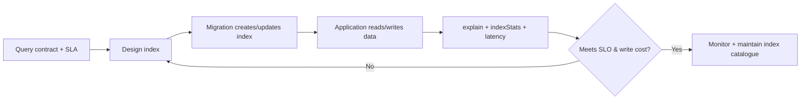
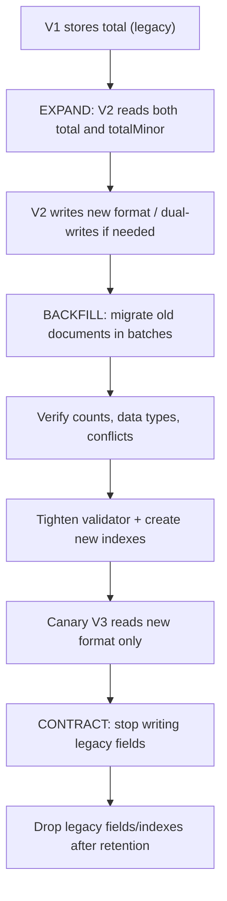
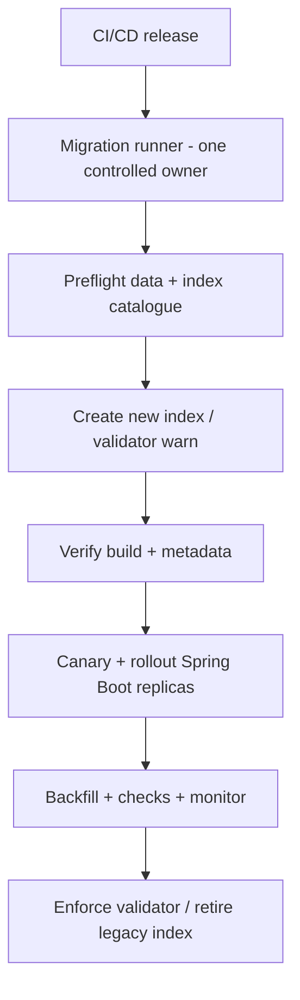

# Indexes, Index Creation Conditions, and Schema Management Workflows

> **Chapter:** MongoDB  
> **Scope:** The **SPRING_BOOT_INTEGRATION** module organizes system integration via HTTP clients, databases, caches, message brokers, and Spring Integration adapters. This lesson focuses on **designing MongoDB indexes from real query patterns**, controlling **when and how indexes are created**, and safely managing **document structure changes and collection validation** across Spring Boot versions. Examples connect directly to transactions, idempotency, integration errors, testing, and observability.

## 1. Problem: Growing Data Makes a Lookup API Slower and Slower

Suppose `order-query-service` stores millions of documents in the `orders` collection. A frequently called API:

```text
GET /tenants/tenant-a/orders?status=READY&from=2026-11-01
  |
  v
Spring Boot Controller
  |
  v
OrderQueryService / MongoTemplate
  |
  v
MongoDB orders collection (millions of documents)
  |
  v
List of orders sorted by createdAt descending
```

With only 200 documents, the query runs fast even without an index. With 20 million documents, a full collection scan (**COLLSCAN**) burns CPU/I/O, spikes response latency, and starves other integration flows sharing the cluster.

Design is not just “put `@Indexed` on a few fields”. Architects must ask:

1. Which queries run frequently, and do they filter by **tenant** and **business state**?
2. How must queries **sort**, **paginate**, and filter **ranges**?
3. Which fields may be absent, arrays, or change data types across versions?
4. Is a **unique constraint** needed to protect idempotency for webhook/broker consumers?
5. Can indexes be built at startup, or must they run via a **coordinated migration**?
6. When old and new app versions run side by side, are **schemas and indexes** compatible?
7. Does the query planner actually use the new index, and is it worth its write/memory cost?



**Learning objective:** understand that indexes speed up lookups while adding write overhead; choose the right index types; control Spring Data MongoDB auto-index creation; manage migrations, index builds, and validators safely; and test and observe changes before rolling them out.

## 2. Flexible Documents Do Not Mean No Schema

MongoDB stores BSON documents; the same collection can hold documents with different fields:

```javascript
// Legacy document version:
{
  _id: ObjectId("650000000000000000000001"),
  tenantId: "tenant-a",
  orderId: "ORD-101",
  status: "READY",
  total: 125000
}

// New document version:
{
  _id: ObjectId("650000000000000000000002"),
  tenantId: "tenant-a",
  orderId: "ORD-102",
  status: "READY",
  totalMinor: NumberLong("125000"),
  currency: "VND",
  schemaVersion: 2,
  createdAt: ISODate("2026-11-21T00:00:00Z")
}
```

Both documents can coexist, yet **the application can read incorrectly** if new code assumes `totalMinor` and `currency` are always present. Queries, filters, and indexes can also behave differently depending on field presence, data type, or encoding.

A **schema contract** in a MongoDB system spans multiple layers:

| Layer | Responsibility |
| --- | --- |
| **BSON document shape** | Fields, data types, null/missing semantics, arrays, nested objects, versions |
| **Spring Data mapping** | `@Document`, `@Id`, `@Field`, custom converters, repositories/`MongoTemplate` |
| **Collection validator** | MongoDB `$jsonSchema`/validationAction constraints if configured |
| **Index catalogue** | Index keys, order, uniqueness, partial filters, TTL, collation |
| **Business constraints** | Identity, idempotency, conflict handling, state transitions |
| **API/message contracts** | JSON/Avro/Protobuf/DTOs for HTTP, Kafka, RabbitMQ, Spring Integration |
| **Migration history** | When indexes were created/modified, backfills, validator changes, legacy field drops |

**Indexes do not replace schema validators; validators do not replace unique indexes; neither replaces transactions or business rules.** Each layer has its own job.

## 3. How Indexes Work and What They Cost

A standard index helps the database locate documents via **organized keys**, instead of inspecting every document in the collection. With a matching index, the query planner can choose an index scan (**IXSCAN**), often paired with a **FETCH** stage to retrieve the full documents.

```text
Without a matching index:
  filter tenantId=tenant-a AND status=READY
       -> COLLSCAN -> filter many documents -> sort -> limit

With index {tenantId:1, status:1, createdAt:-1, _id:-1}:
  filter tenantId=tenant-a AND status=READY
       -> narrow IXSCAN -> preserve sort order -> FETCH as needed -> limit
```

### 3.1. Benefits and costs

| Benefit | Cost / Risk |
| --- | --- |
| Accelerates matching filters/sorts/pagination | Every insert/update/delete may also have to update indexes |
| Enforces `unique` data constraints | Creating a unique index fails if duplicates exist; introduces write conflicts |
| Enables covered queries in specific cases | Large indexes consume disk, RAM cache, and rebuild overhead |
| Supports TTL cleanup for certain documents | TTL does not delete at exact timestamps and does not replace retention workflows |
| Partial indexes index only a subset of documents | Queries must match the predicate for the planner to use the index safely |
| Hidden indexes let you simulate dropping an index | Still consume storage/write maintenance and still enforce constraints |

**Do not index every field.** Each index is a structured copy of keys; excessive indexes slow down write-heavy integrations such as inboxes/outboxes, event ingestion, or CDC sinks.

### 3.2. The default `_id` index

MongoDB creates a unique index on `_id` for standard collections. Using a business-meaningful `_id` leverages its uniqueness, yet:

- Default `_id` does not automatically encode tenant or business scope.
- With `@Id String id`, BSON `ObjectId` vs. String mapping depends on converters and value format.
- Concatenating arbitrary strings into `_id` without normalization can cause collisions or leak PII.
- In sharded collections, unique indexes and shard keys impose specific constraints.

Therefore, design **explicit business unique keys**, especially when handling redelivered messages.

## 4. Start from Query Patterns, Not Annotations

Suppose the application runs:

```javascript
db.orders.find({
  tenantId: "tenant-a",
  status: "READY",
  createdAt: { $gte: ISODate("2026-11-01T00:00:00Z") }
}).sort({
  createdAt: -1,
  _id: -1
}).limit(50);
```

A candidate index to **evaluate** is:

```javascript
db.orders.createIndex(
  { tenantId: 1, status: 1, createdAt: -1, _id: -1 },
  { name: "ix_orders_tenant_status_created_id_v1" }
);
```

This key order stems from the query shape: equality filters, timestamp sorting, and `_id` tie-breaking. There is no universal rule that “all fields sort ascending” or “highest-cardinality field always goes first” for every workload.

### 4.1. The ESR rule: Equality → Sort → Range

**ESR** is a helpful guideline for compound indexes:

- **Equality:** fields compared for exact equality (`tenantId`, `status`).
- **Sort:** fields defining result order (`createdAt`, `_id`).
- **Range:** range predicates like `createdAt >= ...` or `amountMinor > ...`.

When the **sort field is also the range field**, key ordering requires inspecting the exact query shape and how the planner builds index bounds rather than applying a one-line formula mechanically. Some queries benefit from placing Range before Sort (**ERS**) if the range is highly selective, at the cost of an extra sort stage. Base the final choice on `explain`, data distribution, and benchmarks.

### 4.2. Compound indexes support *prefixes*

An index:

```javascript
{ tenantId: 1, status: 1, createdAt: -1, _id: -1 }
```

typically helps queries using a **leading prefix**:

```text
tenantId
tenantId + status
tenantId + status + createdAt
tenantId + status + createdAt + _id
```

However, a query filtering only on `status` without the leading `tenantId` **cannot leverage the leading prefix in the same way**. Profile your actual workload rather than creating one giant index and expecting queries on arbitrary fields to be fast.

### 4.3. Sort order and tie-breakers

`sort({createdAt:-1})` does not guarantee deterministic ordering when multiple documents share the exact same timestamp. Adding `_id:-1` makes ordering deterministic and supports **keyset pagination**. In multi-tenant queries, keys and authorization must always include tenant scoping; never reuse a cursor from tenant A for tenant B.

Ascending/descending direction matters in multi-key compound sorts; when the entire sort direction is reversed, MongoDB can walk the index backward. Match the actual sort pattern rather than reflexively creating separate ascending and descending indexes.

## 5. Index Types to Know

| Type | When to Use | Caveat |
| --- | --- | --- |
| **Single-field** | Queries routinely filter/sort one field | Often insufficient for multi-tenant queries |
| **Compound** | Repeated equality, sort, and range patterns | Key order governs prefix and sort usage |
| **Multikey** | Indexing array fields | Generates multiple index entries; restrictions apply with compound arrays |
| **Unique** | Enforcing unique business identities | Existing duplicates, nulls, or missing fields can fail the build |
| **Partial** | Indexing only documents matching `partialFilterExpression` | Planner must deduce that the query falls within the partial filter |
| **Sparse** | Skips documents missing the field in certain cases | Not equivalent to partial; understand null/missing behavior |
| **TTL** | Auto-deletes expired documents via a date field | Async cleanup; not an exact deadline |
| **Text** | Basic text search | Not identical to MongoDB Search / Atlas Search |
| **Wildcard** | Queries across dynamic, unpredictable fields | Disk/query trade-offs; does not replace schema discipline |
| **Hashed** | Certain equality/sharding patterns | Cannot serve range/sort queries like standard B-tree indexes |
| **Geospatial** | Coordinates and spatial queries (`2dsphere`) | GeoJSON, CRS, and query semantics must be valid |
| **Hidden** | Testing the impact of removing an index from the planner | Still maintained on writes; unique constraints remain active |

### 5.1. Single-field and compound examples

```javascript
db.orders.createIndex(
  { updatedAt: -1 },
  { name: "ix_orders_updated_at_v1" }
);

db.orders.createIndex(
  { tenantId: 1, orderId: 1 },
  { name: "ux_orders_tenant_order_v1", unique: true }
);
```

The first index can serve a job scanning recently updated records, though if the job always filters by tenant or status, a compound index may be better. The second protects a tenant-scoped business key, suited to **idempotent upserts**.

### 5.2. Multikey indexes for arrays

```javascript
// Document:
{
  orderId: "ORD-501",
  tenantId: "tenant-a",
  tags: ["priority", "fragile"]
}

db.orders.createIndex(
  { tenantId: 1, tags: 1 },
  { name: "ix_orders_tenant_tags_v1" }
);
```

Indexing an array generates an index entry per element. Do not naively assume a compound multikey index supports every sort/array query or allows indexing multiple independent array fields in the same compound index: MongoDB enforces restrictions on **parallel arrays** and covered queries.

### 5.3. Collation and case-insensitive lookups

If a business key is an email or case-insensitive code, consider:

1. **Normalizing on write** into an `emailNormalized` field using a stable application rule.
2. Or using a MongoDB **collation** with a chosen locale/strength on both the index and queries.

```javascript
db.customer_contacts.createIndex(
  { tenantId: 1, email: 1 },
  {
    name: "ux_contact_tenant_email_ci_v1",
    unique: true,
    collation: { locale: "en", strength: 2 }
  }
);
```

**Note:** a unique index with collation does not automatically make all queries case-insensitive: if a query uses a different or default collation, the planner may not use the index as expected. For international emails, Unicode normalization, IDN, and identity semantics need an explicit contract rather than relying on a naive `toLowerCase()`.

## 6. Unique Indexes: Foundation for Idempotency

A Kafka consumer processing `OrderConfirmed` events may receive the same event multiple times after rebalances, lost ACKs, or retries. A unique index on `(tenantId, eventId)` catches duplicate processing:

```javascript
db.integration_inbox.createIndex(
  { tenantId: 1, eventId: 1 },
  { name: "ux_inbox_tenant_event_v1", unique: true }
);
```

### 6.1. Unique indexes alone do not complete a business transaction

Recommended processing pattern:

```text
Receive event E-42
  -> Validate/authenticate tenant/event schema
  -> DB transaction:
       INSERT inbox {tenantId, eventId, fingerprint}
       UPDATE business document/state
       (if needed: INSERT outbox event)
     COMMIT
  -> ACK broker

Crash after COMMIT before ACK:
  -> Broker redelivers E-42
  -> Unique conflict/inbox lookup
  -> Verify fingerprint + business outcome
  -> Re-ACK if already processed successfully
```

A unique index **prevents duplicate keyed documents**, yet it does not make writes across two collections atomic if issued as separate non-transactional writes. When atomic writes across multiple documents/collections are required, use a **MongoDB transaction** with the proper topology/session/transaction manager, or model single-document atomic state with outbox/reconciliation. MongoDB transactions also **do not** span an HTTP POST, Redis cache update, or broker ACK.

### 6.2. Duplicate keys are not always valid replays

```text
tenantId=tenant-a, eventId=E-42, payloadSha256=abc  -> already processed
tenantId=tenant-a, eventId=E-42, payloadSha256=xyz  -> data conflict
```

If code catches `DuplicateKeyException` and blindly ignores every collision, a producer sending **the same eventId with a different payload** will be silently dropped. Persist a fingerprint/schema version and inspect the business outcome to distinguish:

- Replay with identical payload: idempotent success/no-op.
- Same business key, different content: conflict requiring investigation.
- Transient MongoDB error: bounded retry by outcome; do not misclassify as “duplicate”.

### 6.3. Null and missing fields in unique indexes

On a single-field unique index, multiple documents missing the field or holding `null` can collide because the index indexes null/missing entries under specific rules. Compound unique indexes also have specific semantics for combinations of null/missing values.

**Before creating a unique index**, audit duplicates, data types, and documents missing the field. Never assume MongoDB skips nulls the same way an arbitrary SQL database might. For optional fields, consider an appropriate **partial unique index**.

## 7. Partial Indexes: Indexing a Conditional Subset

A **partial index** indexes only documents satisfying `partialFilterExpression`. It shrinks index size and write overhead when queries regularly target a specific subset of records.

For example, enforcing unique emails per tenant only among **active** contacts:

```javascript
db.customer_contacts.createIndex(
  { tenantId: 1, emailNormalized: 1 },
  {
    name: "ux_contacts_active_tenant_email_v1",
    unique: true,
    partialFilterExpression: { active: true }
  }
);
```

This means:

- Active contacts (`active:true`) must have a unique `(tenantId, emailNormalized)` pair across indexed active documents.
- Contacts with `active:false` or not matching the filter **are not constrained by this unique index**.
- **Do not** assume all contacts have unique emails if `active` is missing or unnormalized.
- If multiple active contacts lack `emailNormalized`, the unique constraint can still collide on the missing/null pair.

### 7.1. Queries must satisfy the partial filter predicate

```javascript
// Query whose predicate fits inside the partial index filter:
db.customer_contacts.find({
  tenantId: "tenant-a",
  active: true,
  emailNormalized: "a@example.test"
});
```

If a query omits `active:true`, using the partial index would miss inactive documents, so the planner cannot safely choose it to return **complete** results. Verify with `explain`.

### 7.2. `sparse` is not `partial`

`sparse:true` is an older option for indexes on optional fields, yet its missing/null and compound-key semantics differ from a partial predicate. When you want to index only documents where `active:true` or a field has a valid type, **`partialFilterExpression` states intent explicitly**. Never combine `sparse` and `partialFilterExpression` on the same index where disallowed by the API/version.

### 7.3. Activating a contact

An update setting `active:false -> true` can fail with a duplicate key error if another active contact already holds that normalized email. That is **correct constraint enforcement**. Services must translate this error into a business conflict rather than retrying infinitely or deleting the competing document.

## 8. TTL Indexes: Expiring Data, Not a Precision Clock

A TTL index uses a date field to let MongoDB **automatically delete** expired documents. It suits temporary sessions/tokens or **inbox records governed by defined retention windows**:

```javascript
db.integration_ephemeral_tokens.createIndex(
  { expiresAt: 1 },
  {
    name: "ttl_ephemeral_expires_at_v1",
    expireAfterSeconds: 0
  }
);

// Example document:
{
  tenantId: "tenant-a",
  tokenHash: "not-a-plaintext-token",
  expiresAt: ISODate("2026-11-22T00:00:00Z")
}
```

With `expireAfterSeconds:0`, the timestamp in `expiresAt` indicates when the document becomes eligible for deletion. With `expireAfterSeconds:N`, expiration occurs N seconds after that timestamp.

**Important:**

1. The TTL monitor runs in the background: expired documents **can persist past their timestamp**. For authentication, always validate `expiresAt` on read rather than treating document existence as proof of validity.
2. Standard TTL indexes require a **single date field** per MongoDB rules; do not expect an arbitrary compound index to act as a TTL index (time-series collections follow separate rules).
3. Wrong field types or missing fields prevent documents from expiring as expected; normalize with validators/backfills.
4. TTL deletions generate write load; enabling TTL on a huge legacy collection can trigger a **massive deletion spike**, requiring batched cleanup/rollout and replication lag monitoring.
5. TTL is unsafe when inbox/event records must outlive the retry horizon; expiring too early lets redelivered duplicates be processed as new.
6. TTL does not replace **audit retention, legal holds, backup policies**, or PII governance.

### 8.1. Business cleanup should respect state

For `integration_outbox`, never put a 7-day TTL on `createdAt` that blindly deletes `PENDING` or `UNKNOWN` records not yet confirmed by partners. Safe cleanup selects only **completed**, sufficiently aged records not under legal hold, archiving/purging them via a rate-limited, audited worker.

## 9. Hidden Indexes and Index Replacement Strategies

MongoDB lets you **hide** an index from the query planner so you can evaluate whether the application still needs it before dropping it:

```javascript
// After confirming your server version supports hidden indexes:
db.orders.hideIndex("ix_orders_legacy_status_v1");

// Run canary/monitoring and inspect execution plans.

// If latency degrades, unhide:
db.orders.unhideIndex("ix_orders_legacy_status_v1");
```

A hidden index is still maintained on writes and **still enforces unique constraints**. Hiding an index is not dropping it or “turning off uniqueness”.

Safe replacement sequence:

1. Measure baseline workloads and record query shapes using the old index.
2. Create the new index and verify the build finishes.
3. Update queries and roll out via canary.
4. Hide the old index (when supported by version/topology), monitoring query plans and p95/p99 latency.
5. Once traffic relies cleanly on the new index, drop the old index in a separate migration.
6. Keep a rollback plan in case rare batch traffic still depends on the old index.

**Never drop an old index in the same deployment that creates its replacement without measuring first.** Rare queries (such as month-end reconciliation) may rely on the old index and surface days later.

## 10. Explain: Is the Index Actually Helping the Query?

MongoDB `explain` reveals the winning query plan and, with `executionStats`, keys/documents examined and execution timing.

```javascript
db.orders.find({
  tenantId: "tenant-a",
  status: "READY",
  createdAt: { $gte: ISODate("2026-11-01T00:00:00Z") }
})
  .sort({ createdAt: -1, _id: -1 })
  .limit(50)
  .explain("executionStats");
```

Fields to inspect (exact names/locations can vary across MongoDB versions and execution engines):

| Indicator | Interpretation |
| --- | --- |
| `COLLSCAN` | Planner scans the entire collection; dangerous when filters have low selectivity |
| `IXSCAN` | Scans an index to locate matching index keys |
| `FETCH` | Retrieves full documents for candidate keys from the index |
| `SORT` | Explicit in-memory sort stage; check whether the index can satisfy the sort |
| `nReturned` | Number of documents returned |
| `totalKeysExamined` | Number of index keys scanned |
| `totalDocsExamined` | Number of documents read/examined |
| `executionTimeMillis` | Execution time in the explain run; not a substitute for production benchmarks |
| `indexName` | Name of the index used by the winning plan |

### 10.1. Diagnostic examples

```text
Query returns nReturned = 50
totalKeysExamined = 68
totalDocsExamined = 50
  -> Indicates relatively selective filtering; still measure real latency

Query returns nReturned = 50
totalKeysExamined = 900000
totalDocsExamined = 900000
  -> Likely scanning far too many candidate documents
```

These numbers are **illustrative only**. Selectivity, RAM residency, disk I/O patterns, and concurrency govern real performance. Never enforce a rigid rule like “keysExamined/returned must always stay under 2” across all queries, especially for aggregations and low-selectivity workloads.

### 10.2. Covered queries and projections

A query can skip `FETCH` when the index already contains every filtered, sorted, and projected field, forming a covered query. Typically this requires:

- Projecting only fields present in the index.
- Excluding `_id` from the projection unless `_id` is included in the index.
- Avoiding projections requiring the full document or uncovered expressions.

**Do not cram dozens of fields into an index just to “cover” a rarely called API**: bloated indexes inflate memory/disk usage and hurt write latency.

### 10.3. Measure beyond a single explain

Combine multiple signals before concluding:

- Production-like datasets: realistic collection size and tenant/status/createdAt distributions.
- Query latency P50/P95/P99 and throughput under concurrency.
- CPU, disk I/O, cache pressure, replication lag, and write latency.
- `$indexStats`/index usage within appropriate observability permissions.
- Impact on inbox/outbox inserts/updates and bulk ingestion.

`explain("executionStats")` actually executes the query and consumes resources; run it carefully in production. A single measurement does not guarantee the planner sticks to the same plan as data distributions and workloads shift.

## 11. Spring Data MongoDB: From `@Document` to `@Indexed`

In Spring Boot, Spring Data MongoDB provides mapping, repositories, `MongoTemplate`, and index-definition abstractions. Examples use Spring Data MongoDB 4.x on Spring Boot 3.x; verify against your project's BOM/version.

### 11.1. Dependencies

```xml
<dependencies>
    <dependency>
        <groupId>org.springframework.boot</groupId>
        <artifactId>spring-boot-starter-data-mongodb</artifactId>
    </dependency>
    <dependency>
        <groupId>org.springframework.boot</groupId>
        <artifactId>spring-boot-starter-validation</artifactId>
    </dependency>
    <dependency>
        <groupId>org.springframework.boot</groupId>
        <artifactId>spring-boot-starter-test</artifactId>
        <scope>test</scope>
    </dependency>
</dependencies>
```

If using the reactive MongoDB driver, choose `spring-boot-starter-data-mongodb-reactive` and `ReactiveMongoTemplate`; do not assume blocking `MongoTemplate` calls fit on a Netty event loop. The examples below use the **synchronous driver** for clarity.

### 11.2. Entity and compound index annotations

```java
package com.example.integration.mongo;

import java.time.Instant;
import org.springframework.data.annotation.Id;
import org.springframework.data.mongodb.core.index.CompoundIndex;
import org.springframework.data.mongodb.core.mapping.Document;

@Document(collection = "orders")
@CompoundIndex(
    name = "ix_orders_tenant_status_created_id_v1",
    def = "{ 'tenantId': 1, 'status': 1, 'createdAt': -1, '_id': -1 }")
@CompoundIndex(
    name = "ux_orders_tenant_order_v1",
    def = "{ 'tenantId': 1, 'orderId': 1 }",
    unique = true)
public class OrderDocument {
    @Id
    private String id;

    private String tenantId;
    private String orderId;
    private String status;
    private Instant createdAt;
    private long amountMinor;
    private String currency;
    private int schemaVersion;

    protected OrderDocument() {}

    // Constructors/getters/setters or mapping strategy per project conventions.
}
```

**Annotations declare desired indexes; they do not prove those indexes exist in production.** `@CompoundIndex` can be repeated on a class in versions supporting repeatable annotations. When using `@Field("field_alias")`, check how Spring Data resolves field names inside index definitions; mismatched names can build an index that never serves real queries.

### 11.3. Declaring a partial unique index via annotation

```java
package com.example.integration.mongo;

import org.springframework.data.annotation.Id;
import org.springframework.data.mongodb.core.index.CompoundIndex;
import org.springframework.data.mongodb.core.mapping.Document;

@Document(collection = "customer_contacts")
@CompoundIndex(
    name = "ux_contacts_active_tenant_email_v1",
    def = "{ 'tenantId': 1, 'emailNormalized': 1 }",
    unique = true,
    partialFilter = "{ 'active': true }")
public class CustomerContactDocument {
    @Id
    private String id;
    private String tenantId;
    private String emailNormalized;
    private boolean active;

    protected CustomerContactDocument() {}
    // Constructors/getters/setters required in real code.
}
```

This is a **mapping-layer declaration**, not authorization for every pod to build production indexes. Filtered indexes enforce uniqueness only within `active:true`; the application must still validate emails and state. If using custom converters or an older annotation version lacking `partialFilter`, use `mongosh` migrations or `MongoTemplate.indexOps(...)` accordingly.

### 11.4. Single-field `@Indexed`

```java
@Indexed(name = "ix_orders_updated_at_v1", direction = IndexDirection.DESCENDING)
private Instant updatedAt;
```

This is a **field snippet** inside a `@Document` importing `org.springframework.data.mongodb.core.index.Indexed` and `IndexDirection`. Do not confuse a single-field `@Indexed` with a compound index optimized for tenant/status/sort filtering.

## 12. Index Creation Conditions: `auto-index-creation` Is Not a Migration Tool

Modern Spring Data MongoDB versions (from 3.x onward) **disable automatic index creation from annotations by default**. Spring Boot exposes a property to control this:

```yaml
spring:
  data:
    mongodb:
      uri: ${MONGODB_URI}
      auto-index-creation: false
```

**Why keep it `false` in production?**

1. Multiple replicas starting simultaneously may race to create indexes, causing contention, errors, or unpredictable rollouts.
2. Building indexes on large collections consumes heavy resources and should not block **when pods need to become ready for traffic**.
3. Unique indexes can fail due to historical duplicates or missing fields.
4. Modifying index options often cannot be done “in place” under the same name.
5. Application runtime accounts should only hold necessary read/write privileges, not schema/index DDL permissions.
6. There is no migration history, version ledger, checkpoint, or rollback path when annotations create indexes ad hoc outside release pipelines.

**In local/test environments**, enabling `auto-index-creation: true` can be convenient on isolated, small datasets. Yet **tests relying on auto-created annotation indexes do not replace testing production migrations**, where auto-index is off.

### 12.1. Preconditions before creating an index outside annotations

An index should be created or retained only when these conditions are satisfied:

| Condition | Question to Answer |
| --- | --- |
| **Query benefit** | Do real query shapes genuinely benefit from this index? |
| **Data hygiene** | Are there duplicates, nulls/missing fields, type mismatches, or collation conflicts? |
| **Compatibility** | Can all concurrently running app versions use the new index and schema? |
| **Operational window** | Does the cluster have enough disk/IO/CPU, and is index build monitoring in place? |
| **Privileges & coordination** | Who owns `createIndex`, and is single-execution ordering guaranteed? |
| **Rollback** | If the new index degrades performance or fails, can the old index be kept/restored? |
| **Write cost** | Will inbox/outbox/ingestion throughput degrade noticeably? |
| **Shard constraints** | If sharded, do unique/shard-key and routing rules remain valid? |

**An index annotation states design intent; it does not answer any of these operational conditions.**

## 13. Managing Indexes Explicitly with `MongoTemplate`

Spring Data MongoDB lets you manage indexes programmatically via `IndexOperations`. This works well inside a **controlled migration runner or admin tool**, rather than relying on annotation auto-creation during every replica startup.

### 13.1. Defining compound and partial unique indexes

```java
package com.example.integration.mongo.migration;

import org.springframework.data.domain.Sort;
import org.springframework.data.mongodb.core.MongoTemplate;
import org.springframework.data.mongodb.core.index.Index;
import org.springframework.data.mongodb.core.index.PartialIndexFilter;
import org.springframework.data.mongodb.core.query.Criteria;

public final class MongoIndexDefinitions {
    private final MongoTemplate mongo;

    public MongoIndexDefinitions(MongoTemplate mongo) {
        this.mongo = mongo;
    }

    public void createOrderLookupIndex() {
        Index index = new Index()
                .on("tenantId", Sort.Direction.ASC)
                .on("status", Sort.Direction.ASC)
                .on("createdAt", Sort.Direction.DESC)
                .on("_id", Sort.Direction.DESC)
                .named("ix_orders_tenant_status_created_id_v1");

        mongo.indexOps("orders").ensureIndex(index);
    }

    public void createActiveContactUniqueIndex() {
        Index index = new Index()
                .on("tenantId", Sort.Direction.ASC)
                .on("emailNormalized", Sort.Direction.ASC)
                .unique()
                .partial(PartialIndexFilter.of(
                        Criteria.where("active").is(true)))
                .named("ux_contacts_active_tenant_email_v1");

        mongo.indexOps("customer_contacts").ensureIndex(index);
    }
}
```

**Important:** this class defines index creation helpers and **is not invoked automatically** in the application context. In production, invoke it from a migration coordinator holding `createIndex` privileges in an approved release order. Calling `ensureIndex` does not automatically alter an existing index that has the same name but different options; changing keys or options requires creating a new index, auditing duplicates, and dropping the old index safely afterward.

### 13.2. Index operations for TTL

Corresponding Spring Data API:

```java
Index ttlIndex = new Index()
        .on("expiresAt", Sort.Direction.ASC)
        .expire(0)
        .named("ttl_ephemeral_expires_at_v1");

mongo.indexOps("integration_ephemeral_tokens")
        .ensureIndex(ttlIndex);
```

`expire(0)` specifies seconds after the date stored in `expiresAt`. **Do not mistake** `0` for “delete every inserted document immediately”; if the field holds a future timestamp, it expires in the future. The TTL monitor runs asynchronously.

### 13.3. Verify instead of always creating

A **read-only** startup check can verify index presence:

```java
var existingIndexes =
        mongo.indexOps("orders").getIndexInfo();

boolean found = existingIndexes.stream()
        .anyMatch(info ->
                "ix_orders_tenant_status_created_id_v1"
                        .equals(info.getName()));

if (!found) {
    throw new IllegalStateException(
            "Required MongoDB index migration is missing");
}
```

This example checks only the index name for illustration; **a production check should verify keys, order, and unique/partial/collation/TTL options**, and optionally check the migration version. An index **with the right name but wrong definition** still breaks query performance or uniqueness.

If the new release runs slower yet remains correct without a read index, consider a **readiness gate/canary** rather than crashing every pod on startup; the policy depends on SLOs and rollout strategy. Conversely, if the index enforces a uniqueness invariant preventing data corruption, the app must not accept writes until the index is confirmed present.

## 14. Collection Validation with `$jsonSchema`

MongoDB offers collection-level validators to check document structure on inserts and updates. This is especially valuable in integration platforms with multiple writers—Spring Boot services, import scripts, Spark/ETL pipelines, or other services that do not share Spring Data annotations.

### 14.1. Example validator on the `orders` collection

```javascript
db.runCommand({
  collMod: "orders",
  validator: {
    $jsonSchema: {
      bsonType: "object",
      required: ["tenantId", "orderId", "status", "createdAt"],
      properties: {
        tenantId: { bsonType: "string" },
        orderId: { bsonType: "string" },
        status: {
          enum: ["NEW", "READY", "COMPLETED", "CANCELLED"]
        },
        createdAt: { bsonType: "date" },
        amountMinor: {
          bsonType: ["int", "long"],
          minimum: 0
        },
        currency: { bsonType: "string" },
        schemaVersion: { bsonType: ["int", "long"] }
      }
    }
  },
  validationLevel: "moderate",
  validationAction: "warn"
});
```

`collMod` requires the collection to exist and the account to have appropriate privileges. This illustrates a **soft observation phase**: `validationAction:"warn"` permits non-conforming writes while logging validation warnings; once data and writers are ready, consider switching to `"error"` to reject invalid writes.

### 14.2. `strict` vs `moderate`, `warn` vs `error`

| Option | Meaning to Understand |
| --- | --- |
| `validationLevel:"strict"` | Enforces validation on inserts and updates per standard rules, including legacy documents when updated |
| `validationLevel:"moderate"` | Skips validation on updates to existing invalid documents, helpful during legacy data transitions |
| `validationAction:"warn"` | Allows operations while logging warnings on violations |
| `validationAction:"error"` | Rejects operations violating the validator |

**Do not treat `"moderate"` as a guarantee of clean data.** Existing invalid documents can linger indefinitely. **Do not jump straight to strict/error** while older application versions are still writing the legacy shape: a rolling deployment will immediately suffer widespread write failures.

### 14.3. Validators do not replace Bean Validation

`@NotBlank`, `@Valid`, and Spring Boot checks validate data at the **API boundary**. MongoDB `$jsonSchema` validates documents **at the collection**. The two layers complement each other:

- API validation protects HTTP/message contracts before persistence.
- Domain services enforce **state-machine rules** (such as “COMPLETED cannot transition back to NEW”) and tenant authorization.
- MongoDB validators enforce field/type invariants even for non-Java writers.
- Unique indexes prevent duplicate keys under concurrency.

Do not try to encode complex cross-document business rules inside JSON Schema; those belong in transactions, compare-and-set updates, or domain services.

## 15. Schema Evolution Workflow: Expand → Backfill → Contract

MongoDB does not require every document to share identical fields, yet multiple application versions must remain compatible during **rolling deployments**. A phased workflow is far safer than “changing fields all at once”:



### 15.1. Expand: application reads both versions

Suppose the legacy schema is:

```javascript
{ tenantId: "tenant-a", orderId: "ORD-101", total: 125000 }
```

New schema:

```javascript
{
  tenantId: "tenant-a",
  orderId: "ORD-101",
  totalMinor: NumberLong("125000"),
  currency: "VND",
  schemaVersion: 2
}
```

A domain-layer **read adapter** can support both:

```java
public record Money(long amountMinor, String currency) {}

public Money readMoney(BsonDocument raw) {
    if (raw.containsKey("totalMinor")
            && raw.containsKey("currency")) {
        return new Money(
                raw.getNumber("totalMinor").longValue(),
                raw.getString("currency").getValue());
    }

    if (raw.containsKey("total")) {
        // Valid ONLY when the legacy contract defined total
        // ALREADY in minor units with a fixed source currency.
        return new Money(
                raw.getNumber("total").longValue(),
                "VND");
    }
    throw new IllegalArgumentException(
            "Missing money fields");
}
```

This is a **snippet using `org.bson.BsonDocument`**, not a complete class method. Defaulting `"VND"` is valid **only after verifying the legacy schema strictly stored VND in minor units**; if legacy data spans multiple currencies, derive the currency from an authoritative source or quarantine invalid records rather than guessing.

### 15.2. Batched backfill with checkpoints

Never mutate millions of documents with an unbounded script assuming “re-running on error is always safe”. A production backfill should:

1. Scan along a stable key (typically `_id` or batch ID) with a snapshot/watermark.
2. Read finite pages, e.g., 500–2,000 records depending on document size.
3. Validate legacy data types, currencies, and business identities.
4. Issue updates **guarded by predicates confirming the legacy schema** and expected version.
5. Record `lastProcessedId`, counts, errors, and hashes/checksums in a migration ledger.
6. While new writes continue, run dual-read/dual-write or **catch-up** via `updatedAt`, change streams, or an outbox.
7. Support pause/resume/rollback and quarantine unconvertible records.

An illustrative command demonstrating **version-tagging idempotency**:

```javascript
db.orders.updateMany(
  {
    schemaVersion: { $exists: false },
    totalMinor: { $exists: true },
    currency: { $exists: true }
  },
  { $set: { schemaVersion: 2 } }
);
```

This only stamps `schemaVersion` on documents **already holding the new fields**; it does not convert `total` into `totalMinor`—the application/migration must compute and verify the conversion beforehand. On large collections, batch the work rather than running an unbounded `updateMany`.

### 15.3. Catching up data written during backfill

A forward `_id` scan can miss an older document modified after its page was scanned. If services remain live during backfill, choose a strategy:

- Briefly pause writers in a controlled window, or
- Dual-write old and new fields during the transition, or
- Run backfill plus **catch-up** driven by `updatedAt`, change streams, or an outbox with proper watermarks and retention.

**Change streams do not guarantee infinite replay**: verify resume tokens, oplog retention, privileges, and failover behavior. If changes fall out of the oplog window, fall back to full reconciliation or rescanning.

### 15.4. Contract only after every producer has migrated

Before dropping `total` or switching validators to strict/error:

1. Confirm all active app versions read the new schema.
2. Confirm no batch jobs, Spring Integration adapters, or legacy consumers still write the legacy shape.
3. Confirm backfill and catch-up pass count/checksum verification.
4. Confirm new queries and indexes are deployed and benchmarked.
5. Confirm rolling back the new app **no longer requires the legacy schema** or has a compatible rollback plan.
6. Schedule dropping legacy fields/indexes in a separate step.

Never bundle “code change + strict validator + field drop + index drop” into a single deployment when multiple services read/write the collection.

## 16. Unique Index Migration: Clean Data Before Tightening Constraints

Suppose `orders` has 10 million documents. The team decides `(tenantId, orderId)` must be unique, yet legacy data contains defects:

```javascript
{ tenantId: "tenant-a", orderId: "ORD-101", schemaVersion: 1 }
{ tenantId: "tenant-a", orderId: "ORD-101", schemaVersion: 1 }
{ tenantId: "tenant-b", orderId: null,       schemaVersion: 1 }
{ tenantId: "tenant-b",                      schemaVersion: 1 }
```

Running immediately:

```javascript
db.orders.createIndex(
  { tenantId: 1, orderId: 1 },
  { unique: true, name: "ux_orders_tenant_order_v1" }
);
```

will fail during the index build due to duplicate keys or null/missing fields under unique index semantics. Simply “adding retries” will not solve it.

### 16.1. Preflight duplicate detection

```javascript
db.orders.aggregate([
  {
    $group: {
      _id: { tenantId: "$tenantId", orderId: "$orderId" },
      count: { $sum: 1 },
      ids: { $push: "$_id" }
    }
  },
  { $match: { count: { $gt: 1 } } },
  { $limit: 100 }
]);
```

**Warning:** `$push: "$_id"` can accumulate huge arrays for heavily duplicated keys. In production, count duplicates without pushing all IDs first, then sample/query specific groups in bounded partitions to control memory and I/O. The snippet above illustrates investigation on a controlled dataset.

Inspect specifically for:

- Missing `tenantId`/`orderId`.
- `null` or empty strings.
- Case/Unicode normalization and collation rules.
- Whether `tenantId` was properly authenticated.
- Identical-payload duplicates vs. conflicting payloads.
- Compatibility with the shard key if the collection is sharded.

### 16.2. Plan for rolling out a unique index

1. **Stop creating new duplicates:** fix writers/consumers and deploy idempotency/atomic key updates first.
2. Scan existing data; generate duplicate reports categorized by business impact.
3. Resolve duplicates via merging, quarantine, or ledger adjustments—never blindly delete financial data.
4. Backfill required fields and standardize data types.
5. Verify **no new duplicates arrive during the build**; coordinate write gates or atomic guards if needed.
6. Build the index via a dedicated migration with proper privileges, maintenance window, and monitoring.
7. Afterward, verify the index definition and test two concurrent inserts with the same key: one must fail with a conflict.
8. Add `DuplicateKeyException` handling with fingerprint comparison rather than blind retries.

### 16.3. Partial unique index for transitional data

When enforcing uniqueness initially only on `schemaVersion:2` documents, consider a **temporary transitional** partial unique index:

```javascript
db.orders.createIndex(
  { tenantId: 1, orderId: 1 },
  {
    name: "ux_orders_v2_tenant_order_partial",
    unique: true,
    partialFilterExpression: { schemaVersion: 2 }
  }
);
```

**Do not mistake this for collection-wide uniqueness**: older-version documents remain unconstrained. The roadmap must still clean up legacy data and create the full unique index (or an explicitly approved permanent partial contract). Also verify `schemaVersion` invariants and prevent downgrading versions to bypass the constraint.

## 17. Create the New Index Before Changing Queries and Dropping the Old Index

A common evolution: v1 queries filter `{tenantId, status}`; v2 queries also sort by `createdAt` and paginate by `_id`.

```text
Currently running:
  ix_orders_tenant_status_v1

Target:
  ix_orders_tenant_status_created_id_v2

Do NOT:
  DROP v1 -> change code -> create v2 while pods serve traffic

DO:
  CREATE v2 -> verify -> canary v2 queries -> roll out
  -> hide v1 -> observe -> drop v1 in a later migration
```

### 17.1. Versioned index names

Naming convention:

```text
ix_orders_tenant_status_created_id_v2
ux_inbox_tenant_event_v1
ttl_ephemeral_expires_at_v1
```

Names communicate collection, purpose, keys, intent, and migration version. You do not need to cram every option into the name, but maintain an **index catalogue** documenting keys, options, owning queries, and creation timestamps. Stable naming simplifies migration tracking and rollbacks.

### 17.2. Do not assume `createIndex` is rollback-free

Modern MongoDB builds indexes without long global blocking like legacy builds, yet **index builds still consume heavy resources** and can fail. For unique indexes, concurrent duplicate writes arriving mid-build abort the build. Across replica sets and sharded clusters, monitor build coordination, topology, primary/secondaries, and disk space.

Do not blindly copy `background:true` from outdated tutorials without checking your MongoDB version: index build behavior changed substantially across MongoDB releases. Use semantics and tooling matching your actual server version.

### 17.3. Query hints are not a long-term fix

`hint()` helps experiment with an index or diagnose planner choices, yet hardcoding hints into production queries makes future index migrations/drops fragile and prevents the planner from adapting to shifting data distributions. Use hints only with benchmarks and clear operational ownership—never to “force an IXSCAN” over a poorly designed index.

## 18. Indexes on Sharded MongoDB: Additional Design Constraints

In a sharded MongoDB cluster, the shard key governs data routing and unique index rules. A unique index design **cannot be evaluated as if it were an unsharded collection** while ignoring the shard key.

For example, a workload mostly querying by tenant:

```text
tenantId + orderId -> business identity
tenantId + status + createdAt -> list query
tenantId + eventId -> inbox dedup
```

When choosing a shard key, evaluate:

- Which queries route to one or a few shards vs. scatter–gather?
- Could a large tenant create a hotspot if partitioned purely by tenant?
- Do unique indexes require the **shard key as a prefix** under your server version/topology rules?
- What is the cost of changing the shard key later?
- How do TTL, resharding, chunk migrations, and balancing impact latency?

**Do not assume from unsharded examples that `unique(tenantId, orderId)` works identically on every sharded collection.** Check exact MongoDB server version rules, shard-key uniqueness constraints, and exceptions; schema/index design may need adjustment before enabling sharding.

### 18.1. Partition keys and query indexes

A good shard key does not replace compound indexes for domain queries. Conversely, a locally optimal sorting index does not prevent scatter–gather routing if queries omit the shard key. Verify end-to-end through `mongos`/cluster rather than benchmarking a single node.

### 18.2. Multi-tenancy and security

A compound index starting with `tenantId` speeds up tenant-scoped queries, **yet it does not enforce authorization**. Repositories must still filter by the authenticated tenant, domain services must verify permissions, and migration scripts must avoid updating the whole collection when targeting one tenant.

## 19. Spring Data Mapping Evolution and Optimistic Concurrency

Spring Data MongoDB maps BSON documents to Java objects. When changing schemas, verify:

- `@Field` renames between Java and BSON fields.
- `@Id` and `ObjectId`/String mapping behavior.
- Custom converters and numeric types (`int`, `long`, `Decimal128`).
- Date/time encoding and timezones.
- Constructors, Java records, required fields, and defaults.
- Collection names, nested paths, and array structures.
- Preserving unmapped legacy fields when saving entire documents.

### 19.1. Risk of saving a legacy document with a newer mapper

If a newer Java model drops `legacyField` and the service reads an old document and executes a **full document replace/`save`**, unmapped fields can be dropped or altered. That breaks other services still reading the legacy field during a rolling deployment.

Options:

1. **Dual-read/dual-write** during compatibility windows when genuinely necessary.
2. Use `MongoTemplate.updateFirst(...)` with `$set` on changed fields instead of full-document replacement.
3. Version-aware updates guarded by optimistic locking.
4. Maintain BSON v1/v2 test fixtures covering rollbacks and rolling deploys.

### 19.2. `@Version` and optimistic locking

```java
package com.example.integration.mongo;

import org.springframework.data.annotation.Id;
import org.springframework.data.annotation.Version;
import org.springframework.data.mongodb.core.mapping.Document;

@Document("inventory_projection")
public class InventoryProjectionDocument {
    @Id
    private String id;
    private String tenantId;
    private String sku;
    private long quantity;

    @Version
    private Long version;

    protected InventoryProjectionDocument() {}
    // Constructors/getters/setters for real code.
}
```

When using version-aware repository/template updates, `@Version` detects concurrent edits on **the same document**. However:

- Raw driver or bulk updates that bypass `@Version` ignore mapping checks.
- `@Version` does not prevent duplicate documents sharing a business key; use a unique index.
- Optimistic locking does not replace transactions when multiple documents must update atomically.
- Never catch every optimistic-lock failure and retry indefinitely, especially if HTTP side effects already occurred.

**Note:** write concern and error handling affect conflict detection on certain operations; configure and test the exact production write path.

## 20. Migration Runners, Privileges, and Deployment History

MongoDB schema/index management does not have a Spring Boot auto-enabled Flyway/JPA DDL equivalent for all collections out of the box. Options include:

- **`mongosh` scripts** orchestrated by the deployment pipeline.
- **A dedicated migration job/command** executed once with elevated privileges.
- An appropriate MongoDB migration tool (such as Mongock or Liquibase MongoDB extensions, where supported by version and enterprise policy).
- An **in-house migration framework** with a proper ledger collection and execution lock.

### 20.1. Why not run migrations on every pod startup?



When 10 pods all execute `ensureIndex` and `collMod` on startup:

- It is unclear which owner/version is applying changes.
- Pods compete over index builds, migration locks, or duplicate cleanup.
- Pod readiness/health suffers during long index builds.
- Runtime apps require elevated schema/index privileges beyond runtime needs.
- There is no clean audit trail or checkpointing.

A separate runner keeps privileges, timeouts, rollbacks, metrics, and blast radius contained. A **migration ledger** should record migration ID, script checksum, start/end timestamps, status, and executor/release version—never just “latestVersion=42” without audit evidence.

### 20.2. Privileges and secrets

| Actor | Recommended Privileges |
| --- | --- |
| Spring Boot runtime | Read/write only on needed collections; no `createIndex`/`collMod` by default |
| Migration runner | Scoped privileges to create/drop indexes and modify validators |
| Read-only diagnostics | `listIndexes`, `explain`/`indexStats` per monitoring permissions |
| Ops/DBA | Audited administrative/backup/restore privileges |

Never embed a MongoDB admin URI in `application.yml` allowing a compromised runtime replica to modify schemas. Use separate secrets for runtime vs. migration and redact URIs/tokens from logs.

### 20.3. Repeatable migrations are not automatically idempotent

A `createIndex` with identical keys/options can be a no-op in many scenarios, yet:

- Same name with different keys/options raises an error.
- `collMod` updating a validator affects active writers immediately.
- Backfills without version/predicate guards can overwrite newer data.
- `dropIndex` cannot be rolled back instantaneously on huge indexes.
- Steps may complete partially if a script crashes mid-run.

Structure migrations as **preconditions → action → postconditions**, with idempotent/restartable checkpoints, separating destructive drops into later releases.

## 21. Sample Release Plan for a Multi-Replica System

Suppose we have four Spring Boot replicas, a MongoDB replica set, and two ingestion job groups.

### Phase A: Audit and add indexes

1. Capture query shapes, sorts, p95/p99 latency, index usage, and write throughput.
2. Audit historical data, missing fields, and duplicates.
3. Run the migration creating new indexes via a single runner.
4. Verify `getIndexes` and `explain` against canary data/traffic.
5. **Do not** drop old indexes or tighten validators yet.

### Phase B: Transition readers and writers

1. Deploy code capable of reading both old and new schemas.
2. Writers emit the new schema, or perform controlled dual-writes.
3. Monitor duplicate keys, validation warnings, query latency, and write errors.
4. Run batched backfills with checkpoints, quarantining unconvertible records.
5. Run catch-up so updates arriving during backfill are not missed.

### Phase C: Tighten contracts

1. Verify all replicas, jobs, and adapters have migrated.
2. Switch validator from `warn` to `error` once data and writers conform.
3. Build final unique indexes after clean preflight; verify concurrent writes.
4. Route queries completely to the new index; hide the old index.
5. After an adequate observation window, drop legacy indexes/fields in a separate migration.

### Phase D: Rollback and post-deploy checks

1. If queries slow down: roll back the app/canary and unhide the old index if needed.
2. If the validator blocks writers: relax validation temporarily in a controlled way, fix the producer, or roll back code.
3. If a unique build fails: halt migration, investigate duplicates—never auto-delete data.
4. If backfill fails: resume from checkpoint; never run an unguarded blanket update script.
5. Verify p95/p99 latency, keys/docs examined, bulk write latency, index build status, replica lag, and invalid document counts.

**For deployments with business side effects**, rolling back application code does not undo committed migrations, indexes, or data changes. Clarify which steps are reversible vs. requiring forward-fixes or conditional data restoration.

## 22. Query Latency, Writes, and Index Metrics to Monitor

| Signal | Purpose |
| --- | --- |
| API/Repository p50/p95/p99 latency | Did user queries actually speed up after adding the index? |
| `COLLSCAN` / `IXSCAN` / `SORT` in explain | Do query plans match expectations? |
| Keys examined / docs examined / returned | Are queries scanning too much data? |
| Index usage from `$indexStats` | Is the index actually used during the observation window? |
| MongoDB slow query profiler/logs | Spot unexpected query shapes |
| Index storage size and collection stats | Track index overhead as data grows |
| Insert/update/bulk throughput | Did the new index slow down ingestion/inbox/outbox? |
| CPU, memory, cache pressure, disk I/O | Are queries/indexes overloading the cluster? |
| Replica lag/index build progress | Are builds/migrations hurting fault tolerance? |
| Duplicate-key and validation failures | Detect contract drift across writers |
| Backfill throughput, pending counts, conflicts | Track migration SLA and data cleanliness |
| Cache invalidation/lag and broker retries | Observe schema-change ripple effects across integration flows |

`$indexStats` example:

```javascript
db.orders.aggregate([
  { $indexStats: {} }
]);
```

Index usage counters are scoped **per node and uptime window**, resetting on restarts or index rebuilds. An index unused over a single day might still be essential for month-end reconciliation jobs.

### 22.1. Do not turn sensitive data into metric labels

Never use unbounded `tenantId`, `orderId`, `eventId`, email, raw MongoDB URIs, access tokens, or full BSON queries as high-cardinality metric labels. Use bounded labels such as collection, operation, route template, error category, or migration ID. Correlation IDs belong in properly secured traces/logs.

### 22.2. Monitor integration paths, not just HTTP

An index that speeds up read APIs while crippling a consumer writing 100k events/sec is a trade-off that must be measured. Track:

- Write latency of Kafka/RabbitMQ consumers.
- `DuplicateKeyException` rates from unique inboxes.
- Outbox `status` update latency.
- Backfill throughput and lock contention.
- Retry/broker lag when MongoDB writes slow down.
- App heap/memory spikes when unindexed queries return oversized batches.

**Indexes must be evaluated across the entire integration flow**, not just `GET /orders`.

## 23. Troubleshooting Common Issues

| Symptom | Possible Cause | Verification / Fix |
| --- | --- | --- |
| Query slow despite having an index | Wrong compound key order, missed prefix, missing sort support | Inspect `explain("executionStats")`, query shape, and data skew |
| Query uses `COLLSCAN` | Missing index or planner favors scan due to low selectivity | Check cardinality/predicate and benchmark |
| Expensive in-memory `SORT` | Index does not match sort order or range blocks sort optimization | Redesign compound index and sort/tie-breaker |
| Index missing after app startup | `auto-index-creation=false` or unexecuted migration | Check config, `getIndexes`, and release logs |
| Startup fails on index creation | Concurrent pod auto-creation, missing privileges, option conflict | Move to dedicated migration runner; keep runtime least-privilege |
| Unique index build fails | Existing duplicates, nulls/missing fields, or collation mismatch | Run duplicate/normalization preflight and clean up per business rules |
| `DuplicateKeyException` after deploy | New constraint active, producer retries, or conflicting updates | Distinguish idempotent replay vs. payload conflict |
| Partial index ignored | Query does not imply the partial predicate | Add matching filter predicate or redesign index |
| TTL fails to delete on time | Async TTL monitor, wrong BSON date type, high DB load | Verify date field types and TTL configuration |
| TTL deletes too much | Wrong timestamp field, overly short retention, backlog spike | Halt rollout, audit/backfill/restore from backup |
| Older app version fails to write | Strict/error validator or newly required field | Expand first, roll out readers/writers, contract later |
| Document loses legacy fields | Full-document `save`/replace without mapping legacy fields | Use selective `$set` updates or dual-read/write |
| Query leaks cross-tenant data | Missing tenant filter or unscoped cursor/key | Enforce authorization + tenant-scoped repository tests |
| BSON data type mismatch | Legacy `double` vs. new `long`, or Date stored as string | Version-aware converters + backfill |
| Bloated index, slow writes | Too many indexes or high-cardinality keys | Audit index catalogue, measure write cost, hide/drop systematically |
| Rolling deploy races migrations | Every pod runs `ensureIndex`/`collMod` | Enforce single migration owner/lock and release ordering |
| Sharded unique index rejected | Shard key/unique index restriction | Verify topology and server version rules |
| Backfill job stalls | Unstable paging, missing index, lock/I/O contention, mutating data | Use stable cursor/snapshot/checkpoint and bounded batches |
| Errors persist after app rollback | Schema/validator was permanently tightened | Apply forward-fix or intentional migration rollback |

**Never react to the first error by turning off validation and dropping all indexes**: that destroys uniqueness, slows queries dramatically, and triggers retry storms across brokers and HTTP APIs.

## 24. Testing Indexes and Schema Migrations Against Real MongoDB

### 24.1. Unit tests are not enough

Mocking `MongoRepository` or `MongoTemplate` verifies which methods a service calls, yet **cannot prove**:

- MongoDB actually holds the compound/partial/unique/TTL index.
- The query planner chooses the index.
- Concurrent duplicate inserts are rejected.
- `collMod` warn/error validators behave as expected.
- Older document versions deserialize cleanly in newer app versions.
- Re-running migrations does not error or overwrite newer documents.
- Sharded/replica-set uniqueness and transactions behave properly.

For these guarantees, run tests against a real MongoDB test backend matching your production version and representative fixtures.

### 24.2. Testing index structure with `MongoTemplate`

```java
package com.example.integration.mongo;

import static org.assertj.core.api.Assertions.assertThat;

import org.junit.jupiter.api.Test;
import org.springframework.beans.factory.annotation.Autowired;
import org.springframework.boot.test.autoconfigure.data.mongo.DataMongoTest;
import org.springframework.data.mongodb.core.MongoTemplate;

@DataMongoTest
class OrderIndexContractTest {

    @Autowired
    MongoTemplate mongo;

    @Test
    void expectedIndexIsPresent() {
        // Test setup must execute migrations/index creation first.
        var indexes = mongo.indexOps("orders").getIndexInfo();

        assertThat(indexes)
                .anyMatch(info ->
                        "ix_orders_tenant_status_created_id_v1"
                                .equals(info.getName()));
    }
}
```

**Limitation:** this checks only the index name and assumes **migrations already ran in test setup**; strict contract tests must assert exact keys, order, and unique/partial/collation/TTL options. `@DataMongoTest` also does not automatically spin up a test MongoDB instance in every environment; configure Testcontainers or an isolated test server rather than defaulting to a production URI.

### 24.3. Testing partial unique indexes against a real database

```java
// Test skeleton: migration already created the unique partial index.
mongo.getCollection("customer_contacts")
        .insertOne(new Document("tenantId", "tenant-a")
                .append("emailNormalized", "a@example.test")
                .append("active", true));

assertThatThrownBy(() ->
        mongo.getCollection("customer_contacts")
                .insertOne(new Document("tenantId", "tenant-a")
                        .append("emailNormalized", "a@example.test")
                        .append("active", true)))
        .isInstanceOf(MongoWriteException.class);

// Inactive document with the same email is allowed when
// partialFilterExpression covers only active:true.
mongo.getCollection("customer_contacts")
        .insertOne(new Document("tenantId", "tenant-a")
                .append("emailNormalized", "a@example.test")
                .append("active", false));
```

This snippet belongs **inside a test method** importing MongoDB Java driver `org.bson.Document`, `com.mongodb.MongoWriteException`, and AssertJ `assertThatThrownBy`, with isolated collections/fixtures. In strict tests, assert the **duplicate-key error code** too, since `MongoWriteException` can represent other write errors.

### 24.4. Testing validators and backward-compatible migrations

Recommended test cases:

| Case | Expected Result |
| --- | --- |
| Insert valid v2 document | Succeeds |
| Insert missing required field with `error` validator | Rejected |
| Insert v1 while validator is `warn` | Succeeds while emitting policy warnings |
| Update legacy v1 document under `moderate` | Follows validator and app compatibility semantics |
| App v2 reading v1 document | Mapper/adapter emits valid business DTO |
| App v1 reading v2 document during rolling deploy | Does not crash per compatibility policy |
| Running backfill twice | Does not overwrite newer schema; counts remain consistent |
| Backfill interrupted mid-page | Resumes without skipping or corrupting records |
| Unique index build with duplicates | Fails clearly with report; does not silently alter data |
| Two concurrent writers with same business key | Unique constraint catches race; one conflict handled properly |
| Expired TTL document | Does not assert millisecond-exact deletion; app checks expiry |
| Query on large dataset | `explain`/latency stays within defined thresholds |
| New migration + app rollback | Compatible until contract phase completes |

### 24.5. Testing `explain` and performance

Automated tests can verify index existence, while performance regression tests on representative datasets compare query plans, `docsExamined`, latency, and write throughput. **Avoid brittle assertions pinned to an exact `explain` JSON structure** across MongoDB upgrades; assert acceptable cost and performance bounds instead.

### 24.6. Testing transactions and retries in integration flows

A high-value test case:

1. Create the inbox unique index `(tenantId,eventId)`.
2. Receive a broker event; transaction inserts inbox + updates business projection.
3. Inject a failure after transaction commit but before broker ACK/offset commit.
4. Redeliver the same event ID/payload; verify zero duplicate side effects.
5. Redeliver the same ID with a different payload; verify conflict handling and quarantine.
6. Simulate MongoDB outage and timeouts; verify no premature ACK.
7. Verify after-commit outbox events and external HTTP retries with idempotency keys.

**MongoDB transactions** work only when topology, sessions, write concern, and the transaction manager are configured properly; do not assume a default standalone container mirrors a production replica set.

## 25. Practical Exercise: Multi-Tenant Order and Inbox Migration

### Scenario

A Spring Boot service consumes Kafka `OrderConfirmed` events and exposes:

```text
GET /tenants/{tenantId}/orders?status=READY&from=...
POST /tenants/{tenantId}/orders/{orderId}/confirm
```

Current data state:

- 15 million `orders`, with 8% missing `createdAt`.
- Some documents use `total` instead of `totalMinor`.
- Multiple duplicate `orderId` values exist **within the same tenant**.
- The inbox lacks a unique index, so broker replays occasionally duplicate business side effects.
- Three Spring Boot replicas, a MongoDB replica set, deployed via rolling updates.
- Requirement: minimal downtime and zero silent deletion of broken orders.

### Proposed design

| Item | Design |
| --- | --- |
| Query API | Compound index `tenantId,status,createdAt,_id` matching sort order |
| Business identity | Unique `tenantId,orderId` **after resolving existing duplicates** |
| Inbox identity | Unique `tenantId,eventId` + fingerprint for deduplication |
| Document schema | V2 adds `totalMinor`, `currency`, `createdAt`, `schemaVersion` |
| Backward compatibility | V2 reads both V1/V2 during the expand phase |
| Backfill | Paged by `_id` or batch ID with checkpoints and quarantine |
| Validator | `warn`/`moderate` first, `error`/`strict` once writers and data are ready |
| Rollout | Migration runner builds indexes first, canary new code, then full rollout |
| Operational safety | Track index builds, p95/p99, duplicate errors, replica lag |
| Cleanup | Hide legacy indexes, observe, then drop in a subsequent release |

### 7-step execution plan

1. **Audit:** run `getIndexes`, `explain`, count missing fields, duplicate groups, and tenant skew.
2. **Expand code:** update all services/consumers to read both `total` and `totalMinor`; normalize business keys at ingress.
3. **Non-breaking index migrations:** build the compound read index and inbox unique index after cleaning legacy inbox duplicates.
4. **Backfill:** convert amounts and timestamps from authoritative sources without fabricating missing data; record in migration ledger.
5. **Order uniqueness:** resolve duplicates via business decision, then build the unique index once clean.
6. **Validator & rollout:** advance from `warn` to `error`, testing concurrent writes, rolling deploys, and rollbacks.
7. **Contract:** after the observation/retention period, remove legacy fields and indexes in a dedicated migration.

### Acceptance criteria

- Primary queries no longer scan nearly the whole collection; p95/p99 meets SLO on representative data.
- Zero duplicate business outcomes on Kafka replay, including crashes between Mongo commit and broker ACK.
- Zero cross-tenant leakage from queries, indexes, or migrations.
- Legacy data remains readable by rolling-deployed app versions.
- Re-running migrations neither corrupts data nor drops critical indexes.
- Validators reject non-conforming new documents after the transition window.
- Write latency and replication lag stay within defined budgets.
- Index catalogue, migration history, rollback plan, and operator runbooks are documented.

## 26. Anti-Patterns to Avoid

1. **“MongoDB is schemaless so we don't need migrations.”** False: app mappings, validators, indexes, and legacy data form a contract.
2. **“Adding `@Indexed` guarantees production has the index.”** False: auto-index creation may be off and migrations unexecuted.
3. **“Turn on auto-index on every replica for convenience.”** Creates operational, privilege, and startup hazards.
4. **“Indexing every field makes everything faster.”** False: write cost, disk/cache footprint, and build times rise.
5. **“Compound indexes work equally well regardless of field order.”** False: leading prefixes and sort direction are decisive.
6. **“Any `IXSCAN` means the query is optimal.”** False: it may still examine millions of keys followed by `FETCH`/`SORT`.
7. **“Unique indexes are just performance optimizations.”** False: they are data constraints that can reject writes.
8. **“Catching `DuplicateKeyException` and ignoring it equals idempotency.”** False: compare fingerprints and outcomes.
9. **“Partial unique indexes enforce uniqueness across all documents.”** False: only across documents matching the filter.
10. **“Sparse and partial indexes are interchangeable.”** False: missing/null and compound semantics differ.
11. **“TTL deletes documents at the exact millisecond of expiry.”** False: the TTL monitor is asynchronous.
12. **“TTL on outbox safely cleans everything.”** False: it can delete uncompleted jobs.
13. **“Hidden indexes cost nothing and stop enforcing uniqueness.”** False: write maintenance and constraints still apply.
14. **“You can change index options under the same name without migration.”** Never assume that.
15. **“Strict/error collection validators can be enabled before rolling out new writers.”** Breaks legacy writers immediately.
16. **“A single unbounded `updateMany` is enough for backfill.”** Lacks checkpoints, I/O throttling, and catch-up.
17. **“Reading a document and calling `save()` never drops legacy fields.”** False when new mappings omit those fields.
18. **“Rolling back app code rolls back schemas, indexes, and data.”** False: committed DB changes persist independently.
19. **“Unsharded compound unique indexes work on every sharded collection.”** False: shard-key restrictions apply.
20. **“Read-optimizing indexes do not affect consumer writes.”** False: index maintenance happens on every write.
21. **“Mock repository tests prove uniqueness and migrations.”** False: test against real MongoDB.
22. **“A single `explain` stays valid forever.”** False: query plans shift as data grows and changes.

## 27. Production Checklist

1. **Query inventory:** list top query patterns, equality/range/sort/projection fields, and tenant scope.
2. **Index design:** select single/compound/unique/partial/TTL/multikey indexes purposefully, avoiding redundancy.
3. **Data preflight:** check nulls/missing fields, types, duplicates, collation, dirty records, and legacy schemas.
4. **Idempotency:** protect business keys with unique indexes + fingerprints + durable outcomes.
5. **Spring mapping:** verify `@Document`, `@Id`, `@Field`, `@Version`, and custom converters.
6. **Schema contract:** define validators, warn/error levels, and tightening milestones.
7. **Release ordering:** expand code, build new indexes, backfill/catch-up, validate, contract/drop legacy.
8. **Migration owner:** single-run runner, dedicated privileges, ledger/checkpoints, and rollback plan.
9. **Replica/sharding:** assess index build impact, cluster capacity, and shard-key/unique constraints.
10. **No startup surprises:** disable auto-index creation in production where controlled migrations are required.
11. **Performance proof:** `explain`, latency, keys/docs examined, write throughput, and replica lag.
12. **Memory/disk budget:** index storage, sort memory, BSON limits, cache pressure, and cleanup.
13. **Security:** tenant authorization, secret rotation, schema privileges, logging/redaction.
14. **Integration contracts:** HTTP/Kafka/Rabbit/JMS DTO versions, ack/transaction boundaries, and replay safety.
15. **Testing:** real MongoDB, concurrent uniqueness, restartable migrations, old/new docs, validation, and rollback.
16. **Runbooks:** diagnosing failed index builds, duplicates, validator rejections, hiding/rolling back indexes, and resuming backfills.

### Self-check questions

1. Why does a project still need schema management and migrations even though MongoDB stores flexible BSON?
2. What is the difference between `COLLSCAN`, `IXSCAN`, `FETCH`, and `SORT`?
3. Can a compound index `tenantId,status,createdAt` efficiently serve a query filtering only on `createdAt`?
4. What is ESR, and why should it not be treated as an absolute rule?
5. Why does `createdAt,-1` typically need `_id,-1` for stable pagination?
6. To what extent does a unique index on `tenantId,eventId` deduplicate a Kafka consumer?
7. Why must a duplicate with the same `eventId` but a different payload raise a conflict instead of being ignored?
8. Does a partial unique index on `active:true` constrain documents with `active:false`?
9. Does a TTL index guarantee a document is deleted at the exact `expiresAt` timestamp?
10. Why do hidden indexes still consume resources and enforce unique constraints?
11. Under what condition can the query planner refuse to use a partial index to return complete results?
12. What behavior changes when deploying with `spring.data.mongodb.auto-index-creation=false`?
13. Why does `@CompoundIndex` not replace a migration runner?
14. How does `validationLevel:"moderate"` differ from `strict`, and `validationAction:"warn"` from `error`?
15. In what order must expand, backfill, and contract run during a rolling deployment?
16. If a legacy document lacks a currency field, why must you not guess an arbitrary default?
17. Why do live writers during backfill require a catch-up step?
18. What can happen if a newer app calls `save()` on a full document without mapping legacy fields?
19. Does a MongoDB transaction encompass an HTTP POST and a Kafka ACK?
20. Why do unique indexes on sharded collections require checking the shard key?
21. Which metrics reveal that a new index sped up read APIs while slowing down consumer ingestion?
22. Which tests require a real MongoDB instance instead of mocks?

## 28. References

- [MongoDB Manual — Indexes](https://www.mongodb.com/docs/manual/indexes/): index types, index builds, and best practices.
- [MongoDB Manual — Compound Indexes](https://www.mongodb.com/docs/manual/core/indexes/index-types/index-compound/): key order, prefixes, sorting, and ESR.
- [MongoDB Manual — Unique Indexes](https://www.mongodb.com/docs/manual/core/index-unique/): uniqueness and null/missing semantics.
- [MongoDB Manual — Partial Indexes](https://www.mongodb.com/docs/manual/core/index-partial/): `partialFilterExpression` and query planner rules.
- [MongoDB Manual — TTL Indexes](https://www.mongodb.com/docs/manual/core/index-ttl/): expiration and background deletion.
- [MongoDB Manual — Schema Validation](https://www.mongodb.com/docs/manual/core/schema-validation/): `$jsonSchema`, `collMod`, validation levels/actions.
- [MongoDB Manual — Explain Results](https://www.mongodb.com/docs/manual/reference/explain-results/): query plans and execution statistics.
- [Spring Data MongoDB — Index Creation](https://docs.spring.io/spring-data/mongodb/reference/mongodb/mapping/mapping-index-management.html): annotations, `IndexOperations`, and auto-index behavior.
- [Spring Boot — Data MongoDB](https://docs.spring.io/spring-boot/reference/data/nosql.html): MongoDB integration and properties.
- [MongoDB Manual — Transactions](https://www.mongodb.com/docs/manual/core/transactions/): transaction semantics and topology.

**Key takeaway:** **MongoDB indexes must derive from real queries and data contracts**, not from putting annotations on every field. Compound indexes depend on proper key order; unique, partial, and TTL indexes carry business semantics beyond mere speedups. In Spring Boot, never assume `@Indexed` or `@CompoundIndex` deployed indexes to production when auto-index creation is disabled. Manage **index builds, collection validators, and schema evolution** as migrations with clear owners, preflight checks, backfills, benchmarks, and rollbacks. Across integrated HTTP, SQL, broker, and Spring Integration systems, combine **unique business keys, version-aware mapping, transactions/idempotency, monitoring, and real MongoDB tests** so applications upgrade across replicas without losing correctness.
