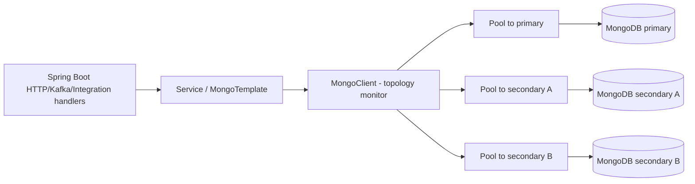
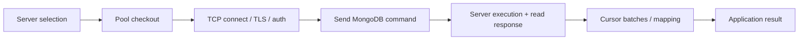
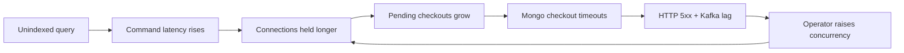
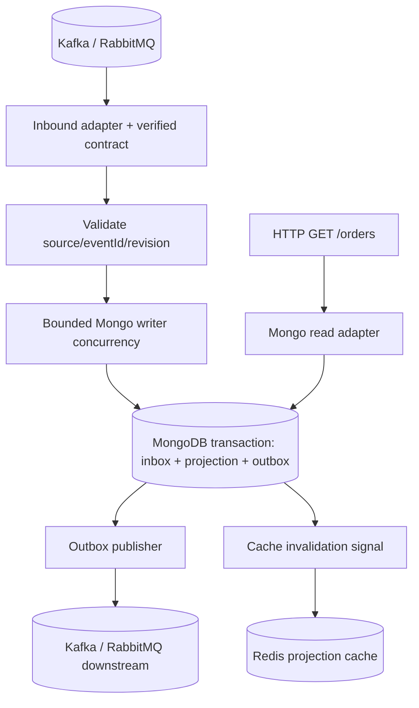

# Connection Pools, Timeouts, and Customizing MongoClientSettings

In **SPRING_BOOT_INTEGRATION**, MongoDB often sits behind an HTTP endpoint receiving partner payloads, a Spring Integration flow syncing a catalog, a Kafka/RabbitMQ consumer writing projections, or a scheduled job saving checkpoints. When MongoDB slows down, the application can hit `MongoTimeoutException` even though the server is still alive; when the pool is too small, requests queue and exhaust HTTP deadlines; when the pool is oversized across many pods, MongoDB can be flooded with sockets. Raising `maxPoolSize` or `socketTimeoutMS` by guesswork usually just shifts the bottleneck from the application to the database.

This lesson belongs to the **MongoDB** chapter and focuses on **connection pools, timeouts, and customizing `MongoClientSettings`** in Spring Boot. We trace an operation's lifecycle—server selection, connection checkout, TCP/TLS handshake, command execution, and result consumption; clarify pool and timeout parameters; configure `MongoClientSettingsBuilderCustomizer` alongside Spring Boot auto-configuration; contrast synchronous and reactive drivers; and apply these bounds to transactions, idempotency, testing, and observability in real integration systems.

> Examples target **Java 17+, Spring Boot 3.x, Spring Data MongoDB 4.x, and BOM-aligned MongoDB Java Driver 4.x/5.x**. Certain overloads or client-side operation timeout modes vary across driver versions; verify against the library API managed by your BOM. The database name `integration`, collection `order_projection`, endpoints, pool counts, and timeouts are **illustrative values only**, not optimal defaults for every environment.

## 1. Learning Objectives

After this lesson, you will be able to:

1. Describe the MongoDB access lifecycle: **server selection → connection checkout → connect/TLS → execute → consume result → return to pool**.
2. Distinguish `maxSize`, `minSize`, `maxConnecting`, `maxWaitTime`, `maxConnectionIdleTime`, and `maxConnectionLifeTime`; understand limits **per server/pool, per `MongoClient`, and per pod**.
3. Diagnose **server selection timeouts**, **pool checkout timeouts**, **connect timeouts**, **socket read timeouts**, server-side `maxTimeMS`, write concern timeouts, and overall deadlines.
4. Use `spring.data.mongodb.uri`/connection-string options or `MongoClientSettingsBuilderCustomizer` within clear ownership boundaries, avoiding redundant `MongoClient` instances.
5. Align connection pools with HTTP/broker concurrency, replica sets, TLS, read/write concerns, and transactions/sessions.
6. Classify transient, permanent, and **UNKNOWN_COMMIT_OUTCOME** errors to drive sound retry and idempotency policies.
7. Design metrics, logging, and runbooks for pool saturation, DNS/TLS issues, failovers, slow MongoDB primaries, and consumer backlogs.
8. Write tests using MongoDB Testcontainers, configuration/serialization tests, and fault injection rather than merely asserting bean initialization.

## 2. `MongoClient`, Topology, and Connection Pools Are Three Different Concepts

A Spring Boot application typically holds one `com.mongodb.client.MongoClient` (synchronous) and potentially one `com.mongodb.reactivestreams.client.MongoClient` (reactive) when using Spring WebFlux/Reactive MongoDB. **A `MongoClient` is not a single socket**: it is a configured client object that monitors topology and **manages underlying connection pools**. Operations from `MongoTemplate`, `MongoRepository`, or driver APIs borrow connections from the corresponding client.



With a MongoDB replica set, the driver discovers members, picks an eligible server based on **operation + read preference**, and checks out a connection from that server's pool. Background monitoring/heartbeats can maintain separate sockets outside application checkouts. Thus, server socket counts do not necessarily equal a single `maxPoolSize` parameter.

### 2.1. Lifecycle of a read command

```text
HTTP request / Kafka event
  -> application service validates input/deadline
  -> MongoTemplate.find(...)
      -> driver picks server matching readPreference/topology
      -> waits for an idle connection in that server's pool
      -> if needed: opens TCP socket, TLS handshake, authenticates
      -> sends find/aggregate command and awaits response
      -> reads batches/cursor as requested
      -> returns connection to pool once operation/cursor finishes
  -> maps Document to DTO/projection
  -> HTTP response / business commit / broker ack
```

One operation can issue **multiple commands**: cursor queries with `getMore`, transactions with multiple reads/writes/commits, or services making multiple calls. Do not measure “MongoDB time” from a single socket read alone. Unclosed cursors, long-lived sessions/transactions, or code holding resources too long deplete available connections.

### 2.2. Pools are **per server**, not a cluster-wide quota

Suppose 6 pods each run a `MongoClient` with `maxPoolSize=80`. If all pods write primarily to the same primary, **application connections reaching the primary can total 6 × 80 = 480**, excluding monitoring sockets and other clients. If each pod creates two distinct `MongoClient` beans, pool counts multiply further. `maxPoolSize=80` **does not** mean the entire deployment opens at most 80 connections.

| Concept | Scope | What to Avoid |
| --- | --- | --- |
| One `MongoClient` | One driver client instance | Creating a new one per HTTP request or event. |
| Pool for server A | One `MongoClient` to one MongoDB server address | Mistaking `maxSize` for a cluster-wide limit. |
| `maxSize` | Application connection limit per pool | Forgetting to multiply by pod and node counts. |
| Monitoring connections | Driver server/topology/heartbeat checks | Ignoring them when reconciling server connection counts. |
| Read preference | Selects which servers are eligible for reads | Assuming all reads always hit the primary. |
| Sync vs. reactive pools | Bound to their respective `MongoClient` types | Assuming sync and reactive clients share one pool. |

### 2.3. Why never create a `MongoClient` per operation?

```java
// Anti-pattern: every request spawns its own client and pool.
public void saveOrderBadly(OrderSnapshot value) {
    try (var client = com.mongodb.client.MongoClients.create(
            "mongodb://localhost:27017")) {
        client.getDatabase("integration")
                .getCollection("order_projection");
        // ... each call pays startup/monitor/auth/pool overhead
    }
}
```

In Spring Boot, maintain **an application-scoped managed `MongoClient` bean** and inject `MongoTemplate`/repositories into services. Create a separate client only when truly different configurations, credentials, or clusters are required and total connection math has been checked. Never share a single `MongoClient` across tenants whose trust boundaries or credentials violate security policy.

## 3. Connection Pool Parameters to Understand

The MongoDB Java Driver exposes `ConnectionPoolSettings`; names differ slightly between the Java builder and URI options:

| Java Builder | MongoDB Connection String Option | Effect |
| --- | --- | --- |
| `maxSize(n)` | `maxPoolSize=n` | Maximum application connections **per pool/server**. |
| `minSize(n)` | `minPoolSize=n` | Minimum connections the pool tries to maintain via background maintenance. |
| `maxConnecting(n)` | `maxConnecting=n` | Caps how many connections can be **established concurrently** per pool. |
| `maxWaitTime(t, unit)` | `waitQueueTimeoutMS=...` | Max wait time to check out an idle connection; distinct from connect timeout. |
| `maxConnectionIdleTime(t, unit)` | `maxIdleTimeMS=...` | Max **idle** duration before a connection is eligible for eviction. |
| `maxConnectionLifeTime(t, unit)` | `maxLifeTimeMS=...` | Max connection age since creation per pool cleanup rules. |
| Maintenance-related settings | Driver/config dependent | Pool maintenance frequency; does not alter query logic. |

A **value of 0 can mean “no time limit” or “no timeout”** depending on the specific setting and driver version. Never generalize zero-value semantics blindly; verify in your exact driver documentation and avoid unbounded settings that mask incidents.

### 3.1. `maxSize` does not make queries run faster

Suppose the database efficiently sustains 40 concurrent operations; bumping a pool from 100 to 1,000 lets more operations contend for CPU, locks, and I/O simultaneously, worsening both p95 latency and error rates. A bigger pool cannot fix:

- Queries missing indexes or tenant filters.
- Aggregations returning oversized payloads.
- Transactions holding locks for too long.
- Server replication lag or primary elections.
- High network/TLS latency.
- Kafka consumers running without concurrency/backpressure bounds.

Pool size represents **concurrent access capacity**, not guaranteed ready connections or optimal DB concurrency.

### 3.2. `minSize` and the cost of keeping connections open

`minSize=5` avoids socket-creation latency under steady traffic, yet across 30 pods × 3 servers, idle connection overhead adds up quickly. For scale-to-zero or sparse traffic, a high `minSize` wastes footprint. The driver populates connections gradually via maintenance; **do not assume `ApplicationReady` already holds `minSize` open connections**, nor assume physical connections survive forever across network drops, NAT timeouts, or primary failovers.

### 3.3. `maxConnecting` and cold-start bursts

When 20 pods roll out at once and cold pools establish TLS/auth sockets, `maxConnecting` caps **concurrent socket handshakes per pool**. Too low makes cold starts or scale-ups sluggish; too high triggers a connection storm against MongoDB and auth infrastructure. Measure **time to first successful operation**, checkout wait, and server connection churn when tuning.

### 3.4. Idle time and lifetime do not actively kill a running transaction

`maxIdleTime` and `maxLifeTime` govern background pool eviction/replacement; they are **not designed as mid-command execution deadlines**. If application code holds a session, cursor, or transaction open too long, enforce transaction/query deadlines and close resources properly rather than hoping idle eviction saves you.

Behind load balancers, NAT gateways, or firewalls with idle timeouts, choose a `maxIdleTime` below the network idle cutoff to reduce stale socket reuse, keeping in mind heartbeats, TCP keep-alives, server timeouts, and network paths. Test against real infrastructure.

## 4. A MongoDB Operation's Duration Spans Multiple Phases

A request can breach its SLA even when *no single* timeout fires:



| Limit | Scope | Common Misconceptions |
| --- | --- | --- |
| `serverSelectionTimeoutMS` | Time spent locating a server matching topology/read preference | Not the query execution timeout on the server. |
| `waitQueueTimeoutMS` | Waiting to check out a connection from the pool | Not the TCP socket connect timeout. |
| `connectTimeoutMS` | Opening a TCP connection to the server | Does not guarantee TLS/auth/operation finish within that window. |
| `socketTimeoutMS` | Waiting on socket I/O in the synchronous driver per version semantics | Not the end-to-end SLA; multi-batch streams can take longer. |
| `maxTimeMS` | Server-side processing cap on supported commands/queries | Not a transport deadline; not applied automatically to all operations. |
| `wTimeoutMS` / write concern | Waiting for write concern acknowledgment | Timing out does not prove the write did not occur. |
| Client-side operation timeout / `timeoutMS` if supported | Broader deadline in newer driver APIs/configs | Do not assume availability across all 4.x/5.x drivers or treat it as idempotency. |
| HTTP/broker overall deadline | Budget allocated to the **business workflow** | Must be propagated/enforced across all steps, not just the Mongo driver. |

### 4.1. Server selection timeout

Before a read or write, the driver must pick an eligible server, such as the **primary** for writes. When majority is lost, a primary has not yet been elected, the topology monitor is stale, or `readPreference` demands an unavailable secondary, operations wait up to `serverSelectionTimeoutMS` and throw `MongoTimeoutException`.

**Never blame pool size from the exception class alone.** Server selection failures state topology/server eligibility issues in their message; checkout timeouts point to waiting in a busy pool. Capture the exact error category, topology state, and pool telemetry before adjusting parameters.

### 4.2. Checkout timeout

Once a target server is selected, the operation checks out a socket. If the pool is at `maxSize` with all sockets busy, requests queue. `waitQueueTimeoutMS` bounds queue waiting; waiting indefinitely ties up HTTP worker threads or Kafka consumer threads, cascading failures across services.

```text
Mongo primary pool: maxSize=40
In-use = 40
Available = 0
Pending checkouts = 70
New request waits...
  -> a connection may be returned in time
  -> otherwise checkout timeout occurs
```

Adding 100 Kafka workers while the pool remains 40 only increases **pending checkouts**, not throughput. Balance consumer concurrency with MongoDB capacity rather than cranking up pool limits to “cure” backlogs.

### 4.3. Connect timeout vs. read timeout

`connectTimeoutMS` applies to establishing the TCP connection. `socketTimeoutMS`/driver read timeout applies to subsequent socket I/O; exact coverage of TLS handshakes and sub-phases must be verified against your runtime/provider. A server that accepts connections yet stalls while executing a command trips the read timeout, not the connect timeout.

Setting `socketTimeoutMS=0` (infinite) can leave HTTP threads wedged indefinitely. Conversely, setting 100 ms on a heavy aggregation causes timeout storms. **Optimize indexes/queries first**, then choose timeouts matching real SLAs and specific phases.

## 5. Spring Boot Auto-Configuration: Connection Config Is Not Business Data Config

With Spring Boot 3.x, typical dependencies are:

```groovy
dependencies {
    implementation 'org.springframework.boot:spring-boot-starter-data-mongodb'
    implementation 'org.springframework.boot:spring-boot-starter-validation'
    testImplementation 'org.springframework.boot:spring-boot-starter-test'
}
```

Maven equivalent:

```xml
<dependency>
    <groupId>org.springframework.boot</groupId>
    <artifactId>spring-boot-starter-data-mongodb</artifactId>
</dependency>
```

When auto-configuration conditions are satisfied, Boot wires a synchronous `MongoClient`, `MongoDatabaseFactory`, `MongoTemplate`, and repositories if enabled/detected. With `spring-boot-starter-data-mongodb-reactive`, auto-configuration takes a **separate reactive client/template** path; inspect carefully if both starters coexist.

### 5.1. Configuring `spring.data.mongodb.uri`

```yaml
spring:
  data:
    mongodb:
      uri: ${MONGODB_URI:mongodb://localhost:27017/integration}
```

A local URI clearly illustrating connection options:

```text
mongodb://localhost:27017/integration
  ?appName=integration-api
  &maxPoolSize=60
  &minPoolSize=4
  &maxConnecting=4
  &waitQueueTimeoutMS=300
  &maxIdleTimeMS=120000
  &maxLifeTimeMS=1800000
  &serverSelectionTimeoutMS=3000
  &connectTimeoutMS=2000
  &socketTimeoutMS=5000
```

Line breaks above are **for readability only**: a MongoDB connection string passed via environment variables must be **one continuous string** with no spaces or newlines:

```text
mongodb://localhost:27017/integration?appName=integration-api&maxPoolSize=60&minPoolSize=4&maxConnecting=4&waitQueueTimeoutMS=300&maxIdleTimeMS=120000&maxLifeTimeMS=1800000&serverSelectionTimeoutMS=3000&connectTimeoutMS=2000&socketTimeoutMS=5000
```

Do not copy 60/4/4 blindly into production; these numbers only illustrate parameter semantics. In URIs, parameters suffixed with `MS` are in **milliseconds**. If credentials appear in the URI, **never log the URI**; percent-encode special characters in username/password, and supply secrets via a secret manager or protected environment rather than Git.

### 5.2. Every config path needs one clear owner

| Configuration | Typical Owner | What to Watch |
| --- | --- | --- |
| `spring.data.mongodb.uri` | Spring Boot properties / MongoDB URI | Defines topology, auth, TLS, and many timeout/pool options. |
| `MongoClientSettingsBuilderCustomizer` | Application `@Configuration` bean | Customizes Java driver settings for the Boot auto-configured client. |
| `MongoClientSettings` + `MongoClients.create(...)` | Manual client code | Can bypass Boot auto-configuration and create an independent pool. |
| `MongoTemplate` | Spring Data operations API | Controls collection, query, mapping, and read/write behavior; not a separate pool. |
| `ReactiveMongoTemplate` | Reactive `MongoClient` | Has separate backpressure/reactive deadlines; does not use the sync pool. |
| `MongoTransactionManager` | Spring transaction infrastructure | Manages sessions/transactions; not `MongoClientSettings`. |

**Never set the same timeout in both the URI and a customizer relying on implicit ordering.** Spring Boot applies internal and application customizers during builder construction; exact precedence varies by BOM, bean order, and whether `MongoClient` is manually defined. Keep **one authoritative source per option** and verify effective settings via integration tests or driver diagnostics.

### 5.3. What happens if you declare a custom `MongoClient` bean?

```java
@Bean
com.mongodb.client.MongoClient mongoClient() {
    return com.mongodb.client.MongoClients.create(
            "mongodb://localhost:27017/integration");
}
```

Such a custom bean causes Boot to **back off from creating its default synchronous `MongoClient`**, meaning `MongoClientSettingsBuilderCustomizer` beans intended for the auto-configured client may not apply to your manual bean. If you construct the client manually, you must apply **all** URI, pool, TLS, credential, command listener, and shutdown lifecycle logic yourself. Never instantiate a new `MongoClient` per repository call.

When connecting to **two MongoDB clusters**, declare two clients intentionally with qualifiers and separate database factories/templates/repositories, accounting for total pool/socket usage. Never let repositories bind to “whichever MongoDB bean happens to be primary” by accidental bean naming.

## 6. Customizing `MongoClientSettings` via Boot Customizer

When an application wants **strongly typed application properties** for pools and timeouts, `MongoClientSettingsBuilderCustomizer` is a clean extension point. Avoid creating `MongoClient` manually so Boot keeps ownership of lifecycle and topology auto-configuration.

### 6.1. Application-owned properties

```yaml
spring:
  data:
    mongodb:
      uri: ${MONGODB_URI:mongodb://localhost:27017/integration}

app:
  mongo:
    max-pool-size: 80
    min-pool-size: 5
    max-connecting: 4
    max-wait: 300ms
    max-idle: 2m
    max-life: 30m
    connect-timeout: 2s
    read-timeout: 5s
    server-selection-timeout: 3s
```

`app.mongo.*` is an **application-defined namespace**, not built-in Boot MongoDB properties. It requires the Java binding and customizer below. When using this pattern, omit conflicting `maxPoolSize`/`socketTimeoutMS` options from `MONGODB_URI` unless precedence is explicitly tested and documented.

### 6.2. Using a `@ConfigurationProperties` record

```java
import java.time.Duration;
import java.util.Objects;
import org.springframework.boot.context.properties.ConfigurationProperties;

@ConfigurationProperties(prefix = "app.mongo")
public record MongoTuningProperties(
        int maxPoolSize,
        int minPoolSize,
        int maxConnecting,
        Duration maxWait,
        Duration maxIdle,
        Duration maxLife,
        Duration connectTimeout,
        Duration readTimeout,
        Duration serverSelectionTimeout) {

    public MongoTuningProperties {
        if (maxPoolSize < 1 || minPoolSize < 0
                || minPoolSize > maxPoolSize
                || maxConnecting < 1) {
            throw new IllegalArgumentException(
                    "Invalid MongoDB pool capacity");
        }
        for (Duration d : new Duration[]{
                maxWait, maxIdle, maxLife,
                connectTimeout, readTimeout,
                serverSelectionTimeout}) {
            Objects.requireNonNull(
                    d, "All MongoDB timeout properties are required");
            if (d.isZero() || d.isNegative()) {
                throw new IllegalArgumentException(
                        "MongoDB durations must be positive");
            }
        }
    }
}
```

This pattern **fails fast on missing or invalid configuration**, requiring all durations to be supplied. Real systems may allow disabling `maxIdle`/`maxLife` with an explicit sentinel, yet should never pass an unexplained `0` and mistake it for “0 ms timeout”.

### 6.3. Defining `MongoClientSettingsBuilderCustomizer`

```java
import java.util.concurrent.TimeUnit;
import org.springframework.boot.autoconfigure.mongo.MongoClientSettingsBuilderCustomizer;
import org.springframework.boot.context.properties.EnableConfigurationProperties;
import org.springframework.context.annotation.Bean;
import org.springframework.context.annotation.Configuration;

@Configuration(proxyBeanMethods = false)
@EnableConfigurationProperties(MongoTuningProperties.class)
public class MongoClientTuningConfiguration {

    @Bean
    MongoClientSettingsBuilderCustomizer tuningMongoClient(
            MongoTuningProperties p) {

        return settings -> {
            settings.applyToConnectionPoolSettings(pool -> pool
                    .maxSize(p.maxPoolSize())
                    .minSize(p.minPoolSize())
                    .maxConnecting(p.maxConnecting())
                    .maxWaitTime(
                            p.maxWait().toMillis(),
                            TimeUnit.MILLISECONDS)
                    .maxConnectionIdleTime(
                            p.maxIdle().toMillis(),
                            TimeUnit.MILLISECONDS)
                    .maxConnectionLifeTime(
                            p.maxLife().toMillis(),
                            TimeUnit.MILLISECONDS));

            settings.applyToSocketSettings(socket -> socket
                    .connectTimeout(
                            p.connectTimeout().toMillis(),
                            TimeUnit.MILLISECONDS)
                    .readTimeout(
                            p.readTimeout().toMillis(),
                            TimeUnit.MILLISECONDS));

            settings.applyToClusterSettings(cluster -> cluster
                    .serverSelectionTimeout(
                            p.serverSelectionTimeout().toMillis(),
                            TimeUnit.MILLISECONDS));
        };
    }
}
```

These builder calls reflect standard MongoDB sync driver settings in the version range noted earlier; if a newer driver version deprecates or alters overloads, align with the BOM and test before upgrading. `maxConnecting` is not total `maxSize`, and `SocketSettings.connectTimeout` is not `ClusterSettings.serverSelectionTimeout`.

**Spring Boot auto-configuration note:** this customizer applies to **clients built via Boot auto-configuration's customizer list**; it will not automatically apply to manually constructed `MongoClient` beans elsewhere. When both synchronous and reactive auto-configuration are active, verify which clients/settings actually receive the customizer and measure each pool separately rather than assuming from bean presence alone.

### 6.4. Avoid hardcoding secrets and URI conflicts

Never place passwords or TLS client certificate materials inside `MongoTuningProperties` meant for general tuning. Credentials and CA/truststore/keystore material belong to secret/connection management; a customizer altering auth/SSL settings in a different order can override URI settings. Separate concerns clearly:

```text
MONGODB_URI                 -> topology, database, auth, TLS, retry mode
app.mongo.* tuning          -> application-owned pool/timeouts
MongoTemplate / query       -> query projections, maxTime, writeConcern as needed
Application service         -> overall deadline, idempotency, retry budget
```

This is a **suggested ownership split**, not mandatory. Always verify **effective settings**: if the URI specifies `maxPoolSize=500` while a Java customizer sets `maxSize(80)`, know which wins instead of trusting whichever YAML file you read first.

## 7. URI vs. Java Builder Configuration: Choosing by Need

| Criterion | URI / Connection String Only | `MongoClientSettingsBuilderCustomizer` |
| --- | --- | --- |
| Standard pool/timeouts | Often sufficient and easy per environment | Typed `Duration` validation and grouped config |
| Infrastructure supplies MongoDB URI | Convenient for managed MongoDB/SRV | Must verify critical URI options are not overwritten |
| ConnectionPool/Command listeners | Cannot attach Java listeners via URI | Builder cleanly registers listeners |
| Per-profile/environment overrides | Strong via env/secrets | Strong via `@ConfigurationProperties` and Spring profiles |
| Custom metrics/observability | Driver/Actuator auto-metrics depending on classpath | Can attach custom listeners with explicit policies |
| Manual `MongoClient` / multiple clusters | Configured per client | Must be wired into **each** client manually; not automatic |
| Input validation | URI parser checks option syntax | Code can enforce business SLO constraints |

Do not write Java code solely to set `maxPoolSize=80` when the URI is already cleanly managed. However, when the application needs **`maxConnecting`, metrics listeners, custom TLS handling, or module-specific server selection/tuning**, the Java builder consolidates validated, testable decisions in one place.

### 7.1. Never override connection string options unpredictably

Dangerous example:

```yaml
spring:
  data:
    mongodb:
      uri: mongodb://localhost:27017/integration?maxPoolSize=100
app:
  mongo:
    max-pool-size: 20
```

Even though the app boots, the “effective pool” may surprise operators. Choose **one single source** for `maxPoolSize`. If multiple customizers use `@Order`, write an integration test verifying effective behavior and document the policy. Never declare a manual `MongoClientSettings` bean just to “override” properties if doing so breaks Boot's managed client lifecycle.

### 7.2. Verify bean lifecycle and graceful connection shutdown

`MongoClient` must be closed on application shutdown to release pools, monitoring threads, and sockets. Boot-managed clients have their lifecycle managed by the Spring context. If you create a client outside the Spring context, manage `close()` yourself; if you create one client per tenant/request, never expect GC or shutdown hooks to fix a connection storm.

During graceful shutdown of HTTP servers and Kafka listeners, **stop admitting new work, allow in-flight operations to complete within a deadline, and then close `MongoClient`**. Never shut down the client mid-way after a DB commit before updating outbox/inbox records; acknowledgment boundaries must stay durable at the application layer.

## 8. Server-Side Timeouts, Queries, and Write Concerns

MongoDB Java driver timeouts **do not** limit how long the database server spends executing a query. A read can check out a connection rapidly and still run an aggregation for seconds due to missing indexes or huge data volume.

### 8.1. Using `maxTimeMS` on supported operations

Spring Data MongoDB example:

```java
import java.time.Duration;
import org.springframework.data.mongodb.core.MongoTemplate;
import org.springframework.data.mongodb.core.query.Criteria;
import org.springframework.data.mongodb.core.query.Query;
import org.springframework.stereotype.Repository;

@Repository
public class OrderMongoReadAdapter {
    private final MongoTemplate mongo;

    public OrderMongoReadAdapter(MongoTemplate mongo) {
        this.mongo = mongo;
    }

    public OrderProjection findOrder(
            String tenantId, String orderId) {

        Query query = Query.query(
                Criteria.where("tenantId").is(tenantId)
                        .and("orderId").is(orderId));
        query.maxTime(Duration.ofSeconds(2));

        return mongo.findOne(query, OrderProjection.class);
    }
}
```

`OrderProjection` is the Java Mongo document mapping defined in the business example below. `Query.maxTime(...)` hints to **MongoDB server execution limits** as supported by the command/driver; it **does not** cover DNS/server selection, pool queueing, TCP connections, network I/O, mapping, or application orchestration. Never use `maxTime` as a substitute for indexes or query projections.

In the raw MongoDB driver API, supported operations expose:

```java
import java.util.concurrent.TimeUnit;
import com.mongodb.client.MongoCollection;
import org.bson.Document;

Document found = collection
        .find(new Document("tenantId", "tenant-7")
                .append("orderId", "ORD-42"))
        .maxTime(2, TimeUnit.SECONDS)
        .first();
```

This snippet assumes `collection` is a `MongoCollection<Document>` obtained from a managed `MongoClient`, not a new client created per query. For `aggregate`, `countDocuments`, and other commands, `maxTime` APIs and scope vary. For bulk writes/transactions, check write concern/commit limits and overall deadlines separately.

### 8.2. Write concern timeout does not mean “the write rolled back”

MongoDB write concerns such as `w: "majority"` demand a specific acknowledgment level. `wTimeoutMS` bounds how long to wait for that acknowledgment; if it times out, **you cannot automatically conclude the write did not occur**.

```text
Client -> primary: insert document with stable _id
Primary applies write
Replicas lag; majority acknowledgment too slow
Client sees write concern timeout
             |
             v
        Outcome may be uncertain
```

Distinguish clearly:

- **Command validation error**: MongoDB rejected the operation outright (e.g., invalid update, unauthorized, or unique index violation). Usually deterministic for unchanged input/schema.
- **Write concern timeout**: the acknowledgment level was not reached within the timeout, yet the write may already exist on the primary. Inspect state/operation keys instead of generating a new business ID.
- **Network error after sending**: the response may have been lost after server commit; outcome is **UNKNOWN**.
- **Transaction commit error**: handle retries/unknown outcomes per **transaction error labels/driver contract**, rather than treating every `MongoException` as blindly retryable.

### 8.3. Read preference, read concern, and freshness

When an application reads an order projection immediately after writing:

- Reading from **primary** avoids secondary lag, yet does not replace business transaction invariants.
- `secondaryPreferred`/`nearest` can return stale data before writes replicate; use read-your-writes/session semantics when contracts demand freshness.
- `readConcern("majority")` defines visibility per replica set semantics; **it does not guarantee absolute freshness** across every secondary.
- `writeConcern("majority")` strengthens durability/acknowledgment at the expense of latency and quorum availability.
- Transactions impose specific constraints on read concern, write concern, sessions, and topology.

**Consistency and connection pools are related but distinct.** During primary elections, reads/writes suffer server-selection delays and elevated retries, yet raising `maxSize` cannot fix replication lag. Define business read consistency requirements before offloading reads to secondaries.

## 9. Bound the Entire Workflow, Not Uncoordinated Per-Layer Timeouts

Suppose an HTTP API has a 2-second SLO, yet configures:

```text
serverSelectionTimeout = 3s
maxWaitTime             = 1s
connectTimeout          = 2s
socketTimeout           = 5s
partner HTTP timeout    = 4s
```

Even individual timeouts **exceed** the SLO, and they do not execute as a simple single-pass sum—an operation can retry server selection, fetch multiple cursor batches, or retry commands. Enforce a **business deadline** computed upon request/event arrival and allocate time budgets per step.

### 9.1. Time budget example

```text
SLO / operation budget: 2 000 ms
  request parsing + authentication:   100 ms
  Mongo query + pool checkout:         600 ms
  partner HTTP dependency:             800 ms
  DB/outbox commit:                    300 ms
  safety/serialization margin:         200 ms
Total:                              2 000 ms
```

These numbers illustrate budgeting math only, **not production defaults**. Never grant every dependency a 5-second timeout inside a 2-second request SLA. When remaining budget is insufficient, fail fast or hand off to a durable async path per SLA instead of starting another Mongo transaction destined to time out.

### 9.2. Why `socketTimeoutMS` is not an overall deadline

A single Mongo operation may:

1. Wait for server selection.
2. Wait for pool checkout.
3. Execute a query bounded by `maxTimeMS`.
4. Stream multiple cursor batches, each incurring network I/O.
5. Map results and call a partner HTTP service afterward.

`socketTimeoutMS` does not span all of those phases. In newer MongoDB Java driver versions supporting **client-side operation timeout (CSOT)**, evaluate `timeoutMS`/per-operation timeouts per version docs, keeping in mind that timeout/cancellation **does not automatically roll back server-side side effects**. In older drivers, enforce deadlines/bulkheads at the application layer across individual commands.

### 9.3. Deadlines across HTTP ingress and broker consumers

| Source | Where Does the Deadline Come From? | When Mongo Slows Down |
| --- | --- | --- |
| HTTP endpoint | Reverse proxy, server timeout, client SLA, app budget | Return proper error or durable acceptance per API contract; avoid uncontrolled side effects after client disconnect. |
| Kafka consumer | Poll loop constraints, rebalance limits, task budget, lag | Cap concurrent in-flight records; ack/commit offsets only after durable processing. |
| RabbitMQ listener | Consumer concurrency, broker redelivery, ack policy | Bound in-flight messages, apply retry/backoff; avoid tight requeue loops. |
| Spring Integration poller | Trigger interval, `maxMessagesPerPoll`, worker pool | Durable message stores/checkpoints and bounded throughput. |
| Quartz scheduled job | Job-specific budget and scheduler worker capacity | Process in checkpointed chunks; never lock threads for hours assuming Quartz retries fix everything. |

When MongoDB acts as a **cache/projection**, unavailability might allow bounded fallback to a source of truth. When MongoDB is the **authoritative business store**, never silently return “order does not exist” when the database is actually unreachable.

## 10. Sizing Pools by Concurrency, Latency, and Pod Count

A useful starting estimate is Little's Law:

\[
L \approx \lambda W
\]

Where `L` is the **average number of in-flight requests** in a steady system, `λ` is average throughput, and `W` is average service time. For MongoDB, estimate **concurrent operations needing a connection** as MongoDB ops/sec × connection hold time (seconds/op)—**not** total HTTP response time if MongoDB is only part of the request.

### 10.1. Sizing example with assumptions

A deployment has **6 pods** serving **900 Mongo operations/s** evenly distributed. Suppose each operation holds a Mongo connection for **40 ms** on average:

```text
Per pod throughput    = 900 / 6           = 150 ops/s
Mean connection usage = 40 ms             = 0.040 s
Average in use        = 150 * 0.040       = 6 connections/pod
```

6 is only the **steady-state mean**, not a recommendation to set `maxSize=6`. Under p95/p99 latency spikes, bursts, multi-op transactions, or primary elections, concurrent demand jumps sharply. Base final headroom on per-pod load tests and MongoDB server metrics.

Conditional capacity-planning example:

| Parameter | Hypothetical Scenario | Meaning |
| --- | --- | --- |
| Pods | 6 | Number of `MongoClient`s assuming one sync client per pod. |
| `maxPoolSize` | 40 | Up to ~240 application connections to **each** server if all pods target that server. |
| `minPoolSize` | 4 | Maintains at least ~24 pooled connections per server under normal conditions. |
| `maxConnecting` | 3 | Limits concurrent socket creation per pool, smoothing cold-start storms. |
| `maxWaitTime` | 300ms | Bounded wait queue instead of holding HTTP/broker threads indefinitely. |
| `serverSelectionTimeout` | 2s | Failover topology wait, balanced against the overall deadline. |

This is **not** a preset for any specific MongoDB cluster. Server `connections.current` also includes background, monitoring, admin, and other services' clients. In sharded clusters/`mongos`, pools target each router/server address; per-pool limits can yield higher total connection counts than expected.

### 10.2. Monitor MongoDB alongside HTTP and brokers

A typical overload cascade:

```text
Kafka listener concurrency = 24 per pod
  -> each record calls Mongo twice
  -> Mongo waitQueueTimeout grows
  -> listener processing slows
  -> Kafka consumer lag increases
  -> operator increases concurrency to 48
  -> queue and timeout get worse
```

If MongoDB is already saturated, raising Kafka concurrency lowers effective throughput. Instead:

1. Measure `inUse/available/pendingCheckouts` per pool/server and command p95.
2. Determine whether queries, indexes, DB CPU/I/O, or replication are the bottleneck.
3. Cap in-flight database operations via bulkheads/concurrency limits before or alongside tuning pools.
4. Reduce round trips, tighten projections, or batch appropriately without creating huge cursors/transactions that hold connections open.
5. Increase pool sizes carefully while measuring p95/p99 and Mongo server resources before and after.

### 10.3. Pool exhaustion is usually a symptom

A full checkout queue can be caused by:

- Unindexed queries holding connections longer.
- Unclosed or slowly iterated cursors/streams.
- Long transactions pinning sessions/connections.
- Mongo server failover or read preference waiting on servers.
- Unexpected pod/client scaling bursts.
- Slow TLS/auth handshakes throttling `maxConnecting`.
- HTTP/Kafka thread pools dispatching more concurrent DB calls than the system can handle.

Increasing `maxSize` helps only after identifying **what is occupying connections** and confirming **the server still has headroom**. Distinguish *high in-use with low query latency* (may warrant capacity) from *high in-use with spiking query latency* (MongoDB itself is overloaded).

## 11. Transactions, `ClientSession`, and Connection Pinning

MongoDB transactions on replica sets or sharded clusters carry specific deployment and session requirements; they do not work on standalone MongoDB instances that lack transaction support. Spring Data MongoDB provides `MongoTransactionManager` for synchronous operations; configure and test it explicitly whenever workflows use Mongo transactions.

### 11.1. Intentional transaction manager configuration

```java
import org.springframework.context.annotation.Bean;
import org.springframework.context.annotation.Configuration;
import org.springframework.data.mongodb.MongoDatabaseFactory;
import org.springframework.data.mongodb.MongoTransactionManager;

@Configuration(proxyBeanMethods = false)
public class MongoTransactionConfiguration {
    @Bean("mongoTransactionManager")
    MongoTransactionManager mongoTransactionManager(
            MongoDatabaseFactory factory) {
        return new MongoTransactionManager(factory);
    }
}
```

In applications also using PostgreSQL/JPA, never confuse Mongo's transaction manager with `JpaTransactionManager`. Qualify explicitly:

```java
import org.springframework.stereotype.Service;
import org.springframework.transaction.annotation.Transactional;

@Service
public class ProjectionBatchService {
    private final OrderProjectionWriter writer;

    public ProjectionBatchService(OrderProjectionWriter writer) {
        this.writer = writer;
    }

    @Transactional(transactionManager = "mongoTransactionManager")
    public void applyBatch(VerifiedOrderBatch batch) {
        writer.upsertProjection(batch);
        writer.insertCheckpoint(batch);
    }
}
```

`OrderProjectionWriter` and `VerifiedOrderBatch` are **application-defined interfaces/DTOs** for illustration and must be defined separately for compilation. `@Transactional` triggers only when invoked **through a Spring proxy**, not via same-class self-invocation.

### 11.2. Transactions hold connections longer than single queries

Inside a transaction, the driver uses a `ClientSession` and can **pin** connections/servers per transaction/topology semantics (especially across sharded/`mongos` topologies). Pool sizing must account for **concurrent transactions × hold duration**, not just single queries. Never open a Mongo transaction and then:

```text
BEGIN Mongo transaction
  -> read collection A
  -> wait 10s on partner HTTP call
  -> call Redis/cache
  -> write collection B
COMMIT
```

HTTP and Redis do not participate in MongoDB transactions, while holding the transaction across network I/O extends locks/sessions and increases contention. Call external partners **before** the transaction when idempotency/state machines permit, keeping the transaction brief for claim/check/update/outbox writes. Use sagas or outbox patterns for cross-system consistency rather than pretending one transaction spans everything.

### 11.3. Sessions, cursors, and resource management

Sync driver cursors (`MongoCursor<T>`) must always be closed when iterated manually:

```java
import com.mongodb.client.MongoCursor;
import org.bson.Document;

try (MongoCursor<Document> cursor =
        collection.find(new Document("tenantId", "tenant-7"))
                .iterator()) {
    while (cursor.hasNext()) {
        Document item = cursor.next();
        // Bounded processing; never make slow partner HTTP calls inside the loop.
    }
}
```

`collection` assumes a `MongoCollection<Document>` from a managed application client. Cursors hold server resources and issue `getMore` round trips; forgetting to close them or keeping them open across slow blocking pipelines consumes connections and latency. With Spring Data's `MongoTemplate.stream(...)`, wrap `Stream<T>` in `try-with-resources`. Never call `findAll()`/`collectList()` on millions of documents and expect a larger pool to fix memory exhaustion.

### 11.4. MongoDB transactions do not cover Kafka offsets or Redis

```text
MongoDB transaction commit
     != Redis SET commit
     != Kafka producer transaction commit
     != RabbitMQ ACK
     != HTTP partner POST commit
```

If a consumer receives a Kafka event, writes MongoDB, and crashes before committing the offset, the event will be redelivered. Use **unique event keys/inboxes or conditional updates** inside MongoDB to tolerate duplicates. Transactions guarantee atomicity across supported MongoDB operations, **not distributed exactly-once across Kafka + MongoDB**.

## 12. Reactive `MongoClient` Is Not Just a Renamed Sync `MongoClient`

With `spring-boot-starter-data-mongodb-reactive`, `ReactiveMongoTemplate` and the reactive driver manage publishers, scheduling, and connections under the reactive client model. Calling synchronous `MongoTemplate` directly inside a Spring WebFlux endpoint blocks the event loop and stalls unrelated requests.

### 12.1. Non-blocking read example

```java
import java.time.Duration;
import org.springframework.data.mongodb.core.ReactiveMongoTemplate;
import org.springframework.data.mongodb.core.query.Criteria;
import org.springframework.data.mongodb.core.query.Query;
import reactor.core.publisher.Mono;

public final class ReactiveOrderMongoAdapter {
    private final ReactiveMongoTemplate mongo;

    public ReactiveOrderMongoAdapter(ReactiveMongoTemplate mongo) {
        this.mongo = mongo;
    }

    public Mono<OrderProjection> find(
            String tenantId, String orderId) {
        Query query = Query.query(
                Criteria.where("tenantId").is(tenantId)
                        .and("orderId").is(orderId));
        query.maxTime(Duration.ofSeconds(1));

        return mongo.findOne(query, OrderProjection.class)
                .timeout(Duration.ofSeconds(2));
    }
}
```

`Mono.timeout(2s)` caps reactive **subscription** wait time; it does not guarantee the Mongo server stopped executing or rolled back a remote write. Pair driver timeouts with proper cancellation semantics, and protect retries on writes using `retryWhen` with idempotency and retry budgets.

### 12.2. Blocking calls inside reactive chains

Never do this:

```java
return reactiveMongoTemplate.findOne(query, OrderProjection.class)
        .map(result -> synchronousMongoTemplate.findAll(
                OtherProjection.class))   // blocking DB call on event loop
        .block();                           // blocks reactive caller
```

If blocking calls cannot yet be eliminated, offload them onto an appropriate scheduler with **bounded concurrency** (e.g., Reactor `Schedulers.boundedElastic()`), keeping thread scheduling, backpressure, and pool isolation in mind—adding `publishOn(...)` is not an infinite scaling strategy.

### 12.3. Sync/reactive configuration and metric notes

| Question | Significance |
| --- | --- |
| Does the app inject `MongoTemplate` or `ReactiveMongoTemplate`? | Determines which driver, client, and pool are actually active. |
| Are both sync and reactive starters present? | You may have **two independent `MongoClient`s and pools**. |
| Which `MongoClientSettingsBuilderCustomizer` applies to which client? | Verify auto-configuration/beans under your Boot BOM instead of guessing. |
| Does sync socket `readTimeout` behave like reactive cancellation? | No; consult driver-specific timeout semantics. |
| Does a Kafka listener call reactive `subscribe()` and ack early? | If so, DB writes may not have committed when the offset/ack completes. |
| Does cancelling a Mongo operation on client disconnect stop the server? | Not guaranteed; enforce idempotency. |

Choose **one primary programming model per workflow** in an integration module, then test end-to-end deadlines, thread pools, transactions/sessions, and broker acks. Never mix sync and async arbitrarily inside a payment handler.

## 13. Retryable Errors, Unknown Outcomes, and Idempotency with MongoDB

The MongoDB driver supports retryable reads/writes for **eligible commands and topologies** when enabled and supported by the server. Driver retries **do not make** an HTTP → MongoDB → Kafka workflow exactly-once.

### 13.1. Classify before retrying

| Error/Scenario | Handling Strategy | What Not to Do |
| --- | --- | --- |
| `MongoTimeoutException` during **server selection** | Potentially transient (primary election/DNS); bounded retry within deadline | Raise `maxPoolSize` without inspecting topology. |
| `MongoTimeoutException` during **connection checkout** | Pool saturated; reduce concurrency, optimize queries, inspect in-use/pending | Keep spinning up more Kafka consumers. |
| TCP reset/read timeout mid-write | Outcome may be UNKNOWN; read back by stable business key | Retry using a newly generated random or payment ID. |
| MongoDB server `maxTimeMS` exceeded | Slow query/missing index or overloaded DB; fix query | Retry identically 100 times against a struggling DB. |
| `DuplicateKeyException` on stable event ID | Valid duplicate replay or payload conflict | Ignore all duplicates without comparing hashes. |
| BSON/JSON mapping/schema error | Permanent for the current payload | Put into infinite transient backoff. |
| Authorization or TLS trust failure | Bad secret/certificate/role | Trigger a reconnect storm with unchanged credentials. |
| Transaction transient error label | Driver/server may allow retrying the transaction unit per contract | Repeat external HTTP side effects inside the transaction callback. |
| Unknown transaction commit result | Check/retry commit via transaction API and inspect actual state | Re-run the whole workflow with a new operation ID. |

**Never retry all subclasses of `MongoException`.** A failed transaction may roll back; a post-write timeout may leave the record persisted; a unique-index violation may indicate already-processed work or conflicting data. Each case demands its own policy.

### 13.2. Defining projection and identity

Example MongoDB persistence model decoupled from HTTP response and Kafka event DTOs:

```java
import java.math.BigDecimal;
import java.time.Instant;
import org.springframework.data.annotation.Id;
import org.springframework.data.mongodb.core.mapping.Document;
import org.springframework.data.mongodb.core.mapping.Field;
import org.springframework.data.mongodb.core.mapping.FieldType;
import org.springframework.data.mongodb.core.index.CompoundIndex;

@Document(collection = "order_projection")
@CompoundIndex(
        name = "tenant_order_unique",
        def = "{'tenantId': 1, 'orderId': 1}",
        unique = true)
public record OrderProjection(
        @Id String id,
        String tenantId,
        String orderId,
        String status,
        @Field(targetType = FieldType.DECIMAL128)
        BigDecimal amount,
        String currency,
        Instant updatedAt,
        long sourceRevision
) {}
```

MongoDB BSON `Decimal128` supports a bounded precision/range, **not arbitrary `BigDecimal` values**. Validate precision/scale/currency before persisting, test JSON/Decimal128 round-trips, and never convert via `double`. `@CompoundIndex` is an **index declaration**, not proof the index exists in production: Spring Data MongoDB `auto-index-creation`/lifecycle behavior depends on configuration, so create indexes via controlled migrations and verify via database metadata.

### 13.3. Creating unique indexes to protect business keys

Inside managed migrations/provisioning (never per HTTP request):

```javascript
db.order_projection.createIndex(
  { tenantId: 1, orderId: 1 },
  { unique: true, name: "tenant_order_unique" }
);

db.processed_event.createIndex(
  { sourceSystem: 1, eventId: 1 },
  { unique: true, name: "source_event_unique" }
);
```

Before creating unique indexes on historical collections, audit duplicates, collation/case sensitivity, null/missing fields, and sharding constraints. On sharded collections, **unique indexes are constrained by shard key/topology**; verify your MongoDB version and deployment rather than assuming every compound unique index works across every sharding scheme. Never delete historical duplicates just to make index creation succeed without business verification.

### 13.4. Deduplicating in MongoDB with a short transaction

Suppose a consumer receives an event:

```java
import java.math.BigDecimal;
import java.time.Instant;

public record VerifiedOrderEvent(
        String sourceSystem,
        String eventId,
        String tenantId,
        String orderId,
        String status,
        BigDecimal amount,
        String currency,
        Instant occurredAt,
        long sourceRevision,
        String canonicalPayloadHash
) {}
```

A handler persisting **inbox key + projection** inside one MongoDB transaction:

```java
import java.time.Instant;
import org.springframework.data.mongodb.core.MongoTemplate;
import org.springframework.stereotype.Service;
import org.springframework.transaction.annotation.Transactional;
import org.springframework.data.mongodb.core.query.Criteria;
import org.springframework.data.mongodb.core.query.Query;
import org.springframework.data.mongodb.core.query.Update;

@Service
public class OrderMongoEventWriter {
    private final MongoTemplate mongo;

    public OrderMongoEventWriter(MongoTemplate mongo) {
        this.mongo = mongo;
    }

    @Transactional(transactionManager = "mongoTransactionManager")
    public void apply(VerifiedOrderEvent e) {
        // A unique index on (sourceSystem,eventId) is required.
        mongo.insert(new ProcessedEvent(
                null, e.sourceSystem(), e.eventId(),
                e.canonicalPayloadHash(), Instant.now()));

        Query query = Query.query(
                Criteria.where("tenantId").is(e.tenantId())
                        .and("orderId").is(e.orderId()));
        Update update = new Update()
                .set("status", e.status())
                .set("amount", e.amount())
                .set("currency", e.currency())
                .set("updatedAt", e.occurredAt())
                .set("sourceRevision", e.sourceRevision());

        mongo.upsert(query, update, OrderProjection.class);
        // For downstream events, persist a durable outbox record in the SAME
        // MongoDB transaction or use another verified pattern.
    }
}
```

```java
import java.time.Instant;
import org.springframework.data.annotation.Id;
import org.springframework.data.mongodb.core.mapping.Document;
import org.springframework.data.mongodb.core.index.CompoundIndex;

@Document(collection = "processed_event")
@CompoundIndex(
        name = "source_event_unique",
        def = "{'sourceSystem': 1, 'eventId': 1}",
        unique = true)
public record ProcessedEvent(
        @Id String id,
        String sourceSystem,
        String eventId,
        String payloadHash,
        Instant processedAt
) {}
```

This is a **basic atomic-claim pattern**, not a complete production ordering solution: `mongo.upsert(...)` on the projection can let an **older** event overwrite a newer one under out-of-order delivery. Add revision/watermark/optimistic-concurrency guards from the authoritative source. With `@Id String id=null`, MongoDB/Spring Data generates a document ID while the compound index enforces business uniqueness.

### 13.5. Duplicates vs. identity conflicts

When `mongo.insert(ProcessedEvent)` hits a duplicate key, **never catch it and return success inside the aborted transaction**. Outside the transaction boundary, query the existing record by `(sourceSystem, eventId)` and compare **canonical payload hash + contract version**:

```text
Same key + same canonical hash -> confirmed replay
    -> return idempotent success / acknowledge

Same key + different canonical hash -> identity conflict
    -> quarantine / alert; do NOT overwrite previous projection

Duplicate key on a different index -> investigate:
    may be data conflict or a broken identity rule
```

**UNKNOWN commit case:** if the process/network fails after issuing commit, look up the inbox/projection by stable key before re-running. Follow MongoDB driver transaction/commit retry labels rather than treating a plain Java `try/catch` as full failover recovery.

### 13.6. Protecting order/event sequencing

If event A (revision 10) arrives **after** event B (revision 11) due to Kafka partitions, RabbitMQ redelivery, or HTTP polling, guard updates to apply only newer revisions:

```text
UPDATE projection
  WHERE (tenantId, orderId) = business key
    AND sourceRevision < incomingRevision
  SET state/amount/revision = incoming version
```

Using `upsert` with a filter including `sourceRevision < incomingRevision` can attempt an insert when the document already exists at a higher revision; the unique index blocks a duplicate insert, yet **hitting a duplicate key is not the clean happy path**. Use explicit conditional updates plus insert-on-absence with proper race handling, or document-level optimistic locking. Test out-of-order A/B delivery and concurrent duplicates against real MongoDB.

## 14. How Replica Sets, SRV DNS, TLS, and Failover Affect Timeouts

A URI like:

```text
mongodb+srv://service.example.invalid/integration?retryWrites=true&w=majority
```

illustrates **structure only**; `example.invalid` is not a real endpoint. The `mongodb+srv` scheme performs DNS SRV/TXT lookups to discover hosts and options per driver rules. It never lets applications bypass DNS policies, TLS verification, or server selection; DNS/SRV failures or blocked network paths fail **even before connection checkout**.

### 14.1. Commonly confused failure layers

| Symptom | Typically Involved Component | Priority Action |
| --- | --- | --- |
| Hostname/SRV fails to resolve | DNS, search domains, SRV/TXT, proxy/firewall | Check DNS resolution from the runtime node/container, not just a laptop. |
| TLS handshake fails | CA/truststore, hostname verification, cert expiry/rotation, mTLS | Fix chain/hostname/credentials; never disable TLS/hostname verification. |
| `MongoSecurityException` | Authentication source, user, secret, roles | Check credential rotation/privileges; never log secrets. |
| Driver cannot find primary | Election, topology monitor, wrong `replicaSet` name, network reachability | Inspect server selection error/topology and replica set health. |
| Read latency varies across pods | DNS routing, region/network path, read preference | Compare selected server/RTT instead of just aggregate p95. |
| Connections surge after deploy | Pod count, `MongoClient` count, `minSize`/`maxSize`/monitor sockets | Audit bean/pod inventory and DB connection counts. |
| Stale reads on secondary | Replication lag, `readConcern`/`readPreference` | Adjust consistency policy and track source revisions. |

### 14.2. Replica set elections are not pool-size errors

During a primary election, there is briefly no writable primary. The driver waits up to server selection timeout and/or retries eligible operations per policy. Raising `maxPoolSize` whenever `MongoTimeoutException` fires will not elect a primary—it only spikes pressure when the cluster recovers.

A runbook should verify:

1. Does the cluster have healthy nodes/quorum and proper replica set member states?
2. Does the MongoDB URI misconfigure `replicaSet`, `directConnection`, or topology?
3. Which network zones host app vs. DB—are there partitions, NATs, LBs, or proxies?
4. Are clients targeting primary/secondaries with appropriate read preferences and read/write concerns?
5. Do `serverSelectionTimeout`, command latency, and retry budgets fit client SLAs?
6. Did a new release accidentally spin up extra `MongoClient` instances causing cold-start pool spikes?

### 14.3. TLS and auth: do not use timeouts to mask bad certificates

If the CA or certificate hostname is wrong, bumping `connectTimeoutMS` from 2s to 30s merely makes requests fail **later**. Enable TLS, verify hostnames, truststores, and mTLS per deployment. Never deploy `tlsAllowInvalidCertificates=true` or `tlsAllowInvalidHostnames=true` to production as a “temporary fix”—disabling TLS checks compromises security and hides misrouting.

When MongoDB credentials rotate in a secret manager, existing pooled sockets and newly opened sockets can behave differently during the transition. Test **secret rotation + pool reconnect** deliberately rather than waiting for the server to kill sockets.

### 14.4. Containers and `localhost`

`mongodb://localhost:27017` points only to **the process's own network namespace**. Inside a Kubernetes pod or Docker container, `localhost` usually is not an external MongoDB server. When local runs work yet staging fails, inspect service DNS, ports, NetworkPolicies, firewalls, proxies, and TLS before touching pool settings.

## 15. Observability: Measure Pool Checkout and Command Latency Separately

Spring Boot Actuator/Micrometer can instrument MongoDB commands and pools depending on driver capabilities and version auto-configuration. For custom listeners, the Java driver supports `ConnectionPoolListener`, `CommandListener`, and server monitoring events.

**Double-counting warning:** when Boot/Actuator already registers MongoDB metrics listeners, avoid registering a second custom listener emitting the same events under the same metric names. Inspect actual wired beans and cross-check against real Mongo command counts.

### 15.1. Useful signals to collect

| Signal | Why It Matters |
| --- | --- |
| Pool in-use/checked-out connections | Connections actively serving operations. |
| Pool available/idle connections | Immediate capacity before queueing occurs. |
| Pool pending checkouts / wait duration | Surfaces pool saturation before timeouts fire. |
| Connection creation/close counts | Cold starts, churn, stale sockets, lifetime/idle eviction. |
| Checkout failure count/reason | Pool timeout vs. pool cleared/closed. |
| Command success/failure latency p95/p99 | Slow queries, aggregations, or server stalls. |
| Server selection timeout count | No eligible server—often topology, DNS, or failover. |
| Server RTT/heartbeat/topology changes | Primary elections or network instability. |
| MongoDB server current connections, CPU, memory, queues, locks | Actual database capacity, beyond client pools. |
| Query docs examined / returned / index usage | Missing indexes or oversized aggregations. |
| Active transactions and cursor counts | Long-lived sessions/cursors causing pool contention. |
| HTTP latency, Kafka/Rabbit lag, outbox age | Shows whether Mongo bottlenecks cascade across the integration flow. |

### 15.2. Registering a `ConnectionPoolListener`

Example listener tracking checkout counts and failures; register in **one** centralized place:

```java
import java.util.concurrent.atomic.LongAdder;
import com.mongodb.event.ConnectionPoolListener;
import com.mongodb.event.ConnectionCheckedOutEvent;
import com.mongodb.event.ConnectionCheckOutFailedEvent;
import org.springframework.stereotype.Component;

@Component
public final class MongoPoolEvents implements ConnectionPoolListener {
    private final LongAdder checkedOut = new LongAdder();
    private final LongAdder checkoutFailures = new LongAdder();

    @Override
    public void connectionCheckedOut(ConnectionCheckedOutEvent event) {
        checkedOut.increment();
    }

    @Override
    public void connectionCheckOutFailed(
            ConnectionCheckOutFailedEvent event) {
        checkoutFailures.increment();
        // event.getReason() helps classify checkout failures.
        // Never log credentials or raw BSON commands here.
    }

    public long totalCheckouts() {
        return checkedOut.sum();
    }

    public long totalCheckoutFailures() {
        return checkoutFailures.sum();
    }
}
```

Wiring the listener into `MongoClientSettings`:

```java
import org.springframework.boot.autoconfigure.mongo.MongoClientSettingsBuilderCustomizer;
import org.springframework.context.annotation.Bean;
import org.springframework.context.annotation.Configuration;

@Configuration(proxyBeanMethods = false)
public class MongoPoolMetricsConfiguration {
    @Bean
    MongoClientSettingsBuilderCustomizer poolMetricsCustomizer(
            MongoPoolEvents listener) {
        return settings -> settings.applyToConnectionPoolSettings(
                pool -> pool.addConnectionPoolListener(listener));
    }
}
```

These are **cumulative event counters**, not gauges of currently checked-out connections; tracking current in-use counts requires incrementing on checkout, decrementing on check-in, and handling pool-cleared lifecycle events. In production, bind to `MeterRegistry` with bounded labels and **avoid double instrumentation**. `event.getServerId()`/address can aid controlled diagnostics, yet avoid raw dynamic hostnames if they explode cardinality.

### 15.3. Command listeners and data security

`CommandListener` exposes command names (such as `find`, `aggregate`, `update`), durations/failures, and servers to help pinpoint slow query categories. **Never log full `getCommand()` or `getReply()`** on every operation; they can leak documents, emails, tokens, tenant IDs, customer data, and sensitive filters.

For tracing:

```text
traceId=trace-123
component=mongo_projection
operation=find_order
command=find
pool_checkout_outcome=success
mongo_error_category=none
duration_ms=34
tenant_ref=redacted
```

Never put `orderId`, `eventId`, raw Mongo queries, or customer emails into metric tags. Use bounded tags like `operation=find_order`, `command=find`, `errorCategory=POOL_TIMEOUT`, `result=hit/miss`, and allowlisted schema versions.

### 15.4. Pool metrics do not replace server-side query profiling

Rising pending checkouts may be caused by slow commands. Combine:

- MongoDB query profiler / slow query logs under proper access controls and retention.
- `explain`/execution plans in safe environments with managed indexes.
- App-level operation concurrency, pool checkout wait, and time to first byte.
- Server CPU/I/O/memory, cache pressure, replication lag, and server selection.

Never turn on full query logging for all production traffic without assessing cost, PII exposure, and volume. Sampling, redaction, and query-shape fingerprinting are far safer.

## 16. Troubleshooting Table for MongoDB Pools and Timeouts

Timeouts are usually **symptoms of a system boundary issue**, not a single root cause. Before changing settings, pinpoint **which phase failed** and **what is holding connections**.

| Symptom | Common Cause | Evidence to Collect | Remediation |
| --- | --- | --- | --- |
| `MongoTimeoutException` unable to select server | Primary election, DNS, wrong replica set/topology, network partition | Driver topology state, server selection logs, MongoDB replica set health | Restore topology/network; align server-selection budget with SLO. |
| `MongoTimeoutException` waiting for checkout | All connections busy, queue saturated | Checked-out/available/pending, checkout wait histograms | Bound concurrency, fix slow queries/cursors/transactions; raise pool cautiously if DB has headroom. |
| `MongoSocketOpenException` / connect failure | Firewall, hostname, port, network/SRV | Connection errors, DNS, NetworkPolicy, port | Fix endpoint/network; do not raise read timeout. |
| TLS handshake/certificate error | CA/truststore, SNI, hostname mismatch, cert expiry/rotation | TLS exception chain, cert expiry, endpoint host | Fix TLS chain/rotation; keep hostname verification enabled. |
| Authentication/authorization error | Wrong `authSource`/secret/role | Sanitized error category, auth config inventory | Rotate/fix credentials and grants; never log passwords. |
| `MongoSocketReadTimeoutException` | Slow server/query or stalled network I/O | Command latency, server profiling, socket timeout | Optimize queries/indexes/network; adjust budget if SLO permits. |
| `maxTimeMS` expired / server command code | Server exceeded query execution limit | Explain/query shape, slow query logs, docs scanned | Optimize indexes/queries/pagination; do not retry blindly forever. |
| Checkout latency spikes during pod scale-out | Cold pool + low `maxConnecting` or slow auth/TLS | Connection creation rate, startup/ready timeline | Warm up sensibly, tune `maxConnecting`/`minSize`, rate-limit rollouts. |
| Excessive MongoDB server connection count | Many pods/clients, high `minSize`, monitoring sockets | Inventory `MongoClient`s × pods, server connections | Use singleton clients, remove duplicate pools, size against server limits. |
| High query p99 while pool still has idle connections | Bad query plan, DB I/O/CPU, replication/locks | Explain/profiler/DB metrics | Tune database/queries; do not inflate the pool first. |
| Pool exhausted despite few transactions | Long-held transactions, unclosed cursors | Active sessions/cursors, transaction duration | Shorten transactions, close cursors/streams, move network calls outside transactions. |
| Pool cleared after failover | Topology change/network failure invalidated sockets | Driver pool-cleared events, primary election timeline | Bounded retries, controlled pool rebuild, verify idempotency. |
| Consumer lag grows after raising `maxPoolSize` | DB overloaded, server command latency rising | Kafka lag, command p95, Mongo CPU/I/O/locks | Reduce concurrency, optimize writes/batches, balance tuning. |
| Stale data on secondary reads | Replication lag, unsuitable `readPreference` | Selected read host, revision/watermark, replica lag | Pick consistency/`readConcern` matching business contract. |
| Duplicate Mongo docs after retries | Unstable IDs or missing unique business index | Same `eventId`/`operationId`, collection indexes | Stable business keys, unique indexes, inbox/conditional writes. |
| DB write succeeded yet HTTP timed out | Commit/ack response lost in transit | Read back by stable ID, write concern/network logs | Reconcile UNKNOWN outcomes; never reissue with a new ID. |
| High throughput spikes app memory | Huge cursor results, `findAll()`, unbounded buffering | Heap/GC, cursor batches, response sizes | Projections, bounded pagination/streaming/closing; pool tuning will not fix heap. |

### 16.1. Distinguishing server selection timeouts from pool checkout timeouts

Both can manifest as **`MongoTimeoutException`**. Differentiate using messages, causes, driver telemetry, and elapsed timings:

```text
SERVER_SELECTION
  No suitable server for write
  Topology = replica set without a reachable primary
  Pool could be healthy for another server

POOL_CHECKOUT
  Suitable server selected
  All checked-out connections busy, pending checkout > 0
  Wait limit reached before a connection became available
```

Never log full MongoDB connection strings with credentials. Never assume “`MongoTimeoutException` means the database is down”: an app with pool=5 and 100 concurrent commands can hit checkout timeouts even when the replica set is completely healthy.

### 16.2. Diagnosing true connection leaks

Unlike JDBC, the MongoDB driver handles checkout/return automatically for standard operations. A “leak” can still occur if code keeps a `MongoCursor` or session open too long, or it may simply be **very slow queries**. Diagnostic steps:

1. Compare command p95/p99 against checkout wait; if command latency rose before checkout wait, suspect Mongo workload.
2. Check active transaction/cursor counts and blocked handlers.
3. Audit code for unclosed streams/cursors or sessions held across HTTP calls.
4. Inspect pool-cleared/churn metrics from network failures rather than calling every closed socket a leak.
5. Run a steady-load test to verify whether in-use counts stabilize or climb monotonically.

Never rely on `System.gc()` or adding RAM to “free Mongo connections” when the root cause is an unclosed cursor or long transaction.

### 16.3. Cause-and-effect feedback loop



This feedback loop is extremely common. Break it by fixing **queries/indexes** and capping in-flight concurrency, rather than widening the Mongo pool to pile more slow requests onto the database.

## 17. Testing Settings and Real MongoDB with Testcontainers

A unit test creating a `MongoClientSettingsBuilderCustomizer` bean does not prove that the URI, Boot auto-configuration, topology, or socket timeouts took effect. Split testing into layers:

1. **Pure settings tests:** verify the customizer sets expected `ConnectionPoolSettings`/`SocketSettings`/`ClusterSettings` on the builder.
2. **Spring Boot context tests:** verify `MongoClient`/`MongoTemplate` are created once, bind properties/URI/env properly.
3. **MongoDB Testcontainers tests:** verify real reads/writes, indexes/serialization, deadlines, and duplicate-key handling.
4. **Fault-injection tests:** simulate pool saturation, network delays/drops, primary elections, retryable writes/transactions, and UNKNOWN outcomes.

### 17.1. Testing settings on the builder without a MongoDB server

```java
import static org.junit.jupiter.api.Assertions.*;
import com.mongodb.MongoClientSettings;
import java.time.Duration;
import java.util.concurrent.TimeUnit;
import org.junit.jupiter.api.Test;

class MongoClientTuningTest {
    @Test
    void customizerSetsExpectedSettings() {
        var props = new MongoTuningProperties(
                40, 4, 3,
                Duration.ofMillis(300),
                Duration.ofMinutes(2),
                Duration.ofMinutes(30),
                Duration.ofSeconds(2),
                Duration.ofSeconds(5),
                Duration.ofSeconds(3));

        var customizer =
                new MongoClientTuningConfiguration()
                        .tuningMongoClient(props);
        var builder = MongoClientSettings.builder();
        customizer.customize(builder);
        MongoClientSettings settings = builder.build();

        assertEquals(40,
                settings.getConnectionPoolSettings().getMaxSize());
        assertEquals(4,
                settings.getConnectionPoolSettings().getMinSize());
        assertEquals(3,
                settings.getConnectionPoolSettings().getMaxConnecting());
        assertEquals(300,
                settings.getConnectionPoolSettings()
                        .getMaxWaitTime(TimeUnit.MILLISECONDS));
        assertEquals(2_000,
                settings.getSocketSettings()
                        .getConnectTimeout(TimeUnit.MILLISECONDS));
        assertEquals(5_000,
                settings.getSocketSettings()
                        .getReadTimeout(TimeUnit.MILLISECONDS));
        assertEquals(3_000,
                settings.getClusterSettings()
                        .getServerSelectionTimeout(
                                TimeUnit.MILLISECONDS));
    }

    @Test
    void rejectsInvalidPoolRanges() {
        assertThrows(IllegalArgumentException.class, () ->
                new MongoTuningProperties(
                        4, 10, 1,
                        Duration.ofMillis(100),
                        Duration.ofSeconds(10),
                        Duration.ofMinutes(5),
                        Duration.ofSeconds(1),
                        Duration.ofSeconds(1),
                        Duration.ofSeconds(1)));
    }
}
```

**Test scope:** validates customizer logic, **not** whether Boot applies the customizer to the `MongoClient` actually injected into the app. If a manual `MongoClient` exists or the URI sets conflicting options, this test can pass while production uses different effective settings. Add Spring context tests inspecting actual beans and connection/command listeners.

### 17.2. PostgreSQL Testcontainers does not replace MongoDB Testcontainers

If a module uses both JDBC/PostgreSQL and MongoDB, **Mongo pool tests must run against a real MongoDB server**; embedded/mocked `MongoTemplate` cannot simulate driver checkout, server selection, or failover. Gradle setup:

```groovy
dependencies {
    testImplementation 'org.springframework.boot:spring-boot-starter-test'
    testImplementation 'org.testcontainers:junit-jupiter'
    testImplementation 'org.testcontainers:mongodb'
}
```

With MongoDB Testcontainers, `MongoDBContainer` supplies a runtime connection string to the Spring context:

```java
import static org.junit.jupiter.api.Assertions.*;

import java.math.BigDecimal;
import java.time.Instant;
import java.time.Duration;
import org.junit.jupiter.api.BeforeEach;
import org.junit.jupiter.api.Test;
import org.springframework.beans.factory.annotation.Autowired;
import org.springframework.boot.test.context.SpringBootTest;
import org.springframework.data.domain.Sort;
import org.springframework.data.mongodb.core.MongoTemplate;
import org.springframework.data.mongodb.core.index.Index;
import org.springframework.data.mongodb.core.query.Criteria;
import org.springframework.data.mongodb.core.query.Query;
import org.springframework.test.context.DynamicPropertyRegistry;
import org.springframework.test.context.DynamicPropertySource;
import org.testcontainers.containers.MongoDBContainer;
import org.testcontainers.junit.jupiter.Container;
import org.testcontainers.junit.jupiter.Testcontainers;
import org.testcontainers.utility.DockerImageName;
import org.springframework.dao.DuplicateKeyException;

@SpringBootTest(properties = {
    "app.mongo.max-pool-size=20",
    "app.mongo.min-pool-size=1",
    "app.mongo.max-connecting=2",
    "app.mongo.max-wait=250ms",
    "app.mongo.max-idle=30s",
    "app.mongo.max-life=10m",
    "app.mongo.connect-timeout=2s",
    "app.mongo.read-timeout=5s",
    "app.mongo.server-selection-timeout=3s"
})
@Testcontainers
class MongoPoolAndProjectionIT {

    @Container
    static final MongoDBContainer mongodb =
            new MongoDBContainer(
                    DockerImageName.parse("mongo:7.0"));

    @DynamicPropertySource
    static void mongoProperties(DynamicPropertyRegistry registry) {
        registry.add(
                "spring.data.mongodb.uri",
                mongodb::getReplicaSetUrl);
    }

    @Autowired
    MongoTemplate mongo;

    @BeforeEach
    void prepareIndex() {
        // ONLY on ephemeral test DB; never drop production data.
        mongo.dropCollection(OrderProjection.class);
        mongo.indexOps(OrderProjection.class).ensureIndex(
                new Index()
                        .on("tenantId", Sort.Direction.ASC)
                        .on("orderId", Sort.Direction.ASC)
                        .unique()
                        .named("tenant_order_unique"));
    }

    @Test
    void roundTripWithDecimal128AndBoundedQuery() {
        var item = new OrderProjection(
                "tenant-7:ORD-42",
                "tenant-7", "ORD-42", "PAID",
                new BigDecimal("125.00"),
                "USD",
                Instant.parse("2026-11-20T10:30:00Z"),
                11L);

        mongo.insert(item);
        Query query = Query.query(
                Criteria.where("tenantId").is("tenant-7")
                        .and("orderId").is("ORD-42"));
        query.maxTime(Duration.ofSeconds(2));
        OrderProjection result =
                mongo.findOne(query, OrderProjection.class);

        assertNotNull(result);
        assertEquals("PAID", result.status());
        assertEquals(0, new BigDecimal("125.00")
                .compareTo(result.amount()));
        assertEquals(11L, result.sourceRevision());
    }

    @Test
    void uniqueBusinessKeyRejectsConflictingDocument() {
        mongo.insert(new OrderProjection(
                "one", "tenant-7", "ORD-42", "PAID",
                new BigDecimal("125.00"), "USD",
                Instant.parse("2026-11-20T10:30:00Z"), 1L));

        assertThrows(DuplicateKeyException.class, () ->
                mongo.insert(new OrderProjection(
                        "different-id",
                        "tenant-7", "ORD-42", "PAID",
                        new BigDecimal("125.00"), "USD",
                        Instant.parse("2026-11-20T10:30:00Z"), 1L)));
    }
}
```

**Prerequisites:** Docker/Testcontainers, MongoDB driver, and a Spring Boot context containing `MongoClientTuningConfiguration` and `OrderProjection`. `MongoDBContainer` provides a replica-set URL in Testcontainers versions supporting `getReplicaSetUrl()`; check image/driver compatibility. Creating/dropping collections and unique indexes here applies **strictly to the ephemeral container DB**; never copy `dropCollection` into production startup code.

This test verifies MongoDB reads/writes and unique indexes, **not yet that `maxPoolSize=20` behaves properly under load**, since pool checkouts are not directly asserted. Add listener/metric assertions or Spring context effective-settings tests alongside the fault-injection tests below.

### 17.3. What each test proves and does not prove

| Test | Proves | Does Not Prove |
| --- | --- | --- |
| Builder settings test | Java customizer sets desired builder values | Whether Boot applies the customizer to the active client. |
| Testcontainers Mongo insert/find | `MongoTemplate` mapping/connection/Decimal128 and indexes work | Pool saturation, failover, or production TLS. |
| Unique index duplicate test | Database rejects duplicate `(tenantId, orderId)` | End-to-end Kafka/outbox exactly-once behavior. |
| Replica-set transaction test | Cross-document Mongo transactions work in test topology | Transactions spanning Kafka/HTTP/Redis. |
| Pool pressure test | Bounded checkout behavior under controlled concurrency | Real MongoDB primary elections or managed DB behavior. |
| Network fault test | DNS/socket/timeout errors and retry classification | Every load balancer or real HA topology case. |

**Never spawn thousands of parallel threads just to prove `maxPoolSize` by crashing MongoDB Testcontainers.** Use controlled concurrency/latency scenarios with short timeouts and checkout telemetry so tests stay deterministic.

## 18. Fault Injection: Distinguishing Timeouts, Pool Saturation, and Write Outcomes

MongoDB Testcontainers tests a real database, yet many failure modes **require controlling network or server behavior**. A single MongoDB container does not faithfully simulate multi-node primary elections, replica set failover, TLS CA rotation, or production load balancers.

### 18.1. Controlled pool saturation test scenario

Rather than opening huge connection counts, configure a small **test-only `MongoClient`** (e.g., `maxSize=1`, `maxWaitTime=150ms`) and arrange one real operation holding the connection long enough:

```text
Given: one MongoDB server/container, test MongoClient maxPoolSize=1
And: a controlled long-running server operation / cursor / session
When: operation A holds the only connection
And: operation B requests another connection
Then: B either waits and succeeds if A releases in time
      or fails with a bounded checkout timeout
And: ConnectionPoolListener sees checkout wait/failure
And: HTTP/Kafka handler applies configured backpressure/fallback
```

**Important:** verify A **actually holds a pooled connection**; executing a fast `findOne` and then calling `Thread.sleep` in Java **after the query returns** does not test pool exhaustion because the connection was already returned. Use a controlled failpoint on test-only MongoDB, an open cursor/`getMore`, or a session/transaction holding the connection per driver semantics, verifying with listener events. Never leave an unbounded server-side sleep that hangs the test suite.

### 18.2. Network delay/disconnect scenarios

With Toxiproxy or a fault-injecting network proxy in test environments:

```text
Case A: connection refused
  -> connect failure, no successful request

Case B: successful TCP, delayed MongoDB response
  -> socket read timeout / operation deadline
  -> application must not label this as schema-invalid

Case C: network disconnect during/after write
  -> UNKNOWN commit outcome possible
  -> read back by stable event/business key

Case D: recover network, cold pool rebuild
  -> connection creation spikes but bounded by maxConnecting
  -> no endless retry storm
```

Test **connect** and **read** timeouts separately; proxies can delay handshakes vs. mid-stream packets, so pinpoint when faults trigger. Never assume a client timeout means the DB did not commit. When driver retryable writes are active, assert that stable identifiers and unique indexes prevent duplicates.

### 18.3. Replica set failover scenario

True HA testing requires **multiple replica set members** and fault injection targeting the primary:

1. Measure baseline server selection/command latency and confirm the active primary.
2. Stop or isolate the primary in a test cluster with majority, awaiting election.
3. Send bounded read/write operations and inspect timeout/retry behavior.
4. Verify command timeouts distinguish **no suitable server** from checkout starvation.
5. Heal topology and measure pool clear/rebuild, connection churn, and read/write concerns.
6. Confirm zero duplicate business documents/outbox events after retries.

A single-node `MongoDBContainer` replica set cannot simulate **elections across peer nodes**. Without multi-node tests, report only connect/restart verification—never label it “HA failover PASS”.

### 18.4. Transaction + Kafka redelivery scenario

```text
Kafka record evt-42 received
  -> write Mongo inbox + projection in Mongo transaction
  -> Mongo COMMIT succeeds
  -> process crashes before Kafka offset commit
  -> broker redelivers evt-42
  -> second attempt sees unique inbox record
  -> hash matches: treat as idempotent replay
  -> do not issue duplicate downstream side effect
```

Also test the same event ID with a **different payload hash**: that is a conflict, not a valid replay. Test out-of-order events to verify stale revisions do not overwrite newer `sourceRevision` values. For Kafka outbox publishing, insert outbox records inside the same Mongo transaction or use a durable workflow—never publish before Mongo commits hoping the broker rolls back on DB failure.

### 18.5. Graceful shutdown and pool close scenario

When a pod receives SIGTERM:

- Stop HTTP admission / consumer polling or remove the node from load balancing.
- Allow in-flight operations to finish within a **bounded grace period**; avoid unbounded cursors/transactions.
- Commit business state/acks per durable policy.
- Flush/record pending work cleanly; never log credentials.
- Close `MongoClient` only after application contexts/dependencies no longer need it.

Test a workflow interrupted by SIGTERM while awaiting checkout: if the request never started writing, another instance can retry; if the write just completed, reconcile via stable business keys. Graceful shutdown **reduces** mid-flight errors, yet does not prove exactly-once.

## 19. Case Study: MongoDB Projection for HTTP and Broker Integration

A system consumes `OrderChanged` events from Kafka/RabbitMQ, normalizes into a canonical event, persists a MongoDB projection serving HTTP GETs, emits downstream outbox events, and invalidates a Redis cache.



### 19.1. Contracts that must be explicit

| Boundary | Contract / Decision | What Must Not Be Skipped |
| --- | --- | --- |
| Kafka/Rabbit inbound | Event `schemaVersion`, `sourceSystem`, `eventId`, aggregate revision | Headers/type metadata must be validated/allowlisted. |
| Canonical mapping | Amount/enum/timezone, null/missing rules, DTO version | Parsing success does not equal valid business values. |
| Mongo projection | Unique tenant/order index, revision, decimal type, TTL if cached | Is the projection a source of truth or rebuildable? |
| Mongo connection | Pool per server, checkout budget, server selection, query `maxTime` | Never open a `MongoClient` per message. |
| Mongo transaction | Inbox + projection + outbox atomic within Mongo scope | Not atomic with Kafka offsets or Redis `SET`. |
| Redis | Key/version/serializer/TTL, invalidation | Cache does not replace durable business idempotency records. |
| HTTP | Read consistency/freshness, response timeout/SLA | Never return `404` when Mongo is unavailable and unqueried. |
| Operations | Lag, pool wait, server topology, invalid events/quarantine | Remediate root causes; never endlessly retry poison data. |

### 19.2. Concurrency and pool allocation

Assumptions per pod:

```text
HTTP DB read concurrency cap:  20
Broker writer concurrency cap: 10
Mongo pool maxSize:           40
Mongo pool minSize:            4
Mongo checkout maxWait:      300ms
Command query maxTime:         1s
HTTP overall deadline:         2s
```

These **illustrative assumptions** ensure total work sources (20 + 10) stay comfortably within expected in-flight capacity; in reality, workflows may open multiple commands, cursors/transactions, or hit different nodes, so there is no exact rule that “30 workers require pool 30”. Load-test peak traffic against **business SLOs and MongoDB server capacity**, measuring pending checkouts and command p95 rather than copying this table verbatim.

### 19.3. Desynchronization scenarios to handle

**Scenario A — Slow Mongo query, HTTP client times out:** never return `404 Not Found` when `findOne` fails because Mongo is unreachable. Return an appropriate upstream error, bounded stale-cache fallback if permitted, or async fallback—distinguishing “does not exist” from “could not verify”.

**Scenario B — Mongo transaction commits, Kafka offset not committed:** redelivery brings back `evt-42`, and the unique inbox/hash prevents duplicating the projection/outbox writes. A mid-transaction failure leaves no partial inbox claim when properly wrapped.

**Scenario C — Mongo primary election:** server selection delays grow consumer lag; cap in-flight work/retry budgets rather than spawning extra workers; once the cluster recovers, monitor pending checkouts and pool warm-up.

**Scenario D — Redis invalidation fails:** Mongo DB remains authoritative while the cache may stay briefly stale. Combine outbox/cache-refresh retries, TTLs, and versioned cache entries; never treat Redis `SET` as the commit marker of a Mongo transaction.

**Scenario E — Event revision 10 arrives after revision 11:** prevent overwrites via conditional updates/revision contracts; unique event IDs block duplicate **identical IDs**, not out-of-order arrivals.

### 19.4. From error to operator action

```text
HTTP 5xx rising?
  -> compare Mongo server selection vs pool checkout vs command latency
  -> primary election?   fix topology/network, bounded retries
  -> checkout full?      measure in-use/query latency/transactions/cursors
  -> command slow?       inspect query plan/index/DB CPU
  -> data contract?      schema validation/quarantine, do not retry verbatim

Kafka lag rising?
  -> check consumer concurrency and Mongo command p95
  -> do not add workers if pool/server is already saturated
  -> keep durable inbox/outbox/offset policies intact
  -> inspect stuck/poison events separately
```

## 20. Checklist for Taking MongoDB Pools and Timeouts to Production

Before deploying or modifying `MongoClientSettings`:

1. **Client ownership:** How many sync/reactive `MongoClient`s does each Spring Boot app actually run? Is any client created per request/tenant, multiplying pools?
2. **Topology:** Is the URI standalone, replica set, or `mongodb+srv`/sharded? Are `readPreference`, `replicaSet` name, and network routes verified?
3. **Pool scope:** Is `maxPoolSize` understood as **per server/per `MongoClient`**, multiplied by pods/clients/server addresses plus monitoring sockets?
4. **Pool capacity:** Are `maxSize`/`minSize`/`maxConnecting` sized from throughput/latency/burst load tests rather than copied sample defaults?
5. **Checkout deadline:** Does `maxWaitTime` fit HTTP/broker SLAs, with telemetry on pending checkouts and failures?
6. **Connection lifecycle:** Are `maxIdleTime`/`maxLifeTime` aligned with NAT/LB/firewall cutoffs, and tested for stale sockets and pool rebuilds?
7. **Timeout taxonomy:** Are server selection, connect, socket read, query `maxTime`, write concern timeout, and overall operation deadlines distinguished and tested?
8. **Configuration ownership:** Are conflicting options avoided between URI and customizers, and do you know which Boot auto-config creates `MongoClient`?
9. **Properties:** Are `app.mongo.*` bound/validated properly, with secrets kept out of Git, logs, and URI debug output?
10. **Client shutdown:** Is the singleton `MongoClient` lifecycle managed by Spring, with cursors/sessions closed and graceful shutdown ordered?
11. **Sync vs. reactive:** Are sync `MongoTemplate` calls kept off Reactor event loops, and is reactive cancellation never mistaken for server rollback?
12. **Queries/indexes:** Are compound indexes, projections, and pagination in place rather than hiding slow queries behind pool tuning?
13. **Consistency:** Do `readPreference`/`readConcern`/`writeConcern` match freshness contracts, with business acceptance of primary election/secondary lag?
14. **Transactions:** Are replica set/sharded transactions supported, `MongoTransactionManager` properly selected, and long HTTP calls excluded from transactions?
15. **Idempotency:** Do unique event/order keys/indexes exist, with tests for matching-hash replays, hash conflicts, and out-of-order revisions?
16. **Retry safety:** Do permanent/transient/UNKNOWN errors have clear taxonomy, backoff/deadlines, and stable business IDs without infinite retries?
17. **Broker integrations:** Are Kafka/RabbitMQ acks/offsets committed after durable processing, without mistaking Mongo transactions for Kafka transactions?
18. **Cache interactions:** Are Redis TTL/serializer/invalidation separated so volatile caches never replace authoritative Mongo records?
19. **Security:** Are TLS/mTLS, hostname verification, `authSource`/roles, secret rotation, query field allowlists, and PII/log redaction enforced?
20. **Tests:** Are pure builder tests, Spring context effective-settings tests, MongoDB Testcontainers, index/Decimal128, pool saturation, network/TLS/failover, and retry-after-commit covered?
21. **Observability:** Are pool checked-out/pending/creation/failure, command latency, elections, DB CPU/I/O, HTTP errors, broker lag, and outbox age measured without high-cardinality ID tags?
22. **Runbook/rollback:** Are MongoDB ownership, consumer pause switches, config rollbacks, backpressure controls, restore paths, and post-incident data verification documented?

**Key takeaway:** `MongoClient` manages **topology and per-server connection pools**, so `maxPoolSize` is never a deployment-wide ceiling; total sockets scale with pods, clients, and servers. Separate **server selection, pool checkout, TCP/TLS connect, socket I/O, query `maxTimeMS`, and overall business deadlines** so you never apply the wrong fix. In Spring Boot, prefer auto-configured `MongoClient`s using URI or `MongoClientSettingsBuilderCustomizer` with clear ownership, instrument pools via metrics/listeners, and bound HTTP/Kafka/RabbitMQ/Spring Integration concurrency. Even with well-tuned MongoDB connections and transactions, **idempotency, unique business keys, ordering, outbox/inbox, and reconciliation** are what preserve correctness through retries, failovers, and network drops after commit.
