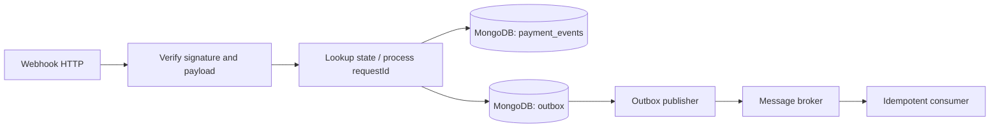

# Testing Against Real MongoDB and Limitations of Embedded Solutions

When integrating MongoDB into a Spring Boot application, a repository passing against mock data does not prove the application will work against a real MongoDB deployment. Differences typically surface in queries, BSON data types, indexes, transactions, consistency levels, network failures, and replica set-dependent features. Therefore, a trustworthy test suite needs cases running against **real MongoDB**, configured as close to the target deployment as practical.

This lesson explains how to structure Spring Boot MongoDB integration tests using Testcontainers or a dedicated test MongoDB instance, while clarifying the capabilities and limitations of *embedded MongoDB* solutions.

## 1. Testing Goals and Scope

In a system-integration application, MongoDB may store HTTP request state, deduplication keys, outboxes, or query projections. MongoDB failures can break the entire business workflow even when an HTTP endpoint still returns a seemingly valid status code.

After this lesson, you will be able to:

- Distinguish unit tests, data-access layer tests, and integration tests against real MongoDB.
- Provision ephemeral MongoDB instances for Spring Boot tests using Testcontainers with safe dynamic URI configuration.
- Verify document mapping, queries, unique indexes, and duplicate-write handling against real server behavior.
- Identify scenarios requiring a replica set—especially multi-document transactions and change streams.
- Design tests for HTTP → MongoDB → external system flows without confusing MongoDB transactions with distributed transactions.
- Build a test suite that runs reliably on developer laptops and CI with isolated data, reasonable runtime, and clear failure diagnostics.

**Scope:** Spring Boot components such as Spring Data MongoDB (repositories, `MongoTemplate`, connection configuration, transaction managers) and adapters interacting with MongoDB inside an integration flow. API, message broker, and cache testing are mentioned only where they directly impact MongoDB data contracts and correctness.

## 2. Choosing the Right Test Level

Different test levels answer different questions; never expect one level to replace all others.

| Test Level | Best Suited For | What It Proves | Limitations |
|---|---|---|---|
| Unit tests with mocks | Business rules, error branching, idempotency key generation | Logic of the layer calling the repository | Runs no MongoDB; verifies no queries, indexes, or BSON |
| Embedded MongoDB | Basic mapping and queries in a lightweight setup | Partial behavior against the launched embedded MongoDB binary | May differ in version, deployment architecture, and real topology |
| Testcontainers + MongoDB | Repositories, `MongoTemplate`, unique indexes, aggregations, transactions, real driver behavior | Behavior of a real MongoDB process at the chosen version | A single container does not fully simulate multi-node clusters or infra failures |
| Dedicated test MongoDB | Authentication, TLS, multi-node replica sets, failovers, RBAC, load | Deployment characteristics closer to production | Higher setup, data isolation, and operational cost |
| End-to-end | HTTP, app, MongoDB, and downstream dependencies | End-to-end correctness of a complete business flow | Slower and harder to localize failures |

A practical strategy keeps unit tests fast and plentiful, adds MongoDB integration tests for critical data contracts, and reserves a focused set of full-flow tests for multi-system coordination.

For example, the rule “if `requestId` already exists, do not create a new order” can be unit-tested. However, proving that **two concurrent requests cannot create two records with the same `requestId`** requires a unique index on real MongoDB; a mocked repository cannot provide that atomic guarantee.

## 3. What Is Embedded MongoDB and Why Does It Have Limitations?

A common option is Flapdoodle Embedded MongoDB. Understand how it works: it typically downloads and launches a managed **`mongod` process** tied to the test lifecycle, rather than being a pure-Java in-memory MongoDB clone. Other libraries emulate MongoDB in memory, with even narrower support and fidelity.

Risks to evaluate:

1. **Version mismatch with production.** Differences in wire protocol, aggregation operators, indexes, driver behavior, collations, or type conversions can let tests pass while production fails.
2. **Single-node standalone topology.** A standard standalone `mongod` does not satisfy multi-document transaction or change-stream requirements. Some tools can spin up an embedded replica set, though you must verify exact tool capabilities and supported features.
3. **Host-dependent startup.** Platform-specific binaries for your OS and CPU architecture must be cached or downloadable; execute permissions, proxies, and CI restrictions can cause unexpected failures.
4. **Missing production characteristics.** TLS, authentication, privileges, replica set tuning, failovers, resource constraints, and network behavior differ markedly from production.
5. **Spring Boot integration is not guaranteed out of the box.** Never assume merely adding an embedded dependency auto-configures itself in modern Spring Boot. Check startup mechanisms and configuration for your project's version.

Embedded MongoDB remains useful for lightweight, controlled tests covering basic CRUD/queries once version compatibility is verified. The key is **being explicit about what the test proves**. Whenever business correctness depends on unique indexes, transactions, change streams, or driver error behavior, run tests against real MongoDB.

## 4. Provisioning Real MongoDB with Testcontainers

Testcontainers starts ephemeral containers for tests, assigns dynamic ports, waits for readiness, and cleans up containers afterward. Your Spring Boot application communicates with MongoDB using the real driver.

For a Spring Boot 3.x project using Gradle and BOM-managed Testcontainers versions, dependencies typically look like:

```groovy
dependencies {
    implementation 'org.springframework.boot:spring-boot-starter-data-mongodb'

    testImplementation 'org.springframework.boot:spring-boot-starter-test'
    testImplementation 'org.testcontainers:junit-jupiter'
    testImplementation 'org.testcontainers:mongodb'
}
```

Module names and APIs can change across Testcontainers major versions. Use the dependency set aligned with your project's BOM rather than mixing mismatched library versions.

A repository test can supply the dynamic MongoDB URI via `@DynamicPropertySource`:

```java
package example.integration.mongo;

import java.time.Instant;
import java.util.Optional;

import org.junit.jupiter.api.BeforeEach;
import org.junit.jupiter.api.Test;
import org.springframework.beans.factory.annotation.Autowired;
import org.springframework.boot.test.autoconfigure.data.mongo.DataMongoTest;
import org.springframework.dao.DuplicateKeyException;
import org.springframework.data.annotation.Id;
import org.springframework.data.domain.Sort;
import org.springframework.data.mongodb.core.MongoTemplate;
import org.springframework.data.mongodb.core.index.Index;
import org.springframework.data.mongodb.core.mapping.Document;
import org.springframework.data.mongodb.repository.MongoRepository;
import org.springframework.test.context.DynamicPropertyRegistry;
import org.springframework.test.context.DynamicPropertySource;
import org.testcontainers.containers.MongoDBContainer;
import org.testcontainers.junit.jupiter.Container;
import org.testcontainers.junit.jupiter.Testcontainers;
import org.testcontainers.utility.DockerImageName;

import static org.assertj.core.api.Assertions.assertThat;
import static org.assertj.core.api.Assertions.assertThatThrownBy;

@Document("purchase_orders")
record PurchaseOrder(
        @Id String id,
        String requestId,
        Instant createdAt
) {}

interface PurchaseOrderRepository
        extends MongoRepository<PurchaseOrder, String> {
    Optional<PurchaseOrder> findByRequestId(String requestId);
}

@DataMongoTest
@Testcontainers
class PurchaseOrderRepositoryIT {

    @Container
    static final MongoDBContainer mongo = new MongoDBContainer(
            DockerImageName.parse("mongo:7.0")
    );

    @DynamicPropertySource
    static void mongodbProperties(DynamicPropertyRegistry registry) {
        registry.add(
                "spring.data.mongodb.uri",
                mongo::getReplicaSetUrl
        );
    }

    @Autowired
    PurchaseOrderRepository repository;

    @Autowired
    MongoTemplate template;

    @BeforeEach
    void resetCollectionAndIndex() {
        template.dropCollection(PurchaseOrder.class);
        template.indexOps(PurchaseOrder.class)
                .ensureIndex(new Index()
                        .on("requestId", Sort.Direction.ASC)
                        .unique());
    }

    @Test
    void storesDocumentAndRejectsDuplicateRequestId() {
        PurchaseOrder first = repository.save(new PurchaseOrder(
                null,
                "payment:evt-123",
                Instant.parse("2026-01-01T00:00:00Z")
        ));

        assertThat(repository.findByRequestId("payment:evt-123"))
                .contains(first);

        assertThatThrownBy(() -> repository.save(new PurchaseOrder(
                null,
                "payment:evt-123",
                Instant.parse("2026-01-01T00:00:01Z")
        ))).isInstanceOf(DuplicateKeyException.class);
    }
}
```

Place the example inside the Spring Boot application's scanned package tree so `@DataMongoTest` discovers the document and repository. This example uses Testcontainers APIs featuring `MongoDBContainer` and `getReplicaSetUrl()`; adapt imports/APIs if upgrading across major versions.

Key design choices in this example:

- `mongo:7.0` is an **explicitly pinned version**. Real projects should pin a tag matching the major version in production and upgrade intentionally with tests—never use `latest` for reproducible suites.
- `getReplicaSetUrl()` provides the URI for the replica-set-capable MongoDB container initialized by Testcontainers. Match connection setup to the container type used.
- `@DynamicPropertySource` injects the dynamic URI into Spring Boot, avoiding hardcoded port `27017` assumptions on the host.
- `@DataMongoTest` loads only the MongoDB data-access *test slice*, avoiding full HTTP controllers or unrelated adapters.
- Index creation is **performed explicitly**, never assuming Spring Data MongoDB auto-creates `@Indexed` in all configurations.
- `DuplicateKeyException` confirms MongoDB's error was translated into Spring's data-access exception hierarchy—critical when services turn duplicate errors into idempotent responses.

This is real integration testing: remove the unique index and the duplicate assertion fails; swap in a mock repository and the test proves nothing about database constraints.

### Configuration alternative: `@ServiceConnection`

In Spring Boot versions supporting Testcontainers service connections, `@ServiceConnection` can replace `@DynamicPropertySource`:

```java
@SpringBootTest
@Testcontainers
class OrderFlowIT {

    @Container
    @ServiceConnection
    static final MongoDBContainer mongo =
            new MongoDBContainer(DockerImageName.parse("mongo:7.0"));

    // Tests for services, controllers, adapters...
}
```

This requires `org.springframework.boot:spring-boot-testcontainers` in test scope and importing `org.springframework.boot.testcontainers.service.connection.ServiceConnection`. When Spring Boot detects the container type, it registers connection details automatically. These two snippets are **alternatives** for wiring connections; do not apply both to the same container.

When testing the full application, use `@SpringBootTest` with only the beans needed. When testing mapping or repositories only, prefer `@DataMongoTest` to keep startup fast and avoid unrelated external failures masking MongoDB tests.

## 5. Designing Test Cases Around Data Contracts

Do not stop at testing `save()` followed by `findById()`. Integration systems need clear contracts connecting incoming payloads, stored documents, and outgoing responses.

### 5.1. Data mapping and BSON

Because MongoDB stores BSON, verify common failure points:

- `_id`: `ObjectId` vs. `String`, Spring Data's conversion behavior, and API serialization.
- Timestamps: `Instant`/`Date` types, UTC representation, and millisecond precision (do not assert nanosecond preservation).
- Money and decimals: `Decimal128`, `String`, or minor integer units—never silently convert to `double` when exact precision matters.
- Missing fields vs. explicit `null`, nested documents, new enums, and renamed fields.
- Default values for legacy schemas and documents written by older application versions.

For instance, if API code maps `requestId` yet the database index is on `request_id`, a simple insert/read test passes while the business index guards the wrong field. Verify both BSON field names and actual index definitions.

### 5.2. Queries, aggregations, and sorting

Seed test fixtures covering every branch of your filters: distinct statuses, boundary timestamps, documents missing optional fields, and records sharing identical timestamps. Test:

- Operators like `$in`, `$elemMatch`, `$exists`, `$group`, and actual aggregation pipelines.
- Deterministic sort ordering with a secondary tie-breaker key when primary sort keys match.
- Explicit pagination and ordering guarantees.
- Collation/case-sensitivity rules on names, codes, or emails.
- Partial updates (`$set`, `$inc`, `$addToSet`) preserving **single-document** atomicity where required.

For critical queries, inspect `explain()` in a test environment to confirm index usage. Never treat millisecond timings on an empty container as proof of production performance.

### 5.3. Unique indexes and duplicate handling

In webhook or message-ingestion flows, deduplication is central. Test in sequence:

1. Create the unique index on the business key, e.g., `(source, externalEventId)` or `requestId`.
2. Write a valid event; verify the stored document and state.
3. Resend the exact same event; verify only one business effect exists.
4. Send the same key with a conflicting payload; verify the agreed policy (conflict error or warning).
5. For concurrent processing, dispatch two near-simultaneous requests with the same key and verify the real unique index prevents duplicates.

Calling `findByRequestId()` before `insert()` is not enough: two threads can both observe “not found” and both insert. **MongoDB's unique index is the final atomic guard**, while the service translates duplicate-key errors into the API/message contract. Even “only one DB record saved” does not prove side effects outside MongoDB ran only once.

## 6. Transactions: Test Topology and Boundaries Properly

MongoDB supports multi-document transactions on supporting topologies (replica sets or capable sharded clusters). A standard standalone `mongod` is not a valid environment for transaction testing.

In Spring Boot, transaction logic typically uses `MongoTransactionManager` and `@Transactional`:

```java
@Configuration
class MongoTransactionConfig {

    @Bean
    MongoTransactionManager mongoTransactionManager(
            MongoDatabaseFactory databaseFactory) {
        return new MongoTransactionManager(databaseFactory);
    }
}
```

The corresponding imports are `org.springframework.context.annotation.Configuration`, `org.springframework.context.annotation.Bean`, `org.springframework.data.mongodb.MongoDatabaseFactory`, and `org.springframework.data.mongodb.MongoTransactionManager`.

Write a service that modifies two documents in one transaction and intentionally throws an exception before commit. A meaningful test verifies **both writes rolled back**, followed by a happy-path test verifying both committed. Key caveats:

- `@Transactional` relies on Spring proxies; same-bean internal method calls can bypass the proxy.
- Do not assume DDL like creating collections/indexes is valid inside transactions; provision collections and indexes before tests execute.
- The driver, transaction manager, and MongoDB must share the same active session; opening an independent connection bypasses the transaction.
- MongoDB transactions cover only MongoDB operations bound to that session—HTTP requests and Kafka/RabbitMQ publishes do not join the transaction.

For example, “save order to MongoDB → publish event to broker” has a crash window if MongoDB commits and the broker times out. Tests should verify the recovery design—typically a **transactional outbox** (persisting the outbox record in the same MongoDB transaction for later publishing) paired with idempotent consumers. Outboxes prevent lost events yet can still redeliver; test crashing right after broker publish before marking the outbox sent.

Testcontainers running a single-node replica set is great for testing basic transactions and rollbacks. It **does not prove** behavior across multi-node primary elections, network partitions, or multi-node write concerns—those require a fuller test topology.

## 7. Change Streams, TTLs, and Time-Dependent Behavior

### Change streams

If the application reacts to collection changes via change streams, test against a supporting MongoDB deployment (typically a replica set). Scenarios to verify:

- Inserts, updates, and deletes emit events containing the fields your service needs.
- Listeners filter to the expected collection and operation types.
- After a connection drop, the service resumes from the persisted resume token.
- When events replay, consumers tolerate duplicates safely.
- When a resume token expires or the oplog window falls short, the app handles and alerts properly.

Never design tests assuming “every change arrives strictly once”. Build for **at-least-once + idempotency** and monitor processing lag from write time to handling.

### TTL indexes

TTL indexes clean up temporary sessions, bounded dedup keys, or intermediate records. Because MongoDB's TTL monitor runs on a background interval, expiration **does not mean the document vanishes at the exact millisecond the clock crosses the timestamp**.

A reliable TTL test should:

- Verify the TTL index exists on the expected field with the right `expireAfterSeconds`.
- Insert a document with a short test-friendly timestamp.
- Poll with a reasonable timeout until the document disappears.
- Avoid a short fixed `Thread.sleep` that flakes and falsely blames TTL.

When testing business rules like “reject expired requests”, test the application's time comparison directly with an injectable `Clock` rather than waiting on MongoDB's background TTL sweep for every case.

## 8. Injecting Meaningful Integration Failures

An integration suite needs failure scenarios injected at the right layer.

| Scenario | What to Verify | Appropriate Environment |
|---|---|---|
| Unique index violation | Spring translates exception; service responds idempotently or with conflict per contract | MongoDB Testcontainers |
| Missing/wrong BSON field type | Mapping or validation reacts as specified | MongoDB Testcontainers |
| Transient fault or disconnect | Bounded timeouts; backoff retries; zero duplicate writes | Container + network fault proxy, or integration env |
| Transaction rollback | Zero partial writes left across participating collections | Test replica set |
| Primary failover | Client discovers new topology and retries per policy | Multi-node replica set |
| Broker publish fails after Mongo commit | Outbox retains pending record and recovers without losing the event | MongoDB + real broker or controlled adapter |
| Unindexed query | Query plans/metrics flag collection-scan risk | Database with realistic data and indexes |

When testing retries, separate **retryable failures** (transient disconnects, retryable transaction labels) from **non-retryable failures** (unique constraint violations, bad payloads, missing permissions). Retries need capped attempts, backoff, and idempotent writes so they do not amplify outages.

Never strip out timeout controls or turn `DuplicateKeyException` into “retry forever”. Tests must prove bounded attempts and observable final state.

## 9. Structuring the Test Suite in Spring Boot

Organize tests by the questions each suite answers:

```text
src/test/java/...
  order/
    OrderServiceTest.java             # Unit tests: business policies
    OrderRepositoryIT.java            # @DataMongoTest + real MongoDB
    OrderTransactionIT.java           # Replica set + transaction manager
    OrderHttpFlowIT.java              # @SpringBootTest + HTTP + MongoDB
    OrderOutboxFlowIT.java            # MongoDB + publisher/broker
```

Implementation principles:

**Isolated data.** Every test owns its data—reset collections and recreate indexes as shown, use distinct database names, or prefix IDs per test. When running parallel tests on one database, never let one test `dropCollection()` while another is reading.

**Reproducible environments.** Pin MongoDB image tags and configurations; let Testcontainers assign dynamic host ports. Avoid accidentally hitting whatever MongoDB happens to be running on a developer's local port.

**Explicit schema/index setup.** If the app creates indexes on startup or via migrations, test that mechanism directly; if a test creates indexes manually, document which component owns production index creation. Manual index creation in tests does not validate production migrations.

**Exclude unnecessary dependencies.** Repository tests need no broker. Outbox tests genuinely include the broker as part of the contract and should test it accordingly. Spring Integration adapters can be tested with controlled input/output channels backed by real MongoDB when persistence behavior is under test.

**Avoid order dependency.** Never let one test seed data that another test relies on implicitly. Every test asserts against fixtures it sets up itself.

**Avoid indiscriminate `@DirtiesContext`.** Only mark the Spring context dirty when a test genuinely mutates shared beans/config; overusing `@DirtiesContext` slows test suites drastically.

## 10. Running on CI and Managing Test Environments

Testcontainers requires a compatible container runtime (such as Docker or an API-compatible daemon). CI pipelines must allocate adequate permissions and memory/CPU for MongoDB startup.

A practical CI pipeline runs:

1. Fast unit tests and static analysis first for rapid feedback.
2. Repository/MongoDB integration tests against pinned container images.
3. End-to-end integration tests with brokers/HTTP dependencies where applicable.
4. Failover, security, and performance suites in dedicated test environments on appropriate pipelines.

If CI cannot run containers, provision an ephemeral pipeline-scoped MongoDB with isolated databases/credentials, cleanup, and teardown. Never point automated tests at production databases or shared, unisolated instances.

Common CI issues and what to check:

| Symptom | What to Investigate |
|---|---|
| Cannot start MongoDB container | Container runtime unavailable, missing permissions, insufficient resources, or image pull failure |
| Connection refused on `localhost:27017` | Test uses a hardcoded URI instead of Testcontainers' dynamic host/port |
| Transactions unsupported | MongoDB running standalone, wrong URI/topology, or missing transaction manager |
| Unique index test misses duplicate error | Index never created, wrong field name, or test fixtures did not actually collide |
| Flaky tests | Shared fixtures, parallel tests touching the same collection, timing assumptions on TTL/change streams, or unbounded retries |
| CI vs. production divergence | Mismatched MongoDB major version, indexes, collations, read/write concerns, auth, topology, or driver settings |

## 11. Observability and Failure Diagnostics in Tests

Integration flows need clear correlation from HTTP/messages down to MongoDB operations and final outcomes.

Track:

- `requestId`/`correlationId` and collection names in safe logs, never logging sensitive payloads or password-bearing URIs.
- Operation type, query duration, and retry counts via metrics to separate MongoDB latency from application overhead.
- Classified driver errors: timeouts, network drops, auth errors, duplicate keys, transaction aborts.
- Outbox backlog depth, oldest pending record age, change-stream lag, replayed event counts, and failure rates.
- For critical queries: index metadata/`explain()` output in diagnostic environments.

Tests themselves must assert **final persisted state** and **observable side effects**: which documents exist, which status was saved, how many external calls fired, and where retries stopped. Asserting only a log line like “save success” never proves a commit occurred or a consumer behaved correctly.

## 12. End-to-End Scenario Example: Payment Webhook

Suppose a Spring Boot API receives partner webhooks, stores them in MongoDB for deduplication, and creates an outbox record for a message broker:



Contracts that tests should prove:

| Case | Expectation |
|---|---|
| First valid webhook | Exactly one consistent `payment_event` and one outbox event |
| Resent with same `requestId` and payload | No new payment transaction; responds per idempotency policy |
| Two concurrent webhooks with the same key | Unique index enforces a single business outcome |
| Failure after writing event before writing outbox | Transaction rolls back both, or defined recovery handles it |
| MongoDB commits yet broker fails | Outbox remains pending and publisher retries |
| Publisher emits then dies before marking sent | Broker/consumer redelivery handled idempotently |
| Legacy schema missing new fields | Mapping and logic handle per compatibility rules |

Repository tests prove indexes and mapping; transaction tests prove atomic event/outbox writes; full-flow tests prove HTTP status codes and publisher outcomes. Splitting coverage this way speeds up root-cause isolation whenever a case fails.

## 13. Project Adoption Checklist

Before trusting your MongoDB test suite, confirm:

- [ ] Tests run against real MongoDB at the major version matching deployment.
- [ ] Test URIs are dynamically provisioned and isolated, containing zero production credentials.
- [ ] Fixtures are isolated; collections and indexes follow clear app vs. test ownership.
- [ ] BSON mapping, critical queries/aggregations, and unique indexes are tested.
- [ ] Idempotency keys are backed by database constraints and tested under concurrency.
- [ ] Transactions and change streams are tested only on supporting topologies with rollback/resume assertions.
- [ ] Timeouts, retries, duplicates, and communication errors are classified per business contract.
- [ ] External brokers/HTTP calls alongside MongoDB have verified outbox or recovery strategies.
- [ ] TTL and async behaviors use bounded polling assertions rather than brittle sleeps.
- [ ] CI pipelines reproducibly provision environments, retain diagnostic logs, and never touch production databases.

**Key takeaway:** embedded MongoDB can suit lightweight CRUD checks, yet real MongoDB is essential for verifying real driver behavior, BSON types, indexes, transactions, and integration flows prone to duplicate delivery. Even with Testcontainers, a test suite only validates **the exact version, topology, data shapes, and failure modes** it actually simulates.
