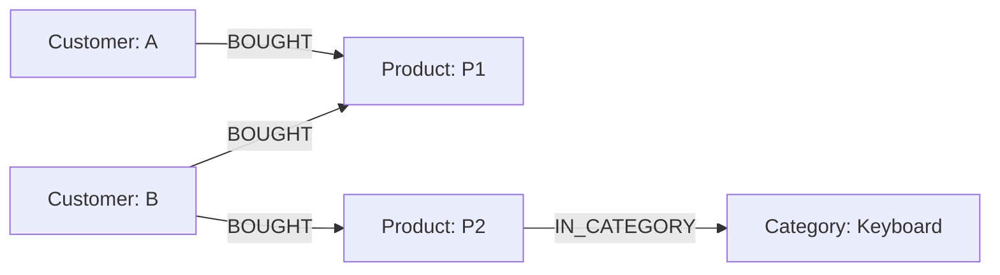
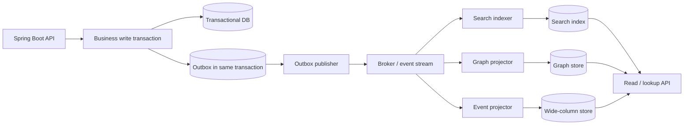

# Choosing a Data Store for Search, Graph, and Distributed Workloads

## 1. The problem: one system, multiple query patterns

Suppose a Spring Boot e-commerce application needs to satisfy three requirements at the same time:

1. Users search for products using fuzzy keywords, with filters, relevance sorting, and autocomplete suggestions.
2. The system recommends products based on relationships among customers, products, brands, and purchasing behavior.
3. A service ingests millions of access events, requiring high-throughput writes and fast lookups by customer and time range.

These three requirements have very different query patterns and load characteristics. **No single NoSQL store is inherently optimal for all of them.** The choice must start from queries, data contracts, consistency levels, partitioning strategies, and operability; product names should only come up after those conditions are clear.

In the **SPRING_BOOT_INTEGRATION** module, this lesson focuses on how Spring Boot connects to and structures data adapters, while also addressing failures, transactions, data synchronization, deduplication, testing, and observability. A search or graph store may very well serve only as a **supplementary read model** for a system that already has a transactional database.

After this lesson, you will be able to:

- Distinguish between **full-text content search**, **graph relationship traversal**, and **distributed key-based read/write** problems.
- Choose a storage model based on access patterns, latency, scale, consistency, and operational cost.
- Recognize the roles of Elasticsearch/OpenSearch, Neo4j, and Cassandra/ScyllaDB along with their alternatives.
- Integrate a suitable store into Spring Boot using configuration, Spring Data, or a dedicated client/adapter.
- Design data synchronization via outbox and message broker when using multiple stores, while handling duplicate events, out-of-order delivery, lag, and recovery.

> **Example scope:** Java 17+, Spring Boot 3.x, and the Spring Data versions compatible with the Spring Boot version in use. APIs, drivers, configuration properties, authentication mechanisms, and server versions must be verified against your actual project compatibility matrix. The systems in these examples are independent: there is no need to add every starter into a single application just to learn how to choose a store.

## 2. Start from the access pattern

Before evaluating technologies, write down your primary queries in concrete form:

| Workload question | Example to clarify | Design implication |
| --- | --- | --- |
| What do users query by? | Free-text keywords; ID; composite key; multi-hop relationship path | Determines index type and data model |
| How many records are returned? | Top 20 products; neighbor nodes; 100 most recent events | Affects pagination and read cost |
| Required latency? | p95 under 150 ms at target load | Must be benchmarked on representative data and infrastructure |
| Read/write volume? | 5,000 events/sec, 50 queries/sec | Determines scalability needs and cost |
| Can stale data be tolerated? | Search results delayed by a few seconds; balances must update immediately | Distinguishes eventual consistency read models from critical business state |
| How deep are relationship traversals? | One friend hop or 4–6 conditional hops | Decides between traditional JOINs/indexes and graph queries |
| Is the partition key evenly distributed? | One very large tenant, other tenants small | Risk of hot partitions and skewed load |
| Do queries change frequently? | Continuously adding filters, similarity search | Different flexibility trade-offs across stores |
| How must the system recover? | RPO, RTO, backups, index rebuild | Determines whether the store can serve as source of truth |

Simply having multiple servers or replicas is **not enough** to conclude that you need a distributed NoSQL database. PostgreSQL/MySQL with proper indexes, replication, and partitioning can satisfy many medium-scale needs. A specialized store only makes sense when its benefits outweigh the costs of development, operations, and keeping replicas consistent.

## 3. Three storage categories to distinguish

| Category | Core model and structure | Favorable queries | Typical limitations | Examples |
| --- | --- | --- | --- | --- |
| **Search engine** | Documents and inverted index; scoring and aggregations | Full-text, relevance, configurable typo tolerance, filters, facets | Indexing introduces update lag; heavy writes/analysis can be resource-intensive; requires mapping design | Elasticsearch, OpenSearch, Apache Solr |
| **Graph database** | Nodes, edges, properties, and traversals | Multi-hop relationships, paths, connection-based recommendations, cluster detection | Traversals are hard to bound on supernodes; distributed graph partitioning is complex; queries must be bounded | Neo4j, JanusGraph, Amazon Neptune |
| **Distributed wide-column / key-value** | Key-based partitioning; replicas across nodes; tables typically modeled per query | High write volume, reads by partition key, time-series or keyed event data | Limited JOINs and ad-hoc queries; poor partition keys cause hotspots or expensive scans | Apache Cassandra, ScyllaDB, DynamoDB with its own key-value model |

These are **categories by query strength**, not rigid classifications. Many products combine multiple capabilities: relational databases have full-text search, document databases offer search or graph lookup, and search engines support vector search. Sharing a feature name does not guarantee equivalent query capabilities, relevance quality, or consistency guarantees.

### Quick classification rule

<pre>
Need natural-language text search and relevance ranking?
    → Evaluate a search engine or existing full-text search.
Need to query paths and multi-hop relationships?
    → Evaluate a graph database, or a relational solution if the graph is small.
Need high write throughput and reads by a predefined key/partition?
    → Evaluate a distributed wide-column/key-value store.
Need strict transactions, flexible queries, and business JOINs?
    → Start with a relational database first.
</pre>

## 4. When to choose a search store?

A product table can be queried with SQL:

```sql
SELECT id, name
FROM products
WHERE name LIKE '%ban phim%';
```

However, when users need free-text search, accented/unaccented matching, typo tolerance, synonyms, autocomplete suggestions, multiple filters, and relevance sorting, `LIKE` can no longer adequately express product requirements. Search engines typically use an **inverted index**: mapping tokens to the set of documents containing each token, then combining that with scoring algorithms and filters.

For example, given the query “wireless mechanical keyboard”, a search engine can:

- Analyze text into tokens according to a configured analyzer.
- Find documents containing matching tokens, even when word order differs.
- Filter results by tenant, availability status, and price range.
- Rank results using keyword relevance combined with business signals.
- Return total hit counts and facet aggregations by brand and category.

### 4.1. Distinguishing `text` and `keyword`

In Elasticsearch/OpenSearch, two common field types have distinct meanings:

| Field | Common type | Purpose |
| --- | --- | --- |
| `name`, `description` | `text` | Content analysis, token-based search, and relevance scoring |
| `tenantId`, `productId`, `categoryCode` | `keyword` | Exact matching, filtering, grouping/aggregations, application-level ID joins |
| `price` | Appropriate numeric type | Range filters and sorting |
| `available` | Boolean | Status filtering |
| `updatedAt` | Date | Synchronization, sorting, and time filtering |

If you map `productId` as `text` and expect a `term` query to behave like an exact ID comparison, results can be wrong because the field was tokenized. Conversely, using only `keyword` for a product name makes full-text relevance difficult to support.

Example query in Elasticsearch Query DSL:

```json
{
  "size": 20,
  "query": {
    "bool": {
      "must": [
        {
          "match": {
            "name": {
              "query": "wireless keyboard",
              "operator": "and"
            }
          }
        }
      ],
      "filter": [
        { "term": { "tenantId": "tenant-a" } },
        { "term": { "available": true } }
      ]
    }
  }
}
```

`match` serves full-text content search; `term` on `keyword` or boolean fields serves exact conditions. `must` affects matching criteria and can contribute to scoring, whereas `filter` is typically used for non-scoring conditions. This query is illustrative; in practice, mappings, analyzers, and the index must be defined beforehand.

**For Vietnamese text**, default tokenizers may not handle multi-syllable word segmentation, diacritics, or user typing habits well. Test analyzers, normalization, synonyms, and diacritic-folding policies using real query sets; do not assume installing a search engine immediately yields good Vietnamese search quality.

### 4.2. Trade-offs to consider

- **Indexing latency:** data changes do not necessarily appear in search results at the exact moment the business transaction commits; you must define an acceptable lag SLA.
- **Synchronization and index rebuilding:** records can be missed, duplicated, or arrive out of order; you must support reindexing and data reconciliation.
- **Schema/mapping:** changing an analyzer or certain field types usually requires creating a new index, migrating data, and swapping aliases in a planned rollout.
- **Cost:** shards, replicas, index size, heap, refresh intervals, aggregations, vectors, and ingest volume all increase resource usage.
- **Correctness:** `_score`-based rankings can shift; do not use a search index as the sole authoritative source for balances, inventory, or payment status if the model lacks the required consistency guarantees.

Elasticsearch and OpenSearch share historical APIs and concepts, but **you should not assume clients, plugins, and Spring Data Elasticsearch versions are fully compatible with OpenSearch**. Choose drivers and starters according to each product's compatibility matrix. If the problem only involves light full-text queries on small datasets, evaluate PostgreSQL full-text search and related extensions before operating an additional cluster.

## 5. When to choose a graph database?

Relationship modeling takes center stage when queries resemble:

> “Which products have been bought by users with similar behavior to User A, that User A has not bought yet?”

Or:

- Finding short paths between two accounts through transactions or shared devices.
- Detecting fraud rings across accounts, phone numbers, addresses, and cards.
- Analyzing dependencies among services, APIs, queues, and systems to assess change impact.
- Traversing knowledge trees/graphs with multiple relationship types.

In a graph database, **nodes** represent entities and **relationships (edges)** represent connections; both nodes and relationships can have properties. Queries are expressed as path patterns. With Neo4j, the standard language is Cypher.

Model example:



If A bought P1, and B bought both P1 and P2, then P2 may be a recommendation candidate for A. An illustrative Cypher query:

```cypher
MATCH (customer:Customer {id: $customerId})-[:BOUGHT]->(:Product)
      <-[:BOUGHT]-(similar:Customer)-[:BOUGHT]->(candidate:Product)
WHERE candidate.active = true
  AND NOT EXISTS {
    MATCH (customer)-[:BOUGHT]->(candidate)
  }
RETURN candidate.id AS productId,
       count(DISTINCT similar) AS commonBuyers
ORDER BY commonBuyers DESC
LIMIT 10
```

The input `$customerId` is a client-bound **parameter**, avoiding direct concatenation of user values into Cypher strings. On large datasets, you need appropriate indexes/constraints on `Customer.id`, traversal depth limits, and execution plan reviews.

### Characteristics to evaluate before choosing a graph database

| Condition | Verification question |
| --- | --- |
| Relationship depth | Do queries typically traverse 2, 3, or 8 hops? |
| Graph shape | Are there “supernodes” with millions of edges that cause traversals to explode? |
| Constraints and consistency | Do edge creation and node updates require a single transaction? |
| Distributed scale | Is graph sharding needed with frequent cross-shard queries? |
| Use case | Do you just need “products in the same category,” or actual pathfinding, cycles, and complex relationship patterns? |
| Data source | Is the graph the primary store or a projection from transactions and events? |

A graph database **does not guarantee that every traversal is fast**. Complexity grows sharply with high-degree nodes, unbounded traversal depth, or late filtering. If the problem only needs one or two clear JOINs on properly indexed tables, SQL may be simpler.

Do not equate “graph” with a single type of transactional guarantee. For example, Neo4j supports transactions for its graph data; other graph systems have their own architectures and consistency models. A transaction in a graph store also **does not automatically extend** into an atomic transaction across the graph, transactional database, and broker.

## 6. When to choose a partition-key distributed store?

A classic example is activity event logging:

```text
tenant-a, 2026-11-21, 10:00:01, view-product, event-001
tenant-a, 2026-11-21, 10:00:02, add-to-cart, event-002
tenant-b, 2026-11-21, 10:00:03, view-product, event-003
```

The primary requirement is continuous writes, distributing data across multiple nodes, retrieving the **100 latest events for a tenant on a given day**, and optionally retaining data with an expiration policy. This access pattern fits wide-column stores like Cassandra/ScyllaDB well, provided the partition key is chosen properly.

### 6.1. Query-first table design

CQL example:

```sql
CREATE TABLE events_by_tenant_day (
    tenant_id text,
    event_day date,
    occurred_at timestamp,
    event_id uuid,
    event_type text,
    payload text,
    PRIMARY KEY ((tenant_id, event_day), occurred_at, event_id)
) WITH CLUSTERING ORDER BY (occurred_at DESC, event_id DESC);
```

A query matching the partition key:

```sql
SELECT event_id, event_type, occurred_at
FROM events_by_tenant_day
WHERE tenant_id = 'tenant-a'
  AND event_day = '2026-11-21'
LIMIT 100;
```

Key breakdown:

- `(tenant_id, event_day)` is the **composite partition key**; it determines which logical partition owns the data.
- `occurred_at`, `event_id` are **clustering columns**; they sort records within the partition and disambiguate events sharing the same timestamp.
- `LIMIT 100` bounds the returned rows, though it does not automatically keep resource costs low if a partition grows too large or accumulates many tombstones.

To read across multiple days or tenants, the application may have to issue separate partition queries and merge the results. Cassandra is not suited for arbitrarily writing `WHERE` clauses on any column as if querying a heavily indexed SQL table. If another high-frequency access pattern is needed, you may have to create **another table modeled specifically for that query**.

### 6.2. Partitioning, replication, and consistency

- **Load-distributing partition keys:** if a single tenant generates tens of millions of events per day, a `tenant_id + event_day` partition can become oversized and cause a hotspot. Consider smaller time buckets or controlled bucketing based on actual measurements.
- **Replication factor:** the number of replicas per cluster/datacenter should align with fault-tolerance requirements and cluster topology.
- **Consistency level:** Cassandra allows choosing consistency per operation, such as `LOCAL_ONE` and `LOCAL_QUORUM` in an appropriate setup. Do not assume Cassandra has only one fixed consistency level.
- **Retries and idempotency:** writing the same primary key again behaves like an upsert, which does not automatically solve event ordering, conditional updates, or external side effects outside the database.
- **TTL and tombstones:** automatic expiration helps with retention, but excessive tombstones can degrade queries and compaction.
- **Conditional writes:** lightweight transactions (LWT) can enforce certain conditions at a higher cost than normal writes; do not enable them by default for every write.

Cassandra scales horizontally when the data model, replication, and cluster are operated properly. **“Distributed” does not mean “infinitely scalable”**: limits can arise from hot partitions, network, disk, compaction, connection counts, or consistency level choices.

Beyond Cassandra/ScyllaDB, DynamoDB is an example of a large-scale managed key-value/document service with its own partitioning mechanisms and query model; you cannot swap CQL syntax or the Cassandra driver for DynamoDB without redesigning. When choosing a managed service, evaluate lock-in, read/write pricing, query limits, and multi-region behavior.

## 7. Decision table by practical requirements

| Priority requirement | Evaluate first | Validate through testing |
| --- | --- | --- |
| Product content search, ranking, autocomplete, facets | Search engine; or full-text in existing DB when needs are simple | Vietnamese/domain result quality, p95, indexing and update cost |
| Multi-hop relationship queries, pathfinding, link patterns | Graph DB; benchmark against SQL JOINs/recursive CTEs | Traversal depth, supernode behavior, correctness |
| High-volume event writes, reads by tenant and day | Cassandra/ScyllaDB or suitable distributed key-value store | Partition distribution, write throughput, p99, compaction cost |
| Multi-table transactions, relational constraints, flexible reporting | RDBMS first; add a read model only when genuinely needed | Performance with indexes/partitions and operational cost |
| Hot key lookups with TTL and very short operations | Cache/key-value like Redis, or existing store | Cache invalidation policy, stale data, memory cost |
| Flexible JSON storage with document queries | Document DB or JSON in RDBMS | Indexes for query patterns, schema evolution, transactions |

A **selection procedure** a development team can apply:

1. Write down the 5–10 most important queries, their inputs/outputs, and realistic p95/p99 targets.
2. Identify the system of record, required consistency level, and acceptable data sync lag.
3. Check whether the existing database can handle the workload with indexes, materialized views, or an appropriate structure.
4. Pick at most a few candidates that fit the queries; generate test data with realistic distributions, including large tenants and worst-case scenarios.
5. Compare operations: backup/restore, upgrades, monitoring, security, cost, and team expertise.
6. Only add a specialized store when measurable benefits justify the added synchronization and operational complexity.

## 8. Integrating with Spring Boot: dependencies and configuration

Spring Boot helps manage datasources/clients, environment-based configuration, dependency injection, and observability/testing utilities. However, the framework cannot compensate for choosing the wrong data model or consistency model.

Three common Spring Data starters (include only what the application actually uses):

```xml
<!-- Elasticsearch: Spring Data Elasticsearch, using a server-compatible client -->
<dependency>
    <groupId>org.springframework.boot</groupId>
    <artifactId>spring-boot-starter-data-elasticsearch</artifactId>
</dependency>

<!-- Neo4j: Spring Data Neo4j -->
<dependency>
    <groupId>org.springframework.boot</groupId>
    <artifactId>spring-boot-starter-data-neo4j</artifactId>
</dependency>

<!-- Cassandra: Spring Data Cassandra -->
<dependency>
    <groupId>org.springframework.boot</groupId>
    <artifactId>spring-boot-starter-data-cassandra</artifactId>
</dependency>
```

The configuration examples below illustrate **each store in an independent application**. Do not merge all of them into production configuration if the application does not use those stores.

```yaml
# Example application using only Elasticsearch, Spring Boot 3.x
spring:
  elasticsearch:
    uris: https://search.example.internal:9200
    username: ${SEARCH_USERNAME}
    password: ${SEARCH_PASSWORD}
```

```yaml
# Example application using only Neo4j
spring:
  neo4j:
    uri: bolt://neo4j.example.internal:7687
    authentication:
      username: ${NEO4J_USERNAME}
      password: ${NEO4J_PASSWORD}
```

```yaml
# Example application using only Cassandra
spring:
  cassandra:
    contact-points: cassandra-1.example.internal:9042
    local-datacenter: dc1
    keyspace-name: integration_app
```

In real environments, use a secret manager or environment variables for sensitive credentials, and enable TLS and authentication per store policy. Cassandra exposes many driver settings such as auth, TLS, timeouts, and consistency: verify against your Spring Boot/driver version rather than copying parameters from another system.

Simply connecting to a store does not mean the schema is ready. Creating indexes, constraints, keyspaces, and tables should belong to an explicit, versioned migration/provisioning process with compatibility testing.

## 9. Spring Boot adapter examples for each store type

The snippets below are independent of one another and illustrate how to **hide query details behind an adapter**, so business logic does not depend directly on vendor client APIs. Package and domain names are illustrative.

### 9.1. Search: Spring Data Elasticsearch

Define a document in the search index:

```java
package example.integration.search;

import org.springframework.data.annotation.Id;
import org.springframework.data.elasticsearch.annotations.Document;
import org.springframework.data.elasticsearch.annotations.Field;
import org.springframework.data.elasticsearch.annotations.FieldType;

@Document(indexName = "products-v1")
public record ProductSearchDocument(
        @Id String id,
        @Field(type = FieldType.Text) String name,
        @Field(type = FieldType.Keyword) String tenantId,
        @Field(type = FieldType.Boolean) boolean available) {
}
```

Adapter accepting `ElasticsearchOperations` configured by Spring Boot/Spring Data:

```java
package example.integration.search;

import java.util.List;
import org.springframework.data.domain.PageRequest;
import org.springframework.data.elasticsearch.core.ElasticsearchOperations;
import org.springframework.data.elasticsearch.core.SearchHit;
import org.springframework.data.elasticsearch.core.query.Criteria;
import org.springframework.data.elasticsearch.core.query.CriteriaQuery;
import org.springframework.stereotype.Component;

@Component
public class ProductSearchAdapter {

    private final ElasticsearchOperations operations;

    public ProductSearchAdapter(ElasticsearchOperations operations) {
        this.operations = operations;
    }

    public List<ProductSearchDocument> search(
            String tenantId, String keyword) {

        Criteria criteria = new Criteria("tenantId").is(tenantId)
                .and("available").is(true)
                .and("name").matches(keyword);

        CriteriaQuery query = new CriteriaQuery(criteria);
        query.setPageable(PageRequest.of(0, 20));

        return operations.search(query, ProductSearchDocument.class)
                .getSearchHits()
                .stream()
                .map(SearchHit::getContent)
                .toList();
    }
}
```

Here:

- `tenantId` is a mandatory condition scoping tenant data in the example.
- `matches(keyword)` demonstrates full-text matching; verify the generated query DSL and relevance behavior in your Spring Data version.
- `PageRequest` limits the number of results; deep search or large pagination should consider `search_after`/PIT depending on search engine capabilities and use case.
- The adapter returns only required data; larger systems should define result DTOs, field-hiding rules for sensitive data, and separate search results from authoritative transactional records.

**Security note:** filtering by `tenantId` in the query is only part of access control. The application must resolve the tenant from a trusted authenticated context; never accept an arbitrary `tenantId` from user input and grant access implicitly.

### 9.2. Graph: `Neo4jClient` and parameterized queries

```java
package example.integration.graph;

import java.util.List;
import org.springframework.data.neo4j.core.Neo4jClient;
import org.springframework.stereotype.Component;

@Component
public class RecommendationGraphAdapter {

    private final Neo4jClient neo4jClient;

    public RecommendationGraphAdapter(Neo4jClient neo4jClient) {
        this.neo4jClient = neo4jClient;
    }

    public List<String> recommendProductIds(String customerId) {
        return neo4jClient.query("""
                MATCH (c:Customer {id: $customerId})-[:BOUGHT]->(:Product)
                      <-[:BOUGHT]-(other:Customer)-[:BOUGHT]->(candidate:Product)
                WHERE candidate.active = true
                  AND NOT EXISTS {
                    MATCH (c)-[:BOUGHT]->(candidate)
                  }
                RETURN candidate.id AS productId,
                       count(DISTINCT other) AS score
                ORDER BY score DESC
                LIMIT 10
                """)
                .bind(customerId).to("customerId")
                .fetchAs(String.class)
                .mappedBy((typeSystem, record) ->
                        record.get("productId").asString())
                .all()
                .stream()
                .toList();
    }
}
```

The adapter encapsulates Cypher and returns candidate IDs. The business layer can combine these with inventory, visibility permissions, and business rules from a data source providing the required correctness guarantees. For graph queries, **bounding traversal hops, limiting results, and maintaining proper indexes/constraints** matter more than merely setting a timeout.

### 9.3. Wide-column: `CqlSession` and prepared statements

Using the Cassandra table created in Section 6:

```java
package example.integration.events;

import com.datastax.oss.driver.api.core.CqlSession;
import com.datastax.oss.driver.api.core.cql.PreparedStatement;
import java.time.LocalDate;
import java.util.List;
import org.springframework.stereotype.Component;

@Component
public class EventHistoryAdapter {

    private final CqlSession session;
    private final PreparedStatement recentEvents;

    public EventHistoryAdapter(CqlSession session) {
        this.session = session;
        this.recentEvents = session.prepare("""
                SELECT event_type
                FROM events_by_tenant_day
                WHERE tenant_id = ? AND event_day = ?
                LIMIT 100
                """);
    }

    public List<String> recentEventTypes(
            String tenantId, LocalDate eventDay) {
        return session.execute(
                        recentEvents.bind(tenantId, eventDay))
                .all()
                .stream()
                .map(row -> row.getString("event_type"))
                .toList();
    }
}
```

The prepared statement is created once when the bean initializes and reused, rather than re-prepared on every call. The query targets the exact partition key and applies a limit. `ResultSet.all()` fits an example capped at 100 rows; real queries may need paging via paging state to avoid loading large volumes into memory.

In production, consider timeouts, retry policies, consistency levels, session driver compatibility, and the case where the cluster is not yet ready at application startup. Error handling and reconnection are driver behaviors that must be verified in an integration environment.

## 10. Using multiple stores: primary source of truth and read models

A common architecture:

- The transactional database is the **system of record** for products and orders.
- The search index is a **read model** for search.
- The graph store is a **read model** for purchase relationships and recommendations.
- Cassandra stores events by query key with its own retention policy.
- A broker transports change events so projections update independently.



The diagram illustrates the **transactional outbox**: business data changes and the outbox record are committed in the **same transactional database transaction**. A publisher then relays events to the broker, and consumers update the read models. No single automatic transaction spans the DB, broker, search index, graph, and Cassandra.

### 10.1. Why not update all stores synchronously?

The following pseudocode carries serious risks:

```text
updateOrderInDatabase()
updateSearchIndex()
updateGraph()
publishEvent()
```

If the database update succeeds but indexing or publishing fails, the stores drift out of sync. Retrying the entire function can produce duplicate updates or duplicate messages. Putting `@Transactional` on a Spring method **does not magically turn these operations into an atomic transaction across technologies**.

With an outbox, the guarantee to uphold is that **business data and the outbox event commit together**; external projections converge later. This still requires monitoring lag and having mechanisms to repair drift.

### 10.2. Idempotency, ordering, and schema evolution

Each event should include at minimum:

```json
{
  "eventId": "evt-701",
  "aggregateType": "Product",
  "aggregateId": "P-100",
  "version": 12,
  "occurredAt": "2026-11-21T03:00:00Z",
  "eventType": "ProductUpdated",
  "schemaVersion": 1,
  "data": {
    "name": "Mechanical keyboard",
    "available": true
  }
}
```

Consumer strategy:

1. Define an idempotency key, such as `eventId` or the pair `aggregateId + version`.
2. If update version 12 has already been applied, receiving the same event again must not produce incorrect results.
3. If version 11 arrives after version 12, prevent overwriting newer data with older state; use version comparisons, current-state checks, or rebuilds from the authoritative source.
4. Acknowledge the message only after the projection write succeeds, according to the broker's semantics. If a crash happens before ack, the message may be redelivered; the consumer must be idempotent.
5. Route unprocessable events to a monitored retry/DLQ flow; define replay and projection-repair procedures.

A search engine may require versioning/external versions or conditional updates appropriate for the client and domain; a graph store can use `MERGE` with constraints where suitable; Cassandra needs key design and conditional updates depending on ordering criticality. **Simply using upsert is not enough to handle every out-of-order event case.**

Separating the event's `schemaVersion` from the entity's `version` lets you evolve the contract structure while still controlling data update ordering. When changing a schema or index, plan for backfilling and validating both sides before switching read traffic.

### 10.3. Connection to Spring Integration

Spring Boot can access data stores using Spring Data repositories, `*Operations`, or driver clients. **Spring Integration** addresses a different layer of responsibility: orchestrating message flows through channels, transformers, routers, filters, service activators, polling, and corresponding adapters/gateways.

An example integration flow might look like:

```text
Broker inbound adapter
   → MessageChannel
   → validate / transform event
   → service activator calling SearchProjectionAdapter
   → ack / retry / error channel per policy
```

Do not assume every NoSQL system has an official Spring Integration adapter or identical acknowledgment semantics. When no specialized adapter exists, a service activator can invoke the application's Spring Data/driver adapter. What matters most remains the event contract, deduplication, and failure recovery mechanisms.

## 11. Transactions, consistency, and common pitfalls

| Issue | Example | Mitigation |
| --- | --- | --- |
| Stale reads | Product renamed, search still returns old name | Publish index latency SLA; read from primary source where strict consistency is required |
| Dual-write | DB commits, index fails | Transactional outbox, retries, and reconciliation |
| Duplicate events | Broker redelivers after disconnect | Idempotency by ID/version, avoid duplicate side effects |
| Out-of-order events | Older version update arrives after newer version | Track versions and enforce version ordering rules |
| Poor partition key | One tenant concentrates most of the traffic | Change partition model, add controlled bucketing, benchmark hot keys |
| Graph query explosion | Node with huge edge count, unbounded traversal | Limit depth/fan-out, add indexes, inspect execution plans |
| Expensive search query | Aggregation on very high-cardinality field | Bound queries, profile, tune index mappings and caching |
| Multi-system rollback needed | DB changes state while external message already processed | Design saga/compensation if required, define intermediate states |
| Multi-region | Sites experience latency, failover, update conflicts | Evaluate consistency/quorum/failover per product rather than applying one generic assumption |

Note: a search index does not have to be a source of truth; however, a graph database or distributed store **can** act as primary data if the workload, transaction guarantees, and recovery strategy fit. That role must be explicitly defined in the architecture, not decided solely by technology name.

## 12. Testing and load evaluation before deciding

### 12.1. Functional and contract testing

- **Search:** verify analyzers, `text`/`keyword` fields, tenant filters, hit counts and ordering, pagination, Vietnamese/domain text, and index mapping changes.
- **Graph:** test node/edge creation, uniqueness constraints, traversal results, cycle/duplicate-edge cases, and user-level access control.
- **Cassandra:** test with real schemas, partition keys, ordering, prepared statements, paging, TTL, and disconnect error handling.
- **Projection flows:** deliver the same event twice, invert version order, simulate failures after write but before ack, test DLQ replay, and test full data rebuilds.

Unit tests can mock business adapters to verify service decisions. For mappings, query DSLs, transactions, and drivers, use **integration tests against the real server type**, such as test containers for Elasticsearch/Neo4j/Cassandra when CI infrastructure permits. Mocks cannot validate analyzer behavior, the Cypher planner, or consistency levels.

Example projection test scenario:

```gherkin
Given product P-100 has version 8 in the read model
When the consumer receives ProductUpdated(version=9)
And the consumer receives the same version 9 event again
And the consumer receives a late ProductUpdated(version=8)
Then the final state remains at version 9
And no side effect occurs twice
```

When read models update asynchronously, tests should **poll conditions with a timeout** rather than assuming results appear immediately after publishing an event or relying on fixed sleeps.

### 12.2. Meaningful benchmarks

Measure on a representative dataset, rather than just checking that “the query runs”:

| Criterion | How to evaluate |
| --- | --- |
| Latency | p50, p95, p99 across common and heavy queries |
| Throughput | Requests/s, inserts/s at expected and peak load |
| Correctness | Relevance quality; traversal results; event ordering |
| Consistency | Time from source commit until visible in the projection |
| Data footprint | Index/storage size, replica overhead, growth over time |
| Resilience | Node failures, network partitions, restarts, failovers, rebuild/reindex |
| Operational cost | CPU, RAM, disk I/O, network, backups, staffing, and licensing/managed service fees |

Specifically for search, correctness means not just returning documents containing keywords, but returning **useful results for users**: you need sample query sets and relevance evaluation data. For Cassandra, measure partition distribution and hot key behavior. For graphs, benchmarks must include high-degree nodes and multi-hop traversals.

## 13. Observability, security, and operations

Introducing a new datastore adds connections, credentials, backup infrastructure, upgrade procedures, and potential failure points. A baseline set of signals includes:

| System | Key signals |
| --- | --- |
| Search | Query p95/p99, indexing lag, ingest queue, rejections, shard allocation, index size |
| Graph | Query latency, number of records/edges traversed, traversal depth, lock/transaction contention |
| Wide-column | Read/write latency, timeouts, unavailable exceptions, hot partitions, compaction, tombstones, disk |
| Broker and projector | Consumer lag, retries, DLQ, unprocessed event age, deduplication count |
| Spring Boot adapter | Error rates by type, in-flight requests, timeouts, trace IDs, and dependency status |

Note that Micrometer/Actuator integration and instrumentation depend on starters, drivers, versions, and observation configuration. Having a working client does not automatically mean full metrics are emitted. External connections require timeouts, resource limits, bounded retry policies, and mechanisms to detect unavailable dependencies.

Regarding sensitive data:

- Do not log passwords, tokens, or full personal information in logs, traces, or broker event payloads.
- Enforce authorization both at the business API and query layers; tenant filters in search/graph must derive from an authenticated identity.
- Configure TLS, separate read-only and read/write roles, and store secrets via environment mechanisms or a secret manager.
- Define retention periods and sensitive-data deletion/update procedures across **all projections**, not just the primary database.
- Back up and test restores; reindexing or replaying events does not fully replace backups if events lack complete history.

## 14. Decision scenarios

### Scenario A — Searching across 30,000 products

The application already uses PostgreSQL and requires searching by name and filtering by category. Users do not yet need complex autocomplete or custom scoring.

**Starting direction:** evaluate indexes, full-text search, and queries directly in PostgreSQL using real Vietnamese/domain data. Only introduce a search cluster when tests demonstrate that relevance, facets, features, or throughput exceed the current solution's capacity.

### Scenario B — Fraud network detection

Each transaction links accounts, devices, phone numbers, addresses, and multiple relationship types. Investigators routinely query 3–5 hop paths and look for account clusters sharing multiple signals.

**Evaluation direction:** a graph database, tested with simulated data containing sufficient high-degree nodes, uniqueness constraints, and bounded queries. Verify access controls and sync latency if the graph is a read model fed from transactional streams.

### Scenario C — Hundreds of millions of event logs per day

The system mainly writes events by tenant and timestamp, reading the 100 latest events in a time bucket; no complex ad-hoc JOINs are needed.

**Evaluation direction:** distributed wide-column or managed key-value with a matching partition design. Benchmark with the highest-load tenant, retention/TTL, compaction, replication factor, and recovery requirements. Do not pick a partition key just because it appears in a `WHERE` clause; calculate data distribution and partition sizes.

### Scenario D — Search, graph, and events all at once

You do not necessarily need to adopt all three systems immediately. Identify the real bottleneck and decouple in phases. When maintaining multiple projections, standardize event schemas, outbox, idempotency, lag monitoring, replay, and reconciliation before trusting results across stores.

## 15. Integration design checklist

1. **Queries before technology:** specify inputs/outputs, pagination, traversal depth, frequency, and p95/p99 targets.
2. **Source of truth:** establish which store owns business data and which stores are rebuildable projections.
3. **Data contract:** schema versions, entity identifiers, change events, and data deletion policies.
4. **Query model:** mappings and analyzers for search; nodes/relationships/constraints for graph; partition/clustering keys for wide-column.
5. **Consistency:** define acceptable lag, transaction boundaries, event ordering, and deduplication.
6. **Spring Boot adapter:** externalized configuration, compatible starter/driver versions, clear abstractions, timeouts, and error handling.
7. **Testing:** contract/query tests against real servers; simulate replays, duplicates, disconnects, and data drift.
8. **Observability:** metrics, logs, tracing, index lag/consumer lag, alerts, and rebuild capability.
9. **Operations:** backup/restore, HA, capacity, security, cost, and upgrade procedures.

### Self-check questions

**1.** Why is Elasticsearch typically well-suited for relevance-based product search, yet should not be used by default as the authoritative source for final inventory counts?

**2.** A three-hop relational query in PostgreSQL achieves p95 of 20 ms at production load. Is that enough reason to migrate to a graph database simply because the data has relationships? What else would you measure?

**3.** For the Cassandra table `events_by_tenant_day`, what happens if a single tenant accounts for 90% of traffic and generates millions of records per day? How would you change the partition key?

**4.** When a graph consumer receives `ProductUpdated(version=10)` and then receives `ProductUpdated(version=9)`, is a standard upsert enough to guarantee the right final state?

**5.** Why does `@Transactional` on a Spring service not make a database write, a search update, and a broker publish into a single atomic operation?

## Conclusion

Data store selection should reflect **how the system reads, writes, and guarantees correctness**. Search engines fit when queries demand text analysis and ranking; graph databases excel when multi-hop relationships are central; distributed wide-column/key-value stores shine at high volume with pre-designed key-based access patterns. With Spring Boot, wrap each store in a clear adapter, manage configuration and data contracts, use an outbox/broker when synchronizing multiple projections, and verify behavior through integration tests, benchmarks, and recovery drills. An architecture with fewer stores that reliably meets its SLAs is usually easier to operate and more dependable than adding multiple technologies simply for their specialized features.
