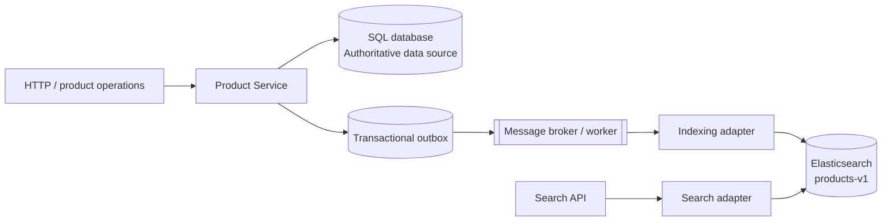
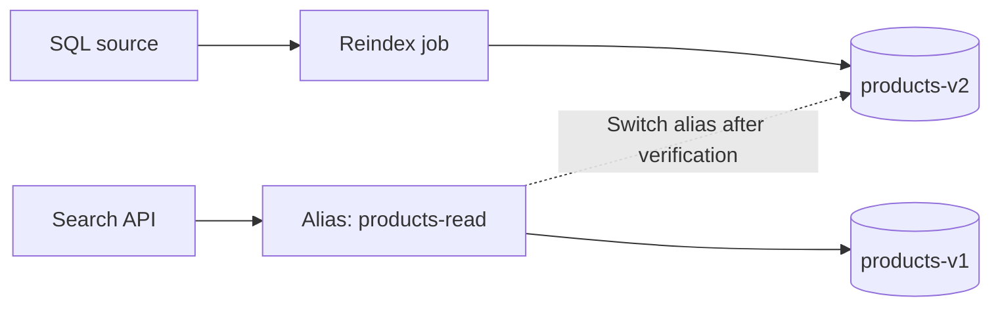
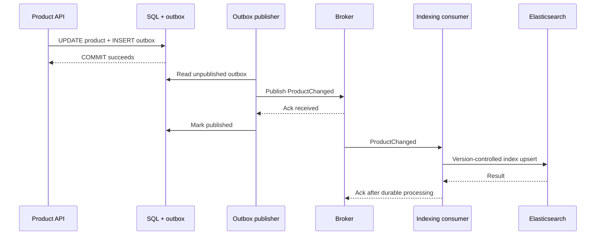

# Integrating the Elasticsearch Client and Spring Data Elasticsearch

In a Spring Boot application, PostgreSQL may hold product and order data as the **authoritative data source**, yet search requirements are often more complex than a typical SQL query: multi-keyword matching, prioritizing product names, category filtering, sorting, pagination, and aggregations. **Elasticsearch** is an index-based search and analytics engine commonly used to serve those queries.

This lesson belongs to the **Other NoSQL Stores** chapter of the **SPRING_BOOT_INTEGRATION** module. This module organizes Spring Boot system integration through HTTP clients, databases, caches, message brokers, and Spring Integration adapters. Consequently, integrating Elasticsearch is not just adding a dependency and calling a search API: you must control **configuration, data contracts, indices, change synchronization, transactions, deduplication, retries, testing, and observability**.

Two common ways to access Elasticsearch in Spring Boot are the **Elasticsearch Java API Client** (working directly with Elasticsearch APIs) and **Spring Data Elasticsearch** (repositories, mapping, and `ElasticsearchOperations`). Both can coexist, provided their responsibilities are clearly separated.

> **Version scope:** Examples use Spring Boot 3.x, Spring Data Elasticsearch 5.x, Elasticsearch 8.x, and Java 17+. In other versions, artifact names, client configuration classes, repositories, JSON mappers, and query APIs may differ. Check the **Spring Data Elasticsearch ↔ Elasticsearch compatibility matrix** for your project version before implementing. The examples target Elasticsearch and are not guaranteed to be compatible with OpenSearch by default.

## 1. Learning objectives

After this lesson, you will be able to:

1. Explain `index`, `document`, `_id`, `mapping`, `analyzer`, `shard`, and *near real-time search* behavior.
2. Distinguish between **Elasticsearch Java API Client**, **Spring Data repositories**, and **ElasticsearchOperations**.
3. Configure Elasticsearch connections in Spring Boot and declare safe mappings.
4. Write code to save, fetch, and search documents scoped by tenant using Spring Data Elasticsearch and native Elasticsearch queries.
5. Design a synchronization pipeline from SQL via outbox/broker to Elasticsearch, handling retries, duplicates, and out-of-order events.
6. Classify Elasticsearch errors, design integration tests, and select appropriate observability metrics.
7. Understand key limitations around data consistency, indexing latency, and search authorization.

## 2. What is Elasticsearch in an integration architecture?

### 2.1. What is Elasticsearch used for?

Elasticsearch stores **JSON documents** inside **indices** for search queries, filtering, relevance scoring, aggregations, and analytics. A document has an `_id` and a set of fields. Each field is mapped to a specific search type, for example:

| Concept | Example | Purpose |
| --- | --- | --- |
| Index | `products-v1` | Collection of documents sharing the same mapping/settings |
| Document | A product with name, price, tenant, and update timestamp | Unit of indexed data |
| `_id` | `tenant-a:product-101` | Document identifier used for overwrite/lookup by ID |
| Mapping | `name` as `text`, `tenantId` as `keyword` | Defines how fields are indexed and queried |
| Analyzer | Breaks product names into tokens | Enables full-text search |
| Query DSL | `match`, `term`, `bool`, `range` | Expresses search and filter criteria |
| Shard | Partition of an index | Distributes data and search execution |
| Replica | Copy of a shard | Increases availability and read capacity depending on configuration |

Elasticsearch excels when flexible search is needed, but it is **not a default replacement for a SQL database handling business transactions**. For instance, order creation, inventory reservation, payments, and balance updates require invariants and transactions in the operational store. An Elasticsearch index can serve as a **read model** powering search, built from that source of truth.

### 2.2. An index is a read copy, not necessarily the source of truth

A common architecture:



The benefit is that each system does what it is built for: SQL enforces write correctness, while Elasticsearch powers search. The trade-off is that **search results can lag behind SQL data by a short window**. The system must define acceptable latency, an index recovery mechanism, and reconciliation procedures when failures occur.

If an application only needs lookup by ID and a few simple predicates, SQL with proper indexes may be sufficient. Adding Elasticsearch brings synchronization overhead, migrations, cluster operations, and stale-data management.

### 2.3. Near real-time differs from immediate transactional visibility

After successfully indexing a document, Elasticsearch may not surface that change in **search** results until the index undergoes a **refresh**. This is *near real-time* behavior. Lookup by document ID and search queries can have different visibility semantics for recent updates.

Therefore:

- Do not treat a successful write response as a guarantee that an immediate `match` query will find the document.
- Do not rely on fixed `Thread.sleep(...)` calls to “wait for the index to update” in tests.
- In tests, you can explicitly refresh the index or use an appropriate refresh policy; in production, evaluate the performance cost of refreshing too frequently.
- For workflows requiring strict “read-your-own-writes,” define the read source and consistency level clearly before using Elasticsearch instead of SQL.

## 3. Two integration approaches: Java API Client and Spring Data Elasticsearch

### 3.1. Elasticsearch Java API Client

The official Elasticsearch client for Java provides a strongly typed API for requests such as `index`, `get`, `search`, `bulk`, index administration, and response handling. The main entry class is:

```java
co.elastic.clients.elasticsearch.ElasticsearchClient
```

When an application needs direct access to Query DSL, bulk indexing, or newer Elasticsearch features not yet exposed by higher-level abstractions, the Java API Client is a practical choice.

### 3.2. Spring Data Elasticsearch

Spring Data Elasticsearch provides:

- Mapping annotations between Java objects and Elasticsearch documents: `@Document`, `@Id`, `@Field`.
- `ElasticsearchRepository<T, ID>` for CRUD operations and derived query methods.
- `ElasticsearchOperations` for search/indexing operations via Spring Data APIs.
- Integration with type conversion, pagination, search hit mapping, and Spring ecosystem configuration.

Spring Data Elasticsearch uses a compatible client underneath in its execution layer, yet **not every Elasticsearch API appears under the same abstraction**.

| Criterion | Elasticsearch Java API Client | Spring Data Elasticsearch |
| --- | --- | --- |
| API level | Close to Elasticsearch REST/Query DSL | Entity mapping, repositories, operations |
| Basic CRUD | Build requests directly | `save`, `findById`, `deleteById` |
| Advanced search | Typed Query DSL client | `NativeQuery`/`ElasticsearchOperations`, or direct client |
| Java mapping | Managed via client JSON/serializer | Spring Data annotations and mapping converter |
| New Elasticsearch features | Usually accessible directly per client version | Depends on Spring Data support |
| Consistency / cross-SQL transactions | Not automatically guaranteed | Also not automatically guaranteed |
| Best fit | Bulk, admin APIs, specialized native queries | Repositories and standard application queries |

You do not need to force both APIs onto every operation. A clean design might use repositories/operations for standard business search and the Java API Client in a dedicated component for bulk indexing or complex queries. If both write to the same index, they must share the same ID convention, mapping, serializer, version rules, and error handling.

## 4. Setting up the local development environment and dependencies

### 4.1. Running Elasticsearch locally

Example `compose.yaml` **strictly for local development**, running a single node with security disabled for simplicity:

```yaml
services:
  elasticsearch:
    image: docker.elastic.co/elasticsearch/elasticsearch:8.13.4
    environment:
      discovery.type: single-node
      xpack.security.enabled: "false"
      ES_JAVA_OPTS: "-Xms512m -Xmx512m"
    ports:
      - "127.0.0.1:9200:9200"
    volumes:
      - elasticsearch_data:/usr/share/elasticsearch/data

volumes:
  elasticsearch_data:
```

Start and verify:

```bash
docker compose up -d
curl http://localhost:9200/
curl http://localhost:9200/_cluster/health
```

- Requires an active Docker runtime and sufficient memory for Elasticsearch.
- The published port binds to `127.0.0.1` to restrict host access in local environments.
- The named volume persists data/indices across restarts; reset it explicitly when a clean slate is needed.
- **Never use `xpack.security.enabled=false` in production.** Deployed environments require TLS, authentication, least-privilege roles, and network policies matching organizational standards.
- The image version is illustrative. Choose a version compatible with your Spring Data/Elasticsearch client, and pin versions in CI.

If the Spring Boot application runs **directly on the host**, connect to `http://localhost:9200`. If it runs **inside the same Docker Compose network**, use the service DNS such as `http://elasticsearch:9200`. Inside an app container, `localhost` refers to that app container itself, not the Elasticsearch container.

### 4.2. Spring Boot dependencies

Gradle example (Groovy DSL):

```groovy
dependencies {
    implementation 'org.springframework.boot:spring-boot-starter-data-elasticsearch'

    testImplementation 'org.springframework.boot:spring-boot-starter-test'
    testImplementation 'org.springframework.boot:spring-boot-testcontainers'
    testImplementation 'org.testcontainers:junit-jupiter'
    testImplementation 'org.testcontainers:elasticsearch'
}
```

The Spring Data Elasticsearch starter pulls in the integration components and compatible client managed by Spring Boot dependency management. **Do not arbitrarily mix Spring Data and Elasticsearch client versions** without verifying compatibility.

When you need to declare the Elasticsearch Java API Client explicitly due to custom project dependency structures:

```groovy
// Only add if the existing dependency graph does not already provide the client:
implementation 'co.elastic.clients:elasticsearch-java'
```

Avoid duplicating declarations or forcing a version different from the BOM just because an online snippet uses a newer release. Always verify dependency resolution and the compatibility matrix when upgrading.

### 4.3. Spring Boot connection configuration

Example `application-local.yml` for local development without security enabled:

```yaml
spring:
  elasticsearch:
    uris: ${ELASTICSEARCH_URIS:http://localhost:9200}
    connection-timeout: 2s
    socket-timeout: 5s
```

In an authenticated environment:

```yaml
spring:
  elasticsearch:
    uris: ${ELASTICSEARCH_URIS}
    username: ${ELASTICSEARCH_USERNAME}
    password: ${ELASTICSEARCH_PASSWORD}
```

These properties illustrate Spring Boot 3.x configuration. With HTTPS, configure proper **trust material/CA certificates** using SSL bundles or the client configuration mechanism supported by your Boot version; never disable certificate validation to work around environment issues. Supply credentials via environment variables or a secret manager instead of committing them to source control.

**Connection timeout is not the full query timeout**: connection timeout bounds establishing the TCP/HTTP connection, while socket/response timeout bounds waiting for I/O responses at a client layer. An operation with retries or multiple steps still needs an overall business deadline.

## 5. Index design and search data contract

### 5.1. Sample product model

Suppose SQL owns the `products` table and Elasticsearch serves per-tenant keyword search. The search document needs:

| Field | Elasticsearch type | Purpose |
| --- | --- | --- |
| `tenantId` | `keyword` | Exact filtering by tenant |
| `productId` | `keyword` | Exact product code |
| `name` | `text` | Full-text search on product name |
| `description` | `text` | Full-text search on description |
| `priceMinor` | `long` | Price in the currency's smallest minor unit |
| `currency` | `keyword` | ISO currency code or domain contract |
| `sourceVersion` | `long` | Monotonic version from the source system |
| `updatedAt` | `date` | Normalized update timestamp |

**Why not use `double` for money?** Monetary values require exact precision and explicit units. Storing integer minor units (`priceMinor`) works well when the domain clearly defines units and bounds; other cases needing fractional precision may use `scaled_float` or an appropriate contract type.

### 5.2. `keyword` and `text` are two distinct types

A `keyword` field is typically used for **exact filters, sorting, and aggregations**; `text` is processed by an analyzer into tokens for full-text search.

Examples:

- `tenantId: "tenant-a"` → use a `term` filter on `keyword`.
- `name: "Lightweight running shoes"` → use `match`/`multi_match` on `text`.
- To support both full-text search on the name and exact sorting/aggregation on the raw name, you can design a multi-field such as `name` as `text` and `name.keyword` as `keyword` with appropriate rules.

Do not apply `term` to a `text` field expecting it to implicitly match how the tokenizer/analyzer broke up the text. Conversely, do not use full-text `match` for tenant IDs or exact authorization keys.

### 5.3. Creating the mapping

An explicitly managed index can be created ahead of time via the HTTP API or a deployment tool:

```http
PUT /products-v1
Content-Type: application/json

{
  "mappings": {
    "properties": {
      "tenantId": { "type": "keyword" },
      "productId": { "type": "keyword" },
      "name": { "type": "text" },
      "description": { "type": "text" },
      "priceMinor": { "type": "long" },
      "currency": { "type": "keyword" },
      "sourceVersion": { "type": "long" },
      "updatedAt": { "type": "date" }
    }
  }
}
```

The snippet above illustrates **Elasticsearch HTTP REST syntax**, not Java code. Depending on the language and domain, Vietnamese or localized analyzers must be evaluated with real search queries, tokenization behavior, and available plugins. Never assume the `standard` analyzer meets Vietnamese search quality expectations out of the box.

Avoid letting dynamic mapping infer every field in external payloads, as varied data can generate excessive field names, mapping conflicts, or unstable types. In production, consider index templates, explicit mappings, restricting dynamic fields, and a schema update process. If enabling `dynamic: strict`, account for metadata/type-hint fields that serializers or Spring Data might emit.

### 5.4. Index versions and aliases

For incompatible mapping changes, do not rely on mutating an existing field's type in place. A safer rollout pattern:



Typical workflow: create `products-v2` with the new mapping, backfill data in a controlled manner, catch up on changes occurring during the backfill, validate counts and correctness, and switch the **read alias** to the new index via an atomic alias update. If the application both writes and reads through aliases, design a write alias and a synchronized cutover process to avoid writing to the old index by mistake. Switching an alias alone does not guarantee all in-flight data changes have been caught up.

## 6. Declaring documents with Spring Data Elasticsearch

### 6.1. Search entity

Example `ProductSearchDocument.java`:

```java
package com.example.integration.search;

import java.time.Instant;

import org.springframework.data.annotation.Id;
import org.springframework.data.elasticsearch.annotations.Document;
import org.springframework.data.elasticsearch.annotations.Field;
import org.springframework.data.elasticsearch.annotations.FieldType;

@Document(indexName = "products-v1", createIndex = false)
public record ProductSearchDocument(
        @Id String id,
        @Field(type = FieldType.Keyword) String tenantId,
        @Field(type = FieldType.Keyword) String productId,
        @Field(type = FieldType.Text) String name,
        @Field(type = FieldType.Text) String description,
        @Field(type = FieldType.Long) long priceMinor,
        @Field(type = FieldType.Keyword) String currency,
        @Field(type = FieldType.Long) long sourceVersion,
        @Field(type = FieldType.Date) Instant updatedAt
) {}
```

Explanation:

- `@Document(indexName = "products-v1")` maps the Java type to the corresponding index.
- `createIndex = false` adopts the strategy of **managing schemas ahead of time via deployment tooling**, rather than having the repository auto-create the index. When running the example, you must create the index/mapping first, otherwise search operations may fail.
- `@Id` identifies the document; this example uses a deterministic composite of tenant and product to prevent cross-tenant collisions.
- `@Field` expresses mapping intent. Keep annotations aligned with the real server mapping; Java annotations **do not magically alter** an already-existing index mapping.
- `sourceVersion` is the business version from the source system. **Simply adding this field to the document does not stop an older event from overwriting a newer one**; version comparison must be enforced in the write operation or processing pipeline.

Immutable records work cleanly for read models. If using mutable classes or custom constructors, ensure the Spring Data mapping converter can instantiate the object properly and deserialize all required fields.

### 6.2. CRUD repository

`ProductSearchRepository.java`:

```java
package com.example.integration.search;

import org.springframework.data.elasticsearch.repository.ElasticsearchRepository;

public interface ProductSearchRepository
        extends ElasticsearchRepository<ProductSearchDocument, String> {
}
```

A simple indexing service:

```java
package com.example.integration.search;

import java.util.Optional;

import org.springframework.stereotype.Service;

@Service
public class ProductSearchStore {
    private final ProductSearchRepository repository;

    public ProductSearchStore(ProductSearchRepository repository) {
        this.repository = repository;
    }

    public ProductSearchDocument save(ProductSearchDocument document) {
        return repository.save(document);
    }

    public Optional<ProductSearchDocument> findById(String id) {
        return repository.findById(id);
    }

    public void deleteById(String id) {
        repository.deleteById(id);
    }
}
```

This demonstrates the **CRUD API**, not a production synchronization pipeline. A retried event can call `save` repeatedly; with the same ID, it updates the same document instead of creating a new ID. However, when an **older version arrives after a newer version**, a plain `save` can still regress the data. Section 10 covers how to design for that problem.

### 6.3. Choosing deterministic IDs and protecting tenants

A simple formula:

```text
documentId = tenantId + ":" + productId
```

Ensure both components are validated and normalized, and define escaping rules if the delimiter character can appear inside an ID. Never generate a random ID when **updating the same product**, because every retry would create a separate document.

Having a `tenantId` field in the document **does not by itself enforce multi-tenant security**. The search API must obtain the tenant from an authenticated identity, enforce tenant filtering, and authorize `get`, `update`, `delete`, or administrative operations. Never trust an arbitrary `tenantId` passed as a user query parameter.

## 7. Searching with `ElasticsearchOperations` and `NativeQuery`

### 7.1. Problem: combining full-text search with exact filtering

Requirement: find products whose name/description matches `"running shoes"` **only within the authenticated tenant**, returning at most 20 documents.

With Elasticsearch Query DSL, you typically combine:

- `bool.filter` + `term(tenantId)`: exact filter that does not affect relevance scoring.
- `bool.must` + `multi_match(name, description)`: full-text search, optionally boosting the name field.
- `size` or pageable: prevents overly large responses.
- An explicit sort strategy when deterministic ordering is required; otherwise, search sorts by relevance score by default.

### 7.2. Spring Data Elasticsearch code

`ProductSearchService.java`:

```java
package com.example.integration.search;

import java.util.List;

import org.springframework.data.domain.PageRequest;
import org.springframework.data.elasticsearch.client.elc.NativeQuery;
import org.springframework.data.elasticsearch.core.ElasticsearchOperations;
import org.springframework.data.elasticsearch.core.SearchHit;
import org.springframework.data.elasticsearch.core.SearchHits;
import org.springframework.stereotype.Service;

@Service
public class ProductSearchService {
    private final ElasticsearchOperations operations;

    public ProductSearchService(ElasticsearchOperations operations) {
        this.operations = operations;
    }

    public List<ProductSearchDocument> search(
            String authenticatedTenantId, String userText, int limit) {

        if (authenticatedTenantId == null
                || authenticatedTenantId.isBlank()) {
            throw new IllegalArgumentException("Missing authenticated tenant");
        }
        if (userText == null || userText.isBlank()) {
            throw new IllegalArgumentException("Search keyword is blank");
        }

        int pageSize = Math.min(Math.max(limit, 1), 50);

        NativeQuery query = NativeQuery.builder()
                .withQuery(q -> q.bool(b -> b
                        .filter(f -> f.term(t -> t
                                .field("tenantId")
                                .value(authenticatedTenantId)))
                        .must(m -> m.multiMatch(mm -> mm
                                .query(userText)
                                .fields("name^2", "description")))))
                .withPageable(PageRequest.of(0, pageSize))
                .build();

        SearchHits<ProductSearchDocument> hits =
                operations.search(query, ProductSearchDocument.class);

        return hits.getSearchHits().stream()
                .map(SearchHit::getContent)
                .toList();
    }
}
```

Key points to understand:

1. `NativeQuery` lets you express Elasticsearch Query DSL within Spring Data Elasticsearch. `ElasticsearchOperations` executes it and maps results to `ProductSearchDocument`.
2. `filter` restricts results to the **authenticated tenant**; the tenant value comes from the security context, not directly from the request body.
3. `multiMatch` uses the index's configured analyzer. The `name^2` boost is illustrative; tune relevance using real query test sets.
4. Capping results at 50 limits payload size, though the application should also validate `userText` length, query timeouts, rate limits, and pagination policies.
5. `SearchHits` contains metadata about hits, scores, and total counts. The example returns only content for brevity; real APIs may expose total hits or cursors while being careful not to leak internal metadata.

**Caution:** Spring Data Elasticsearch and the Elasticsearch Java API Client evolve across versions. If your project uses versions outside Boot 3.x / Data Elasticsearch 5.x, adjust imports and builders to match your actual version.

### 7.3. Avoid deep pagination with large offsets

`PageRequest.of(page, size)` is convenient for initial pages, yet unsuitable for **deep pagination** on large indices. For deep traversal, consider `search_after` combined with a deterministic sort and **point in time (PIT)** per Elasticsearch capabilities, along with query/time limits.

Do not let `from + size` grow arbitrarily into hundreds of thousands while expecting stable performance. Pagination semantics are part of the API contract, especially when underlying data changes while users page through results.

## 8. Calling the Elasticsearch Java API Client directly

In a properly configured Spring Boot 3.x application, you can inject `ElasticsearchClient` to use the native API.

### 8.1. Indexing by document ID

`NativeProductIndexClient.java`:

```java
package com.example.integration.search;

import java.io.IOException;

import co.elastic.clients.elasticsearch.ElasticsearchClient;
import co.elastic.clients.elasticsearch.core.IndexResponse;

import org.springframework.stereotype.Component;

@Component
public class NativeProductIndexClient {
    private final ElasticsearchClient client;

    public NativeProductIndexClient(ElasticsearchClient client) {
        this.client = client;
    }

    public IndexResponse index(ProductSearchDocument document)
            throws IOException {
        return client.index(request -> request
                .index("products-v1")
                .id(document.id())
                .document(document));
    }
}
```

Here, `ElasticsearchClient` serializes the document and calls the index API directly. Be aware of which Java JSON mapper the client uses and how it aligns with the index mapping, especially when mixing direct client calls with Spring Data converters. The two serialization mechanisms can differ in **field naming, null handling, type hints, or date/time formatting**; do not assume they always emit identical JSON just because they share the same Java record.

**Important:** `index()` is a document write operation; no SQL transaction spans it. Indexing with the same `_id` prevents creating extra documents with different IDs, yet does not prevent **stale writes**. If event ordering is required, version checks or write conditions must be enforced by Elasticsearch or the pipeline.

### 8.2. Searching via the native client

Example using the typed Query DSL:

```java
package com.example.integration.search;

import java.io.IOException;
import java.util.List;
import java.util.Objects;

import co.elastic.clients.elasticsearch.ElasticsearchClient;
import co.elastic.clients.elasticsearch.core.SearchResponse;
import co.elastic.clients.elasticsearch.core.search.Hit;

import org.springframework.stereotype.Component;

@Component
public class NativeProductSearchClient {
    private final ElasticsearchClient client;

    public NativeProductSearchClient(ElasticsearchClient client) {
        this.client = client;
    }

    public List<ProductSearchDocument> search(
            String authenticatedTenantId, String userText) throws IOException {
        SearchResponse<ProductSearchDocument> response =
                client.search(s -> s
                        .index("products-v1")
                        .size(20)
                        .query(q -> q.bool(b -> b
                                .filter(f -> f.term(t -> t
                                        .field("tenantId")
                                        .value(authenticatedTenantId)))
                                .must(m -> m.match(mt -> mt
                                        .field("name")
                                        .query(userText))))),
                        ProductSearchDocument.class);

        return response.hits().hits().stream()
                .map(Hit::source)
                .filter(Objects::nonNull)
                .toList();
    }
}
```

This sample intentionally uses the same basic tenant filter and full-text condition for comparison with `NativeQuery`. Before production use, you still need input validation, limits, timeouts, error response handling, and authorization just like in the Spring Data service.

### 8.3. When should you use the direct client?

- You need specialized aggregations, kNN, bulk, or admin queries that Spring Data abstractions do not express cleanly.
- You need control over specific request parameters tied to an Elasticsearch API version.
- You are integrating index/alias operations or custom reindexing workflows.

Do not leak `ElasticsearchClient` into domain services simply because the API is “more powerful.” Keep it behind a port/adapter with a clear contract so implementations can change or be mocked in tests without coupling business logic.

## 9. Mapping and contract between SQL and Elasticsearch

Suppose SQL stores a product:

```json
{
  "tenantId": "tenant-a",
  "productId": "product-101",
  "name": "Running shoes",
  "description": "Lightweight shoes for training",
  "priceMinor": 129900,
  "currency": "VND",
  "version": 17,
  "updatedAt": "2026-11-21T03:10:00Z"
}
```

An **indexing transformer** builds `ProductSearchDocument` from the SQL record or validated event. Rules:

1. Never take tenant from an unverified client-supplied field; derive it from validated business data.
2. Derive a deterministic `documentId` from `(tenantId, productId)`.
3. Preserve `version` from the source system as `sourceVersion` to support ordering control.
4. Normalize `updatedAt` to UTC; do not replace it with the timestamp when the consumer received the message.
5. Keep consistent `priceMinor` and `currency` units; never convert money through `double`.
6. Index only fields genuinely needed for search; never copy secrets, tokens, or unnecessary PII into documents.

### 9.1. Search model differs from transaction model

Do not design `ProductSearchDocument` as a literal snapshot of the SQL entity. The read model serves search needs, so it may:

- Denormalize fields from category or brand tables to avoid search-time joins.
- Contain normalized keywords or suggestion fields.
- Use `text`/`keyword` mappings differing from SQL column types.
- Carry `sourceVersion` or `indexedAt` for lag diagnostics, without using them as substitutes for SQL transactional constraints.

When denormalizing, a category change can affect many product documents. You must define a policy for re-indexing affected documents and managing the resulting backlog.

## 10. Data synchronization: outbox, idempotency, and out-of-order events

This is a critical part of Elasticsearch integration: SQL data and the search index live in **two separate storage systems**.

### 10.1. Why not write to SQL and call Elasticsearch directly?

If your code executes:

```text
1. UPDATE SQL product.
2. COMMIT SQL succeeds.
3. Call Elasticsearch index.
4. Application crashes before step 3 or before receiving the response.
```

SQL now has the new data while Elasticsearch retains the old version. Conversely, if you call Elasticsearch first and SQL rolls back, the search index exposes uncommitted data.

`@Transactional` with a `DataSource` only covers the configured SQL transaction; it **does not create a distributed transaction with Elasticsearch**.

### 10.2. Transactional outbox

A common design:



- The SQL transaction writes **business data and the outbox entry** together. If the transaction rolls back, neither commits.
- The publisher relays outbox entries with bounded retries; if a failure happens after the broker accepts the message but before marking it sent, an event may be published more than once.
- The consumer must be **idempotent** and guard against version regression. Acknowledge the message only after the required persistence step succeeds or has a proper recovery path.
- Elasticsearch can temporarily lag behind SQL. Monitor outbox age/queue lag and version drift to detect issues.

Not every system requires a broker. An outbox polling job that indexes directly can work if throughput, recovery, and operational needs allow. The core principle is **durably recording the intent to update the search index alongside the SQL data**.

### 10.3. Handling duplicates vs. handling stale events

Suppose a product receives events in real business order:

```text
Event A: sourceVersion = 17, name = "Running shoes"
Event B: sourceVersion = 18, name = "Running shoes Pro"

Consumer might receive:
B → A → B
```

If you blindly call `repository.save(...)`, event A arriving late overwrites version 18 with version 17. Therefore:

- **Duplicate:** the same event ID/version appears multiple times; avoid repeated side effects.
- **Stale / out-of-order:** an event with a lower version than the currently applied state must be rejected or ignored.
- **Missing event:** if the pipeline requires sequential state, detect version gaps.
- **Delete event:** if a document is deleted and an older update event arrives later, the document could be resurrected; design tombstones/versioning or SQL rehydration policies.

Possible solutions include **optimistic concurrency control** via `if_seq_no`/`if_primary_term`, **external versioning** with monotonically increasing source versions, or compare-and-set enforcement at the persistence/indexing layer. Each mechanism has prerequisites, such as strictly increasing versions and handling `409 conflict`. Never rely solely on checking `sourceVersion` in RAM because concurrent consumers can race.

**Important note:** A `sourceVersion` field inside `_source` is plain data and does not make Elasticsearch automatically reject stale updates. You must use an actual versioning mechanism or write condition.

### 10.4. Reindexing and reconciliation

A reliable pipeline needs a way to rebuild the index:

1. Create a new index with the target mapping/version.
2. Read committed data from the authoritative source (SQL) in batches with checkpoints.
3. Index documents using deterministic IDs, recording versions.
4. Catch up on changes emitted while loading.
5. Compare counts, sample-check correctness, and measure lag.
6. Switch the read alias after verification.
7. Retain a rollback plan to revert to the old index during the cutover window.

Matching document count to SQL row count is insufficient when data is denormalized or filtered. Verify against the read model contract and actual tenant scopes.

## 11. Elasticsearch errors and retry policy

Elasticsearch can fail at the connection, HTTP request, shard, or individual bulk-item level. Do not handle every exception by retrying blindly.

| Error group | Example | Action |
| --- | --- | --- |
| Unreachable | DNS, TLS, socket timeout | Check infrastructure, bounded retry if transient |
| Unauthorized / Forbidden | 401, 403 | Verify credentials/privileges; do not retry indefinitely |
| Mapping/contract | Writing text into a long field, invalid analyzer/mapping | Quarantine payload, fix mapping/transformer |
| Index missing | Wrong alias, migration not run | Halt/fix deployment; do not auto-create indices ad hoc |
| Resource overload | 429, rejected thread pool, shard unavailable | Backoff, limit concurrency, inspect cluster health |
| 5xx responses | Node/cluster failure | Retry appropriately for idempotent operations within deadline |
| Conflict | Optimistic concurrency / version conflict | Ignore stale event or reload state to avoid overwriting |
| Bulk item failure | Partial item errors inside a batch | Inspect **each item**, retry only eligible items |
| Search timeout | Expensive query, slow node | Bound queries, paginate properly, tune mappings and resources |

### 11.1. Can retries create duplicate data?

With a deterministic `_id`, re-sending the same document usually does not create another document under a different ID. Risks remain:

- An older event arriving after a newer one regresses state.
- A deleted document gets re-indexed by a stale event.
- Pre/post-index side effects (HTTP calls, broker publishes, SQL updates) execute twice.
- Retrying an entire bulk request after partial success masks mapping errors or amplifies load.

Hence **end-to-end idempotency** must cover identifiers, versions, side effects, acknowledgments, and recovery mechanisms.

### 11.2. Bulk indexing

The Bulk API helps when processing many documents or reindexing full datasets. Each batch should account for:

- Batch size and concurrent request count suited to the cluster.
- Inspecting **per-item** responses, since an HTTP response can succeed while individual items fail.
- Retrying only transient errors, avoiding infinite loops on mapping errors.
- Not equating batch completion order with per-product version order.
- Memory/backpressure and refresh/search visibility timing.

Larger batches are not always better: oversized requests and full-batch retries worsen congestion. Measure throughput, latency, and error rates at realistic batch sizes.

## 12. Testing with real Elasticsearch and Testcontainers

Unit tests can mock repositories or operations, yet they cannot prove `text`/`keyword` mappings, analyzers, Query DSL, JSON converters, version conflicts, refresh behavior, or connection settings work on real Elasticsearch.

### 12.1. Testing strategy

| Level | What to verify |
| --- | --- |
| Mapper unit test | ID, tenant, version, price, timestamps normalized correctly |
| Service unit test | Rejects missing tenant, enforces result limits, classifies errors |
| Elasticsearch integration test | Index mapping, repository CRUD, full-text query, tenant filter |
| Pipeline integration test | SQL outbox → consumer → Elasticsearch; retries and duplicates |
| Fault test | Elasticsearch not ready, 429/503, timeouts, conflicts, bulk partial failures |
| End-to-end test | Search API never leaks another tenant's data, lag meets SLA |

### 12.2. Creating an ephemeral cluster with Testcontainers

With Spring Boot 3.x supporting `@ServiceConnection`, this integration test focuses on the repository and mapping:

```java
package com.example.integration.search;

import static org.junit.jupiter.api.Assertions.*;

import java.time.Instant;

import org.junit.jupiter.api.BeforeEach;
import org.junit.jupiter.api.Test;
import org.springframework.beans.factory.annotation.Autowired;
import org.springframework.boot.test.context.SpringBootTest;
import org.springframework.boot.testcontainers.service.connection.ServiceConnection;
import org.springframework.data.elasticsearch.core.ElasticsearchOperations;
import org.springframework.data.elasticsearch.core.IndexOperations;

import org.testcontainers.elasticsearch.ElasticsearchContainer;
import org.testcontainers.junit.jupiter.Container;
import org.testcontainers.junit.jupiter.Testcontainers;

@SpringBootTest
@Testcontainers
class ProductSearchRepositoryIT {

    @Container
    @ServiceConnection
    static ElasticsearchContainer elasticsearch =
            new ElasticsearchContainer(
                    "docker.elastic.co/elasticsearch/elasticsearch:8.13.4")
                    .withEnv("xpack.security.enabled", "false");

    @Autowired
    ProductSearchRepository repository;

    @Autowired
    ElasticsearchOperations operations;

    @BeforeEach
    void ensureIndex() {
        IndexOperations indexOps =
                operations.indexOps(ProductSearchDocument.class);

        if (!indexOps.exists()) {
            indexOps.create();
            indexOps.putMapping(indexOps.createMapping());
        }
    }

    @Test
    void savesAndReadsProductDocument() {
        var document = new ProductSearchDocument(
                "tenant-a:product-101",
                "tenant-a",
                "product-101",
                "Running shoes",
                "Lightweight shoes for training",
                129900L,
                "VND",
                17L,
                Instant.parse("2026-11-21T03:10:00Z")
        );

        repository.save(document);

        var fromIndex = repository.findById(document.id());

        assertTrue(fromIndex.isPresent());
        assertEquals("tenant-a", fromIndex.orElseThrow().tenantId());
        assertEquals(17L, fromIndex.orElseThrow().sourceVersion());

        // When asserting via search queries, account for index refresh.
        operations.indexOps(ProductSearchDocument.class).refresh();
    }
}
```

- `@Container` and `@Testcontainers` manage the container lifecycle via the JUnit extension.
- `@ServiceConnection` feeds connection details from the container into Spring Boot when supported, avoiding hardcoded `localhost:9200`.
- The test explicitly creates the index and mapping because the entity sets `createIndex = false`.
- This test primarily checks **saving and fetching by ID**. To verify full-text search and tenant isolation, run `ProductSearchService.search(...)` after refresh and assert results, including confirming another tenant's documents are excluded.
- Containers require a Docker-compatible runtime locally/in CI. Never let test security-disabled settings leak into production.

**Version note:** Testcontainers changes module/artifact structures across major releases; for instance, `org.testcontainers:elasticsearch` is used with Testcontainers 1.x. Pick dependency versions matching your BOM, Elasticsearch image, and Spring Boot release. This test shows structure and does not replace running against your actual project versions.

### 12.3. Full-text tests must evaluate search quality

A passing `repository.findById` test does not prove real search relevance is good. Build a fixture covering:

- Accented and unaccented Vietnamese/localized names if required by the product.
- Synonyms, abbreviations, and common typos.
- Units, SKU codes with special characters, and leading zeros.
- Products from another tenant with identical names to catch missing tenant filters.
- Long, blank, wildcard/special-character, and malicious or overly expensive queries.
- Deleted products or products updated to a newer version.
- Searching immediately after indexing to verify refresh/visibility expectations.

Search accuracy and ranking are product requirements: evaluate them against real query/expected-result datasets in addition to technical unit and integration tests.

### 12.4. Testing the SQL → Elasticsearch pipeline

A representative scenario:

```text
Given:
  SQL product has sourceVersion = 18.
  Outbox has ProductChanged(version 18).
  Elasticsearch currently has version 17.

When:
  Consumer receives version 18 event and indexes it.
  Consumer receives version 18 event again.
  Consumer later receives delayed version 16 event.

Then:
  Elasticsearch still displays version 18.
  No duplicate document ID is created.
  Version 16 event does not overwrite newer data.
  Retries/conflicts are recorded for observability.
```

Tests must verify the **actual versioning mechanism** rather than merely reading `sourceVersion` after two sequential saves. Use concurrent consumers or fault injection at the acknowledgment boundary to test race conditions and redelivery.

## 13. Elasticsearch security and tenant isolation

Elasticsearch often aggregates searchable data from many sources. Misconfiguration can expose data across tenants or via administrative endpoints.

- **Encryption and authentication:** enforce TLS/HTTPS, use least-privilege accounts or API keys scoped by index/operation, and manage secrets securely.
- **Application-level authorization:** always apply a tenant filter derived from the authenticated security context; lookups by `_id` must also enforce authorization.
- **API restrictions:** block arbitrary user-submitted Elasticsearch Query DSL unless explicitly authorized; never expose Elasticsearch endpoints directly to the public Internet.
- **Sensitive data:** index only fields needed for search; address retention and deletion policies, especially during reindexing or snapshots.
- **Administrative separation:** separate credentials that create indices/templates/aliases from runtime credentials that only query or index documents.
- **Audit:** record index/alias changes, migrations, reindexes, and broad permission updates.

Tenant filtering in the application service is necessary for multi-tenancy in this design, while stronger isolation may also require controls at the data source and Elasticsearch layers. Never assume adding a `tenantId` field automatically enforces isolation.

## 14. Observability, operations, and troubleshooting

### 14.1. Signals to monitor

| Signal | Question answered |
| --- | --- |
| Search latency (p95/p99), error rate | Is search slow or failing for users? |
| Indexing latency, bulk failures | Are consumers keeping the index updated? |
| Outbox/queue lag, oldest event age | How far behind SQL is search data? |
| Retry count, version conflicts, DLQ | Are errors, duplicates, or out-of-order events rising? |
| Index size, shard count, document count | Is the cluster growing within design expectations? |
| Heap, CPU, disk watermark, thread pool rejections | Is Elasticsearch hitting resource bottlenecks? |
| Refresh/merge pressure | Is write/refresh frequency straining the index? |
| Correlation ID, event ID, sourceVersion | Can a SQL change be traced all the way to the search document? |

Spring Boot Actuator/Micrometer can observe outbound clients and pipelines when instrumentation libraries and metric/trace exporters are configured. Keep **metric tags** bounded (operation, index alias, error type); never use `productId`, `eventId`, or raw search text as labels because of high cardinality.

Traces and logs can retain correlation IDs for investigation, but must strip tokens, credentials, sensitive payloads, and search keywords containing personal data.

### 14.2. Quick diagnostic table

| Symptom | Possible cause | First check |
| --- | --- | --- |
| `Connection refused` | Elasticsearch not running, wrong host/port, or network issue | Container/cluster health, URI, DNS |
| `401`/`403` | Invalid credentials/privileges or TLS config | Principal, roles, secret, CA certificate |
| `index_not_found_exception` | Wrong index/alias or migration not executed | Index/alias list, deploy order |
| `mapper_parsing_exception` | Document violates mapping | Field types, payload, migration |
| Search misses newly written data | Not refreshed yet, wrong target index/alias, event lag | `_id`, target index, refresh, backlog |
| Query leaks/misfilters tenant | Wrong field name or missing filter | `tenantId` mapping, query DSL, security context |
| Slow deep pagination | Large offset, expensive query, too many shards | Profiling, pagination strategy, mapping |
| `429` or bulk rejection | Cluster overloaded, high concurrency/batch size | Thread pools, bulk size, heap, disk |
| Older event overwrites newer | Missing version control on write | Ordering, conflict policy, `sourceVersion` |
| Stale/wrong data after reindex | Missed concurrent updates during backfill | Checkpoint, replay lag, alias swap |

Do not treat every issue by blindly adding shards, replicas, or heap. Those choices affect cost, segment count, shard distribution, and throughput; measure and size based on actual workload.

## 15. Common pitfalls

1. **Using Elasticsearch as the primary SQL store** for multi-table transactional business workflows without a consistency design.
2. **Syncing only by “write SQL then index”** without an outbox or recovery mechanism if the app crashes mid-way.
3. **Treating `repository.save` as protection against stale events**; a `sourceVersion` field does not enforce CAS automatically.
4. **Mapping every field as `text`**, breaking exact filters on tenant/SKU or sorting/aggregations.
5. **Skipping mapping/index version management**, letting dynamic mapping create incompatible fields or types.
6. **Expecting search to reflect writes immediately** without understanding refresh and near real-time behavior.
7. **Generating a new `_id` on every retry**, creating multiple documents for the same product.
8. **Ignoring deletes/tombstones**, allowing old update events to resurrect deleted documents.
9. **Not checking individual bulk response items**, leading to silent data loss.
10. **Allowing apps to query across all tenants**, or accepting `tenantId` directly from unverified input.
11. **Mocking all of Elasticsearch in tests**, missing mapping, tokenizer, converter, and response semantics bugs.
12. **Mixing Spring Data and the native client without unifying serializers/mappings**.

## 16. Self-check questions and exercises

### 16.1. Questions

1. Why is Elasticsearch usually better suited as a search read model than as the sole store for order placement transactions?
2. How do `text` and `keyword` differ when filtering by `tenantId` vs. searching product names?
3. How do Spring Data `ElasticsearchRepository`, `ElasticsearchOperations`, and `ElasticsearchClient` differ?
4. Why does `@Document(createIndex = false)` require preparing the index and mapping beforehand?
5. Why might a search query immediately after a successful index response still miss the document?
6. If a consumer receives version 18 and then version 16, does a `sourceVersion` field alone prevent the older event from overwriting the newer one?
7. Why does a transactional outbox reduce the risk of lost events between SQL and the broker, yet consumers still must handle duplicates?
8. Why must a bulk response be inspected item by item?
9. When should you use index versioning and aliases instead of modifying a mapping in place?
10. Which metrics tell you whether search slowness comes from query execution, indexing pressure, or queue backlog?
11. What test scenario proves tenant A cannot see products belonging to tenant B?
12. Why is Testcontainers running real Elasticsearch more valuable than repository mocks when testing mappings and analyzers?

### 16.2. Implementation exercise

Build a Spring Boot service exposing a product search endpoint backed by a SQL source:

- Design `ProductSearchDocument` with tenant ID, product ID, name, description, price, currency, version, and updated timestamp.
- Create a versioned mapping/index and configure Spring Data Elasticsearch.
- Write an `ElasticsearchRepository` for CRUD, and use `ElasticsearchOperations + NativeQuery` for tenant-scoped name search.
- Add an operation using `ElasticsearchClient` directly to observe how it differs from Spring Data.
- Emit an outbox event inside the SQL transaction when a product is renamed; have the consumer enforce monotonically increasing versions to prevent stale overwrites.
- Write Testcontainers integration tests with at least two tenants, identical search keywords, tenant isolation assertions, and an unrefreshed index case.
- Test duplicate/stale events and versioned delete/recreate; measure retry counts and backlog age.

**Acceptance criteria:** The search API leaks no other tenant's products, results satisfy the contract, SQL updates propagate to the index with retry/recovery, older versions never overwrite newer ones, and metrics reveal when the read model lags.

## 17. Takeaways

- **Elasticsearch** excels at search and analytics; treat it as a read model when business operations require transactions and another authoritative source.
- **Spring Data Elasticsearch** offers mapping, repositories, and operations; **Elasticsearch Java API Client** gives direct access to Elasticsearch APIs and Query DSL. Choose based on requirements and version compatibility.
- **Mapping defines search semantics**: `keyword` for identifiers/exact filters, `text` for full-text; manage analyzers, index versions, and aliases deliberately.
- **Search is near real-time**: a successful write response does not guarantee every immediate search sees the new record.
- **SQL → Elasticsearch synchronization is a distributed integration problem**: it demands outbox/retries, deterministic IDs, true versioning, duplicate/out-of-order/delete handling, and a reindex procedure.
- **Testing against real Elasticsearch**, enforcing multi-tenant isolation, and monitoring latency/indexing lag are essential for a reliable search system.

In **SPRING_BOOT_INTEGRATION**, Elasticsearch works well when integrated into the end-to-end architecture: data flows across HTTP, SQL, brokers, adapters, and the search index under clear contracts, with recovery under failure and verification via tests and observability.
