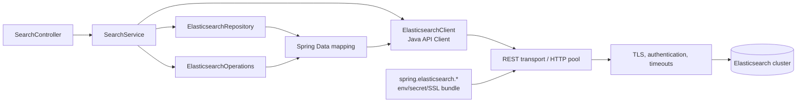
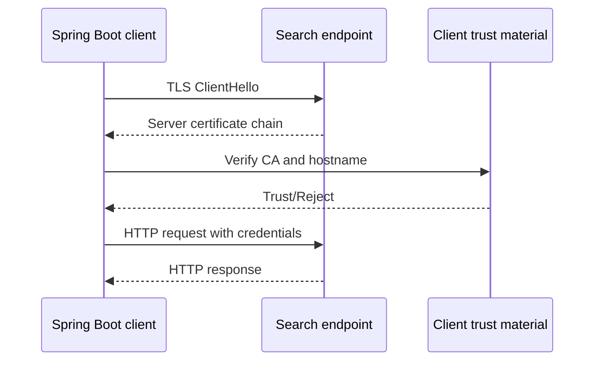
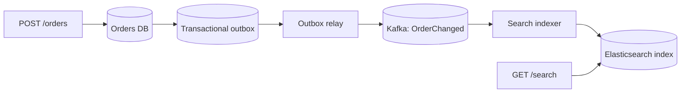

# Elasticsearch Cluster URIs, Authentication, TLS, and Client Customization

## 1. Elasticsearch in a Spring Boot integration flow

Elasticsearch is commonly used for **searching, analyzing, and querying indexed data**. In an e-commerce system, `order-service` might write orders to PostgreSQL/MongoDB, publish an `OrderCreated` event to Kafka, and let `search-indexer` synchronize data into Elasticsearch. Search APIs then read from the Elasticsearch index rather than running complex search queries against the transactional database.

Before writing a repository or query, the application must answer four operational questions:

1. **What are the cluster URIs?** A single node, multiple endpoints, or a gateway/load-balancer URL? HTTP or HTTPS?
2. **How does it authenticate?** Username/password, API key, or environment-specific security mechanisms?
3. **Is TLS verified properly?** CA certificate, hostname, truststore/SSL bundle, and whether mTLS is needed?
4. **How is the client customized?** Timeouts, connection pool, headers, retries, observability, and lifecycle.

This lesson belongs to the **Other NoSQL Stores** chapter of the **SPRING_BOOT_INTEGRATION** module. In line with the module scope, we connect Elasticsearch configuration with data contracts, HTTP flows, brokers, databases, caches, transactions, retries, deduplication, testing, and observability. A client connecting successfully only solves **communicating with the cluster**—it does not prove that search data is consistent with the source system.

**Learning objectives**

1. Correctly interpret `spring.elasticsearch.uris` endpoints and distinguish direct nodes from gateways.
2. Configure Elasticsearch in Spring Boot 3.x via properties and environment variables.
3. Set up Basic authentication or API keys without leaking secrets.
4. Verify TLS by CA and hostname; understand the risks of disabling certificate validation.
5. Customize synchronous clients built on the Elasticsearch Java API Client, low-level REST client, and Spring Data Elasticsearch.
6. Choose appropriate timeouts/pools and classify 401/403/429/5xx and connection errors.
7. Test real connectivity, verify index mappings, and design safe retries and idempotency.

> **Version note:** Main examples use **Java 17+, Spring Boot 3.x, Spring Data Elasticsearch 5.x**, and the Elasticsearch Java API Client selected by the Spring Boot BOM. Spring Boot 4.x / newer Spring Data Elasticsearch versions may change property structures, dependencies, or REST transport. Always check the configuration metadata/BOM for your exact version before copying code verbatim. Examples assume Elasticsearch 8.x; cluster and client must form a vendor-supported combination.

## 2. Component model



| Component | Responsibility | Notes |
| --- | --- | --- |
| `ElasticsearchClient` | Typed Java API Client for search, index, delete, bulk, and cluster APIs. | Not a general-purpose HTTP client for arbitrary services. |
| Low-level `RestClient` | Underlying HTTP connection layer for this stack's REST transport. | Manages nodes, requests, connection pool, and TLS. |
| `ElasticsearchOperations` | Spring Data abstraction for query/index/mapping. | Suitable when using Spring Data mapping. |
| `ElasticsearchRepository` | CRUD/query repository based on `@Document` entities. | Does not turn Elasticsearch into an ACID transactional source like an RDBMS. |
| `RestClientBuilderCustomizer` | Extension hook for customizing the low-level REST client in Spring Boot 3.x. | Only add settings not already managed by properties. |
| `spring.elasticsearch.*` | Configuration for URIs, credentials, timeouts, and REST client. | Distinct from `spring.data.elasticsearch.*` in older versions/technologies. |

**Do not confuse two similarly named classes:** `org.elasticsearch.client.RestClient` is the low-level Elasticsearch REST client; `org.springframework.web.client.RestClient` is Spring Framework's general-purpose synchronous HTTP client. Customizing the latter **does not automatically** alter Elasticsearch's connection pool.

## 3. Analyzing Elasticsearch cluster URIs

### 3.1. Single node in local development

Example local Elasticsearch running without security (use only in isolated development environments):

```yaml
spring:
  elasticsearch:
    uris: http://localhost:9200
```

URI components:

- `http://`: protocol scheme. In production, prefer HTTPS with certificate verification.
- `localhost`: host **from the application process's perspective**.
- `9200`: common default HTTP REST port, not the cluster-to-cluster transport port (commonly 9300).

In Docker, `localhost` inside the app container **does not** point to a separate Elasticsearch container. Use the service DNS/hostname, such as `http://elasticsearch:9200` on an internal network or the endpoint provided by your cluster provider.

### 3.2. Multiple endpoints

Spring Boot 3.x supports configuring a URI list via `spring.elasticsearch.uris`:

```yaml
spring:
  elasticsearch:
    uris:
      - https://search-a.example.internal:9200
      - https://search-b.example.internal:9200
      - https://search-c.example.internal:9200
```

The driver can use the configured addresses to dispatch requests and handle available nodes at the transport layer. That **does not replace** understanding cluster topology and verifying endpoints:

- Every endpoint must belong to the cluster the application is authorized and able to reach.
- DNS names and TLS certificates must match each endpoint's hostname.
- Never mix nodes from two different clusters in the same URI list.
- Never point the REST HTTP client at internal node-to-node transport ports.
- If the deployment has dedicated coordinating nodes or a reverse proxy, point the client according to the cluster architecture rather than assuming all data nodes should serve app traffic.

**Note:** Not every client or topology should enable dynamic node “sniffing.” Behind a cloud proxy, load balancer, or Kubernetes ingress, sniffing can discover internal addresses unreachable from application pods. Only enable node discovery when you understand the routes, firewalls, TLS, and cluster lifecycle.

### 3.3. A single gateway URL or managed service

```yaml
spring:
  elasticsearch:
    uris: https://search-gateway.example.com:443
```

A single gateway URL is often simpler than multiple endpoints when a provider manages load balancing, failover, firewalls, and certificates centrally. Still, clarify:

1. Does the gateway support every API endpoint the application uses?
2. Is there a `path prefix` such as `/search`? If so, configure the prefix supported by your stack.
3. Does TLS terminate at the gateway or is it verified end-to-end?
4. Does the proxy enforce its own timeouts, header/body size limits, rate limits, or retry rules?
5. Is the client permitted to call cluster info/ping endpoints, or only search/index on specific indices?

In Boot 3.x, `spring.elasticsearch.path-prefix` supports proxies with a URL path prefix when supported by the client/transport version. Test directly against the real gateway; do not simply append `/search` to the base URI and assume every request routes properly.

### 3.4. Elasticsearch does not use MongoDB-style URIs

These URIs are **HTTP(S) endpoints**, such as `https://search.example.com:9200`, not `mongodb://` or `mongodb+srv://`. Some Elasticsearch providers support a Cloud ID or special token/credential mechanism, yet do not assume `spring.elasticsearch.uris` accepts a Cloud ID directly. For managed clusters, read the endpoint and authentication docs from your provider.

## 4. Dependencies and auto-configuration in Spring Boot

A typical imperative application using Spring Data Elasticsearch:

```xml
<!-- pom.xml: version managed by Spring Boot parent/BOM -->
<dependency>
    <groupId>org.springframework.boot</groupId>
    <artifactId>spring-boot-starter-data-elasticsearch</artifactId>
</dependency>

<dependency>
    <groupId>org.springframework.boot</groupId>
    <artifactId>spring-boot-starter-test</artifactId>
    <scope>test</scope>
</dependency>
```

With the right dependency and no conflicting custom beans, Spring Boot 3.x configures the client components and Spring Data infrastructure from `spring.elasticsearch.*`. Applications usually inject `ElasticsearchClient`, `ElasticsearchOperations`, or an `ElasticsearchRepository`.

If only the Java API Client is needed, you can use the appropriate dependency without repositories. When declaring custom `ElasticsearchClient` or `RestClient` beans, understand Boot's `@ConditionalOnMissingBean` behavior: declaring your own bean can cause parts of auto-configuration to back off. Avoid keeping Boot's auto-configured client while silently building another client with duplicate pools, mismatched security settings, and unmanaged resources.

### 4.1. HTTP, driver, and index are three distinct boundaries

```text
Business command → Spring Data / ElasticsearchClient
                 → REST transport (connect + TLS + auth + pool)
                 → Elasticsearch HTTP API
                 → Index, mapping, shards, refresh
```

Connecting to an endpoint successfully does not prove:

- The user has privileges to read or write the target index.
- The index mapping/analyzer matches your DTO.
- Newly written documents are immediately visible to search.
- Index data is synchronized with the source database.

The search contract should state the target index/alias, schema, expected refresh/latency, and update mechanism.

## 5. `spring.elasticsearch.*` properties in Boot 3.x

### 5.1. Configuration with environment variables

```yaml
# application.yml
spring:
  elasticsearch:
    uris: ${ELASTICSEARCH_URIS:https://search.example.internal:9200}
    username: ${ELASTICSEARCH_USERNAME}
    password: ${ELASTICSEARCH_PASSWORD}
    connection-timeout: 2s
    socket-timeout: 10s
```

In this setup, the endpoint uses HTTPS and username/password uses HTTP Basic authentication supported by the client/transport. The `ELASTICSEARCH_*` placeholders show how to supply environment variables; never commit real credentials into the repository.

**Production warning:** the default URI in the snippet is illustrative only. Real deployments should require environment endpoints and credentials explicitly so that missing config fails fast or fails readiness rather than silently pointing at the wrong cluster.

### 5.2. Key properties table

| Boot 3.x property | Role | Considerations |
| --- | --- | --- |
| `spring.elasticsearch.uris` | List of HTTP(S) REST endpoints. | Scheme, DNS, port, cluster identity, gateway. |
| `spring.elasticsearch.username` | Basic authentication username. | Only needed if the cluster/realm requires it. |
| `spring.elasticsearch.password` | Basic authentication password. | Secret; never log or store in VCS. |
| `spring.elasticsearch.connection-timeout` | Timeout for establishing a connection. | Not the deadline for the entire search operation. |
| `spring.elasticsearch.socket-timeout` | Timeout waiting for transport I/O/response. | Align with query complexity and SLOs. |
| `spring.elasticsearch.path-prefix` | Path prefix when REST API sits behind a proxy. | Verify routing against the real endpoint. |
| `spring.elasticsearch.restclient.ssl.bundle` | SSL bundle name when supported by the Boot version. | Configure CA/trust; never disable hostname verification. |

Do not invent properties like `spring.elasticsearch.max-pool-size` or `spring.elasticsearch.retry-count` just because they sound plausible. Settings absent from configuration metadata must be configured via client/HTTP transport APIs or application resilience tools.

A common mistake: older Spring Data/Boot versions used different configuration namespaces such as `spring.data.elasticsearch.*`. This lesson targets **Boot 3.x**; avoid copying properties from legacy `RestHighLevelClient` tutorials.

## 6. Authentication: Basic, API key, and privilege scope

### 6.1. Basic authentication via properties

If Elasticsearch requires username/password:

```yaml
spring:
  elasticsearch:
    uris: https://search.example.internal:9200
    username: ${SEARCH_APP_USER}
    password: ${SEARCH_APP_PASSWORD}
```

Use a **technical principal** with least privilege—for example, `read` only on a search alias, or scoped `write/create_index` for an indexer service. Never use the `elastic` superuser across applications.

| Application type | Privileges to consider | Avoid |
| --- | --- | --- |
| Read-only Search API | Read on relevant indices/aliases. | `manage_security`, wildcard access across all indices. |
| Kafka-fed Indexer | Create/index/update on target indices; read if needed by workflow. | Delete rights on unrelated indices. |
| Index migration job | Controlled creation of mappings/templates/aliases/rollovers. | Using migration credentials permanently in runtime APIs. |
| Monitoring/health | Minimal endpoint scope for health/metrics. | Treating a `403` from an admin API as the whole cluster being down. |

**401 Unauthorized** usually indicates missing, wrong, or expired credentials; **403 Forbidden** indicates an authenticated identity lacking privileges or blocked by policy. Never treat either as a transient network error to retry indefinitely.

### 6.2. API key

Elasticsearch supports authentication via an HTTP header of the form:

```http
Authorization: ApiKey <base64-encoded-api-key>
```

Elastic versions and managed providers issue API keys in specific ways. Prefer keys with narrow scope, defined expiration, and a rotation workflow; inject them via a secret manager rather than hardcoding in source or `application.yml`.

When using an API key in Spring Boot 3.x, you typically customize the HTTP transport to attach the header. **Do not configure both Basic username/password and an API key on the same client** without an explicit precedence design, as both compete for the `Authorization` header. Also never pass an API key in a URL query parameter.

Manual client construction illustrating the **low-level layer** when not using Boot's auto-configured client:

```java
// Standalone illustration: manual client creation; requires proper TLS trust
// configuration and closing the REST transport with the application lifecycle.
import co.elastic.clients.elasticsearch.ElasticsearchClient;
import co.elastic.clients.json.jackson.JacksonJsonpMapper;
import co.elastic.clients.transport.rest_client.RestClientTransport;
import org.apache.http.Header;
import org.apache.http.HttpHost;
import org.apache.http.message.BasicHeader;
import org.elasticsearch.client.RestClient;

String encodedKey = secretProvider.elasticsearchApiKey();
RestClient lowLevel = RestClient.builder(
        HttpHost.create("https://search.example.internal:9200"))
    .setDefaultHeaders(new Header[] {
        new BasicHeader("Authorization", "ApiKey " + encodedKey)
    })
    .build();

RestClientTransport transport =
    new RestClientTransport(lowLevel, new JacksonJsonpMapper());
ElasticsearchClient searchClient = new ElasticsearchClient(transport);

// On application shutdown: close the transport/HTTP client you own;
// never create a new transport per request.
```

This is a **wiring illustration**, not a complete Spring `@Configuration`: `secretProvider` is application-supplied and lacks bean/lifecycle management here. In production, register the client with the container for resource management, configure timeouts/pool/truststore, wire observability, and avoid conflicting with auto-configuration. Unless you have a specific need, **prefer the Boot-managed client**.

### 6.3. Per-service credential isolation

Sharing one search account across multiple services makes it hard to identify who deleted an index, exhausted quotas, or wrote bad schemas. Separate credentials by workload and enforce index/alias privileges. Do not assume an API key automatically inherits every privilege of the user who created it; verify actual issuance policies and role descriptors.

## 7. TLS: verifying server identity, CA, and hostname

Elasticsearch 8.x is commonly deployed with security and TLS enabled by default. In production, an HTTPS URI is necessary but **not sufficient**: the client must also verify that the certificate belongs to a trusted server.



If the CA or hostname does not match, the TLS handshake must fail. **Never** use “trust all certificates,” disable hostname verification, or downgrade HTTPS to HTTP as a quick fix for certificate errors in production.

### 7.1. Custom CA via SSL bundles

When using a Spring Boot 3.x version that supports **SSL bundles for the Elasticsearch REST client** (such as Boot 3.2+/3.5 as applicable), you can configure a PEM trust certificate:

```yaml
spring:
  ssl:
    bundle:
      pem:
        elasticsearch-ca:
          truststore:
            certificate: file:/etc/app/certs/elasticsearch-ca.crt
  elasticsearch:
    uris: https://search.example.internal:9200
    username: ${SEARCH_APP_USER}
    password: ${SEARCH_APP_PASSWORD}
    restclient:
      ssl:
        bundle: elasticsearch-ca
```

Key ideas:

- `spring.ssl.bundle.pem.elasticsearch-ca` declares trust material loaded from a mounted file or secret.
- `spring.elasticsearch.restclient.ssl.bundle` points the client to the configured SSL bundle.
- CA certificates can differ across local, test, staging, and production.
- Only include trusted certificates when authenticating the **server**; no private key is needed in the trust bundle.

Verify exact SSL bundle property names in the configuration metadata of **your Boot version**. If your environment or Boot version lacks this property support, configure the JVM truststore or a custom HTTP client SSL context per driver docs instead of adding unrecognized YAML keys.

### 7.2. JVM truststore or custom SSL context

A traditional approach places the organization's CA in a JVM truststore with appropriate security and rotation procedures. When mTLS is required, **client** certificates and private keys are also needed; protect private keys, monitor expiration, and restrict file permissions.

**TLS debugging reference:**

| Symptom | Likely cause | Remediation |
| --- | --- | --- |
| `SSLHandshakeException`: PKIX path building failed | CA not trusted or incomplete chain. | Configure the proper CA/SSL bundle and check the chain. |
| Hostname verification failed | Certificate SAN/CN does not match URI host. | Use the matching hostname/certificate; never disable verification. |
| Handshake timeout | Network/proxy/firewall blocking TLS negotiation. | Check routes, network policies, and proxy settings. |
| HTTP 401 after TLS succeeds | TLS works, credentials invalid. | Check Basic/API key/realm configuration. |
| HTTP 403 | TLS + auth succeeded, missing privileges. | Check index/cluster privileges. |
| HTTP URI to HTTPS port | Protocol mismatch causing connection resets/garbled responses. | Fix the URI scheme; do not weaken security. |

Never print raw `Authorization` headers or full client configuration secrets into logs while debugging TLS.

## 8. Customizing the REST client in Spring Boot

### 8.1. Prefer properties for supported settings

For standard timeouts:

```yaml
spring:
  elasticsearch:
    uris:
      - https://search-a.example.internal:9200
      - https://search-b.example.internal:9200
    connection-timeout: 2s
    socket-timeout: 15s
```

Choose timeouts based on SLOs and query shapes. A simple search may have a budget of a few hundred milliseconds, whereas bulk indexing might take seconds; **avoid setting a huge socket timeout** on every request just to keep bulk calls from timing out. For distinct workloads, consider separate clients or an asynchronous bulk pipeline.

### 8.2. `RestClientBuilderCustomizer` for connection limits

In Spring Boot 3.x with the low-level Elasticsearch REST client backed by Apache HttpAsyncClient, you can tune pool sizes:

```java
// ElasticsearchHttpPoolConfiguration.java
import org.apache.http.impl.nio.client.HttpAsyncClientBuilder;
import org.elasticsearch.client.RestClientBuilder;
import org.springframework.boot.autoconfigure.elasticsearch.RestClientBuilderCustomizer;
import org.springframework.context.annotation.Bean;
import org.springframework.context.annotation.Configuration;

@Configuration(proxyBeanMethods = false)
public class ElasticsearchHttpPoolConfiguration {

    @Bean
    RestClientBuilderCustomizer elasticsearchPoolCustomizer() {
        return new RestClientBuilderCustomizer() {
            @Override
            public void customize(RestClientBuilder builder) {
                // Do not replace timeout/TLS callbacks configured by Boot
                // unless an explicit custom policy is required.
            }

            @Override
            public void customize(HttpAsyncClientBuilder httpClientBuilder) {
                httpClientBuilder.setMaxConnTotal(100);
                httpClientBuilder.setMaxConnPerRoute(40);
            }
        };
    }
}
```

This illustrates the extension point Spring Boot 3.x provides for Apache HttpComponents-based REST transport. The values 100/40 are **not universal defaults**; size them based on measured traffic and pod/instance counts:

- The pool caps **concurrent connections**, not Elasticsearch shards or queued business-layer requests.
- If one pod has a pool of 100 and you deploy 50 pods, total connections can become large—especially across multiple endpoints/nodes.
- Enlarging the pool will not fix unindexed queries, oversized shards, or saturated Elasticsearch thread pools.
- Across major versions that swap HTTP client stacks, customizer class names and signatures can change; do not force this class onto an incompatible transport.

When adding custom timeouts or interceptors, avoid recklessly overwriting `setHttpClientConfigCallback` or `setRequestConfigCallback`, which can wipe out TLS, credentials, or timeouts applied by Boot or other customizers. Verify customizer ordering and effective runtime settings via integration tests.

### 8.3. When should you build `ElasticsearchClient` manually?

Build a custom client/transport only with clear justification:

- One application connects to two distinct Elasticsearch clusters with separate URLs, credentials, or truststores.
- A custom authentication/token scheme does not fit standard configuration.
- Provider-specific endpoint transport, proxy rules, or request signing are required.
- Latency-sensitive search and bulk indexing workloads must be isolated in separate pools.

In those cases, use explicit bean names/qualifiers, close the transport/pool cleanly on shutdown, and confirm which bean Spring Data uses. Never instantiate a new `ElasticsearchClient` per `@KafkaListener` call or controller request.

### 8.4. Credential rotation and dynamic headers

If an API key or OAuth token expires, a static default header read **once at startup** will not refresh itself. Use a safe refresh strategy, controlled transport/client replacement, or a per-request interceptor/option backed by a credential provider as supported by the client. Test rotation paths to avoid waves of 401 failures and retry storms.

For tracing headers such as Elasticsearch's `X-Opaque-Id`, attach only short, normalized correlation values; never put personal data or tokens in headers. If using thread-locals to pass trace IDs, verify context propagation across async executors and bulk operations.

## 9. Spring Data and the Java API Client sharing configuration

### 9.1. A search document

Suppose an application indexes orders by ID and tenant. Keep the search document separate from JPA entities:

```java
// OrderSearchDocument.java
package com.example.search;

import java.time.Instant;
import org.springframework.data.annotation.Id;
import org.springframework.data.elasticsearch.annotations.Document;
import org.springframework.data.elasticsearch.annotations.Field;
import org.springframework.data.elasticsearch.annotations.FieldType;

@Document(indexName = "orders-search-v1")
public record OrderSearchDocument(
    @Id String id,
    @Field(type = FieldType.Keyword) String tenantId,
    @Field(type = FieldType.Keyword) String status,
    @Field(type = FieldType.Date) Instant createdAt,
    @Field(type = FieldType.Text) String customerNote
) {}
```

`Keyword` mappings fit exact filters/aggregations, while `Text` feeds full-text analyzers. Test analyzers, locales, date formats, normalizers, and index mappings against real data. Avoid hardcoding raw physical index names across services if your deployment relies on aliases and rollover.

### 9.2. Repository or `ElasticsearchOperations`

```java
// OrderSearchRepository.java
package com.example.search;

import java.util.List;
import org.springframework.data.elasticsearch.repository.ElasticsearchRepository;

public interface OrderSearchRepository
    extends ElasticsearchRepository<OrderSearchDocument, String> {

    List<OrderSearchDocument> findByTenantIdAndStatus(
        String tenantId, String status
    );
}
```

Example using `ElasticsearchOperations`:

```java
// SearchIndexWriter.java
package com.example.search;

import org.springframework.data.elasticsearch.core.ElasticsearchOperations;
import org.springframework.stereotype.Service;

@Service
public class SearchIndexWriter {
    private final ElasticsearchOperations operations;

    public SearchIndexWriter(ElasticsearchOperations operations) {
        this.operations = operations;
    }

    public void upsert(OrderSearchDocument document) {
        operations.save(document);
    }
}
```

Saving with the same document ID aims for one indexed state per key, yet re-writing a document does not guarantee **event ordering**. If version 3 is already indexed and version 2 arrives late, a plain `save` regresses the document. Use versioning or conditional updates rather than confusing “same ID” with safe replay handling.

### 9.3. Calling the typed Java API Client

A lightweight connectivity probe to inspect the cluster:

```java
// SearchClusterProbe.java
import co.elastic.clients.elasticsearch.ElasticsearchClient;
import java.io.IOException;
import org.springframework.stereotype.Component;

@Component
public class SearchClusterProbe {
    private final ElasticsearchClient client;

    public SearchClusterProbe(ElasticsearchClient client) {
        this.client = client;
    }

    public String clusterName() throws IOException {
        return client.info().clusterName();
    }
}
```

`info()` requires a reachable endpoint and sufficient permissions; it does not prove the user can write to an index. For production health/readiness probes, consider health API permissions, latency, probe frequency impact, and distinguishing an unavailable cluster from missing privileges.

## 10. Data contracts and consistency with the source database

Elasticsearch is usually a **read/search model** rather than the transactional source of truth. Example:



This creates several design requirements:

| Scenario | Risk | Protection |
| --- | --- | --- |
| DB commits, process crashes before sending event | Elasticsearch misses the new document. | Transactional outbox / CDC relay. |
| Kafka redelivers the same event | Indexer repeats the write. | Event ID/version and idempotent updates. |
| Events arrive out of order | Index state regresses. | Aggregate version/sequence, conditional updates. |
| Searching immediately after write | Document may not yet be visible due to refresh. | Document eventual consistency or controlled refresh policy. |
| Reindex/mapping change | Broken queries or wrong results. | Versioned indices + alias swap/migration, contract tests. |
| Elasticsearch temporarily unavailable | Outbox/consumer backlog grows. | Backoff retries, lag bounds, and alerting. |

**A write acknowledgment does not mean immediate search visibility.** Elasticsearch updates and refreshes indices asynchronously; a successful index response can return before the document appears in standard search queries. For strict read-after-write needs, evaluate a refresh policy/`refresh=wait_for` or fetching by document ID, without forcing synchronous refreshes across all writes without measuring performance impact.

### 10.1. Idempotency and versioning

To make an indexer safe:

1. Give every event a deterministic `eventId` and `aggregateId`.
2. Give every document a deterministic ID, typically namespace/tenant + aggregate ID.
3. Store `aggregateVersion` and apply updates only when the incoming version is newer, using Elasticsearch optimistic concurrency/versioning/update scripts as appropriate.
4. On retry after timeout, never generate a new document ID.
5. If cross-system deduplication is needed, store inbox markers inside the consumer's database transaction or rely on strictly enforced version/idempotent updates.

Never generate a fresh client-side document ID on each retry of the same event when targeting a single document per aggregate.

### 10.2. Transactions spanning DB and Elasticsearch

A `@Transactional` annotation on PostgreSQL cannot roll back an operation already committed in Elasticsearch. Likewise, Spring Data Elasticsearch does not create a distributed ACID transaction across Kafka or HTTP. When mid-flight failures happen, you need replay/recovery and drift measurement; for a search index, you can reindex from the source of truth.

## 11. Classifying connection, authentication, and data errors

Common failures:

| Error / symptom | Possible cause | What to verify |
| --- | --- | --- |
| DNS / connection refused | Wrong host/port, firewall, service down. | Test endpoint reachability from the app pod/container itself. |
| TLS handshake / PKIX / hostname mismatch | Missing CA, certificate mismatch with URI. | Check CA, SANs, and truststore. |
| `401 Unauthorized` | Wrong or expired credentials/API key. | Secret rotation, realm, auth header. |
| `403 Forbidden` | Missing index/cluster/alias privileges. | Roles/privileges and called API. |
| `404 index_not_found_exception` | Index/alias does not exist or wrong route. | Index name, alias, migrations, read permissions. |
| `400 mapper_parsing_exception` | Incompatible JSON/mapping. | Mapping, DTO, field values, schema evolution. |
| `409 version_conflict_engine_exception` | Write/update failed version/concurrency check. | Check sequence/version and event history. |
| `413 Payload Too Large` from proxy | Bulk request exceeds limit. | Reduce batch size, inspect proxy limits. |
| `429 Too Many Requests` | Saturated thread pool/queue or rate limit. | Backoff/jitter, cap concurrency and bulk size. |
| `502/503/504` | Gateway/server unavailable, overload/failover. | Topology, logs, retry policy, timeouts. |
| Socket timeout | Slow query/bulk, network, overloaded server. | Query profile, shards, pool, socket timeout/SLO. |
| Deserialization / API compatibility error | Response format or client/server version mismatch. | BOM, compatibility matrix, response mapping. |

With the typed Java client, you may receive `co.elastic.clients.elasticsearch._types.ElasticsearchException` for structured API errors from Elasticsearch, or `IOException`/transport exceptions for network/I/O issues. Spring Data translates certain errors into Spring's exception hierarchy. Never catch everything as “not found” and return empty results: that misleads business decisions and hides cluster outages.

### 11.1. Safe retries do not mean retrying every request

- Read/search queries can retry transient errors within a time budget without looping infinitely.
- Bulk indexing must inspect **per-item errors**, not just the overall HTTP status. A 200 HTTP bulk response can still contain failed items.
- 400 mapping errors will not heal with retries; fix the data or schema.
- 429/503 responses can be retried with exponential backoff, jitter, and capped attempts.
- If an index write times out, you do not know whether the server applied it; rely on deterministic document IDs and versioning for safe replay.
- If a Kafka consumer layer already retries, the search adapter must not multiply attempts unchecked.

### 11.2. Avoiding retry storms when a cluster slows down

If `order-service`, `search-indexer`, and an HTTP gateway each retry three times independently, one initial failure can multiply traffic unexpectedly. Apply rate limiting, bounded queues, circuit breakers, retry budgets, and backpressure. For background indexers, retain retryable events in a queue rather than blocking servlet threads indefinitely.

## 12. Timeouts, pools, TLS, and security under load

A configuration that “connects successfully” may still fail under production traffic. For example, if each pod opens up to 100 connections and autoscaling launches 50 pods, total potential connections look nothing like local development.

### 12.1. Practical strategy

1. Measure throughput and p95/p99 search/bulk latency before enlarging pools.
2. Enforce query timeouts, result caps, and proper pagination/`search_after`; avoid unbounded deep pagination.
3. Isolate bulk indexing workloads from latency-sensitive search APIs when needed.
4. Keep `connection-timeout` well below the request budget, and `socket-timeout` generous enough for valid queries without hanging indefinitely.
5. Tune server-side index/thread-pool/refresh settings in cluster operations; clients cannot fix server-side saturation alone.
6. Plan secret and certificate rotation without triggering simultaneous outages.
7. Behind reverse proxies or firewalls, align keep-alive and idle timeouts on both sides.

### 12.2. Protecting sensitive data

- Never accept arbitrary index names, tenant IDs, or sensitive parameters from user requests directly into raw APIs without validation and authorization.
- Never log full query bodies, `Authorization` headers, or responses containing personal data.
- Restrict returned `_source` fields per use case; avoid accidentally exposing internal attributes.
- Use HTTPS/TLS verification, least-privilege credentials, network policies, and audit logs.
- In shared multi-tenant indices, every search/update must enforce tenant scope from an **authenticated** identity; a controller-only filter is insufficient if internal access paths can bypass it.

## 13. Integration testing with real Elasticsearch

Unit tests mocking `ElasticsearchClient` are useful for business logic, yet they **cannot** prove:

- URIs use the correct scheme, host, and port.
- TLS/CA verification and Basic/API key authentication work.
- Server and client versions are compatible.
- Mappings, analyzers, and index aliases accept documents properly.
- Pools, timeouts, and failover behave as expected.

To verify connectivity and transport behavior, use Elasticsearch in Testcontainers or a dedicated test cluster.

### 13.1. Testcontainers with Spring Boot

Test dependencies for Testcontainers Elasticsearch (pick versions matching your BOM):

```xml
<dependency>
    <groupId>org.testcontainers</groupId>
    <artifactId>elasticsearch</artifactId>
    <scope>test</scope>
</dependency>
<dependency>
    <groupId>org.testcontainers</groupId>
    <artifactId>junit-jupiter</artifactId>
    <scope>test</scope>
</dependency>
```

Compatible Spring Boot 3.x / Testcontainers 1.x example:

```java
// ElasticsearchConnectionTest.java
import static org.assertj.core.api.Assertions.assertThat;

import co.elastic.clients.elasticsearch.ElasticsearchClient;
import org.junit.jupiter.api.Test;
import org.springframework.beans.factory.annotation.Autowired;
import org.springframework.boot.test.context.SpringBootTest;
import org.springframework.test.context.DynamicPropertyRegistry;
import org.springframework.test.context.DynamicPropertySource;
import org.testcontainers.elasticsearch.ElasticsearchContainer;
import org.testcontainers.junit.jupiter.Container;
import org.testcontainers.junit.jupiter.Testcontainers;

@SpringBootTest
@Testcontainers
class ElasticsearchConnectionTest {

    @Container
    static final ElasticsearchContainer es = new ElasticsearchContainer(
        "docker.elastic.co/elasticsearch/elasticsearch:8.15.5"
    );

    @DynamicPropertySource
    static void elasticsearchProperties(DynamicPropertyRegistry registry) {
        registry.add("spring.elasticsearch.uris",
            () -> "http://" + es.getHttpHostAddress());
        // Test containers are commonly configured for unauthenticated HTTP;
        // never carry that assumption into HTTPS production environments.
    }

    @Autowired
    ElasticsearchClient client;

    @Test
    void clientCanReachClusterAndReadVersion() throws Exception {
        var info = client.info();
        assertThat(info.clusterName()).isNotBlank();
        assertThat(info.version().number()).isNotBlank();
    }
}
```

**Prerequisites:** Docker must be available, the image must have adequate memory/CPU, and the container's security settings must match the HTTP URI in the test. Across newer Spring Boot BOMs and Testcontainers major versions, container packages/APIs may differ; check dependencies first. The test above only reads `cluster info`—it does **not** verify index privileges or business mappings.

### 13.2. Testing key invariants

| Test | Scenario | Expected outcome |
| --- | --- | --- |
| Valid URI | Points to test cluster; ping/info succeeds. | Client uses configured endpoints. |
| Invalid host/port | Connection refused / timed out. | Never silently returns “not found.” |
| Valid TLS CA | Client trusts valid CA. | Handshake succeeds, hostname verified. |
| Invalid TLS CA | Untrusted certificate. | Connection fails; verification stays enabled. |
| Auth failure | Invalid username/password/API key. | 401/403 classified accurately. |
| Index privileges | Search API read-only, indexer write-scoped. | Least privilege enforced. |
| Mapping | Save and query with Keyword/Text/Date. | No parse errors, types preserved. |
| Refresh | Newly indexed doc not yet visible to search. | App respects documented consistency contract. |
| Bulk partial failure | One item fails mapping, others succeed. | Failed items are not silently dropped. |
| Duplicate replay | Same eventId/document ID arrives again. | No duplicate documents or side effects. |
| Out-of-order | Version 3 then version 2. | State does not regress. |
| Cluster overload | 429/503, socket timeout, pool saturation. | Bounded retries, metrics, and recovery. |
| Proxy/path prefix | Gateway forwards with path prefix. | Health and search/index endpoints route properly. |

If your application handles authorization or TLS errors, an unauthenticated HTTP test container is insufficient; test against an HTTPS/certificate/role environment closer to production. Never treat a “skip certificate check” test as proof of production readiness.

## 14. Observability and operations

With Spring Boot Actuator/Micrometer and your telemetry stack, monitor:

- **HTTP transport:** request counts by endpoint class/status, connection pool wait/saturation, timeouts, TLS handshake failures.
- **Cluster/index:** health, heap/disk pressure, node availability, shard allocation, indexing/search latency, indexing failures, rejected requests.
- **Data pipeline:** event-to-index latency, Kafka consumer lag, outbox backlog, retries/DLT, mismatched document counts.
- **Schema:** mapping rejections, ingest pipeline failures, index/alias version distribution.
- **Security:** aggregated 401/403 counts by client/principal, certificate expiry, credential rotation events.
- **Business:** orders found/not found by authorized criteria, search index freshness SLO.

Never use `documentId`, `userId`, raw query text, or full URIs with sensitive params as metric tags; cardinality explodes and data can leak. Use normalized routes, index aliases, status categories, structured logs with redaction, and safe correlation IDs.

### 14.1. What does readiness mean?

A search-only service may mark Elasticsearch unavailability as a readiness failure; an order-writing service with secondary search may keep accepting orders while the search indexer pauses and the queue buffers events. Do not let a default health indicator take down an entire service when a non-critical dependency is temporarily degraded.

`info()` or `ping()` only proves basic cluster reachability; it does not replace checking index privileges, mappings, or aliases required by the business use case. Balance health check depth against cost, security, and probe frequency.

## 15. Common mistakes

| Mistake | Consequence | Fix |
| --- | --- | --- |
| Using `http://localhost:9200` inside an app container | Connects to wrong host. | Use environment-appropriate DNS/service endpoints. |
| Mixing nodes from two clusters in `uris` | Requests hit inconsistent data or fail cluster checks. | Configure endpoints belonging to one logical cluster. |
| Switching to HTTPS without trusting CA or matching hostname | TLS handshake fails. | Configure CA/truststore/SSL bundle properly. |
| Disabling hostname verification to silence errors | Vulnerable to MITM, loses server identity verification. | Fix certificate/SAN/endpoint alignment. |
| Committing passwords/API keys to Git | Credential exposure and difficult rotation. | Use secret manager/env + RBAC. |
| Giving the search API an admin user | Excessive blast radius if compromised. | Least-privilege index/cluster roles. |
| Configuring Basic auth and API key simultaneously without policy | Header conflicts, confusing 401s. | Pick one auth mechanism per client. |
| Customizing Spring Framework `RestClient` expecting Elasticsearch to change | Two completely different HTTP clients. | Use the Elasticsearch REST client customizer. |
| Creating a new client per request | Pool explosion, resource leaks. | Reuse singleton and close on shutdown. |
| Increasing pool size when queries are slow | Increases cluster load without fixing mappings/queries. | Profile queries, fix indices/shards, measure concurrency. |
| Treating `client.info()` success as full index/search permissions | Business APIs still fail with 403. | Verify privileges with real index/alias operations. |
| Retrying all 400/401/403 errors | Extra load, errors never resolve. | Classify statuses; retry only transient failures. |
| Ignoring `BulkResponse.errors()` | Silent partial index data loss despite HTTP 200. | Inspect per-item failures and replay with deterministic IDs. |
| Treating index write ack as immediate search visibility | Search results missing right after write. | Account for refresh and eventual consistency. |
| Assuming DB `@Transactional` guarantees immediate Elasticsearch consistency | Search index drifts on publish/index failure. | Transactional outbox, idempotency, replay/reindex. |
| Testing unauthenticated HTTP and assuming production TLS/auth works | Cert/credential failures surface only in production. | Test HTTPS/auth/proxy configurations close to production. |

## 16. Safe deployment procedure

1. **Define the workload:** search-only, indexing-only, or both; required freshness/SLO.
2. **Collect cluster endpoints:** HTTP(S) URIs, nodes/gateway, proxy/path prefix, host list, and network policy.
3. **Select authentication:** Basic or API key with least privilege; manage credentials and rotation.
4. **Verify TLS:** CA certificates, hostnames, truststore/SSL bundle, and mTLS if required.
5. **Configure Boot:** `spring.elasticsearch.uris`, auth, timeouts; use the version-accurate namespace.
6. **Customize carefully:** connection pool/interceptors/transport only when properties are insufficient; reuse the client.
7. **Design mappings/index aliases:** schema versioning, `Keyword`/`Text`/`Date`, analyzers, and index mutation privileges.
8. **Design consistency:** whether DB is source of truth, outbox/Kafka/indexer, replay/duplicates/ordering/refresh.
9. **Test:** URIs, TLS/auth, index privileges, mappings, bulk partial failures, overload, timeouts, idempotent replay.
10. **Observe:** pools, 401/403/429/5xx, latency, shard health, event-to-index lag, and freshness.

**Self-check questions**

1. What is the difference between `org.elasticsearch.client.RestClient` and `org.springframework.web.client.RestClient`?
2. When an application runs inside Docker, what does `localhost:9200` point to?
3. Why might you want to avoid enabling sniffing when connecting through a managed gateway?
4. How does `spring.elasticsearch.connection-timeout` differ from `socket-timeout`?
5. Why must TLS over HTTPS still reject certificates with an untrusted CA or mismatched hostname?
6. When migrating from Basic auth to an API key, what else changes besides the secret value?
7. Why must `BulkResponse` be checked per item even when the HTTP call throws no exception?
8. If a Kafka event is redelivered after a crash, what prevents Elasticsearch from duplicating or regressing a document?
9. Why might a search query fail to return a document immediately after a successful index response?
10. Can `@Transactional` on PostgreSQL roll back an index operation already sent to Elasticsearch?

## 17. References

- [Spring Boot 3.5 — Working with Elasticsearch](https://docs.spring.io/spring-boot/3.5/reference/data/nosql.html#data.nosql.elasticsearch): Elasticsearch auto-configuration and Spring Data.
- [Spring Boot 3.5 — Common Application Properties](https://docs.spring.io/spring-boot/3.5/appendix/application-properties/index.html): look up `spring.elasticsearch.*` for your exact version.
- [Spring Data Elasticsearch — Reference](https://docs.spring.io/spring-data/elasticsearch/reference/): mapping, repositories, `ElasticsearchOperations`, and client configuration.
- [Elasticsearch Java API Client — Connecting](https://www.elastic.co/docs/reference/elasticsearch/clients/java/connecting): REST transport, authentication, and client lifecycle.
- [Elasticsearch Java API Client — Documentation](https://www.elastic.co/guide/en/elasticsearch/client/java-api-client/current/index.html): typed requests/responses and API errors.
- [Elasticsearch — Security settings](https://www.elastic.co/guide/en/elasticsearch/reference/current/security-settings.html): TLS, authentication, and authorization.
- [Elasticsearch — Near real-time search](https://www.elastic.co/guide/en/elasticsearch/reference/current/near-real-time.html): refresh and search visibility.
- [Testcontainers — Elasticsearch Module](https://java.testcontainers.org/modules/elasticsearch/): integration tests with an Elasticsearch container.
