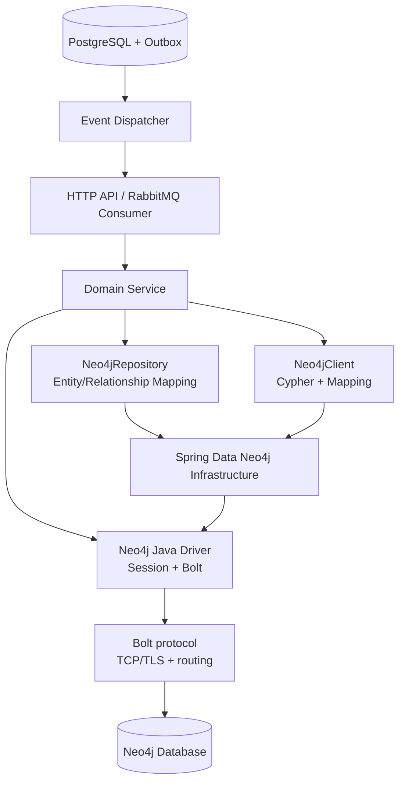
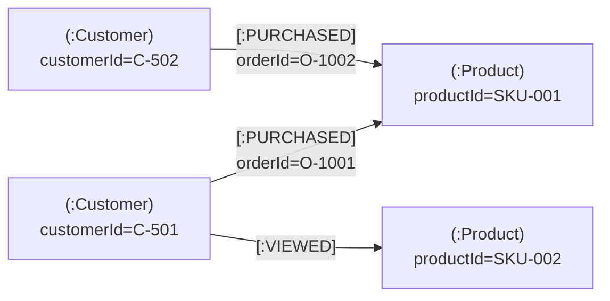
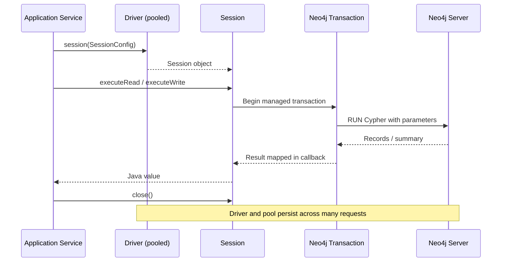
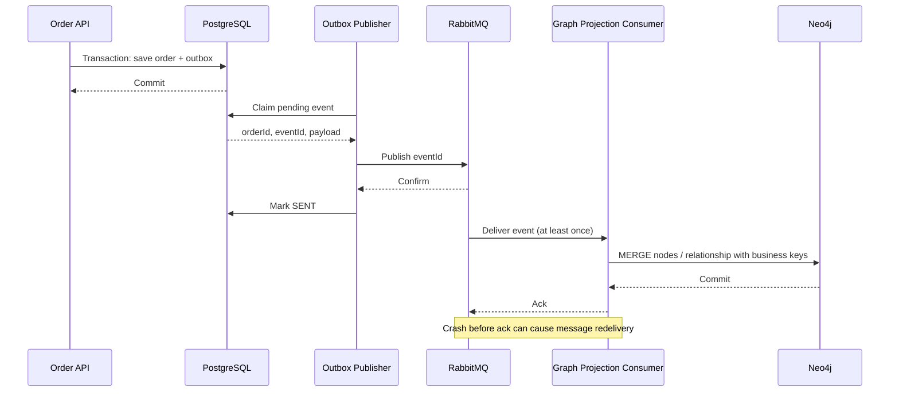
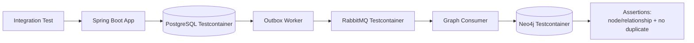
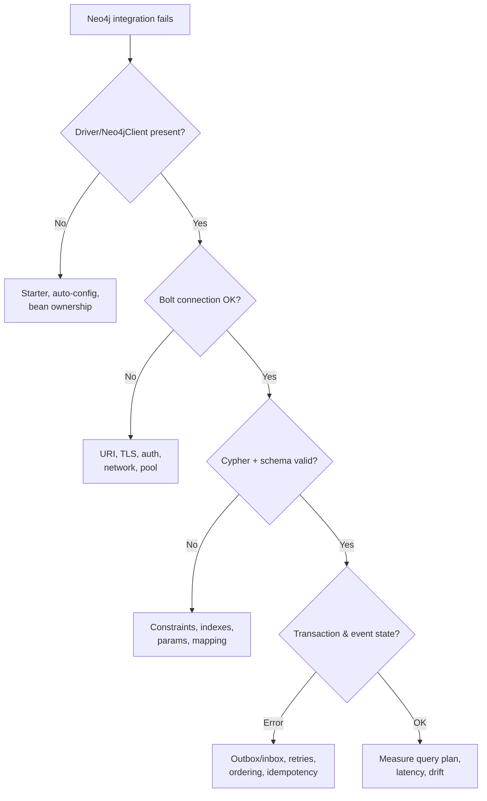

# Neo4j Driver, Neo4jClient, and Spring Data Neo4j

## 1. Context: a graph database in a Spring Boot Integration system

In the **SPRING_BOOT_INTEGRATION** module, a Spring Boot application may receive HTTP commands, persist state in PostgreSQL, use Redis for caching, publish events through RabbitMQ/Kafka, and synchronize data to specialized stores. **Neo4j** is a strong choice when the problem requires storing, querying, and traversing **relationships** among entities: customers, products, organizations, accounts, transactions, devices, or nodes in a dependency network.

For example, a commerce system might need to answer:

- Which products has Customer A purchased, and through which orders?
- Which products are frequently bought together within three relationship hops?
- Do two accounts share a device, address, or intermediate entities?
- If an upstream source redelivers the same purchase event, will the graph create duplicate relationships?
- When PostgreSQL commits but Neo4j has not yet updated, can the synchronization pipeline recover?

In modern Java/Spring Boot, there are **three distinct API layers** for working with Neo4j:

1. **Neo4j Java Driver** (`org.neo4j.driver.Driver`): low-level client communicating with Neo4j over the Bolt protocol, managing sessions, transactions, and Cypher results.
2. **`Neo4jClient`** (`org.springframework.data.neo4j.core.Neo4jClient`): **Spring Data Neo4j** abstraction for executing Cypher, binding parameters, and mapping results cleanly within the Spring environment.
3. **Spring Data Neo4j (SDN)**: entity/relationship mapping layer and repository abstraction providing `Neo4jRepository`, `@Node`, `@Relationship`, and `@Query`.

All three layers can coexist in one application, yet they are **not interchangeable** and do not automatically guarantee consistency across PostgreSQL, brokers, or HTTP.

### Lesson objectives

After this lesson, you will be able to:

- Choose Driver, `Neo4jClient`, or SDN repositories appropriately for each read/write operation.
- Configure Bolt connections, authentication, database selection, and connection pooling in Spring Boot.
- Write parameterized Cypher queries without concatenating HTTP input strings.
- Map nodes and relationships, and understand the risks of calling `save()` on partial object graphs.
- Define transaction boundaries and design event-driven synchronization with outbox and idempotency.
- Test against real Neo4j via Testcontainers, inspect query plans, and handle transport/schema errors.

> Examples target **Spring Boot 3.x, Spring Data Neo4j 7.x, Neo4j Java Driver 5.x, and Neo4j 5**, with Java 17+. Newer generations may change packages, starters, Cypher syntax, or driver options. Check your project's BOM and exact version documentation; never pin dependency versions that conflict with Spring Boot.

## 2. Quick comparison: Driver, Neo4jClient, and Spring Data Neo4j

| Criterion | Neo4j Java Driver | Neo4jClient | Spring Data Neo4j |
| --- | --- | --- | --- |
| Abstraction level | Low: Bolt, session, transaction, record | Medium: Cypher + parameter binding + result mapping | High: entity/node/relationship mapping + repositories |
| Core APIs | `Driver`, `Session`, `Result` | `query()`, `bind()`, `fetch()/fetchAs()` | `@Node`, `@Relationship`, `Neo4jRepository` |
| Who writes Cypher? | The application | The application | Framework-generated or developer-written `@Query` |
| Result mapping | Manual from `Record/Value` | Manual mapper or projection | Entity graph mapping |
| Session lifecycle | Managed by you when used directly | Managed by Spring Data Neo4j infrastructure | Managed by Spring Data Neo4j |
| Spring transactions | Direct sessions do **not automatically** join Spring-managed transactions | Supports SDN transaction context | Supports SDN `@Transactional` |
| Best fit | Specialized tasks, driver APIs, optimized queries | Custom Cypher, read models, targeted graph mutations | Domain graph CRUD and repositories |
| Key concerns | Closing sessions, callback retries, pooling | Record mapping, query boundaries, types | Fetch depth, graph persistence, relationship ownership |

**Choose by task, not by “which API looks most modern.”** One application can use a repository for the `Product` entity, `Neo4jClient` for product recommendation queries, and the Driver directly for a specialized admin/diagnostic operation.

### Layered architecture diagram



The diagram shows the possible interaction paths. Injecting **`Driver` directly** is an independent path from Spring Data Neo4j repositories; SDN and `Neo4jClient` generally share the driver infrastructure configured by Boot.

## 3. Neo4j is a graph database, not a renamed relational table

Neo4j stores data as **nodes**, **relationships**, and **properties**. Nodes can carry labels; relationships have a type and a direction; both nodes and relationships can hold properties.

A small model:



A Cypher query can traverse edges:

```cypher
MATCH (c:Customer {customerId: $customerId})
      -[:PURCHASED]->(p:Product)
RETURN p.productId AS productId, p.name AS productName
ORDER BY productId
LIMIT $limit
```

`$customerId` and `$limit` are client-bound **parameters**. Never replace them with string concatenation from request inputs.

This highlights two distinct workloads:

- **Simple aggregate CRUD:** creating a `Product`, renaming it, looking it up by business ID → an SDN repository can be very convenient.
- **Complex graph traversals/projections:** multi-hop traversal, ranking, finding connected pairs, controlling cardinality → `Neo4jClient` or Driver with explicit Cypher makes query plans easier to inspect and tune.

Do not treat Neo4j as a transactionless cache. Neo4j has its own transactions and constraints; it is a database management system requiring backups, migrations, authorization, replication/routing, and operations.

## 4. Dependencies and what Spring Boot auto-configures

Use the Spring Boot parent/BOM to manage versions:

```xml
<dependencies>
    <dependency>
        <groupId>org.springframework.boot</groupId>
        <artifactId>spring-boot-starter-data-neo4j</artifactId>
    </dependency>
</dependencies>
```

Equivalent in Gradle:

```groovy
dependencies {
    implementation 'org.springframework.boot:spring-boot-starter-data-neo4j'
}
```

The starter brings in the **Neo4j Java Driver** and **Spring Data Neo4j** libraries needed for entity mapping and repositories. If an application only needs the raw Driver, it can depend directly on the driver and configure it accordingly without pulling in all Spring Data repositories.

Spring Boot provides conditional auto-configurations to create or wire:

- `org.neo4j.driver.Driver` from `spring.neo4j.*` when the driver is on the classpath and conditions match.
- `Neo4jClient` and Neo4j mapping/repository infrastructure when SDN is present.
- `Neo4jTransactionManager` and repositories when transaction/database conditions are satisfied.
- Reactive variants when compatible dependencies/stack conditions are met.

**Adding the starter does not start a Neo4j server/broker.** You still need an external Neo4j server or service, such as a dedicated container in local/test environments. If your application declares custom `Driver`, `Neo4jClient`, or transaction manager beans, auto-configured beans may back off due to `@ConditionalOnMissingBean`.

To diagnose bean issues, inspect the runtime classpath, the Conditions Evaluation Report, and transaction manager bean names rather than adding duplicate configuration classes.

## 5. Configuring `spring.neo4j.*` and `spring.data.neo4j.*`

Example `application.yml`:

```yaml
spring:
  neo4j:
    uri: ${NEO4J_URI:bolt://localhost:7687}
    authentication:
      username: ${NEO4J_USERNAME:neo4j}
      password: ${NEO4J_PASSWORD}
    pool:
      max-connection-pool-size: 40
      connection-acquisition-timeout: 5s

  data:
    neo4j:
      database: ${NEO4J_DATABASE:neo4j}
```

| Property | Role | Notes |
| --- | --- | --- |
| `spring.neo4j.uri` | Bolt/Neo4j routing endpoint | Scheme affects direct vs. routing and encryption |
| `spring.neo4j.authentication.username` | Login identity | Does not have to equal the database name |
| `spring.neo4j.authentication.password` | Neo4j secret | Externalize via secret manager/env |
| `spring.neo4j.pool.max-connection-pool-size` | Driver pool cap | Tune based on concurrency/latency; never set unbounded |
| `spring.neo4j.pool.connection-acquisition-timeout` | Max wait to acquire a connection from pool | Distinct from query timeout and business deadline |
| `spring.data.neo4j.database` | Target database used by SDN queries | Must be authorized; distinct from server hostname |

`spring.neo4j.*` properties are supported by Spring Boot, while `spring.data.neo4j.database` configures Spring Data. Verify exact metadata for your Boot version, especially when defining multiple databases or custom driver beans.

### Bolt, `neo4j://`, and TLS

Common schemes:

| Scheme | Common usage |
| --- | --- |
| `bolt://` | Direct connection to a single Bolt endpoint |
| `neo4j://` | Routing URI using the Neo4j driver, typically for cluster deployments |
| `bolt+s://` | Direct Bolt with TLS and verified certificates |
| `neo4j+s://` | Neo4j routing with TLS and verified certificates |
| `bolt+ssc://` / `neo4j+ssc://` | Schemes for self-signed certificates in specific scenarios; evaluate trust/security carefully |

Select the URI based on actual server topology, DNS, proxies/LBs, and certificates. In production, enforce TLS with proper trust chain and hostname verification; never pick self-signed/unverified schemes just to silence security errors.

**Port 7687 is typically Bolt**; Neo4j's HTTP/browser interface may use 7474, yet the **Java Driver does not execute Cypher over the browser URL**. Containers can expose dynamic host ports other than 7687; never hardcode them in integration tests.

## 6. Neo4j Java Driver: the lowest access layer

The Neo4j Java Driver uses the Bolt protocol and provides:

- `Driver`: thread-safe entry point managing connection pools; reuse across the entire application.
- `Session`: lightweight context for a unit of work; **never share a single `Session` across threads**.
- `TransactionContext` / transaction callbacks: execute Cypher with transaction boundaries and driver-level retries.
- `Result`: query output as records and values.
- `SessionConfig`: selects database, access mode, bookmarks, and session options.
- `Value`: converts Neo4j values into Java types.

In a Spring Boot application with auto-configured `Driver`, simply inject it:

```java
import org.neo4j.driver.Driver;
import org.springframework.stereotype.Component;

@Component
public class Neo4jDriverGateway {
    private final Driver driver;

    public Neo4jDriverGateway(Driver driver) {
        this.driver = driver;
    }
}
```

**Do not call `driver.close()` after every request** when `Driver` is a Spring-managed singleton bean. The application context owns the `Driver` lifecycle; application code only opens and closes `Session` per unit of work.

### Resource lifecycle



`Session` is the unit that **must be closed** (typically via `try-with-resources`); the shared `Driver` is long-lived.

## 7. Driver example: `executeRead` and parameterized queries

An adapter querying only a product name:

```java
import java.util.Optional;

import org.neo4j.driver.Driver;
import org.neo4j.driver.Result;
import org.neo4j.driver.Session;
import org.neo4j.driver.SessionConfig;
import org.neo4j.driver.Values;
import org.springframework.stereotype.Repository;

@Repository
public class ProductDriverReader {

    private final Driver driver;

    public ProductDriverReader(Driver driver) {
        this.driver = driver;
    }

    public Optional<String> findName(String productId) {
        try (Session session = driver.session(
                SessionConfig.forDatabase("neo4j"))) {

            return session.executeRead(tx -> {
                Result result = tx.run(
                    """
                    MATCH (p:Product {productId: $productId})
                    RETURN p.name AS name
                    """,
                    Values.parameters("productId", productId)
                );

                if (!result.hasNext()) {
                    return Optional.<String>empty();
                }

                String name = result.single()
                    .get("name").asString();
                return Optional.of(name);
            });
        }
    }
}
```

Explanation:

1. `Driver` comes from Spring Boot and shares the connection pool.
2. `SessionConfig.forDatabase("neo4j")` specifies the database **in this example**; production code should not hardcode it if configured externally.
3. `executeRead` opens a managed read transaction; callbacks must **perform no external side effects outside Neo4j**.
4. `Values.parameters` binds values, preventing Cypher injection.
5. `Result` is consumed **inside the transaction callback** and converted to Java values before the session closes.
6. `single()` expects at most/exactly one record when present; a unique constraint on `productId` keeps results predictable.

Never return a `Result` or lazy iterator outside `try-with-resources` to read later: the session/transaction may already be closed, causing errors or resource leaks.

### Driver callback retries and external side effects

The driver may retry a managed transaction callback on transient errors classified as retryable. Therefore, **never send emails, invoke payment HTTP APIs, or publish to a broker inside the callback assuming it runs exactly once**. Read callbacks should be pure; write callbacks should be idempotent by business key.

## 8. Driver example: `executeWrite` and `MERGE`

Suppose a RabbitMQ event needs to ensure a product node exists:

```java
import org.neo4j.driver.Driver;
import org.neo4j.driver.Session;
import org.neo4j.driver.SessionConfig;
import org.neo4j.driver.Values;
import org.springframework.stereotype.Component;

@Component
public class ProductDriverWriter {

    private final Driver driver;

    public ProductDriverWriter(Driver driver) {
        this.driver = driver;
    }

    public void upsertProduct(String id, String name) {
        try (Session session = driver.session(
                SessionConfig.forDatabase("neo4j"))) {

            session.executeWrite(tx -> {
                tx.run(
                    """
                    MERGE (p:Product {productId: $id})
                    SET p.name = $name
                    """,
                    Values.parameters("id", id, "name", name)
                ).consume();

                return null;
            });
        }
    }
}
```

`MERGE` matches or creates the specified pattern. However, **`MERGE` does not replace a uniqueness constraint** when multiple concurrent workers run or duplicate data already exists. Create a database constraint on `Product.productId` and handle real conflict errors.

`SET p.name = $name` can overwrite a newer name if an older event arrives late. When an integrated system can deliver out-of-order events, add `sourceVersion` or well-defined `updatedAt` rules and check versions before applying updates, rather than trusting a blind upsert.

### Managed transactions vs. auto-commit

The driver offers both auto-commit query APIs and managed transaction APIs. For mutations requiring atomicity and controlled retries, prefer `executeWrite` and ensure **results are consumed before the callback returns**. Do not scatter writes meant to be atomic across multiple sessions.

## 9. `Neo4jClient`: explicit Cypher with Spring Data integration

`Neo4jClient` can be injected once Spring Data Neo4j is configured:

```java
import org.springframework.data.neo4j.core.Neo4jClient;
import org.springframework.stereotype.Repository;

@Repository
public class ProductGraphQueries {
    private final Neo4jClient neo4jClient;

    public ProductGraphQueries(Neo4jClient neo4jClient) {
        this.neo4jClient = neo4jClient;
    }
}
```

It provides:

- A fluent API for parameterized Cypher queries.
- Simple scalar, `Map`, or custom DTO record mapping.
- No boilerplate opening/closing `Session` for standard queries.
- Participation in Spring Data Neo4j transactions when the proper transaction manager is active.
- Clear graph queries without mapping everything into `@Node` entity graphs.

It remains a **Neo4j/Cypher client**, not a SQL JDBC abstraction. It does not validate HTTP/RabbitMQ contracts or automatically relay events from PostgreSQL to Neo4j.

### When to use `Neo4jClient` instead of a repository?

- Queries returning projections like `ProductRecommendation` that do not match a single aggregate node.
- Cypher using multiple relationship types, `UNWIND`, `OPTIONAL MATCH`, or aggregations.
- Targeted mutation of a single relationship without calling `save()` on an entire graph.
- Specialized queries with multiple labels/types or dynamic filtering **backed by an allowlist**.
- Avoiding loading large entity/relationship graphs into memory just to read a few properties.

## 10. `Neo4jClient` example: parameter binding and `fetchAs` projection

Querying products a customer has purchased:

```java
public record PurchasedProduct(
    String productId,
    String name
) {}
```

```java
import java.util.Collection;
import org.springframework.data.neo4j.core.Neo4jClient;
import org.springframework.stereotype.Repository;

@Repository
public class PurchaseReadModel {

    private final Neo4jClient client;

    public PurchaseReadModel(Neo4jClient client) {
        this.client = client;
    }

    public Collection<PurchasedProduct> findPurchased(
            String customerId, int maxItems) {

        int limit = Math.max(1, Math.min(maxItems, 100));

        return client.query("""
            MATCH (c:Customer {customerId: $customerId})
                  -[:PURCHASED]->(p:Product)
            RETURN DISTINCT p.productId AS productId,
                            p.name AS name
            ORDER BY productId
            LIMIT $limit
            """)
            .bind(customerId).to("customerId")
            .bind(limit).to("limit")
            .fetchAs(PurchasedProduct.class)
            .mappedBy((typeSystem, record) ->
                new PurchasedProduct(
                    record.get("productId").asString(),
                    record.get("name").asString()
                )
            )
            .all();
    }
}
```

Here:

- `customerId` and `limit` are bound via the fluent API rather than concatenated into Cypher.
- `DISTINCT` may be needed if a customer has multiple `PURCHASED` relationships to the same product and the use case wants unique products.
- `fetchAs(...).mappedBy(...)` transforms each Neo4j Driver `Record` into a DTO, bypassing entity graph persistence context tracking.
- `all()` materializes the entire query result; `LIMIT` helps bound memory.
- `maxItems` is clamped between 1 and 100 before binding; in production, also enforce deadlines, query selectivity, and indexes.

When only a single node or scalar is needed:

```java
import java.util.Optional;

Optional<Long> total = client.query("""
        MATCH (c:Customer {customerId: $customerId})
              -[:PURCHASED]->(p:Product)
        RETURN count(DISTINCT p) AS total
        """)
    .bind("C-501").to("customerId")
    .fetchAs(Long.class)
    .mappedBy((typeSystem, record) ->
        record.get("total").asLong()
    )
    .one();
```

`one()` returns an `Optional` per the API, unlike list queries. Do not confuse `Optional.empty()` with count = 0: a `count(...)` query usually returns one record holding `0`, whereas `MATCH ... RETURN p` may return zero records.

## 11. `Neo4jClient` example: updating a specific relationship

A paid-order event needs to record a “purchased” relationship between customer and product using explicit Cypher:

```java
import org.springframework.data.neo4j.core.Neo4jClient;
import org.springframework.stereotype.Service;
import org.springframework.transaction.annotation.Transactional;

@Service
public class PurchaseGraphWriter {

    private final Neo4jClient client;

    public PurchaseGraphWriter(Neo4jClient client) {
        this.client = client;
    }

    @Transactional
    public void registerPurchase(
            String customerId,
            String productId,
            String orderId,
            String occurredAt) {

        client.query("""
            MERGE (c:Customer {customerId: $customerId})
            MERGE (p:Product {productId: $productId})
            MERGE (c)-[r:PURCHASED {orderId: $orderId}]->(p)
            ON CREATE SET r.occurredAt = datetime($occurredAt)
            """)
            .bind(customerId).to("customerId")
            .bind(productId).to("productId")
            .bind(orderId).to("orderId")
            .bind(occurredAt).to("occurredAt")
            .run();
    }
}
```

Explanation:

1. `MERGE` locates or creates nodes using **business keys**, not internal element IDs.
2. The relationship is keyed by both endpoints and `orderId`. If the contract allows an order to contain the same product multiple times, include `lineId` or another discriminator.
3. `ON CREATE SET` ensures retrying the same event does not overwrite `occurredAt` if the pattern already exists.
4. `@Transactional` here must resolve to the appropriate **Neo4jTransactionManager**. If the app also has a JDBC/JPA transaction manager, specify the transaction manager explicitly rather than relying on implicit selection.
5. Uniqueness constraints are required for `Customer.customerId` and `Product.productId`, along with relationship idempotency/concurrency rules; `MERGE` alone is not a system-wide exactly-once guarantee.
6. If events arrive out of order, `MERGE` may create a node missing `name` or other business attributes; plan an enrichment/versioning and repair strategy.

Never execute remote HTTP calls or broker publishes inside a Neo4j transaction callback assuming atomic commit across systems.

## 12. Spring Data Neo4j: mapping nodes to entities

Spring Data Neo4j provides annotations, a mapping context, and repository abstractions well-suited for CRUD and domain-graph queries.

Example product node with an application-assigned business ID:

```java
import org.springframework.data.neo4j.core.schema.Id;
import org.springframework.data.neo4j.core.schema.Node;

@Node("Product")
public class ProductNode {

    @Id
    private String productId;

    private String name;

    protected ProductNode() {
    }

    public ProductNode(String productId, String name) {
        this.productId = productId;
        this.name = name;
    }

    public String getProductId() {
        return productId;
    }

    public String getName() {
        return name;
    }

    public void rename(String newName) {
        this.name = newName;
    }
}
```

These annotations come from `org.springframework.data.neo4j.core.schema`, **distinct from** JPA's `jakarta.persistence.Entity`, `@Table`, and `@Id`.

For nodes:

- `@Node("Product")` maps the class to nodes labeled `Product`.
- `@Id` marks the property serving as the business identifier. When supplying `productId` yourself, `@GeneratedValue` is not needed.
- Properties map to node properties per mapping configuration.
- Entity mapping does not replace database unique constraints. **`@Id` does not automatically create a unique index in Neo4j under concurrent traffic**.
- Avoid using Neo4j internal node IDs as long-lived business IDs. Across integrated systems, stable business IDs simplify replay, deduplication, and migration.

Immutable classes and records may require specific constructor/mapping support depending on the Spring Data version. Using a Java class with a no-arg constructor keeps mapping behavior clear here.

## 13. `Neo4jRepository` and derived queries

Basic repository:

```java
import java.util.List;
import java.util.Optional;

import org.springframework.data.neo4j.repository.Neo4jRepository;
import org.springframework.data.neo4j.repository.query.Query;
import org.springframework.data.repository.query.Param;

public interface ProductRepository
        extends Neo4jRepository<ProductNode, String> {

    Optional<ProductNode> findByProductId(String productId);

    @Query("""
        MATCH (p:Product)
        WHERE toLower(p.name) CONTAINS toLower($fragment)
        RETURN p
        ORDER BY p.name, p.productId
        LIMIT $limit
        """)
    List<ProductNode> searchByName(
        @Param("fragment") String fragment,
        @Param("limit") long limit
    );
}
```

A CRUD service:

```java
import org.springframework.stereotype.Service;
import org.springframework.transaction.annotation.Transactional;

@Service
public class ProductCatalogService {

    private final ProductRepository repository;

    public ProductCatalogService(ProductRepository repository) {
        this.repository = repository;
    }

    @Transactional
    public ProductNode rename(String id, String newName) {
        ProductNode product = repository.findById(id)
            .orElseThrow(() ->
                new IllegalArgumentException("Product not found")
            );
        product.rename(newName);
        return repository.save(product);
    }
}
```

Crucial condition: the service uses the proper **Neo4j transaction manager**. If the project has both PostgreSQL and Neo4j, specify the transaction manager explicitly, such as `@Transactional("neo4jTransactionManager")` when registered under that bean name.

`findById`, `findByProductId`, and `@Query` carry different responsibilities:

- **Derived queries** are handy for simple predicates; they match Java property names.
- **`@Query`** executes custom Cypher; it must return a shape that Spring Data Neo4j can map properly.
- **`save`** persists the entity graph according to mapping rules; it is not JPA SQL `INSERT`/`UPDATE`, and behaves differently when relationships are loaded or modified.

### When should you avoid using repositories for everything?

Multi-hop queries, scalar/projection aggregations, or single-relationship mutations are often cleaner with `Neo4jClient`. Forcing every query to return `List<ProductNode>` can over-fetch graph data, inflate query cost, or bloat domain models with unnecessary relationships.

## 14. Mapping relationships with `@Relationship`

Neo4j relationships have a **type** and a **direction**. In SDN, you can model relationships on an entity:

```java
import java.util.HashSet;
import java.util.Set;

import org.springframework.data.neo4j.core.schema.Id;
import org.springframework.data.neo4j.core.schema.Node;
import org.springframework.data.neo4j.core.schema.Relationship;

@Node("Customer")
public class CustomerNode {

    @Id
    private String customerId;

    private String displayName;

    @Relationship(
        type = "FOLLOWS",
        direction = Relationship.Direction.OUTGOING
    )
    private Set<CustomerNode> follows = new HashSet<>();

    protected CustomerNode() {
    }

    public CustomerNode(String customerId, String displayName) {
        this.customerId = customerId;
        this.displayName = displayName;
    }

    public void follow(CustomerNode other) {
        follows.add(other);
    }
}
```

This snippet illustrates how SDN represents relationships. A real graph design must also decide:

- Who is the **aggregate root/owner** of the relationship?
- Are bidirectional mappings allowed?
- How many accounts can a `Customer` follow, and what fetch depth limit applies?
- If a consumer only has two customer IDs, should it really load the entire `follows` set just to add one edge?
- Are entity `equals`/`hashCode` implementations stable when used inside a `Set`?
- When a node is deleted, are related edges and neighbors handled per domain policy?

Avoid unbounded recursive graph mapping or eager loading of entire relationship networks. In systems with many customers, load **focused projections** instead of serializing full entity graphs directly as JSON API responses.

## 15. Relationships with properties: `@RelationshipProperties` and `@TargetNode`

A “purchased” edge often carries more than a type; it may store `orderId`, `quantity`, or `occurredAt`. SDN models relationship properties as follows:

```java
import java.time.Instant;

import org.springframework.data.neo4j.core.schema.GeneratedValue;
import org.springframework.data.neo4j.core.schema.Id;
import org.springframework.data.neo4j.core.schema.RelationshipProperties;
import org.springframework.data.neo4j.core.schema.TargetNode;

@RelationshipProperties
public class PurchasedRelationship {

    @Id
    @GeneratedValue
    private Long id;

    @TargetNode
    private ProductNode product;

    private String orderId;

    private Instant occurredAt;

    protected PurchasedRelationship() {
    }

    public PurchasedRelationship(
            ProductNode product,
            String orderId,
            Instant occurredAt) {
        this.product = product;
        this.orderId = orderId;
        this.occurredAt = occurredAt;
    }
}
```

On `CustomerNode`, you can declare:

```java
@Relationship(
    type = "PURCHASED",
    direction = Relationship.Direction.OUTGOING
)
private Set<PurchasedRelationship> purchases = new HashSet<>();
```

The snippet above is an **addition to `CustomerNode`**, not a standalone compilable file. When applying it, decide whether the earlier `FOLLOWS` relationship is kept; each class snippet illustrates a distinct concept.

**Distinguish SDN-managed relationship IDs from business keys:** the internal ID supports framework mapping, while `orderId` or `eventId` must be enforced by business contracts to prevent duplicate replays. If business uniqueness is needed on a relationship, use an appropriate schema/Cypher strategy rather than treating `@GeneratedValue` as an idempotency key.

## 16. Be careful with `save()` on incomplete object graphs

This is crucial when using Spring Data Neo4j in an integrated system with multiple workers updating the same graph.

An entity with `@Relationship` represents a collection of relationships. When you call `repository.save(entity)`, SDN can synchronize the graph to match the mapped/loaded state, **including relationship updates**. If you construct a “partial” entity holding only a subset of edges and save it as if it were the complete graph, you can unintentionally alter or delete existing relationships depending on mapping and version behavior.

Consider this scenario:

```text
In Neo4j:
Customer C-501 --FOLLOWS--> C-502
Customer C-501 --FOLLOWS--> C-503

Incoming message only says "add C-504".
App builds CustomerNode(C-501) with follows={C-504}
and calls repository.save(...).
```

The goal is to **add one relationship**, not replace the entire relationship collection. For narrow mutations, Cypher:

```cypher
MATCH (a:Customer {customerId: $fromId})
MATCH (b:Customer {customerId: $toId})
MERGE (a)-[:FOLLOWS]->(b)
```

is far clearer than saving an under-populated aggregate. Always test how your exact SDN version handles existing relationships during `save()`.

**Do not equate SDN with Hibernate/JPA dirty checking.** Their persistence models differ significantly, particularly around graph relationships, fetch depth, and `save` semantics.

## 17. Safe Cypher queries: parameters and allowlists

When users supply `productId` or `customerId`, bind parameters:

```cypher
MATCH (p:Product {productId: $productId})
RETURN p.productId AS id, p.name AS name
```

**Never do this:**

```java
String unsafe = "MATCH (p:Product {productId: '"
    + userInput + "'}) RETURN p";
```

User input can break syntax or alter query semantics. `Neo4jClient.bind(...)` and Driver `Values.parameters(...)` pass values safely as parameters.

### Dynamic labels and relationship types

Not every structural position in Cypher accepts scalar parameters across all Neo4j versions. If an application supports choosing labels or relationship types dynamically:

1. Define an explicit **allowlist** of permitted labels/types.
2. Select Cypher fragments **controlled by application code** instead of concatenating untrusted input.
3. Verify dynamic label/type syntax support for your **exact Neo4j version** before using it.
4. Never let HTTP callers choose another tenant's label name.
5. Avoid string interpolation for arbitrary identifiers without strict allowlist validation.

In multi-tenant systems, enforce authorization and tenant filtering at the application/database boundary; never let users pick relationship types as a shortcut around proper authorization.

## 18. Schema constraints and indexes must be managed separately

The `@Id` annotation does not replace database constraints. With replayed events and concurrent workers updating the graph, you need uniqueness constraints on **business identifiers**.

Cypher example for Neo4j 5:

```cypher
CREATE CONSTRAINT product_id_unique IF NOT EXISTS
FOR (p:Product)
REQUIRE p.productId IS UNIQUE;

CREATE CONSTRAINT customer_id_unique IF NOT EXISTS
FOR (c:Customer)
REQUIRE c.customerId IS UNIQUE;

CREATE INDEX product_name_idx IF NOT EXISTS
FOR (p:Product)
ON (p.name);
```

These statements should run through a controlled **schema migration/provisioning** workflow. Do not let every application replica run DDL constraints at startup without clear permissions, deployment ordering, and migration ownership.

A uniqueness constraint prevents two nodes from sharing the same product ID. It **does not** automatically guarantee:

- Older events cannot overwrite newer graph state.
- A `PURCHASED` relationship is not added twice under different business keys.
- Neo4j and PostgreSQL transactions commit atomically together.
- External HTTP calls or broker publishes execute only once.

### Performance verification

Inspect critical queries with `EXPLAIN` and `PROFILE` in a safe environment. `EXPLAIN` shows the planned execution without running it; `PROFILE` **executes the query** to gather runtime metrics, so avoid profiling mutating queries on production data unless you understand the side effects. Check cardinality, index seeks vs. scans, relationship traversal counts, and intermediate row sizes.

## 19. Transactions: Neo4j is independent from PostgreSQL, RabbitMQ, and HTTP

A Neo4j transaction protects work inside Neo4j. It does not automatically cover PostgreSQL, Redis, a partner HTTP API, or a RabbitMQ publisher.

An unsafe example with respect to atomicity:

```java
@Transactional
public void processOrder(OrderCreatedEvent event) {
    postgresOrderRepository.save(event.toJpaEntity());
    productGraphQueries.updateFromEvent(event);
    rabbitTemplate.convertAndSend(
        "integration.orders.events",
        "order.created",
        event
    );
}
```

This snippet is purely illustrative; `OrderCreatedEvent`, `postgresOrderRepository`, `productGraphQueries`, and `rabbitTemplate` are application-defined types. When multiple transaction managers exist, `@Transactional` selects **one** manager and does not implicitly form a distributed transaction across all three resources.

Failure windows:

1. PostgreSQL commits, Neo4j write fails → graph falls behind.
2. Neo4j commits, PostgreSQL rolls back → graph holds state never committed in the source of truth.
3. Neo4j commits, app crashes before acking RabbitMQ → message is redelivered.
4. HTTP timeout after a remote side effect → caller cannot tell if the remote relationship was created.
5. A managed transaction callback retries → external side effects inside the callback run more than once.

**Define the system of record first:** for instance, PostgreSQL owns orders while Neo4j is a graph read model rebuilt from events. Treating both as primary write masters requires much more complex consistency or saga protocols.

## 20. Syncing PostgreSQL → Neo4j with outbox and idempotent graph updates

A practical architecture:



Example event:

```json
{
  "eventId": "evt-1001",
  "eventType": "order.paid",
  "schemaVersion": 1,
  "orderId": "ORD-501",
  "customerId": "C-501",
  "productId": "SKU-001",
  "occurredAt": "2026-11-21T03:00:00Z"
}
```

Design rules:

- **PostgreSQL transaction** writes business state and the outbox event atomically.
- The publisher sends events with a stable `eventId`; RabbitMQ publisher confirms verify broker receipt, not business completion.
- The graph consumer uses `MERGE` or an idempotency marker so replaying an event does not duplicate graph side effects.
- Enforce uniqueness constraints on business IDs and clear relationship keys such as `orderId`/`lineId`.
- Only **ack RabbitMQ after** the Neo4j transaction commits and required state is persisted.
- If the consumer crashes after Neo4j commits but before acking, redelivery must remain safe.
- Maintain backfill/reconciliation to align the graph read model with the system of record after drift or schema changes.
- Record `sourceVersion`/`occurredAt` to handle delayed stale updates.

Outbox/inbox alone does not achieve true exactly-once delivery. The realistic target is **at-least-once delivery + idempotent business effects** within your chosen contracts and transaction boundaries.

## 21. Event ordering and graph read-model consistency

Suppose the producer emits:

```text
evt-101: Product SKU-001 name = "A", version = 5
evt-102: Product SKU-001 name = "B", version = 6
```

If the consumer receives evt-102 before evt-101, an unconditional `SET p.name = $name` reverts the name back to “A”. Do not try to fix this by adding retries; use **version-aware updates**.

A Cypher approach:

```cypher
MERGE (p:Product {productId: $productId})
ON CREATE SET p.sourceVersion = -1
WITH p
WHERE coalesce(p.sourceVersion, -1) < $sourceVersion
SET p.name = $name,
    p.sourceVersion = $sourceVersion
RETURN p.productId AS updatedId
```

This illustrates a conditional update; test concurrency, locking, and version semantics against real Neo4j before deploying with concurrent writers. `WHERE` is not a cross-resource distributed lock. Sequence/version numbers must originate from the system of record rather than relying solely on wall-clock timestamps across machines with clock skew.

**Read-your-writes / causal consistency:** Neo4j Driver supports bookmarks and causal chaining in compatible cluster deployments. An application needing immediate read-after-write within a session/cluster must understand transaction boundaries, database routing, and bookmarks. However, Neo4j bookmarks **do not** eliminate propagation delay from PostgreSQL through RabbitMQ to Neo4j.

For UI screens reading the graph right after payment, decide whether to show a `PENDING_GRAPH_UPDATE` state or fall back to the primary database.

## 22. Query depth, cardinality, and pagination

Graph traversals can expand row counts rapidly:

```cypher
MATCH (c:Customer {customerId: $customerId})
      -[:FOLLOWS*1..3]->(other:Customer)
RETURN DISTINCT other.customerId AS id
LIMIT $limit
```

Even with `*1..3` bounding path length, relationship combinations can explode in dense graphs. Watch out for:

- Duplicate destination nodes reached via multiple distinct paths.
- `DISTINCT` and `ORDER BY` consuming large amounts of memory/CPU.
- `LIMIT` bounding final output without always bounding the intermediate traversal cost beforehand.
- Page instability under offset pagination when the graph changes between requests.
- Unbounded graph loading via repositories consuming far more memory than DTO projections.

For external-facing APIs:

1. Cap `maxDepth` and `pageSize` upfront.
2. Add indexes/constraints on entry-point nodes.
3. Use projections returning only required fields.
4. Benchmark latency and query plans on production-scale data.
5. Consider cursor/keyset pagination when graphs mutate frequently.
6. Bound total database work with timeouts and resource policies.

**Do not just increase connection pool size** to fix queries traversing millions of relationships: that can overload the database even faster.

## 23. Connections, pooling, timeouts, and resource limits

`Driver` manages the pool; `Session`/transactions borrow connections as needed. Under high concurrency, a graph API service can encounter pool acquisition waits or query bottlenecks.

Signals to observe:

| Category | Signals | Action |
| --- | --- | --- |
| Connections | Open connections, acquisition latency, timeouts | Size pool to workload; never create Driver per request |
| Transactions | Transaction duration, lock waits, retries | Keep transactions short; no external HTTP inside |
| Queries | Latency, rows, db hits, plans | `EXPLAIN`, indexes, bound traversal/cardinality |
| Neo4j cluster | Routing/leader availability, session expiry | Use matching URI scheme, understand retryable errors |
| Memory | Large result materialization | Bounded queries, projections, streaming where appropriate |
| Downstream | RabbitMQ backlog, HTTP latency | Backpressure, concurrency limits, timeout policies |

`spring.neo4j.pool.max-connection-pool-size` is not a one-to-one count of “concurrently queried nodes”; sessions borrow connections per transaction and routing target. Do not raise pool sizes into the thousands without considering server limits, CPU, memory, network, and connection lifetimes.

### Driver `verifyConnectivity`

To probe connectivity in diagnostic paths:

```java
import org.neo4j.driver.Driver;

public void verifyNeo4j(Driver driver) {
    driver.verifyConnectivity();
}
```

`verifyConnectivity()` attempts a connection and throws on network, auth, or routing failures; it **does not prove** business queries, schema constraints, or event consistency are healthy. Startup and health policies must distinguish whether Neo4j is a hard dependency or a secondary read model that can tolerate lag.

## 24. Driver/`Neo4jClient` errors and retry policies

Common failure classes:

| Error class | Examples | What to do |
| --- | --- | --- |
| Network / cluster | `ServiceUnavailableException`, disconnect | Bounded retries for transient faults, measure downtime |
| Session / routing | `SessionExpiredException`, leader switch | Driver managed tx can retry; inspect topology |
| Transient DB failure | `TransientException`, deadlock/lock contention | Retry **idempotent** transactions with backoff/jitter |
| Query / constraint failure | `ClientException`, invalid Cypher, unique violation | Fix query/schema or classify duplicate; do not retry blindly |
| Auth / permission | Auth failure or database access denied | Fix credentials/roles; never retry in tight loops |
| Mapping failure | Unreadable `Value`, null/type mismatch | Inspect query projection and data contract |
| Pool timeout | Pool slots exhausted, long session wait | Measure concurrency, transaction duration, pool/server load |
| Missing node | Query returned zero records | Return `Optional.empty()` per business contract |

**Never collapse everything into HTTP 500 or infinite retries.** Syntax errors and permission denials will not heal after 10 attempts. For write transactions, check whether the driver already retries managed callbacks before adding outer retries that multiply execution attempts.

When a transaction fails after the request was sent, the outcome may be ambiguous from the caller's perspective. Reconcile via business keys, constraints, and sync state before replaying rather than relying solely on exception names.

### Designing domain exceptions

Map driver exceptions into adapter-level domain exceptions:

```java
public class GraphUnavailableException extends RuntimeException {
    public GraphUnavailableException(Throwable cause) {
        super("Graph database temporarily unavailable", cause);
    }
}
```

At the service/HTTP layer, decide whether to return `503`, serve a stale fallback read model, or enqueue work based on business requirements. Never log raw Cypher containing tokens/sensitive data or exception messages containing unsanitized parameters.

## 25. Graph schema evolution and data governance

Neo4j is not “schemaless” in the sense of having no contract to manage. Labels, relationship types, property names, indexes, and constraints are all part of the storage contract.

Changes requiring careful planning:

- Changing `Customer.customerId` to a new key format can affect millions of relationships.
- Renaming `PURCHASED` to `BOUGHT` requires migration or a dual-read transition window.
- Making a nullable field mandatory requires backfilling old nodes before tightening constraints.
- Changing relationship property structures impacts Cypher queries, SDN mappings, and event consumers.
- Introducing new Neo4j node labels for tenants/projects requires aligned permissions and indexing.
- Major Neo4j 4/5 upgrades can alter constraint syntax, functions, and query planner behavior.

**Do not let every replica run `CREATE CONSTRAINT` arbitrarily at startup.** Use migration jobs, versioned scripts, or approved administration tools; make migrations idempotent where appropriate and verify rolling compatibility.

Sustaining a graph database also requires **backups/restores, retention policies, access controls, and graph drift repair workflows**. SDN repositories do not replace these operational responsibilities.

## 26. `ReactiveNeo4jClient` and reactive repositories

Spring Data Neo4j supports reactive programming in compatible stacks and versions, including:

- `ReactiveNeo4jClient` for reactive Cypher.
- `ReactiveNeo4jRepository<T, ID>` returning `Mono<T>` / `Flux<T>`.
- Reactive transaction management via `ReactiveNeo4jTransactionManager` when configured.

These abstractions are not interchangeable with imperative `Neo4jClient` despite similar names. A WebFlux application must avoid calling **blocking** operations of the imperative Driver, imperative `Neo4jClient`, or blocking repositories on event-loop threads.

Architecture choices:

| Scope | Sensible choice |
| --- | --- |
| Spring MVC/JPA + some graph queries | Imperative SDN/`Neo4jClient`, standard thread management |
| WebFlux end-to-end with compatible reactive driver | `ReactiveNeo4jClient`/repositories/reactive transactions |
| WebFlux forced to call legacy blocking adapter | Bounded scheduler/worker pool; never `block()` on event loop |
| Workflows requiring crash durability | Outbox/broker + idempotent consumers; reactive alone adds no durability |

Never fire-and-forget `subscribe()` on a graph-writing `Mono` inside a service and discard the result: exceptions get lost and transactions/cancellations become unpredictable. Return the publisher to the responsible caller or enqueue durable work if the workflow demands it.

## 27. Multiple databases or multiple Neo4j sources

A Neo4j deployment may host multiple databases, or a Spring Boot app may access both an internal graph and a partner graph or separate read models.

Key points:

1. `spring.data.neo4j.database` configures the default database for SDN infrastructure in single-database setups.
2. The Driver can select a database per session via `SessionConfig.forDatabase(...)`.
3. A single default `Neo4jClient` does not automatically know which database belongs to each repository when multiple persistence units exist.
4. Multiple `Driver` beans or transaction managers require explicit bean names/`@Qualifier` and clear ownership.
5. Never use a single `@Transactional` expecting two Neo4j databases and one PostgreSQL database to commit atomically.
6. Tests must verify that source graph writes never land in the wrong database or environment.

If the application only uses one database, **prefer auto-configuration** over custom client factories. With multiple databases or tenants, configure explicitly per your Spring Data Neo4j version's capabilities; sometimes explicit Driver sessions are clearer.

Never let HTTP callers pass arbitrary database names directly into `SessionConfig`. Authorization and tenant isolation must resolve target databases from authenticated identities and allowlists.

## 28. Testcontainers: testing with real Neo4j

Mocking `ProductRepository` only proves the service calls a method; it never validates Cypher, relationship mappings, unique constraints, or real Neo4j transactions. For graph queries and concurrency, test against an isolated real Neo4j instance.

A Spring Boot + Testcontainers integration test:

```java
import static org.assertj.core.api.Assertions.assertThat;

import java.util.UUID;

import org.junit.jupiter.api.Test;
import org.springframework.beans.factory.annotation.Autowired;
import org.springframework.boot.test.context.SpringBootTest;
import org.springframework.boot.testcontainers.service.connection.ServiceConnection;
import org.springframework.data.neo4j.core.Neo4jClient;
import org.testcontainers.containers.Neo4jContainer;
import org.testcontainers.junit.jupiter.Container;
import org.testcontainers.junit.jupiter.Testcontainers;

@SpringBootTest
@Testcontainers
class ProductGraphIT {

    @Container
    @ServiceConnection
    static Neo4jContainer<?> neo4j =
        new Neo4jContainer<>("neo4j:5.26")
            .withAdminPassword("local-test-only");

    @Autowired
    ProductRepository repository;

    @Autowired
    Neo4jClient neo4jClient;

    @Test
    void repositoryAndCypherSeeSameProduct() {
        String id = "SKU-" + UUID.randomUUID();
        repository.save(new ProductNode(id, "Office desk"));

        var row = neo4jClient.query("""
                MATCH (p:Product {productId: $id})
                RETURN p.name AS name
                """)
            .bind(id).to("id")
            .fetch().one();

        assertThat(row).isPresent();
        assertThat(row.orElseThrow().get("name"))
            .isEqualTo("Office desk");
    }
}
```

This assumes Spring Boot/SDN 3.x, `spring-boot-testcontainers`, the Testcontainers Neo4j module, JUnit Jupiter, `spring-boot-starter-test`, and an available Docker runtime. For other major Neo4j/Testcontainers versions, verify image tags, artifacts, and APIs.

**What this test proves:** repository and `Neo4jClient` see the same node in one Neo4j container. **What it does not prove:** constraint migrations, RabbitMQ delivery, cluster failures, production authentication/TLS, or performance on graphs with millions of relationships.

### Additional tests needed

| Scenario | What must be verified |
| --- | --- |
| Concurrent creation of the same product ID | Uniqueness constraint blocks duplicate nodes |
| `PURCHASED` event redelivery | Relationship is not duplicated under business key |
| Late older-version update | Node does not regress to stale state |
| Saving an aggregate with partial relationships | Existing edges are not accidentally dropped |
| Querying a non-existent customer | Returns empty/404 per contract |
| Invalid Cypher syntax | Error classified properly; no infinite retries |
| Neo4j temporarily unavailable | Outbox/inbox and retries preserve work |
| Custom query returning null or unexpected type | Mapper handles or throws per contract |
| Graph with 1 → 10,000 relationships | Query plan, memory, and depth limits |
| Two concurrent transactions writing relationships | Real concurrency outcome verified |

## 29. End-to-end testing: PostgreSQL → broker → Neo4j

For graph synchronization from a primary database, a `Neo4jContainer` alone is insufficient. An architectural integration test should run **PostgreSQL, RabbitMQ, and Neo4j** in isolated containers:



Verification steps:

1. Send an HTTP request creating an order with an `Idempotency-Key`.
2. PostgreSQL commits the order and outbox entry in the same transaction.
3. The worker publishes the event; the broker delivers it to the graph projection consumer.
4. The consumer executes Cypher or repository calls inside a Neo4j transaction.
5. The test **eventually asserts** exact nodes, relationships, and graph properties.
6. Re-publish the same event: no duplicate relationship or extra side effect occurs.
7. Stop Neo4j while events arrive: the system retains backlog/retries instead of reporting fake success.
8. Restore Neo4j: the graph catches up and messages are acked per policy.
9. When messages arrive out of order, version-aware updates hold.
10. Logs and metrics carry correlation IDs tracing events from PostgreSQL to Neo4j.

Never use `Thread.sleep(5000)` to assume a consumer finished. Use bounded polling assertions with timeouts and clear failure diagnostics.

## 30. Observability, metrics, and troubleshooting

A Neo4j integration needs observability on both the **client** and the **business projection**:

| Signal | Meaning |
| --- | --- |
| Driver connection pool active/wait | Is concurrency or slow queries starving the pool? |
| Connection/auth/TLS errors | Are hosts, credentials, and certificates valid? |
| Query latency and db hits | Is Cypher using appropriate indexes and bounded traversals? |
| Transaction retries/conflicts | Are hot nodes/relationships suffering write contention? |
| Graph projection lag | How long after PostgreSQL commit does Neo4j reflect changes? |
| Outbox/broker backlog | How long do events wait in queues/workers? |
| Idempotency duplicate count | How many replayed events had duplicate effects suppressed? |
| Data drift/reconciliation | How many nodes/relationships diverge from the system of record? |
| Schema/version mismatches | Are consumers receiving incompatible events/properties? |

Support for Spring Boot Actuator, Micrometer, and driver metrics/logging varies by version and dependencies. Do not assume all metrics appear automatically simply by injecting `Driver` or `Neo4jRepository`.

### Common errors

| Symptom | Common cause | Priority check |
| --- | --- | --- |
| `No qualifying bean of type Driver` | Missing starter/driver, auto-config excluded, custom beans | Dependency tree, Conditions Evaluation Report |
| `No qualifying bean of type Neo4jClient` | Missing SDN infrastructure or unmatched conditions | Starter/SDN version, context config |
| `ServiceUnavailableException` | Wrong host/port, Neo4j not ready, network issue | Bolt URI, DNS, port 7687, mapped container port |
| Authentication failed | Wrong credentials or account policy | Secrets, user/roles, safe logs |
| TLS handshake fails | Scheme/URI mismatch, untrusted certificate | Scheme, trust chain, hostname |
| `ClientException` | Cypher syntax/schema/constraints/permissions | Error code, redacted query params |
| Query returns multiple nodes with same business ID | Missing uniqueness constraint or legacy duplicates | Schema constraints, data cleanup |
| `@Node` mapping issues | Labels/properties/constructors/repository scan | Annotations, query return shape, package scan |
| Graph edges disappear after `save` | Persistence of partial relationship graph | Mapping ownership, `save()` tests |
| Query returns no record after event | Projection lag, wrong routing/tx, replica lag | Broker backlog, consumer status, selected database |
| Pool timeout | Hot query, long transaction, high concurrency | Pool metrics, query plan, lock waits |
| Two events create two edges | Unstable relationship key or faulty `MERGE` pattern | `orderId`/`lineId`, constraints, replay test |

### Diagnostic workflow



## 31. Decision table for choosing an API in a project

| Requirement | Preferred API | Rationale |
| --- | --- | --- |
| CRUD on a node/aggregate with few relationships | Spring Data Neo4j repository | Minimal boilerplate, mapping, and derived methods |
| Read projection across multiple `MATCH`/`OPTIONAL MATCH` | `Neo4jClient` | Flexible Cypher and DTO mapping |
| Adding/removing one specific relationship | `Neo4jClient` with Cypher | Avoids accidentally rewriting aggregate relationships |
| Specialized driver features/sessions/bookmarks | Neo4j Java Driver | Full control over Bolt, sessions, and transactions |
| End-to-end WebFlux application | `ReactiveNeo4jClient` or reactive repository | Avoids blocking the event loop |
| Multiple graph sources/databases | Driver/custom clients with explicit ownership | Separates configs, auth, and transactions |
| Graph synchronized from PostgreSQL | Outbox + broker + idempotent Neo4j consumer | Cross-resource consistency |
| Testing Cypher/relationships/constraints | Neo4j Testcontainers | Proves real database behavior |
| Testing pure business routing | Unit/component tests with fake repositories | Fast, no container needed |
| Multi-hop reads / graph analytics | `Neo4jClient`/Driver projections with query tuning | Control Cypher, cardinality, and execution plans |

**Do not write every query with the raw Driver just because it is “lower-level,” and do not shoehorn every graph query into a repository just because it feels “more Spring-like.”** Choose the API that expresses the contract cleanly and minimizes unintended side effects.

## 32. Anti-patterns to avoid

1. **Creating a new `Driver` per HTTP request:** wastes TCP/pool resources and leaks connections.
2. **Keeping a `Session` open long-term or sharing it across threads:** violates lifecycle rules and causes pool exhaustion.
3. **Returning `Result` outside a closed transaction:** unconsumed results fail or leak.
4. **Concatenating user input into Cypher strings:** opens injection and escaping bugs.
5. **Relying on `@Id` to create uniqueness constraints:** concurrent races create duplicate nodes.
6. **Using internal node IDs as long-term business IDs:** breaks replay and migration.
7. **Calling `save()` on partial graphs without accounting for relationships:** silently drops or alters edges.
8. **Serializing entire graphs into JSON responses:** expensive queries, circular references, data leaks.
9. **Running HTTP calls or broker publishes inside a driver transaction callback:** retries repeat external side effects.
10. **Assuming one `@Transactional` makes Neo4j/PostgreSQL/RabbitMQ atomic:** no implicit distributed transaction exists.
11. **Retrying every `ClientException`:** syntax, permission, and constraint errors never heal on retry.
12. **Updating the graph without checking source versions:** stale events overwrite newer state.
13. **Ignoring broker redelivery/idempotency:** produces duplicate graph relationships.
14. **Skipping schema constraint/index migrations:** degrades data integrity and performance.
15. **Increasing pool sizes indefinitely to fix slow Cypher queries:** overloads the database faster.
16. **Hardcoding Bolt ports in CI with dynamic container mapping:** causes flaky tests and connection refused errors.
17. **Calling the imperative Driver on WebFlux event loops:** blocks threads and ruins throughput.
18. **Logging all properties and query parameters:** leaks PII and secrets.
19. **Confusing graph projection lag with missing data:** UI returns “not found” before an event is processed.
20. **Testing only with mocked repositories:** leaves Cypher, mappings, schemas, and concurrency untested.

## 33. Case study: product recommendation graph after payment

An e-commerce system uses PostgreSQL as the **system of record** for orders. After payment, RabbitMQ publishes an `order.paid` event. A recommendation service updates Neo4j to store purchase relationships and serves two APIs:

- `GET /customers/{id}/purchased-products`: returns purchased products for display.
- `POST /internal/products/{id}/rename`: renames a product from an authenticated internal flow.

After deployment, issues surface:

- Redelivered events created duplicate `PURCHASED` relationships.
- A consumer called `save()` on a `CustomerNode` with incomplete relationships, dropping older edges in some runs.
- A rename event for version 7 processed before version 6, reverting the product name.
- Once PostgreSQL committed while RabbitMQ was offline, causing the graph to miss the update.
- Raising the pool from 40 to 200 did not speed up the API because traversals lacked indexes and returned too many hits.

### Analysis

**1. API selection:** an SDN repository works well for small-aggregate product CRUD. For **adding a single `PURCHASED` relationship**, `Neo4jClient` with a `MERGE` keyed by `orderId`/`lineId` provides clean mutation control.

**2. Deduplication:** keep `eventId` and `orderId` stable across retries. Create uniqueness constraints on customer/product IDs and test concurrent/replayed relationship events.

**3. Ordering:** store `sourceVersion` and apply updates only when incoming versions are newer; test v7 followed by v6. Never trust broker delivery order as absolute business order in all topologies.

**4. Consistency:** PostgreSQL saves the order + outbox in one transaction. The publisher relays events when the broker recovers; the consumer commits Neo4j before acking. Monitor graph projection lag and run reconciliation.

**5. Performance:** run `EXPLAIN`/`PROFILE`, index entry-point nodes, bound traversals, use `LIMIT`, and fetch projections. Enlarging the pool does not fix query plans.

**6. Transactions:** never call HTTP/SMTP inside Driver `executeWrite` callbacks; never hold Neo4j transactions open waiting on downstream calls.

**7. Testing:** use `Neo4jContainer` for Cypher/constraints and PostgreSQL + RabbitMQ + Neo4j containers for end-to-end tests covering idempotency, ordering, retries, crashes, and missing nodes.

**8. Observability:** track `eventId`, graph projection backlog/lag, constraint violations, pool waits, query latency, relationship counts, and reconciliation mismatches.

Expected result: an event may be **delivered multiple times**, yet the graph reflects **exactly one defined business effect** and self-heals after temporary disconnects.

## 34. Deployment checklist

- [ ] Clarify whether Neo4j is the system of record or a graph projection/read model, and who owns the source data.
- [ ] Explicitly choose Driver, `Neo4jClient`, or SDN repository per use case.
- [ ] Singleton Driver/pool managed by Boot; Sessions short-lived and never shared across threads.
- [ ] Configure Bolt/routing URI, database, TLS, credentials, and pool per environment.
- [ ] Parameterize Cypher; enforce allowlists and authorization for dynamic labels/types.
- [ ] Provision uniqueness constraints and indexes via migrations, not annotations alone.
- [ ] Verify `@Node`, `@Id`, and `@Relationship` mappings; test `save()` with partial graphs.
- [ ] Bound custom Cypher/projections with result limits, stable ordering, traversal caps, and verified query plans.
- [ ] Clarify Neo4j transaction boundaries, especially alongside JPA/PostgreSQL transaction managers.
- [ ] Never assume Neo4j + PostgreSQL + RabbitMQ commit atomically together; use outbox/inbox/saga as needed.
- [ ] Keep event IDs, business keys, source versions, and relationship keys stable across retries/redeliveries.
- [ ] Bound retries with backoff; separate transient/network faults from schema, query, and permission errors.
- [ ] Never block WebFlux event loops with the imperative driver; use the right reactive transaction model.
- [ ] Test against real Neo4j for Cypher, mappings, constraints, duplicate relationships, and concurrency.
- [ ] Run end-to-end graph sync tests with the broker and primary DB; measure lag and reconciliation under faults.
- [ ] Monitor query latency, pool waits, retries, projection backlog, and drift; redact secrets/PII from logs.
- [ ] When upgrading Spring Boot/SDN/Driver/Neo4j, check the compatibility matrix, Cypher syntax, indexes, and migrations.

**Takeaway:** **Neo4j Java Driver** provides low-level Bolt connectivity, sessions, and transactions; **`Neo4jClient`** enables parameterized Cypher and custom mapping inside Spring infrastructure; **Spring Data Neo4j** adds entity mapping and repositories. None of these APIs automatically solve cross-system transactions with PostgreSQL/brokers, event ordering, or deduplication. Integration quality depends on **data contracts, business keys, schema constraints, idempotency, realistic testing, and observability**.

## References

- [Spring Boot Reference – Neo4j](https://docs.spring.io/spring-boot/reference/data/nosql.html#data.nosql.neo4j): driver/SDN auto-configuration and connectivity.
- [Spring Data Neo4j Reference](https://docs.spring.io/spring-data/neo4j/reference/): `Neo4jClient`, mapping, repositories, transactions, and reactive access.
- [Neo4j Java Driver Manual](https://neo4j.com/docs/java-manual/current/): Driver, Session, managed transactions, Cypher parameters, errors, and routing.
- [Neo4j Cypher Manual](https://neo4j.com/docs/cypher-manual/current/): `MATCH`, `MERGE`, constraints, indexes, and query plans.
- [Spring Boot Reference – Testcontainers](https://docs.spring.io/spring-boot/reference/testing/testcontainers.html): service connections for integration tests.
- [Testcontainers for Java – Neo4j Module](https://java.testcontainers.org/modules/databases/neo4j/): Neo4j containers in JUnit/CI.

Linked documentation may reflect current releases; verify the exact major/minor versions of Spring Boot, Spring Data Neo4j, Java Driver, and Neo4j server in your project before applying examples of properties, annotations, or Cypher directly.
