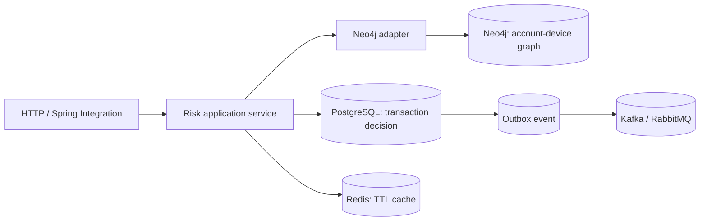
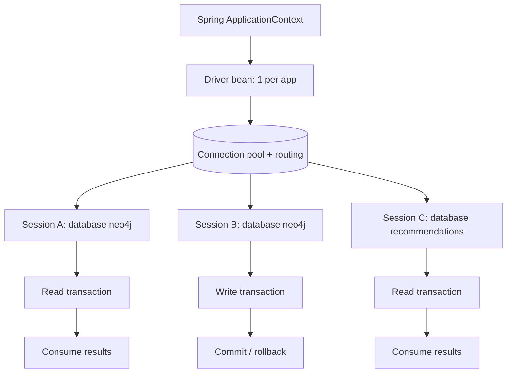
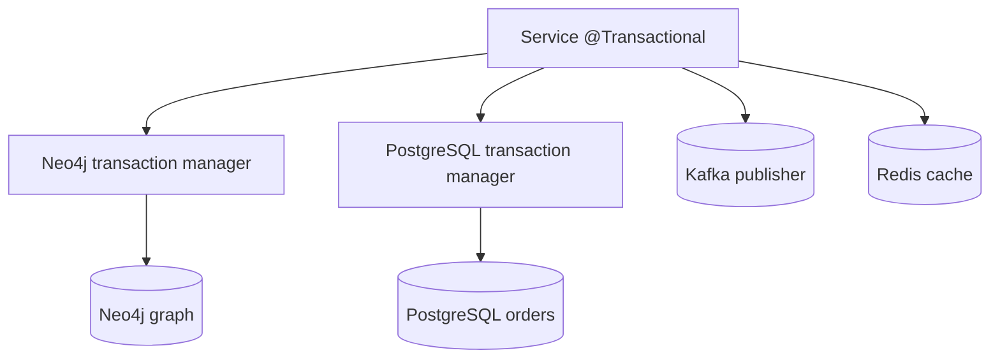
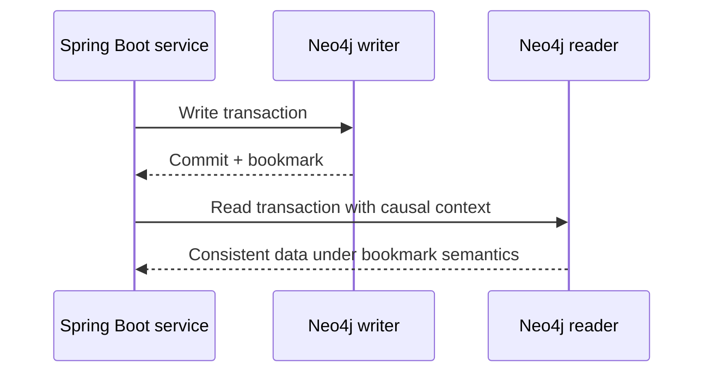
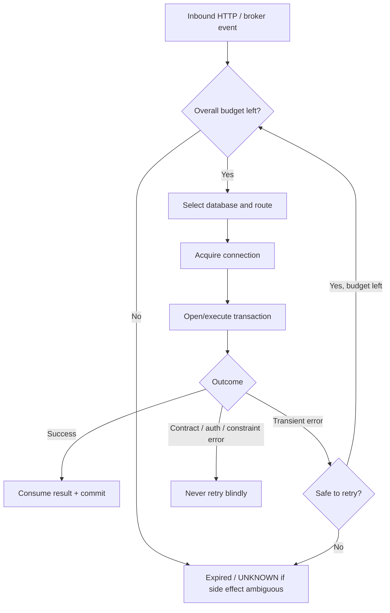
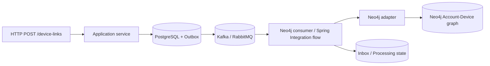

# Neo4j Database Configuration, Authentication, and Session Management

In **SPRING_BOOT_INTEGRATION**, a system may receive orders via HTTP, save transactions in PostgreSQL, check Redis, emit Kafka/RabbitMQ events, and query a graph store to trace relationships across accounts, devices, products, or organizations. **Neo4j** is a solid choice when data has relationships that must be traversed as a graph rather than queried only as isolated records. Before writing Cypher, however, the application must connect to the **right database**, authenticate with the **right identity and permissions**, control the **lifecycle of Driver/Session/Transaction**, and know how to recover when network links or cluster nodes fail.

This lesson belongs to the **Other NoSQL Stores** chapter and focuses on **Neo4j database configuration, authentication, and session management** in Spring Boot. The emphasis is on the boundaries between Boot configuration, the Neo4j Java Driver, Spring Data Neo4j, graph database transactions, and surrounding HTTP/SQL/cache/broker integration steps. The goal is not to catalog every graph query, but to build a Neo4j adapter that is **safe, testable, leak-free, and never mistakenly assumes a Neo4j transaction spans external systems**.

> Examples use **Java 17+, Spring Boot 3.x, Spring Data Neo4j 7.x, and Neo4j Java Driver 5.x/6.x compatible with the BOM**. Some APIs and properties vary across Boot/driver versions. Only add dependencies and configurations matching your real version; never bump the Neo4j driver independently out of alignment with Spring Data.

## 1. Learning objectives

After this lesson, you will be able to:

1. Distinguish between **Neo4j DBMS**, **database**, **graph**, **node/relationship**, and the **database name** selected for a session.
2. Configure `spring.neo4j.uri`, `spring.neo4j.authentication.*`, and `spring.data.neo4j.database`; understand `bolt://` vs. `neo4j://` and TLS variants.
3. Distinguish a **long-lived, thread-safe `Driver`** from a **short-lived, non-thread-safe `Session`** and a **transaction scoped to one unit of work**.
4. Use `SessionConfig` to select database and access mode, run `executeRead`/`executeWrite`, and close resources properly.
5. Understand authentication, authorization, database privileges, TLS, secrets, and rotation; never equate an authenticated connection with permission to read/write every graph.
6. Distinguish Boot auto-configuration from custom `Driver`, `Neo4jClient`, repository, and transaction boundary setups.
7. Handle retries, bookmarks/read-after-write, connection pools, timeouts, session errors, and multi-system side effects.
8. Test connectivity, database selection, unique constraints, session lifecycles, rollbacks, and observability using a Neo4j test container.

## 2. Neo4j model: DBMS, database, and graph

Neo4j stores entities as **nodes**, directed links as **relationships**, and both can carry **properties**. Cypher expresses graph patterns to match or mutate:

```cypher
CREATE (:Customer {customerId: "CUS-100"})
CREATE (:Product {productId: "PRD-200"})
```

In real applications, node creation should use business keys and constraints to avoid duplicates; these two statements only illustrate syntax. Queries can traverse relationships:

```cypher
MATCH (c:Customer {customerId: $customerId})-[:ORDERED]->(o:Order)
RETURN o.orderId AS orderId, o.status AS status
```

| Concept | Meaning | Example |
| --- | --- | --- |
| **DBMS/server** | Neo4j process or cluster serving the Bolt protocol | `graph-db.internal:7687` |
| **Database** | Isolated data space with its own graph and schema/indexes | `neo4j`, `recommendations`, `fraud` |
| **Graph data** | Nodes, relationships, and properties inside one database | `(:Customer)-[:ORDERED]->(:Order)` |
| **Database name** | Name of the database selected by a session/query | `fraud` |
| **Driver** | Application-level client managing connections, routing, and pools | Bean `org.neo4j.driver.Driver` |
| **Session** | Short-lived execution context selecting database, access mode, and bookmarks | Looking up a profile or recording a relationship |
| **Transaction** | Atomic commit/rollback scope in Neo4j | `executeWrite` running one or more Cypher statements |

**A Neo4j server does not necessarily host only a single database** across every edition and topology. Multi-database support depends on the edition and running configuration; the target database must exist and the principal must hold appropriate privileges. In common Neo4j Community setups, applications typically use the default database; never configure `fraud` and assume it exists automatically.

### 2.1. Where does Neo4j differ from PostgreSQL and Redis in a flow?

Suppose a service checks which devices connect multiple accounts:



Neo4j can return relationship insights to support decisions; **PostgreSQL** remains the source of truth for financial transactions, **Redis** holds time-bounded cache entries, and the **broker** transports events. Each system has its own transaction and consistency semantics. **A Neo4j `@Transactional` does not atomically commit alongside PostgreSQL, Redis, and Kafka.**

## 3. Dependencies and Boot auto-configuration

To use Spring Data Neo4j in Spring Boot:

```xml
<dependency>
    <groupId>org.springframework.boot</groupId>
    <artifactId>spring-boot-starter-data-neo4j</artifactId>
</dependency>
```

Gradle Groovy DSL equivalent:

```groovy
dependencies {
    implementation 'org.springframework.boot:spring-boot-starter-data-neo4j'
    testImplementation 'org.springframework.boot:spring-boot-starter-test'
}
```

When a valid driver, mappings, and properties are present, Boot conditionally configures the **Neo4j `Driver`**, Spring Data infrastructure, `Neo4jClient`/`Neo4jTemplate`, and transaction/repository support. Auto-configuration also reacts to user-defined beans, repository scanning, and classpath libraries.

| Component | Infrastructure Boot/Spring Data can provide | What the application still owns |
| --- | --- | --- |
| `Driver` | Neo4j connectivity, routing, pooling per driver settings | URI/TLS, credentials, pool sizing, lifetime, privileges |
| Database selection | Default database name from properties and infrastructure | Which database holds app data, multi-tenant policy |
| `Neo4jClient`/`Neo4jTemplate` | Spring-integrated Cypher/mapping APIs | Queries, parameters, projections, validation |
| `Neo4jRepository` | Repository proxies for `@Node` entities | Schemas, query methods, constraints, rules |
| Neo4j transaction manager | Conditional transaction management for Neo4j data | Commit boundaries, retries, coordination with SQL/brokers |
| Actuator/metrics | Health/observations when configured | Metrics for routing/session/tx failures and business effects |

**`spring-boot-starter-data-neo4j` does not create nodes, relationships, or business constraints on its own.** Cypher migrations, unique constraints, permissions, and seed data must be managed separately. Never infer from Java's `@Id` that Neo4j already enforces a unique index on that property.

### 3.1. Direct Java Driver or Spring Data Neo4j?

| Access style | Best fit | Primary responsibility |
| --- | --- | --- |
| **Neo4j Java Driver** (`Driver`/`Session`/`TransactionContext`) | Full control over sessions, databases, bookmarks, and Cypher | Manage closing, transaction callbacks, result mapping |
| **`Neo4jClient`** | Custom Cypher while keeping Spring Data mapping/transactions | Bind parameters, map results, let framework manage sessions |
| **`Neo4jRepository`** | Domain entity CRUD, derived methods, custom `@Query` | Define clean mappings, avoid unbounded graph fetching |
| **Reactive Neo4j** | Full WebFlux/Reactor pipelines with compatible reactive SDN | Avoid blocking event loops, manage publisher lifecycle/tx |

**Do not mix raw driver transactions and Spring Data repository transactions expecting them to share one session automatically.** When combining both in one business operation, clearly decide who owns the transaction and how each step participates; avoid opening framework-invisible transactions alongside repository calls.

## 4. Configuring URI and database in `application.yml`

Baseline configuration:

```yaml
spring:
  neo4j:
    uri: ${NEO4J_URI:bolt://localhost:7687}
    authentication:
      username: ${NEO4J_USERNAME:neo4j}
      password: ${NEO4J_PASSWORD}
  data:
    neo4j:
      database: ${NEO4J_DATABASE:neo4j}
```

**`spring.neo4j.uri` and `spring.data.neo4j.database` serve two different purposes**: the URI picks the connection/routing endpoint, whereas `database` chooses the graph space when opening a session or query. The database name is not an HTTP-style URL path segment. Never write `bolt://host:7687/fraud` expecting the path to select the database.

### 4.1. URI schemes to distinguish

| URI scheme | Typical purpose | Notes |
| --- | --- | --- |
| `bolt://host:7687` | **Direct** Bolt connection to one host/port | No `neo4j://` routing behavior; fits a single direct endpoint topology |
| `neo4j://host:7687` | Neo4j routing driver using seed address/routing tables | Requires compatible server/topology support; supports cluster routing |
| `neo4j+s://host:7687` | Routing with TLS and certificate verification per driver trust policy | Common when endpoints carry valid trusted certificates |
| `bolt+s://host:7687` | Direct Bolt with TLS and certificate verification | Used for encrypted direct connections |
| `neo4j+ssc://...`, `bolt+ssc://...` | Permits self-signed certificates per driver scheme | Only use when trust policy is understood; avoid in production when trusted CAs are possible |

**Do not equate `neo4j://` with HTTPS.** The Neo4j Java Driver speaks the **Bolt protocol** on the configured port; changing the scheme does not send Cypher to an HTTP REST URL. Behind cloud load balancers or proxies, verify that Bolt, TLS, and routing work and that addresses returned by the routing table are reachable.

### 4.2. Default database and access permissions

Suppose a server hosts two databases: `neo4j` and `recommendations`. The URI can stay identical while session database selection differs:

```text
URI: bolt://graph.example.org:7687
Session database A: neo4j
Session database B: recommendations
```

Configuring a nonexistent database name triggers database-not-found or permission errors, **not necessarily TCP connection errors**. When a user has access to database A but not database B, driver authentication can succeed while Cypher against B still fails.

Never allow HTTP callers to supply arbitrary database names. For multi-tenancy, resolve from a controlled allowlist and enforce separate authorization; **database per tenant** is a topology, privilege, and cost decision—not just a string parameter.

### 4.3. Separating local, staging, and production

```text
Local:       bolt://localhost:7687       / database neo4j
Staging:     neo4j+s://graph-stg.example.org:7687 / configured database
Production:  neo4j+s://graph.example.org:7687     / configured database
```

These are illustrative values, not live endpoints. **Never leave `NEO4J_PASSWORD` defaulting to “password” in production**, never commit credentials to the repo, and never bypass TLS trust checks just to unblock staging.

## 5. Authentication, database authorization, and secure connections

Neo4j separates two questions:

1. **Authentication:** who is the client, and is the credential/token valid?
2. **Authorization:** which **databases**, read/write operations, or procedures is that identity allowed to run?

TCP/TLS can succeed while login fails; login can succeed while the principal lacks write permissions on `recommendations`. Never lump all errors into “Neo4j unavailable.”

### 5.1. Basic authentication from Spring Boot

```yaml
spring:
  neo4j:
    uri: ${NEO4J_URI:neo4j+s://graph.example.org:7687}
    authentication:
      username: ${NEO4J_USERNAME}
      password: ${NEO4J_PASSWORD}
  data:
    neo4j:
      database: ${NEO4J_DATABASE:neo4j}
```

Spring Boot uses these properties when creating the driver **unless replaced by a custom `Driver` bean**. This configuration authenticates with **one application identity** for repositories/operations on that driver; it does not forward HTTP callers' credentials to “bind” each query.

**Never pass Neo4j passwords in URL query strings or paths.** Use a secret manager, environment variables, or an organizational secret delivery mechanism. For zero-restart rotation, check what driver/auth token manager your version supports and how existing connections rotate; changing an environment variable on a running process typically **does not update** credentials already passed to an initialized bean.

### 5.2. Least privilege and database boundaries

| Use case | Appropriate privileges | Risk if overly broad |
| --- | --- | --- |
| Account-relationship lookup API | Read access on required database and labels/data | Might read unrelated tenant/graph data |
| Device sync worker | Write privileges scoped to its assigned database | Might alter or delete unrelated relationships |
| Migration/index job | Schema admin rights via controlled workflow | Could drop/change constraints and disrupt service |
| Internal investigation tool | Read-only identity, scoped purpose, audited | Easy leakage of sensitive data via ad-hoc queries |

Privilege names and granularity vary by Neo4j edition and version. Verify them against your actual deployment rather than guessing role names. In multi-database or multi-tenant setups, **selecting the right database does not replace per-tenant or label-level authorization checks**.

### 5.3. TLS, trust, and hostnames

`neo4j+s://` or `bolt+s://` enables TLS with certificate validation per the driver's scheme. `+ssc` variants alter trust behavior and are meant for controlled self-signed setups. Never switch to `+ssc` or plaintext `bolt://` in production to bypass certificate errors:

- Verify the certificate chain, trust store, hostname/SANs, and routing addresses.
- Verify secrets/TLS proxies, SNI, and all hostnames returned in cluster routing tables.
- During certificate rotation, plan how new connections establish and old connections drain.
- Never log credentials, database tokens, or raw Cypher parameters containing personal data.

With multi-server routing, clients may connect to **hosts other than the initial seed URI**. A certificate valid only for the seed host will fail once routing redirects to another cluster member. Test against real topologies rather than only running a local single-node query.

### 5.4. Classifying errors right at the adapter boundary

| Observed error | What to investigate | What not to assume |
| --- | --- | --- |
| Authentication failed | Password/token/identity, rotation, account status | “This order doesn't exist” |
| Authorization/database access denied | Granted roles and target database name | “Neo4j is down” |
| Database does not exist | DB name, edition, migrations/provisioning, config | “Wrong Bolt URI” when TCP connects fine |
| TLS handshake/certificate | Trust chain, hostname, SNI, proxy | Downgrade to plaintext |
| Routing/service unavailable | Cluster availability, seed, routing addresses, DNS/firewall | Infinite retries of every Cypher query |
| Query syntax/constraint violation | Parameter binding, schema, business invariant | Retrying as a transient fault |

For public APIs, never expose internal database names, Cypher text, credentials, or Neo4j stack traces in responses. Map failures to stable business error codes with a correlation ID.

## 6. `Driver`, `Session`, `Transaction`: three distinct lifecycles

The Neo4j Java Driver provides a long-lived, **thread-safe `Driver`** that manages connection pools and routing and can be shared across services and repositories. **`Session` is not designed for concurrent sharing across threads**; it is a lightweight, short-lived execution context. Transactions live inside a session or are managed by Spring.



| Object | How long should it live? | Thread-safe to share? | How it ends |
| --- | --- | --- | --- |
| **`Driver`** | Roughly the process/application context lifetime | **Yes**, per driver API | Spring closes the `Driver` bean on context shutdown; custom drivers need an owner |
| **`Session`** | One short unit of work (request/job) | **Never share concurrently** | `try-with-resources` or framework-managed |
| **`Transaction`** | One atomic group of Cypher statements | Never share across threads arbitrarily | Commit/rollback via managed tx or framework |
| **Result/Record stream** | While session/transaction remains open | Never leak out and read after close | Consume/map data before closing resources |

### 6.1. Anti-pattern: creating a `Driver` per HTTP request

```java
// WRONG when called repeatedly per request without resource management.
Driver driver = GraphDatabase.driver(uri, AuthTokens.basic(user, password));
Session session = driver.session();
// ... forgot to close ...
```

This creates extra pools and routing tables, adds handshake overhead, and leaks sockets. `Driver` is **not** “a transaction” and should not be reconstructed per query.

### 6.2. Anti-pattern: singleton `Session`

```java
// WRONG: a single Session shared concurrently by request threads.
@Component
class SharedSessionHolder {
    private final Session session;
    SharedSessionHolder(Driver driver) {
        this.session = driver.session();
    }
}
```

A session holds database, routing, bookmark, and transaction state; sharing it causes concurrency failures, state leakage, and unclear shutdown behavior. **Keep `Driver` singleton, open `Session` when needed, then close it**—never the reverse.

### 6.3. When using Spring Data repositories, who owns `Session`?

When accessing Neo4j through `Neo4jRepository`, `Neo4jClient`, or `Neo4jTemplate`, Spring Data Neo4j manages sessions and transactions per operation. **Do not** open `Driver.session()` manually alongside a repository call and expect them to share one transaction.

Consistent options:

- **Repositories/`Neo4jClient` + Spring transaction manager** for most Boot applications.
- **Raw `Driver` + `try-with-resources`/managed transactions** when explicit session, database, bookmark, or custom query control is required.

If a workflow needs both styles, define explicit boundaries or use Spring Data-managed APIs to participate in the same transaction; never open two separate transactions and treat them as one.

## 7. Using `Driver` and `Session` properly in a Java adapter

The example below uses the raw Neo4j Java Driver created by Spring Boot:

```java
import java.util.List;
import org.neo4j.driver.AccessMode;
import org.neo4j.driver.Driver;
import org.neo4j.driver.Session;
import org.neo4j.driver.SessionConfig;
import org.neo4j.driver.Values;
import org.springframework.stereotype.Component;

@Component
public class AccountGraphAdapter {
    private final Driver driver;

    public AccountGraphAdapter(Driver driver) {
        this.driver = driver;
    }

    public List<String> devicesForAccount(String accountId) {
        if (accountId == null || accountId.isBlank()) {
            throw new IllegalArgumentException("Missing accountId");
        }

        SessionConfig config = SessionConfig.builder()
                .withDatabase("neo4j")
                .withDefaultAccessMode(AccessMode.READ)
                .build();

        try (Session session = driver.session(config)) {
            return session.executeRead(tx ->
                    tx.run("""
                        MATCH (a:Account {accountId: $accountId})
                              -[:USED_DEVICE]->(d:Device)
                        RETURN d.deviceId AS deviceId
                        ORDER BY deviceId
                        LIMIT 100
                        """,
                        Values.parameters("accountId", accountId))
                      .list(record ->
                              record.get("deviceId").asString()));
        }
    }
}
```

In the raw driver, `SessionConfig` selects the database for the **new session**, and `AccessMode.READ` lets the driver route reads when the topology supports it. **Access mode does not replace database authorization**, and in single-server/direct setups routing behavior differs from clusters. For queries touching sensitive tenant data, filtering by `accountId` does not replace authorization; tenant scope and permissions must be verified.

**Important:** `list(record -> ...)` consumes the results **while the transaction and session are still open**, returning mapped Java values. Returning raw `Result` outside the `try` block for a controller to iterate later leaves the session closed or the result invalid. For very large result sets, avoid materializing everything into a `List`: use limits/pagination or managed streaming.

### 7.1. Do not hardcode the database name in the adapter

`withDatabase("neo4j")` only illustrates the API. Production adapters should honor external configuration, such as an app property for raw-driver adapters:

```yaml
app:
  graph:
    database: ${NEO4J_DATABASE:neo4j}
```

Inject configuration via the constructor and pass it to `SessionConfig.forDatabase(database)` or the builder. If repositories use `spring.data.neo4j.database` while a raw adapter uses `app.graph.database`, verify **both point to the same DB** when working on the same dataset. Better yet, bind both from one configuration source and test both entrypoints. Never use `@Value` on a `static` field.

### 7.2. Sessions and threads in an HTTP server

Suppose 100 concurrent requests arrive:

```text
Application singleton Driver
    -> request A: Session A -> executeRead -> close
    -> request B: Session B -> executeRead -> close
    -> request C: Session C -> executeWrite -> close
    -> ...
```

Opening a `Session` per request **does not immediately open 100 TCP sockets**. The driver leases connections from its pool on demand for transactions and routing. A tight pool causes acquisition waits or timeouts—not a reason to hold sessions open longer.

If the adapter is called from WebFlux on a Reactor Netty event loop, raw **synchronous** `Session`/`executeRead` calls are blocking. Never invoke them directly on the event loop. Use the reactive driver / reactive Spring Data Neo4j, or offload blocking calls to a bounded scheduler per your architecture; never call `block()` on an event-loop thread.

## 8. Managed transactions and retries in the Neo4j Java Driver

The Neo4j Java Driver provides managed transaction functions `session.executeRead(...)` and `session.executeWrite(...)`. The driver may **retry a transaction function on transient errors eligible for retry** according to policy/config; therefore, callbacks must be safe to run **more than once**.

Example: creating an order node keyed by `orderId` and a deterministic fingerprint:

```cypher
CREATE CONSTRAINT order_business_id IF NOT EXISTS
FOR (o:Order) REQUIRE o.orderId IS UNIQUE;
```

Constraints must be created by migrations/schema management before serving traffic. They prevent two pods from creating duplicate nodes for the same `orderId` during concurrent races.

```java
import java.util.Objects;
import org.neo4j.driver.Driver;
import org.neo4j.driver.Session;
import org.neo4j.driver.SessionConfig;
import org.neo4j.driver.Values;
import org.springframework.stereotype.Component;

public record GraphOrderState(String orderId, String status) {}

@Component
public class OrderGraphWriter {
    private final Driver driver;

    public OrderGraphWriter(Driver driver) {
        this.driver = driver;
    }

    public GraphOrderState createIfAbsent(
            String database, String orderId, String fingerprint) {

        if (orderId == null || orderId.isBlank()
                || fingerprint == null || fingerprint.isBlank()) {
            throw new IllegalArgumentException("Invalid order command");
        }

        try (Session session = driver.session(
                SessionConfig.forDatabase(database))) {
            return session.executeWrite(tx -> {
                var record = tx.run("""
                    MERGE (o:Order {orderId: $orderId})
                    ON CREATE SET o.status = 'PENDING',
                                  o.requestFingerprint = $fingerprint
                    RETURN o.orderId AS id, o.status AS status,
                           o.requestFingerprint AS fingerprint
                    """, Values.parameters(
                            "orderId", orderId,
                            "fingerprint", fingerprint)).single();

                String actual = record
                        .get("fingerprint").asString();
                if (!Objects.equals(actual, fingerprint)) {
                    throw new IllegalStateException(
                            "Same orderId with different payload");
                }
                return new GraphOrderState(
                        record.get("id").asString(),
                        record.get("status").asString());
            });
        }
    }
}
```

In this Java example, `GraphOrderState` and `OrderGraphWriter` are two top-level `public` types and belong in **separate `.java` files** in a real project. Methods accepting a database name must also validate it against a server-configured allowlist rather than passing raw strings from HTTP callers into `SessionConfig`.

**Explanation:**

1. `MERGE` locates or creates the node by `orderId` and initializes properties on creation. The **unique constraint** protects the invariant under concurrent requests; `MERGE` alone does not prevent all duplicates.
2. If the same `orderId` arrives again with a different fingerprint, the callback detects a conflict instead of treating it as a valid retry. Production code should define how fingerprints are computed from canonicalized business fields.
3. When `executeWrite` retries after a transient failure, the callback operates **only inside the Neo4j transaction**; never send emails, call payment APIs, or publish to Kafka inside the callback.
4. `try-with-resources` closes the `Session`, **not the Spring-managed singleton `Driver`**.
5. When multiple nodes/relationships must commit together, place all participating Cypher statements **inside the same callback** and consume their results before returning.

### 8.1. Why not invoke HTTP/Kafka inside a transaction callback?

```text
executeWrite callback #1:
  CREATE/UPDATE Neo4j
  POST external-payment  -> succeeds
  COMMIT Neo4j           -> transient error

Driver retry callback #2:
  CREATE/UPDATE Neo4j
  POST external-payment  -> may be called a second time
```

Even if the Neo4j transaction rolls back, the payment system may already have committed. Use a transactional outbox/durable job and an idempotency key on the target; if the external system lacks idempotency, rely on reconciliation, compensation, or an `UNKNOWN` state. **A retryable callback must never perform non-rollbackable external side effects.**

### 8.2. `executeRead` vs. `executeWrite`

| API | Used for | Common misconceptions |
| --- | --- | --- |
| `session.executeRead(work)` | Read Cypher routable to cluster readers | Does not grant privileges; does not guarantee strong consistency under all read topologies |
| `session.executeWrite(work)` | Write Cypher committed on writers | Callback may be retried; never call external HTTP/brokers inside |
| `session.run(query, params)` | Auto-commit single Cypher statement | To group multiple statements atomically, use explicit/managed tx |
| `session.beginTransaction()` | Explicit transaction with manual commit/rollback | Must ensure close/rollback and retry handling; lacks managed-tx auto-retry |

These APIs belong to the raw Neo4j Java Driver. With `Neo4jRepository`/`Neo4jClient`, Spring Data manages transactions via Spring's transaction infrastructure; do not mix the two models unknowingly.

## 9. Spring Data Neo4j: repositories and `Neo4jClient`

In typical Boot apps, you do not need `try (Session ...)` in every method. Spring Data Neo4j offers **`@Node` mapping**, repositories, and `Neo4jClient` executing Cypher through Spring infrastructure.

### 9.1. Entity and repository

```java
import org.springframework.data.annotation.Id;
import org.springframework.data.neo4j.core.schema.Node;

@Node("Order")
public class OrderGraph {
    @Id
    private String orderId;
    private String status;

    protected OrderGraph() {}

    public OrderGraph(String orderId, String status) {
        this.orderId = orderId;
        this.status = status;
    }

    public String getOrderId() { return orderId; }
    public String getStatus() { return status; }
    public void setStatus(String status) { this.status = status; }
}
```

```java
import org.springframework.data.neo4j.repository.Neo4jRepository;

public interface OrderGraphRepository
        extends Neo4jRepository<OrderGraph, String> {
}
```

`@Id` marks the object-mapping ID; it **does not automatically create** a unique constraint in Neo4j. For business ID `orderId`, run a Cypher migration:

```cypher
CREATE CONSTRAINT order_business_id IF NOT EXISTS
FOR (o:Order) REQUIRE o.orderId IS UNIQUE;
```

If duplicate `orderId` nodes already exist, creating the constraint will fail; clean/migrate legacy duplicates first. In multi-tenant systems, consider composite tenant + order IDs per your Neo4j edition and schema features; do not apply a database-wide unique constraint on `orderId` if IDs are only unique per tenant.

### 9.2. `Neo4jClient` with Cypher and parameter binding

`Neo4jClient` is ideal for custom projections/queries without opening raw sessions:

```java
import java.util.Optional;
import org.springframework.data.neo4j.core.Neo4jClient;
import org.springframework.stereotype.Component;
import org.springframework.transaction.annotation.Transactional;

@Component
public class OrderStatusQuery {
    private final Neo4jClient client;

    public OrderStatusQuery(Neo4jClient client) {
        this.client = client;
    }

    @Transactional(readOnly = true)
    public Optional<String> findStatus(String orderId) {
        return client.query("""
                    MATCH (o:Order {orderId: $id})
                    RETURN o.status AS status
                    """)
                .bind(orderId).to("id")
                .fetchAs(String.class)
                .mappedBy((typeSystem, record) ->
                        record.get("status").asString())
                .one();
    }
}
```

This binds the Cypher parameter `$id` rather than concatenating `orderId`. `Neo4jClient` and repositories run through Spring-managed infrastructure and join the active transaction **when the right transaction manager is selected**. If a project contains both Neo4j and JDBC transaction managers, specify the transaction manager per service; an unqualified `@Transactional` can resolve ambiguously or pick the wrong manager.

### 9.3. Never concatenate user data into Cypher strings

```java
// WRONG: user-supplied data becomes Cypher syntax.
String query = "MATCH (a:Account {accountId: '" + accountId + "'}) RETURN a";

// RIGHT: keep query syntax static and bind values.
String querySafe = """
    MATCH (a:Account {accountId: $accountId})
    RETURN a
    """;
```

Parameters protect **data values**, not all structural parts of a query. For dynamic labels, relationship types, property names, or sort fields, enforce a server-side **allowlist**; never interpolate untrusted input into Cypher keywords or patterns. Any dynamic Cypher features in newer versions must be verified against your exact version and never fed untrusted structural input.

## 10. Spring transaction boundaries vs. raw-driver boundaries

A service using Spring Data Neo4j can wrap operations in a transaction:

```java
import org.springframework.stereotype.Service;
import org.springframework.transaction.annotation.Transactional;

@Service
public class OrderGraphApplicationService {
    private final OrderGraphRepository orders;

    public OrderGraphApplicationService(OrderGraphRepository orders) {
        this.orders = orders;
    }

    @Transactional
    public OrderGraph markAccepted(String orderId) {
        OrderGraph order = orders.findById(orderId)
                .orElseThrow(() ->
                        new IllegalArgumentException("Order not found"));

        if (!"PENDING".equals(order.getStatus())) {
            throw new IllegalStateException("Invalid transition");
        }

        order.setStatus("ACCEPTED");
        return orders.save(order);
    }
}
```

**This demonstrates Spring-layer transactions**, not complete concurrency protection. Two concurrent requests could both read `PENDING` and both write `ACCEPTED` without optimistic locking or conditional updates; if target states differ, one update silently overwrites the other. Enforce business invariants with **conditional Cypher updates**, version checks, or locking supported by your Spring Data/Neo4j version.

### 10.1. Conditional state transition in a single query

For simple transitions, a conditional query makes expectations explicit:

```cypher
MATCH (o:Order {orderId: $id})
WHERE o.status = 'PENDING'
SET o.status = 'ACCEPTED'
RETURN o.orderId AS id, o.status AS newStatus
```

Returning zero rows means either **not found** or **no longer `PENDING`**; re-read if you need to distinguish 404 from a 409 conflict. Under high concurrency, verify transaction behavior and uniqueness constraints on `orderId`. Never interpret `0 rows` as a database crash.

### 10.2. One `@Transactional` does not span two databases



Neo4j and PostgreSQL normally use **separate transaction managers**. A single service annotation does not commit both atomically, and Kafka/Redis do not automatically enlist either. A sound application model:

1. Pick **one source of truth** and commit business changes + outbox events there.
2. Emit events with stable IDs; have workers update the Neo4j graph **idempotently**.
3. Track sync state with bounded retries and reconciliation when Neo4j is temporarily down.
4. Guard every side effect using unique constraints and recorded states.

When coordinating Neo4j and PostgreSQL, design explicitly for **eventual consistency** or compensation workflows. Never respond to HTTP with “saved across all systems” just because the Neo4j transaction committed if the SQL outbox event has not been persisted.

### 10.3. Selecting the right transaction manager

When only one Neo4j transaction manager exists, `@Transactional` resolves automatically. When both `DataSourceTransactionManager`/`JpaTransactionManager` and the Neo4j transaction manager exist in the same context:

- Configure beans/defaults and `@Transactional(transactionManager="...")` using the **actual bean names** in your project.
- Write integration tests verifying Neo4j rolls back properly when the service throws an exception.
- Never designate one manager as default and assume repositories for another datastore will enlist in it.
- Never open a raw `Driver.session()` inside the same service expecting it to inherit an active Spring transaction.

**Common bug:** a Neo4j repository saves a node, then a SQL service fails; because the two operations use different managers, only one rolls back. That is a **consistency architecture issue**, not fixable by raising session timeouts.

## 11. Bookmarks, routing, and read-after-write

In a Neo4j cluster, a write query may hit the writer while a subsequent read routes to a reader. **Bookmarks** capture causal ordering between transactions: a later read can require seeing at least the changes committed previously, per driver/topology semantics.



### 11.1. Single session vs. multiple sessions

| Case | Considerations |
| --- | --- |
| Write then read **within the same session**, sequential managed tx | Driver/session can carry bookmarks for causal consistency across subsequent work. |
| Write in Session A, read in a new **Session B** | If causal ordering is needed, share bookmarks or use a bookmark manager per driver API/version. |
| Two independent HTTP requests reading/writing at different times | No automatic causal guarantee solely from sharing a singleton `Driver`. |
| Mixing Spring Data repositories and raw driver | Do not share bookmark/transaction context automatically; bridge explicitly or read from the right source. |
| Reading from a cluster reader immediately after a write | Check routing, bookmarks, and replication latency/failover behavior. |

**A bookmark is not a business ID, HTTP correlation ID, or idempotency key.** It is internal transaction/routing progress metadata and should not become a long-lived public contract or be logged indiscriminately.

### 11.2. Routing URI and access mode

`neo4j://` enables driver routing via the Neo4j protocol; `SessionConfig` sets `AccessMode.READ` or `WRITE`. However:

- With a direct `bolt://` connection to one endpoint, access mode does not change that endpoint into a separate reader or writer.
- Access mode does not replace authorization; read-only credentials do not gain write permissions just by setting `WRITE`.
- Routing tables may contain internal addresses unreachable from the client over DNS/VPC/firewalls; connecting to the seed node does not guarantee all cluster queries succeed.
- After failover, the driver may refresh routing and retry transient faults; total duration can exceed a single network round trip.

For lower latency, specify an explicit database name rather than leaving it blank and relying on home-database lookups unnecessarily. While not a universal speed guarantee across every version/topology, it removes ambiguity in multi-database deployments.

## 12. Connection pools, timeouts, and `Driver` lifecycle

`Driver` owns pool and routing resources. With `spring-boot-starter-data-neo4j` and Boot managing `Driver`, the driver normally lives for the application context's lifetime and closes on context shutdown.

| Setting | Purpose | Misconfiguration failure |
| --- | --- | --- |
| **Max pool size** | Caps open/pooled connections per driver/remote address | Too low causes waiting; too high overloads server or OS. |
| **Connection acquisition timeout** | Max wait for an idle connection from the pool | Waiting too long exhausts the HTTP/broker workflow deadline. |
| **Connection timeout** | Caps establishing the network connection | Does not cover pool waits, query execution, or retries. |
| **Max connection lifetime** | Caps connection age before replacement | Too low adds churn/TLS overhead; too high retains stale connections. |
| **Idle/health checking** | Tests idle/broken connections per driver policy | Stale sockets can fail during reuse/failover. |
| **Max transaction retry time** | Budget for retrying managed transactions | Does not replace overall deadlines or idempotency. |
| **Query/transaction timeout** | Bounds Cypher or tx execution where supported | Does not bound DB pool waits, serialization, or broker acks. |

### 12.1. Configuring the pool via Spring Boot properties

Sample configuration for Boot versions supporting `spring.neo4j.pool.*`:

```yaml
spring:
  neo4j:
    uri: ${NEO4J_URI:bolt://localhost:7687}
    authentication:
      username: ${NEO4J_USERNAME:neo4j}
      password: ${NEO4J_PASSWORD}
    pool:
      max-connection-pool-size: 50
      connection-acquisition-timeout: 2s
      max-connection-lifetime: 30m
```

Exact property names and binding support for Neo4j pool properties **depend on the Spring Boot version**. Before deploying to production, verify configuration metadata for your version and check active driver settings. Never assume a misspelled key fails startup; unbound properties silently leave defaults active.

### 12.2. Raw driver configuration to understand pool ownership

In standalone programs or when intentionally replacing Boot's auto-configured `Driver`, the Java Driver provides a builder:

```java
import java.util.concurrent.TimeUnit;
import org.neo4j.driver.AuthTokens;
import org.neo4j.driver.Config;
import org.neo4j.driver.Driver;
import org.neo4j.driver.GraphDatabase;

Config config = Config.builder()
        .withMaxConnectionPoolSize(50)
        .withConnectionAcquisitionTimeout(2, TimeUnit.SECONDS)
        .withMaxConnectionLifetime(30, TimeUnit.MINUTES)
        .withMaxTransactionRetryTime(10, TimeUnit.SECONDS)
        .build();

try (Driver driver = GraphDatabase.driver(
        "bolt://localhost:7687",
        AuthTokens.basic("neo4j", password),
        config)) {

    driver.verifyConnectivity();
    // Open and close sessions per unit of work.
}
```

Here `password` is retrieved securely by the program, and **`try-with-resources` is used solely because this is a standalone program**. If a Spring Boot application deliberately overrides Boot's `Driver` auto-configuration, declare a bean with explicit lifecycle management:

```java
import org.neo4j.driver.AuthTokens;
import org.neo4j.driver.Config;
import org.neo4j.driver.Driver;
import org.neo4j.driver.GraphDatabase;
import org.springframework.beans.factory.annotation.Value;
import org.springframework.context.annotation.Bean;
import org.springframework.context.annotation.Configuration;

@Configuration(proxyBeanMethods = false)
public class Neo4jDriverConfiguration {

    @Bean(destroyMethod = "close")
    Driver applicationNeo4jDriver(
            @Value("${spring.neo4j.uri}") String uri,
            @Value("${spring.neo4j.authentication.username}") String user,
            @Value("${spring.neo4j.authentication.password}") String password) {

        Config config = Config.builder()
                .withMaxConnectionPoolSize(50)
                .build();
        return GraphDatabase.driver(
                uri, AuthTokens.basic(user, password), config);
    }
}
```

This bean **intentionally replaces** Boot's `Driver` when auto-configuration backs off—it is not a bean to add blindly to every app. If Boot already provides a `Driver`, never create a second `Driver` just to “tune the pool” without verifying which driver repositories actually use. Prefer Boot properties/customizers for your version or replace the bean cleanly with tests confirming every adapter shares it.

### 12.3. When the pool saturates

Suppose one instance handles 100 concurrent HTTP requests needing Neo4j queries. If the pool/cluster only serves a smaller number of active connections at once, remaining requests wait on acquisition. **Do not** set the pool size to your CPU thread count by default. Neo4j queries can hold connections during heavy traversals, unconsumed results, or lock waits.

Balance by:

- Limiting concurrency per graph operation type or filter.
- Enforcing query limits/pagination, proper indexes, and sound Cypher execution plans.
- Bounding acquisition timeouts and overall request/job deadlines.
- Monitoring pool waits, in-flight queries, server CPU/RAM, cluster routing, and transaction retries.
- Avoiding synchronous `Driver` calls on WebFlux event loops.
- Never scaling pool size across **all instances** beyond Neo4j cluster capacity just because p99 latency spikes.

### 12.4. Closing a `Session` is not closing the `Driver`

```text
HTTP request A -> open Session -> query -> consume -> close Session
HTTP request B -> open Session -> query -> consume -> close Session
Application shutdown -> close Driver -> dispose pool/routing resources
```

Closing `Driver` after request A breaks request B with a closed-pool/driver error. Failing to close `Session` holds transaction/result resources or connections longer, causing timeouts under load. With Spring Data, let the framework manage lifecycles; with the raw driver, open and close sessions consistently in one adapter layer.

## 13. Deadlines, transient errors, and safe retries without breaking business logic

A Neo4j operation spans multiple stages: selecting a server from the routing table, acquiring a pooled connection, establishing TCP/TLS, starting a transaction, running Cypher, reading records, and committing. **A timeout on one phase is not an end-to-end workflow deadline.**



### 13.1. Timeouts do not substitute for one another

| Limit | Protects | Does not cover |
| --- | --- | --- |
| Connection acquisition timeout | Waiting for a pooled Neo4j connection | Cypher execution time after acquiring the connection |
| TCP connection timeout | Establishing the network socket | Routing retries, authentication, queries, mapping |
| Managed transaction retry budget | Total time the driver retries eligible faults | End-to-end HTTP deadlines or external side effects |
| Transaction/query timeout | Bounding Cypher/tx where supported by driver/server | DB pool waits, serialization, downstream HTTP |
| Overall operation deadline | Full business operation from caller to response/ack | Does not exist automatically from Neo4j timeouts alone |

In the raw driver, you can set a transaction timeout on a managed transaction:

```java
import java.time.Duration;
import org.neo4j.driver.Session;
import org.neo4j.driver.TransactionConfig;
import org.neo4j.driver.Values;

TransactionConfig transactionConfig = TransactionConfig.builder()
        .withTimeout(Duration.ofSeconds(2))
        .build();

// session was opened via try-with-resources in the enclosing method.
var rows = session.executeRead(
        tx -> tx.run("""
                MATCH (d:Device)
                WHERE d.status = $status
                RETURN d.deviceId AS id
                LIMIT 50
                """, Values.parameters("status", "ACTIVE"))
                .list(record -> record.get("id").asString()),
        transactionConfig);
```

This is a **snippet inside a method owning `session`**, not a standalone Java method. Transaction timeout APIs and server enforcement can vary across driver/Neo4j versions, so verify real timings in integration tests. If an HTTP request only has 500 ms remaining in its budget, never start a 2-second Neo4j transaction and retry it multiple times.

### 13.2. Classify errors before retrying

| Error category | Examples | Policy |
| --- | --- | --- |
| **Transient / service unavailable** | Writer failover, temporarily unreachable route | Bounded retry when operation/callback is safe and budget remains |
| **Pool / acquisition saturation** | Cannot acquire connection within timeout | Apply bulkheads/rate limits, reduce concurrency; avoid retry storms |
| **Authentication / authorization** | Bad credentials, missing database grant | Fix secrets/privileges; never tight-loop retry |
| **Cypher syntax / schema** | Wrong label/property, missing constraint, invalid query | Fix code/schema/migrations |
| **Uniqueness / business conflict** | Two commands with same `orderId` but different payloads | Return conflict/quarantine; not transient |
| **Ambiguous commit outcome** | Network error during or right at commit | Reconcile by business key; always prepare for redelivery |
| **Bookmark / routing mismatch** | Reader cannot yet serve causal context | Inspect routing, timeouts, cluster health, retry policy |

Inside `executeWrite` callbacks, never send messages, invoke payment APIs, or update non-rollbackable caches. If the driver re-invokes the callback, external actions repeat. Keep callbacks pure Cypher using `MERGE`, constraints, and conditional writes so invariants hold even when commit outcomes look ambiguous.

### 13.3. Never swallow exceptions and tell the broker the message succeeded

Suppose a Kafka consumer receives `AccountLinkedToDeviceV1` and updates Neo4j:

```text
Listener receive -> Neo4j executeWrite -> commit -> broker ACK/offset commit
```

If Neo4j is temporarily unreachable, the listener must not simply log and return normally, or the container may ack/commit the offset and lose the work. If Neo4j committed but acking failed, the broker may **redeliver** the message; graph writes must be idempotent by stable event/business ID.

With RabbitMQ, ack/requeue/dead-letter behavior depends on listener container settings; with Kafka, offset commits and error handlers have different semantics. Whether using a Spring Integration adapter or a direct listener, **acknowledgment must follow the actual committed business outcome**.

## 14. Safe data: graph schema, uniqueness, and tenant isolation

Neo4j is flexible with labels and relationships, yet you must never write arbitrary graph structures directly from unvalidated JSON inputs.

### 14.1. Uniqueness constraints for nodes and relationships

Example account/device graph:

```cypher
CREATE CONSTRAINT account_id IF NOT EXISTS
FOR (a:Account) REQUIRE a.accountId IS UNIQUE;

CREATE CONSTRAINT device_id IF NOT EXISTS
FOR (d:Device) REQUIRE d.deviceId IS UNIQUE;
```

Create a conditional link:

```cypher
MATCH (a:Account {accountId: $accountId})
MATCH (d:Device {deviceId: $deviceId})
MERGE (a)-[r:USED_DEVICE]->(d)
ON CREATE SET r.firstObservedAt = datetime()
RETURN a.accountId AS accountId, d.deviceId AS deviceId
```

**`MERGE` on a relationship expresses idempotent intent for that pattern**. Under concurrent writers, correctness still depends on existing/locked nodes, constraints/schema, and transaction concurrency. Never claim `MERGE` alone guarantees exactly-once across all relationship patterns and multi-database scenarios; test under contention against your actual schema and invariants.

If the business needs to store **multiple legitimate device usage events**, a single `USED_DEVICE` relationship will not preserve event history. Instead, create event nodes `(:DeviceUse {eventId})` with a uniqueness constraint and link them, or store events in a separate event store; model the schema around business needs rather than collapsing history into one edge.

### 14.2. Cypher parameters and allowlists

Never concatenate:

```java
String cypher = "MATCH (n:" + labelFromHttp + ") RETURN n";
```

Instead:

- Keep **labels, types, and query shapes static**, controlled by application code or an allowlist.
- Use Cypher parameters `$accountId`, `$deviceId` for **data values**.
- Bound graph traversal depth, `LIMIT`, query timeouts, and tenant scope to avoid runaway traversals.
- Return only approved DTOs/projections; never serialize whole graphs with sensitive properties to HTTP or brokers.

**Parameterized Cypher does not replace authorization.** If the Neo4j principal can read the entire database and the app omits a tenant filter, callers can read another tenant's data without any Cypher injection.

### 14.3. Multi-tenancy and database selection

Three common models:

| Model | Benefits | Trade-offs |
| --- | --- | --- |
| Single database, `tenantId` property on nodes/edges | Simple topology, unified operations | Every query/constraint/ACL must enforce tenant scope |
| Database per tenant | Database-level isolation when edition/topology allows | Increases DB, provisioning, connection/routing, and migration costs |
| Separate cluster/DBMS per tenant group | Stronger operational and resource isolation | High infrastructure, sync, and observability overhead |

When selecting a database per tenant, never call `SessionConfig.forDatabase(request.getParameter("db"))` directly. Map the authenticated tenant server-side to an **allowlisted database** and confirm principal permissions on it. If tenant switching inside a session is disallowed by policy, open a dedicated session with the right config instead of mutating shared state.

### 14.4. Contracts between the graph and other systems

If Neo4j holds `AccountGraph` and PostgreSQL holds `AccountEntity`, never publish raw Neo4j `Node`/record internals onto Kafka. Define an explicit event:

```json
{
  "eventId": "evt-device-link-017",
  "schemaVersion": 1,
  "accountId": "ACC-017",
  "deviceId": "DEV-095",
  "operation": "LINKED"
}
```

Keep `eventId` stable across retries and replays so Neo4j consumers can deduplicate using it and business keys. A correlation ID for tracing is distinct from `eventId`. When graph data depends on PostgreSQL order state, use versioned event contracts and reconciliation instead of querying one DB and assuming the other updated instantaneously.

## 15. Connecting Neo4j with Spring Integration, HTTP, and brokers

A flow:



### 15.1. Choosing the source of truth and when to report success

If an HTTP handler writes PostgreSQL and then updates Neo4j directly in one method, failures leave ambiguity:

```text
PostgreSQL COMMIT -> Neo4j timeout -> HTTP 500
Client retries -> Does PostgreSQL create a duplicate operation?
```

Or conversely, Neo4j commits while PostgreSQL rolls back. A common pattern:

1. Give the HTTP request an **idempotency key** to prevent duplicate commands.
2. Commit the SQL order and **outbox event** in one SQL transaction.
3. Have a publisher relay events to the broker (duplicates possible after crashes).
4. Have the Neo4j consumer apply the graph side effect idempotently and ack the broker only after Neo4j commits.
5. Track projection/graph sync state, alert on high lag/backlog, and support replay/reconciliation.

This is **controlled eventual consistency**, not an atomic distributed transaction. The API should communicate states like `ACCEPTED` or `PENDING_GRAPH_SYNC` and eventual completion rather than claiming the graph is already synced without verification.

### 15.2. Inbox and uniqueness for graph projections

When `eventId` is stable, you can create a node recording event application **inside the same Neo4j transaction** as the graph mutation:

```cypher
CREATE CONSTRAINT processed_graph_event IF NOT EXISTS
FOR (e:ProcessedGraphEvent) REQUIRE e.eventId IS UNIQUE;
```

Distinguish states carefully:

| State | Meaning | Redelivery handling |
| --- | --- | --- |
| No event marker | No evidence the graph side effect committed | Attempt idempotent transaction |
| Marker committed with graph updates | Event logic applied per contract | Check identity/version; do not re-apply side effects |
| Marker written separately before graph update | **Dangerous** if the update fails | Can cause retries to skip unfinished work |
| Same `eventId` with different payload | Producer violated identity contract | Conflict/quarantine; never silently ignore |

**Record the processed marker only inside/after the same transaction as the graph update**; if external HTTP/payment side effects remain outside Neo4j, a Neo4j marker does not protect those external systems. If multiple functional consumers consume the same event, scope the marker key by consumer (or store in separate labels/collections/DBs) so shipping and analytics never block each other.

### 15.3. Acknowledge after commit—never fire-and-forget

A Spring Integration flow may route messages across HTTP adapters, Neo4j services, Redis, and error channels. **`MessageChannel` does not propagate Neo4j transactions to a Kafka broker.** With async channels, callers or adapters can return before graph writes finish; premature broker acks lose work if the worker crashes afterward.

Rules:

- Synchronous handlers: return success only after the graph write commits.
- Async handlers: ack only after a **durable job/outbox** is safely persisted, or bind broker acks to actual completion.
- Use bounded retries, idempotency, and dead-letter/quarantine queues for invalid schemas/events.
- Never map arbitrary broker headers/credentials into dynamic database selection or raw Cypher parameters.

## 16. Reactive Neo4j: never share sessions or block event loops

Spring Data Neo4j supports reactive repositories and clients when compatible with the driver and project. Example interface:

```java
import org.springframework.data.neo4j.repository.ReactiveNeo4jRepository;
import reactor.core.publisher.Flux;

public interface ReactiveOrderGraphRepository
        extends ReactiveNeo4jRepository<OrderGraph, String> {

    Flux<OrderGraph> findByStatus(String status);
}
```

A WebFlux controller can return `Mono<OrderGraph>` or map to a DTO without calling `block()`:

```java
import org.springframework.stereotype.Service;
import reactor.core.publisher.Mono;

@Service
public class ReactiveOrderGraphLookup {
    private final ReactiveOrderGraphRepository orders;

    public ReactiveOrderGraphLookup(ReactiveOrderGraphRepository orders) {
        this.orders = orders;
    }

    public Mono<String> findStatus(String id) {
        return orders.findById(id)
                .map(OrderGraph::getStatus);
    }
}
```

**Crucial differences:**

- Reactive publishers are **lazy**: a `Mono` runs only when the framework or a downstream subscriber actually subscribes.
- Never call fire-and-forget `subscribe()` inside a Kafka listener and ack immediately; the graph update may fail after the listener returns.
- Never call synchronous `Driver.session()`/`executeRead()` on Reactor Netty event-loop threads; if blocking APIs are unavoidable, isolate them on a bounded scheduler or use reactive APIs.
- Reactive transactions require a **reactive transaction manager/context**, not JDBC `ThreadLocal` assumptions across asynchronous callbacks.
- A graph-writing publisher may **re-execute on a second subscription**; side effects must be idempotent.

### 16.1. Reactive connection/session lifecycle differs from blocking

In reactive APIs, resources are acquired as subscriptions progress and released on completion, error, or cancellation per driver/framework rules. Avoid returning unbounded `Flux` streams from queries as open HTTP streams; cap records via Cypher `LIMIT`/pagination, honor backpressure, and understand when transactions close.

Never call `collectList()` on a graph query returning millions of nodes. Complex Cypher traversals still burn Neo4j CPU/RAM even if the subscriber consumes items slowly; enforce indexes, hop/label caps, projections, and query budgets.

## 17. Testing Neo4j configuration and `Session` lifecycle

Unit tests mocking `Driver`/`Session` verify API calls, yet **they cannot prove the right database is targeted, auth/TLS succeeds, Cypher constraints work, or transactions roll back properly**. Those require integration tests against an appropriate Neo4j server, such as Neo4j Testcontainers.

### 17.1. Testcontainers dependencies

Maven example using the Spring Boot BOM and matching Testcontainers modules:

```xml
<dependencies>
    <dependency>
        <groupId>org.springframework.boot</groupId>
        <artifactId>spring-boot-starter-test</artifactId>
        <scope>test</scope>
    </dependency>
    <dependency>
        <groupId>org.springframework.boot</groupId>
        <artifactId>spring-boot-testcontainers</artifactId>
        <scope>test</scope>
    </dependency>
    <dependency>
        <groupId>org.testcontainers</groupId>
        <artifactId>neo4j</artifactId>
        <scope>test</scope>
    </dependency>
    <dependency>
        <groupId>org.testcontainers</groupId>
        <artifactId>junit-jupiter</artifactId>
        <scope>test</scope>
    </dependency>
</dependencies>
```

With Spring Boot 3.1+ and compatible modules, `@ServiceConnection` supplies connection details from the Neo4j Testcontainer to auto-configuration. **Never hardcode `localhost:7687` in tests**: CI containers map to random ports.

### 17.2. Integration test creating constraints, verifying duplicates, and rolling back

```java
import static org.junit.jupiter.api.Assertions.*;

import java.util.UUID;
import org.junit.jupiter.api.BeforeEach;
import org.junit.jupiter.api.Test;
import org.neo4j.driver.Driver;
import org.neo4j.driver.Session;
import org.neo4j.driver.SessionConfig;
import org.neo4j.driver.Values;
import org.neo4j.driver.exceptions.ClientException;
import org.springframework.beans.factory.annotation.Autowired;
import org.springframework.boot.test.context.SpringBootTest;
import org.springframework.boot.testcontainers.service.connection.ServiceConnection;
import org.testcontainers.containers.Neo4jContainer;
import org.testcontainers.junit.jupiter.Container;
import org.testcontainers.junit.jupiter.Testcontainers;

@SpringBootTest
@Testcontainers
class Neo4jSessionIT {

    @Container
    @ServiceConnection
    static final Neo4jContainer<?> neo4j =
            new Neo4jContainer<>("neo4j:5")
                    .withAdminPassword("integration-test-password");

    @Autowired
    Driver driver;

    @BeforeEach
    void ensureSchema() {
        try (Session session = driver.session(
                SessionConfig.forDatabase("neo4j"))) {
            session.run("""
                CREATE CONSTRAINT order_business_id IF NOT EXISTS
                FOR (o:Order) REQUIRE o.orderId IS UNIQUE
                """).consume();
        }
    }

    @Test
    void writesToExpectedDatabaseAndEnforcesUniqueness() {
        String id = "ORD-" + UUID.randomUUID();

        try (Session session = driver.session(
                SessionConfig.forDatabase("neo4j"))) {
            session.executeWrite(tx -> {
                tx.run("CREATE (:Order {orderId: $id})",
                        Values.parameters("id", id)).consume();
                return null;
            });

            assertThrows(ClientException.class, () ->
                    session.executeWrite(tx -> {
                        tx.run("CREATE (:Order {orderId: $id})",
                                Values.parameters("id", id)).consume();
                        return null;
                    }));

            long count = session.executeRead(tx -> tx.run("""
                    MATCH (o:Order {orderId: $id})
                    RETURN count(o) AS total
                    """, Values.parameters("id", id))
                    .single().get("total").asLong());
            assertEquals(1L, count);
        }
    }

    @Test
    void rollsBackWriteWhenTransactionFunctionFails() {
        String id = "ORD-" + UUID.randomUUID();

        try (Session session = driver.session(
                SessionConfig.forDatabase("neo4j"))) {
            assertThrows(IllegalStateException.class, () ->
                    session.executeWrite(tx -> {
                        tx.run("CREATE (:Order {orderId: $id})",
                                Values.parameters("id", id)).consume();
                        throw new IllegalStateException("Force rollback");
                    }));
        }

        try (Session session = driver.session(
                SessionConfig.forDatabase("neo4j"))) {
            long count = session.executeRead(tx -> tx.run("""
                    MATCH (o:Order {orderId: $id})
                    RETURN count(o) AS total
                    """, Values.parameters("id", id))
                    .single().get("total").asLong());
            assertEquals(0L, count);
        }
    }
}
```

**What this test proves:**

1. Spring Boot builds a `Driver` that connects to the Testcontainers-managed server; the test does not construct a new `Driver` per method.
2. `SessionConfig.forDatabase("neo4j")` targets the database inside the test container.
3. The constraint actually blocks **two nodes with the same `orderId`**—not relying on Java annotation assumptions.
4. An `executeWrite` throwing before commit rolls back changes inside the transaction.
5. Raw sessions close cleanly via `try-with-resources`, on both success and exception paths.

**Limitations of this test:** a single Neo4j container **does not** simulate cluster routing/failover, read replicas, multi-database privileges across editions, or production TLS/mTLS. Nor does it prove the application picks the right transaction manager once PostgreSQL/JPA is added. Cover those in dedicated test layers/environments.

### 17.3. Testing database names and access permissions

Do not query a `recommendations` database in a Community Testcontainer if the edition/topology does not support creating additional databases. To test multi-database behavior:

- Use a Neo4j test edition/environment that supports multiple databases.
- Provision `recommendations` and a principal granted access only where permitted.
- Reuse the same URI while varying `SessionConfig` per database; verify queries hit the right database.
- Test with separate principals to confirm **authentication succeeds while unauthorized database access fails**.
- When using `spring.data.neo4j.database`, test repositories and `Neo4jClient` end-to-end to prove every query hits the configured database.

Tests **must distinguish** “no records found” from “database does not exist”; never catch all exceptions into an empty list and return a misleading 404.

### 17.4. Fault-injection and concurrency matrix

| Scenario | How to test | Invariant to prove |
| --- | --- | --- |
| Singleton `Driver` | Run multiple requests/workers through Spring bean | No new driver/pool created per request |
| `Session` closing | Run succeeding and failing queries; inspect resources | No connections/transactions leaked open |
| Competing unique constraint | Two concurrent writers create the same `orderId` | Exactly one business node commits |
| Managed tx retry | Inject controlled transient errors | Callback calls no external HTTP/Kafka/email; graph effect is idempotent |
| Transaction rollback | Two Cypher statements in one tx, second fails | Zero partial graph changes committed |
| Wrong database | Nonexistent database or unauthorized principal | Fails explicitly; never falls back silently to default DB |
| Cluster failover | Stop/switch writer in a test cluster | Routing/retries/deadlines behave per policy |
| TLS rotation | Rotate cert/endpoint under control | Never disables trust; new sessions still connect |
| Read-after-write | Write then read via new session/routed reader | Causal context/bookmarks satisfy contract |
| Broker redelivery | Redeliver same event ID after Neo4j commit before ack | No extra nodes/relationships or duplicate effects |
| Cross-system failure | SQL commits while graph update fails | Outbox/recovery/reconciliation catches up |
| Tenant isolation | Query same ID across two tenants | No cross-tenant leaks; DB never picked from raw input |

In concurrency tests, never assert “worker A always wins,” since thread scheduling is non-deterministic. Assert the final invariant—**one business node/relationship** and valid error/duplicate outcomes. For async integration tests, use bounded polling assertions instead of multi-second fixed sleeps.

## 18. Observing sessions, pools, queries, and transactions

An application can return HTTP 200 for completed requests while many others **queue waiting for connections**, suffer routing failovers, or run runaway traversals. Measure both client and Neo4j server metrics.

| Signal | Question answered |
| --- | --- |
| Driver/pool active/idle/in-use, acquisition wait | Is the pool saturated, or are sessions/results held too long? |
| Connections created/closed, TLS errors | Is connection churn high, or are certs/routing changing? |
| Routing table refreshes, server unavailable | Are seeds, cluster membership, DNS, or firewalls failing? |
| Query latency p50/p95/p99 by operation type | Are graph reads or relationship writes slowing down? |
| Transaction begin/commit/rollback/retries | Are lock contention, transient errors, or callback retries spiking? |
| Cypher profile/explain, index usage | Are traversals scanning too many nodes or missing indexes? |
| Authentication/authorization failures | Are secret rotations, roles, or DB grants broken or abused? |
| Connection acquisition/transaction timeouts | Is contention occurring before the query or inside execution? |
| Neo4j projection lag / inbox duplicates | How synced are the broker/SQL and the graph? |
| Spring Boot HTTP/broker latency | Is Neo4j slowing down the overall pipeline? |

Spring Boot Actuator/Micrometer and Neo4j driver metrics/tracing provide partial telemetry depending on version and configuration. **Never assume every `Driver` bean exposes identical meter names automatically.** With custom drivers, verify metric options, registries, and Boot integration for your version.

### 18.1. Log failures by phase without dumping full Cypher

When a request fails, emit structured, safe logs:

```text
component=neo4j_adapter
operation=account_devices_lookup
database=neo4j
phase=transaction
outcome=timeout
duration_ms=860
retry_attempt=1
correlation_id=trace-abc
```

Never log passwords, raw `AuthToken`s, full Cypher parameters containing PII, sensitive graph properties, or raw database URIs with embedded user-info. For metric labels, avoid `accountId`, `orderId`, `eventId`, unbounded dynamic database/tenant names, or raw query text; use **bounded operation names and error categories**.

### 18.2. Query plans and indexes

Slow analytical queries often stem from missing indexes:

```cypher
EXPLAIN
MATCH (a:Account {accountId: $accountId})
      -[:USED_DEVICE]->(d:Device)
RETURN d.deviceId AS deviceId
LIMIT 100
```

`EXPLAIN` shows the execution plan without running the full query per Cypher semantics; `PROFILE` executes the query to measure runtime stats, so run it only in safe environments—especially for mutating queries. An index/constraint on `Account.accountId` speeds up entry lookup, yet wide relationship fan-outs can still be costly. Cap hops, filters, pagination, and projections per contract.

### 18.3. Runbook when the pool or cluster errors

1. Identify the exact **database name** and principal used by the failing request.
2. Classify the error: credential/permission, TLS/connect, routing/acquisition, or Cypher/transaction.
3. Measure concurrent requests, active sessions, pool waits, and transaction retries.
4. Verify routing table addresses are reachable from the running container/pod.
5. Inspect Cypher plans, indexes, data skew, and locks—never just bump the pool size.
6. Check for raw `Result`/`Session` usage after close or closing `Driver` before shutdown.
7. If commit outcome is ambiguous, **reconcile by business key** before replaying side effects.
8. Once fixed, prove recovery with fault-injection and integration tests.

Never apply a “raise all timeouts to 60 seconds” workaround when queries miss indexes or a Neo4j cluster lacks a writer: that holds connections and HTTP/broker workers longer, cascading failures across systems.

## 19. Common misconceptions

**“`spring.neo4j.uri` already includes the database name.”** No. The URI specifies endpoints and routing; the database is selected via `spring.data.neo4j.database` or `SessionConfig`. One server can host multiple DBs depending on topology/edition.

**“Driver is one connection; create a new Driver per request for safety.”** Wrong. `Driver` is thread-safe, owns connection pools and routing, and must be reused; a `Session` is the short-lived context.

**“Make `Session` a singleton bean to save resources.”** Wrong in multi-threaded apps. `Session` is not thread-safe for concurrent use and must be closed promptly.

**“Opening a new Session always opens a new TCP socket.”** Not necessarily. The driver leases connections from its pool on demand; session objects and physical sockets are distinct.

**“Closing Session means closing Driver too.”** Wrong. Closing `Driver` per request destroys the pool and breaks other requests.

**“Setting `AccessMode.READ` means Neo4j enforces read-only permissions.”** Wrong. It is a driver routing hint/mode; real permissions belong to the server principal.

**“Successful login grants query access to every database.”** Wrong. Database grants and privileges can still reject reads/writes even with valid credentials.

**“`MERGE` prevents all duplicates when multiple pods write concurrently.”** Wrong without proper keys, constraints, and schema. Design unique business IDs and test concurrency.

**“Transaction callbacks run only once, so calling a payment API inside is safe.”** Wrong. Managed transactions can retry callbacks; external side effects do not roll back with Neo4j.

**“`@Transactional` synchronizes Neo4j with PostgreSQL, Redis, and Kafka.”** Wrong. You need outbox/inbox patterns, workflow state, compensation, or reconciliation.

**“Enabling `neo4j://` ensures every query reads the latest writes.”** Not automatically. Understand routing, session/bookmark causal consistency, and read-after-write contracts.

**“Increasing max pool size fixes every timeout.”** Wrong. Missing indexes, heavy queries, locks, auth failures, or broken routing do not disappear by adding connections.

**“Reactive repositories execute automatically without subscribing.”** Wrong. Publishers are lazy; never fire-and-forget and ack the broker prematurely.

**“Using `+ssc` in production is standard TLS.”** Never treat weakened trust as a default fix. Configure proper CA/certificate validation and test all routing hosts.

## 20. Checklist before shipping a Neo4j adapter to production

Before deployment, verify:

1. **Right database:** `spring.data.neo4j.database`/`SessionConfig` targets an existing, edition-compatible, authorized DB?
2. **Right URI:** `bolt://` direct vs. `neo4j://` routing chosen intentionally; DNS, ports, Bolt/TLS, and routing addresses verified?
3. **Safe credentials:** secrets externalized, rotation/rollback planned, privileges minimized per use case?
4. **TLS trust:** certificate validation, hostname/SNI, cluster hostnames, and proxies tested without disabling TLS verification?
5. **Singleton Driver:** Boot-managed or custom bean with clear ownership; never created per request, closed on context shutdown?
6. **Session scope:** opened per unit of work, never shared across threads, always closed after consuming results?
7. **Transaction boundaries:** consistent choice of raw driver vs. Spring Data manager; rollbacks verified; never confusing JDBC and Neo4j transactions?
8. **Managed tx retries:** callbacks safe to re-run; zero HTTP/payment/broker calls inside retry callbacks?
9. **Query safety:** bound parameters, allowlisted dynamic labels/types, bounded projections/limits/traversals/indexes, complete tenant authorization?
10. **Data invariants:** real unique constraints/schema migrations applied; `MERGE`/conditional updates and payload conflicts handled?
11. **Consistency:** bookmarks/routing/read-after-write across sessions aligned with expectations, never assuming shared `Driver` gives causal guarantees?
12. **Pools/deadlines:** max pool size, acquisition, TLS/connect, transaction timeouts, and overall budgets sized across instance counts?
13. **Cross-system workflows:** HTTP/SQL/cache/broker use outbox/inbox, idempotency keys, dead-letter/reconciliation, and explicit completion states?
14. **Reactive:** never call synchronous Driver on Netty event loops; subscribe per lifecycle and ack only after promised outcomes?
15. **Testing:** Neo4j Testcontainers covering database selection, auth/TLS, unique constraints, concurrency, rollbacks, retries, failover, and redelivery within scope?
16. **Observability:** pool/routing/query/tx metrics, error categories, projection lag, trace correlation, and log redaction ready for runbooks?

**Takeaway:** with Neo4j in Spring Boot, the **URI** defines connection/routing, **database selection** picks the graph namespace, **authentication/authorization** restricts who can do what, **`Driver`** owns the long-lived pool, and **`Session`** and **`Transaction`** belong to a short-lived unit of work. Only by respecting these boundaries can an application target the right database, avoid resource leaks, and retry safely. When Neo4j integrates with PostgreSQL, caches, HTTP, and message brokers, end-to-end consistency also demands **data contracts, unique business keys, outbox/inbox patterns, fault testing, and reconciliation**—never just `@Transactional` or a single committed Neo4j session.
