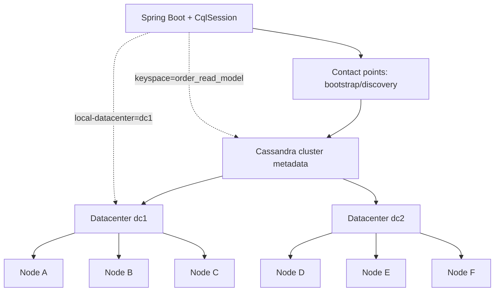
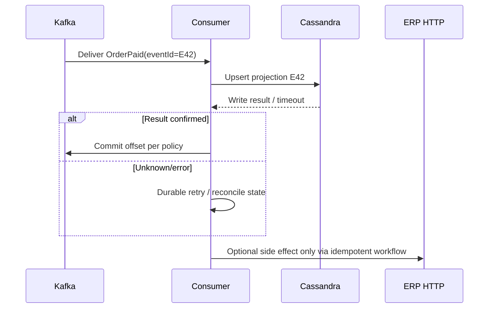

# Cassandra `CqlSession`, Contact Points, Keyspace, and Local Datacenter

## 1. The integration problem: connecting to Cassandra does not mean reading/writing the right data

A Spring Boot application may use Cassandra to store high-volume lookup state, partitioned event histories, or materialized views for an ordering system. That same application might still call an ERP over HTTP/SOAP, update a transactional database, use Redis for caching, and consume Kafka/RabbitMQ via Spring Integration.

A Cassandra configuration looks deceptively simple:

```yaml
spring:
  cassandra:
    contact-points: cassandra-1.internal,cassandra-2.internal
    port: 9042
    keyspace-name: order_read_model
    local-datacenter: dc1
```

Yet these four settings carry four **non-interchangeable** meanings. `contact-points` are merely initial seed addresses helping the driver discover the cluster; `port` is the native transport port; `keyspace-name` specifies the namespace and schema where statements execute; and `local-datacenter` determines which nodes count as local for the driver's load-balancing policy.

If the keyspace does not exist, the session may fail to initialize. If `local-datacenter` is wrong, the driver may find zero eligible nodes. Even when the local datacenter is right, a wrong replication factor or consistency level allows the client to run while failing availability, consistency, or latency requirements.

This lesson, **“Cassandra `CqlSession`, Contact Points, Keyspace, and Local Datacenter”**, belongs to the **“Other NoSQL Stores”** chapter of **SPRING_BOOT_INTEGRATION**. It places Cassandra inside real Spring Boot integration alongside HTTP clients, databases, caches, brokers, and Spring Integration adapters—focusing on **configuration, data contracts, transactions, failures, deduplication, testing, and observability**.

After this lesson, you should be able to:

1. Distinguish the `CqlSession` driver, Cassandra clusters/nodes, contact points, local DC, and keyspace.
2. Rely on Spring Boot auto-configuration instead of manually building a session that drops shared settings.
3. Connect cleanly in single-DC/multi-DC, container, cloud/Kubernetes, TLS, and credentialed environments.
4. Write CQL queries and prepared statements aligned with partition keys and appropriate consistency levels.
5. Handle timeouts, ambiguous write outcomes, retries, and idempotency at the integration layer.
6. Test against real Cassandra via Testcontainers and observe topology, latency, and errors.

## 2. Cassandra model: cluster, datacenter, node, token, and keyspace

Cassandra is a distributed wide-column database where data placement follows the **partition key** and replication strategy. One cluster can span multiple datacenters (DCs), each holding multiple nodes. A Cassandra datacenter is a **logical topology/failure-domain grouping**, not necessarily a single physical city or site.



| Term | What it means | What it is not |
|---|---|---|
| **Cluster** | Set of Cassandra nodes sharing topology/metadata. | A single database server. |
| **Datacenter** | Group of nodes for replication and DC-aware routing. | An arbitrary client-invented label. |
| **Node** | Cassandra instance storing data and serving the native CQL protocol. | Always a single partition or independent shard. |
| **Token/ring** | Mechanism distributing partition replicas per partitioner/topology. | A Kafka topic offset. |
| **Partition key** | Determines which partition owns a row. | A traditional RDBMS primary key. |
| **Replication factor (RF)** | Number of data replicas per DC per strategy. | Connection pool size or retry count. |
| **Keyspace** | Namespace for tables/types with replication settings. | A Cassandra server/cluster or SQL transactional database. |
| **CqlSession** | Shared driver session managing topology and connections. | A single JDBC connection or HTTP request. |

Distinguish **logical datacenter** from **availability zone**: multi-rack/zone deployments can use rack-aware placement inside one DC. Replication and rack placement depend on cluster configuration and the snitch; clients must never guess datacenter names from IPs or hostnames.

### 2.1. Why pick Cassandra for an integration flow?

Cassandra fits **query-first** access patterns requiring partition-based scaling, heavy write throughput, explicit availability/consistency trade-offs, and no broad relational joins or multi-table transactions. It does not replace PostgreSQL for workflows needing multi-table ACID, foreign keys, or atomic relational outbox writes.

Good fits: latest-status lookups by `(tenantId, orderId)`, time-series by aggregate and bucket, projections fed from Kafka. Poor fits: forcing Cassandra to run arbitrary ad-hoc joins and slapping `ALLOW FILTERING` onto large tables.

## 3. `CqlSession` in the DataStax/Apache Cassandra Java Driver 4

In Driver 4, the core entry point is:

```java
import com.datastax.oss.driver.api.core.CqlSession;
```

`CqlSession` is responsible for:

- Connecting to contact points and retrieving cluster metadata and routing tables.
- Managing pooled connections to nodes per driver configuration.
- Preparing and executing CQL statements, value codecs, and paging.
- Selecting coordinator nodes using load-balancing, token-aware routing, and local DC policies.
- Managing timeouts, retry/load-balancing policies, and driver metrics if enabled.
- Tracking topology changes, node health, and session lifecycle.

**An application normally uses a single managed, reused session**, rather than creating a new `CqlSession` per query or per broker message. Session creation incurs handshakes, metadata fetches, and connection setup—multiplying sockets, threads, memory, and TLS handshakes under load.

### 3.1. How `CqlSession` differs from a JDBC connection

| Cassandra driver | JDBC/JPA in Spring Boot |
|---|---|
| `CqlSession` can span multiple connections/nodes. | `DataSource` manages a pool of JDBC connections. |
| Routes by partition key, replicas, and DC-aware policies. | Usually sends SQL over a connection to one DB endpoint. |
| Consistency level chosen per request/statement. | Transaction isolation/commit on the JDBC resource. |
| Upsert by default, conditional writes via LWT. | Row locks, joins, multi-statement RDBMS transactions. |
| No equivalent multi-table/partition JDBC `@Transactional` ACID. | `@Transactional` supports local DB transactions when configured. |

Never call `session.close()` inside a repository or gateway after one query; let the Spring container own the auto-configured singleton session lifecycle.

## 4. Spring Boot: choosing dependencies and version-accurate property namespaces

In Spring Boot 3.x with Spring Data Cassandra, the typical dependency is:

```kotlin
dependencies {
    implementation("org.springframework.boot:spring-boot-starter-data-cassandra")
    implementation("org.springframework.boot:spring-boot-starter-actuator")
}
```

The starter brings compatible Spring Data Cassandra and Cassandra Java Driver versions via the Spring Boot BOM. On Spring Boot 2.x or other versions, **property prefixes and APIs** differ: examples here use `spring.cassandra.*` from Boot 3.x; always check configuration metadata for your exact version.

```yaml
spring:
  cassandra:
    contact-points: cassandra-1.internal,cassandra-2.internal
    port: 9042
    local-datacenter: dc1
    keyspace-name: order_read_model
```

This is an **illustration** for a self-managed cluster. Confirm hostnames and DC names from real cluster topology—never copy them into production without an actual cluster, ACLs, and TLS. `keyspace-name` must exist before the session connects; bootstrap migrations normally run outside the application data path.

### 4.1. What Boot can auto-configure

When the starter, classpath, and conditions align, Boot provides or wires `CqlSession` and Spring Data infrastructure such as `CassandraTemplate` and repositories. If you declare your own `CqlSession` bean, auto-configuration may **back off**, causing `spring.cassandra.*` properties to be ignored unless wired manually.

Having settings in `application.yml` does not by itself prove the app connects to the intended cluster: verify the **actual injected `CqlSession` bean** and startup logs/metadata showing the expected hosts, DC, and keyspace.

### 4.2. Environment-specific configuration

```yaml
# application-local.yml (example)
spring:
  cassandra:
    contact-points: 127.0.0.1
    port: 9042
    local-datacenter: datacenter1
    keyspace-name: order_read_model_local
```

In production, supply cluster endpoints, credentials, truststore, and DC from managed environment configuration. Never assume `datacenter1` is the real DC name in staging/prod just because it is the default in a Docker image.

## 5. Contact points: cluster entry points, not the exclusive node list

`contact-points` are one or more node addresses the **driver connects to initially** to fetch metadata. After bootstrapping, the driver learns all nodes advertised by the cluster and may connect to any eligible node per its policies.

```text
Spring Boot app
  -> cassandra-1.internal:9042  (contact point)
  -> metadata: nodes A, B, C; dc/rack/tokens/status
  -> load balancing chooses coordinators for requests
```

Consequently:

- A contact point is not a single proxy representing the whole cluster.
- Listing multiple contact points primarily ensures **reliable bootstrap** when one node is down—not automatic throughput multiplication.
- Advertised node addresses returned in metadata must be **routable from where the app runs**. NAT, Docker, Kubernetes, and multi-DC networks can leave a contact point reachable while peer nodes are unreachable.
- Use stable DNS/hostnames, redundant bootstrap entries, and matching TLS/identity policies.
- Never let user requests specify contact points to redirect which cluster the app writes to.

### 5.1. Cassandra native transport port

The standard unencrypted native CQL protocol port is **9042**, though deployments may use custom ports or provider gateways. This port is distinct from JMX, internode gossip, and HTTP APIs; never treat 9042 as an HTTP endpoint.

```yaml
spring:
  cassandra:
    contact-points: cassandra-a.internal,cassandra-b.internal
    port: 9042
```

Some driver APIs accept per-contact-point ports via `InetSocketAddress`. With Spring Boot's `port` property, check how your Boot version parses `host:port` inside `contact-points` rather than assuming every format works.

### 5.2. Bootstrap succeeds yet queries fail

This happens when the client reaches a contact point, but the cluster advertises unreachable private IPs, nodes sit in the wrong datacenter, or TLS certificates fail on peer nodes. Inspect **discovered node endpoints and the local DC policy**, rather than just pinging contact point DNS.

## 6. `local-datacenter`: a topology label that must match reality

The local datacenter tells the load-balancing policy which DC's nodes to prefer, especially in multi-DC clusters. With Driver 4's default load-balancing policy, specifying the exact local DC is critical to having eligible candidate nodes.

```yaml
spring:
  cassandra:
    local-datacenter: dc1
```

`dc1` must match the **datacenter name advertised by the Cassandra cluster**, not an arbitrary Kubernetes namespace, AWS region, or hostname. Clusters may use `datacenter1`, `dc1`, or any operator-defined name.

### 6.1. How to verify the DC name

On an authorized node/cluster, operators can check `nodetool status` or query CQL system metadata:

```sql
SELECT data_center, rack, host_id
FROM system.local;
```

Peer node information appears in `system.peers_v2` in compatible Cassandra versions and in driver metadata. Respect system-table permissions and differences between self-hosted Cassandra and managed services; never guess DC names solely from container IPs.

In the application, inspect loaded metadata using the driver API:

```java
session.getMetadata().getNodes().values()
    .forEach(node -> {
        String dc = node.getDatacenter();
        // Log DC + node state internally when permitted.
    });
```

Never leak full cluster addresses or credentials in public responses. Use protected health diagnostics and alert when node counts or DCs diverge from deployment expectations.

### 6.2. Classic misconfigurations

| Symptom | Likely cause |
|---|---|
| Driver complains local datacenter is unspecified. | `local-datacenter` omitted when required explicitly by the driver. |
| Local DC configured, yet no usable nodes found. | Misspelled DC name or nodes in that DC are unreachable. |
| Unexpected traffic routed to a remote DC. | Routing policy/local DC misconfigured or overridden by a custom builder. |
| Latency spikes after deploying to another region. | Client still targets old local DC or cross-DC path is active. |
| All contact points sit in a remote DC. | Bootstrap may be restricted or rejected by driver policy. |

**Never fix this by “trying `local-datacenter=datacenter1` blindly.”** Verify topology/metadata from the real cluster and assert it in startup tests.

## 7. Keyspace: namespace and replication settings, not just a table prefix

A keyspace holds replication metadata and durable-write settings; every CQL table belongs to a keyspace. Spring Boot property:

```yaml
spring:
  cassandra:
    keyspace-name: order_read_model
```

When a session selects a keyspace, statements like `SELECT ... FROM order_status_by_id` can use unqualified table names. When creating a new keyspace or running schema bootstrap, connect **without specifying a nonexistent keyspace** and execute DDL under appropriate privileges.

### 7.1. Creating a keyspace with the right replication strategy

Example for a production datacenter `dc1` with at least three eligible nodes:

```sql
CREATE KEYSPACE IF NOT EXISTS order_read_model
WITH replication = {
    'class': 'NetworkTopologyStrategy',
    'dc1': 3
}
AND durable_writes = true;
```

Meaning:

- `NetworkTopologyStrategy` configures replication factor per datacenter.
- `'dc1': 3` specifies three replicas in datacenter `dc1`.
- RF must align with node counts, failure domains, and capacity; never copy `3` onto a single-node test cluster.
- `durable_writes=true` is standard for durable data; disabling it requires understanding commitlog trade-offs.

In a single-node test environment:

```sql
CREATE KEYSPACE IF NOT EXISTS integration_test
WITH replication = {
    'class': 'NetworkTopologyStrategy',
    'datacenter1': 1
};
```

**Never default to `SimpleStrategy` for multi-DC production.** When adding a second DC, the replication strategy must cover both explicitly; if the client's local DC holds no replicas, consistency and availability break down.

### 7.2. A keyspace does not appear automatically just because the app configures it

If `spring.cassandra.keyspace-name=order_read_model` points to a missing keyspace, the driver/session fails on startup or on statements targeting it. Reliable workflow:

1. Infra/admin or a migration job creates the keyspace and tables.
2. Verify replication, DC, and schema.
3. Application starts once the keyspace is ready.
4. Startup/health tests confirm connection and queries match the contract.

Do not grant `CREATE KEYSPACE` to every runtime app instance just to paper over missing setup, unless you have an explicit secure, serialized, audited bootstrap design.

## 8. Relationship between local datacenter, replication factor, and consistency level

Three frequently confused concepts:

- **Local DC:** which DC's coordinator/replica nodes the driver prefers.
- **Replication factor:** how many replicas each partition has inside a DC per keyspace strategy.
- **Consistency level:** how many replicas must acknowledge a write or respond to a read for an operation to succeed.

Example for a keyspace with RF=3 in `dc1`:

| Consistency | Approximate rule in local DC | Trade-off |
|---|---|---|
| `LOCAL_ONE` | One local replica responds. | Low latency, weaker recency guarantees. |
| `LOCAL_QUORUM` | Quorum of replicas in local DC (2 for RF=3). | Strong balance for same-DC reads/writes; depends on replica availability. |
| `ONE` | Any eligible replica responds; not equivalent to `LOCAL_ONE` in multi-DC. | Requires understanding routing/replication topology. |
| `QUORUM` | Quorum across total replicas in all DCs per topology. | Can incur cross-DC latency/cost; not `LOCAL_QUORUM`. |
| `EACH_QUORUM` | Quorum in every DC holding replicas. | Different availability/latency and multi-DC failure coupling. |

In a single DC with RF=3, `LOCAL_QUORUM` writes + `LOCAL_QUORUM` reads overlap in quorum under normal operation, yet **this does not turn every query into a linearizable transaction**. Last-write-wins timestamps, tombstones, repair, hinted handoff, and concurrent clients still affect visible values. When compare-and-set is required, use **lightweight transactions (LWT)** and account for their cost and serial consistency.

### 8.1. Choosing consistency per integration operation

- Read projections tolerant of update lag: consider `LOCAL_ONE` if business rules allow.
- Flows needing read-after-write within the local DC: consider `LOCAL_QUORUM` reads and writes with properly sized RF.
- LWT for unique command markers: manage both serial consistency and regular consistency.
- Remote payment/ledger reconciliation: Cassandra's weak/last-write-wins semantics may not fit as source of truth.

Never set every request to `ALL` or `EACH_QUORUM` thinking it is “safest”; that turns any single replica or remote DC blip into a broad outage.

## 9. Spring Boot-managed `CqlSession` bean

Example repository injecting the session:

```java
import com.datastax.oss.driver.api.core.CqlSession;
import org.springframework.stereotype.Repository;

@Repository
public class OrderStatusCqlGateway {
    private final CqlSession session;

    public OrderStatusCqlGateway(CqlSession session) {
        this.session = session;
    }

    public boolean isSessionReady() {
        return session != null && !session.isClosed();
    }
}
```

`isClosed()` reflects only local lifecycle state—**it does not prove the cluster has healthy nodes or that requests will succeed**. Real readiness checks must account for local DC, keyspace, dependency criticality, and SLOs at reasonable cost.

Never wrap `try (CqlSession session = ...)` around individual methods in a singleton repository. Spring Boot owns the bean lifecycle and closes it on context shutdown.

### 9.1. One session for multiple keyspaces?

You can use **fully qualified table names** such as `order_read_model.order_status_by_id` in statements when permissions allow. When multiple keyspaces represent distinct trust boundaries, credentials, or clusters, define separate beans and clear adapter ownership. Never mutate a singleton session's active keyspace globally across concurrent requests.

In particular, a session connected to **cluster A** cannot query cluster B merely because keyspace names match. Resolve clusters and credentials from trusted configuration, never arbitrary user headers.

## 10. Custom sessions: avoid bypassing Spring Boot configuration

A plain driver API example:

```java
import com.datastax.oss.driver.api.core.CqlIdentifier;
import com.datastax.oss.driver.api.core.CqlSession;
import java.net.InetSocketAddress;

CqlSession client = CqlSession.builder()
    .addContactPoint(new InetSocketAddress("cassandra-1.internal", 9042))
    .withLocalDatacenter("dc1")
    .withKeyspace(CqlIdentifier.fromCql("order_read_model"))
    .build();
```

This shows the raw driver API—**not the recommended default for a production Spring Boot bean**. Calling `CqlSession.builder()` manually makes you responsible for TLS, credentials, driver config, metrics, keyspace, DC, health checks, retries, socket pools, and lifecycle. Moreover, Boot auto-configuration may back off when your bean exists, silently ignoring `spring.cassandra.*` unless you wire them yourself.

### 10.1. Prefer version-appropriate builder customizers

In Spring Boot versions that provide `CqlSessionBuilderCustomizer`, customize the Boot-managed builder instead:

```java
import com.datastax.oss.driver.api.core.CqlSessionBuilder;
import org.springframework.boot.autoconfigure.cassandra.CqlSessionBuilderCustomizer;
import org.springframework.context.annotation.Bean;

@Bean
CqlSessionBuilderCustomizer cassandraClientCustomizer() {
    return (CqlSessionBuilder builder) -> {
        // Customize only intentional settings; avoid overwriting
        // Boot-managed contact points, keyspace, local DC, or auth/TLS.
    };
}
```

Check classes, packages, and extension points for your exact Spring Boot version; never mix Spring Data Cassandra's `AbstractCassandraConfiguration` with Boot auto-configuration without understanding bean ownership. Multiple customizers can overwrite each other, so verify final session metadata at startup.

### 10.2. When separate sessions make sense

- Two Cassandra clusters with distinct credentials or availability domains.
- Dedicated read clients with markedly different timeout or request-throttling profiles (per API and topology).
- External managed Cassandra-compatible services requiring custom auth/SSL/driver profiles.
- Migration/admin jobs holding schema privileges distinct from runtime applications.

Give each session an explicit bean name/`@Qualifier` and separate lifecycle, health, and metrics to prevent accidental cross-injection.

## 11. Query-first CQL schemas: pick the partition key before writing repositories

Suppose you need order status lookup by tenant + `orderId`, without querying all orders by status:

```sql
CREATE TABLE IF NOT EXISTS order_read_model.order_status_by_id (
    tenant_id text,
    order_id text,
    state text,
    version bigint,
    updated_at timestamp,
    PRIMARY KEY ((tenant_id, order_id))
);
```

Here the partition key is `(tenant_id, order_id)`. Including both gives each order its own partition; Cassandra does not thereby enforce tenant security automatically. Optimal query:

```sql
SELECT state, version, updated_at
FROM order_read_model.order_status_by_id
WHERE tenant_id = ? AND order_id = ?;
```

Never run:

```sql
SELECT *
FROM order_read_model.order_status_by_id
WHERE state = 'PAID' ALLOW FILTERING;
```

on a large table expecting predictable performance. Cassandra lacks relational B-tree indexes and joins; `ALLOW FILTERING` can scan every partition and cause unbounded latency. To query `orders_by_status`, design a dedicated read-model table with appropriate partition/bucket keys.

### 11.1. Query-first schemas and partition sizing

Design rules:

1. List real queries: by aggregate ID, tenant + day, status + bucket.
2. Choose partition keys that distribute reads and writes evenly.
3. Avoid **one giant partition per tenant** merely because querying by tenant looks convenient.
4. Choose clustering columns for in-partition ordering and slicing.
5. Account for retention, TTL, tombstones, and scan patterns.
6. Define idempotency and version semantics in the domain rather than assuming `PRIMARY KEY` solves them.

`PRIMARY KEY ((tenant_id), order_id)` and `PRIMARY KEY ((tenant_id, order_id))` are **not equivalent**: the first puts all of a tenant's orders into one hot, growing partition; the second distributes them by pair.

## 12. Prepared statements and safe data binding

`CqlSession` supports `prepare` and `execute`. Reuse prepared statements for repeated queries; bind variables apply to **values**, never table or keyspace identifiers.

```java
import com.datastax.oss.driver.api.core.CqlSession;
import com.datastax.oss.driver.api.core.cql.PreparedStatement;
import com.datastax.oss.driver.api.core.cql.BoundStatement;
import com.datastax.oss.driver.api.core.cql.Row;
import java.util.Optional;

public final class OrderStatusReader {

    private final CqlSession session;
    private final PreparedStatement findByKey;

    public OrderStatusReader(CqlSession session) {
        this.session = session;
        this.findByKey = session.prepare("""
            SELECT state, version
            FROM order_read_model.order_status_by_id
            WHERE tenant_id = ? AND order_id = ?
            """);
    }

    public Optional<String> stateOf(
            String tenantId, String orderId) {
        BoundStatement bound = findByKey.bind(tenantId, orderId);
        Row row = session.execute(bound).one();

        return row == null
                ? Optional.empty()
                : Optional.ofNullable(row.getString("state"));
    }
}
```

This assumes the keyspace and table already exist and the session has `SELECT` privileges. At startup, avoid calling `prepare` before migrations/schema readiness; some applications use lazy initialization or ordered migration dependencies.

### 12.1. Never concatenate user input into CQL

Wrong:

```java
String cql = "SELECT * FROM order_status_by_id WHERE order_id = '"
        + inputOrderId + "'";
```

Right: use `session.prepare(...)` and `bind(...)` or statement builders with bind variables. If keyspace or table names differ by tenant, **identifiers cannot be bound with `?`**; map authenticated tenants through a server-side allowlist of preconfigured identifiers, or encode multi-tenancy inside the partition key.

### 12.2. Type mapping and NULLs

The Java driver includes codecs for CQL types; `timestamp` normally maps to `java.time.Instant` in Driver 4. Nullable columns can return `null` from `getString(...)`/`getInstant(...)`; missing columns throw errors. Never interpret a nonexistent row as `state = PENDING`. Authoritative data still needs DTO and schema validation.

## 13. Writes/upserts and the risk of lost updates

Cassandra `INSERT` typically has **upsert** semantics: writing with an existing primary key updates columns rather than throwing a unique-key duplicate error like SQL. Example:

```java
import java.time.Instant;
import com.datastax.oss.driver.api.core.cql.PreparedStatement;
import com.datastax.oss.driver.api.core.cql.BoundStatement;

PreparedStatement write = session.prepare("""
    INSERT INTO order_read_model.order_status_by_id
        (tenant_id, order_id, state, version, updated_at)
    VALUES (?, ?, ?, ?, ?)
    """);

BoundStatement bound = write.bind(
        "tenant-1", "O-42", "PAID", 7L, Instant.now());

session.execute(bound);
```

**Upsert is not compare-and-set.** Two events for the same order with `version=7` and `version=8` arriving out of order will let the older state overwrite the newer one unless guarded. Cassandra resolves conflicts via write timestamps, so client apps must never assume “highest `version` column wins” automatically.

### 13.1. Conditional idempotent writes

Repeating the exact same `INSERT` with identical values can look logically idempotent in simple cases; however, **counters, TTLs, client write timestamps, external side effects, and LWT** complicate semantics. Evaluate retry safety against actual operations rather than relying on the word `INSERT`.

## 14. Lightweight transactions (LWT) for compare-and-set or unique markers

Cassandra supports conditional writes such as `IF NOT EXISTS` or `IF version = ?`, using Paxos/serial consistency within a partition. This is **not** an RDBMS multi-table/multi-row JDBC transaction.

Example creating a one-time marker:

```sql
INSERT INTO order_read_model.consumed_events_by_id
    (consumer_name, event_id, processed_at)
VALUES (?, ?, ?)
IF NOT EXISTS;
```

Matching schema:

```sql
CREATE TABLE IF NOT EXISTS order_read_model.consumed_events_by_id (
    consumer_name text,
    event_id text,
    processed_at timestamp,
    PRIMARY KEY ((consumer_name, event_id))
);
```

In the driver:

```java
import com.datastax.oss.driver.api.core.cql.PreparedStatement;
import com.datastax.oss.driver.api.core.cql.Row;

PreparedStatement claimEvent = session.prepare("""
    INSERT INTO order_read_model.consumed_events_by_id
      (consumer_name, event_id, processed_at)
    VALUES (?, ?, ?)
    IF NOT EXISTS
    """);

Row result = session.execute(
        claimEvent.bind("inventory", eventId, java.time.Instant.now()))
    .one();

boolean applied = result != null
        && result.getBoolean("[applied]");
```

`[applied]` is the standard metadata column returned by conditional statements in the driver. Test against your exact Cassandra/driver versions; never merely check that `execute` threw no exception.

### 14.1. Why one marker does not create an exactly-once workflow

If a consumer writes an `IF NOT EXISTS` marker first and then calls an ERP over HTTP, the process can crash between the marker write and the ERP call. On redelivery, the marker already exists, so the consumer skips **unfinished work**. When PostgreSQL is the source of truth, store the inbox marker and business update in the **same RDBMS transaction**, or build a durable state machine; a Cassandra marker only prevents races on one key—it is **not atomic with HTTP/SOAP/Kafka or data in other partitions**.

To track durable workflow state in Cassandra, design explicit `PENDING`/`CLAIMED`/`SUCCEEDED`/`UNKNOWN` states, leases/generations, and recovery, verified within a single-partition conditional data model.

## 15. Conditional updates to prevent version regression

Assuming a record exists, LWT can guard updates:

```sql
UPDATE order_read_model.order_status_by_id
SET state = ?, version = ?, updated_at = ?
WHERE tenant_id = ? AND order_id = ?
IF version = ?;
```

The result returns `[applied]`. The caller must:

- Supply `expectedVersion` read or obtained from a trusted source.
- If `[applied]=false`, read the current version/state to distinguish duplicates, out-of-order events, and conflicts.
- Separate initial creation (`IF NOT EXISTS`) from existing-row updates.
- Bound retries on LWT contention rather than spinning into a lock storm.

**LWT requires more round trips than plain writes.** Do not turn every projection update into an LWT if the domain allows last-write-wins with rebuild/reconciliation; balance consistency against throughput and SLOs.

### 15.1. Serial consistency differs from regular consistency

Conditional writes use **serial consistency** (e.g., `LOCAL_SERIAL`) for the Paxos consensus phase and **regular consistency** (e.g., `LOCAL_QUORUM`) for normal reads/writes. Setting only `LOCAL_QUORUM` does not describe complete LWT semantics; check statement settings, driver defaults, RF/local DC, and cluster version.

## 16. Per-statement consistency and request timeouts

Instead of creating new sessions per operation, set policies on individual statements:

```java
import com.datastax.oss.driver.api.core.DefaultConsistencyLevel;
import com.datastax.oss.driver.api.core.cql.BoundStatement;
import java.time.Duration;

BoundStatement lookup = findByKey
        .bind(tenantId, orderId)
        .setConsistencyLevel(DefaultConsistencyLevel.LOCAL_QUORUM)
        .setTimeout(Duration.ofSeconds(2));

Row row = session.execute(lookup).one();
```

Here `findByKey` is a previously prepared statement. A driver request timeout **does not prove the remote write did not apply**; a timeout can occur after the coordinator or replicas persisted the mutation. Separate **read** timeouts, **write** timeouts, and **ambiguous write outcomes**.

### 16.1. Driver retry policies do not replace business retries

The driver can retry certain errors/replica failures per its retry policy and statement idempotence flag. Never set `setIdempotent(true)` blindly across all writes:

- Statements involving conditional state, counters, or TTLs require individual analysis.
- CQL write timeouts leave uncertain replica state.
- An outer Kafka consumer retry multiplies total attempts.
- If the operation triggers downstream business state changes outside Cassandra, the driver cannot guarantee idempotency.

Define **one overall retry budget** spanning Kafka listener/Spring Integration, the Cassandra driver, and the adapter. Use backoff/jitter, concurrency caps, and deadlines; when a write outcome is unknown, reconcile via stable business keys.

## 17. Asynchronous queries and avoiding blocking event loops

`session.execute(...)` is blocking from the caller's standpoint. Never invoke blocking CQL queries directly on Reactor Netty event loops or message-processing threads with tight poll deadlines without accounting for the budget.

The driver offers `executeAsync`, returning `CompletionStage<AsyncResultSet>`:

```java
import java.util.concurrent.CompletionStage;
import com.datastax.oss.driver.api.core.cql.AsyncResultSet;

CompletionStage<AsyncResultSet> stage =
        session.executeAsync(findByKey.bind(tenantId, orderId));
```

In Reactor-based applications:

```java
import reactor.core.publisher.Mono;

Mono<AsyncResultSet> result =
        Mono.fromCompletionStage(
            () -> session.executeAsync(
                findByKey.bind(tenantId, orderId)));
```

The lambda supplier defers issuing the query until subscription time. When Reactor retries via resubscription, the query re-runs—so verify write idempotency. When using `ReactiveCassandraTemplate`/reactive Spring Data repositories, verify driver/reactive integration and context propagation for your version; **never mix thread-bound JDBC transactions with reactive Cassandra calls** expecting shared rollback.

### 17.1. Paging and backpressure

`AsyncResultSet` represents one driver page of results; for additional pages, call `fetchNextPage()` or use compatible Spring Data abstractions. Never use SQL-style offset pagination on large Cassandra tables, and never materialize millions of rows in memory. Paging state is bound to the query context; validate and protect it if exposed as an API cursor.

## 18. Authentication, TLS, and trust boundaries

When a Cassandra cluster requires auth/TLS, use configuration matching your driver and Spring Boot version, typically including:

```yaml
spring:
  cassandra:
    contact-points: cassandra-a.internal,cassandra-b.internal
    port: 9042
    local-datacenter: dc1
    keyspace-name: order_read_model
    username: ${CASSANDRA_USERNAME}
    password: ${CASSANDRA_PASSWORD}
```

Load credentials from a secret manager, environment, or secret volume per policy—never hardcode in Git. **Do not mistake this snippet for TLS being enabled:** username/password only handles authentication; TLS/mTLS truststores, certificates, hostname verification, encryption, and driver options must be configured separately per environment.

### 18.1. Managed Cassandra-compatible services can differ from self-hosted topologies

Managed services may require secure connect bundles, proxy endpoints, custom ports, token-based auth, or have restricted CQL/feature compatibility. Follow the provider's and driver's integration guidance; self-hosted `contact-points`/`local-datacenter` properties may not cover the full secure connection workflow.

Never substitute an arbitrary cloud region name for `local-datacenter` when a provider requires a specific DC identifier or bundled metadata. Check node metadata and driver logs rather than guessing.

### 18.2. Least privilege

- Runtime apps only need `SELECT`/`MODIFY` on required keyspaces and tables.
- Only migration/admin jobs should hold `CREATE`/`ALTER`/`DROP`, under approval and audit.
- Separate credentials across test, staging, and prod.
- Never log passwords, secret bundle paths containing secrets, JDBC-like URLs, or raw connection configurations.

## 19. Bootstrap topology in Docker, Kubernetes, and multi-DC

In Docker/Testcontainers, the app's contact point uses the **host + dynamically mapped port** exposed by the container runtime, while Cassandra may advertise an internal address/port. Depending on the Testcontainers module/version, integration networking handles part of discovery; never hardcode `127.0.0.1:9042` across all CI runners.

In Kubernetes:

- Cassandra pods usually have stable StatefulSet DNS entries.
- Advertised node addresses must be routable from the app namespace/network.
- Network policies must permit the native transport port.
- Local DC naming comes from Cassandra cluster configuration/topology.
- Service load balancers do not guarantee token-aware routing; a TCP proxy can hide node metadata/topology if misdesigned.

### 19.1. Multi-DC failover is not changing one property arbitrarily

If the local DC fails completely, failing clients over to a remote DC changes latency, consistency, and write availability. Failover plans must evaluate remote-DC replication factors, consistency levels, repair/replication state, DNS/security, app SLAs, and how the driver updates cluster topology.

Never let individual requests “switch DC” by mutating a shared session; manage failover with controlled, observable, tested configuration.

## 20. Error classification: configuration error vs. data error?

Java Driver 4 throws exceptions such as `AllNodesFailedException`, `DriverTimeoutException`, server-side timeout/unavailable exceptions, and query validation errors. These **do not automatically map** to Spring `DataAccessException` in all cases.

| Scenario | Possible cause | Next step |
|---|---|---|
| Cannot connect to any node. | Contact points/network/TLS, nodes down, local DC mismatch. | Inspect endpoints, discovery, DC, auth, per-node driver errors. |
| Session startup reports missing keyspace. | Migration not run or wrong `keyspace-name`. | Run schema bootstrap with proper privileges; avoid hot-loop retries. |
| Invalid query / unknown table. | CQL/schema/version mismatch. | Fix query/migration; do not retry. |
| Read/write timeout. | Quorum/replica latency, backpressure, network. | Review CL/RF, p95/p99, outcome uncertainty. |
| Unavailable replicas. | Not enough replicas alive for chosen consistency. | Inspect node status, RF, local DC, availability policy. |
| Authentication/authorization failure. | Invalid secret, ACL, or provider setting. | Stop tight retries; alert on config/security. |
| Overloaded / coordinator busy. | Hot partition, queue saturation, concurrent writes. | Throttle in-flight requests, spread partition keys. |
| LWT conflict. | Competing updates on the same key. | Read current state, bounded retry or reject conflict. |
| Codec/type mismatch. | Schema/data contract or bind type mismatch. | Fix DTO/codec; test against migrated records. |

### 20.1. `@Repository` does not automatically translate every raw driver exception

Spring Data Cassandra templates and repositories translate driver exceptions into `org.springframework.dao.DataAccessException` via Spring Data's exception translator. When calling `CqlSession.execute(...)` directly, however, the driver throws **driver-specific runtime exceptions**. Never catch only `DataAccessException` assuming all failures are covered.

Normalize technical failures in the adapter into stable domain categories such as `CASSANDRA_UNAVAILABLE`, `CQL_CONTRACT_ERROR`, `WRITE_OUTCOME_UNKNOWN`, and `CONDITIONAL_CONFLICT`, while **preserving the internal cause** for investigation. Never expose stack traces, CQL with bound PII, or internal server addresses in public HTTP responses.

## 21. Cassandra does not share transactions with Kafka, HTTP, and RDBMS

Suppose an app consumes a Kafka event and then:

1. Writes a Cassandra read model.
2. Publishes `ProjectionUpdated` to Kafka.
3. Acks the source offset.

If the Cassandra write succeeds and the Kafka publish fails, the projection updated without emitting the event. If the Kafka offset commits before the Cassandra write, a crash loses work. **No Spring JDBC `@Transactional` wraps all three systems into an atomic unit.**



For a **rebuildable read projection**, Kafka's retained log plus idempotent version checks may suffice; for ledgers or money movement, choose a source of truth with stronger transaction guarantees. When local business state and event intent must commit atomically, a transactional outbox in a **database supporting the required local transaction** is usually clearer; Cassandra batches are **not** a drop-in replacement for multi-row SQL ACID transactions.

### 21.1. Cassandra batches do not provide distributed atomicity

Cassandra logged batches help ensure batch mutations apply together per Cassandra's batch mechanism, yet **they do not provide isolation or cross-system ACID transactions**. Unlogged batches are also not a general throughput booster for writes across different partitions; independent writes are often faster when sent asynchronously with concurrency bounds.

Never wrap a Kafka publish or HTTP ERP call inside a Cassandra batch logic assuming everything rolls back if the remote endpoint rejects it.

## 22. Kafka/RabbitMQ redelivery and projection idempotency

Brokers can deliver the same event multiple times due to consumer crashes, rebalances, producer retries, or replays. A plain Cassandra upsert on the same primary key is insufficient when events **arrive out of order** or side effects exist outside Cassandra.

Design requirements:

- Include stable `eventId`, `aggregateId`, and `aggregateVersion` in the event envelope/payload.
- Choose a partition key aligned with the aggregate; use version guards or LWT when needed.
- Never use Kafka topic-partition-offset as the sole business `eventId` if producers can republish.
- For consumers writing only Cassandra projections, define idempotency as “re-applying the same event yields the same final state” and test duplicates/out-of-order cases.
- For external HTTP/SOAP side effects, use durable inbox/operation states plus upstream idempotency keys or reconciliation.

### 22.1. LWT markers and projections in separate partitions still leave a gap

If writing `consumed_events_by_id` succeeds and the app crashes before writing `order_status_by_id`, redelivery sees the marker and skips the unfinished projection. Never treat “marker inserted” as **`SUCCEEDED`** before the actual work completes. Use a state machine inside the **same partition model** with conditional transitions, or a PostgreSQL transactional inbox/outbox boundary where strictness warrants it.

## 23. Timeouts, retry budgets, and backpressure

A Kafka listener might poll 200 records per batch; if each record hits Cassandra with long retries and timeouts, Kafka's `max.poll.interval.ms` can expire. Signals to track:

| Resource | Signal | Countermeasure |
|---|---|---|
| Cassandra driver in-flight requests | Queue depth, request throttling, timeouts. | Cap concurrency; tune driver profiles from measurements. |
| Coordinator/replica latency | Read/write p95/p99, timeouts. | Inspect hot partitions, CL/RF, compaction/GC. |
| Kafka consumer lag | Backlog and record age. | Reduce blocking, use durable handoff, scale workers. |
| Spring Integration channel queues | Pending messages and error channel traffic. | Bounded channels/consumer capacity, durable queues if needed. |
| HTTP ERP pool/rate limits | Saturation and 429/503s. | Bulkheads/timeouts; never multiply retries across layers. |
| Cassandra storage | Tombstones, compaction backlog, disk usage. | Adjust TTL, schema, partition sizing, repair ops. |

### 23.1. A timeout does not undo a write

If the driver sends a mutation to replicas and times out before receiving the reply, Cassandra may already have applied it partially or completely via consistency and background reconciliation. For versioned state updates, never generate a new event or bump versions just because a response timed out. Read by key at appropriate consistency and inspect operation IDs/versions before retrying.

### 23.2. Assign retry ownership to one layer

Never stack 3 driver retries × 3 Spring Retry attempts × 3 Spring Integration advice retries × infinite broker redeliveries. Define:

1. Which errors are retryable (conditional timeouts/resource contention).
2. Whether the operation is safe to retry.
3. Total attempts, deadline, backoff, and jitter.
4. Where `RETRY_WAIT`, `UNKNOWN`, or quarantined items go once the budget expires.
5. How recovery resumes after a process restart.

## 24. TTL, tombstones, and data “disappearing” over time

Cassandra supports TTL to expire cells or rows automatically; deletes and expired records create tombstones cleaned up through compaction and repair. For cache-like projections, TTL fits well. For **inbox/idempotency keys**, an overly short TTL causes an event replayed after expiration to look unseen, triggering duplicate side effects.

Example:

```sql
INSERT INTO order_read_model.order_status_by_id
    (tenant_id, order_id, state, version, updated_at)
VALUES (?, ?, ?, ?, ?)
USING TTL 86400;
```

`86400` seconds is **one day** (illustrative). Before applying TTL, check:

- How long is the broker retention, DLT, and replay window?
- Can the projection be rebuilt from the source of truth?
- Could TTL cause state to regress when an older record is replayed?
- Will hot partitions or tombstone scans degrade query latency?
- Are there backup, repair, or compliance retention requirements?

**Never use TTL as an exactly-once guarantee.** TTL manages data lifecycle, not locking or transactions.

## 25. Multi-tenancy, sensitive data, and authorization

Putting `tenantId` in the partition key separates logical access paths, yet **it does not create a security boundary by itself**. Repositories must resolve the tenant from an authenticated identity and enforce ACLs—never trusting unverified tenant headers in inbound HTTP or Kafka messages.

Isolation levels:

| Model | Advantages | Risks |
|---|---|---|
| Shared cluster/keyspace/table with tenant in partition key. | Low operational overhead, clear keyed queries. | Must enforce app authorization; noisy-neighbor risk. |
| Dedicated keyspace per tenant. | Cleaner namespace/schema/privilege boundaries in some contexts. | Schema/migration explosion; dynamic identifier routing complexity. |
| Dedicated cluster per tenant/trust boundary. | Strong resource and credential isolation. | High cost, lifecycle, session, and observability overhead. |

Never interpolate tenant input into `USE tenant_...` or spin up arbitrary sessions per request. For tenant-specific keyspaces, use allowlist mappings, named sessions, or controlled fully qualified queries.

### 25.1. Safe logging and tracing

- Never log credentials, access tokens, certificate secrets, or secure connect bundles.
- Never place `tenantId`, `orderId`, or `eventId` in high-cardinality Micrometer tags.
- Log query operation templates and error categories, not bound PII values.
- Keep topology/node/DC diagnostics in restricted internal logs.
- Use standard instrumentation for HTTP/Kafka tracing; never hijack Cassandra primary keys to carry trace IDs.

## 26. Observability: seeing the right topology is not measuring real latency

The Cassandra Java Driver exposes metrics and diagnostics depending on version and config. Spring Boot Actuator can wire health/instrumentation when dependencies and beans match, yet **the starter alone does not provide every metric automatically**.

Signals to collect:

| Signal | Why it matters |
|---|---|
| Nodes recognized by driver per DC and status | Catches wrong contact points, local DC, or routing errors. |
| Request latency p50/p95/p99 per query operation | Separates a single hot query from cluster-wide slowdowns. |
| Client timeouts, retries, and in-flight requests | Reveals retry storms and capacity exhaustion. |
| Read/write consistency and LWT contention | Evaluates CL/RF choices and conditional write overhead. |
| Server-side dropped mutations/read failures | Reflects cluster health beyond client visibility. |
| Partition sizes, tombstone scans, compaction/GC | Highlights poor schema keys or TTL designs. |
| Kafka consumer lag and redeliveries | Connects Cassandra slowness to broker backlogs. |
| Spring Integration error channels / outbox oldest age | Distinguishes store outages from durable job backlogs. |
| Business `UNKNOWN` / reconciliation age | Detects business workflows stuck after ambiguous timeouts. |

### 26.1. Health checks must distinguish liveness from readiness

A Cassandra outage does not kill the JVM. Liveness can stay green while readiness degrades according to SLOs and dependency criticality; if all pods mark themselves unhealthy and restart simultaneously, an outage turns into a connection storm.

A simple `session.isClosed()` check is insufficient. Base readiness on a lightweight query or driver node-availability check with a tight timeout, separating optional vs. critical dependencies—never run heavy `SELECT *` queries as health probes.

### 26.2. Trace by operation, not raw CQL data

Keep span and metric names low-cardinality, such as `cassandra.order-status.lookup`, instead of tagging `orderId=O-42`. Correlation and event IDs belong in secured logs/traces for troubleshooting, subject to observability access controls and retention.

## 27. Unit testing: verify mappings and query contracts first

Unit tests can mock `CqlSession`/`PreparedStatement` or test version-comparison logic, yet **they cannot prove local DC routing, keyspace existence, CQL validity, LWT conflicts, or driver timeout semantics**. Separate adapter unit tests into:

- Query statement and parameter mapping.
- DTO null and version handling.
- Mapping technical errors to domain outcomes.
- Idempotency and out-of-order rules.
- Retry budgets and scheduling.
- Security: tenant ID always derived from a trusted context.

Never mock `session.execute(...)` returning a pristine `Row` and conclude your keyspace schema is valid. Anything tied to Cassandra cluster behavior needs integration tests.

## 28. Testcontainers Cassandra: connecting with dynamic host/port and the right DC

An integration test skeleton with Spring Boot 3.x and Cassandra Testcontainers:

```kotlin
dependencies {
    testImplementation("org.springframework.boot:spring-boot-starter-test")
    testImplementation("org.springframework.boot:spring-boot-testcontainers")
    testImplementation("org.testcontainers:junit-jupiter")
    testImplementation("org.testcontainers:cassandra")
}
```

The test requires an `integration_test` keyspace and table created **before the Spring context's session requests that keyspace**. Example CQL init script `cassandra-init.cql` (placed in project test resources):

```sql
CREATE KEYSPACE IF NOT EXISTS integration_test
WITH replication = {
  'class': 'NetworkTopologyStrategy',
  'datacenter1': 1
};

CREATE TABLE IF NOT EXISTS integration_test.order_status_by_id (
    tenant_id text,
    order_id text,
    state text,
    version bigint,
    PRIMARY KEY ((tenant_id, order_id))
);
```

JUnit Jupiter skeleton:

```java
import com.datastax.oss.driver.api.core.CqlIdentifier;
import com.datastax.oss.driver.api.core.CqlSession;
import org.junit.jupiter.api.Test;
import org.springframework.beans.factory.annotation.Autowired;
import org.springframework.boot.test.context.SpringBootTest;
import org.springframework.test.context.DynamicPropertyRegistry;
import org.springframework.test.context.DynamicPropertySource;
import org.testcontainers.containers.CassandraContainer;
import org.testcontainers.junit.jupiter.Container;
import org.testcontainers.junit.jupiter.Testcontainers;

import static org.junit.jupiter.api.Assertions.assertEquals;

@SpringBootTest
@Testcontainers
class CassandraConfigurationIT {

    @Container
    static CassandraContainer<?> cassandra =
            new CassandraContainer<>("cassandra:4.1")
                .withEnv("CASSANDRA_DC", "datacenter1")
                .withInitScript("cassandra-init.cql");

    @DynamicPropertySource
    static void cassandraProperties(DynamicPropertyRegistry registry) {
        registry.add("spring.cassandra.contact-points",
                cassandra::getHost);
        registry.add("spring.cassandra.port",
                () -> cassandra.getMappedPort(9042));
        registry.add("spring.cassandra.local-datacenter",
                () -> "datacenter1");
        registry.add("spring.cassandra.keyspace-name",
                () -> "integration_test");
    }

    @Autowired CqlSession session;

    @Test
    void connectsToConfiguredKeyspace() {
        assertEquals(
                CqlIdentifier.fromCql("integration_test"),
                session.getKeyspace().orElseThrow());
    }
}
```

This is a **skeleton for a compatible Spring Boot/Testcontainers/driver combination**; check your exact version APIs, init-script classpath placement, Docker availability, and approved image tags. Containers take time to boot; CI needs adequate resource limits, timeouts, and test isolation. Port and DC mapping behave specifically in the Cassandra driver; never hardcode external `localhost` when running against remote Docker.

### 28.1. When using `@ServiceConnection`

If your Spring Boot/Testcontainers version supports `CassandraConnectionDetails` for `CassandraContainer`, `@ServiceConnection` can replace manual dynamic connection properties; **still verify keyspace and local DC** match the container/topology. Never mix `@ServiceConnection` and manual dynamic properties pointing to two different Cassandra containers in the same test.

## 29. Integration tests must verify actual routing and CQL behavior

Suggested test matrix:

| Scenario | What to prove |
|---|---|
| Contact point reachable, local DC matches. | Session starts, node metadata loads, queries run. |
| Wrong local DC. | App/test fails clearly rather than silently hitting random nodes. |
| Missing keyspace. | Startup/query reports misconfiguration; never auto-creates prod schema. |
| Valid init schema. | Prepared statements work per primary-key query contract. |
| Wrong table/column name. | Driver returns query validation error instead of swallowing it. |
| Two upserts on same primary key. | Understand exact final state; do not expect a duplicate-row error. |
| Conditional insert `IF NOT EXISTS`. | `[applied]` is true first time, false second time. |
| Conditional update version conflict. | Newer state not overwritten; read-back/reconcile works. |
| Query missing partition key. | Rejected or flagged per schema; never silently patched with `ALLOW FILTERING`. |
| Expired TTL + replayed event. | No unintended duplicate side effects; retention matches contract. |
| Cassandra node unavailable. | Bounded retries; readiness and metrics reflect failure. |
| Ambiguous driver write timeout. | No new business key generated; reconciliation recovers state. |
| Two Kafka consumers processing same event/aggregate. | Idempotency and ordering hold per contract. |
| Startup with wrong credentials/TLS. | Never bypasses security or logs secrets. |
| Multi-DC failover (dedicated environment). | Local routing, CL/RF, and metrics behave as expected. |

### 29.1. Complex topologies require matching clusters

A single-node `CassandraContainer` **cannot prove** RF=3 quorum semantics or multi-DC routing. For multi-DC logic, test in a multi-node/multi-DC sandbox cluster governed by policy; never treat single-node tests as proof of production consistency.

### 29.2. Never use `Thread.sleep` to wait for eventual consistency

Use bounded polling assertions targeting specific keys, appropriate consistency levels, and clear failure diagnostics. Fixed `Thread.sleep(3000)` makes CI flaky and hides root causes. With async paging or retries, assert the actual final business state rather than just completion of the enqueue future.

## 30. Troubleshooting: verify the four settings before increasing retries

| Symptom | Common cause | Check |
|---|---|---|
| Startup fails with `AllNodesFailedException`. | Contact points, DNS/network/port, TLS, DC mismatch. | Inspect endpoints, transport, and per-node driver causes. |
| Cluster running, yet no nodes selected. | Wrong `local-datacenter` or local nodes unreachable. | Driver metadata vs. actual datacenter names. |
| Connects, then `Keyspace ... does not exist`. | `keyspace-name` not bootstrapped or wrong environment. | Query system schema, check migration order. |
| Works in local Docker, fails in remote CI. | Hardcoded `localhost`/native port, advertised address mismatch. | Mapped host/port and Testcontainers networking. |
| Query timeouts while cluster nodes are up. | Consistency higher than available replicas, hot partition, load. | RF, CL, node status, latency, metrics. |
| Stale reads after writes. | CL/RF choices, concurrent timestamps, replication lag. | Local read/write consistency and version rules. |
| Unexpected `IF NOT EXISTS` returning false. | Marker already exists, TTL, duplicate event. | Read key/hash/outcome; never ack blindly. |
| Upsert regresses version. | Missing LWT/version guard or out-of-order events. | Compare `aggregateVersion` and event delivery order. |
| Duplicate event still triggers ERP side effect. | Cassandra marker is not atomic with HTTP. | Durable operation state, idempotency key, reconciliation. |
| Latency spikes for a single tenant. | Hot/oversized partition or poorly keyed query. | Partition sizes, query shapes, per-operation metrics. |
| Production breaks after adding custom `CqlSession` bean. | Bypassed Boot properties, auth, local DC, or metrics. | Bean ownership, customizer, session metadata. |
| H2/Mockito tests pass while Cassandra fails. | Mocks lack CQL, schema, LWT, and consistency behavior. | Testcontainers Cassandra and real keyspace migrations. |
| Connection count climbs after restarts. | Sessions created per request or unclosed. | Bean lifecycle, thread/socket metrics. |
| CQL fields null or mismatched. | Codec, schema evolution, or bind mismatch. | Driver codecs, row nulls, schema migrations. |
| Health stays green while queries fail. | Checking only `!session.isClosed()`. | Lightweight readiness query + node availability. |

### 30.1. Quick runbook

1. Confirm which **`CqlSession` bean** and active profile/property sources the app uses.
2. Verify contact points, native port, and network/routability to all driver-discovered nodes.
3. Confirm `local-datacenter` from cluster metadata rather than guessing from IPs or region names.
4. Confirm keyspace existence, RF/`NetworkTopologyStrategy`, and privileges.
5. Check consistency level and serial consistency when using LWT.
6. Verify CQL query partition keys, schema, prepared bindings, and codecs.
7. Separate read timeouts, write timeouts, `Unavailable`, validation, and auth/TLS errors.
8. When a write outcome is unknown, look up by stable key/version before retrying.
9. Inspect Kafka lag, Spring Integration retries, pools/throttling, and business backlogs.
10. Add an integration test reproducing the **exact configuration and failure boundary**.

## 31. Anti-patterns to avoid

1. **Setting `local-datacenter` to an arbitrary region or Kubernetes namespace not advertised by Cassandra.**
2. **Treating a contact point like a single load balancer** and ignoring discovered peer addresses.
3. **Hardcoding `localhost:9042` in CI or remote Docker.**
4. **Assuming Boot auto-creates the keyspace** just because `keyspace-name` is configured.
5. **Copying production `replication_factor=3` into single-node tests** without understanding quorum.
6. **Using `SimpleStrategy` in multi-DC production** out of habit.
7. **Creating a new `CqlSession` per call or per Kafka event.**
8. **Declaring a manual session bean that bypasses Boot security, TLS, local DC, and metrics.**
9. **Slapping `ALLOW FILTERING` onto every query missing a partition key.**
10. **Assuming CQL `INSERT` raises a duplicate-key error like SQL.**
11. **Assuming a `version` column prevents out-of-order writes** without an explicit guard.
12. **Running LWT without checking `[applied]`.**
13. **Using a Cassandra marker to assume an external HTTP ERP side effect committed.**
14. **Calling blocking `CqlSession` queries directly on a Reactor event loop.**
15. **Retrying every driver exception forever or flagging `idempotent=true` indiscriminately.**
16. **Treating Cassandra batches like a distributed ACID transaction across Kafka/HTTP.**
17. **Setting inbox TTL shorter than the event replay/DLT retention window**, causing post-expiry duplicates.
18. **Logging credentials, bound CQL PII, or exposing node internals in public APIs.**
19. **Treating single-node Testcontainers as proof of multi-DC quorum.**
20. **Testing only repository mocks without verifying real keyspaces and local DCs.**

## 32. Cassandra configuration checklist for Spring Boot Integration

- [ ] Chosen Cassandra for an appropriate access pattern without assuming RDBMS semantics.
- [ ] Spring Boot, driver, and Spring Data Cassandra versions aligned via BOM/matrix.
- [ ] `spring.cassandra.contact-points` are routable and HA-redundant bootstrap nodes.
- [ ] Native transport port, TLS, credentials, and network policies match the environment.
- [ ] `spring.cassandra.local-datacenter` matches the datacenter name in cluster metadata.
- [ ] `spring.cassandra.keyspace-name` exists before session startup.
- [ ] Replication strategy and RF match single- or multi-DC topology.
- [ ] Per-operation consistency levels tested against availability and latency budgets.
- [ ] Runtime uses Boot-managed `CqlSession` unless overridden deliberately.
- [ ] Session reused and closed with the Spring lifecycle—never created per request.
- [ ] Custom sessions/builders preserve Boot auth, TLS, metrics, and clear bean ownership.
- [ ] Schemas designed around partition keys and queries, avoiding hot partitions and `ALLOW FILTERING`.
- [ ] CQL values bound via prepared statements; never concatenated from user input.
- [ ] DTOs, codecs, nullable columns, and schema migrations explicitly managed.
- [ ] LWT used deliberately, checking `[applied]` and serial consistency.
- [ ] Duplicate and out-of-order handling preserves stable event IDs and aggregate versions.
- [ ] Never relying on a standalone Cassandra marker to prove cross-system atomicity.
- [ ] Retry policy bounded with budget, separating reads, writes, and unknown outcomes.
- [ ] Event loops never blocked; paging and backpressure bounded.
- [ ] TTL, tombstones, and retention aligned with replay and idempotency windows.
- [ ] Multi-tenant isolation and authorization enforced at business boundaries.
- [ ] Metrics and health track DCs, nodes, latency, timeouts, LWT, throttling, and backlog.
- [ ] Cassandra Testcontainers tests bootstrap keyspace and bind dynamic host/port/DC accurately.
- [ ] Failure tests cover wrong local DC, missing keyspace, LWT conflicts, duplicates, and out-of-order events.
- [ ] Multi-DC critical workloads tested in dedicated multi-DC/multi-replica sandboxes.
- [ ] Runbooks ready for startup failures, schema drift, outages, retry storms, and recovery.

## 33. Summary

**`CqlSession` is the shared client session of the Cassandra Java Driver, managing connections, topology, routing, and CQL execution. `contact-points` serve bootstrap discovery, `keyspace-name` selects the namespace/schema/replication, and `local-datacenter` specifies the DC preferred by routing.** All four must align with **real cluster topology**: having valid contact points with a wrong DC or missing keyspace still breaks startup or violates latency and consistency goals.

In Spring Boot, favor the auto-configured session and starter, verify which bean is injected, model CQL tables around partition keys, reuse prepared statements, choose consistency levels matched to RF, and apply LWT or version guards when handling duplicates and out-of-order delivery. Cassandra does not replace local JDBC transactions, broker acknowledgments, or outbox/inbox guarantees; a write timeout can still leave an `UNKNOWN` outcome requiring reconciliation.

In **SPRING_BOOT_INTEGRATION**, Cassandra is one storage dependency alongside HTTP, caches, Kafka/RabbitMQ, and Spring Integration. Only by governing **connection configuration, schema contracts, retries/idempotency, real-cluster tests, and observability** can an application integrate Cassandra reliably without turning a local DC mismatch or event replay into data loss or duplicate side effects.
