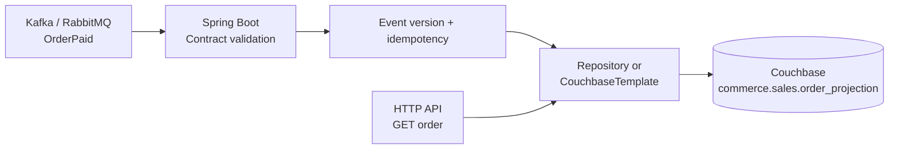
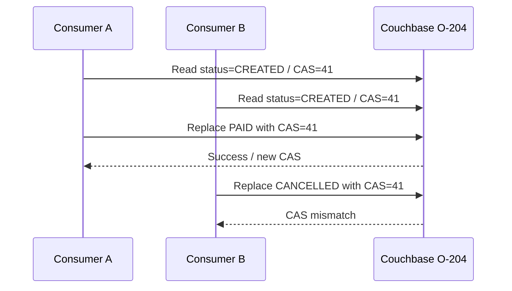
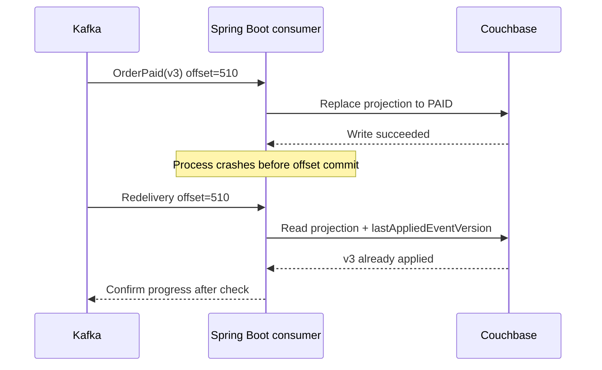

# CouchbaseTemplate, Repositories, and Connection Configuration

## 1. Context and objectives

In the **SPRING_BOOT_INTEGRATION** module, Spring Boot coordinates HTTP flows, SQL, caches, message brokers, and Spring Integration adapters. Some flows require a JSON document store supporting keyed access, projections fed from Kafka/RabbitMQ, or status queries. **Couchbase** is a document database supporting both **key-value (KV)** operations and the **SQL++** query language.

Spring Data Couchbase provides two common integration styles:

- **`CouchbaseRepository`**: interface-based repository offering CRUD, ID lookups, derived queries, and pagination.
- **`CouchbaseTemplate`**: explicit APIs for insert, replace, upsert, find-by-ID, and query operations—ideal when you need explicit write semantics and fine-grained operation customization.

Both access Couchbase through Spring Data configuration. Throughout this lesson, we use an `order-projection` service that consumes payment events from Kafka, updates order status, and serves an HTTP API.



Objectives of this lesson: configure connections, map entities to bucket/scope/collection, use templates and repositories with accurate semantics, understand secondary indexes and query consistency, handle CAS, timeouts, retries, transactions, security, and integration testing.

## 2. Essential Couchbase concepts

| Concept | Role | Example |
| --- | --- | --- |
| Cluster | Set of Couchbase nodes running Data, Query, Index services per deployment | `cb-prod.example.net` |
| Bucket | Storage and resource-management unit | `commerce` |
| Scope | Logical grouping of collections inside a bucket | `sales` |
| Collection | Namespace storing documents and their keys | `order_projection` |
| Document | JSON content bound to a unique document ID within a collection | `tenant42::order::O-204` |
| KV | Read/write by document ID via the Data Service | `findById`, insert, replace |
| SQL++ | JSON queries by field, filter, sort, join | Finding `PAID` orders for a tenant |
| Secondary index | Index structure helping SQL++ avoid full scans | Index on `tenantId` and `status` |
| CAS | Metadata for optimistic concurrency control | Optimistic locking via `@Version` |

Do not confuse the **document key** with the `orderId` field inside JSON. Conventions such as `tenant42::order::O-204` keep keys deterministic across retries and prevent cross-tenant collisions. Never embed passwords, emails, or access tokens in keys because IDs frequently appear in logs, traces, and incident reports.

A KV lookup with a known key normally **needs no secondary index**. Conversely, querying by `status` uses Query/Index services and requires an appropriate index; `findById` succeeding does not prove SQL++ queries are properly indexed.

## 3. Dependencies and connection configuration in Spring Boot

Examples assume **Java 17+, Spring Boot 3.x, and Spring Data Couchbase versions managed by the BOM**. Avoid forcing a Couchbase Java SDK version differing from the Spring Data branch managed by Boot unless verified for compatibility.

```groovy
dependencies {
    implementation 'org.springframework.boot:spring-boot-starter-data-couchbase'
    implementation 'org.springframework.boot:spring-boot-starter-validation'
    testImplementation 'org.springframework.boot:spring-boot-starter-test'
}
```

Spring Boot configures cluster and bucket connectivity via these properties:

```yaml
spring:
  couchbase:
    connection-string: ${COUCHBASE_CONNECTION_STRING:couchbase://localhost}
    username: ${COUCHBASE_USERNAME}
    password: ${COUCHBASE_PASSWORD}
  data:
    couchbase:
      bucket-name: commerce
```

| Property | Meaning |
| --- | --- |
| `spring.couchbase.connection-string` | Seed nodes or cluster endpoint, e.g., `couchbase://localhost` in a lab |
| `spring.couchbase.username` | Principal authenticating against Couchbase |
| `spring.couchbase.password` | Secret supplied via secret manager or environment |
| `spring.data.couchbase.bucket-name` | Default bucket name used by Spring Data |

`couchbase://` in a lab does not represent a secure production connection. For Couchbase TLS, use `couchbases://...` and configure trust chains and hostname verification per your Couchbase SDK and Spring Boot versions. Never disable certificate validation just to bypass handshake errors.

### Environment profiles

```yaml
# application-prod.yml — example
spring:
  couchbase:
    connection-string: ${COUCHBASE_CONNECTION_STRING}
    username: ${COUCHBASE_USERNAME}
    password: ${COUCHBASE_PASSWORD}
  data:
    couchbase:
      bucket-name: commerce
```

Local setups may use `couchbase://localhost`, test credentials, and a dedicated bucket; production uses IAM/secret managers, network policies, and TLS. Never hardcode passwords in Git, images, or diagnostic logs. During secret rotation, verify SDK client lifecycle and rollout/restart needs: updating a Secret object does not automatically refresh credentials on existing live connections.

### What Spring Boot does not create automatically

Adding the starter and Java entities **does not provision** server-side resources. Before the application runs, you must have:

1. A running cluster whose advertised node addresses are reachable from the deployment environment.
2. Bucket `commerce`, scope `sales`, and collection `order_projection` if using the mappings below.
3. A principal with KV and Query privileges scoped to the right bucket/scope/collection, separate from migration/index accounts.
4. Query Service and secondary indexes required for queries beyond `findById`.
5. Monitoring, timeouts, and a schema/index rollout workflow ahead of new code releases.

An account with KV-only privileges can fetch documents by ID yet fail on SQL++ queries. Never grant cluster-wide admin rights to a runtime user merely to simplify bootstrapping.

## 4. Mapping Java entities to documents

Example using `@Document`, `@Id` for identity, and `@Scope`/`@Collection` to specify the namespace:

```java
import java.time.Instant;
import org.springframework.data.annotation.Id;
import org.springframework.data.annotation.Version;
import org.springframework.data.couchbase.core.mapping.Collection;
import org.springframework.data.couchbase.core.mapping.Document;
import org.springframework.data.couchbase.core.mapping.Field;
import org.springframework.data.couchbase.core.mapping.Scope;

@Document
@Scope("sales")
@Collection("order_projection")
public class OrderProjection {
    @Id
    private String id;

    @Field
    private String tenantId;

    @Field
    private String orderId;

    @Field
    private String status;

    @Field
    private Instant updatedAt;

    @Version
    private Long version;

    public OrderProjection() {}

    public OrderProjection(String id, String tenantId, String orderId,
                           String status, Instant updatedAt) {
        this.id = id;
        this.tenantId = tenantId;
        this.orderId = orderId;
        this.status = status;
        this.updatedAt = updatedAt;
    }

    public String getId() { return id; }
    public String getTenantId() { return tenantId; }
    public String getOrderId() { return orderId; }
    public String getStatus() { return status; }
    public Instant getUpdatedAt() { return updatedAt; }
    public Long getVersion() { return version; }

    public void setId(String id) { this.id = id; }
    public void setTenantId(String tenantId) { this.tenantId = tenantId; }
    public void setOrderId(String orderId) { this.orderId = orderId; }
    public void setStatus(String status) { this.status = status; }
    public void setUpdatedAt(Instant updatedAt) { this.updatedAt = updatedAt; }
    public void setVersion(Long version) { this.version = version; }
}
```

Explanation:

- `@Id` maps the **document key**, separate from an `orderId` field inside the JSON body.
- `@Field` marks mapped fields; the mapper applies naming conventions or explicit field names.
- `@Scope` and `@Collection` target the exact collection; matching names must exist on the server.
- `@Version` leverages Couchbase CAS for optimistic locking per Spring Data Couchbase semantics. CAS tracks document mutations, **which is different from** business event ordering versions arriving from Kafka.
- Spring Data may persist type-hint metadata fields; inspect actual JSON output and generated indexes/queries before planning migrations.

Never reuse a document entity directly as an untrusted HTTP/Kafka input DTO. Input DTOs can carry `eventId`, `schemaVersion`, `eventVersion`, and validated fields, while `tenantId` must be verified against the authenticated caller or producer.

## 5. Using `CouchbaseRepository`

Spring Data implements CRUD methods, `findById`, and derived queries for repository interfaces:

```java
import org.springframework.data.couchbase.repository.CouchbaseRepository;
import org.springframework.data.domain.Page;
import org.springframework.data.domain.Pageable;

public interface OrderProjectionRepository
        extends CouchbaseRepository<OrderProjection, String> {

    Page<OrderProjection> findByTenantIdAndStatus(
            String tenantId, String status, Pageable pageable);
}
```

Example keyed lookup service:

```java
import java.util.Optional;
import org.springframework.stereotype.Service;

@Service
public class OrderLookupService {
    private final OrderProjectionRepository repository;

    public OrderLookupService(OrderProjectionRepository repository) {
        this.repository = repository;
    }

    public Optional<OrderProjection> find(String tenantId, String orderId) {
        String key = tenantId + "::order::" + orderId;
        return repository.findById(key);
    }
}
```

Repositories provide convenient abstractions without replacing business authorization; `find(...)` illustrates key construction, whereas real controllers/services must verify an authenticated `tenantId`. `save` can create or update, so **never treat it as “insert only if absent”** when overwrites must be prevented.

| Repository operation | Typical execution path | Secondary index |
| --- | --- | --- |
| `findById(id)` | KV lookup by ID | Usually not needed |
| `save(entity)` | Keyed write | Not needed for basic write |
| `existsById(id)` and `deleteById(id)` | Keyed KV | Usually not needed |
| `findByTenantIdAndStatus(...)` | SQL++ query by fields | Matching index required |
| Custom `@Query` | Declared SQL++ statement | Depends on predicates, sort, indexes |

Avoid `findAll()` on large datasets, especially inside HTTP endpoints. Apply pagination, tenant filters, result size caps, and query timeouts. Deep offset pagination can also degrade: evaluate keyset or cursor approaches against real queries.

## 6. Using `CouchbaseTemplate`

`CouchbaseTemplate` shines when you want explicit **insert-only**, **replace**, **upsert**, or keyed operations inside an adapter:

```java
import java.util.Optional;
import org.springframework.data.couchbase.core.CouchbaseTemplate;
import org.springframework.stereotype.Service;

@Service
public class OrderDocumentCommands {
    private final CouchbaseTemplate template;

    public OrderDocumentCommands(CouchbaseTemplate template) {
        this.template = template;
    }

    public OrderProjection insertOnly(OrderProjection document) {
        return template.insertById(OrderProjection.class).one(document);
    }

    public Optional<OrderProjection> get(String documentId) {
        return Optional.ofNullable(
                template.findById(OrderProjection.class).one(documentId));
    }

    public OrderProjection replaceExisting(OrderProjection document) {
        return template.replaceById(OrderProjection.class).one(document);
    }

    public OrderProjection upsert(OrderProjection document) {
        return template.upsertById(OrderProjection.class).one(document);
    }
}
```

This illustrates the modern fluent API of Spring Data Couchbase; verify exact signatures and behavior on your project version. In particular, test `@Version`/CAS behavior directly for each write method; **never assume `upsert` protects business invariants** or prevents overwriting concurrent modifications.

| Need | Preferred option |
| --- | --- |
| Standard CRUD and derived queries | `CouchbaseRepository` |
| Insert that must fail if key already exists | `CouchbaseTemplate.insertById` |
| Replace a previously read document with concurrency control | Template/SDK + CAS |
| Dynamic queries with custom predicates/pagination | Template, custom repository, or parameterized SQL++ |
| Atomic increments or SDK-specific sub-document operations | Adapter using the Couchbase Java SDK directly when needed |

Template and Repository can coexist in one project; place both behind a unified **service contract** governing IDs, versioning, retries, and telemetry so different paths never apply conflicting write rules.

## 7. SQL++ queries and secondary indexes

Finding documents by `tenantId` and `status` requires Query and Index services. Example SQL++ on the defined collection:

```sql
SELECT META(o).id AS docId, o.orderId, o.status
FROM `commerce`.`sales`.`order_projection` AS o
WHERE o.tenantId = "tenant42"
  AND o.status = "PAID"
LIMIT 20;
```

Namespace identifiers are wrapped in *backticks* per SQL++ syntax. A matching index for this predicate:

```sql
CREATE INDEX ix_order_projection_tenant_status
ON `commerce`.`sales`.`order_projection`(tenantId, status);
```

**This index is a starting point, not a universal recipe.** Spring Data may append type-hint predicates, pagination, or sorting. Inspect the actual executed SQL++ and run `EXPLAIN` to verify the query optimizer plan:

```sql
EXPLAIN
SELECT o.orderId, o.status
FROM `commerce`.`sales`.`order_projection` AS o
WHERE o.tenantId = "tenant42"
  AND o.status = "PAID"
LIMIT 20;
```

When an index is not yet ready, queries fail or crawl. Provision indexes, collections, and RBAC inside deployment/migration pipelines—never assume declaring a Java entity provisions server infrastructure. Specifically:

- **Primary indexes** are handy in labs, yet broad scans in production burn CPU, I/O, and latency budgets.
- Index field order, real filter/sort predicates, and `MISSING`/`NULL` handling affect optimizer efficiency.
- Validate query plans under realistic workloads rather than checking only a handful of test rows.
- Restrict Query Service permissions, scopes/collections, result counts, and execution timeouts; never allow clients to inject raw SQL++ syntax or arbitrary column names.
- Query syntax supports parameter binding for **values**; allowed filter/sort fields must be validated against a server-side allowlist.

A frequent failure mode is `findById` succeeding while `findByTenantIdAndStatus` errors. That usually points to a **missing index, missing Query privileges, or an unavailable Query Service**—not necessarily a full cluster outage.

## 8. Query consistency vs. KV lookups

A successful KV write does not mean a SQL++ query backed by a secondary index reflects the new document immediately. Depending on scan consistency, indexes take time to catch up with recent mutations.

| Read pattern | Characteristics | Best fit |
| --- | --- | --- |
| KV `findById` by key | Uses KV path directly; no index scan needed | Reading a document whose ID is already known |
| SQL++ with `NOT_BOUNDED` | Can return results before the index reflects the latest mutations | Dashboards/listings tolerant of brief lag |
| SQL++ with `REQUEST_PLUS` | Waits for indexes to catch up to mutations completed prior to query | Queries requiring stronger recency |
| SQL++ `AT_PLUS` / mutation state | Waits only for specific mutation tokens to appear in the index | Flows tracking mutation tokens with targeted consistency needs |

Never claim a repository **always** reads the freshest data just because every method uses `CouchbaseTemplate`. Classify use cases:

1. `GET /orders/{id}` right after updating a document: prefer keyed KV reads.
2. `GET /orders?status=PAID`: uses secondary indexes; define acceptable lag.
3. Audit reports requiring point-in-time accuracy: rely on explicit consistency, reconciliation, and snapshot designs; scan consistency alone does not replace auditing logic.

Stronger scan consistency can raise latency and timeouts during index lag. Enable it only where business requirements justify it and validate under load.

## 9. CAS, optimistic locking, and out-of-order events

`@Version` on an entity enables Spring Data to use Couchbase **CAS (compare-and-swap)** to detect concurrent modifications since read. Consider two consumers updating the same order:



On an optimistic locking failure, **never blindly retry the stale object forever**. Re-read the current document, re-evaluate the business state transition, and retry with the new version/CAS only if still valid.

**CAS is not an event version.** If a producer emits `OrderUpdated(v3)` before `OrderUpdated(v2)`, document CAS only prevents two concurrent writes from silently overwriting each other at the exact same instant; it **does not tell** which business event is newer. For order-sensitive projections, store a field such as `lastAppliedEventVersion` and compare explicitly:

| Incoming version | Stored version | Recommended handling |
| --- | --- | --- |
| `v3` | `v3` | Duplicate; skip repeating side effects |
| `v2` | `v3` | Stale event; ignore with logging or route per contract |
| `v4` | `v3` | Valid forward step if transition rules pass |
| `v6` | `v3` | Version gap detected; wait, reload state, or escalate per policy |

When an update depends on current state, use a bounded **read → validate → conditional replace** loop. If multiple producers contend on the same key, partition events by key for sequential processing while still retaining version/CAS checks for crash-recovery retries.

### Why indiscriminate `upsert` causes bugs

`upsert` works well for read models overwritten completely from authoritative snapshots, yet in event-driven flows, upserting a stale status can regress newer state. Follow clear rules:

- `insert` for create-once records where duplicate keys must be detected.
- `replace` with CAS/version guards when updating from previously read state.
- `upsert` only when reading from an authoritative snapshot and blind overwrite is valid.
- When mutations only increment counters or change specific fields conditionally, evaluate atomic KV/sub-document APIs or transactions rather than unprotected read-modify-write cycles.

## 10. Timeouts, retries, and ambiguous write outcomes

Network faults, failovers, Query overload, or slow nodes cause timeouts. In integrated systems, retry policies must match **write semantics**:

| Case | Risk | Handling |
| --- | --- | --- |
| Document not found | Wrong key, missing record, or deleted | Handle not-found per contract; never retry indefinitely |
| Insert fails with key exists | Duplicate event, race condition, or conflicting payload | Read and compare key/payload to separate duplicate vs. conflict |
| CAS mismatch | Another writer updated the document | Re-read, re-check transition, bounded retry |
| Missing query index | Configuration/schema deployment error | Fix index; do not increase retries |
| Authentication/RBAC denied | Wrong credentials or privileges | Alert configuration; fix identity/roles |
| Pre-execution timeout | Mutation likely not applied | Retry only if idempotent, with backoff and cap |
| **Ambiguous timeout** | Client does not know if server persisted the mutation | **Read and reconcile** by key/event ID before re-writing |

Verify exact exception types and semantics for your Couchbase Java SDK version. Never conclude from a `TimeoutException` that the server did not write: especially when **DB write succeeds yet consumer crashes before offset ACK/commit**, the same record will be redelivered.

If each retry generates a random new ID, retries spawn duplicate documents. Use deterministic IDs derived from entity/event keys, uniqueness constraints where suitable, and idempotency guards for downstream HTTP or broker calls.

Align retry counts, backoff, timeouts, and circuit breakers with SLOs and load limits. Stop retrying immediately on permanent failures such as bad permissions, invalid schemas, or missing indexes instead of turning an outage into thousands of retries per second.

## 11. Transactions and consistency with brokers

Single-document KV writes are atomic per operation semantics. When **multiple documents** must update under shared invariants, evaluate Couchbase transactions supported by your SDK/framework, permitted operations, and durability/consistency requirements. Spring `@Transactional` applies only when the matching transaction manager is configured and calls pass through a Spring-managed transaction proxy.

**Never assume JDBC/JPA `@Transactional` covers Couchbase or bundles Couchbase + Kafka + HTTP into a distributed transaction.** Workflows spanning systems require transactional outbox, inbox, idempotent consumers, or sagas depending on requirements.

Consider this flow:



Once re-reading shows `v3` already applied, the consumer must not re-send emails or re-charge payments. If external side effects exist outside Couchbase, enforce idempotency keys at target systems or maintain dedicated delivery state. Kafka transactions for Kafka-to-Kafka pipelines do not automatically create exactly-once semantics for Couchbase.

## 12. Connection and data security

Couchbase JSON documents often hold customer information, so enforce:

- Fetch credentials from a secret manager or environment with least privilege; never store passwords in Git or logs.
- Enforce **RBAC scoped by bucket/scope/collection and operation**; separate runtime accounts from index/migration accounts.
- Enable TLS with certificate, hostname, and CA trust verification; never disable validation to silence errors.
- Restrict network ingress/egress, admin UI access, and Couchbase ports at the infrastructure layer.
- Resolve `tenantId` from the authenticated principal—never trust client-supplied tenant headers blindly.
- Never put emails or tokens into document keys or metric labels; redact raw JSON, SQL++ with PII, secrets, and query results from logs.
- Align retention, TTL, and snapshot/backup access controls with data sensitivity and compliance needs.

When rotating passwords, updating a Secret in the environment **does not prove the running SDK client picked up the new credential**. Follow supported refresh/rollout lifecycles, test new connections, watch authentication error metrics, and only then revoke old credentials.

### TTL and document bounds

When projections only need a limited lifetime, design expiration/TTL explicitly: bucket/collection default TTLs and per-document TTLs can interact on mutations depending on semantics. Test updates carefully so mutations do not accidentally clear TTLs or extend retention unexpectedly.

Never store unbounded JSON documents or infinitely growing event arrays in one document just because document stores permit nested arrays. Bound input sizes, field counts, array lengths, nesting depth, and fan-out to protect memory, Query/Index services, and network bandwidth.

## 13. Observing KV, Query, and cluster health

A baseline dashboard should separate:

| Signal | Purpose |
| --- | --- |
| KV `get/insert/replace` latency | Confirms Data Service meets SLOs |
| CAS conflicts, key exists/not found | Distinguishes contention, duplicates, and data contract errors |
| SQL++ query latency, timeouts, scan volume | Catches missing or suboptimal indexes |
| Index state/lag/build progress | Evaluates query freshness and readiness |
| SDK connection/auth/TLS errors | Diagnoses network, certificate, and credential issues |
| Node/cluster capacity | Tracks CPU, RAM, disk, failovers, replicas, and quotas |
| Kafka consumer lag, redeliveries, retry/DLT | Connects Couchbase outages to consumer backlogs |
| Business event version gaps and duplicates | Surfaces out-of-order events or invalid overwrites |

Structured logs should record `eventId`, safe `documentId`, operation, scope/collection, duration, error code, and trace ID. Never attach full JSON payloads to spans or metric labels. When KV is fast yet SQL++ lags, inspect `EXPLAIN`, index state, and Query Service before scaling application threads.

## 14. Integration testing against real Couchbase

Mocking repositories only verifies mocked business branching—not mappings, namespaces, CAS, query indexes, or scan consistency. Run tests against a real Couchbase instance (e.g., Testcontainers) with **bucket, scope, collection, and indexes** provisioned beforehand.

```java
import static org.junit.jupiter.api.Assertions.assertEquals;
import static org.junit.jupiter.api.Assertions.assertTrue;
import java.time.Instant;
import java.util.UUID;
import org.junit.jupiter.api.Test;
import org.springframework.beans.factory.annotation.Autowired;
import org.springframework.boot.test.context.SpringBootTest;
import org.springframework.data.couchbase.core.CouchbaseTemplate;

@SpringBootTest
class OrderProjectionCouchbaseIT {
    @Autowired
    CouchbaseTemplate template;

    @Autowired
    OrderProjectionRepository repository;

    @Test
    void insertWithTemplateAndReadWithRepository() {
        String orderId = UUID.randomUUID().toString();
        String key = "test-tenant::order::" + orderId;
        var document = new OrderProjection(
                key, "test-tenant", orderId, "CREATED", Instant.now());

        template.insertById(OrderProjection.class).one(document);

        var found = repository.findById(key);
        assertTrue(found.isPresent());
        assertEquals("CREATED", found.orElseThrow().getStatus());
    }
}
```

This is an **integration test skeleton** requiring a test profile and real Couchbase fixture—it cannot run standalone without provisioning the cluster, bucket, and scope. It checks that template and repository share mappings; expand with cases covering:

| Scenario | What to verify |
| --- | --- |
| Repository derived query | Query uses proper index, tenant filter, and pagination |
| Two concurrent writers with same CAS | One succeeds; concurrent modification detected |
| KV write followed immediately by query | Consistency honors policy without relying on fixed sleeps |
| Event v3 then v2 | State does not regress |
| Crash after KV write before offset commit | Redelivery produces no duplicate business side effects |
| Ambiguous timeout | Reconciles key/version and retries safely |
| Invalid RBAC or TLS trust | Rejected explicitly without falling back to weaker security |
| Query/index unavailable | Error classified cleanly; bounded timeout/backoff |

Wait for index readiness using condition polling with timeouts instead of hardcoded `Thread.sleep`. Exercise network faults, crashes, and failovers in isolated test environments.

## 15. Common issues and troubleshooting

| Symptom | Cause to check | Verification |
| --- | --- | --- |
| Cluster connect timeout | DNS, network policy, ports, TLS, advertised node addresses | Test topology reachability from the app environment |
| Authentication failed | Username/password, rotation, secret source | Secret version, user RBAC, fresh connections |
| Collection does not exist | `@Scope`/`@Collection` mismatch with server resources | Verify provisioned namespaces |
| `findById` works yet derived query fails | Query/Index Service or missing secondary index | Query logs, `EXPLAIN`, index readiness |
| Query returns stale data | Index lag and scan consistency option | KV `get` by ID vs. query consistency |
| CAS/optimistic locking failure | Concurrent writer modified the document | Re-read and recompute transition |
| Timeout though server persisted write | Ambiguous mutation outcome | Read key + business version/idempotency |
| Event redelivery regresses state | Missing event version guard | Compare `lastAppliedEventVersion` |
| Queries slow after cache expires | Broad scans, wrong index, unbounded results | `EXPLAIN`, scan metrics, bounded limits |
| Fails only in production | RBAC, TLS, bucket, networking, SDK version drift | Compare deployment config and per-dependency health |

## 16. Hands-on exercise: from Kafka to Couchbase

**Prompt:** A consumer receives `OrderCreated`, `OrderPaid`, and `OrderCancelled` from Kafka, stores projections in `commerce.sales.order_projection`, and serves two APIs: lookup by ID, and list `PAID` orders for a tenant.

Requirements:

1. Provision bucket, scope, collection, and indexes; separate runtime credentials from migration credentials.
2. Configure `spring.couchbase.*` and `spring.data.couchbase.bucket-name` per profile, pulling secrets from environment variables.
3. Define `OrderProjection` with `@Id`, `@Version`, and `lastAppliedEventVersion` to reject stale events.
4. Use template insert-only for creation events; update with CAS/version guards on subsequent events.
5. Use repository `findById` for the ID endpoint, and a derived query + index for the list endpoint.
6. Deliver `OrderPaid(v3)` before `OrderCreated(v2)`: prove stale state is never applied and gaps are handled.
7. Simulate a process crash after Couchbase writes succeed but before committing the Kafka offset; verify redelivery causes no duplicate side effects.
8. Measure Query latency/index readiness, KV timeouts, CAS conflicts, Kafka lag, and duplicate events.
9. Verify document keys omit PII/secrets and RBAC/TLS are enforced.

### Acceptance criteria

| Verification | Expected outcome |
| --- | --- |
| Bootstrap | Correct cluster, bucket, scope, collection, and permissions |
| KV CRUD | Insert, lookup, and replace honor keys and mappings |
| Derived query | Backed by proper index, bounded results, and tenant isolation |
| Concurrency | No silent lost updates thanks to CAS |
| Event replay | Business effect applied at most once |
| Query consistency | Clear policy when immediate freshness is needed |
| Timeouts | Ambiguous outcomes reconciled; retries bounded |
| Monitoring | Separates KV, Query, Index, auth, and consumer lag |

## 17. Design mistakes to avoid

1. Assuming that because `findById` works, no queries need indexes.
2. Calling `findAll` on large datasets and filtering in Java.
3. Using `upsert` for every mutation without CAS or business versions.
4. Retrying write timeouts without verifying whether the write succeeded.
5. Putting emails, passwords, or tokens into document keys and logs.
6. Passing arbitrary bucket, scope, or collection names from user requests into queries.
7. Believing SQL/JPA `@Transactional` spans Couchbase, Kafka, and HTTP.
8. Ignoring secondary index eventual consistency when read-your-own-writes is required.
9. Granting index creation/deletion rights to runtime app accounts instead of deployment pipelines.
10. Rotating a secret in a secret manager without verifying running clients picked it up.
11. Exposing Couchbase entity classes directly as HTTP input DTOs, letting callers tamper with internal fields.
12. Skipping Spring Boot / Spring Data / SDK version checks before configuring template APIs or transactions.

## 18. Self-check questions

1. How do `CouchbaseTemplate` and `CouchbaseRepository` differ in abstraction level?
2. Why does `findById` normally require no secondary index while `findByTenantIdAndStatus` does?
3. How do bucket, scope, and collection affect Spring Data configuration?
4. Does CAS from `@Version` replace `eventVersion` when Kafka delivers events out of order?
5. After a KV write, why might a SQL++ query not immediately return the new data?
6. How do you prove that delivering the same Kafka record twice applies the projection effect only once?
7. When a mutation times out, why can you not assume Couchbase left the document untouched?
8. In a service modifying multiple documents together, why must you check the transaction manager and supported operations?
9. What is the difference between KV permissions, Query permissions, and index/migration permissions?
10. Why is mocking repository interfaces insufficient for testing derived queries and optimistic locking?

## Summary

In **SPRING_BOOT_INTEGRATION**, Spring Data Couchbase connects Spring Boot applications to a document store via **`CouchbaseTemplate`** and **`CouchbaseRepository`**. `spring.couchbase.*` configures cluster endpoints and credentials, `spring.data.couchbase.bucket-name` picks the bucket, and `@Scope`/`@Collection` bind entities to namespaces. Keyed KV operations and field-based SQL++ queries differ in indexing, latency, and freshness. In real HTTP/broker flows, enforce CAS, business event versions, redelivery idempotency, reconciliation after ambiguous timeouts, clear transaction boundaries, TLS/RBAC, reviewed query plans, and integration tests against real Couchbase.

### References

- [Spring Boot Reference — NoSQL / Couchbase](https://docs.spring.io/spring-boot/reference/data/nosql.html)
- [Spring Data Couchbase Reference](https://docs.spring.io/spring-data/couchbase/reference/)
- [Couchbase Java SDK Documentation](https://docs.couchbase.com/java-sdk/current/hello-world/start-using-sdk.html)
- [Couchbase SQL++ — CREATE INDEX](https://docs.couchbase.com/server/current/n1ql/n1ql-language-reference/createindex.html)
