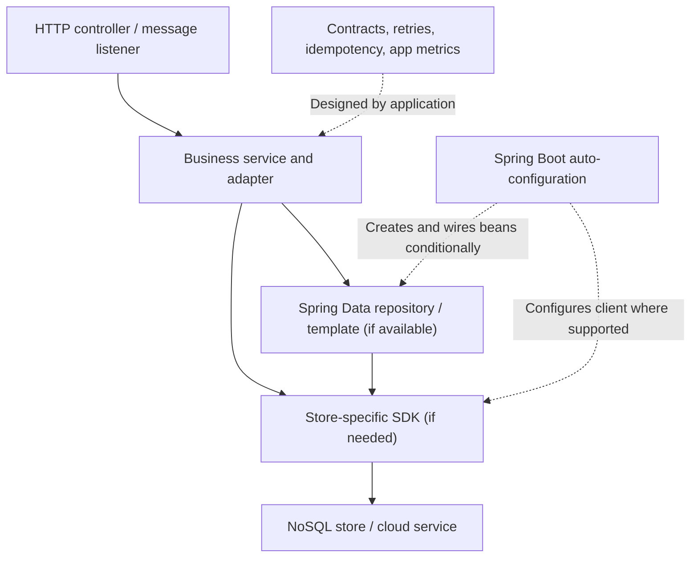
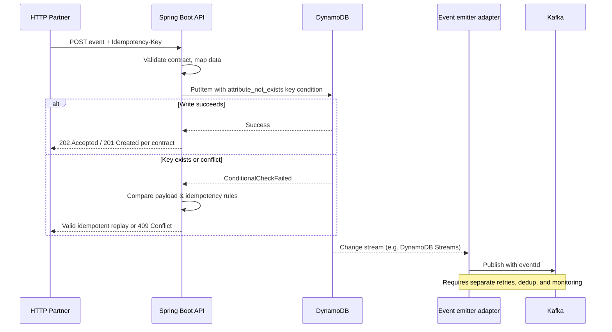

# Distinguishing Boot Auto-Configured Features from Vendor-Supplied Capabilities

## 1. Why make this distinction?

When integrating a NoSQL store into a **Spring Boot** application, adding a starter and setting a few properties is often enough to get a working client, template, or repository. That makes it easy to mistakenly assume Spring Boot is also responsible for every capability of the datastore itself: creating tables or buckets, provisioning indexes, managing partitions, guaranteeing transactions, handling network failures, securing access, and monitoring performance.

In reality, those responsibilities sit across different layers. Within the **SPRING_BOOT_INTEGRATION** module, this distinction matters especially because a single integration flow may simultaneously receive HTTP requests, write to NoSQL, use a cache, emit events through a broker, and call external adapters. Starting up cleanly **does not** mean the whole pipeline has sound data contracts, safe deduplication, or consistency guarantees.

After this lesson, you will be able to:

- Identify what belongs to Boot's *auto-configuration* vs. what is handled by Spring Data, vendor drivers/SDKs, the datastore service, and business code.
- Decide when to rely on an official starter and when to declare custom SDK beans or adopt a third-party starter.
- Verify which configuration actually took effect, and design error handling, transactions, idempotency, testing, and observability for a NoSQL integration flow.

## 2. Five layers of responsibility in a NoSQL integration

| Layer | Primary responsibility | What you should not infer |
|---|---|---|
| **Spring Boot auto-configuration** | Evaluates dependencies, properties, and conditions to create and wire selected beans: clients, connection factories, templates, repository infrastructure, health indicators, or metrics where supported. | That Boot creates databases, indexes, tables, buckets, or clusters, or guarantees query and transaction correctness. |
| **Spring Data** (if the store has a module) | Object ↔ document/record mapping, repository abstractions, templates, and transaction integration within what the store supports. | That all NoSQL stores share identical query models, transaction capabilities, or consistency guarantees. |
| **Vendor Driver / SDK** | Implements wire protocols, dispatches commands, handles supported authentication, and exposes store-specific APIs such as conditional writes, bulk APIs, durability, and query options. | That the SDK understands your API contracts, deduplicates business events automatically, or coordinates across other systems. |
| **NoSQL service / cluster** | Persists data, executes replication, partitioning, indexing, TTL, backups, quotas, access policies, and engine-level limits. | That adding a dependency or editing `application.yml` provisions cloud/cluster infrastructure. |
| **Application and operations** | Designs data contracts, identifier keys, idempotency, retries, timeouts, cross-system transactions, migrations, testing, and alerting. | That those concerns are solved automatically by a starter name or repository annotation. |

You can visualize the dependency flow as follows:



**Dividing line:** Boot is the **configuration wiring** layer; Spring Data is the **data-access abstraction** layer; the SDK and service deliver the **specific database engine capabilities**. An application can use all three, use only the SDK, or combine them per operation.

## 3. What does Boot actually auto-configure?

Auto-configuration is driven by conditions—not merely by the word “NoSQL” appearing in your project:

1. **Classpath:** Are the required dependencies and client classes present? For example, the Spring Data Redis starter pulls in the driver and integration needed for a `RedisConnectionFactory`.
2. **Properties:** Are connection settings, credentials, database/bucket names, timeouts, etc., configured using keys matching the *running Boot version*?
3. **Existing beans:** Many auto-configurations use mechanisms like `@ConditionalOnMissingBean` to step aside when your app defines its own bean; never assume every bean follows this pattern without checking.
4. **Additional conditions:** Are Spring Data modules, Actuator, Micrometer, enable/disable flags, or supporting beans present?

When conditions match, Boot **may** supply connection factories/clients, templates, repository infrastructure, and related operational hooks. Always check exact bean names and scope in documentation and dependencies for your **exact version**—names and modules shift across releases.

Common examples:

| Data store | Typically supported by Boot / Spring Data with the right starter | Still owned by driver, provider, or application |
|---|---|---|
| **Redis** | Redis connection, `RedisTemplate`, `StringRedisTemplate`, repository support if configured. | Key design, TTL, eviction, real Redis Cluster/Sentinel topology, Lua/scripts, stream consumer semantics, cache stampede prevention. |
| **Couchbase** | Cluster connection config and `CouchbaseTemplate`/repository support via Spring Data Couchbase. | Creating buckets/scopes/collections, query indexes, durability, SDK sub-document operations, cluster configuration. |
| **Cassandra** | `CqlSession` and Spring Data Cassandra access layer when compatible dependencies exist. | Creating keyspaces, partition keys, compaction, consistency levels, topology, query-first table modeling. |
| **Neo4j** | Driver and Spring Data Neo4j repository/transaction infrastructure when conditions match. | Advanced Cypher, indexes/constraints, routing, cluster behavior, query plans. |
| **Elasticsearch** | Client and Spring Data Elasticsearch abstractions aligned with library versions. | Index templates, analyzers, mappings, lifecycle policies, shards/replicas, server API versions. |
| **Amazon DynamoDB** | **Spring Boot core provides no built-in DynamoDB auto-configuration** merely from adding the AWS SDK. Use custom bean config or a separately chosen third-party starter. | AWS SDK / Enhanced Client, IAM, tables, key schemas, conditional writes, streams, TTL, capacity modes, retry policies. |

**Note:** This table illustrates responsibility boundaries, not a promise that a starter unconditionally builds every listed bean. For example, repositories require the matching Spring Data module, and health indicators typically depend on Actuator. Distinguish capabilities of a *third-party starter* from **Spring Boot core**.

## 4. Example A — A store with auto-configuration support: Couchbase

Suppose an HTTP service saves an order read model into Couchbase. Using Spring Data Couchbase, you start with the starter:

```kotlin
dependencies {
    implementation("org.springframework.boot:spring-boot-starter-data-couchbase")
}
```

Illustrative application configuration using standard Spring Boot 3.x properties:

```yaml
spring:
  couchbase:
    connection-string: ${COUCHBASE_CONNECTION_STRING}
    username: ${COUCHBASE_USERNAME}
    password: ${COUCHBASE_PASSWORD}
  data:
    couchbase:
      bucket-name: ${COUCHBASE_BUCKET}
```

With a valid classpath and properties, Boot and Spring Data assemble the supported Couchbase access objects. The developer can then declare a repository:

```java
// OrderReadModel is an application-defined and mapped Couchbase entity.
public interface OrderReadModelRepository
        extends CouchbaseRepository<OrderReadModel, String> {
}
```

**What this configuration has NOT done:**

- It has not created the cluster, bucket, scope/collection, or query indexes in Couchbase.
- It has not decided whether document keys prevent collisions, nor chosen business-appropriate consistency/durability levels.
- It has not tuned timeouts, retries, or flaky-connection handling; client defaults must be validated under real load.
- It has not made Couchbase writes and Kafka event publishing atomic together.

If you need the Couchbase SDK's sub-document API or explicit durability options, call the SDK API or supported Spring Data extensions; **the starter does not turn every Couchbase feature into generic Spring Data annotations**. Manage indexes and cluster resources via controlled deployment/migration pipelines.

## 5. Example B — A store requiring SDK integration: DynamoDB

For DynamoDB, adding AWS SDK v2 alone does not make Spring Boot core create a `DynamoDbClient` bean. The application needs explicit bean configuration, or a deliberately evaluated third-party auto-configuration library.

```kotlin
dependencies {
    implementation("software.amazon.awssdk:dynamodb")
}
```

Manage AWS SDK versions consistently via a BOM or dependency constraints. Illustrative configuration:

```yaml
integration:
  dynamodb:
    region: ${AWS_REGION:ap-southeast-1}
```

```java
import org.springframework.beans.factory.annotation.Value;
import org.springframework.context.annotation.Bean;
import org.springframework.context.annotation.Configuration;
import software.amazon.awssdk.auth.credentials.DefaultCredentialsProvider;
import software.amazon.awssdk.regions.Region;
import software.amazon.awssdk.services.dynamodb.DynamoDbClient;

@Configuration(proxyBeanMethods = false)
class DynamoDbConfiguration {
    @Bean(destroyMethod = "close")
    DynamoDbClient dynamoDbClient(
            @Value("${integration.dynamodb.region}") String region) {
        return DynamoDbClient.builder()
                .region(Region.of(region))
                .credentialsProvider(DefaultCredentialsProvider.create())
                .build();
    }
}
```

Here **Spring** manages the bean lifecycle you declared, while the **AWS SDK** handles connections, request signing, credential chain resolution, and DynamoDB APIs. IAM roles, tables, key schemas, and endpoint reachability must still be provisioned externally. In real environments, prefer workload identities/IAM roles over hardcoded access keys.

One **DynamoDB capability**—not generated by Boot—is conditional writes to prevent duplicate records:

```java
import java.util.Map;
import software.amazon.awssdk.services.dynamodb.model.AttributeValue;
import software.amazon.awssdk.services.dynamodb.model.PutItemRequest;
import software.amazon.awssdk.services.dynamodb.model.ConditionalCheckFailedException;

void recordOnce(DynamoDbClient client, String eventId, String payload) {
    try {
        client.putItem(PutItemRequest.builder()
                .tableName("integration_events")
                .item(Map.of(
                        "pk", AttributeValue.builder().s(eventId).build(),
                        "payload", AttributeValue.builder().s(payload).build()))
                .conditionExpression("attribute_not_exists(pk)")
                .build());
    } catch (ConditionalCheckFailedException duplicate) {
        // Inspect the existing record and idempotency rules before deciding
        // whether this is a valid retry or a payload conflict.
        throw duplicate;
    }
}
```

This assumes the `integration_events` table already exists with a string partition key named `pk`. `attribute_not_exists(pk)` is a DynamoDB server-side condition; Boot never infers it from a repository name or HTTP header. Notice the catch block intentionally **does not treat every conditional failure as success**: receiving the same `eventId` with a different payload may indicate a data conflict requiring a business error.

If you adopt the *DynamoDB Enhanced Client* for object mapping, that still comes from the AWS SDK. A third-party starter might configure clients or mappers automatically, yet you must track which component owns each bean, which credentials it uses, and whether it collides with manual configuration.

## 6. Responsibility matrix when designing an integration

| Technical concern | What Boot / Spring Data helps with | Who holds final responsibility? |
|---|---|---|
| **Connectivity & config** | Property binding, supported bean creation, Spring lifecycle, applying user config. | Application selects endpoints/regions, TLS, permissions; provider operates and protects endpoints. |
| **Data contracts & serialization** | Maps objects to documents/records via Spring Data converters when used. | Application manages schema evolution, required fields, producer/consumer compatibility, legacy records. |
| **Indexes & query models** | Provides query APIs, mapping metadata, and limited schema options per module. | Engineering and ops design keys, indexes, shards/partitions, and migrations. |
| **Transactions** | Configures transaction managers for stores that support them, within native limits. | Application defines transaction boundaries; never assume transactions span Redis/Couchbase/DynamoDB/Kafka. |
| **Retries & timeouts** | Binds exposed client properties; integrates external resilience libraries. | Drivers define low-level faults and internal retries; application retries only safe operations with backoff, deadlines, and idempotency. |
| **Deduplication** | Repositories assist reading/writing, without adding business idempotency. | Application defines idempotency keys, uniqueness/conditional writes, and conflict policies. |
| **Observability** | Actuator, Micrometer, and health/metrics for supported integrations when configured. | Application adds business metrics; vendor/service provides cluster metrics; monitor both. |
| **Security & secret lifecycle** | Injects properties or custom beans into runtime. | Operations manage secrets, roles, networking, rotation, IAM/ACLs, least privilege; redact logs. |

Common confusion: features inside **Spring Data** are not necessarily written by **Boot** itself. For instance, `CouchbaseRepository` belongs to Spring Data Couchbase; Boot merely wires components together. Likewise, built-in driver retries never authorize your application to blindly resend non-idempotent writes without verification.

## 7. Real-world flow: HTTP → DynamoDB → message broker

Suppose an adapter handles `POST /integrations/order-events`, stores the event in DynamoDB, and emits updates downstream via Kafka. This illustrates the boundaries in **SPRING_BOOT_INTEGRATION**:



In this design:

1. **Boot** runs the web server, HTTP binding, lifecycle of declared beans, and Kafka auto-configuration when Kafka dependencies are present.
2. **AWS SDK and DynamoDB** execute conditional writes; if using DynamoDB Streams, the service and stream adapter/SDK handle reading change records.
3. **The application** normalizes payloads, enforces idempotency keys, maps errors to consistent HTTP responses, monitors latency/retries, and prevents duplicate event emissions.

Writing to DynamoDB and publishing directly to Kafka inside one request handler **is not atomic**. Crashing between the two writes leaves stored data with no emitted event. Depending on requirements, use a change stream such as DynamoDB Streams or a store-compatible outbox mechanism. Even with streams, consumers must tolerate redelivery or duplicate processing; check the service's actual ordering, retention, and delivery guarantees.

For Redis caches accelerating reads, Boot configures the client, yet **cache invalidation strategies** and stale-read prevention belong to the application. Never treat cache state as proof that a multi-system transaction completed.

## 8. How to verify what Boot actually auto-configured

Never guess from dependency names. Run these verification steps against your exact Boot version and deployment profile:

1. **Inspect actual dependencies:** check the dependency tree for official starters, Spring Data modules, drivers, AWS SDKs, or third-party starters. An SDK alone does not imply Boot auto-configuration exists.
2. **Check supported properties:** verify property metadata and docs for your exact version instead of copying outdated snippets assuming they still bind.
3. **Read the condition evaluation report:** run with `--debug` locally to inspect which auto-configurations matched or did not match and why. With Actuator enabled and authorized, `/actuator/conditions` shows the same data.
4. **Inspect actual beans:** check which clients, templates, or repositories exist in `ApplicationContext`, and whether each came from auto-configuration or a custom `@Configuration`—confirming where user beans caused auto-configuration to back off.
5. **Verify against a real store:** connecting cleanly does not prove write privileges, indexes, consistency, or timeout recovery. Exercise controlled reads/writes and failure paths.

For DynamoDB, finding a `DynamoDbClient` bean declared in `DynamoDbConfiguration` above means it is an **application-configured bean**, not proof that Boot core auto-configures DynamoDB. Conversely, for Couchbase with its starter, Boot/Spring Data wires the client and template conditionally—still check whether any bean was overridden or missed a property.

## 9. Testing and observability for integration flows

A production-grade NoSQL flow needs verification beyond “the app starts without errors.”

| Test type | Minimum coverage | Commonly missed gaps |
|---|---|---|
| **Adapter/logic unit tests** | Request → document mapping, validation, duplicate-key handling, exception mapping, retry decisions. | Swallowing all conditional failures as “already processed,” hiding real conflicts. |
| **Store integration tests** | Bean wiring using realistic config; reads/writes; required indexes; codecs/serialization; timeouts and supported rollbacks. Use Testcontainers where suitable. | Mocked unit tests pass while real commands or query indexes are missing. |
| **Contract tests** | JSON/field compatibility, versions, HTTP status semantics, idempotency keys, emitted events. | Producers add fields or change types, breaking downstream consumers. |
| **Failure tests** | Flaky networks, throttles/quotas, permission denials, timeouts after server write, event retries/duplicates, broker unavailable. | Retries cause duplicate writes; “dual-writes” drop events. |
| **Operational checks** | Health/readiness, connection pools, p95/p99 latency, timeout/throttle rates, retry counts, stream/consumer lag, DLQ, conflict counts. | Health endpoint says UP while a business flow is completely stuck. |

Separate telemetry cleanly:

- **Application signals:** request successes/failures by error type, valid duplicates vs. conflicts, end-to-end time from HTTP receipt to persistence and event emission, backlog size.
- **Client/driver signals:** SDK call latency, connection counts, timeouts, throttling, retries, and auth errors where exposed.
- **Service signals:** CPU/memory or provisioned capacity, server latency, index/replica health, throttle rates, and stream health from provider monitoring.

Never log tokens, access keys, or full sensitive payloads. Use correlation IDs, event IDs, and trace context to connect HTTP, NoSQL, caches, brokers, and adapters without leaking secrets.

## 10. Common misconceptions and how to avoid them

| Misconception | Consequence | Right practice |
|---|---|---|
| “Added the starter, so Boot creates all schemas/indexes.” | Queries fail or crawl on fresh environments. | Manage provisioning and migrations via separate infra workflows; verify indexes before sending traffic. |
| “Using `@Repository` means every store has RDBMS transactions.” | Partial writes when multi-store or broker steps fail. | Verify native transaction scope and design outbox/streams, idempotency, or compensation. |
| “Having the AWS SDK means an official Boot starter exists.” | `DynamoDbClient` bean missing at injection time. | Declare custom beans or select an explicit integration library; inspect the condition report. |
| “The driver retries, so retrying every operation is fine.” | Duplicate writes or out-of-order state. | Classify errors; retry only safe operations using conditional writes, idempotency keys, and bounded backoff. |
| “Health UP means the integration pipeline is healthy.” | Messages stop flowing even though the store answers pings. | Monitor per-stage and end-to-end metrics: backlogs, lag, DLQs, and business transaction outcomes. |
| “Cloud TTL deletes expired items instantaneously.” | Reads still observe expired items briefly. | Verify each service's TTL semantics; enforce expiration checks in app logic when immediate expiry is required. |

## 11. Checklist before shipping a NoSQL adapter to production

- [ ] Documented **what Boot core, Spring Data, SDK, third-party starters, and the NoSQL service** each provide for your exact versions.
- [ ] Inspected active beans and auto-configuration conditions per deployment profile, including custom beans.
- [ ] Provisioned tables/buckets/keyspaces, indexes, permissions, TLS, secrets, and migration/provisioning workflows.
- [ ] Locked schemas and compatibility contracts, partition/document keys, consistency levels, and transaction boundaries.
- [ ] Defined timeouts, bounded retries, idempotency, and rules separating valid duplicates from conflicts.
- [ ] Tested disconnects, ambiguous write timeouts, permission errors, throttling, and slow or unavailable brokers.
- [ ] Established integration/contract tests plus metrics, traces, logs, and alerts across both clients and end-to-end flows.

**Takeaway:** Boot initializes and wires supported components conditionally; Spring Data provides data-access abstractions; vendors supply NoSQL engine features and constraints; and the application remains responsible for integration correctness—especially around transaction boundaries, network failures, and deduplication.
