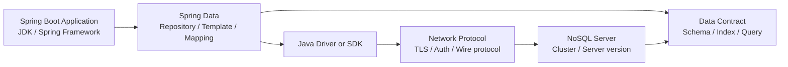

# Checking Compatibility Across Drivers, Servers, and Spring Data During Upgrades

In a Spring Boot application integrating multiple systems, upgrading library versions is never just changing a number in `pom.xml` or `build.gradle`. For example, the app may compile fine after a Spring Boot bump yet fail to connect to the Cassandra cluster; or connect to Couchbase successfully while queries using scopes/collections break; or Spring Data Elasticsearch may start cleanly while index mappings and query behavior subtly shift. Those failures often appear only when the app talks to a real server.

This lesson belongs to the **Other NoSQL Stores** chapter of the **SPRING_BOOT_INTEGRATION** module. Within an integration landscape covering HTTP clients, databases, caches, message brokers, and Spring Integration adapters, compatibility checks must cover **connection configuration, data contracts, transactions, error handling, deduplication, testing, and operational observability**. The goal is concrete proof that the new version still executes business flows properly, even when rolling out application and server versions at different times.

## 1. Compatibility spans multiple layers



| Layer to check | Question to answer | Failure examples if skipped |
| --- | --- | --- |
| JDK, Spring Boot, Spring Framework | What minimum Java and Spring Framework versions does the target require? | Startup crashes due to incompatible APIs or Java bytecode levels. |
| Spring Data modules and release train | Are `spring-data-cassandra`, `spring-data-couchbase`, `spring-data-neo4j`, etc. aligned on a tested release train? | `NoSuchMethodError`, missing beans, altered repository/mapping behavior. |
| Driver/SDK and transitive dependencies | Which driver version actually sits on `runtimeClasspath`? Are any versions pinned or duplicated? | Binary linkage errors, broken codecs, serializers, or driver settings. |
| Protocol and security | Does the driver support the server's wire protocol, auth mechanisms, TLS, and cluster mode? | Handshake, authentication, SSL, or node discovery failures. |
| Server and features | Does the target server support the commands, features, topology, and upgrade path? | Statements or queries rejected despite establishing a connection. |
| Data and application behavior | Do schemas, indexes, data types, TTLs, pagination, concurrency, and retries still satisfy contracts? | Wrong reads, duplicate writes, lost updates, latency regressions. |

**Distinguish three milestones:** *compiling* only proves build-time APIs exist; *connecting* only proves parts of wire protocol, networking, and authentication; *business compatibility* requires exercising real reads/writes, mappings, queries, errors, and end-to-end integration flows. Never infer one milestone from another.

Official compatibility matrices must also be read in context: versions used to build and test a release are not an implicit promise to support every future server version. Support windows, maintenance schedules, and major-version limits must be verified in the docs for the **exact versions** of Spring Data, drivers, and server vendors.

## 2. Lock down the real version baseline before upgrading

Before touching dependency files, record the current **baseline** and target versions across every environment.

| Component | Baseline to record | Target to verify |
| --- | --- | --- |
| Runtime | Java, Spring Boot, Spring Framework | Minimum requirements and major-version configuration changes. |
| Spring Data | Release train, module, and Spring Data Commons version | Release train managed by Boot; corresponding migration guides. |
| Driver/SDK | Artifact coordinates and actual resolved version | Server support window, breaking changes, transitive dependencies. |
| Server | Per-node version, cluster mode, compatibility flags, enabled features | Supported upgrade paths; mixed old/new node windows. |
| Data contract | Schemas, indexes, queries, codecs, TTLs, consistency, ID types, serialization | Bidirectional read/write compatibility and data migration/rollback. |
| Operations | TLS, auth, secrets, node addresses, timeouts, pools, retries, metrics | Post-upgrade operational configurations and alert thresholds. |

With Maven, inspect resolved versions after applying BOMs, parents, and transitive resolution:

```bash
./mvnw help:effective-pom -Doutput=target/effective-pom.xml
./mvnw dependency:tree -Dincludes=org.springframework.data:*
./mvnw dependency:tree -Dincludes=com.datastax.oss:*
./mvnw dependency:tree -Dincludes=org.neo4j.driver:*
```

With Gradle:

```bash
./gradlew dependencies --configuration runtimeClasspath
./gradlew dependencyInsight --dependency spring-data-cassandra --configuration runtimeClasspath
./gradlew dependencyInsight --dependency java-driver-core --configuration runtimeClasspath
```

These commands illustrate Cassandra and Neo4j; substitute coordinates for Couchbase, MongoDB, or Elasticsearch as needed. For packaged `bootJar` artifacts, inspect the actual bundled libraries inside the deployable JAR. Declared dependencies alone do not reveal runtime driver versions once BOMs, plugins, and transitive exclusions take effect.

**Precedence rule:** when using Spring Boot starters, let Spring Boot manage Spring Data and its aligned dependencies together; override a release train or driver version only with documented vendor support and thorough extra testing. Never bump a single Spring Data module to a new major version assuming other modules and Spring Framework stay compatible. Outside Spring Boot BOMs, align modules using the **Spring Data Release Train BOM**.

## 3. Store-specific upgrade checks

| Datastore and access layer | What to check across version bumps | Minimum high-value tests |
| --- | --- | --- |
| **Apache Cassandra** — Spring Data Cassandra, Java Driver, CQL | Which server/protocol versions the driver supports; local datacenter, node discovery, consistency levels, keyspaces, data types, CQL/schema changes. | Full-cluster connectivity; partition-key reads/writes; prepared statements, paging, timeouts/retries, unavailable-node faults. |
| **Couchbase** — Spring Data Couchbase, Couchbase Java SDK | SDK and Couchbase Server compatibility; buckets/scopes/collections; RBAC permissions, indexes, SQL++/Query, CAS, expiry/TTL. | Template/repository CRUD; queries hitting real secondary indexes; CAS updates and document expiration. |
| **Neo4j** — Spring Data Neo4j, Neo4j Java Driver | Bolt/driver/server matrix; URI config, database selection, cluster routing; Cypher syntax, relationship mappings, transactions. | Node and relationship reads/writes; transactional rollbacks; active Cypher queries; targeting the right database. |
| **Elasticsearch** — Spring Data Elasticsearch, Java API Client (per release line) | Spring Data–Elasticsearch matrix; client API shifts, mappings, analyzers, templates, index aliases, Query DSL. | Create/read documents, refresh then search; compare query results and mappings/indexes; test pagination. |
| **MongoDB** — Spring Data MongoDB, MongoDB Java Driver | Driver–server compatibility; Feature Compatibility Version if applicable; BSON codecs, aggregations, transactions, change streams, auth/TLS. | CRUD, aggregations, indexes, transactions/change streams where used; verify legacy vs. new BSON records. |
| **Redis** — Spring Data Redis, Lettuce/Jedis | Server/RESP protocol version; standalone/sentinel/cluster; codecs, Lua scripts, TTLs, cache serialization. | Key reads/writes; expiry; scripts and failovers; reading older cached entries written by prior app versions. |

MongoDB and Redis entries provide cross-store reference points; for **other NoSQL stores**, prioritize the exact engines integrated by this module—Cassandra, Couchbase, Neo4j, and Elasticsearch. Some stores use vendor SDKs or custom adapters rather than an official Spring Data module; check the same layers without assuming a Spring Data release train manages them.

For example, Spring Data Elasticsearch's compatibility matrix explicitly maps release trains, Spring Data versions, Elasticsearch versions, and Spring Framework versions. For Cassandra, verify **protocol support** alongside datacenter and schema settings. For Couchbase, a passing `ping` does not prove SQL++ queries still run if index behavior or permissions changed.

## 4. Build an upgrade matrix accounting for rolling deployments

Do not test only the final target state. Unless the application and database upgrade simultaneously during downtime, both old and new versions will run concurrently. Record results across all plausible combinations:

| Application | Server | Why test this combination? |
| --- | --- | --- |
| Old | Old | Known baseline; existing tests must still pass. |
| **New** | **Old** | Required when upgrading the application first or before server upgrades finish. |
| **Old** | **New** | Required when upgrading the server first or during an application rollback. |
| New | New | Target state and performance acceptance criteria. |

Depending on the store, certain combinations may be **unsupported by the vendor**; mark them *do not deploy* and adjust upgrade sequencing instead of testing them ad hoc and trusting lucky passes. For clusters, consult official guidance on mixed-version nodes during server rolling upgrades.

Before executing, lock down allowed upgrade paths:

1. **Read release notes and compatibility matrices** for Spring Boot, Spring Data modules, drivers/SDKs, and servers across source and target versions; note JDK requirements, removed APIs, renamed properties, and deprecated features.
2. **Choose an officially supported sequence:** server-first vs. app-first, intermediate hop versions if required, and mixed-node windows.
3. **Design forward-compatible schemas and data formats:** add fields/indexes before the new app uses them; keep fields still read by the old app; test cross-version serialization compatibility in case of rollback.
4. **Test in production-like environments:** matching topology, auth/TLS, sample data, indexes, replication, and realistic data scale to expose timeouts, paging issues, or query plan shifts.
5. **Rehearse rollback:** take proper snapshots/backups; identify schema, index, or feature changes that cannot be undone simply by redeploying the old JAR.

Record every matrix cell with exact versions, test date, build/log link, approver, `PASS`/`FAIL`/`NOT_SUPPORTED`, and open issues. `Untested` never counts as `PASS`.

## 5. Example: proving Spring Data Cassandra works with a target server

Suppose a Spring Boot service writes integration events to Cassandra before publishing notifications to a broker. When upgrading Boot, Spring Data, the driver, or Cassandra Server, you must prove **the driver connects**, **Spring Data mappings remain valid**, and **retries never duplicate events**. The snippet below verifies the first two; deduplication requires dedicated business-level tests.

### 5.1. Keep dependencies aligned

With a Spring Boot parent or BOM, declare dependencies without custom version overrides:

```xml
<dependencies>
    <dependency>
        <groupId>org.springframework.boot</groupId>
        <artifactId>spring-boot-starter-data-cassandra</artifactId>
    </dependency>
    <dependency>
        <groupId>org.springframework.boot</groupId>
        <artifactId>spring-boot-starter-test</artifactId>
        <scope>test</scope>
    </dependency>
</dependencies>
```

Never force custom versions on `spring-data-cassandra` or `java-driver-core` just to make the dependency tree look newer. Inspect resolved versions after upgrading Boot and verify server support in driver docs.

### 5.2. Test environment with a fixed schema

Use a dedicated Cassandra test cluster with keyspace `integration_test`, never production. Provision the table via migrations or test fixtures beforehand:

```sql
CREATE TABLE IF NOT EXISTS integration_test.integration_probe (
    id text PRIMARY KEY,
    payload text
);
```

Example `src/test/resources/application-test.yml`:

```yaml
spring:
  cassandra:
    contact-points: "${CASSANDRA_CONTACT_POINTS:127.0.0.1:9042}"
    local-datacenter: "${CASSANDRA_DC:datacenter1}"
    keyspace-name: integration_test
    schema-action: none
```

The keyspace must already exist, and `local-datacenter` must match the real cluster. For TLS/auth, configure Boot properties matching the test cluster. Never set `schema-action` to auto-create/drop schemas against real data just to make a test pass.

### 5.3. Protocol and mapping test through Spring Boot

```java
import static org.assertj.core.api.Assertions.assertThat;

import java.util.UUID;

import com.datastax.oss.driver.api.core.CqlSession;
import com.datastax.oss.driver.api.core.cql.Row;
import org.junit.jupiter.api.Test;
import org.springframework.beans.factory.annotation.Autowired;
import org.springframework.boot.test.context.SpringBootTest;
import org.springframework.data.cassandra.core.CassandraTemplate;
import org.springframework.data.cassandra.core.mapping.PrimaryKey;
import org.springframework.data.cassandra.core.mapping.Table;
import org.springframework.test.context.ActiveProfiles;

@SpringBootTest
@ActiveProfiles("test")
class CassandraUpgradeCompatibilityIT {

    @Autowired CqlSession session;
    @Autowired CassandraTemplate template;

    @Test
    void driverCanQueryTargetServer() {
        Row row = session.execute("SELECT release_version FROM system.local").one();
        assertThat(row).isNotNull();
        assertThat(row.getString("release_version")).isNotBlank();
    }

    @Test
    void springDataCanRoundTripMappedEntity() {
        String id = UUID.randomUUID().toString();
        try {
            template.insert(new Probe(id, "compatible"));
            Probe loaded = template.selectOneById(id, Probe.class);
            assertThat(loaded).isNotNull();
            assertThat(loaded.getPayload()).isEqualTo("compatible");
        } finally {
            template.deleteById(id, Probe.class);
        }
    }

    @Table("integration_probe")
    static class Probe {
        @PrimaryKey
        private String id;
        private String payload;

        Probe() {}

        Probe(String id, String payload) {
            this.id = id;
            this.payload = payload;
        }

        public String getId() { return id; }
        public String getPayload() { return payload; }
    }
}
```

This test exercises both `CqlSession` (driver-to-server wire communication) and `CassandraTemplate` (Spring Data entity mapping). Run it across every **supported** cell of your upgrade matrix pointing at the corresponding server version. With Maven Surefire, `*IT` classes may require Failsafe or explicit include patterns to execute—never treat a green build as proof if the test never ran.

**Scope limits of this example:** single-table CRUD does not cover business queries, secondary indexes/materialized views, complex prepared statements, consistency levels, paging, multi-node failures, concurrency, or retries. If event emission can duplicate after timeouts, add tests for idempotency keys, unique business keys, or outboxes per your design. Never infer cross-system atomicity between Cassandra and a broker from a single successful write test.

## 6. Test suite required before approving an upgrade

Layer tests from fast to thorough without skipping behavioral layers:

| Test layer | Verifies | Acceptance criteria |
| --- | --- | --- |
| **Build and startup** | Dependency tree, Java requirements, context loading, auto-configured beans, deprecation warnings. | Zero classpath conflicts, startup errors, or silently unbound properties. |
| **Connectivity and protocol** | TLS/auth, discovery, server metadata, database/keyspace/bucket selection, failover. | Connects to the right cluster under real operational settings. |
| **Data contracts** | Entity mapping, codecs, ID types, nulls, numbers, date/times, enums, records written by prior versions. | Clean round-trips; legacy records readable; no silent serialization shifts. |
| **Queries and performance** | Query/CQL/Cypher/SQL++/DSL, indexes, paging, pagination, representative load. | Results, sort order, timeouts, and latencies within agreed budgets. |
| **Transactions and reliability** | Rollbacks where supported; concurrency, retries, timeouts, outbox/idempotency, network faults. | No lost updates or duplicate processing violating business rules. |
| **End-to-end integration flows** | NoSQL reads/writes chained with HTTP calls, caching, broker messaging, or Spring Integration adapters. | Identical data contracts and error-handling behavior as baseline. |
| **Deployment and rollback** | Mixed old/new app and server combinations; schema compatibility before/after migrations. | Tested forward rollout and rollback paths. |

For capabilities a technology lacks (such as RDBMS-style multi-row transactions in Cassandra), do not invent nonsensical tests; validate the consistency, atomicity, and guarantees the application genuinely depends on.

## 7. Diagnosing failures to pinpoint the broken layer

| Post-upgrade symptom | Likely cause | First places to check |
| --- | --- | --- |
| `NoSuchMethodError`, `ClassNotFoundException`, bean startup failure | Version skew across Spring Data, Spring Framework, driver, or transitive deps. | Compare `runtimeClasspath`, BOM, API migration notes, packaged JARs. |
| Handshake, protocol/codec, or node discovery errors | Incompatible driver/server pair, changed datacenter/topology settings. | Compatibility docs, server logs, wire protocol, contact points, seed nodes. |
| `SSLHandshakeException` or authentication failure | TLS ciphers/certs, truststore, or auth mechanism changed. | Compare security and identity configs across versions; never disable TLS to mask failures. |
| Rejected queries or corrupted field mapping | CQL/Cypher/SQL++/Query DSL syntax, index/schema, or converter changes. | Run minimal query, diff migrations, inspect query logs and legacy sample data. |
| Timeouts or errors appearing only under load | Pool, retry, pagination, query plan, backpressure, or cluster changes. | Measure p95/p99 latency, connections, error rates, retries, server metrics. |
| New records work while old records fail to read | Codec, JSON/BSON format, enum, timestamp, TTL, or index mapping changes. | Golden dataset created by the previous version; run cross-version read tests. |

When an error occurs, **preserve evidence**: exact version set, full exception, affected cluster/endpoints, sanitized query without sensitive values, timestamps, and relevant metrics. Stabilize service first if data corruption is at risk, then reproduce with the minimal failing version pair.

## 8. Observable rollout and rollback plan

A practical rollout process:

1. **Pre-deploy:** lock dependencies, record baseline and per-node versions, take snapshots/backups per datastore procedures, sign off on the compatibility matrix and migration plan. Prepare feature flags if new clients depend on new server features.
2. **Canary rollout:** route a small fraction of traffic to the new release. Watch errors by category (auth, timeouts, mapping, queries), failure rates, p95/p99 latency, pools, GC, retries, consumer lag, and duplicate counts.
3. **Progressive expansion:** expand traffic only while metrics stay stable and data reconciliation passes. Check full paths like HTTP → NoSQL → broker/cache, not just health endpoints.
4. **Rollback:** revert to the prior application version **only if** schemas, data formats, and server versions still support the old release. If one-way features or formats were activated, execute the pre-tested recovery or forward-compatibility plan.
5. **Post-deploy:** update the live version inventory, test records, cutover timestamps, and any new alerts; remove temporary dependency overrides once obsolete.

**Example scenario:** upgrading Spring Boot changes how Spring Data Couchbase/SDK handles document expiry. Basic CRUD tests still `PASS`, yet cache documents meant to expire linger far longer. Tests must verify actual TTL expiration and reading legacy records, while dashboards track expired-record rates. If the new version already wrote formats unreadable by the old version, rolling back the application binary alone is insufficient.

## 9. Completion checklist

- [ ] Verified exact Boot/JDK, Spring Data release train, modules, resolved drivers, and server versions across all environments.
- [ ] Checked support matrices and migration guides for **all** of Spring Data, drivers, and servers; documented unsupported combinations.
- [ ] Built and executed the old/new app × old/new server matrix covering rolling upgrades and rollback paths.
- [ ] Verified connectivity, mappings, queries/indexes, legacy/new data, load, network faults, retries, and end-to-end business flows.
- [ ] Confirmed forward-compatible schema/serialization migrations with tested backups and recovery plans.
- [ ] Monitored canary rollouts with metrics, logs, and traces; archived `PASS`/`FAIL` evidence and sign-offs.

### Official documentation to consult

- [Spring Boot — Working with NoSQL Technologies](https://docs.spring.io/spring-boot/reference/data/nosql.html): starters, connection configuration, and auto-configuration.
- [Spring Data — Dependency Management](https://docs.spring.io/spring-data/commons/reference/data-commons/dependencies.html): release train BOMs and how Spring Boot aligns Spring Data versions.
- [Spring Data Elasticsearch — Version Compatibility Matrix](https://docs.spring.io/spring-data/elasticsearch/reference/elasticsearch/versions.html): example version matrix mapping Spring Data, Elasticsearch, and Spring Framework.
- [Spring Data Cassandra — Reference](https://docs.spring.io/spring-data/cassandra/reference/): mappings, templates, repositories, and per-version API changes.
- Release notes and compatibility matrices for the **specific drivers/SDKs and servers** your application runs: verify source versions, target versions, and cluster upgrade rules.

Never assume a version listed in the latest online guide applies retroactively to an older release train in your project. Base every upgrade decision on docs for the exact versions in use and test results against real servers or equivalent test environments.
