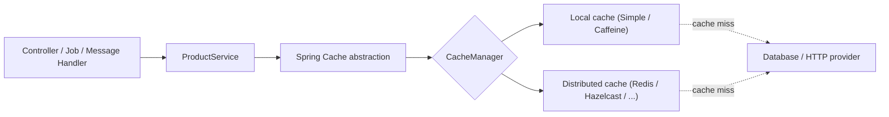
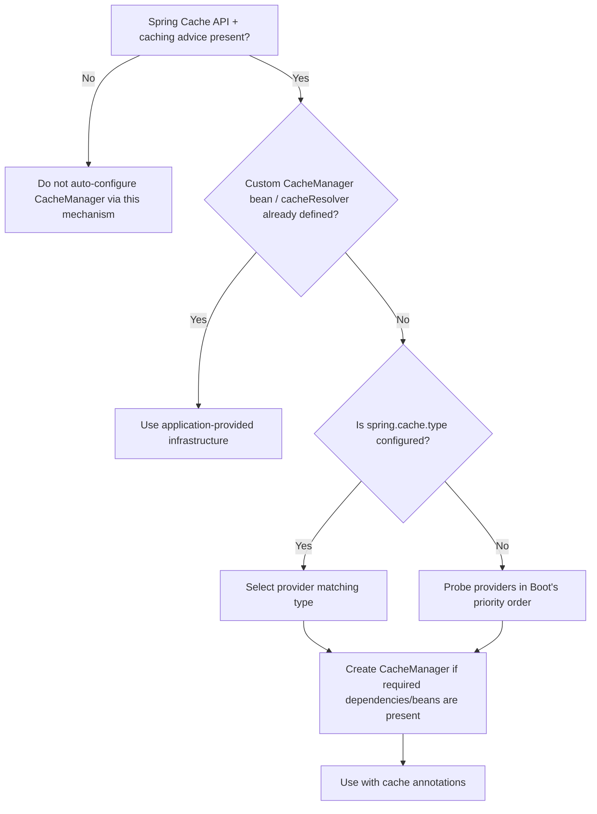
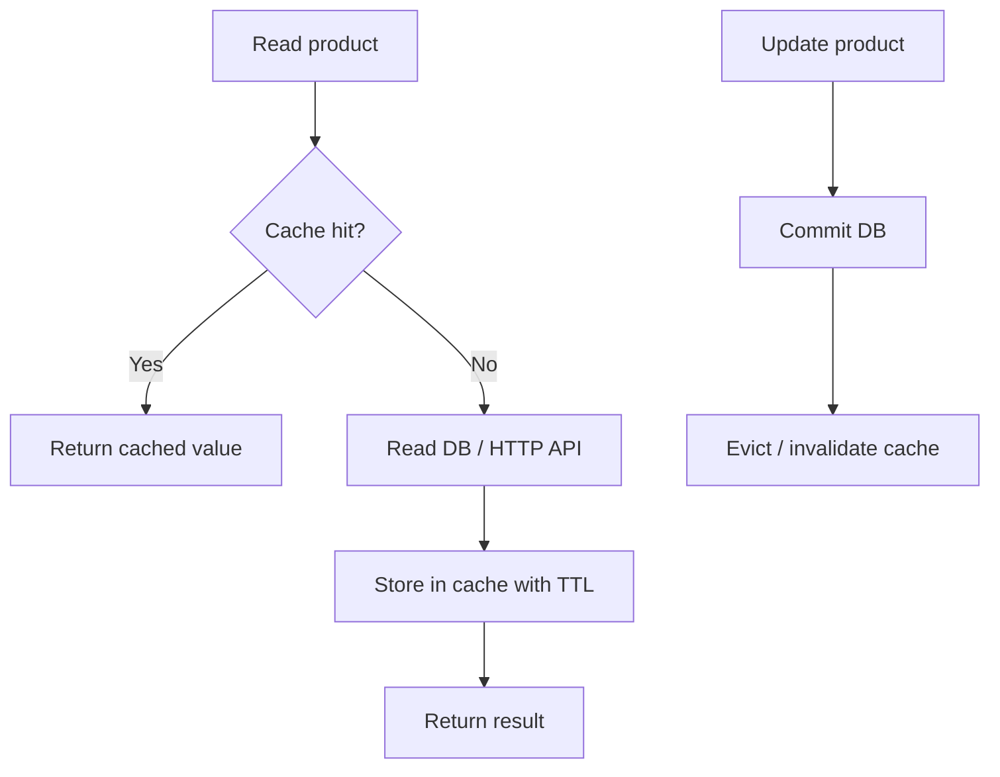

# How Boot Selects a Cache Provider and Specifying spring.cache.type

## 1. Where Does the Cache Provider Sit in an Integration System?

In **SPRING_BOOT_INTEGRATION**, a Spring Boot application may call HTTP APIs, read databases, use Redis, exchange messages via a broker, and connect systems through Spring Integration adapters. When a data read operation is expensive but the data does not change continuously, a cache reduces latency and load on backend systems.

Suppose the Catalog Service reads product details from a database or an HTTP Product API. The first read can fetch from the real data source and store the result; subsequent reads with the same key will return the result from the cache. When a product changes, the application must update or evict the cache at the right moment.



**Spring Cache** is a caching abstraction; it does not mandate a specific backend. `spring.cache.type` helps Spring Boot choose a supported backend when **auto-configuring** `CacheManager`. You can choose an in-process memory cache such as Simple/Caffeine or a distributed cache such as Redis, depending on consistency, data retention, and operational requirements.

**Lesson objectives:** understand how Spring Boot detects cache providers, the conditions for creating `CacheManager`, how to use `spring.cache.type` to control selection, how to configure typical backends, how to handle multiple dependencies coexisting, and how to test and observe cache behavior in a real integration system.

The examples use **Spring Boot 3.x / Spring Framework 6**. The detection order and supported values of `spring.cache.type` may vary across versions; when upgrading major versions or using a specific Boot release, consult the documentation and condition report for your exact version.

## 2. Distinguishing Spring Cache from the Cache Provider

Each component has a distinct responsibility:

| Component | Function | Example |
| --- | --- | --- |
| `@Cacheable`, `@CachePut`, `@CacheEvict` | Express caching policy at method invocations | Cache product read results, evict on update |
| `Cache` | API to read, write, and evict a cache space | Cache named `products` |
| `CacheManager` | Provides `Cache` instances by name | `ConcurrentMapCacheManager`, `CaffeineCacheManager`, `RedisCacheManager` |
| `CacheResolver` | Determines which cache to use for an invocation | Custom resolver by tenant/context |
| Cache provider | Storage engine and TTL/eviction/statistics rules | Caffeine, Redis, JCache provider |
| Spring Boot auto-configuration | Selects and creates appropriate beans when conditions are met | `CacheAutoConfiguration` |

In Spring Framework, cache annotations are normally processed via proxy/AOP. When calling a method marked `@Cacheable`, Spring resolves the key, asks `CacheManager`/resolver for the cache, checks the cache first, and invokes the actual method when necessary.

**Cache name is not provider name.** In `@Cacheable(cacheNames = "products")`, `products` is a logical cache region. It can be managed by Caffeine, Redis, or another provider. `spring.cache.type=redis` selects the cache storage mechanism, while `spring.cache.cache-names=products` can be used to configure pre-created cache region names, depending on the provider.

### 2.1. A Cache Is Not the Source of Truth

A cache holds derived data. If used to read prices, inventory, or access permissions, you must explicitly define the acceptable level of staleness. TTL, eviction, invalidation notifications, and synchronization lag can cause two application instances to see different results.

A cache miss is a normal occurrence and does not automatically indicate an error. Conversely, a cache hit does not prove the data still matches the database if there is no update/eviction policy.

## 3. Getting Started with the Starter and Enabling Caching

With Maven, add the starter:

```xml
<dependency>
    <groupId>org.springframework.boot</groupId>
    <artifactId>spring-boot-starter-cache</artifactId>
</dependency>
```

The starter brings in dependencies for using Spring Cache and its corresponding configuration; **it is not a starter that automatically picks Redis or Caffeine for every application**. Backends beyond Simple in-memory require their own dependencies and sometimes separate external services.

Enable cache annotation processing with `@EnableCaching`:

```java
import org.springframework.cache.annotation.EnableCaching;
import org.springframework.context.annotation.Configuration;

@Configuration
@EnableCaching
public class CachingConfiguration {
}
```

`@EnableCaching` activates Spring Cache's interceptor/advice infrastructure to handle annotations such as `@Cacheable`. Spring Boot can auto-configure a suitable `CacheManager` when classpath and caching infrastructure conditions are met.

Service example:

```java
import org.springframework.cache.annotation.CacheEvict;
import org.springframework.cache.annotation.Cacheable;
import org.springframework.stereotype.Service;

@Service
public class ProductService {

    private final ProductRepository repository;

    public ProductService(ProductRepository repository) {
        this.repository = repository;
    }

    @Cacheable(cacheNames = "products", key = "#productId")
    public ProductDto findById(String productId) {
        return repository.load(productId);
    }

    @CacheEvict(cacheNames = "products", key = "#productId")
    public void invalidate(String productId) {
        // Used to remove the cached entry when source data has changed.
    }
}
```

`ProductRepository` and `ProductDto` are assumed business components. In `findById`, if the key already exists, Spring Cache can return the cached record without calling the repository. `invalidate` removes the corresponding key when the method completes successfully per annotation configuration.

**Proxy note:** internal calls like `this.findById(id)` within the same object normally bypass the Spring proxy, so `@Cacheable` has no effect in default proxy mode. Furthermore, `@CacheEvict` does not automatically know where the database changed: the application must design complete write and invalidation paths.

## 4. Conditions for Boot to Auto-Create CacheManager

Distinguish three decisions:

1. **Is Spring Cache infrastructure enabled?** Usually via `@EnableCaching`.
2. **Has the application already defined its own cache infrastructure?** If you already provide a `CacheManager` or a `CacheResolver` with the designated default resolver name, Boot may back off.
3. **If Boot is allowed to auto-configure, which provider does it choose?** Based on `spring.cache.type` or Boot's provider detection order when type is omitted.

A mental model:



**`spring.cache.type` cannot override an existing custom `CacheManager`.** If the project defines `@Bean CacheManager customCacheManager()`, that bean is an explicit application choice; changing `spring.cache.type` may not change the provider.

Similarly, when the application provides a `CacheResolver` named `cacheResolver` per the convention checked by cache auto-configuration, Boot may skip creating a default manager. Inspect the condition evaluation report of your running version if behavior differs from expectations.

### 4.1. Do Not Confuse Dependencies with Live Connectivity

Having Spring Data Redis on the classpath and a `RedisConnectionFactory` bean does not prove the Redis server is successfully connected. With a Redis cache, credential, DNS, socket, or timeout errors may surface when cache operations run; connectivity must still be verified independently.

Conversely, if only the cache starter is present and no specific provider exists, Boot typically picks Simple cache based on `ConcurrentHashMap`: suitable for development or some small apps, but not a substitute for a distributed cache service across multiple instances.

## 5. Boot's Auto-Detection Order When Type Is Not Set

In Spring Boot 3.x documentation, providers are evaluated in the following common order once cache auto-configuration is eligible:

| Order | Provider type | Typical condition | Points to note |
| --- | --- | --- | --- |
| 1 | **Generic** | One or more `org.springframework.cache.Cache` beans declared directly | Boot can collect cache beans into a manager; adding beans can alter behavior |
| 2 | **JCache (JSR-107)** | Suitable JCache provider/cache API present | When a provider exposes both Spring native and JCache APIs, Boot usually prefers JCache |
| 3 | **Hazelcast** | Suitable Hazelcast infrastructure present | Can serve as a distributed backend or other topology depending on deployment |
| 4 | **Infinispan** | Suitable Infinispan libraries and config present | Pay attention to client/server compatibility |
| 5 | **Couchbase** | Corresponding Couchbase dependency and infrastructure present | Cache depends on an external database/cluster |
| 6 | **Redis** | Spring Data Redis with `RedisConnectionFactory` present | Enables cache sharing across instances |
| 7 | **Caffeine** | Caffeine library present | Local in-memory per JVM |
| 8 | **Cache2k** | Supported cache2k provider present | Local cache with its own configuration mechanism |
| 9 | **Simple** | No preceding matching provider | Backed by concurrent maps; no built-in distributed TTL |
| — | **None** | Explicitly set `spring.cache.type=none` | Creates a no-op cache manager to disable cache storage |

**The order above reflects automatic selection, not a performance ranking or business recommendation.** A project that accidentally pulls in a JCache or Redis dependency may cause the selected provider to change even though service code was untouched. Exact applicability of each branch depends on classpath, bean conditions, and Spring Boot version.

In particular, if a provider supports **two APIs** (such as JCache and a native cache API), Boot usually prioritizes compatibility via JCache unless you explicitly configure the provider in another supported way.

### 5.1. Why Adding a Dependency Can Change the Runtime Cache

Suppose an application initially has only `spring-boot-starter-cache`: the manager is Simple. Later, another team adds `spring-boot-starter-data-redis` to use `RedisTemplate` in a workflow, and Boot now creates a `RedisConnectionFactory`. Without `spring.cache.type` set and without a custom cache manager, cache annotations may switch to Redis.

This can cause surprises:

- Keys and values use Redis serialization instead of in-JVM object references.
- Network hops, timeouts, and Redis errors are introduced.
- Cache data is shared across instances, risking key collisions without proper namespaces.
- Redis TTL/eviction differs from Simple.
- Unit tests using Simple stay green, while production fails when Redis is not ready.

Therefore, in integration systems with multiple cache dependencies or where explicit control across environments is desired, **explicitly setting `spring.cache.type`** is easier to operate and test.

## 6. Explicitly Specifying spring.cache.type

Example choosing Caffeine for a local cache:

```yaml
spring:
  cache:
    type: caffeine
```

Choosing Redis:

```yaml
spring:
  cache:
    type: redis
```

Disabling cache storage through the abstraction:

```yaml
spring:
  cache:
    type: none
```

This property maps to cache types supported by your Boot version such as `simple`, `caffeine`, `redis`, `jcache`, `hazelcast`, `infinispan`, `couchbase`, `cache2k`, `generic`, and `none`. Lowercase as shown in the examples is the standard YAML format.

**Type only selects the configuration branch; it does not create dependencies or infrastructure.** Setting `spring.cache.type=redis` without a Redis driver/`RedisConnectionFactory` can prevent the application from creating a cache manager or starting up under current configuration conditions. It does not start a Redis server.

Similarly, `spring.cache.type=caffeine` requires the Caffeine library on the classpath. Setting `none` does not remove annotations from source code: annotated calls still pass through the cache abstraction if caching is enabled, but use a no-op cache manager so entries are not retained.

### 6.1. Selection Table by Goal

| Goal | Type to choose | When appropriate |
| --- | --- | --- |
| Simple demo/test without external infrastructure | `simple` | Small dataset, single JVM, no strict TTL needed |
| Fast local cache with eviction/TTL | `caffeine` | Read-heavy, acceptable for each instance to hold separate data |
| Cache shared across multiple instances | `redis` | Redis cluster/managed service available, network and failure modes accounted for |
| Ecosystem standardized on JCache | `jcache` | JSR-107 provider and config management process in place |
| Temporarily disable cache for investigation | `none` | Need to run identical business logic without caching |
| Distributed cache tied to another platform | `hazelcast`/`infinispan`/`couchbase` | Corresponding operations strategy and infrastructure available |

An application with **one** default `CacheManager` is usually simpler. If you must have both a short-lived Caffeine cache and shared Redis, design **multiple CacheManagers** with explicit names/`CacheResolver` and clear routing by cache name/operation; in that case `spring.cache.type` alone cannot express the entire policy.

## 7. Configuring Simple: Default In-Memory Cache

With `spring-boot-starter-cache` and `@EnableCaching`, you can force Simple:

```yaml
spring:
  cache:
    type: simple
    cache-names:
      - products
      - categories
```

Spring uses `ConcurrentMapCacheManager` in typical setups. Caches live in process memory; everything is lost on restart. Across two replicas, each replica maintains an independent cache.

Simple does not provide age-based TTL/maximum-size/eviction like Caffeine or Redis. Data can remain until evicted, cleared, or the process restarts; do not use it for caches that grow without bound.

When `spring.cache.cache-names` is configured, Boot can pre-create those named caches and restrict dynamic creation of new names depending on provider characteristics. Do not rely on a misspelled cache name being auto-created in production; verify names and configuration in tests.

Example inspecting the bean at runtime:

```java
import org.springframework.cache.CacheManager;
import org.springframework.stereotype.Component;

@Component
public class CacheInspector {

    private final CacheManager manager;

    public CacheInspector(CacheManager manager) {
        this.manager = manager;
    }

    public boolean hasProductsCache() {
        return manager.getCache("products") != null;
    }
}
```

Tests can assert the manager type is `ConcurrentMapCacheManager` when the project defines no custom manager and `type=simple`. However, do **not** write business logic depending on the concrete manager class; business code should depend on the Spring Cache abstraction.

## 8. Configuring Caffeine: Fast Cache Within a Single JVM

Add the Caffeine library, letting the Spring Boot BOM manage the version:

```xml
<dependency>
    <groupId>com.github.ben-manes.caffeine</groupId>
    <artifactId>caffeine</artifactId>
</dependency>
```

Example configuration:

```yaml
spring:
  cache:
    type: caffeine
    cache-names:
      - products
      - categories
    caffeine:
      spec: maximumSize=10000,expireAfterWrite=5m
```

`CaffeineCacheManager` wraps Caffeine caches and applies maximum-size and expire-after-write policies per the spec. This is a **local cache**, so different Spring Boot instances do not share the same cache objects.

**Suitable scenario:** a high-traffic Product Service where products change infrequently and each instance serving data with a few minutes of update lag is acceptable. Caffeine eliminates network hops compared to Redis, but offers no automatic distributed consistency across replicas.

Points to consider:

- `maximumSize` is Caffeine's eviction policy, not an exact hard cap on the number of entries present at every instant.
- `expireAfterWrite` starts from write time; it differs from `expireAfterAccess`. Choose based on staleness requirements.
- Caffeine does not automatically synchronize invalidations across JVMs. If simultaneous eviction across multiple instances is required, you need a broadcast/invalidation mechanism or must accept the TTL.
- Hit/miss/eviction metrics require instrumentation and supporting configuration; do not assume every application automatically collects full statistics.

For advanced configuration, you can use `CaffeineSpec` or a `Caffeine` builder as supported by Boot. Note that precedence between spec/builder and customization options may vary by version, so avoid declaring conflicting configuration sources.

## 9. Configuring Redis: Sharing Cache Across Multiple Instances

When using Redis as the cache backend, you need Spring Data Redis and a separate Redis server. Maven dependencies:

```xml
<dependency>
    <groupId>org.springframework.boot</groupId>
    <artifactId>spring-boot-starter-cache</artifactId>
</dependency>
<dependency>
    <groupId>org.springframework.boot</groupId>
    <artifactId>spring-boot-starter-data-redis</artifactId>
</dependency>
```

Spring Boot 3.x configuration example:

```yaml
spring:
  data:
    redis:
      host: ${REDIS_HOST:localhost}
      port: ${REDIS_PORT:6379}
      connect-timeout: 2s
      timeout: 2s
  cache:
    type: redis
    cache-names:
      - products
      - categories
    redis:
      time-to-live: 10m
      cache-null-values: false
      use-key-prefix: true
      key-prefix: "catalog::"
```

`spring.data.redis.*` configures the **Redis connection**, whereas `spring.cache.redis.*` configures **how Spring Cache uses Redis**. These are two independent property groups:

| Property | Effect |
| --- | --- |
| `spring.data.redis.host/port` | Redis server address |
| `spring.data.redis.connect-timeout/timeout` | Client connection/operation limits |
| `spring.cache.type=redis` | Selects `RedisCacheManager` created by Boot when eligible |
| `spring.cache.redis.time-to-live` | Default entry TTL for caches managed by this configuration |
| `spring.cache.redis.cache-null-values` | Whether null results are allowed to be cached per cache configuration |
| `spring.cache.redis.use-key-prefix` | Whether to prepend a prefix to cache keys in Redis |
| `spring.cache.redis.key-prefix` | Custom prefix; check how it combines with the cache name |

When services share a Redis cluster, namespace keys separately by application/environment/cache name. Do not use just a bare product key `123` on a shared Redis without namespacing, as collisions across services/schemas can cause deserialization failures or wrong data.

**Important data note:** Redis Cache uses serialization configured on Spring Data Redis/`RedisCacheManager`, not Java object references. Verify key/value encoding, DTO versioning, compatibility during rolling deployments, and old schema handling. Avoid deserializing untrusted data with default Java serialization without safety constraints.

### 9.1. Redis Is Also a Runtime Dependency That Can Fail

A Redis timeout cannot automatically be treated as a cache miss. Depending on the business case:

- **Product read cache:** can fall back to the database with concurrency limits if Redis is unavailable.
- **Authorization or critical price cache:** stale cache or fallback must not corrupt business decisions.
- **Redis used for rate limiting, idempotency, or locking:** this is no longer an optional read cache; clear *fail-open/fail-closed* error policies are required.

If switching from Caffeine to Redis solely by changing `spring.cache.type`, you must also inspect networking, TLS/ACL, timeouts, serialization, TTL, eviction, key prefixes, and how the application reacts during a Redis outage.

## 10. JCache and Other Providers

`spring.cache.type=jcache` requires a **JSR-107/JCache**-compliant provider along with appropriate configuration. Some products such as Ehcache 3 support JCache, but require the right dependency/module version and provider-specific configuration.

Example:

```yaml
spring:
  cache:
    type: jcache
    jcache:
      provider: com.example.cache.ExampleCachingProvider
      config: classpath:cache-config.xml
```

`com.example.cache.ExampleCachingProvider` is only an **illustrative placeholder**; replace it with the fully qualified name of the `CachingProvider` provided by your actual dependency. `cache-config.xml` is likewise a project-supplied resource formatted according to the provider's syntax. Do not copy this example and expect the app to run without a real provider.

When multiple JCache providers are on the classpath, specify `spring.cache.jcache.provider` to avoid ambiguous selection. If a library has both JCache support and native integration, Boot prioritizing JCache during auto-detection may cause your native configuration not to be used.

Providers such as Hazelcast, Infinispan, and Couchbase require their own dependencies, connections/clients, and configurations. **The `spring.cache.type` name does not replace provider operational documentation.** Before using one, determine topology, security, serialization, TTL/eviction, high availability, failover testing needs, and infrastructure cost.

## 11. When the Application Configures CacheManager Manually

An example managed by the application:

```java
import org.springframework.cache.CacheManager;
import org.springframework.cache.concurrent.ConcurrentMapCacheManager;
import org.springframework.context.annotation.Bean;
import org.springframework.context.annotation.Configuration;

@Configuration
public class CustomCacheConfiguration {

    @Bean
    CacheManager cacheManager() {
        return new ConcurrentMapCacheManager("products", "categories");
    }
}
```

When a `CacheManager` bean already exists, Boot normally backs off from creating another manager. In this case, setting `spring.cache.type=redis` **does not automatically turn the bean above into `RedisCacheManager`**. To change providers, modify the bean configuration, remove the custom bean to use auto-configuration, or design explicit multi-manager routing.

If the application defines a custom `CacheResolver`, verify whether it is named `cacheResolver` and whether cache annotations select that resolver. Annotations can pick a specific manager/resolver via the `cacheManager` or `cacheResolver` attributes when multiple beans exist, but keep it consistent to avoid confusing configuration.

Example specifying a concrete bean:

```java
@Cacheable(
    cacheNames = "products",
    key = "#productId",
    cacheManager = "catalogCacheManager"
)
public ProductDto findById(String productId) {
    return repository.load(productId);
}
```

`catalogCacheManager` must be an actual bean name in the application. If caches require different policies (short TTL for inventory, long TTL for catalogs), you can configure per-cache settings within a single provider instead of creating unnecessary separate backends.

### 11.1. Customizers Have Scope Limits

Spring Boot provides hooks such as `CacheManagerCustomizer` in supported configurations. However, a customizer will not automatically run for a `CacheManager` bean manually created by the application via every path. When deep provider overrides are needed, choose one owner for the configuration and verify the actual bean type at runtime.

## 12. Verifying Which Provider Was Actually Selected

Do not guess the backend solely from which dependencies appear in `pom.xml`. A more reliable approach is to inspect the actual `CacheManager` in the application context.

Example component printing the class name during development startup:

```java
import org.springframework.boot.ApplicationRunner;
import org.springframework.context.annotation.Bean;
import org.springframework.context.annotation.Configuration;
import org.springframework.cache.CacheManager;

@Configuration
public class CacheDiagnostics {

    @Bean
    ApplicationRunner reportCacheManager(CacheManager manager) {
        return args -> System.out.println(
            "CacheManager = " + manager.getClass().getName()
        );
    }
}
```

In production, avoid logging sensitive configuration details; the manager class name is generally non-sensitive operational info. Use structured logging instead of `System.out` in real systems.

Enable Spring Boot's condition evaluation report in an appropriate environment:

```properties
debug=true
```

Then look for `CacheAutoConfiguration` and cache provider configurations in the startup log. With Spring Boot Actuator, the `conditions` endpoint (if enabled and authorized) shows which conditions matched or did not match.

What to look for:

- Was a `CacheManager` bean created, and what class is it?
- Is there a custom `CacheManager` or `cacheResolver` bean causing Boot to back off?
- Is `spring.cache.type` loaded properly from profiles/env?
- Does the desired provider have the required dependencies and connection beans?
- Are tests and production running the same auto-configuration, or has a profile overridden the type?

When multiple `CacheManager` beans exist, printing a single bean is insufficient to explain all routing. Check `@Primary`, bean names, and the `CacheResolver` used by annotations.

## 13. Testing Without Real Redis for Simple Cases

A Spring Boot test can force Simple cache to verify annotations work without an external broker/cache server.

Example verifying the manager and caches are created:

```java
import static org.assertj.core.api.Assertions.assertThat;

import org.junit.jupiter.api.Test;
import org.springframework.beans.factory.annotation.Autowired;
import org.springframework.boot.test.context.SpringBootTest;
import org.springframework.cache.CacheManager;
import org.springframework.cache.concurrent.ConcurrentMapCacheManager;

@SpringBootTest(properties = {
    "spring.cache.type=simple",
    "spring.cache.cache-names=products,categories"
})
class CacheConfigurationTest {

    @Autowired
    CacheManager manager;

    @Test
    void usesSimpleCacheManager() {
        assertThat(manager)
            .isInstanceOf(ConcurrentMapCacheManager.class);
        assertThat(manager.getCache("products")).isNotNull();
    }
}
```

The test assumes the application context enables `@EnableCaching`, defines no custom `CacheManager`, and includes `starter-cache`. If the real application has a custom manager, the class assertion may not fit; adjust the test to match the target configuration.

Verify that the cache annotation avoids calling the repository a second time with a business test:

```java
import static org.mockito.Mockito.*;

@Test
void cachesProductLookup() {
    when(repository.load("sku-123"))
        .thenReturn(new ProductDto("sku-123", "USB-C cable"));

    service.findById("sku-123");
    service.findById("sku-123");

    verify(repository, times(1)).load("sku-123");
}
```

This snippet is a **conceptual pattern**: `service` must be an injected Spring bean via proxy, the mock repository is a dependency of `service`, and `ProductDto` has a matching constructor; exact setup details depend on your project. If you instantiate `new ProductService(repository)` directly in a unit test, the Spring interceptor does not run, so you cannot use such a test to conclude `@Cacheable` works.

### 13.1. Testing with Caching Disabled

You can run a test profile:

```yaml
spring:
  cache:
    type: none
```

When `none` is active and there is no custom `CacheManager`, the no-op cache manager stores no entries. Calls to `@Cacheable`-annotated methods normally re-execute on subsequent invocations; useful for verifying behavior does not depend on caching. However, `none` **must not be used as proof that TTL/invalidation policies on Redis or Caffeine are correct**.

### 13.2. Testing Redis/Caffeine Against a Real Provider

For Caffeine: run tests on a real Caffeine manager, verifying TTL/maximum-size and eviction; avoid tight real-time dependencies that make tests flaky.

For Redis: run real Redis via Testcontainers or a test environment, verifying key namespaces, serializers, TTL, post-update invalidation, and behavior on Redis timeout. A test that only forces `type=redis` without a Redis server cannot verify real data exchange.

Key cases at integration boundaries:

1. Cache miss → calls API/database once; hit → does not call again.
2. Source data update → evicts or refreshes the right key.
3. Does not mistakenly cache `null`/error/invalid data responses.
4. Cache keys avoid collisions across tenants, services, and DTO versions.
5. During rolling deployments, new instances can handle old cache entries or use migration/version prefixes.
6. Redis outages do not cause services to retry infinitely and overload the database.
7. Two application instances sharing Redis observe shared invalidations; with Caffeine, verify staleness tolerance or a broadcast mechanism.

## 14. Common Configuration Errors

| Symptom | Causes to inspect | Resolution |
| --- | --- | --- |
| `@Cacheable` has no effect | `@EnableCaching` missing, self-invocation, non-proxied bean | Check caching advice/proxy and call path |
| No `CacheManager` to inject | Cache auto-configuration conditions not met or custom resolver | Inspect condition report, starter, caching config |
| `type=redis` set but Boot reports missing bean | Missing Spring Data Redis/connection factory | Declare dependency and valid connection |
| App suddenly slow after adding Redis | Auto-detection switched from local to Redis | Check actual manager; force desired type |
| Caffeine does not activate | Missing Caffeine library or higher-priority provider present | Add dependency, set `type=caffeine` |
| Wrong cache key/collision | Key lacks tenant/version, or unsuitable key generator | Standardize key, namespace, add multi-tenant tests |
| Redis deserialization error | Serializer/schema changed across versions | Pin serializer, version prefix, migrate |
| No TTL seen with Simple cache | Simple lacks Redis/Caffeine-style TTL config | Switch to suitable provider or manage invalidation manually |
| `CacheManagerCustomizer` does not run | Manager bean created manually or type mismatch | Identify manager source, choose proper hook |
| Tests behave differently from production | `spring.cache.type`/profile/env or classpath differs | Keep test config intentional and test real providers in integration layer |

A cache error should not automatically return 500 if the cache is merely a read optimization **and** falling back to the database is permitted. However, a Redis failure in idempotency/rate-limiting can directly affect correctness, so fail-open or fail-closed policies must be defined per scenario.

## 15. TTL, Invalidation, and Data Consistency

Choosing the right provider is only the first step. Data lifetime and update strategy determine whether caching is safe.

### 15.1. Cache-Aside and Update Lag

A common cache-aside flow:



In practice, race conditions occur: request A reads stale data right before an update, request B commits the DB and evicts the cache, then request A writes the stale data back into the cache. Simply adding `@CacheEvict` does not eliminate all races; sensitive data requires versioning, synchronization, or an appropriate consistency mechanism.

### 15.2. Three Common Constraint Patterns

| Need | Suitable strategy |
| --- | --- |
| Slowly changing catalog data, stale tolerated | Short-TTL Caffeine or Redis TTL with eviction |
| Multiple instances need fast visibility of changes | Shared Redis + explicit invalidation, or broadcast invalidation |
| Business data requiring strong consistency | Do not rely on cache as final decision source; verify and commit atomically at the owner service/database |

**Do not cache context-dependent results without including that context in the key.** For example, user/tenant-scoped data must include the corresponding identifier in the key or avoid shared-layer caching. Do not store access tokens/PII in cache without clear justification, access controls, and retention rules.

### 15.3. Cache Stampede and Negative Caching

When a key expires during high traffic, many requests can hit the database/HTTP provider simultaneously, causing a **cache stampede**. Mitigation approaches include: jittered TTLs, refresh-ahead, concurrency limits, per-key single-flight, conditional stale-while-revalidate, or short-lived caching of missing data.

Negative caching (`not found`) must be defined carefully: non-existence can change very quickly. Do not blindly enable default null caching across all endpoints and accidentally keep a missing state alive too long.

## 16. Observing the Cache After Deployment

Metrics to monitor:

- **Cache effectiveness:** hit/miss ratio per cache name, data retrieval duration, fallback counts to the real data source.
- **Resource usage:** memory, entry count (if provider-supported), evictions, expirations, key cardinality, and payload size.
- **Redis backend:** latency, timeouts, connection count, memory/evictions, replication/failover, and error rate.
- **Business effect:** API p50/p95/p99 latency, stale data frequency, invalidation failures, downstream error rate on cache miss.
- **Deployment:** selected provider, cache schema/key prefix version, TTL, and cross-environment differences.

Spring Boot Actuator can expose cache metrics via Micrometer when supporting dependencies/binders are present and caches are properly instrumented. Check which metrics are actually populated for your provider; do not assume every backend exports hits/misses at the same granularity. A Redis health endpoint (if enabled) reports Redis connectivity, not cache hit ratios or business effectiveness.

In logs/tracing, avoid turning key values containing PII into unbounded-cardinality metric labels. Log only cache name, operation, outcome, and trace/correlation IDs compliant with security policy.

## 17. Synthesis Scenario: Catalog Service Using HTTP, Redis, and Database

Suppose the Catalog Service runs across three instances. It calls a Product API (HTTP) for details, writes orders to a database, and emits messages via a broker. The team wants to reduce HTTP calls to protect the Product API.

There are three approaches:

1. **Simple:** try locally to understand annotations and keys; has no automatic TTL and each instance has a separate cache.
2. **Caffeine:** local cache with a few minutes of TTL; suitable if the Product API tolerates brief staleness and cross-instance invalidation is unnecessary.
3. **Redis:** shared cache across three instances; requires accepting network hops, managing credentials/TLS, TTL, serialization, and Redis outages.

If the module already added Spring Data Redis for idempotency in another flow, do not let that silently switch caching for the entire Catalog Service. Explicitly configure `spring.cache.type=caffeine` for local caching or `redis` for shared caching to keep behavior consistent across local, test, and production environments.

An illustrative production configuration when choosing Redis:

```yaml
spring:
  cache:
    type: redis
    cache-names: products
    redis:
      time-to-live: 5m
      cache-null-values: false
      key-prefix: "catalog:prod:"
      use-key-prefix: true
  data:
    redis:
      host: ${REDIS_HOST}
      port: ${REDIS_PORT:6379}
      connect-timeout: 2s
      timeout: 2s
```

Next, test at least: cache miss/hit, cache eviction after updates, DTO compatibility, Redis failures, non-colliding keys across environments, and connectivity from every replica. If the use case requires strong consistency for inventory, stock checks and reservations must execute at the system owning the data—**do not make final decisions based on a cached copy**.

### Checklist Before Merging or Deploying

- [ ] Enabled `@EnableCaching` and verified calls go through a Spring proxy?
- [ ] Confirmed which `CacheManager` is created via auto-configuration or custom bean?
- [ ] Set `spring.cache.type` where needed to prevent classpath-driven changes?
- [ ] Real dependencies/backend available and access permissions verified if required by the provider?
- [ ] Agreed on cache names, keys, versions, serializers, and tenant/environment isolation?
- [ ] Selected TTL, eviction, and invalidation procedures based on business needs?
- [ ] Defined how the application reacts on cache misses and cache/backend errors?
- [ ] Tested against the real provider alongside write paths and monitored hits/misses?

**Conclusion:** Spring Boot selects a cache provider based on classpath/bean conditions and its auto-detection order when not explicitly configured. `spring.cache.type` specifies the desired provider within the **auto-configuration branch**, but does not replace dependencies, backend infrastructure, or an application-defined `CacheManager` bean. In Spring Boot integration systems, provider selection must go hand-in-hand with data contracts, TTL, invalidation, error handling, testing, and observability so caching reduces load without breaking business correctness.
