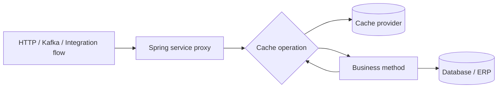
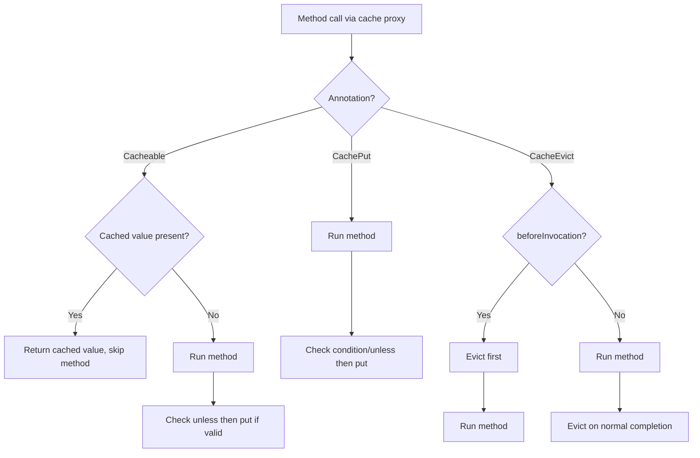
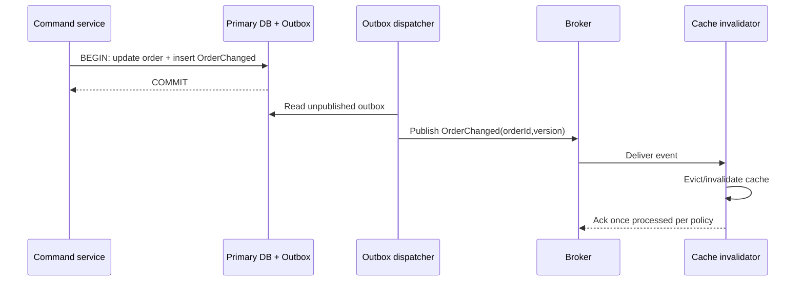

# `@Cacheable`, `@CachePut`, `@CacheEvict`, and Update Semantics

## 1. Why Do Cache Update Semantics Matter in Integration?

A Spring Boot service often needs to connect multiple dependencies: reading orders from PostgreSQL, looking up records from an ERP over HTTP/SOAP, checking a Redis cache, consuming Kafka/RabbitMQ messages, and executing Spring Integration adapters. Repeatedly reading a record consumes time and connections; caching reduces latency and load. However, when data changes, the cache becomes **a potentially stale copy**. Performance optimization is only meaningful when the application clearly defines when that copy is updated or invalidated.

In the **SPRING_BOOT_INTEGRATION** module, caching must be considered alongside connection configuration, data contracts, transactions, error handling, duplicate handling, testing, and integration flow observability. The three annotations of the **Spring Cache abstraction** serve distinct purposes:

- **`@Cacheable`:** prefers reading from the cache; if a value is present, skips invoking the target method.
- **`@CachePut`:** always invokes the target method and places the result of that invocation into the cache.
- **`@CacheEvict`:** removes one entry or all entries from the cache, usually after the method completes normally.

Running example: `OrderQueryService.getOrder(id)` reads from the DB and is cached; `OrderCommandService.changeStatus(id, status)` updates the DB; a consumer receiving `OrderChanged` from a broker may also alter status. If the write commits while the cache still holds the old status, the API returns incorrect data. If the cache is updated before the DB commits and the transaction rolls back, the API may return a status that **was never committed**.

**The goal of this lesson** is to understand the actual behavior of these three annotations, particularly at the boundaries of **methods, proxies, database transactions, multiple replicas, and external update sources**.

## 2. Spring Cache Is an Abstraction, Not a Storage System

Spring provides `Cache`, `CacheManager`, operation annotations, and interceptors. The application selects the backend: an in-memory cache (such as Caffeine) or a shared cache (such as Redis). Annotations do not decide where data is stored, how long the TTL is, or how strong consistency is.

| Component | Responsibility | What it does not automatically guarantee |
|---|---|---|
| `Cache` | Read/write/delete entries by key. | Not inherently durable or consistent with the DB. |
| `CacheManager` | Provides caches by name. | Does not automatically know which records changed in external systems. |
| `CacheResolver` | Selects caches for an invocation. | Does not automatically create multi-system transactions. |
| `KeyGenerator` | Generates keys when SpEL `key` is not declared. | Does not automatically understand tenant, permissions, or data version. |
| `CacheInterceptor` | Intercepts calls to Spring-managed methods. | Does not intercept self-invocation via `this` in proxy mode. |
| Backend Caffeine/Redis/... | Stores data and enforces specific TTL/eviction characteristics. | Does not perform business updates on the source of truth. |



Key characteristic: Spring Cache operates at **method boundaries**. If data changes directly via a SQL console, a batch job, or an instance that does not emit invalidation, annotations on another instance's methods will **not be triggered automatically**.

### 2.1. Fast Reads Do Not Equal Up-to-Date Reads

An order record might be `PENDING` in cache while already `PAID` in the DB. When `@Cacheable` returns a cached value, the DB query method **does not run**. Therefore, the application must define what degree of staleness is acceptable:

- Rarely changing catalog: several minutes of staleness may be acceptable.
- Displayed order status: depending on SLAs and business rules, immediate cache eviction after updates may be required.
- Balances, permissions, payment limits: do not apply caching unconditionally; use stricter verification/consistency or read from the authoritative source at critical decision points.

## 3. Enabling Caching in Spring Boot

A Spring Boot application using cache annotations typically needs the dependency and **`@EnableCaching`**:

```kotlin
dependencies {
    implementation("org.springframework.boot:spring-boot-starter-cache")
}
```

```java
import org.springframework.boot.SpringApplication;
import org.springframework.boot.autoconfigure.SpringBootApplication;
import org.springframework.cache.annotation.EnableCaching;

@SpringBootApplication
@EnableCaching
public class IntegrationApplication {
    public static void main(String[] args) {
        SpringApplication.run(IntegrationApplication.class, args);
    }
}
```

`spring-boot-starter-cache` brings the APIs/configuration for Spring Cache, but **does not automatically intercept annotated methods without enabling caching appropriately**. `@EnableCaching` turns on scanning and processing of cache annotations on Spring beans, typically via AOP proxies.

Spring Boot can auto-configure a `CacheManager` when classpath, provider, and bean conditions are met. If no dedicated cache provider is present, an application may fall back to a simple `ConcurrentHashMap`-based cache depending on conditions/versions; **do not treat this temporary backend as a safe production configuration** because it lacks TTL and cross-replica synchronization the way Caffeine/Redis are designed.

### 3.1. In-Memory Cache with Caffeine

Add the provider when needed:

```kotlin
dependencies {
    implementation("org.springframework.boot:spring-boot-starter-cache")
    implementation("com.github.ben-manes.caffeine:caffeine")
}
```

Single-instance example:

```yaml
spring:
  cache:
    type: caffeine
    cache-names: orderById,ordersByCustomer
    caffeine:
      spec: maximumSize=10000,expireAfterWrite=5m,recordStats
```

`maximumSize` limits entry count, `expireAfterWrite` limits age since write, and `recordStats` enables provider statistics. This is an **illustrative configuration**, not an appropriate TTL or capacity for every domain. Caffeine resides in each instance's RAM; with 4 replicas, there are 4 separate copies by default.

### 3.2. Redis as a Shared Cache

When multiple replicas must see the same cache, Redis can be used:

```kotlin
dependencies {
    implementation("org.springframework.boot:spring-boot-starter-cache")
    implementation("org.springframework.boot:spring-boot-starter-data-redis")
}
```

```yaml
spring:
  cache:
    type: redis
    cache-names: orderById,ordersByCustomer
    redis:
      time-to-live: 5m
      cache-null-values: false
      use-key-prefix: true
  data:
    redis:
      host: redis.internal
      port: 6379
```

The Redis configuration above assumes the internal hostname resolves in the deployment environment. Cache value serialization must be checked carefully; when deploying new DTOs/schemas, entries written by older application versions may fail to deserialize. Changing serializers, DTO types, or JSON/JDK serialization formats is a **cache contract change** and requires versioning/migration plans or controlled clearing.

**Distinguish two concepts:** `spring.cache.redis.time-to-live` sets entry expiration according to Redis cache configuration; it **does not** guarantee data is never stale within the TTL window. The cache can still be seconds out of date after a DB update if there is no invalidation.

## 4. Semantic Comparison Table of the Three Annotations

| Annotation | Reads cache before running method? | Does target method always run? | Cache mutation | Default when method throws an exception |
|---|---|---|---|---|
| `@Cacheable` | Yes. | **No**, on cache hit; yes on miss. | Stores result after method completes. | Does not cache result from a failed invocation. |
| `@CachePut` | Does not skip method on hit. | **Yes**, when invoked through interceptor; `condition` can govern put. | Stores/overwrites method result at key. | Typically does not put if method fails. |
| `@CacheEvict` | Does not serve results from cache. | **Yes**. | Deletes by key or clears entire cache. | Does not evict by default on exception; `beforeInvocation=true` is the exception. |

The table describes scenarios where annotations are properly activated (via Spring proxy/caching infrastructure) without special customization. "Always" for `@CachePut` means the annotation **does not use a cache hit to skip the method body**, not that the method is guaranteed to run if the call never happens, is blocked by another interceptor, or caching is disabled.

A visual representation:



## 5. `@Cacheable`: Read Through Cache, Call Source on Miss

Assume a domain view containing no sensitive data that can be read from the DB:

```java
public record OrderView(long id, String status, long version) {}
```

A query service:

```java
import org.springframework.cache.annotation.Cacheable;
import org.springframework.stereotype.Service;

@Service
public class OrderQueryService {
    private final OrderRepository repository;

    public OrderQueryService(OrderRepository repository) {
        this.repository = repository;
    }

    @Cacheable(cacheNames = "orderById", key = "#p0",
               unless = "#result == null")
    public OrderView findById(long orderId) {
        return repository.findViewById(orderId).orElse(null);
    }
}
```

The example assumes an application-defined `OrderRepository` with a `findViewById(long)` method returning `Optional<OrderView>`. Sequence:

1. Spring computes the key from `#p0` (first parameter `orderId`) and looks it up in `orderById`.
2. **Hit:** returns the stored `OrderView` without calling `repository.findViewById`.
3. **Miss:** calls the repository; if an `OrderView` is returned, caches the result and returns it to the caller.
4. If `null` is returned, `unless = "#result == null"` prevents storing null in the cache.

`unless` is evaluated **after the method executes**, so it can access `#result`. `condition` is evaluated before invocation (in parameter context) and is suitable for deciding whether to participate in caching at all.

### 5.1. `condition` vs. `unless`

```java
@Cacheable(
    cacheNames = "orderById",
    key = "#p0",
    condition = "#p0 > 0",
    unless = "#result == null")
public OrderView findById(long id) {
    return repository.findViewById(id).orElse(null);
}
```

- `condition` false → bypasses cache for that invocation; method runs normally without reading or writing cache.
- `condition` true → checks cache; on miss, runs method; `unless` decides whether to put the result in cache.
- `unless` does not skip an expensive query on a cache miss: the method has already executed before the result is inspected.

You can use `unless` to avoid caching oversized, incomplete, or policy-ineligible responses. However, business rules must be expressed clearly: do not cache authorization-sensitive responses solely by ID if the data depends on who is accessing it.

### 5.2. `Optional`, `null`, and Empty Results

Spring Cache treats `Optional` as a special return value in supported annotation scenarios: a present `Optional` can be unwrapped when cached; `Optional.empty()` represents an empty value. When using `#result`, check the unwrapped-value semantics of your framework/version; do not assume it is always the `Optional` wrapper itself.

Caching a "not found" result (*negative caching*) can reduce load when many requests query non-existent IDs, but requires a short TTL and invalidation rules when a record is newly created. If the backend does not support nulls or `cache-null-values=false`, explicitly avoid caching null. Do not let "not found" entries live long enough to obscure newly created data.

### 5.3. `@Cacheable(sync = true)` When Multiple Callers Miss Simultaneously

```java
@Cacheable(cacheNames = "orderById", key = "#p0", sync = true)
public OrderView loadOrder(long id) {
    return repository.findViewById(id).orElse(null);
}
```

`sync = true` asks the cache provider to synchronize loading for the same key to reduce duplicate calls on a miss. **This is a hint that depends on provider capabilities**, not a distributed lock across all deployments. Typical constraints to note: only a single cache may be used in the operation, `unless` cannot be combined, and other cache operations cannot be mixed on the same method when using `sync=true`. If custom null/negative caching is needed, design a compatible approach rather than copying the annotation from Section 5.1.

With a local cache, locking may protect only one process; multiple replicas can still miss together. With Redis, verify `Cache.get(key, Callable)` semantics and your provider implementation via real tests before claiming cross-replica stampede protection.

## 6. `@CachePut`: Always Recompute and Overwrite Cache

When a method updates the DB and returns the new representation, `@CachePut` can refresh the cache for the corresponding key:

```java
import org.springframework.cache.annotation.CachePut;
import org.springframework.stereotype.Service;
import org.springframework.transaction.annotation.Transactional;

@Service
public class OrderCommandService {
    private final OrderRepository repository;

    public OrderCommandService(OrderRepository repository) {
        this.repository = repository;
    }

    @Transactional
    @CachePut(cacheNames = "orderById", key = "#p0")
    public OrderView changeStatus(long orderId, String newStatus) {
        return repository.updateStatusAndRead(orderId, newStatus);
    }
}
```

`updateStatusAndRead(...)` is an assumed repository operation returning the state **after update**, conforming to the same `OrderView` data contract as the read method. After the method completes normally, the caching interceptor can put `OrderView` into `orderById[orderId]`. If the key or value does not match the read lookup, subsequent read requests may still read stale records from another key.

Unlike `@Cacheable`, **`@CachePut` does not skip updating the DB just because a value exists in the cache**. It should be used when method execution **must** occur, such as changing an order's status.

### 6.1. Stored Result Must Be the Authoritative State

If a method returns `boolean` or `int rowsUpdated`, mechanically applying `@CachePut` puts `true` or `1` into a cache expected to hold `OrderView`. The next read can fail with a type error or return corrupt data.

**Rule:** before using `@CachePut`, confirm the **return type** matches the exact cache type expected by readers. If a write method only returns an acknowledgment, you should usually use `@CacheEvict` to remove stale data and let readers reload.

### 6.2. `#result` Can Be Used in the Post-Invocation Key

```java
@CachePut(cacheNames = "orderById", key = "#result.id()",
          unless = "#result == null")
public OrderView save(OrderDraft draft) {
    return repository.saveAndRead(draft);
}
```

Because `@CachePut` evaluates its key once a result is available, `#result` can extract the saved object's ID. This snippet illustrates when `saveAndRead` returns a non-null `OrderView`, and `OrderDraft` is an application-defined type. Unlike `@CachePut`, `@Cacheable` needs the key **to look up the cache before running the method**, so it cannot rely on `#result` in the same way to find a cache hit.

When a natural key changes—such as changing an email or external ID—putting an entry under the **new** key does not automatically delete the entry under the **old** key. You must also evict the old key or use a dedicated version/prefix scheme.

### 6.3. Do Not Arbitrarily Combine `@Cacheable` and `@CachePut` on One Method

Placing both annotations on the same method creates unpredictable semantics: `@Cacheable` can return a hit and **skip executing the method**, contradicting `@CachePut`'s purpose. Spring recommends avoiding combining them on one method unless conditions are designed to be strictly mutually exclusive. Separating **read methods** and **write methods** clarifies correctness.

## 7. `@CacheEvict`: Removing Stale Copies

If you do not want to push a new representation into the cache on a write, use eviction:

```java
import org.springframework.cache.annotation.CacheEvict;
import org.springframework.stereotype.Service;
import org.springframework.transaction.annotation.Transactional;

@Service
public class OrderDeletionService {
    private final OrderRepository repository;

    public OrderDeletionService(OrderRepository repository) {
        this.repository = repository;
    }

    @Transactional
    @CacheEvict(cacheNames = "orderById", key = "#p0")
    public void delete(long orderId) {
        repository.deleteById(orderId);
    }
}
```

By default, eviction happens **after the annotated method completes normally**, not necessarily **after the database commits**. This matters when the method also carries `@Transactional`: the transaction interceptor and caching interceptor are separate AOP layers, and the order in which they wrap the call affects when cache eviction runs relative to commit.

If the method throws an exception, eviction does not run by default. However, distinguish "method did not throw" from "outermost transaction committed": a transaction may be marked rollback-only or a sub-method may join a caller's transaction.

### 7.1. `beforeInvocation = true`

```java
@CacheEvict(cacheNames = "orderById", key = "#p0",
            beforeInvocation = true)
public void forceRefresh(long orderId) {
    // An action that might throw an exception.
}
```

When `beforeInvocation=true`, the entry is evicted **before** the target method executes and remains evicted even if the method fails. This is useful in certain cases where you want the cache cleared regardless of subsequent outcome, but **does not make cache eviction atomic with the DB**.

If the cache is evicted beforehand, another reader can cache-miss and read the DB while the write is still uncommitted, repopulating stale data. Therefore, do not treat `beforeInvocation=true` as a "silver bullet for all race conditions."

### 7.2. Clearing an Entire Cache with `allEntries = true`

```java
@CacheEvict(cacheNames = "ordersByCustomer", allEntries = true)
public void invalidateAllCustomerOrderLists() {
    // Business operation or callback invalidating all lists.
}
```

When `allEntries=true`, the provider is asked to remove all entries belonging to the **specified cache**, not just one ID. Individual keys generally have no effect in this operation. This can be simple for small caches, but if customer count is large, wiping everything triggers a burst of cache misses and increases database load.

### 7.3. Evicting Multiple Caches with `@Caching`

An order update can render both the detail cache and customer order list stale:

```java
import org.springframework.cache.annotation.Caching;

@Caching(evict = {
    @CacheEvict(cacheNames = "orderById", key = "#p0"),
    @CacheEvict(cacheNames = "ordersByCustomer", allEntries = true)
})
public void invalidateOrderAndLists(long orderId) {
    // Sample operation: must be called via proxy for annotations to take effect.
}
```

`@Caching` groups multiple operations. Using `allEntries=true` for lists in this example keeps it easy to read, **not as a default recommendation** for large caches; a better approach is to resolve the relevant `customerId` and evict only that customer's list. If multiple filter/sort variants are cached, an invalidation strategy covering those variants is needed.

## 8. Choosing `@CachePut` vs. `@CacheEvict` for Write Commands?

| Characteristic | `@CachePut` | `@CacheEvict` |
|---|---|---|
| Write method returns new object in exact cache format | Suitable if commit/timing is controlled. | Suitable, though next read must reload. |
| Write method returns only `void`/affected row count | Do not put wrong data type. | Usually better suited. |
| One change affects multiple caches/views | Putting a single key may not suffice. | Evict related views or use versioning. |
| New value must be recomputed from multiple tables | May require extra queries just to put right object. | Evict and let readers recompute when needed. |
| Cache must stay tightly consistent with DB commit | Single annotation is insufficient. | Also insufficient; requires post-commit coordination/consistency policy. |
| Update requests arrive from other applications | Put runs only if calls pass through this service. | Evict also runs only if an event/update path triggers it. |

**Neither choice is universally right.** `@CachePut` avoids a read miss after an update when an authoritative result is already available; `@CacheEvict` has simpler, safer semantics when building the new value accurately is hard or multiple representations must be invalidated. Both still must address transaction boundaries and updates originating outside the application.

## 9. Cache Keys: Governing Both Correctness and Security

By default, Spring's `SimpleKeyGenerator` typically uses:

- No parameters: `SimpleKey.EMPTY`.
- One parameter: the parameter object itself as the key.
- Multiple parameters: a `SimpleKey` containing the parameters.

The default works for simple methods, but an integration flow with multiple tenants, partners, locales, or schema versions needs explicit key design.

```java
@Cacheable(
    cacheNames = "partnerCatalog",
    key = "#p0 + ':' + #p1 + ':' + #p2")
public CatalogView findCatalog(
        String tenantId, String partnerCode, String locale) {
    return catalogRepository.load(tenantId, partnerCode, locale);
}
```

In the method above, if the key were only `partnerCode`, tenant A could read tenant B's results. That would be an **authorization bug**, not just a cache hit bug. Data dependent on identity/role/access rights must include the corresponding key or boundary, and sensitive information sometimes should not be cached in a shared layer at all.

### 9.1. SpEL in Annotations

| Expression | Meaning |
|---|---|
| `#p0` or `#a0` | First parameter by position. |
| `#root.methodName` | Name of the intercepted method. |
| `#root.targetClass` | Target class. |
| `#p0.id()` | Invokes accessor on the matching argument. |
| `#result` | Result where supported by context, typically `unless` or post-invocation key/condition of applicable operations. |

You can use `key = "#orderId"` when parameter name metadata is available (e.g., compiled with `-parameters`). `#p0` does not depend on parameter names and is more reliable across examples and differing build configurations.

### 9.2. Avoiding Collisions and Unstable Keys

Do not rely on `toString()` of mutable objects or objects whose value varies across calls. With Redis, key prefixes must also separate application, environment, tenant, and cache name to prevent two systems from accidentally sharing a namespace. Changing key format is a **cache contract change**; plan clearing/migration, TTL, and backward compatibility when rolling deployments run multiple application versions concurrently.

### 9.3. `@CacheConfig` for Shared Service-Level Settings

```java
import org.springframework.cache.annotation.CacheConfig;

@CacheConfig(cacheNames = "orderById")
@Service
public class OrderLookupService {
    @Cacheable(key = "#p0")
    public OrderView find(long id) {
        return repository.findViewById(id).orElse(null);
    }
}
```

This snippet focuses solely on reusing `cacheNames`, assuming an injected `repository` field. `@CacheConfig` avoids repetitive declarations, but does not enable caching, create transactions, or alter proxy behavior. If a class accesses multiple caches with different policies, per-method configuration is usually easier to read.

## 10. Transactions and Cache Update Timing: The Biggest Trap

A frequently overlooked question: **does `@CacheEvict`'s default "after method" mean "after commit"?** The answer is **not automatically**.

Consider:

```java
@Transactional
@CachePut(cacheNames = "orderById", key = "#p0")
public OrderView changeStatus(long id, String status) {
    return repository.updateStatusAndRead(id, status);
}
```

In Spring AOP, both caching advice and transaction advice can wrap the method. They do not turn Redis/Caffeine and the database into a single physical transaction. The cache may be populated while the DB transaction is still uncommitted, or after commit, depending on interception order, cache manager, and execution context. If the DB commit fails or an outer transaction rolls back, the cache can diverge from the authoritative data.

### 10.1. Three Scenarios to Distinguish

| Scenario | Risk |
|---|---|
| **Put before DB commit** | Another caller reads uncommitted values; if DB rolls back, cache is wrong. |
| **Evict before DB commit** | A reader cache-misses, reads the old value from DB, and repopulates the cache; after commit, cache remains stale. |
| **DB commits then evict/put fails** | Database has changed while cache retains old entry; retrying the DB write request is not always safe. |

Moreover, a `@Transactional(REQUIRED)` call can **join an outer transaction**. When the inner method returns normally, the actual transaction may not commit until much later. Thus, "putting `@Transactional` and `@CacheEvict` on the same method" is not sufficient proof of consistency.

### 10.2. Transaction-Aware Cache Operations

Spring supports transaction-aware cache mechanisms, such as `TransactionAwareCacheManagerProxy`; some provider cache managers also have transaction-aware options. Inside an active synchronized transaction, eligible operations such as `put`/`evict`/`clear` can be **deferred until after commit** via transaction synchronization. Exact behavior must be checked against your provider and version, especially for "immediate" operations like `putIfAbsent` or early eviction.

This partially solves **cache changes before commit**, but does not turn the DB and Redis into an atomic distributed transaction. If the cache backend fails after DB commit, stale values can still persist. Risk acceptance depends on business consistency requirements and TTL duration.

### 10.3. Post-Commit Invalidation via In-Application Events

A straightforward option for DB-updating operations is publishing an event inside the transaction and handling it after commit:

```java
public record OrderChanged(long orderId) {}
```

```java
import org.springframework.context.ApplicationEventPublisher;
import org.springframework.stereotype.Service;
import org.springframework.transaction.annotation.Transactional;

@Service
public class OrderUpdateService {
    private final OrderRepository repository;
    private final ApplicationEventPublisher events;

    public OrderUpdateService(
            OrderRepository repository,
            ApplicationEventPublisher events) {
        this.repository = repository;
        this.events = events;
    }

    @Transactional
    public void markPaid(long id) {
        repository.markPaid(id);
        events.publishEvent(new OrderChanged(id));
    }
}
```

```java
import org.springframework.cache.CacheManager;
import org.springframework.stereotype.Component;
import org.springframework.transaction.event.TransactionPhase;
import org.springframework.transaction.event.TransactionalEventListener;

@Component
public class OrderCacheInvalidator {
    private final CacheManager cacheManager;

    public OrderCacheInvalidator(CacheManager cacheManager) {
        this.cacheManager = cacheManager;
    }

    @TransactionalEventListener(phase = TransactionPhase.AFTER_COMMIT)
    public void onChanged(OrderChanged event) {
        var cache = cacheManager.getCache("orderById");
        if (cache != null) {
            cache.evict(event.orderId());
        }
    }
}
```

This snippet illustrates **commit-bound coordination**, assuming a local `PlatformTransactionManager` and an event listener configured in the same process. `AFTER_COMMIT` ensures the callback only runs when the transaction commits, but **internal events are not durable**: the application could crash right after commit before the listener completes. If a stale cache entry has serious consequences and reliable invalidation is required, move to a durable approach such as an outbox/invalidation event.

Note that transaction synchronization and transaction-aware cache managers have their own lifecycles. If you already defer cache operations, do not stack multiple post-commit layers without testing execution timing and failures.

### 10.4. Transactional Outbox for Cross-Service Changes



The outbox records the intent to publish inside the same DB transaction so a worker can retry after crashes. Events may be published/delivered more than once; the invalidator must be idempotent, and if out-of-order events must be avoided, use version/generation numbers. **Repeated eviction** is generally safer than putting a stale value into the cache when an event arrives late.

## 11. Race Condition Between Concurrent Cache Miss and Update

Suppose reader R and writer W use cache-aside:

```text
R: GET cache -> MISS
R: Read DB: status = PENDING
W: UPDATE DB: status = PAID, COMMIT
W: EVICT cache key order:42
R: PUT into cache: PENDING (result of earlier read)
```

Result: **the cache holds the stale value after the DB committed and after eviction already ran**. This is a classic race condition that cannot be completely eliminated merely by placing `@CacheEvict` at the end of a write method.

Depending on requirements, strategies include:

1. **Appropriate TTL:** accept bounded staleness over time rather than demanding strong consistency; suitable for less sensitive data.
2. **Versioned cache keys:** use monotonically increasing versions and read/write only the current generation; requires a reliable way to obtain the version.
3. **Per-key write serialization/locking:** coordinate read/load/update in the protected scope; distributed locks must handle expiry, fencing, and failure semantics.
4. **Sequenced invalidation:** attach event versions, ignore stale cache updates if a newer version exists; sometimes requires a watermark in Redis.
5. **Read authoritative source at decision steps:** bypass cache for critical operations such as payment confirmation or authorization.

Do not jump to "double delete" with a fixed sleep and assume consistency is proven; that heuristic only reduces race probability slightly. Define consistency requirements and test under concurrency.

### 11.1. Avoiding Lost Updates and Out-of-Order Events

If `OrderChanged(version=8)` arrives before `OrderChanged(version=7)`, an event-payload-driven `@CachePut` can **overwrite** newer data with older data. Evict-only is less risky because readers will reload from the DB as needed, though the cache-aside race above still exists. If using event-driven cache updates, enforce version checks or compare-and-set in the cache and define explicit out-of-order rules.

## 12. Cache Stampede, Stale Data, and Dependency Load Limits

A cache entry with a 5-minute TTL is queried simultaneously by many requests. When the entry expires, 100 callers can cache-miss together and hit PostgreSQL/ERP. This is a **cache stampede**, which can slow down dependencies right when the cache stops helping.

Load-reduction techniques:

- `@Cacheable(sync=true)` when supported by the provider, strictly within verified semantics.
- Per-key single-flight, time-bounded locks, or refresh-ahead with bounded concurrent loads.
- Jittered TTLs across entries or cache groups to prevent mass simultaneous expiration.
- Bulkheads, bounded queues, and circuit breakers on repository/HTTP adapters during cache misses.
- Stale-while-revalidate if the business **permits** returning slightly stale data briefly while refreshing in the background.
- Bounded warm-up for popular data; do not scan millions of keys at startup.

Caching does not eliminate the need to manage **connection pools and timeouts**. If Redis goes down, all traffic can hit the DB; cache-miss fallbacks need their own rate/concurrency limits to prevent cascading failures.

### Negative Caching and Refresh Policy

Caching `Optional.empty`/not-found for too long can keep a newly created resource "hidden" until the negative entry expires. Use a short TTL for negative results and invalidate when the entity is created. For security-regulated state or legal data, do not use stale fallback without explicit justification.

## 13. Multiple Replicas: Local Cache, Redis, and External Changes

| Deployment model | Advantages | What must be handled |
|---|---|---|
| Local Caffeine per pod | Very fast, no network hop on hit. | Eviction applies to one pod only; data can diverge across replicas. |
| Shared Redis cache | Multiple replicas read/write the same keyspace. | Redis latency, availability, serialization, key prefixes, and eviction races. |
| Local L1 + Redis L2 | Cuts round-trips to Redis for hot keys. | Two-tier invalidation, coherence, versioning, and operational complexity. |
| Event-driven invalidation | Propagates changes from DB/ERP/broker. | At-least-once delivery, ordering, idempotency, crashes, missed events. |
| TTL-only | Simple, bounds cache age. | Accepts stale data within TTL and cold-miss bursts. |

A replica handling a DB update cannot use a local `@CacheEvict` to guarantee another pod dropped its entry. Even with shared Redis, the cache can be repopulated by a slow reader, or an external producer can modify the DB without emitting invalidation.

In systems with multiple writers (HTTP APIs, Spring Batch, broker consumers, ERP sync jobs), enumerate **all write paths** and decide what emits change events. Writers that do not pass through the same Spring service will not trigger that service's annotations.

### 13.1. Key Prefixes and Data Schema Changes

When Redis is shared across modules, prefix keys by application and cache name; when a DTO version is incompatible, use `v2` in the cache/key name or perform controlled entry cleanup. Avoid using `FLUSHALL` to "fix" a cache if Redis also stores data for other systems.

Cache storage is not a durable backup of the database. In Redis, memory-policy eviction, TTL expiration, restarts, or failovers can drop keys. The application must always be able to recover from the authoritative data source.

## 14. Exceptions, Rollbacks, and `CacheErrorHandler`

By default, errors in the cache backend such as Redis timeouts can propagate to callers and break operations that could otherwise have read from the DB. Spring Cache provides `CacheErrorHandler` to customize handling of cache `get`/`put`/`evict`/`clear` errors.

One option is **fail-open for non-critical read caches**: when Redis reads fail, emit metrics and fall back to bounded DB reads. However, do not blanket-catch all cache errors:

- **Cache read error:** can be treated as a cache miss if backend DB capacity suffices.
- **Cache put error:** the DB read request can still succeed, though performance degrades.
- **Cache evict error after DB commit:** more dangerous because stale entries remain. Without durable invalidation, log the incident, shorten TTL/disable cache per policy, or reconcile.
- **Caches used for permissions/safety limits:** swallowing cache errors can bypass access controls; fail-open/fail-closed policies must be decided per business requirement.

Do not treat `CacheErrorHandler` as a transaction manager. It adjusts how Spring reacts to cache errors, not how DB or ERP side effects are rolled back.

## 15. Cache in Spring Integration, HTTP, and Broker Flows

A Spring Integration flow receiving an `OrderChanged` message may invoke a DB-updating adapter, emit an outbox record, and trigger cache invalidation. Rules must be clear:

- If the flow uses `DirectChannel`, synchronous steps usually run on the caller thread; if using `ExecutorChannel`, transaction/thread-local contexts do not propagate automatically to workers.
- If a Kafka consumer commits its offset before the DB and outbox transaction commits, an event can be lost without processing.
- If Redis eviction succeeds but broker ack fails, the event may be redelivered; **repeated eviction** generally causes no business side effects.
- If the DB commits successfully but the invalidation event was not yet emitted, the cache can stay stale until TTL; outbox/retries aid recovery.
- If the source of truth is in an ERP, calling `@CacheEvict` when the application **does not know** the ERP changed has no effect; synchronize ERP changes via webhooks, checkpointed polling, or an agreed TTL.

Do not use the cache as proof that "a message was already processed." That is the responsibility of unique business keys/idempotency tables, transactions, and consumer acknowledgment policies.

### 15.1. Update APIs and Cache Consistency

For `PATCH /orders/{id}`, distinguish:

1. **Accepted:** request accepted and processing intent persisted durably; DB/ERP may not be updated yet.
2. **Committed:** authoritative data in the DB has committed.
3. **Cache refreshed/invalidated:** cached readers will no longer rely on stale entries per the designed consistency guarantee.
4. **Downstream reconciled:** ERP/broker has confirmed side effects.

A `200/204` response does not automatically prove all four steps completed. Post-commit cache invalidation failures must have metrics and runbooks, not silently report "all systems synchronized."

## 16. Testing Annotations and Concurrency Scenarios

Unit tests directly calling `new OrderQueryService(repository)` do not go through the caching proxy; they only test a plain Java method. To test annotations, you need a **Spring context with caching enabled and a `CacheManager`**.

Minimal test example using an in-memory cache:

```java
import static org.junit.jupiter.api.Assertions.assertEquals;
import java.util.concurrent.atomic.AtomicInteger;
import org.junit.jupiter.api.Test;
import org.springframework.beans.factory.annotation.Autowired;
import org.springframework.cache.CacheManager;
import org.springframework.cache.annotation.Cacheable;
import org.springframework.cache.annotation.EnableCaching;
import org.springframework.cache.concurrent.ConcurrentMapCacheManager;
import org.springframework.context.annotation.Bean;
import org.springframework.context.annotation.Configuration;
import org.springframework.test.context.junit.jupiter.SpringJUnitConfig;

@SpringJUnitConfig(CacheAnnotationTest.TestConfig.class)
class CacheAnnotationTest {

    @Configuration
    @EnableCaching
    static class TestConfig {
        @Bean
        CacheManager cacheManager() {
            return new ConcurrentMapCacheManager("orderById");
        }

        @Bean
        CountingLookup countingLookup() {
            return new CountingLookup();
        }
    }

    static class CountingLookup {
        final AtomicInteger executions = new AtomicInteger();

        @Cacheable(cacheNames = "orderById", key = "#p0")
        public String lookup(String orderId) {
            return "status-" + executions.incrementAndGet();
        }
    }

    @Autowired
    CountingLookup lookup;

    @Test
    void secondCallUsesCache() {
        assertEquals("status-1", lookup.lookup("O-42"));
        assertEquals("status-1", lookup.lookup("O-42"));
        assertEquals(1, lookup.executions.get());
    }
}
```

This test demonstrates `@Cacheable` and requires Spring/JUnit test dependencies; in real projects ensure the method can be proxy-intercepted (make the class a public bean if proxy settings differ). In test suites where multiple tests share a context/cache, reset both cache and counters between tests to avoid order dependency. This test asserts nothing about Redis, TTL, or concurrent writers.

### 16.1. Recommended Test Matrix

| Case | Outcome to prove |
|---|---|
| Two reads with same key | Source method runs once on valid cache hit. |
| Two different keys | Values are not mixed. |
| Tenant A and B with same ID | No cross-tenant cache leakage. |
| `@CachePut` with returned object | Cache stores `OrderView`, not `boolean`/ack. |
| `@CacheEvict` after write | Cache entry is removed under the exact key. |
| Update method throws exception | Default eviction and `beforeInvocation` rules differ. |
| Transaction rollback | Cache holds no uncommitted data under the chosen strategy. |
| DB commit then Redis error | Mechanism detects stale/invalidation failures. |
| Two readers miss same key | Concurrency/`sync=true` behaves properly on the real provider. |
| Interleaved cache miss and writer | Stale data does not outlive consistency requirements. |
| Multiple pods, one pod updates | Other pods read per committed TTL/invalidation contract. |
| Out-of-order/replayed events | Does not overwrite with older version; eviction is idempotent. |
| Redis unavailable | Fallback does not cause a DB connection storm. |
| DTO schema change across rolling deployment | No deserialization failures, or clear versioning plan works. |

Transaction/concurrency tests should run against database and cache backends close to production (e.g., PostgreSQL + Redis via Testcontainers) when project conditions allow. Do not rely solely on H2/in-memory cache to draw conclusions about isolation, message ordering, or distributed consistency.

## 17. Observing Cache in Production

Caching needs metrics to answer **whether the benefits justify the cost and risk**:

| Metric group | Examples | Meaning |
|---|---|---|
| Cache lookup | Hits, misses, hit ratio per cache name. | Is the cache actually avoiding source queries? |
| Size/eviction | Entry count, evictions/expirations where provider-supported. | Is the cache hitting RAM limits or churning heavily? |
| Cache latency/errors | `get`/`put`/`evict` latency, Redis timeouts, connection errors. | Is the cache backend becoming a slow dependency? |
| Origin load | DB/ERP QPS, latency, pending connections. | When misses rise, are dependencies saturating? |
| Business freshness | Latency from DB commit to invalidation, detected stale reads. | How well does the cache meet consistency policy? |
| Event invalidation | Outbox backlog, retries, DLQ, event lag, duplicate count. | Is the update sync path still reliable? |
| Resource saturation | Redis memory, Redis pool/network, JVM heap/GC. | Is cache usage creating resource pressure? |

Spring Boot Actuator/Micrometer can instrument several cache types, but exact metrics depend on `CacheManager`, provider, cache names, and settings such as Caffeine `recordStats`. **Do not assume Redis caches expose full hits/misses per cache name by default** if the backend does not surface those signals to Spring. Inspect which metrics actually appear in `/actuator/metrics` or your registry, and add adapter-level instrumentation when needed.

Do not use `orderId`, `customerId`, or `requestId` as metric tags; those have high cardinality. Reasonable tags are typically `cache=orderById`, `operation=get|put|evict`, `outcome=hit|miss|error`, and `source=db|erp`.

### 17.1. Interpreting Metrics Accurately

A high hit ratio **does not prove** caching is beneficial: if stale data causes business errors, the speedup is meaningless. Hit ratio can also look high because many requests hit a few hot keys; still inspect p95/p99 latency for cache misses, cache failures, and the data source.

If Redis entry counts jump sharply after a release while hit ratio drops, keys may have accidentally included timestamps or request IDs; if misses spike right at TTL intervals, investigate synchronized expiration and cache stampede before enlarging the DB pool.

## 18. Troubleshooting: From Symptoms to Root Causes

| Symptom | Common causes | How to inspect |
|---|---|---|
| `@Cacheable` always hits DB | Missing `@EnableCaching`; bean created with `new`; self-invocation; changing key. | Inspect bean proxy, cache manager, key, and test context. |
| DB updated but API returns stale data | `@CacheEvict` did not run, wrong key/cache name, another instance wrote, or early eviction. | Trace update→commit→invalidation, inspect cached value and TTL. |
| `@CachePut` causes cast/type error | Method returns `int`/`boolean` while reader expects DTO. | Check return value/key/value types. |
| `@CacheEvict` present but data still stale | Miss reader reloaded old value after eviction; list cache not cleared. | Reproduce interleaving and check all representations. |
| Null result caching inconsistent | `unless`, `Optional`, and provider null policies differ. | Inspect config and test not-found/create flows. |
| `@CacheEvict(allEntries=true)` overloads DB | Entire cache cleared causing cold miss storm. | Monitor hits/misses, origin QPS, and invalidation frequency. |
| Only one pod sees new data | Local Caffeine cache lacks multi-pod invalidation. | Verify cache provider and cross-replica sync. |
| Redis timeout triggers API 500 | No cache error propagation policy. | Review `CacheErrorHandler`, fallback, and DB capacity. |
| Redis has key but deserialization fails | DTO/serializer changed across versions. | Check wire format, prefix/version, and rolling deployment. |
| Hit ratio drops suddenly after code change | Cache key format or tenant key changed. | Inspect SpEL/KeyGenerator and masked sample keys. |
| Cache update appears before DB commit | Transaction/cache advice ordering breaks assumptions. | Test real rollbacks, transaction awareness, and after-commit events. |
| Event replay reverts cache to old state | Event-payload put lacks version check. | Check event ordering, versioning, and idempotency. |

A runbook should distinguish **cache infrastructure errors**, **un-invalidated cache**, **uncommitted source writes**, **lost/replayed consumer events**, and **key/serializer mismatches**. Each root cause requires a different fix; flushing all of Redis or raising TTL is rarely the first answer.

## 19. Anti-Patterns to Avoid

1. **Equating normal method return with DB commit:** `@CachePut`/`@CacheEvict` and `@Transactional` do not automatically provide multi-resource atomicity.
2. **Caching user-dependent values solely by entity ID:** can leak tenant/role data.
3. **Using `@CachePut` to store row counts instead of DTOs:** breaks the reader cache contract.
4. **Invalidating only detail caches while ignoring list/aggregate caches:** derived views stay stale.
5. **Assuming Redis solves all consistency problems:** races, lost invalidations, and external writers still exist.
6. **Raising TTL purely to chase a high hit ratio:** widens the stale-data window.
7. **Treating `@Cacheable(sync=true)` as a guaranteed distributed lock:** semantics depend on provider and deployment scope.
8. **Swallowing cache errors so write requests always appear successful:** stale cache can linger after DB commit.
9. **Clearing the entire cache whenever one order changes:** triggers stampedes and heavy DB load.
10. **Using cache as durable storage or proof of event processing:** caches can expire, evict, or restart.
11. **Forgetting proxies/self-invocation:** annotations may not be invoked as expected.
12. **Using event-driven puts without version checks:** delayed events can overwrite newer state.

## 20. Cache Design Checklist for Integration Flows

- [ ] Identified the source of truth and acceptable staleness per operation.
- [ ] `spring-boot-starter-cache`, `@EnableCaching`, and `CacheManager` match the intended provider.
- [ ] Is data sensitive or tenant/role-dependent? Does the key capture the full context?
- [ ] `@Cacheable` uses proper keys, `condition`, `unless`, and null/negative-caching policies.
- [ ] `@CachePut` writes only cache-compatible return types; never used to skip DB operations.
- [ ] `@CacheEvict` removes the right keys/derived caches; `allEntries` used intentionally.
- [ ] Understand `beforeInvocation` and behavior when methods throw exceptions.
- [ ] Verified caching proxies, avoided self-invocation and manually instantiated services via `new`.
- [ ] Put/evict timing relative to transaction commit has been tested rather than guessed.
- [ ] Transaction-aware cache or after-commit policy is in place, with post-commit failure limits understood.
- [ ] Where durable invalidation is required, outbox/idempotent consumers and out-of-order handling exist.
- [ ] TTL, max size, serialization, and key versions are explicitly defined per environment.
- [ ] Multi-replica deployments and all writers (API, batch, broker, ERP sync) share an update/invalidation strategy.
- [ ] Stampede protection and DB/HTTP load bounds exist for cache misses or Redis outages.
- [ ] Tested hits/misses, create/update/delete, rollbacks, concurrency, stale reads, restarts, and provider errors.
- [ ] Cache and backend metrics are monitored, with alerts for staleness/invalidation lag where required by business rules.
- [ ] Cache error policy never ignores failures that could corrupt critical data.

## 21. Summary

**`@Cacheable` optimizes read paths by returning cache hits and skipping the method body; `@CachePut` always executes the method and stores its result in the cache; `@CacheEvict` removes an entry or an entire cache according to declared policy.** Differences in timing and stored data types govern API correctness, not just speed.

In **SPRING_BOOT_INTEGRATION**, a trustworthy caching solution must simultaneously answer: **who owns the cache key, where is data updated, which transaction has committed, how does invalidation reach every replica, and what happens if the cache or broker fails?** Combining annotations with transaction boundaries, versioning, TTLs, outbox patterns when needed, concurrency testing, and operational observability improves performance without violating the integration system's data contracts.
