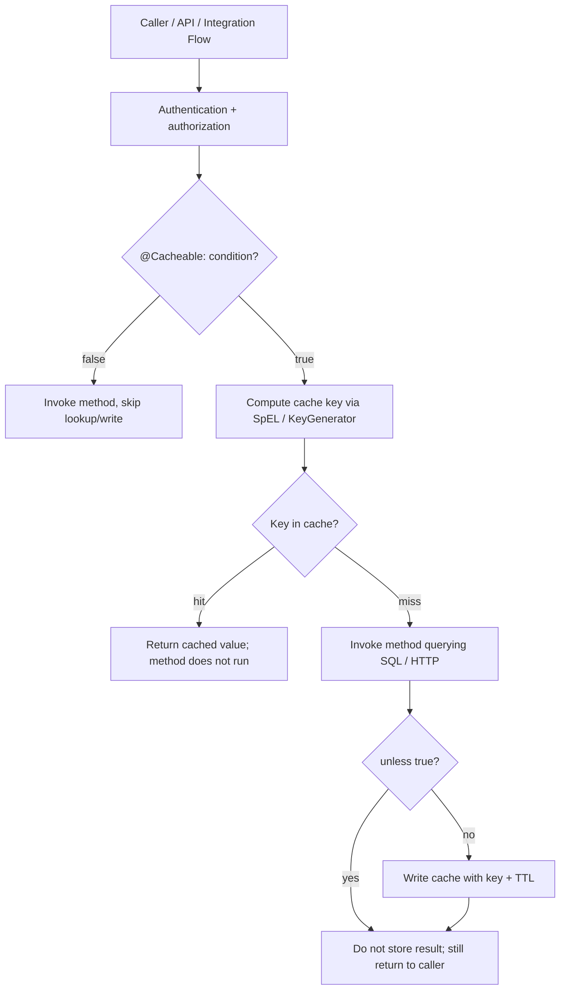
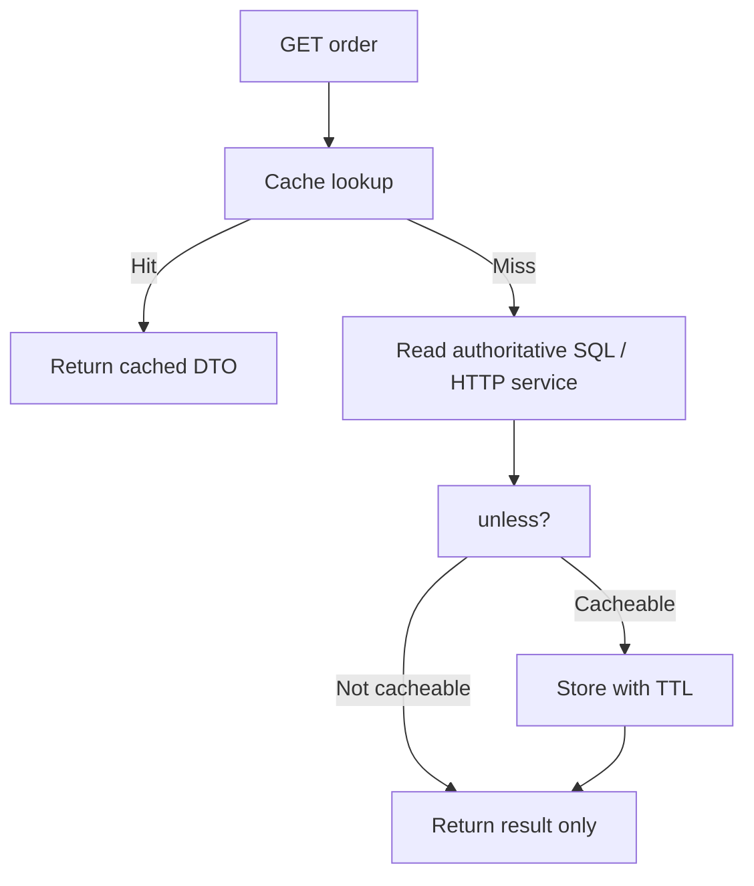

# Cache Keys, SpEL, condition, and unless

> **Chapter:** Caching  
> **Scope:** In the **SPRING_BOOT_INTEGRATION** module, Spring Boot exchanges data via HTTP clients, SQL, Redis/caches, message brokers, and Spring Integration adapters. This lesson focuses on how Spring Cache decides **under which key a result is stored**, uses **SpEL** to define keys and conditions, and distinguishes **`condition`** from **`unless`** in caching annotations. The practical emphasis is on data correctness, tenant isolation, transactions, errors, duplicate handling, testing, and observability.

## 1. Cache Keys Are Part of the Data Contract

Suppose `GET /tenants/{tenantId}/orders/{orderId}` reads order status from SQL and uses Redis to reduce latency. Two requests arrive:

```text
GET /tenants/tenant-a/orders/ORD-42
GET /tenants/tenant-b/orders/ORD-42
```

If the cache only uses `orderId` as the key, both tenants could access the same `ORD-42` entry, resulting in wrong data or **cross-tenant data leakage**. Similarly, if the same order produces results that vary by language, currency, access permissions, or schema version without including those factors in the key, cached results can be wrong even when the database is right.

A useful cache key must be:

1. **Sufficiently discriminating:** every parameter that changes the result must be reflected, or an invariant must prove it has no effect.
2. **Stable:** the same query intent always produces the same key across retries, multiple instances, and compatible deployments.
3. **Free of secrets:** never put bearer tokens, passwords, or raw PII in keys; protect both logs and backend access.
4. **Clearly scoped:** separate tenant, environment, cache name, and schema/version where needed.
5. **Lifecycle-bound:** TTL, invalidation, and rules for handling old keys when data or codecs change.

**Caching is a performance optimization, not a business source of truth.** A cache miss does not prove a record does not exist, and a cache hit does not prove the caller is authenticated or authorized to read that record.



Note that the diagram illustrates standard `@Cacheable` and omits special synchronization variants such as `sync=true`. On a cache hit, the `unless` expression is **not re-evaluated against the cached result**.

## 2. What Components Make Up the Spring Cache Abstraction?

Spring Cache is an abstraction managing cache read/write/evict operations via interceptors/AOP and `CacheManager`. It is not tied permanently to Redis; the provider can be an in-memory cache, Redis, or another integrated system.

| Component | Role | Key point to remember |
| --- | --- | --- |
| **`@EnableCaching`** | Enables cache annotation processing | Does not create a Redis server or TTL policy |
| **`@Cacheable`** | Reads cache first; on miss runs method and may store result | Cache hits typically **skip the method body** |
| **`@CachePut`** | Executes method and updates cache by key | Does not mean "put only on miss" |
| **`@CacheEvict`** | Removes specified entry or all entries | By default eviction runs after method completes normally from the cache interceptor's perspective; **not synonymous with after DB commit** |
| **`@Caching`** | Combines multiple cache operations on one method | Useful when evicting multiple caches |
| **`@CacheConfig`** | Declares shared cache settings at class level | Does not create transactions or access control |
| **`CacheManager` / `Cache`** | Locates cache regions, performs get/put/evict | TTL/serialization/cluster semantics depend on provider |
| **`KeyGenerator`** | Builds keys from method and arguments | Configurable globally or named per annotation |
| **Spring Expression Language (SpEL)** | Computes keys, pre-invocation or post-invocation conditions | Expressions can only see variables available at that exact phase |

Annotations are normally processed when calls pass through the bean's **Spring AOP proxy**. An internal call via `this.method()` can bypass the proxy, rendering caching annotations ineffective. Private methods or non-Spring-managed beans likewise cannot be assumed to be intercepted.

### 2.1. Cache Name vs. Cache Key

Example:

```java
@Cacheable(cacheNames = "order-view-v2", key = "#p0 + ':' + #p1")
public OrderView find(String tenantId, String orderId) {
    // ...
}
```

`cacheNames = "order-view-v2"` identifies the **cache region** managed by `CacheManager`; `key` identifies the **entry within that region**. With `RedisCacheManager`, the physical key is usually prefixed with the cache name/backend config. Do not treat the SpEL-computed string as the entire physical key in Redis across all providers.

Do not reuse the same cache name for incompatible DTOs without a versioning/serialization strategy; older application instances may misread newer values.

## 3. Default Keys When `key` Is Omitted

Spring Cache uses `SimpleKeyGenerator` by default:

| Method parameters | Conceptual default key | Example |
| --- | --- | --- |
| No parameters | `SimpleKey.EMPTY` | `allCurrencies()` |
| Single non-null, non-array parameter | The parameter object itself | `find("ORD-42")` → `"ORD-42"` |
| Multiple parameters | `SimpleKey` holding the parameter list | `find("tenant-a", "ORD-42")` |
| Array argument or special cases | `SimpleKey` wrapping appropriate arguments | Depends on value equality/hash behavior |

`SimpleKeyGenerator` works for many cases, yet has no awareness of the **business meaning** of parameters. If a method takes a custom DTO with unstable `equals()`/`hashCode()`, or the output depends on data sitting only in a security context, the default key may behave unexpectedly.

**A default key does not automatically include method name, class name, tenant, or version.** Cache names can partition by domain, but if two methods share a cache with overlapping parameter types yet return different types or semantics, logical collisions can still occur.

### 3.1. Easily Overlooked Default-Key Bugs

```java
// Risk: method returns different results per logged-in tenant,
// yet cache key contains only orderId.
@Cacheable("order-view")
public OrderView findOrder(String orderId) {
    String tenant = currentTenantFromSecurityContext();
    return database.load(tenant, orderId);
}
```

On a cache hit, **the method body does not run**, so you cannot rely on `currentTenantFromSecurityContext()` inside it to guard access. Proper protection requires **authentication/authorization before allowing a cache hit**, plus a key containing a trustworthy tenant scope.

Other risks: mutable parameters modified after being used as a key; composite keys encoded inconsistently across instances; inconsistent case/normalization; serializer changes after deployment; multiple cache regions sharing the same physical key prefix.

### 3.2. Do Not Equate Cache Keys with Idempotency Keys

| Cache key | Idempotency key |
| --- | --- |
| Identifies a reusable **lookup result** | Identifies **an intent to execute an operation** across retries |
| Can expire/evict per cache TTL | Retention must cover the business retry/replay SLA |
| Miss usually triggers recomputation/reload | A miss on a dedup record **does not prove** the side effect never occurred |
| Usually derived from read function arguments | Agreed upon by client/producer and business scope |

Do not rely solely on a regular Redis cache and `@Cacheable` as your only guard against duplicate orders or payments. For important side effects, use unique constraints, inbox/outbox tables, or durable idempotency records.

## 4. SpEL in Caching Annotations

**SpEL** (*Spring Expression Language*) lets you reference parameters, the method, cache names, and even helper beans to compute keys or conditions. Expressions are evaluated in an **evaluation context** built by Spring Cache per invocation.

| Expression | Meaning | Where used? |
| --- | --- | --- |
| `#p0` or `#a0` | First parameter by position | `key`, `condition`; also usable in `unless` |
| `#p1` / `#a1` | Second parameter | Building composite keys, parameter conditions |
| `#tenantId` | Parameter named `tenantId` if parameter-name metadata is present | Readable; requires build preserving parameter names, e.g. `-parameters` |
| `#root.methodName` | Name of the intercepted method | Distinguishing operations sharing a cache |
| `#root.targetClass` | Target class type | Can be used when keying by type |
| `#root.target` | Target bean instance | Use sparingly due to implementation coupling |
| `#root.args[0]` | Argument list from root object | Equivalent to positional parameter reference |
| `#root.caches[0].name` | Name of first target cache | Useful for debugging; take care when multiple caches are configured |
| `#result` | Method result **once available** | `@Cacheable` `unless`; post-invocation positions supported by annotations |
| `@beanName.method(...)` | Calls a Spring bean by name | Complex key policies; never perform heavy I/O inside SpEL |

Comparison example:

```java
@Cacheable(
    cacheNames = "order-view-v2",
    key = "#p0 + ':' + #p1",
    condition = "#p0 != null && #p1 != null",
    unless = "#result == null")
public OrderView find(String tenantId, String orderId) {
    // ...
}
```

When parameter names are preserved in class files, `key = "#tenantId + ':' + #orderId"` is easier to read. In complex build setups, `#p0` and `#p1` avoid relying on parameter-name discovery, though reordering parameters requires **updating SpEL as well**.

### 4.1. Do Not Reference `#result` Before the Method Runs

`condition` is evaluated **before method execution**; no business result exists yet. Therefore:

```java
// Semantically wrong: condition needs #result, which does not exist yet.
@Cacheable(cacheNames = "orders",
           condition = "#result.status() == 'CONFIRMED'")
public OrderView find(String orderId) { /* ... */ }
```

For a rule like "store only when status is CONFIRMED", use **`unless`** and guard against null:

```java
@Cacheable(
    cacheNames = "orders",
    unless = "#result == null || #result.status() != 'CONFIRMED'")
public OrderView find(String orderId) { /* ... */ }
```

This example does not apply directly if `status` has a different data type; adapt the expression to your actual DTO. For `Optional<T>` supported by Spring Cache, `#result` in `unless` has **unwrapped** result semantics where applicable; do not assume `#result` is always an `Optional` requiring `isPresent()`.

### 4.2. SpEL Can Fail and Must Be Tested

Expressions like `#p0.toLowerCase()` fail when the argument is null; `#result.status()` fails when the result is null. Invalid expressions, missing helper beans, or unexpected return types can cause the cache operation to throw at runtime rather than simply "skipping the cache."

Keep expressions short, null-guarded, and clearly named, and test through the actual **bean proxy** with null, empty, and edge-case enum inputs. Never embed SQL queries, Redis calls, or HTTP calls inside SpEL just to compute a key.

## 5. Key Differences Between `condition` and `unless`

| Criterion | `condition` | `unless` |
| --- | --- | --- |
| Evaluation timing | **Before** method call (`@Cacheable`) | **After method produces a result** when considering caching (`@Cacheable`) |
| Accessible objects | Method, arguments, context | Method, arguments, and `#result` |
| Meaning of boolean `true` | **Allows** caching to be considered | **Prevents storing** result into cache |
| Boolean `false` | Bypasses cache and still runs method | Allows storing result if flow permits |
| Can skip method on cache hit? | Yes, when `condition=true` and entry hits | No; `unless` does not run on normal cache hits |
| Typical use case | Cache only valid read queries or respect bypass flag | Exclude nulls, business errors, or transient state |

The two attribute names create an **inversion that is very easy to confuse**:

```java
condition = "#p2 == false"              // true -> participate in cache
unless    = "#result == null"           // true -> DO NOT store
```

### 5.1. Truth Table on a Cache Miss

| `condition` | Method executed? | `unless` | Written to cache? |
| --- | --- | --- | --- |
| false | Yes | Not evaluated | **No** |
| true | Yes (due to miss) | false | **Yes** |
| true | Yes (due to miss) | true | **No** |

If `condition=true` and the cache **hits**, the method does not normally run and `unless` is not used to re-evaluate the cached entry. A policy of "never return a PENDING result" enforced only with `unless` **cannot remove PENDING entries already stored earlier**; you need invalidation, versioned keys, or fixed lookup/access rules.

### 5.2. Input and Output Condition Example

Suppose we have:

```java
@Cacheable(
    cacheNames = "order-view-v2",
    key = "#p0 + ':' + #p1",
    condition = "#p0 != null && #p1 != null && !#p2",
    unless = "#result == null || #result.status() == 'PROCESSING'")
public OrderView findOrder(
        String tenantId, String orderId, boolean bypassCache) {
    // ...
}
```

Explanation:

- `bypassCache=true` → `condition=false` → neither reads nor writes cache; method always executes.
- `bypassCache=false`, key present in cache → returns entry immediately.
- Cache miss, database returns `null` → returns null to caller, **does not cache null**.
- Cache miss, database returns status `PROCESSING` → does not cache transient state.
- Cache miss, database returns status `CONFIRMED` → stores entry per the cache provider's TTL.

Because the method's output depends on tenant and order, **`bypassCache` does not need to be part of the key** when it only controls caching rather than altering the returned data. Conversely, if a parameter like `includeHistory` alters DTO contents, it must go into the key or use a separate cache.

### 5.3. `unless` Is Neither Validation Nor an Error Handler

When a method throws an exception, there is no successful result to store along `@Cacheable`'s normal path. `unless` does not convert exceptions to null, classify HTTP 404/503 responses, or perform retries. Validation belongs at request/DTO boundaries, infrastructure failures need their own policy, and `unless` solely decides **whether to write a computed result into the cache**.

## 6. Spring Boot 3.x Example: Caching Order Reads from PostgreSQL

This example uses Spring Boot 3.x, Java 17+, Spring Cache, and Redis. Assume an `orders` table with columns `tenant_id`, `order_id`, `status`, and `updated_at`. The database is the primary source of truth; the cache serves only to reduce read queries.

### 6.1. Dependencies

```xml
<dependencies>
    <dependency>
        <groupId>org.springframework.boot</groupId>
        <artifactId>spring-boot-starter-cache</artifactId>
    </dependency>
    <dependency>
        <groupId>org.springframework.boot</groupId>
        <artifactId>spring-boot-starter-data-redis</artifactId>
    </dependency>
    <dependency>
        <groupId>org.springframework.boot</groupId>
        <artifactId>spring-boot-starter-jdbc</artifactId>
    </dependency>
</dependencies>
```

The application needs a PostgreSQL runtime driver, a configured `DataSource` connection, and an available Redis server. Let the Spring Boot parent/BOM manage dependency versions. For in-memory caching, choose another provider instead of Redis; do not add Redis solely to use `@Cacheable`.

### 6.2. Enabling Caching and Configuring the Provider

```java
package com.example.integration.cache;

import org.springframework.cache.annotation.EnableCaching;
import org.springframework.context.annotation.Configuration;

@Configuration
@EnableCaching
public class CacheConfiguration {}
```

```yaml
spring:
  cache:
    type: redis
    cache-names: order-view-v2
    redis:
      time-to-live: 5m
      cache-null-values: false
      use-key-prefix: true
  data:
    redis:
      host: ${REDIS_HOST:localhost}
      port: ${REDIS_PORT:6379}
      timeout: 2s
```

Here **`spring.cache.redis.time-to-live` is the cache TTL** configured by Spring Boot/`RedisCacheManager`, not a SQL query or Redis command timeout. `cache-null-values=false` adds backend protection, yet `unless` on the method remains useful to state the non-null caching rule explicitly and remains portable across providers.

Do not use a single global TTL for every kind of data if freshness requirements differ. For example, newly paid order status may need faster invalidation than product catalog metadata. For per-cache TTLs, configure a `RedisCacheManagerBuilderCustomizer` or the configuration API appropriate for your Spring Data Redis version.

### 6.3. DTO and Service

```java
package com.example.integration.cache;

import java.time.Instant;

public record OrderView(
        String orderId,
        String status,
        Instant updatedAt
) {}
```

```java
package com.example.integration.cache;

import java.util.List;
import org.springframework.cache.annotation.Cacheable;
import org.springframework.jdbc.core.JdbcTemplate;
import org.springframework.stereotype.Service;

@Service
public class OrderViewService {
    private final JdbcTemplate ordersJdbc;

    public OrderViewService(JdbcTemplate ordersJdbc) {
        this.ordersJdbc = ordersJdbc;
    }

    @Cacheable(
        cacheNames = "order-view-v2",
        key = "#p0 + ':' + #p1",
        condition = "#p0 != null && #p1 != null",
        unless = "#result == null || #result.status() == 'PROCESSING'")
    public OrderView find(String tenantId, String orderId) {
        List<OrderView> rows = ordersJdbc.query("""
            SELECT order_id, status, updated_at
              FROM orders
             WHERE tenant_id = ? AND order_id = ?
            """,
            (rs, row) -> new OrderView(
                rs.getString("order_id"),
                rs.getString("status"),
                rs.getTimestamp("updated_at").toInstant()
            ),
            tenantId, orderId
        );
        return rows.stream().findFirst().orElse(null);
    }
}
```

**Correctness:** `tenantId` must be verified against the authenticated identity at the **boundary before accessing cached results**, not only inside `find()` (because hits bypass the body). If the application allows tenant/order IDs containing `:`, simple string concatenation can collide. Validate identifier characters or use a structured encoder as illustrated in Section 8.

**Database not-found case:** the method returns null; with the `unless` expression above, no null entry is written. Broken SQL, DB timeouts, or exception mappings do not automatically turn into cache misses. Because this service uses blocking `JdbcTemplate`, it fits Spring MVC/imperative workers; in a WebFlux event loop you must apply an appropriate blocking boundary or use R2DBC for a non-blocking pipeline.

### 6.4. Caching Is Not User Authentication

Suppose an HTTP controller receives `tenantId` from the path and calls a cached service. A tenant check *performed only inside `find()`* will be skipped on a cache hit. Authenticate, authorize, and bind a trusted tenant **before invoking the caching bean**, or enforce a security interceptor at a boundary with guaranteed ordering while keeping tenant-scoped keys.

Do not trust a client-supplied `tenantId` header alone as a security boundary.

## 7. `@CachePut`, `@CacheEvict`, and Data Update Boundaries

### 7.1. `@CachePut` Always Executes the Method

```java
@CachePut(
    cacheNames = "order-view-v2",
    key = "#p0 + ':' + #p1",
    condition = "#p0 != null && #p1 != null",
    unless = "#result == null")
public OrderView refresh(String tenantId, String orderId) {
    return loadFreshView(tenantId, orderId);
}
```

This pattern **always invokes `loadFreshView(...)`** when the call passes through the cache proxy, then decides whether to put the result into the cache. `@CachePut` does not mean "read from cache if present"; it is typically used when fresh results must be updated in the cache.

With `@CachePut`, key expressions can be evaluated after invocation and some annotation contexts support `#result` in key/unless; however, keys derived from result objects make matching invalidation from other operations harder. Prefer stable keys derived from business identity.

**Do not indiscriminately attach both `@Cacheable` and `@CachePut` to the same method.** One wants to skip the method on a cache hit while the other requires always running the method; combining them is error-prone without a clear contract.

### 7.2. `@CacheEvict` Removes Entries

```java
@CacheEvict(cacheNames = "order-view-v2",
            key = "#p0 + ':' + #p1")
public void invalidate(String tenantId, String orderId) {
    // Service strictly describes key-based cache invalidation.
}
```

If the call passes through the cache proxy and the method completes, the entry is deleted by key. `beforeInvocation = true` requests eviction **before** the method body, even if the method subsequently fails; use intentionally rather than assuming it is better by default.

```java
@CacheEvict(cacheNames = "order-view-v2", allEntries = true)
public void clearOrderViewCache() {
    // Administrative operation: clears the entire cache region, which can trigger a cache stampede.
}
```

`allEntries=true` normally clears all entries in the specified cache; do not put it on routine business paths. In Redis, key prefixes, patterns, and clearing behavior depend on provider/config; measure impact and Redis permissions. Do not combine `allEntries=true` expecting `key` to still filter down to a single entry.

### 7.3. DB Transaction Commit and Cache Operation Are Not the Same Transaction

A classic bug:

```text
@Transactional updates orders in SQL
→ @CachePut writes Redis or @CacheEvict deletes from Redis
→ SQL transaction rolls back afterward
→ Cache and database diverge
```

Or SQL commits, yet cache eviction fails, leaving the system serving stale data. JDBC/JPA `@Transactional` **does not automatically roll back Redis** and does not wrap HTTP, Kafka, or JMS into a shared transaction.

For critical business changes:

1. Write SQL data and an **outbox** record in the same database transaction if events must be emitted.
2. After commit, emit the event/invalidate the cache with a retryable strategy.
3. Update key versions or TTLs to bound staleness windows.
4. Ensure consumers tolerate duplicate messages and evict/update using stable keys.

One in-process option is `@TransactionalEventListener(phase = TransactionPhase.AFTER_COMMIT)` to perform eviction after commit. However, if the process crashes right after commit and before the listener runs, the in-memory event can be lost; if crash-safe reliability is required, use an outbox or reconciliation mechanism.

### 7.4. In-App Post-Commit Invalidation Example

```java
package com.example.integration.cache;

import org.springframework.cache.Cache;
import org.springframework.cache.CacheManager;
import org.springframework.stereotype.Component;
import org.springframework.transaction.event.TransactionPhase;
import org.springframework.transaction.event.TransactionalEventListener;

record OrderChanged(String tenantId, String orderId) {}

@Component
public class OrderCacheInvalidator {
    private final CacheManager cacheManager;

    public OrderCacheInvalidator(CacheManager cacheManager) {
        this.cacheManager = cacheManager;
    }

    @TransactionalEventListener(phase = TransactionPhase.AFTER_COMMIT)
    public void onOrderChanged(OrderChanged event) {
        Cache cache = cacheManager.getCache("order-view-v2");
        if (cache != null) {
            cache.evict(event.tenantId() + ":" + event.orderId());
        }
    }
}
```

This snippet assumes the order-updating service publishes `OrderChanged` **inside an active SQL transaction** via `ApplicationEventPublisher`. Without an active transaction, this listener is not invoked by default (unless fallback execution is configured). Be sure to use the exact same key algorithm as `@Cacheable`; concatenating `tenantId + ':' + orderId` is only safe when identifiers are validated and contain no delimiter.

If cache invalidation fails after commit, you cannot roll back the DB; monitor with metrics/alerts and have a retry/reconciliation mechanism.

## 8. Using a Key-Policy Bean or KeyGenerator When SpEL Gets Long

Across many services, duplicating key-concatenation expressions between `@Cacheable`, `@CacheEvict`, and manual invalidation code breeds bugs. A shared bean centralizes encoding, versioning, and scoping.

### 8.1. KeyPolicy Invoked from SpEL

```java
package com.example.integration.cache;

import org.springframework.stereotype.Component;

@Component("cacheKeyPolicy")
public class CacheKeyPolicy {
    public String order(String tenantId, String orderId) {
        if (tenantId == null || orderId == null) {
            throw new IllegalArgumentException("Missing cache key field");
        }
        // Length prefix avoids collisions from delimiters inside input.
        return "v2:t" + tenantId.length() + ":" + tenantId
             + ":o" + orderId.length() + ":" + orderId;
    }
}
```

```java
@Cacheable(
    cacheNames = "order-view-v2",
    key = "@cacheKeyPolicy.order(#p0, #p1)",
    condition = "#p0 != null && #p1 != null",
    unless = "#result == null")
public OrderView find(String tenantId, String orderId) {
    // ...
}
```

`@cacheKeyPolicy.order(...)` calls the Spring bean named `cacheKeyPolicy` in SpEL, not a Java static method. For manual invalidation, inject the **same bean** into `OrderCacheInvalidator` and call `keyPolicy.order(...)` rather than duplicating the algorithm.

**Versioning:** `v2` in the key and `order-view-v2` in the cache name isolate stale data when schemas or serializers change. Bump versions intentionally and avoid accumulating too many uncleaned old entries. How keys are stringified/serialized further depends on the `CacheManager`/provider.

### 8.2. Using KeyGenerator to Standardize per Method

```java
package com.example.integration.cache;

import java.lang.reflect.Method;
import org.springframework.cache.interceptor.KeyGenerator;
import org.springframework.context.annotation.Bean;
import org.springframework.context.annotation.Configuration;

@Configuration
class CacheKeyGeneratorConfiguration {
    @Bean("scopedKeyGenerator")
    KeyGenerator scopedKeyGenerator() {
        return (Object target, Method method, Object... params) -> {
            // Illustrative example; production must encode parameters stably,
            // include tenant scope, and handle complex types explicitly.
            return method.getDeclaringClass().getSimpleName()
                    + ":" + method.getName()
                    + ":" + java.util.Arrays.deepToString(params);
        };
    }
}
```

Used as follows:

```java
@Cacheable(cacheNames = "reference-data",
           keyGenerator = "scopedKeyGenerator")
public ReferenceData lookup(String tenantId, String code) {
    // ...
}
```

**Limitation of this illustrative generator:** `Arrays.deepToString()` is not a safe canonical serializer for arbitrary objects, maps, secrets, or very large arrays. In multi-instance systems, standardize parameter encoding and schema, constrain inputs, hide PII, and preserve stability across upgrades.

Do not specify both `key` and `keyGenerator` in the same annotation: they are **mutually exclusive** key-selection strategies.

## 9. Scoping Keys by Tenant, Permissions, and Output Format

### 9.1. Tenant Scope and User-Specific Results

If a cached result depends on **tenant**, the key must include the authenticated tenant. If the result also depends on **per-user permissions**, tenant scope alone may be insufficient. For example, an endpoint returning fields based on role:

```java
// Risk: same tenant/order, yet admin and viewer see different fields.
@Cacheable(cacheNames = "order-details", key = "#p0 + ':' + #p1")
public OrderDetails details(
        String tenantId, String orderId, boolean includeSensitiveFields) {
    // ...
}
```

If `includeSensitiveFields` changes the content, include it in the key **or separate caches/DTOs by scope**; it is often cleaner to cache an internal DTO without secret data and apply role-based transformations/field masking at the authenticated boundary.

Do not store user-filtered copies in a shared cache without explicit key/authorization design. Tokens, session IDs, and roles taken directly from requests must not be trusted until validated by security middleware.

### 9.2. Locale, Currency, and Feature Flags

Other factors that can alter results:

| Factor | When must it be in the key? | Example |
| --- | --- | --- |
| Locale/language | When the DTO already contains translated strings | `product:vi-VN:SKU-1` |
| Currency | When monetary amounts are converted or formatted differently | `price:VND:SKU-1` |
| Feature flag | When a flag changes output during a rollout | Versioned cache or flag in key |
| API contract version | When DTO structure differs so values aren't misread | `order-view-v2` |
| Pagination/sort/filter | When results vary by page and ordering | Key includes canonical filter/sort/page |
| Authorization scope | When results are filtered by permissions | Dedicated cache region or authenticated scope in key |

Never include the current timestamp or a random request ID in the key when they **do not actually change the data**; doing so drives hit rates to near zero. Conversely, omitting a parameter that changes the output causes cache poisoning.

## 10. Consistency: TTL, Stale Data, and Invalidation

### 10.1. TTL Does Not Fix a Wrong Key

A one-minute TTL only caps how long a wrong entry may linger; it does not make cross-tenant data leakage acceptable. If a key lacks the tenant, isolation breaks immediately on a cache hit. **Design keys and authorization right first; tune TTL afterward.**

### 10.2. Cache-Aside, Read-Through, and Stale Reads

`@Cacheable` commonly implements method-level read-through:



When SQL updates and the cache is not yet evicted, entries can become stale. In multi-instance deployments, local eviction on one node does not clear caches on other nodes if the backend is in-memory. With shared Redis, invalidating the shared region/key affects all instances, though network outages, replication lag, and races with concurrent reads still require attention.

### 10.3. Race Between Read Miss and Write

A race can occur:

1. Reader A misses the cache and reads stale data from SQL.
2. Writer B updates SQL and evicts the key.
3. Reader A finishes and **puts stale data** into the cache after eviction.

Thus **post-commit eviction** is necessary in many designs, yet still not sufficient for linearizable consistency under all races. For version-sensitive data, consider:

- Version/sequence in the DTO and key; publish only snapshots matching the version.
- Versioned cache keys derived from durable source state versions.
- Short TTL or skipping cache for critical decisions.
- Higher-consistency read/write coordination models when SLAs genuinely demand it.

Do not use the cache as sole proof that an order has not been paid or an event has not been processed.

### 10.4. Cache Stampede and `sync=true`

When a "hot" key's TTL expires, many concurrent requests miss and hit the database together. Spring Cache helps in some cases:

```java
@Cacheable(cacheNames = "reference-data",
           key = "#p0",
           sync = true)
public ReferenceData load(String code) {
    // ...
}
```

`sync=true` asks a supporting provider to coordinate concurrent invocations for the same key within the scope implemented by the provider. This is **not a guaranteed distributed lock across all nodes/providers**, and carries annotation restrictions such as incompatibility with `unless` and certain multi-cache combinations. Do not enable it as a universal concurrency fix without testing your backend.

### 10.5. Negative Caching

You may want to cache "not found" to reduce DB queries when many requests use invalid IDs, but storing nulls or placeholders can keep a newly created order **invisible** until the negative entry expires.

Use negative caching only if the contract allows stale-not-found within an explicit window, with a short TTL, properly scoped keys, and invalidation on record creation. `unless="#result == null"` is a simple choice to **avoid negative-caching nulls**.

## 11. Limitations of Annotations and AOP

### 11.1. Self-Invocation Bypasses the Cache Proxy

```java
@Service
class OrderFacade {
    public OrderView get(String tenantId, String orderId) {
        return this.cachedFind(tenantId, orderId); // Bypasses proxy
    }

    @Cacheable(cacheNames = "order-view-v2",
               key = "#p0 + ':' + #p1")
    public OrderView cachedFind(String tenantId, String orderId) {
        // Query...
        return null;
    }
}
```

In default proxy-based caching, `this.cachedFind(...)` is not intercepted by the caching interceptor. The usual fix: extract the cached method into a separate Spring bean and invoke it via constructor injection, or use an alternative interception configuration when truly necessary.

### 11.2. Method Visibility, `final`, and Key Expression Errors

Annotations on private/final methods or non-Spring-managed objects may not produce expected interception, depending on proxy type and configuration. Do not write a unit test instantiating a service with `new` and conclude caching works. Tests must invoke the **real bean** inside a Spring context.

### 11.3. An Annotation Does Not Manage Transactions

`@Cacheable` does not open a SQL transaction automatically; the method body may need `@Transactional(readOnly=true)` per query needs. `@CachePut` and `@CacheEvict` do not provide atomicity across Redis/SQL/HTTP.

Furthermore, when a method carries both `@Transactional` and cache annotations, **advice/proxy ordering** can affect when cache put/evict happens relative to commit. If "change cache only after commit" is required, design explicit after-commit or transaction-aware cache handling and test it against your real framework/provider versions.

## 12. Cache Backend Errors and Classification

| Scenario | Behavior to decide | What not to assume |
| --- | --- | --- |
| **Cache miss** | Query real source, optionally write cache per `unless` | Does not prove data does not exist |
| **Redis timeout/cache unavailable** | May fall back to DB with rate limit/bulkhead if cache is optimization only | Do not treat all cache errors as unbounded misses |
| **Wrong serializer or schema** | Report error, invalidate/migrate values in a controlled way | Do not retry decoding an unparseable value infinitely |
| **Cache hit with stale data** | TTL/invalidation/versioning/reconciliation | Do not treat cache as final source of truth |
| **Duplicate concurrent loads** | Measure load, limit concurrency/use sync per provider | Do not assume `@Cacheable` executes once across the entire cluster |
| **Cache put fails after DB commit** | Metric, retry, or allow cache miss next time per policy | Do not expect normal `@Transactional` to roll back DB |
| **Eviction fails** | Alert, outbox/retry, max stale TTL | Do not hide errors from callers if correctness is impacted |

Spring provides `CacheErrorHandler` and extension hooks to handle cache get/put/evict/clear errors strategically. If choosing **fail-open** when cache reads fail, bound load to partner databases/HTTP APIs and never apply that pattern to caches holding critical coordination state (dedup/locks) as if they were mere read-through caches.

## 13. Observing Key and Expression Effectiveness

A cache with a high hit rate **is not necessarily correct**; if a key omits the tenant, hit rate can look high simply due to cross-tenant leakage. Monitor both performance and correctness:

| Signal | Question to answer |
| --- | --- |
| Cache hit/miss/eviction by cache name | Is the cache reducing load or wasting memory? |
| Hit ratio by operation | Are key expressions stable across requests? |
| Cache puts skipped by `unless` | Are too many null/PROCESSING results being skipped? |
| `condition=false` rate | How many requests intentionally bypass the cache? |
| DB/HTTP fallback latency | During misses/outages, can the real source handle the load? |
| Key cardinality and Redis memory | Are keys growing unboundedly due to request IDs/nonces? |
| Serializer failures | Are entries from another version or incompatible schema present? |
| Stale-data / cache reconciliation incidents | Does eviction happen after updates and on the exact key? |

Standard metrics can depend on Spring Boot Actuator, Micrometer, and the `CacheManager`/provider. **Do not assume Spring Cache emits per-`unless`-branch metrics out of the box**; add custom instrumentation if needed. Limit tag cardinality: cache name, operation, and error class are reasonable, while `tenantId`, `orderId`, raw cache keys, tokens, or raw URLs generally should not be metric tags.

Logs/tracing should include a controlled correlation ID, cache name, and operation outcome; avoid logging full cache keys when they contain personal data. When caching partner HTTP responses, define caching rights, TTLs, and sensitive-data redaction before storing.

## 14. Testing Keys, condition, unless, and Transactions

### 14.1. Essential Test Suite

| Test case | What to prove |
| --- | --- |
| Same tenant/order, read twice | DB method executes once while entry is within TTL |
| Different tenant, same order ID | Two independent cache keys; no cross-tenant return |
| Different order ID, same tenant | No key collision |
| `condition=false` | Method runs every time without reading/writing cache |
| `unless=true` because `null` | Null not stored; next call still hits source |
| `unless=true` because `PROCESSING` | Transient state not cached |
| `unless=false` because `CONFIRMED` | Result is cached |
| Cache hit after source data changes | Returns stale data per committed TTL/invalidation policy, does not "magically refresh" |
| Null parameter / strange input in SpEL | Does not throw unexpected expression errors |
| Self-invocation | Test detects internal calls bypassing proxy |
| `@CacheEvict` after update | Entry evicted/updated on exact key at the expected commit timing |
| Cache backend outage | Fallback/retry/alert follows policy without unbounded load surge |
| Concurrent cache-miss requests | Measure stampede, validate `sync=true` if enabled |
| Old/new DTO/serializer versions | Does not misread incompatible data |

### 14.2. Testing Spring Cache Through the Bean Proxy

A simple way to test with a real backend is to inject the service from the Spring context, clear the cache, and call twice. JUnit pseudocode:

```java
@SpringBootTest
class OrderViewCacheIT {
    @Autowired OrderViewService service;
    @Autowired CacheManager cacheManager;

    @Test
    void sameTenantOrderUsesOneCacheEntry() {
        Cache cache = cacheManager.getCache("order-view-v2");
        assertThat(cache).isNotNull();
        cache.clear();

        OrderView first = service.find("tenant-a", "ORD-42");
        OrderView second = service.find("tenant-a", "ORD-42");

        assertThat(second).isEqualTo(first);
        // Use a repository spy/proxy or query metric to confirm
        // real SQL ran only once. Comparing DTOs alone is insufficient.
    }
}
```

This is a test skeleton: it requires JUnit 5, AssertJ, Spring Cache imports, PostgreSQL/Redis fixtures, and real beans; run with Testcontainers when proving Redis key serialization, TTL, multi-instance eviction, and SQL transactions. **Do not assert only that two results are equal**: a non-caching implementation can also return two identical DTOs.

### 14.3. Testing with One Provider Still Requires Testing Redis

An in-memory cache (like `ConcurrentMapCacheManager` or Caffeine) is useful for SpEL/key logic, yet **does not prove** key/value serialization, Redis TTL, prefixes, memory eviction, or network timeout behavior. For production Redis, run integration tests against real Redis or a close equivalent.

In particular, if a custom `KeyGenerator` returns a complex object, an in-memory cache may compare objects via `equals()/hashCode()` while Redis serializes them into different strings/bytes. Test against the production provider to avoid false confidence.

### 14.4. Testing Post-Commit Update Boundaries

An effective transaction test:

1. Start an update inside a SQL transaction and intentionally throw an exception before commit.
2. Verify the database rolls back and the cache **contains no uncommitted values**.
3. Update successfully; after commit verify eviction/invalidation on the right key.
4. Simulate a Redis error during eviction; record metrics and verify retry/TTL mechanics rather than assuming the DB rolls back.
5. For broker redelivery, verify outbox/idempotency protects side effects instead of relying on a short-TTL cache key.

## 15. Common Design Mistakes

1. **"All parameters in the default key already provide sufficient scope."** False: results can depend on tenant/role from context or external configuration.
2. **"`@Cacheable` always invokes the method before checking the cache."** False: cache hits usually skip the method.
3. **"`condition=true` means skip the cache."** False: true enables caching; `unless=true` prevents storing the result.
4. **"`unless` can block bad results already sitting in the cache."** False: on normal hits, the method does not run and `unless` does not re-evaluate cached entries.
5. **"`#result` can be used inside `condition`."** False: no result exists yet at pre-invocation time.
6. **"`@CachePut` behaves like `@Cacheable`."** False: put normally executes the method and updates the cache.
7. **"Any string-concatenated key is unique."** False: missing delimiters/canonicalization and scope can collide.
8. **"`@Transactional` guarantees SQL and Redis commit together."** False: the two systems have separate transactions.
9. **"Redis cache can replace inbox/idempotency."** False: TTL, eviction, and failover do not protect committed side effects long-term.
10. **"A unit test calling the method via `new` suffices to verify caching."** False: proxy interception requires a Spring context or proper AOP mechanism.
11. **"`sync=true` guarantees a single DB query across the entire cluster."** False: semantics depend on the provider and implementation.
12. **"Checking hit rate alone proves the cache is healthy."** False: a bad key can give a high hit rate while leaking data or returning stale values.

## 16. Cache Key and SpEL Design Checklist

1. **Classify data:** should it be cached, is it sensitive, or do reads have side effects?
2. **List every factor affecting output:** tenant, business ID, locale, currency, filters, pagination, role, and schema version.
3. **Choose cache name and key format:** prefix/version, canonicalization, length limits, and environment isolation.
4. **Choose `key` or `keyGenerator`:** never use both together; keep the algorithm consistent with eviction.
5. **Finalize `condition`:** which inputs are eligible for caching before invocation?
6. **Finalize `unless`:** which outputs must not be stored after the method runs?
7. **Design TTL/invalidation:** freshness, cache stampede, negative caching, and races with DB commit.
8. **Enforce authorization:** validate before cache hits, never trusting caller-supplied tenant/role claims unverified.
9. **Never replace idempotency with cache:** side-effecting operations use durable constraints/ledgers/inbox/outbox.
10. **Test and observe:** Spring proxy, production provider, nulls/misses, tenant isolation, stale/rollbacks, outages, and metric cardinality.

### Self-Check Questions

1. How do cache name and cache key differ?
2. What keys does `SimpleKeyGenerator` choose for zero, one, and multiple parameters?
3. Why is a tenant-scoped read method dangerous if the key contains only `orderId`?
4. How do `#p0`, `#root.methodName`, and `#result` differ in meaning?
5. Why is `#result` unavailable in `condition`?
6. When `condition=false`, is the method executed and is the cache consulted?
7. When `unless=true` on a cache miss, is the result still returned to the caller?
8. Why cannot `unless` be used to reject a cached result on a cache hit?
9. Why must `@Cacheable` and `@CacheEvict` share the exact same key algorithm?
10. When a SQL update fails after a cache put has occurred, which transaction boundary was violated?
11. When can `@Cacheable(sync=true)` be helpful, and why should it not be treated as distributed idempotency?
12. Which tests prove there is no cross-tenant leakage and that the DB is not queried on a cache hit?

**Key takeaway:** In Spring Cache, **the key defines the identity of reusable data**, while SpEL expresses that identity and policy right on the method. With `@Cacheable`, **`condition=true`** enables lookup/caching before the call; **`unless=true`** refuses storage **after a result is produced**. A cache hit can bypass the entire method body, so tenant scope, authorization, TTL, and invalidation must be designed carefully. When workflows span SQL, Redis, HTTP, and brokers, caching is strictly an optimization layer—transactional correctness and duplicate handling still require durable sources of truth, idempotency, and testing real boundaries.
