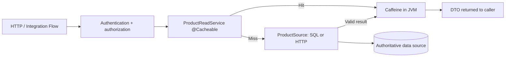
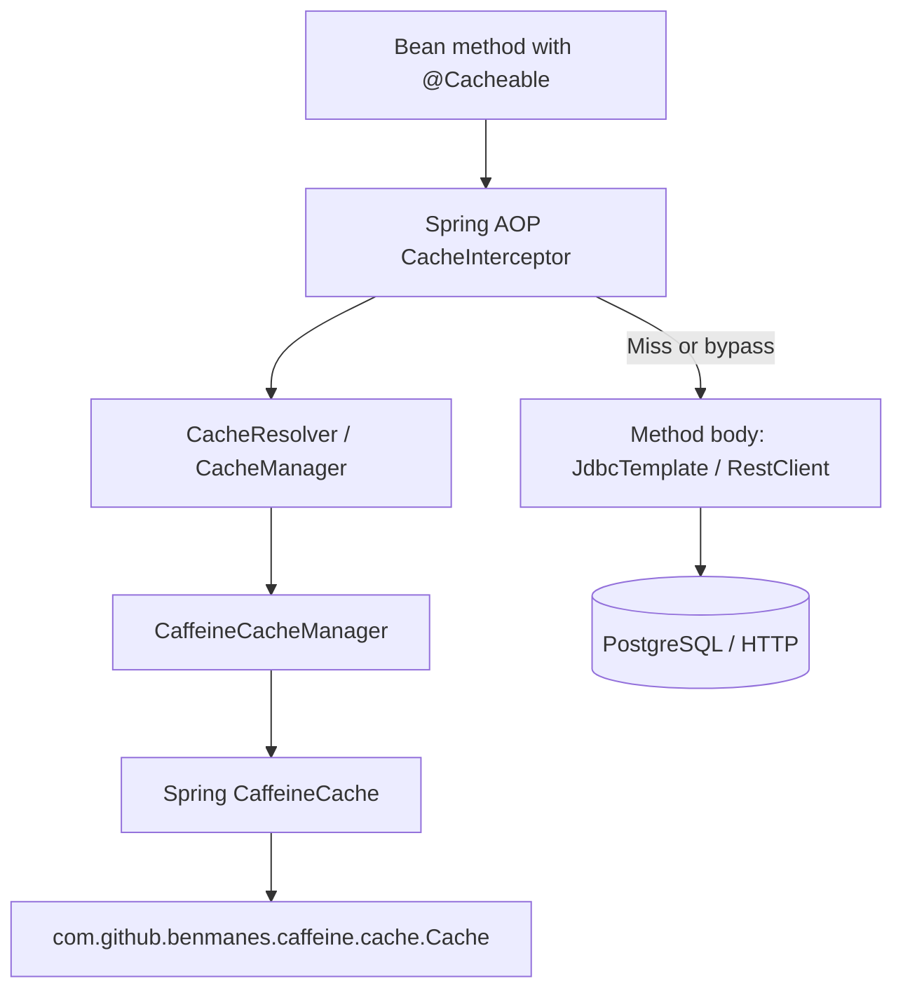
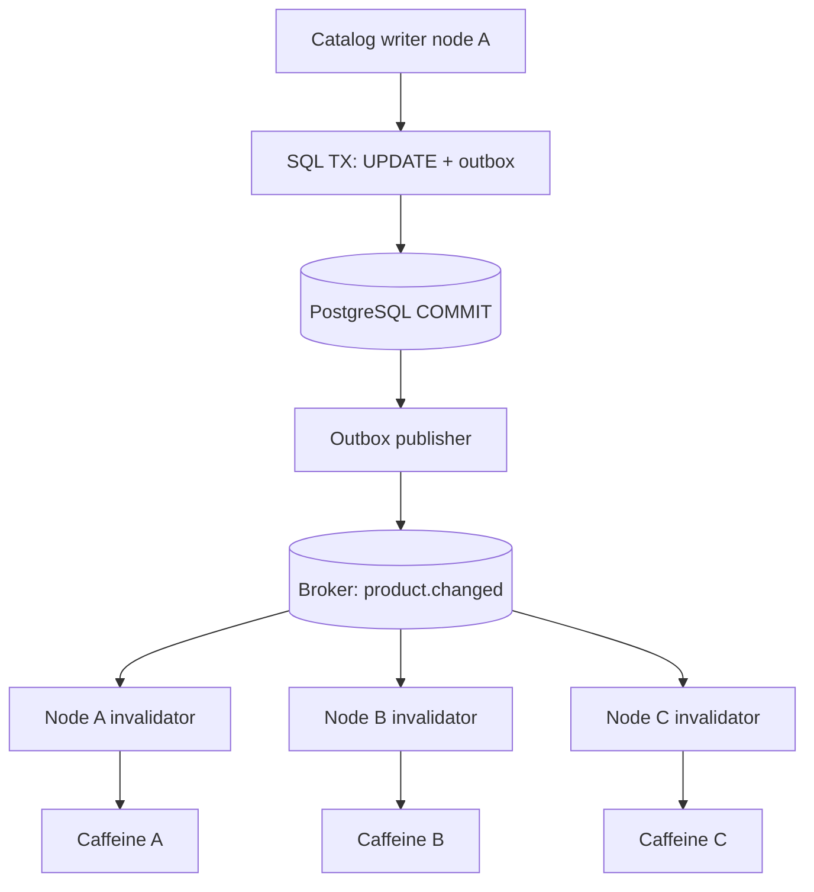
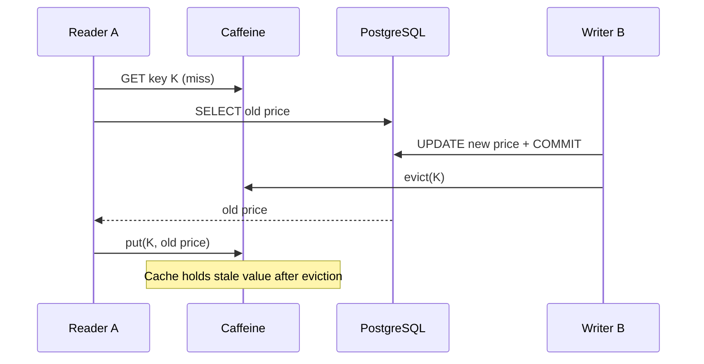

# Integrating Caffeine for Local Caching

> **Chapter:** Caching  
> **Scope:** In the **SPRING_BOOT_INTEGRATION** module, Spring Boot connects systems via HTTP clients, databases, caches, message brokers, and Spring Integration adapters. This lesson guides integrating **Caffeine** as an **in-process JVM** cache, covering dependencies and Spring Cache auto-configuration through key design, TTL, capacity limits, miss/stampede handling, data updates, multi-replica consistency, security, testing, and observability.

## 1. The Problem: Why Do We Need a Local Cache?

A Spring Boot product lookup API may receive thousands of requests for the same SKU within a few minutes. Each request queries PostgreSQL or calls an HTTP catalog service:

```text
GET /tenants/tenant-a/products/SKU-42
        |
        v
Spring Boot ProductReadService
        |
        v
PostgreSQL / HTTP catalog-service
        |
        v
ProductView (price, name, data version)
```

If most results change infrequently and are allowed to be stale for a short time, we can place **Caffeine** between the service and the data source:



On a **cache hit**, a `@Cacheable` method may **not run**; data is fetched from the memory of the **exact instance** handling the request. On a **cache miss**, the method executes, retrieves the source data, and Spring Cache can store the result for reuse.

**Primary benefits:** fewer DB/HTTP calls, lower latency, and reduced load on downstream dependencies. **Primary limitations:** an in-RAM cache is non-durable, is not shared automatically across replicas, and can return stale data.

### Learning Objectives

After this lesson, you will be able to:

1. Enable Caffeine via dependencies and `spring.cache.*` in Spring Boot.
2. Distinguish the Spring Cache abstraction, `CaffeineCacheManager`, and native Caffeine caches.
3. Design keys with tenant, identity, schema version, and all factors that affect results.
4. Choose `maximumSize`, `expireAfterWrite`, or `expireAfterAccess` for the right goal.
5. Use `@Cacheable`, `@CachePut`, and `@CacheEvict` without misjudging update timing.
6. Understand the limits of `sync=true`, `refreshAfterWrite`, null caching, and mutable cached objects.
7. Resolve invalidation bugs, races with SQL transactions, and multi-instance local caches.
8. Test cache hits/misses, concurrency, TTL, memory, instrumentation, and security.

## 2. What Is Caffeine? How Does It Differ from Redis?

**Caffeine** is a Java library providing a high-performance in-memory cache supporting size-based eviction, expiration, statistics, asynchronous loading, and data-loading mechanisms. It stores keys/values **on the JVM process heap**, requiring no external cache server.

| Criterion | Local Caffeine | Redis used as cache |
| --- | --- | --- |
| Data location | **Each JVM's** heap | External Redis process/server |
| Network hop on hit | None | Yes, unless an L1 local cache is added |
| Shared across multiple replicas | **Not automatic** | Yes, if replicas point to the same Redis |
| Lifecycle | Lost on app restart, redeploy, or cache clear | Depends on Redis persistence/eviction config and operations |
| Resource limits | Heap, GC, key/value sizes, CPU | Redis memory, network, connection pool |
| Eviction/TTL | `maximumSize`, `expireAfterWrite`, `expireAfterAccess`, etc. | Redis/configured TTL and eviction policies |
| Multi-instance invalidation | Requires a dedicated mechanism | Instances can evict the same key from a shared backend |
| Typical latency | Very low, in-process operations | Higher due to network/protocol, depending on infrastructure |
| Suitable use cases | Reference data, catalogs, rarely changing query results, pure computations | Shared cache, shared state, larger key/value datasets when infrastructure fits |

**Do not confuse "fast" with "correct."** If a product price was just updated on node A while node B holds the old price, Caffeine may serve stale data until B's TTL expires or B receives an invalidation signal.

Within the same system, you can combine **Caffeine L1 + Redis L2** or Caffeine in front of a database, but then you must also design read order, eviction, key versioning, and propagation. This lesson focuses first on a clearly managed **single local cache tier**.

## 3. Spring Cache and Caffeine Operate at Different Layers

Spring Boot provides the **Spring Cache abstraction**; Caffeine is a **provider** that the abstraction can use:



| Component | Responsibility |
| --- | --- |
| `@EnableCaching` | Enables interception for caching annotations per Spring configuration |
| `@Cacheable` | Checks cache first; on miss invokes method and may put result |
| `@CachePut` | Invokes method and updates cache with the result |
| `@CacheEvict` | Removes a key or a cache region per configuration |
| `CacheManager` | Locates caches by **cache name** |
| `CaffeineCacheManager` | Implements `CacheManager` using in-memory Caffeine |
| `CaffeineCache` | Adapter between Spring `Cache` and native Caffeine cache |
| `com.github.benmanes.caffeine.cache.Cache` | Actual cache structure holding entries/expiry/eviction/stats |

When using annotations, business code does not need to call Caffeine's `getIfPresent()`/`put()` directly. Conversely, certain use cases (manual caches, loading caches, custom per-entry expiry) may fit the **native Caffeine API** better than Spring's abstraction.

**Important:** `@Cacheable` works through interceptors/proxies. Instantiating objects with `new`, calling private methods, or making internal calls via `this.cachedMethod()` can **bypass the cache** in default proxy mode.

## 4. Dependencies and Auto-Configuration in Spring Boot

### 4.1. Maven

Example for **Spring Boot 3.x, Java 17+**:

```xml
<dependencies>
    <dependency>
        <groupId>org.springframework.boot</groupId>
        <artifactId>spring-boot-starter-cache</artifactId>
    </dependency>
    <dependency>
        <groupId>com.github.ben-manes.caffeine</groupId>
        <artifactId>caffeine</artifactId>
    </dependency>
</dependencies>
```

If the example uses SQL, add `spring-boot-starter-jdbc` and the appropriate JDBC driver; if it uses HTTP, add web/HTTP client dependencies per the application. When using the Spring Boot BOM, **let Boot manage the versions** of Spring Cache and Caffeine unless a verified upgrade requires otherwise.

With Gradle:

```groovy
dependencies {
    implementation 'org.springframework.boot:spring-boot-starter-cache'
    implementation 'com.github.ben-manes.caffeine:caffeine'
}
```

The cache starter provides Spring Cache infrastructure; the Caffeine dependency provides the backend. If the application also has Redis/Hazelcast/JCache on the classpath, **do not rely on guessing which provider gets selected from the classpath**: specify the cache type explicitly and verify the actual `CacheManager`.

### 4.2. Enabling Annotation Caching

```java
package com.example.integration.cache;

import org.springframework.cache.annotation.EnableCaching;
import org.springframework.context.annotation.Configuration;

@Configuration
@EnableCaching
public class LocalCacheConfiguration {
}
```

`@EnableCaching` turns on annotation processing; it **does not** create a distributed cache or decide TTL on its own. Spring Boot can auto-configure `CaffeineCacheManager` when dependencies and conditions match; if the application already declares a `CacheManager` bean, Boot may **back off**, so properties do not always affect a manually defined manager.

### 4.3. application.yml for a Cache Region

```yaml
spring:
  cache:
    type: caffeine
    cache-names:
      - catalog-product-v1
    caffeine:
      spec: "maximumSize=10000,expireAfterWrite=2m,recordStats"
```

Explanation:

- `spring.cache.type=caffeine`: selects the Caffeine provider rather than letting Boot choose based on other conditions.
- `spring.cache.cache-names`: declares known **cache regions**, such as `catalog-product-v1`.
- `spring.cache.caffeine.spec`: a **Caffeine spec** of comma-separated options.
- `maximumSize=10000`: targets limiting entry count **per native cache** via eviction policy, not 10,000 entries total across the cluster.
- `expireAfterWrite=2m`: entries expire after the elapsed time since creation/rewrite; **read hits do not extend the deadline**.
- `recordStats`: enables native cache statistics collection; adds a small overhead for observability.

If there are 5 replicas and each replica allows up to roughly 10,000 entries in this region, the system holds **multiple copies** of the same data in RAM. Memory budgets must be calculated as **number of cache regions × number of instances × key/value size + overhead**, not from a single `maximumSize` number.

**Note:** Caffeine's TTL is a **per-entry local policy**, which does not mean every entry is physically removed at the exact instant it expires. Eviction/expiration maintenance runs on cache operations or via a scheduler if configured. On retrieval, expired entries are no longer considered hits; memory reclamation may occur afterward.

## 5. Understanding expireAfterWrite, expireAfterAccess, and Eviction

### 5.1. Basic Configurations

| Caffeine configuration | Meaning | Common use case |
| --- | --- | --- |
| `maximumSize=N` | Policy-based size eviction when entry count exceeds threshold | Bound memory by count of roughly uniform keys |
| `maximumWeight=N` + `weigher` | Bound by custom application-computed weight | Values vary widely in size; requires care |
| `expireAfterWrite=2m` | Expires relative to creation/replacement time | Prices/catalogs needing periodic freshness |
| `expireAfterAccess=2m` | Expires when unaccessed for a duration | Rarely used results should be purged, while hot keys can stay longer |
| `refreshAfterWrite=...` | Enables periodic refresh with an appropriate **loading cache** | Update asynchronously without always blocking callers on reload |
| `recordStats` | Records hit/miss/eviction/load statistics | Diagnosing cache effectiveness |

**`maximumSize` is not simple LRU.** Caffeine uses an admission/eviction policy accounting for **frequency and recency** to improve hit rates. Never write business logic relying on which entry is evicted first.

`maximumWeight` requires a meaningful weight calculation; Java objects carry references, collections, and headers, so do not treat `String.length()` as actual heap bytes. Memory overruns can still happen if a single value is huge or the application retains references elsewhere.

### 5.2. Timeline for Two TTL Types

```text
T0:  key K is written into cache
T1:  caller reads K
T2:  caller reads K
T3:  caller reads K

expireAfterWrite = 2 minutes:
    K expires relative to the write time at T0
    Reads at T1/T2/T3 do not extend TTL

expireAfterAccess = 2 minutes:
    K expires after 2 minutes with no accesses
    Hot keys can survive much longer if read continuously
```

For prices, limits, inventory, or data with **strict maximum freshness** requirements, `expireAfterWrite` is usually easier to reason about. For reference data that can remain as long as it stays hot, `expireAfterAccess` can help, but it **provides no hard upper bound on data age** for a hot key.

### 5.3. Refresh Is Not Expiration

`refreshAfterWrite` is not interchangeable with `expireAfterWrite`:

- Expiration turns an access after TTL into a miss that waits for a load.
- Refresh ties into **`LoadingCache`/`AsyncLoadingCache`** and a loader to update values; the cache can continue returning the old value while a refresh runs under matching semantics.
- Adding `refreshAfterWrite=1m` to `spring.cache.caffeine.spec` will not make all `@Cacheable` methods automatically refresh as desired. On a cache configuration without a suitable loader, it may do nothing or be rejected.

If you need stale-while-revalidate, you must design **the loader, error policy, executor, refresh concurrency limits, and freshness SLA**, not merely add a duration.

## 6. Complete Example: Caching Product Data Read from PostgreSQL

Assume the application has a table:

```sql
CREATE TABLE catalog_products (
    tenant_id VARCHAR(80) NOT NULL,
    sku VARCHAR(120) NOT NULL,
    display_name VARCHAR(300) NOT NULL,
    price_minor BIGINT NOT NULL,
    currency VARCHAR(3) NOT NULL,
    version BIGINT NOT NULL,
    updated_at TIMESTAMPTZ NOT NULL,
    PRIMARY KEY (tenant_id, sku)
);
```

`price_minor` stores monetary amounts in the **agreed minor unit** to avoid floating-point errors; `currency` identifies the unit; `version` and `updated_at` support freshness inspection. The database is the source of truth; Caffeine holds only a read copy.

### 6.1. Immutable DTO

```java
package com.example.integration.catalog;

import java.time.Instant;

public record ProductView(
        String sku,
        String displayName,
        long priceMinor,
        String currency,
        long version,
        Instant updatedAt
) {}
```

Using a `record` with immutable fields is a sound choice for local caches. If a DTO contains mutable `List`/`Map` fields, a record **does not protect nested mutable state**; use immutable copies or defensive copies.

### 6.2. Underlying Data Source

```java
package com.example.integration.catalog;

public interface ProductSource {
    ProductView load(String tenantId, String sku);
}
```

```java
package com.example.integration.catalog;

import java.util.List;
import org.springframework.jdbc.core.JdbcTemplate;
import org.springframework.stereotype.Repository;

@Repository
public class JdbcProductSource implements ProductSource {
    private final JdbcTemplate jdbc;

    public JdbcProductSource(JdbcTemplate jdbc) {
        this.jdbc = jdbc;
    }

    @Override
    public ProductView load(String tenantId, String sku) {
        List<ProductView> values = jdbc.query("""
                SELECT sku, display_name, price_minor, currency,
                       version, updated_at
                  FROM catalog_products
                 WHERE tenant_id = ? AND sku = ?
                """,
                (rs, row) -> new ProductView(
                        rs.getString("sku"),
                        rs.getString("display_name"),
                        rs.getLong("price_minor"),
                        rs.getString("currency"),
                        rs.getLong("version"),
                        rs.getTimestamp("updated_at").toInstant()),
                tenantId, sku);
        return values.stream().findFirst().orElse(null);
    }
}
```

In this example, JDBC is a **blocking** API; do not call it directly on a WebFlux/RSocket Reactor event loop. If using an HTTP client instead, implement `ProductSource` differently, specifying timeouts, 4xx/5xx mapping, auth, and fallbacks.

### 6.3. Building Keys with Tenant Scope and Version

```java
package com.example.integration.catalog;

import org.springframework.stereotype.Component;

@Component("catalogKeyPolicy")
public class CatalogKeyPolicy {

    public String product(String tenantId, String sku) {
        if (tenantId == null || tenantId.isBlank()
                || sku == null || sku.isBlank()) {
            throw new IllegalArgumentException(
                    "tenantId and sku must not be blank");
        }
        if (tenantId.length() > 80 || sku.length() > 120) {
            throw new IllegalArgumentException(
                    "cache identity is too long");
        }

        // Length-prefix avoids collisions if values contain delimiter characters.
        return "product:v1:t" + tenantId.length() + ":" + tenantId
                + ":s" + sku.length() + ":" + sku;
    }
}
```

**Why not use `key = "#sku"`?** SKUs can repeat across tenants. **Why not just concatenate `tenantId + ':' + sku`?** If either value contains the delimiter, distinct pairs can collide; length-prefixing or an immutable structured key mitigates this risk.

`tenantId` must come from an **authenticated identity source or be verified before the caching boundary**, not an arbitrary user-supplied header. This key contains the raw tenant ID; if tenant IDs are considered sensitive, use an opaque ID or scoped digest with managed salt. Avoid logging full keys.

### 6.4. Service with @Cacheable

```java
package com.example.integration.catalog;

import org.springframework.cache.annotation.Cacheable;
import org.springframework.stereotype.Service;

@Service
public class ProductReadService {
    private final ProductSource source;

    public ProductReadService(ProductSource source) {
        this.source = source;
    }

    @Cacheable(
        cacheNames = "catalog-product-v1",
        key = "@catalogKeyPolicy.product(#p0, #p1)",
        condition = "#p0 != null && #p1 != null",
        unless = "#result == null")
    public ProductView find(String tenantId, String sku) {
        return source.load(tenantId, sku);
    }
}
```

Execution flow:

1. Spring Cache evaluates `condition` **before the method call**.
2. If allowed, SpEL invokes the `catalogKeyPolicy` bean to compute the key.
3. Caffeine looks up the key in `catalog-product-v1` in the **current JVM**.
4. On a **hit**, returns the cached `ProductView`, **without calling `source.load(...)`**.
5. On a **miss**, invokes `source.load(...)` to run the SQL query.
6. If `null` is returned, `unless="#result == null"` ensures **null is not stored**.
7. If a non-null DTO is returned, Spring Cache puts it into Caffeine under the TTL/eviction policy.

**Do not confuse `unless` with validation.** SQL exceptions or deserialization errors are not turned into "cache misses" by `unless`. Classify source errors separately. With `condition=false`, the method still executes without reading or writing cache; this expression does not replace parameter validation.

### 6.5. Authorization Boundary Before Cache Hit

A safe pattern:

```java
@GetMapping("/tenants/{tenantId}/products/{sku}")
public ProductView product(
        @PathVariable String tenantId,
        @PathVariable String sku,
        Authentication authentication) {

    authorization.checkCanReadTenant(authentication, tenantId);
    return productReadService.find(tenantId, sku);
}
```

This is an illustrative controller snippet; `authorization` is an application-implemented permission service and `Authentication` comes from Spring Security. **Do not move authorization checks solely inside `ProductReadService.find()` if the method body is skipped on hits.** Enforce authorization at a boundary **guaranteed to run on every request** or in an advice layer with tested ordering/semantics.

## 7. When Should an HTTP Response Be Cached?

In Spring Boot integration, `ProductSource` can call an external API instead of PostgreSQL:

```java
package com.example.integration.catalog;

import org.springframework.beans.factory.annotation.Qualifier;
import org.springframework.web.client.RestClient;

public final class HttpProductSource implements ProductSource {
    private final RestClient client;

    public HttpProductSource(
            @Qualifier("catalogRestClient") RestClient client) {
        this.client = client;
    }

    @Override
    public ProductView load(String tenantId, String sku) {
        return client.get()
                .uri("/internal/v1/tenants/{tenantId}/products/{sku}",
                        tenantId, sku)
                .retrieve()
                .body(ProductView.class);
    }
}
```

This is an **alternative implementation** to JDBC; do not register both as indistinguishable `ProductSource` beans simultaneously. In production, configure `catalogRestClient`, TLS/service credentials, timeouts, error mapping, and tenant/authorization rules. Never let callers supply arbitrary base URLs to prevent SSRF.

**Do not cache all HTTP responses identically:**

| Result type | Usually appropriate policy |
| --- | --- |
| 200 + slowly changing reference DTO | Cache with clear TTL and invalidation where needed |
| 404 "not found" | Consider short-TTL negative caching; or skip to avoid stale-not-found |
| 401/403 | **Never** cache as a shared response; this is a security/business failure |
| 429 or 503 | Do not store as "product does not exist"; use proper backoff/fallback |
| Timeout during read request | Classify error; bounded retries if safe; never default to null |
| HTTP POST creating a resource | Never use `@Cacheable` in place of an idempotency record |

If an HTTP source returns DTOs varying by locale, currency, feature flag, or role, **every factor affecting output must appear in the key or use separate cache regions**. Never serve a cached DTO generated for a high-privilege user to a lower-privilege user.

## 8. @Cacheable, @CachePut, and @CacheEvict Have Different Semantics

| Annotation | When does the method run? | Effect on Caffeine |
| --- | --- | --- |
| `@Cacheable` | Skips body on normal hit; runs on miss/bypass | Reads key, then optionally puts result |
| `@CachePut` | Executes method when invocation passes through proxy | Puts new result under key; never skips method on hit |
| `@CacheEvict` | Method invoked per condition; evicts before/after per config | Removes key or entire local region |
| `@Caching` | Follows nested annotations | Coordinates multiple cache operations |

### 8.1. `condition` and `unless` Are Two Separate Phases

```java
@Cacheable(
    cacheNames = "catalog-product-v1",
    key = "@catalogKeyPolicy.product(#p0, #p1)",
    condition = "#p0 != null && #p1 != null",
    unless = "#result == null")
public ProductView find(String tenantId, String sku) {
    // ...
}
```

- `condition=true`: **allows caching to be evaluated before invocation**.
- `condition=false`: bypasses cache, still invokes method.
- `unless=true`: **prevents storing the result after the method runs**.
- On a cache hit, `unless` is not a filter that re-evaluates the cached result on every request.

If a DTO lacks `sku`, validation belongs in API/domain design rather than expecting `unless` to substitute for full schema enforcement.

### 8.2. Do Not Arbitrarily Cache Null or Mutable References

Native Caffeine caches do not store `null` as a normal value. Spring's `CaffeineCache` can **adapt nulls via a sentinel** depending on the manager's `allowNullValues` setting; therefore, never assume "Caffeine doesn't store null so `@Cacheable` always skips null results."

`unless="#result == null"` expresses the no-null policy at the method level. If you need to cache not-found results, use a **structured result** (such as a `NOT_FOUND` state with its own TTL) or another tested convention.

In a local cache, values are typically the **same object reference** returned to callers. If a caller mutates a `List` inside a cached DTO, subsequent requests see the mutated state **without querying the source**. Use immutable DTOs and defensive copies where needed.

## 9. Customizing Multiple Cache Regions with Different TTLs

A global `spring.cache.caffeine.spec` normally applies **the same policy** across all caches created by that manager. Yet different data needs different freshness:

- `catalog-product-v1`: product descriptions/prices tolerate 2 minutes of staleness.
- `catalog-stock-v1`: stock counts tolerate only 10 seconds of staleness.

When **per-region policies** are needed, you can manually construct a `SimpleCacheManager` from `CaffeineCache` instances:

```java
package com.example.integration.cache;

import java.time.Duration;
import java.util.List;

import com.github.benmanes.caffeine.cache.Caffeine;
import org.springframework.cache.CacheManager;
import org.springframework.cache.caffeine.CaffeineCache;
import org.springframework.cache.support.SimpleCacheManager;
import org.springframework.context.annotation.Bean;
import org.springframework.context.annotation.Configuration;

@Configuration(proxyBeanMethods = false)
class PerRegionCaffeineConfiguration {

    @Bean
    CacheManager cacheManager() {
        CaffeineCache product = new CaffeineCache(
                "catalog-product-v1",
                Caffeine.newBuilder()
                        .maximumSize(10_000)
                        .expireAfterWrite(Duration.ofMinutes(2))
                        .recordStats()
                        .build());

        CaffeineCache stock = new CaffeineCache(
                "catalog-stock-v1",
                Caffeine.newBuilder()
                        .maximumSize(2_000)
                        .expireAfterWrite(Duration.ofSeconds(10))
                        .recordStats()
                        .build());

        SimpleCacheManager manager = new SimpleCacheManager();
        manager.setCaches(List.of(product, stock));
        return manager;
    }
}
```

**Choose only one of the two configuration styles** for practice:

- **Option A — Boot auto-configuration:** `spring.cache.type=caffeine` + `spring.cache.caffeine.spec`.
- **Option B — Custom manager:** declare a `CacheManager` bean and manage each native cache as shown above.

If you pick **Option B**, do not assume `spring.cache.caffeine.spec` still configures your custom manager; the code creating each `CaffeineCache` owns the policy. Never combine both configurations and guess "which policy wins."

**Business warning:** 10 seconds of stale stock may still be too long if stock checks are part of formally reserving items. Display/hint caches must never replace an **authoritative stock-reservation transaction** at the source of truth.

## 10. @Cacheable(sync=true) and Cache Stampede

**Cache stampede** occurs when many requests read a key right as its TTL expires:

```text
T0: catalog-product-v1/SKU-42 expires
T1: Request A -> miss -> SQL query
T2: Request B -> miss -> SQL query
T3: Request C -> miss -> SQL query
...
Tn: N requests surge backend load
```

Spring Cache supports:

```java
@Cacheable(
    cacheNames = "catalog-product-v1",
    key = "@catalogKeyPolicy.product(#p0, #p1)",
    sync = true)
public ProductView findSynced(String tenantId, String sku) {
    return source.load(tenantId, sku);
}
```

`sync=true` asks the cache provider to coordinate avoiding concurrent loads for **the same key** where supported. Caffeine is a provider that supports atomic per-key loading via Spring Cache's get-with-loader mechanism.

**Limits you must understand:**

1. `sync=true` on a Caffeine cache **does not create a distributed lock across multiple JVMs**.
2. It has configuration constraints: incompatible with `unless` and unsupported with multi-cache/operation combinations.
3. Different keys can still load concurrently; enforce global concurrency limits if the backend has rate limits.
4. If the loader fails, waiting callers can all observe the failure; apply retries/backoff/circuit breakers at the right layer.
5. One hot key can cause head-of-line waiting inside the same JVM when loading is slow; monitor loader latency.

**Do not copy `sync=true` into `ProductReadService.find()` from Section 6 while keeping `unless`**: that combination is invalid under Spring Cache's sync caching semantics. To avoid nulls, use a **sentinel/result wrapper** with an explicit contract or design the loader to return only valid data.

### 10.1. When Downstream HTTP Also Has Rate Limits

Suppose 20 replicas simultaneously miss one key. `sync=true` limits loading to one per key **per replica**, yet the backend still receives 20 HTTP requests. If that load is still too high, add:

- A shared cache like Redis or cluster-wide invalidation/coalescing.
- HTTP client bulkheads/rate limiters.
- Prewarming high-traffic keys if genuinely needed.
- A fallback mechanism **that never trades away security or required freshness**.

Never use a short-TTL Redis lock as the sole guarantee for business write commands; preventing duplicate side effects requires database unique constraints or a dedicated ledger.

## 11. Updating Data: Eviction Must Target the Right Key and Timing

Suppose an admin updates a product price in PostgreSQL. If only the database is modified, every instance's local cache can keep serving the old price.

### 11.1. Simple @CacheEvict Pattern

```java
@CacheEvict(
    cacheNames = "catalog-product-v1",
    key = "@catalogKeyPolicy.product(#p0, #p1)")
public void invalidate(String tenantId, String sku) {
    // Serves only to trigger eviction when called through a Spring proxy.
}
```

This deletes an entry from the **current instance's** cache. It does not invalidate other replicas. For SQL changes inside `@Transactional`, you must also consider **whether cache eviction runs before or after DB commit**.

### 11.2. Mistake: Updating Cache Inside a SQL Transaction That Later Rolls Back

```text
BEGIN SQL TRANSACTION
  UPDATE catalog_products SET price_minor = 119000
  @CachePut or @CacheEvict writes/deletes Caffeine
  Exception -> ROLLBACK SQL
END

Possible outcome:
  SQL retains the old price
  Cache holds the new price or was evicted
```

A local Caffeine cache **is not a JDBC-transaction-enlisted resource**. `@Transactional` does not roll back in-RAM puts or evictions.

### 11.3. Publishing an Event in the Transaction and Invalidating After Commit

A better design within the **same JVM** uses `@TransactionalEventListener(AFTER_COMMIT)`:

```java
package com.example.integration.catalog;

public record ProductChanged(String tenantId, String sku) {}
```

```java
package com.example.integration.catalog;

import org.springframework.context.ApplicationEventPublisher;
import org.springframework.jdbc.core.JdbcTemplate;
import org.springframework.stereotype.Service;
import org.springframework.transaction.annotation.Transactional;

@Service
public class ProductPriceMutationService {
    private final JdbcTemplate jdbc;
    private final ApplicationEventPublisher events;

    public ProductPriceMutationService(
            JdbcTemplate jdbc,
            ApplicationEventPublisher events) {
        this.jdbc = jdbc;
        this.events = events;
    }

    @Transactional
    public void updatePrice(
            String tenantId, String sku, long newPriceMinor) {
        if (newPriceMinor < 0) {
            throw new IllegalArgumentException(
                    "newPriceMinor must not be negative");
        }

        int rows = jdbc.update("""
                UPDATE catalog_products
                   SET price_minor = ?,
                       version = version + 1,
                       updated_at = CURRENT_TIMESTAMP
                 WHERE tenant_id = ? AND sku = ?
                """, newPriceMinor, tenantId, sku);

        if (rows != 1) {
            throw new IllegalStateException(
                    "Product not found or not unique");
        }

        events.publishEvent(new ProductChanged(tenantId, sku));
    }
}
```

```java
package com.example.integration.catalog;

import org.springframework.cache.Cache;
import org.springframework.cache.CacheManager;
import org.springframework.stereotype.Component;
import org.springframework.transaction.event.TransactionPhase;
import org.springframework.transaction.event.TransactionalEventListener;

@Component
public class LocalProductCacheInvalidator {
    private final CacheManager manager;
    private final CatalogKeyPolicy keys;

    public LocalProductCacheInvalidator(
            CacheManager manager,
            CatalogKeyPolicy keys) {
        this.manager = manager;
        this.keys = keys;
    }

    @TransactionalEventListener(
        phase = TransactionPhase.AFTER_COMMIT)
    public void invalidate(ProductChanged event) {
        Cache cache = manager.getCache("catalog-product-v1");
        if (cache != null) {
            cache.evict(keys.product(
                    event.tenantId(), event.sku()));
        }
    }
}
```

When the event is published **inside an active transaction**, the `AFTER_COMMIT` listener runs only after that transaction commits successfully. If the transaction rolls back, the listener skips this post-commit eviction branch. Without an active transaction, the listener does **not** run by default unless fallback behavior is enabled; test this boundary explicitly.

**This is not yet a multi-instance consistency strategy.** Events via `ApplicationEventPublisher` are **in-process**, non-durable, and evict only on the node handling the change. If the JVM crashes right after commit before eviction, the in-memory event is also lost.

### 11.4. Multi-Replica Design



If invalidation must broadcast to all replicas:

1. Write a **ProductChanged event/outbox record** in the same SQL transaction when durability is required.
2. Publish via an appropriate broker or bus.
3. **Every replica** must actually receive the invalidation event; with Kafka, **sharing one consumer group splits partitions** instead of delivering each event to **every** instance. Use an appropriate subscription topology (e.g., per-instance consumer group, true pub/sub semantics, or cache versioning).
4. Consumers verify event ID/version and evict the exact key; handle duplicates safely.
5. If an offline node misses notifications, maximum TTL or reconciliation/versioned keys must ensure it cannot stay stale indefinitely.

**If strong cross-node read-after-write consistency is required**, asynchronous local caches are rarely the simplest choice. Consider reading the source of truth directly for critical operations, using a shared cache with consistency safeguards, or enforcing strict versioned reads.

## 12. Race Condition: Post-Commit Eviction Can Still Suffer Stale Writes

A classic race:



Therefore **post-commit eviction is part of the design, not a proof of linearizability**. To reduce risk:

- Bounded TTL aligned with freshness SLAs.
- DTOs carrying `version`/`updatedAt` to detect staleness.
- Keys like `tenant:sku:version` when callers can reliably resolve the source version.
- Read directly from the source of truth for sensitive decisions such as payment execution or stock reservation.
- Or design ordered/version-checked cache updates; never expect fire-and-forget eviction alone to prevent every race.

**Local caches do not replace SQL optimistic locking.** If two writers update the same product, use database constraints/version checks rather than cached values for concurrency control.

## 13. Multi-Tenant, Security, and Sensitive Data

### 13.1. Keys Must Reflect Every Factor Affecting Output

| Factor | If omitted from key, what can happen |
| --- | --- |
| Tenant | Leaking another tenant's products/prices |
| SKU or entity ID | Two entities share the same value |
| Currency | Returning USD price for a VND request |
| Locale | Returning names/units in the wrong language |
| Feature flag/version | Rollout serves old schema/logic |
| Filter/sort/page | Returning search results from a different query |
| Authorization scope | Permission-filtered cached response served to lower-privilege user |

Some factors do not belong in the key when they **do not change the cached data**—for example, a tracing-only correlation ID. Conversely, putting a random request ID in every key destroys hit rates.

**Safe ordering:** authenticate caller → authorize tenant/resource → invoke cached bean. Never place authorization checks solely inside a `@Cacheable` method if hits bypass the body.

### 13.2. Avoid Caching Secrets

Do not cache raw access tokens, passwords, or long-lived sensitive data on the heap without a security review. Heap dumps, debuggers, crash reports, or memory diagnostics can expose cached values. If caching authorization decisions, define freshness, revocation semantics, and fail-closed policies explicitly; a "5-minute TTL" does not suit every security action.

Never put keys containing bearer tokens into metric tags or logs. Each JVM has its own memory space, yet **is not a security boundary** when multi-tenant requests share the process.

## 14. Memory Management, Sizing, and Cache Lifecycle

Local caching is fast, yet shares heap with HTTP requests, SQL mapping, messaging buffers, and Reactor streams. Memory pressure can spike GC pauses or cause JVM out-of-memory errors.

### 14.1. Estimating Memory Budgets

Illustrative estimate:

```text
maximumSize = 10,000 entries
estimated key+value+overhead ~ 2 KB/entry
raw memory ~ 20 MB per region / per JVM

With 4 similar-sized regions:
  ~ 80 MB/JVM excluding object graphs/GC overhead

With 8 replicas:
  multiple copies held (~640 MB cluster-wide by estimate)
```

**The 2 KB figure is purely an assumption**; measure actual object graphs with heap profiling/JFR/metrics. `maximumSize` bounds entry count via policy, not per-value byte size. A single multi-megabyte value or massive object graph reference can still cause OOM.

### 14.2. Bounding Input Before Caching

An endpoint accepting arbitrary `search?q=...` input can create a new key per query, yielding few hits and heavy eviction:

- Validate lengths, characters, and filter counts.
- Normalize inputs meaningfully without altering query semantics.
- Do not cache rare, memory-expensive, or sensitive queries.
- Limit total concurrent miss requests (bulkhead).
- Monitor cardinality and churn rather than hit rate alone.

### 14.3. Application Shutdown, Redeploys, and Warmup

Local Caffeine caches **lose contents when the process stops**; basic caches require no network shutdown steps like a Redis client. The Spring context manages `CacheManager` lifecycle; if you add custom schedulers/executors/loaders, ensure proper shutdown.

After a rolling deployment, new replicas start with cold caches, risking a **cold-start thundering herd** if all instances query the backend simultaneously. You can prewarm a bounded set of keys, ramp traffic gradually, enforce concurrency limits, or use a shared cache if needed. Never prewarm user/tenant data unboundedly.

## 15. Observing Caffeine and Spring Cache

Caffeine exposes statistics via `recordStats`:

| Metric | Meaning and limitations |
| --- | --- |
| **Hit count / hit rate** | Fraction of lookups finding an entry; high does not prove keys are right |
| **Miss count** | May stem from cold start, TTL, eviction, wrong key, or bypass |
| **Load success/failure** | Applies when using cache-loading operations |
| **Eviction count/weight** | Caffeine evicts per policy; distinguish expirations from size evictions |
| **Estimated size** | Approximate entry count; not heap bytes |
| **Load duration** | Data load latency when properly instrumented |

With Boot Actuator/Micrometer and a compatible provider, several cache metrics bind automatically. However, **do not assume every `condition`/`unless` branch gets separate metrics out of the box**; add service-level instrumentation to track bypasses, stale rechecks, or contract errors.

### 15.1. Reading Native Cache Statistics for Diagnostics

```java
package com.example.integration.cache;

import org.springframework.cache.Cache;
import org.springframework.cache.CacheManager;
import org.springframework.cache.caffeine.CaffeineCache;

public class CacheDiagnostics {
    private final CacheManager manager;

    public CacheDiagnostics(CacheManager manager) {
        this.manager = manager;
    }

    public String catalogSnapshot() {
        Cache springCache =
                manager.getCache("catalog-product-v1");

        if (!(springCache instanceof CaffeineCache caffeine)) {
            return "catalog-product-v1 is not a CaffeineCache";
        }

        var nativeCache = caffeine.getNativeCache();
        var stats = nativeCache.stats();
        return "estimatedSize=" + nativeCache.estimatedSize()
                + ", hits=" + stats.hitCount()
                + ", misses=" + stats.missCount()
                + ", evictions=" + stats.evictionCount();
    }
}
```

This is an illustrative diagnostics class, not marked as a Spring bean or HTTP endpoint; avoid exposing internal cache details on public APIs. For meaningful stats, `recordStats` must be enabled. `estimatedSize()` is approximate and may not immediately reflect pending maintenance work.

**Do not use `tenantId`, `SKU`, or raw cache keys as metric labels.** Region name, operation, and outcome/error class have low cardinality and are far safer. To investigate an individual key, use access-controlled logs/traces with redaction.

### 15.2. Correlating Cache Signals with Data Sources

A rising miss rate does not prove Caffeine is broken. It may stem from a key-schema change after deployment, traffic from new tenants, overly short TTLs, or rapidly changing data. Correlate against:

- JDBC query counts/latency and connection pool metrics.
- HTTP client request counts/timeouts/rate-limits.
- Heap usage, GC pauses, and CPU.
- Cache entry counts and eviction counts per region.
- Invalidation event lag, replica skew, and stale-data incidents.
- Frequency of 404/null/PROCESSING results skipped by policy.

**Measure correctness before optimizing hit ratio:** a very high hit rate returning the wrong tenant or stale prices is still a severe bug.

## 16. Testing Caffeine: Proving Bean Proxying and Behavior

### 16.1. Minimum Test Suite

| Scenario | Expected outcome |
| --- | --- |
| Two reads for same tenant/SKU | Source called once while entry remains valid |
| Two tenants with same SKU | Two independent keys, no cross-tenant response |
| Different SKUs | No key collision |
| `condition=false` | Method executes without cache lookup/put |
| Source returns null + `unless=true` | Null not cached; next call reloads |
| Source throws exception | Never turns into a fake cached success |
| Entry expires after TTL | Next access reloads data |
| Exceeds `maximumSize` | Eviction/capping works per policy without unbounded entry growth |
| 10 callers miss same key with `sync=true` | Loads coordinated **within one cache instance** |
| SQL update rolls back | `AFTER_COMMIT` event does not evict along that branch |
| SQL update commits | Entry for exact key evicted after commit |
| Update on node A, read on node B | Demonstrates defined consistency bounds; local cache does not auto-share |
| Source/DTO after upgrade | Separate key region/version or tested compatibility |
| Caller tries accessing another tenant | Authorization still checked before using cached DTO |

### 16.2. Unit/Integration Test Example with Spring Cache Proxy and Counting Source

The example below builds a **small Spring test context**; neither PostgreSQL nor Redis is needed to prove interception and key isolation. It uses `ProductReadService` and `CatalogKeyPolicy` from above:

```java
package com.example.integration.catalog;

import static org.assertj.core.api.Assertions.assertThat;

import java.time.Instant;
import java.util.concurrent.atomic.AtomicInteger;

import com.github.benmanes.caffeine.cache.Caffeine;
import org.junit.jupiter.api.Test;
import org.springframework.beans.factory.annotation.Autowired;
import org.springframework.cache.CacheManager;
import org.springframework.cache.annotation.EnableCaching;
import org.springframework.cache.caffeine.CaffeineCacheManager;
import org.springframework.context.annotation.Bean;
import org.springframework.context.annotation.Configuration;
import org.springframework.test.context.junit.jupiter.SpringJUnitConfig;

@SpringJUnitConfig(classes = {
        ProductReadService.class,
        CatalogKeyPolicy.class,
        LocalCaffeineCacheTest.Config.class
})
class LocalCaffeineCacheTest {

    static final class CountingSource implements ProductSource {
        final AtomicInteger loads = new AtomicInteger();

        @Override
        public ProductView load(String tenantId, String sku) {
            loads.incrementAndGet();
            return new ProductView(
                    sku, tenantId + "-product", 125000L, "VND",
                    1L, Instant.parse("2026-11-21T03:00:00Z"));
        }
    }

    @Configuration
    @EnableCaching
    static class Config {
        @Bean
        CountingSource countingSource() {
            return new CountingSource();
        }

        @Bean
        CacheManager cacheManager() {
            var manager = new CaffeineCacheManager(
                    "catalog-product-v1");
            manager.setCaffeine(Caffeine.newBuilder()
                    .maximumSize(100)
                    .recordStats());
            return manager;
        }
    }

    @Autowired ProductReadService service;
    @Autowired CountingSource source;

    @Test
    void cachesPerTenantAndSku() {
        ProductView first = service.find("tenant-a", "SKU-42");
        ProductView second = service.find("tenant-a", "SKU-42");
        ProductView otherTenant =
                service.find("tenant-b", "SKU-42");

        assertThat(second).isEqualTo(first);
        assertThat(otherTenant.displayName())
                .isEqualTo("tenant-b-product");
        assertThat(source.loads.get()).isEqualTo(2);
    }
}
```

**Test note:** The `CountingSource` bean implements `ProductSource`, so Spring injects it into `ProductReadService` **without declaring a second `ProductSource` bean**. Declaring an extra unnecessary bean of the same interface leads to multiple candidates or ambiguous wiring. Critically, `service` must be a **Spring proxy bean**, not an instance constructed via `new`.

Isolate tests from leftover cache entries/state; if multiple test methods share a context, clear caches and reset counters before each test, or use isolated test fixtures. Without a TTL configured, this test only verifies key/annotation behavior; test TTL/memory separately with expiration settings.

### 16.3. Using a Fake Ticker to Test TTL Precisely

Caffeine supports `Ticker`, letting you test expiration without `Thread.sleep()` for seconds. On a native Caffeine cache, supply a controllable ticker and advance time:

```java
// Conceptual pseudocode using a FakeTicker from test support:
var ticker = new FakeTicker();
var cache = Caffeine.newBuilder()
        .ticker(ticker::read)
        .expireAfterWrite(Duration.ofMinutes(2))
        .build();

cache.put("SKU-42", "v1");
assertThat(cache.getIfPresent("SKU-42")).isEqualTo("v1");

ticker.advance(Duration.ofMinutes(3));
assertThat(cache.getIfPresent("SKU-42")).isNull();
```

`FakeTicker` here is a **test helper you implement or pull from an appropriate test library**; do not assume it is part of Caffeine's public API across all versions. In Spring Cache integration tests, construct `CaffeineCacheManager` with ticker-backed native caches or isolate TTL logic into dedicated tests.

### 16.4. When Integration Tests Against Real SQL/HTTP Are Needed

Pure cache tests do not prove everything:

- **SQL transaction/invalidation:** use PostgreSQL Testcontainers to verify rollbacks, commits, and `AFTER_COMMIT` events.
- **HTTP timeouts:** use WireMock/MockWebServer to prove remote failures are not mistakenly cached as valid values.
- **Multiple instances:** spin up two application contexts/processes or explicitly model two independent cache managers to verify there is no default propagation.
- **Security:** send real requests through protected boundaries testing the same SKU across two tenants.
- **Load:** measure hit/miss/heap and GC under production-like key distributions.

## 17. Troubleshooting Common Errors

| Symptom | Possible cause | How to investigate |
| --- | --- | --- |
| `@Cacheable` has no effect | Missing `@EnableCaching`, self-invocation, non-Spring object | Inspect bean proxy and call path |
| Different cache used despite Caffeine dependency | Provider auto-detection or another custom bean | `spring.cache.type=caffeine`, inspect actual `CacheManager` bean |
| `spring.cache.caffeine.spec` does not change TTL | Custom `CacheManager` configuring itself | Check bean factories/conditions; don't edit YAML blindly |
| Cache hit returns wrong tenant | Key omits tenant or in-method auth check was skipped | Authorization boundary, key scope, regression tests |
| Null records get cached | Spring wrapper may adapt nulls, missing `unless` | Check `allowNullValues` and result policy |
| Memory growth/GC pauses | Unbounded entries, high key cardinality, oversized values | `maximumSize`, profiling, input limits |
| Multiple SQL queries for same key | Stampede, overly short TTL, multiple replicas | Scoped `sync=true`, bulkheads, load tests |
| `sync=true` combined with `unless` fails | Two incompatible options on same annotation | Use sentinel/wrapper or drop one option |
| Another instance does not see entries | This is local Caffeine, not Redis | Verify `CacheManager` and cache topology |
| SQL updated yet stale price returned | Missing eviction, separate instance cache, read/write race | After-commit policy, event broadcast/TTL/versioning |
| Stale persists across restart on another node | Invalidation is in-process only | Inspect per-replica/broker event delivery |
| Missing hit/miss statistics | Missing `recordStats` or metrics binding | Native cache stats/Actuator |
| Test PASSES yet production fails | Test mocks service directly, mismatched provider/profile | Test Spring proxy + real Caffeine + backend contract |

### 17.1. Do Not "Fix" Incidents by Setting TTL to 0

Setting TTL to 0 or turning off caching can help **isolate a bug**, yet under high request rates, backend SQL/HTTP services can overload immediately. Assess capacity, rate limits, and safe rollout first. If cross-tenant data leakage is possible, prioritize **stopping wrong responses** and fixing keys/authorization before optimizing performance.

### 17.2. Inspecting the Active CacheManager

With Actuator enabled, `/actuator/beans` and `/actuator/conditions` (when enabled and authorized) explain active beans and auto-configuration. Never expose them publicly on the Internet. When needed, assert the actual class:

```java
@Autowired CacheManager cacheManager;

@Test
void localCacheProviderIsCaffeine() {
    assertThat(cacheManager)
            .isInstanceOf(CaffeineCacheManager.class);
}
```

This test holds for **Option A** or a custom `CaffeineCacheManager`; for **Option B** in Section 9, the manager is actually `SimpleCacheManager` holding `CaffeineCache` instances. Therefore, assert the cache type **per region** rather than forcing the manager itself to be `CaffeineCacheManager`.

## 18. Practice Designing Policies by Data Type

A Spring Boot order-processing system has four flows:

| Data | Should Caffeine cache it? | Starting policy to test |
| --- | --- | --- |
| Country lists, currency codes, status code tables | **Yes** | Tens of minutes TTL, size cap, version on schema changes |
| Product prices for display | **Conditionally** | Short TTL, invalidation/version; checkout price must be verified at transaction step |
| Displayed stock count | **Very strictly conditionally** | Very short TTL or uncached; stock reservation must query authoritative source |
| Idempotency records for payment operations | **Never use Caffeine as sole decision source** | Store durably in DB/ledger with unique constraints and retention per retry SLA |
| Access tokens and sensitive auth data | **Requires separate security assessment** | Revocation, expiry, audience, and isolation; never treat cache TTL as security policy |
| Heavy but rarely changing SQL query results | **Possibly** | Size/TTL within memory budget; measure hit rate and stale tolerance |
| Pending/unacked broker events | **Never replace broker/inbox with cache** | Ack/retry/DLQ and idempotent consumer per contract |

**Exercise:** Design `CatalogReadService` for 3 tenants, 8 replicas, 100,000 SKUs (~1 KB per product), requiring displayed prices to be stale by at most 60 seconds. Determine:

1. Cache key: tenant + SKU + currency/locale if they alter output.
2. Region name/version and serializer/value immutability.
3. `maximumSize` sized to **one** replica's heap budget, not total cluster SKUs.
4. `expireAfterWrite` and invalidation/broadcast rules.
5. Backend load if all replicas restart simultaneously.
6. Case where a price updates right as an older reader puts stale data after eviction.
7. Tests for isolation, rollback, multi-instance staleness, and security.
8. Metrics needed to verify the cache provides net benefit.

No single TTL/size pair fits every application; measure traffic distribution, object sizes, mutation frequency, stale SLAs, and replica counts to finalize values.

## 19. Production Deployment Checklist

1. **Choose the right backend:** local Caffeine where suitable; consider Redis/shared cache when shared state is needed.
2. **Enable the right infrastructure:** cache starter, Caffeine dependency, `@EnableCaching`, and verified `CacheManager`.
3. **Define cache regions/versions:** clear names, never mix incompatible DTOs.
4. **Design keys:** tenant, identity, and output-affecting parameters; no secrets.
5. **Enforce authorization:** run before returning cache hits.
6. **Set policies:** `maximumSize`/`maximumWeight`, `expireAfterWrite`/`expireAfterAccess` matched to use case.
7. **Handle nulls/exceptions:** know when `unless` skips caching; never swallow source errors silently.
8. **Control concurrency:** stampedes, `sync=true` within its limits, bulkheads/rate limits.
9. **Design updates:** after-commit invalidation, races, multi-replica consistency, and outbox/broadcast if needed.
10. **Manage memory:** profiling, value immutability, cold starts, and rolling deployments.
11. **Observe:** hits/misses/evictions, size, loader latency, backend latency, stale incidents, and GC.
12. **Test:** Spring proxies, real Caffeine, TTL, rollbacks, multi-tenant, multi-instance, and failure scenarios.

### Self-Check Questions

1. Where does Caffeine store data, and why does node B not automatically see entries cached on node A?
2. What different problems do `spring.cache.type=caffeine` and the `caffeine` dependency solve?
3. How do `CacheManager`, `CaffeineCache`, and native Caffeine `Cache` differ?
4. How does `expireAfterWrite` differ from `expireAfterAccess` when a key is read continuously?
5. Why does `maximumSize=10000` not mean the entire cluster holds at most 10,000 entries?
6. Why is `refreshAfterWrite` not a simple TTL setting for every `@Cacheable` method?
7. Why can an authorization check inside a method be skipped on a cache hit?
8. At what points are `condition` and `unless` evaluated?
9. Why does native Caffeine disallow nulls while Spring Cache can still represent cached nulls?
10. What kind of stampede does `@Cacheable(sync=true)` solve, and what kind does it not solve?
11. Why must `sync=true` and `unless` not be combined in the same `@Cacheable`?
12. Why can cache eviction running after SQL commit still suffer a reader writing stale prices back?
13. When one consumer in a Kafka group receives an invalidation event, does it automatically evict all replicas in that group?
14. Why should cached `ProductView` objects be immutable even without serialization or network transport?
15. Which tests prove the cache genuinely reduces SQL queries and prevents cross-tenant data leakage?

## 20. References

- [Spring Boot — Caching](https://docs.spring.io/spring-boot/reference/io/caching.html): configuring Spring Cache, Caffeine, and cache providers.
- [Spring Framework — Cache Abstraction](https://docs.spring.io/spring-framework/reference/integration/cache.html): `@Cacheable`, `@CachePut`, `@CacheEvict`, keys, SpEL, `sync`, and proxy behavior.
- [Caffeine — Wiki](https://github.com/ben-manes/caffeine/wiki): eviction, expiration, loading, statistics, refresh, and tuning.
- [Micrometer — Reference](https://docs.micrometer.io/micrometer/reference/): metrics and cache observability.
- [Spring Framework — Transaction Management](https://docs.spring.io/spring-framework/reference/data-access/transaction.html): SQL transaction boundaries and after-commit behavior.

**Key takeaway:** **Caffeine is an in-JVM local cache**: very fast and requires no Redis server, yet **does not automatically share across replicas** and does not survive restarts. Spring Cache uses `CaffeineCacheManager` to drive `@Cacheable`/`@CacheEvict`, while Caffeine governs expiration, eviction, and statistics. A sound integration requires **scoped and versioned keys, TTL/sizing grounded in real data, authorization before hits, immutable values, post-commit invalidation, and a multi-instance strategy where needed**. Never use cache TTLs as a substitute for SQL transactions, durable idempotency ledgers, broker acknowledgments, or cross-system consistency testing.
