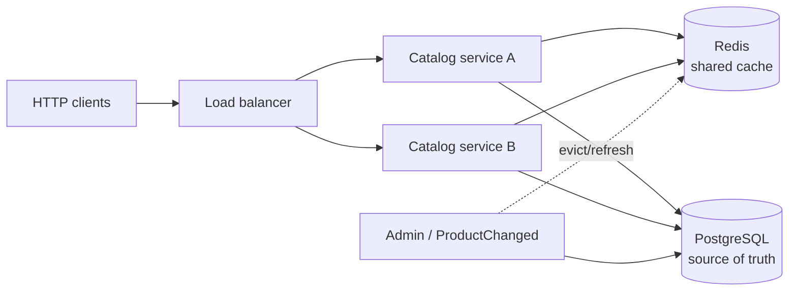
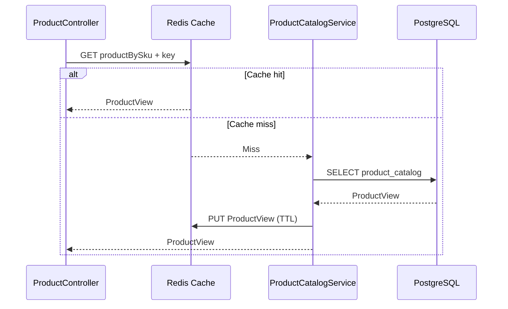
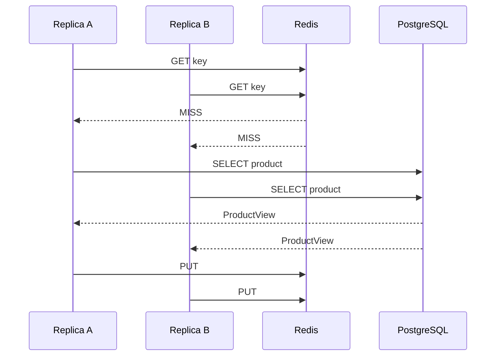

# Integrating RedisCacheManager for Shared Caching

When a Spring Boot application runs across multiple replicas, `@Cacheable` backed by each JVM's default in-memory cache can yield inconsistent results: instance A has updated a product's price while instance B still returns the old price from its own cache copy. If every instance caches independently without sharing or cross-node invalidation, bugs are hard to reproduce locally yet surface frequently once scaled out.

**RedisCacheManager** is Spring Cache's implementation using Redis as a shared cache store. Multiple replicas connecting to the same Redis deployment can access the same cache entries by cache name and key. However, **sharing a store does not mean data is always consistent**: SQL remains the source of truth, caches have TTLs, cache writes can fail, evictions can run after commit, and HTTP/broker flows can modify data concurrently.

This lesson belongs to the **Caching** chapter in **SPRING_BOOT_INTEGRATION**, aimed at structuring Spring Boot integration across HTTP clients, databases, caches, message brokers, and Spring Integration adapters. The focus is managing **configuration, data contracts, transactions, errors, duplicate handling, testing, and observability**. We will use a **Product Catalog API + PostgreSQL + Redis + ProductChanged events** scenario, concentrating on what `RedisCacheManager` handles and what additional safeguards you must design.

> **Illustrative versions:** Java 17+, Spring Boot **3.5.x**, Spring Data Redis **3.5.x**, Redis 7.x, and PostgreSQL 16. APIs, packages, and serializers in Spring Boot 4.x/Spring Data Redis 4.x have changes (notably Jackson 3). In real applications, always verify the dependency BOM, method signatures, and configuration properties of your **deployed version** instead of mechanically copying Boot 3.x imports into Boot 4.x.

## 1. Learning Objectives

After this lesson, you will be able to:

1. Distinguish **Spring Cache abstraction**, `CacheManager`, `RedisCacheManager`, `RedisConnectionFactory`, and `RedisTemplate`.
2. Explain why Redis acts as a **shared cache** across instances without automatically creating consistency with PostgreSQL.
3. Enable Spring caching and obtain `RedisCacheManager` via Spring Boot auto-configuration.
4. Use `spring.cache.redis.*`, `RedisCacheConfiguration`, and `RedisCacheManagerBuilderCustomizer` within their proper scopes.
5. Design TTLs, cache names, key prefixes, tenant isolation, null handling, and versioned serializers.
6. Apply `@Cacheable`, `@CachePut`, `@CacheEvict`, and `@Caching`, and understand proxy/self-invocation rules.
7. Manage post-SQL-commit invalidation, prevent stale writes/races, and handle external changes from brokers or other services.
8. Distinguish cache misses from Redis outages; design fail-open/fail-closed policies per data type.
9. Understand cache stampedes, hot keys, cache warming, eviction, failover, and batch clearing.
10. Test caching against real Redis using Testcontainers and observe hits/misses, TTLs, latency, connection pools, and serialization errors.

## 2. The Problem: Two Replicas Reading the Product Catalog

Suppose `GET /products/{sku}` queries PostgreSQL. The data changes rarely relative to read volume, so querying the DB on every request creates unnecessary load.



With in-memory caches:

```text
Replica A:
  product:tenant-a:SKU-1 -> price=150000

Replica B:
  product:tenant-a:SKU-1 -> price=120000

Database:
  product:tenant-a:SKU-1 -> price=150000
```

A and B maintain independent state. With shared Redis:

```text
Redis key:
  integration:catalog:v2:productBySku::tenant-a:SKU-1

Value:
  {"tenantId":"tenant-a","sku":"SKU-1",
   "name":"T-shirt","priceMinor":150000,"version":8}
```

Both A and B read the same Redis key provided **cache name, key calculation, serializer, prefix, and connection** match.

Yet if both replicas cache-miss and query SQL at slightly different times, one replica can still overwrite a newer price with an older one. Shared storage solves **storage duplication**, not all concurrent update races.

## 3. Which Layer Is the Spring Cache Abstraction?

Spring Framework defines the core contracts:

| Component | Role |
| --- | --- |
| `org.springframework.cache.Cache` | `get`, `put`, `evict`, `clear` on a named cache |
| `org.springframework.cache.CacheManager` | Looks up caches by name, e.g., `productBySku` |
| `@Cacheable` | Method-level cache-aside: hit skips method, miss runs method and writes cache |
| `@CachePut` | Always invokes method, then updates cache with result |
| `@CacheEvict` | Deletes entry or entire named cache conditionally |
| `@Caching` | Combines multiple cache operations on one method |
| `KeyGenerator`/SpEL | Chooses cache key from arguments/context |
| `CacheResolver` | Determines which cache(s) apply per invocation |
| `CacheErrorHandler` | Decides how to react when the cache provider throws |

These annotations **are not tied exclusively to Redis**. Spring Boot can back them with in-JVM caches, Caffeine, JCache, or Redis depending on classpath and settings. Redis is a **backend implementation** that does not change Spring Cache's core abstractions.

### 3.1. What Roles Do Redis Beans Play?

```text
@Cacheable / @CacheEvict
          |
          v
Spring Cache interceptor
          |
          v
CacheManager
          |
          v
RedisCacheManager
          |
          v
RedisCache + RedisCacheWriter
          |
          v
RedisConnectionFactory (Lettuce/Jedis)
          |
          v
Redis server/cluster
```

`RedisConnectionFactory` manages client connections to Redis; `RedisCacheManager` implements **Spring Cache** atop Redis. `RedisTemplate` is an API for direct Redis data-structure commands (GET/SET/HASH/LIST...), and is **not required to write `@Cacheable` services**.

You can have `StringRedisTemplate` for distributed counters alongside `RedisCacheManager` for `@Cacheable`, though serializer/TTL/key conventions across those two paths **do not automatically match**.

### 3.2. Shared Cache Is Not the Database Source-of-Truth

`RedisCacheManager` typically operates as cache-aside:



If Redis loses data, the application must be able to **reload from the database** (when business policy permits). Never design critical business state initialization to live solely in cache relying on TTL as durable storage.

## 4. Which Caches Should Be Shared via Redis?

| Data type | Should it be cached? | Notes |
| --- | --- | --- |
| Slowly changing product catalog | Usually yes | Short/medium TTL, versioning/prefix, and invalidation |
| Non-sensitive settings/feature flags | Consider carefully | Short TTL, avoid cross-environment cache leaks |
| Reference data, currency metadata | Usually yes | Contract versioning and update schedule |
| External partner HTTP responses | Conditionally | Do not ignore partner `Retry-After`, auth, or TTL headers |
| Real-time stock quantity | Very cautiously | Staleness lag risks overselling |
| Payment/authorization status | Generally do not rely on cache for final decisions | Always verify source-of-truth before moving money |
| Authentication tokens/PII | Only when security policy permits | Encryption, TTL, tenant isolation, ACLs |
| Distributed locks | **Do not use @Cacheable** | Needs atomic locking protocol and fencing where applicable |
| Idempotency ledger/outbox/inbox | Never replace durable SQL with cache | Redis loss/eviction must not violate invariants |

**Design question:** If an entry persists for 2 more minutes after SQL changes, what is the business consequence? If the answer is "wrong payments or wrong permissions," do not rely solely on TTL.

## 5. Spring Boot 3.5 Dependencies

A minimal Gradle Groovy DSL build for SQL catalog + Redis:

```groovy
plugins {
    id 'java'
    id 'org.springframework.boot' version '3.5.7'
    id 'io.spring.dependency-management' version '1.1.7'
}

java {
    toolchain {
        languageVersion = JavaLanguageVersion.of(17)
    }
}

repositories { mavenCentral() }

dependencies {
    implementation 'org.springframework.boot:spring-boot-starter-web'
    implementation 'org.springframework.boot:spring-boot-starter-cache'
    implementation 'org.springframework.boot:spring-boot-starter-data-redis'
    implementation 'org.springframework.boot:spring-boot-starter-jdbc'
    implementation 'org.springframework.boot:spring-boot-starter-actuator'

    implementation 'org.flywaydb:flyway-core'
    runtimeOnly 'org.flywaydb:flyway-database-postgresql'
    runtimeOnly 'org.postgresql:postgresql'

    testImplementation 'org.springframework.boot:spring-boot-starter-test'
    testImplementation 'org.springframework.boot:spring-boot-testcontainers'
    testImplementation 'org.testcontainers:junit-jupiter'
    testImplementation 'org.testcontainers:postgresql'
}

tasks.named('test') {
    useJUnitPlatform()
}
```

The Spring Boot BOM manages versions of Spring Data Redis, Lettuce, Jackson, Flyway, and starters. The plugin versions above **only illustrate a Boot 3.5 project**; for other projects pick an organization-approved Boot release instead of mixing starters/versions arbitrarily.

**Why are there two separate starters?**

- `spring-boot-starter-cache`: Spring Cache abstraction/AOP support.
- `spring-boot-starter-data-redis`: Redis client, `RedisConnectionFactory`, Spring Data Redis integration.
- `spring-boot-starter-jdbc`: SQL source-of-truth for the example.
- `spring-boot-starter-actuator`: health/metrics within enabled instrumentation scope.

Lettuce is provided by default with the Redis starter. If switching to Jedis, verify pooling, clustering, TLS, and dependency selection for your Boot version. Do not manually declare `RedisConnectionFactory` just to set hostnames and timeouts when properties suffice.

## 6. Local Redis and Connection Configuration

### 6.1. Running Redis for the Lab

```bash
docker run -d --name redis-cache-lab \
  -p 6379:6379 redis:7.4-alpine

docker exec redis-cache-lab redis-cli ping
```

Expected output: `PONG`. This Redis instance has no ACL/password for isolated local lab convenience—**never** expose it to the Internet or use it in production. Standalone Redis also has no HA; if the container is deleted, losing cache contents is expected.

When running the application inside Docker as well, `localhost` from inside the app container **does not** reach another Redis container; configure a Docker network and proper service DNS.

### 6.2. application.yml

```yaml
spring:
  datasource:
    url: ${CATALOG_JDBC_URL:jdbc:postgresql://localhost:5432/catalog}
    username: ${CATALOG_DB_USER:catalog}
    password: ${CATALOG_DB_PASSWORD:devonly}

  data:
    redis:
      host: ${REDIS_HOST:localhost}
      port: ${REDIS_PORT:6379}
      username: ${REDIS_USERNAME:}
      password: ${REDIS_PASSWORD:}
      connect-timeout: 1s
      timeout: 2s

  cache:
    type: redis
    cache-names:
      - productBySku
    redis:
      time-to-live: 10m
      cache-null-values: false
      use-key-prefix: true
      enable-statistics: true

management:
  endpoints:
    web:
      exposure:
        include: "health,info,metrics"
```

Explanation:

- `spring.data.redis.*` configures the Redis connection in Spring Boot 3.5, not Cache abstraction TTLs.
- `spring.cache.type: redis` forces Boot to pick the Redis provider for cache auto-configuration. If Redis dependencies or connection factory are missing, startup can fail rather than silently falling back to in-memory caching and masking errors.
- `spring.cache.cache-names` declares intended named caches; pre-creates them per provider rules, and does **not** warm keys automatically.
- `time-to-live: 10m` sets default entry expiration unless overridden by custom configuration.
- `cache-null-values: false` prevents storing nulls at the provider, helpful when newly created records must not be hidden.
- `use-key-prefix: true` retains cache-name prefixes to avoid collisions across named caches.
- `enable-statistics` activates `RedisCache` stats as supported by Spring Data Redis; it does **not** automatically expose every server/cluster metric.
- `timeout/connect-timeout` govern distinct phases; they do not automatically provide circuit breaking or retries.
- Empty credential fallbacks in the lab config are unsafe for production: production needs auth/TLS/secret managers and checks preventing insecure defaults.

### 6.3. Separating Environment Configurations

```text
local:
  redis: localhost:6379
  schema: catalog dev

staging:
  redis: redis.staging.internal
  schema: catalog staging

production:
  redis: managed Redis cluster
  schema: catalog production
```

Never share a single Redis deployment or prefix across dev and prod without strict partitioning and ACL enforcement. An accidental `Cache.clear()` in the wrong environment can wipe data belonging to another service if key namespaces are not isolated.

## 7. Enabling Caching: @EnableCaching

```java
package com.example.integration.cache;

import org.springframework.cache.annotation.EnableCaching;
import org.springframework.context.annotation.Configuration;

@Configuration(proxyBeanMethods = false)
@EnableCaching
public class CacheEnablementConfiguration {}
```

`@EnableCaching` activates infrastructure for cache annotations. Spring Boot can auto-configure `RedisCacheManager` when conditions are satisfied:

1. Caching is enabled.
2. Spring Cache/Redis libraries are on the classpath.
3. A suitable `RedisConnectionFactory` exists.
4. No user-defined `CacheManager` or `cacheResolver` causes the default branch to back off.
5. `spring.cache.type` and provider conditions do not exclude Redis.

**Do not equate:** Adding `spring-boot-starter-data-redis` does not create a business cache or automatically cache repository methods.

### 7.1. Checking Which CacheManager Is Actually Injected

```java
@Component
public class CacheDiagnostics {

    public CacheDiagnostics(
            org.springframework.cache.CacheManager manager) {

        System.out.println(
                "CacheManager = " + manager.getClass().getName());
    }
}
```

This verification snippet is **for lab use only**. Production should use bean graphs/Actuator conditions with secured access; never log system internals and secrets indiscriminately.

You can assert:

```java
assertThat(cacheManager)
        .isInstanceOf(RedisCacheManager.class);
```

If it actually turns out to be `ConcurrentMapCacheManager`, replicas are still using local caches despite Redis client settings being present. Inspect the condition evaluation report and bean definitions rather than inferring from "Redis PING succeeded."

## 8. Default RedisCacheManager and Three Customization Tiers

| Tier | Approach | When to pick |
| --- | --- | --- |
| **1. Properties** | `spring.cache.redis.time-to-live`, `cache-null-values`, `cache-names` | Global TTL, simple setup |
| **2. Builder customizer** | `RedisCacheManagerBuilderCustomizer` | Per-cache TTL/serializer/prefix while keeping Boot auto-config |
| **3. RedisCacheConfiguration @Bean** | Supply your own default cache configuration | Intentional override of all defaults |
| **4. Explicit RedisCacheManager @Bean** | Build manager directly from `RedisConnectionFactory` | Multiple managers, special writer/batch strategies, full ownership |

**Prefer properties → customizer → custom manager.** Declaring `@Bean RedisCacheManager` solely to alter a TTL makes Boot auto-configuration **back off** and bypasses defaults/customizers you might expect.

### 8.1. Spring Data Redis Defaults You Should Know

In Spring Data Redis 3.5, default `RedisCacheManager` typically uses:

- **Non-locking** cache writer.
- Batch clearing using `KEYS`, unless configured otherwise.
- Null values **allowed** in default `RedisCacheConfiguration`.
- Default cache key prefix **by cache name**.
- No TTL unless configured.
- Default key serializer `StringRedisSerializer`.
- Default value serializer `JdkSerializationRedisSerializer`.
- Transaction awareness **disabled** by default.
- Local hits/misses statistics disabled unless enabled.

**Notably:** If values are Java records like `ProductView` that do not implement `Serializable`, JDK serialization will fail at runtime. This lesson configures **typed JSON** for product caching instead of default JDK serialization.

## 9. Illustrative DTO and PostgreSQL Table

### 9.1. SQL Migration

`src/main/resources/db/migration/V1__create_product_catalog.sql`:

```sql
CREATE TABLE product_catalog (
    tenant_id VARCHAR(64) NOT NULL,
    sku VARCHAR(64) NOT NULL,
    product_name VARCHAR(200) NOT NULL,
    price_minor BIGINT NOT NULL CHECK (price_minor >= 0),
    version BIGINT NOT NULL DEFAULT 1,
    updated_at TIMESTAMPTZ NOT NULL DEFAULT now(),
    PRIMARY KEY (tenant_id, sku)
);

CREATE INDEX idx_product_catalog_tenant_updated
    ON product_catalog (tenant_id, updated_at);
```

Every lookup must supply an **authorized** `tenant_id`. `sku` can repeat across tenants; if the cache key contains only SKU, tenant A may receive tenant B's product.

### 9.2. ProductView Record

```java
package com.example.integration.cache;

public record ProductView(
        String tenantId,
        String sku,
        String name,
        long priceMinor,
        long version
) {}
```

This cache/API DTO is versioned via **value schema/key prefix**; never serialize managed JPA entities or objects holding lazy proxies directly into Redis. In production, establish an explicit JSON serialization contract if polyglot services read the same keys.

### 9.3. JDBC Repository

```java
package com.example.integration.cache;

import org.springframework.jdbc.core.JdbcTemplate;
import org.springframework.stereotype.Repository;
import java.util.List;

@Repository
public class ProductRepository {

    private final JdbcTemplate jdbc;

    public ProductRepository(JdbcTemplate jdbc) {
        this.jdbc = jdbc;
    }

    public ProductView findByTenantAndSku(
            String tenantId, String sku) {

        List<ProductView> rows = jdbc.query("""
                SELECT tenant_id, sku, product_name,
                       price_minor, version
                FROM product_catalog
                WHERE tenant_id = ? AND sku = ?
                """,
                (rs, row) -> new ProductView(
                        rs.getString("tenant_id"),
                        rs.getString("sku"),
                        rs.getString("product_name"),
                        rs.getLong("price_minor"),
                        rs.getLong("version")),
                tenantId, sku);

        return rows.stream().findFirst().orElse(null);
    }

    public int updatePrice(String tenantId,
                           String sku, long priceMinor) {
        return jdbc.update("""
                UPDATE product_catalog
                SET price_minor = ?, version = version + 1,
                    updated_at = now()
                WHERE tenant_id = ? AND sku = ?
                """, priceMinor, tenantId, sku);
    }
}
```

`JdbcTemplate` does not automatically know data is cached. Caching happens at the **service boundary** or a contracted adapter; Spring does not intercept arbitrary SQL queries to compute cache keys.

## 10. @Cacheable: Sharing Read Results Across Instances

```java
package com.example.integration.cache;

import org.springframework.cache.annotation.Cacheable;
import org.springframework.stereotype.Service;

@Service
public class ProductCatalogService {

    private final ProductRepository repository;

    public ProductCatalogService(ProductRepository repository) {
        this.repository = repository;
    }

    @Cacheable(
        cacheNames = "productBySku",
        key = "#p0 + ':' + #p1",
        unless = "#result == null"
    )
    public ProductView find(String tenantId, String sku) {
        return repository.findByTenantAndSku(tenantId, sku);
    }
}
```

Part-by-part breakdown:

- `cacheNames="productBySku"` selects the named cache.
- `key="#p0 + ':' + #p1"` builds the key from arg0 = tenantId, arg1 = sku; `#p0/#p1` does not depend on Java parameter names being preserved with `-parameters`.
- `unless="#result == null"` prevents caching not-found results.
- Cache hit: Spring cache interceptor returns the value from Redis without calling the repository.
- Cache miss: repository queries SQL; result is serialized and written to Redis with the configured TTL.
- Returning `null` when a product does not exist may be valid internally; the API should map it to `404`/typed results rather than silently returning 200 null.

**Security:** `tenantId` must come from an authenticated tenant context and pass authorization; having a tenant inside the cache key does not itself verify the caller is allowed to access that tenant.

### 10.1. Example Key Path

For the evaluated key `tenant-a:SKU-1`:

```text
Named cache:  productBySku
Key:          tenant-a:SKU-1
Redis key:    productBySku::tenant-a:SKU-1
```

That is the default cache-name prefix (unless customized). When multiple applications share Redis, the default `productBySku::` can collide if two apps use the same cache name. Add a **service/environment/schema prefix**, such as `integration:catalog:v2:productBySku::`.

### 10.2. Delimiters and Canonical Keys

Concatenating `tenantId + ":" + sku` in the lab assumes neither value contains ambiguous delimiter characters. With arbitrary inputs, two different pairs can yield the same string. Production should validate tenant/sku formats, use length-prefixed or structured hash encodings, and reserve version namespaces for key-schema changes.

**Never place raw tokens, passwords, or email/PII in Redis keys** unless explicitly approved by data policy: keys show up in metrics, Redis management commands, and logs.

## 11. Customizing Per-Cache TTL and Typed JSON Serialization

This is a major strength of `RedisCacheManager`: one application can define separate named caches with distinct TTLs and serializers while Boot continues managing `RedisConnectionFactory` and cache manager lifecycle.

### 11.1. RedisCacheManagerBuilderCustomizer for Boot 3.5

```java
package com.example.integration.cache;

import java.time.Duration;

import com.fasterxml.jackson.databind.ObjectMapper;

import org.springframework.boot.autoconfigure.cache.RedisCacheManagerBuilderCustomizer;
import org.springframework.context.annotation.Bean;
import org.springframework.context.annotation.Configuration;
import org.springframework.data.redis.cache.RedisCacheConfiguration;
import org.springframework.data.redis.serializer.Jackson2JsonRedisSerializer;
import org.springframework.data.redis.serializer.RedisSerializationContext;

@Configuration(proxyBeanMethods = false)
public class ProductRedisCacheConfiguration {

    @Bean
    RedisCacheManagerBuilderCustomizer productCacheCustomizer(
            ObjectMapper objectMapper) {

        return builder -> {
            RedisCacheConfiguration productCache =
                    RedisCacheConfiguration.defaultCacheConfig()
                            .entryTtl(Duration.ofMinutes(5))
                            .disableCachingNullValues()
                            .computePrefixWith(
                                cacheName -> "integration:catalog:v2:"
                                        + cacheName + "::")
                            .serializeValuesWith(
                                RedisSerializationContext.SerializationPair
                                        .fromSerializer(
                                            new Jackson2JsonRedisSerializer<>(
                                                objectMapper,
                                                ProductView.class)));

            builder.withCacheConfiguration(
                    "productBySku", productCache);

            // Defer supported put/evict operations until after SQL commit.
            builder.transactionAware();
        };
    }
}
```

**Verified for Boot 3.5:** `RedisCacheManagerBuilderCustomizer` lives in package `org.springframework.boot.autoconfigure.cache`. In Boot 4.x the package changes; never copy Boot 4 imports into Boot 3.5 examples.

`Jackson2JsonRedisSerializer<>(objectMapper, ProductView.class)` is a **typed serializer** for `productBySku`, avoiding arbitrary Jackson default typing. It fits when every value in this named cache is `ProductView`. Never use this serializer for a cache holding heterogeneous types without a shared contract.

### 11.2. Why Not Override CacheManager Directly?

Declaring `@Bean RedisCacheManager manager(...)` hands ownership to the application; Boot may skip creating its default manager. You then must manage:

- Cache names and default TTLs.
- Prefixes/serializers.
- Transaction awareness.
- Writer batching/locking policies.
- Stats/metrics.
- Dynamic cache creation policies.

`RedisCacheManagerBuilderCustomizer` runs only when Boot **actually uses Redis auto-configuration to build the manager**. If a custom manager is declared elsewhere, the customizer will not run. Assert the runtime type and settings in integration tests.

### 11.3. Do Not Mix Two TTL Sources Without Knowing Precedence

`spring.cache.redis.time-to-live: 10m` sets the default for Boot-configured caches. In the builder customizer above, `productBySku` overrides TTL to **5 minutes** and sets prefix `integration:catalog:v2:...`. Other caches created dynamically use the manager's property-bound defaults.

To keep everything under one configuration source, bind per-cache TTLs via typed `@ConfigurationProperties` rather than hardcoding them in Java. Never change a YAML property assuming it overrides `entryTtl(...)` inside a Java customizer.

### 11.4. Why Prefer Typed JSON Over JDK Serialization?

- JSON bytes are far easier to inspect and troubleshoot than JDK serialization bytes.
- Decouples cache schema from Java `Serializable` binary format.
- Not every cache value implements `Serializable`.
- Easier to namespace versions and test backward compatibility.

Yet **JSON does not automatically guarantee safe schema evolution**: renaming `name` → `productName` or changing `priceMinor`'s type, defaults, or date-time format can break deserialization on older instances.

### 11.5. Jackson Versions When Upgrading to Spring Boot 4.x

Spring Data Redis 3.5 typically uses Jackson 2 APIs like `Jackson2JsonRedisSerializer`. The 4.x line shifts to Jackson 3 with replacement serializers such as `JacksonJsonRedisSerializer`. Upgrading one service to Boot 4 while older replicas remain on Boot 3 requires **cross-version serialization tests**; do not assume identical JSON bytes or compatible class whitelists/type metadata.

## 12. TTL: Difference Between Time-to-Live and Time-to-Idle

### 12.1. TTL

With `entryTtl(Duration.ofMinutes(5))`, an entry written at T0 normally expires around T0+5 minutes regardless of how often it is read, unless explicitly refreshed.

```text
T0      T+2m        T+5m
SET     GET hit     Key expires
                  -> next GET misses
```

TTL is a **storage lifetime bound**, not a guarantee that data stays fresh during that period.

### 12.2. TTI-Like Behavior (Spring Data Redis 3.2+)

Spring Data Redis offers `RedisCacheConfiguration.enableTimeToIdle()` in supported versions. It uses `GETEX` to **extend TTL on reads**, creating time-to-idle semantics.

```java
RedisCacheConfiguration config =
        RedisCacheConfiguration.defaultCacheConfig()
                .entryTtl(Duration.ofMinutes(5))
                .enableTimeToIdle();
```

**Requirement:** Redis **6.2+** supports `GETEX`. Redis has no standalone TTI primitive separate from TTL; reading entries via `RedisTemplate.opsForValue().get` elsewhere **will not extend expiration the same way**. If multiple clients read the same key without consistently using `GETEX`, lifetimes will deviate from expectations.

Use TTI only when the business explicitly wants to "keep actively used data alive," and evaluate the risk that hot keys never expire and serve stale data indefinitely.

### 12.3. Dynamic TTL per Key or Value

Spring Data Redis 3.2+ provides `RedisCacheWriter.TtlFunction` to choose per-entry TTLs—e.g., 1 hour for static metadata and 30 seconds for fast-changing products.

**Note:** `TtlFunction` only sees keys/values at the cache writer layer, without full request/user context; never use it for authorization logic. Across distinct data tiers, separate domain-named caches are usually easier to manage than overly complex dynamic TTL rules.

### 12.4. Zero TTL

In `RedisCacheConfiguration.entryTtl(Duration.ZERO)`, zero represents non-expiring entries under Spring Data Redis configuration. This is dangerous for mutable business data: no TTL + a missed invalidation = unbounded staleness.

## 13. Null Values and Negative Caching

With `cache-null-values=false`, missing products write no entry. Advantage: newly created products appear immediately on the next read. Disadvantage: repeated lookups for a non-existent SKU hit the database every time.

**Negative caching** (caching "does not exist") is sometimes helpful:

```text
GET tenant-a:SKU-X
 -> SQL: not found
 -> cache NOT_FOUND 10-30s
```

However, caching all `null`s for 10 minutes causes newly inserted products to falsely return 404. A cleaner strategy is caching a **typed result** carrying `Found/NotFound` state with separate TTLs, or a dedicated `missingProducts` cache with a very short TTL.

Never cache negative authorization responses if permissions can be granted immediately. For payments/stock, negative caching can cause incorrect business decisions.

### 13.1. How `unless` and `condition` Differ

- `condition` evaluates before method execution, based on inputs/context.
- `unless` evaluates after the method returns, with access to `#result`.

Example:

```java
@Cacheable(
    cacheNames = "productBySku",
    key = "#p0 + ':' + #p1",
    condition = "#p1 != null && #p1.length() <= 64",
    unless = "#result == null"
)
public ProductView find(String tenantId, String sku) {
    return repository.findByTenantAndSku(tenantId, sku);
}
```

**Never use `condition` as validation or security.** It only decides whether to engage the cache; the method still executes when `condition` is false, so validate inputs and permissions in the business layer.

## 14. @CachePut and @CacheEvict When SQL Data Changes

### 14.1. When to Use @CacheEvict?

For price updates, a simple approach is deleting the cache key so the next request loads fresh data from SQL:

```java
package com.example.integration.cache;

import org.springframework.cache.annotation.CacheEvict;
import org.springframework.stereotype.Service;
import org.springframework.transaction.annotation.Transactional;

@Service
public class ProductCommandService {

    private final ProductRepository repository;

    public ProductCommandService(ProductRepository repository) {
        this.repository = repository;
    }

    @Transactional
    @CacheEvict(
        cacheNames = "productBySku",
        key = "#p0 + ':' + #p1"
    )
    public void changePrice(
            String tenantId, String sku, long newPriceMinor) {

        if (newPriceMinor < 0) {
            throw new IllegalArgumentException("Negative priceMinor");
        }

        int updated = repository.updatePrice(
                tenantId, sku, newPriceMinor);

        if (updated != 1) {
            throw new IllegalArgumentException(
                    "Product not found");
        }
    }
}
```

`@CacheEvict` defaults to `beforeInvocation=false`, meaning eviction runs only when the method finishes **without throwing**. However, **"method return" and "database commit" are not always simultaneous** across multiple proxies/transaction advice. In the Section 11 customizer we called `builder.transactionAware()` so supported cache put/evict calls defer until **after commit**.

**Always integration-test** eviction timing against DB commit with your exact Spring Boot setup. Transaction awareness does not make Redis and PostgreSQL atomic.

### 14.2. @CachePut

`@CachePut` always executes the method and stores its result in the cache:

```java
@CachePut(
    cacheNames = "productBySku",
    key = "#result.tenantId() + ':' + #result.sku()"
)
public ProductView refreshFromDatabase(
        String tenantId, String sku) {

    return repository.findByTenantAndSku(tenantId, sku);
}
```

If the result can be `null` while `disableCachingNullValues()` is configured, add `unless="#result == null"` or a matching contract to prevent null-put errors. `@CachePut` fits refreshing a known value, yet **can write stale data** if two concurrent refreshes complete out of order.

### 14.3. When Not to Use @CachePut?

Suppose:

```text
T1: request A reads DB version 7 but stalls
T2: DB updates to version 8, cache evicts
T3: request A PUTs version 7 into Redis after eviction
```

The cache holds stale data again until TTL expires. Using `@CachePut` for prices without a version guard lets a delayed update overwrite a newer price. For critical catalogs, consider **versioned cache invalidation**, conditional writes via Redis Lua/CAS, or versioned keys to block stale refills.

## 15. Proxies and Self-Invocation

Spring caching annotations are normally handled via **Spring proxies**, much like `@Transactional` and `@Async`. Internal `this.method()` calls bypass the proxy and skip cache interception.

Wrong:

```java
@Service
public class ProductService {

    public ProductView getProduct(String tenantId, String sku) {
        return findCached(tenantId, sku); // Self-invocation.
    }

    @Cacheable(cacheNames = "productBySku")
    public ProductView findCached(String tenantId, String sku) {
        return readFromDatabase(tenantId, sku);
    }
}
```

Better—extract to a separate bean:

```java
@Service
public class ProductFacade {

    private final ProductCatalogService catalog;

    public ProductFacade(ProductCatalogService catalog) {
        this.catalog = catalog;
    }

    public ProductView getProduct(String tenantId, String sku) {
        return catalog.find(tenantId, sku);
    }
}
```

`ProductCatalogService` is a separate bean carrying `@Cacheable`, so calls pass through the Spring proxy. Never instantiate services with `new ProductCatalogService(...)` to test proxies; inject beans from the context.

### 15.1. Do Not Arbitrarily Mix @Cacheable and @CachePut on One Method

These two annotations have conflicting semantics: `@Cacheable` skips the method on hit, whereas `@CachePut` always runs it. Placing both without strictly disjoint conditions makes write order and invalidation hard to predict. Separate read methods from write/refresh methods with clear ownership.

### 15.2. Final/Private Methods

In standard proxy-based caching, methods that cannot be intercepted by the proxy mode will not get caching behavior. Never rely on annotations on `private` methods or self-calls; verify with integration tests through injected beans.

## 16. Transaction-Aware Cache: After Commit Is Not Atomic Commit

Distinguish three milestones:

```text
A. SQL UPDATE sent to PostgreSQL
B. SQL transaction COMMIT succeeds
C. Redis key is evicted/updated
```

If Redis is evicted at **A** and another request misses, reads old SQL before **B**, and writes back to Redis, then after **B** the cache still serves the old price. That is a race between transactions and cache-aside.

### 16.1. RedisCacheManagerBuilder.transactionAware()

`RedisCacheManager.RedisCacheManagerBuilder.transactionAware()` creates caches synchronized with Spring-managed transactions.

```java
@Bean
RedisCacheManagerBuilderCustomizer transactionAwareCache() {
    return builder -> builder.transactionAware();
}
```

This is an **API illustration**. In Section 11, `transactionAware()` was already enabled, so do not register a duplicate customizer bean.

When a transaction is active, operations like `Cache.put`/`Cache.evict` can be **deferred until after commit succeeds**. However:

- Not every Cache API operation is deferred; check contracts for `putIfAbsent` and immediate operations.
- Works only within a compatible Spring transaction context; does not start a SQL transaction itself.
- If Redis fails at after-commit time, **SQL has already committed**; cache errors cannot roll back SQL.
- Direct `RedisTemplate` calls do not automatically inherit `RedisCacheManager` transaction awareness.
- AOP ordering of `@Transactional`/`@CacheEvict` still requires real integration tests.

### 16.2. Do Not Confuse Transaction Awareness with XA

```mermaid
sequenceDiagram
    participant A as ProductCommandService
    participant SQL as PostgreSQL
    participant R as Redis
    A->>SQL: BEGIN + UPDATE price
    SQL-->>A: UPDATE OK
    A->>SQL: COMMIT
    SQL-->>A: Commit OK
    A->>R: EVICT productBySku key
    alt Redis healthy
        R-->>A: EVICT OK
    else Redis unavailable
        R--xA: Timeout
        Note over SQL,R: SQL committed; cache may be stale
    end
```

If business rules demand "every SQL update must eventually invalidate cache," record **durable invalidation intent** via a SQL outbox or durable job instead of relying solely on in-memory after-commit callbacks.

### 16.3. What Are the Risks of @CacheEvict(beforeInvocation=true)?

`@CacheEvict(beforeInvocation=true)` evicts cache before the method executes. While the SQL transaction is uncommitted, another request can read the old price and repopulate cache. If the method throws, the cache was cleared even though SQL rolled back.

The default `beforeInvocation=false` combined with transaction awareness is safer for most write paths, though it still **does not eliminate all stale races**.

## 17. ProductChanged: Cross-Service Invalidation

An integration application rarely has a single writer:

- Admin HTTP endpoint updates prices.
- Batch job imports products.
- Another service updates a SQL projection.
- Migration/backfill edits records.
- Broker consumer receives a `ProductChanged` event.
- Controlled operational data fix.

If only `ProductCommandService` calls `@CacheEvict`, other write paths bypass invalidation.

### 17.1. Event Contract

```java
package com.example.integration.cache;

public record ProductChanged(
        String eventId,
        String tenantId,
        String sku,
        long productVersion
) {}
```

A broker-agnostic business handler:

```java
package com.example.integration.cache;

import org.springframework.cache.Cache;
import org.springframework.cache.CacheManager;
import org.springframework.stereotype.Component;

@Component
public class ProductCacheInvalidator {

    private final CacheManager cacheManager;

    public ProductCacheInvalidator(CacheManager cacheManager) {
        this.cacheManager = cacheManager;
    }

    public void invalidate(ProductChanged event) {
        Cache cache = cacheManager.getCache("productBySku");
        if (cache == null) {
            throw new IllegalStateException(
                    "Cache productBySku is not configured");
        }
        cache.evict(event.tenantId() + ":" + event.sku());
    }
}
```

Kafka/RabbitMQ/JMS adapters can call `invalidate(event)` after deserialization/validation. With Kafka on Spring Boot 3.x, the relevant dependency is `org.springframework.kafka:spring-kafka`; this Redis lesson does not require installing a broker just to practice caching.

**Ack rule:** Never acknowledge a broker message as processed until invalidation succeeds or is handed off to a durable retry mechanism. If a cache error handler swallows `evict` errors, messages may be acked while Redis retains stale values.

### 17.2. SQL Outbox for Durable Invalidation

```text
@Transactional:
  UPDATE product_catalog ... version=version+1
  INSERT outbox(eventId, "ProductChanged",
                tenantId, sku, productVersion)
COMMIT

Outbox relay:
  claim pending event
  publish to broker, wait confirmation
  mark published (with safe retry)

Cache invalidation consumer:
  validate event
  EVICT Redis key
  ACK only after success/handoff
```

Duplicate publications can still occur if the relay crashes right after broker confirmation. For eviction, duplicates are usually benign, though metrics and **version-aware ordering** are needed if the cache also receives refreshes/puts.

### 17.3. Stale Refill Race After Eviction

```text
T0: Request A misses cache, SELECT SQL version=7
T1: Request B UPDATE SQL version=8, COMMIT
T2: B EVICT Redis key
T3: A PUT version=7 from earlier SQL read
T4: Cache holds version=7 even though DB is at version=8
```

`transactionAware()` does not fully solve this because request A is outside B's transaction.

Solutions by SLA:

1. Short TTL to bound staleness duration.
2. Versioned cache keys verified against a trusted source.
3. Conditional Redis PUT via Lua/CAS only when the stored version is not newer.
4. Invalidation epoch/token incremented by the data owner; loaders verify the token before/after querying.
5. Direct SQL reads for decisions requiring strong consistency.
6. Ordered updates/sequence guards when applying broker events.

Never call a shared Redis cache *strongly consistent* merely because all replicas point to the same Redis endpoint.

## 18. Multi-Tenant Isolation and Cache Keys

Wrong:

```java
@Cacheable(cacheNames = "productBySku", key = "#p1")
public ProductView find(String tenantId, String sku) {
    return repository.findByTenantAndSku(tenantId, sku);
}
```

If `tenant-a/SKU-1` and `tenant-b/SKU-1` share a key, tenant B receives tenant A's data. This is a **data isolation vulnerability**, not just a cache miss.

Better:

```java
@Cacheable(
    cacheNames = "productBySku",
    key = "#p0 + ':' + #p1",
    unless = "#result == null"
)
public ProductView find(String tenantId, String sku) {
    return repository.findByTenantAndSku(tenantId, sku);
}
```

**However**, `tenantId` must come from an authenticated tenant context or pass authorization; a client passing `tenantId=tenant-b` does not become authorized merely because the cache key includes tenant.

| Key layer | Purpose |
| --- | --- |
| `production:catalog` | Separates service and environment |
| `v2:productBySku` | Separates schema/cache type |
| `tenant-a:SKU-1` | Separates tenant and business identity |

Example Redis key:

```text
production:catalog:v2:productBySku::tenant-a:SKU-1
```

If `tenantId`/`SKU` can contain `:`, normalize/encode unambiguously. Never include raw tokens/passwords/emails in keys unless explicitly permitted by policy; keys surface in management tools and logs.

### 18.1. Two-Tier Caches Increase Risk

Adding a local Caffeine near-cache in front of Redis:

```text
Replica A local near cache --> Redis shared --> SQL
Replica B local near cache --> Redis shared --> SQL
```

Evicting Redis does not automatically evict A/B local caches. You need pub/sub invalidation, very short local TTLs, or version tokens, accounting for dropped/reordered invalidation messages. If your goal is simply a **shared cache**, starting with a single `RedisCacheManager` is far simpler to operate.

## 19. Cache Stampede, Hot Keys, and sync=true

When a key's TTL expires, hundreds of requests across replicas can miss together and hit PostgreSQL:



`@Cacheable(sync=true)` requests the provider to coordinate loading a key via `Cache.get(key, Callable)` where supported:

```java
@Cacheable(
    cacheNames = "productBySku",
    key = "#p0 + ':' + #p1",
    sync = true
)
public ProductView find(String tenantId, String sku) {
    return repository.findByTenantAndSku(tenantId, sku);
}
```

**Do not assume** `sync=true` provides a distributed single-flight lock across **all replicas** with `RedisCacheManager`. Spring Cache `sync=true` imposes restrictions such as disallowing standard `unless`; test your exact provider's behavior.

Measures by requirement level:

- TTL jitter to avoid simultaneous mass expiration.
- Rate limiting/circuit breakers and proper SQL connection pool sizing.
- Refresh-ahead for hot keys.
- Distributed leases with TTL and fencing if needed, verifying data once the lease is acquired.
- Stale-while-revalidate with an explicit maximum stale window.
- Versioned cache keys or version guards on write to block stale refills.

**Cache stampede is a load/performance issue; duplicate business commands are an idempotency issue.** Never use a "miss-protection" Redis lock to replace SQL unique constraints, inboxes, or outboxes.

## 20. RedisCacheWriter: Non-Locking, Locking, and Clear

Spring Data Redis defaults to `nonLockingRedisCacheWriter` to minimize round-trips. Some multi-command operations such as `putIfAbsent` or `clear` can race on the non-locking path.

Locking writers reduce overlap, yet locking typically happens at the **named-cache level**, not per key. On busy caches, locking the whole cache introduces severe contention; never enable it merely hoping `@Cacheable` becomes a distributed lock.

### 20.1. Cache.clear May Use KEYS

```java
Cache cache = cacheManager.getCache("productBySku");
if (cache != null) {
    cache.clear();
}
```

`clear()` affects every entry in the named cache; if multiple tenants share the cache, clearing removes **every tenant's** data. In corresponding Spring Data Redis versions, default batch clearing may execute `KEYS`, risking latency spikes on large keyspaces.

You can switch to `SCAN` via a custom writer:

```java
RedisCacheWriter writer =
        RedisCacheWriter.nonLockingRedisCacheWriter(
                redisConnectionFactory,
                BatchStrategies.scan(1000));
```

Imports:

```java
import org.springframework.data.redis.cache.BatchStrategies;
import org.springframework.data.redis.cache.RedisCacheWriter;
```

This snippet is **optional for custom managers**. If you build `RedisCacheManager.builder(writer)` manually, you must reapply TTL, prefixes, serializers, and transaction awareness; Boot builder customizers do not automatically run on a manually built manager.

`SCAN` avoids blocking Redis with a single `KEYS` command, yet still adds network/load, varies across Lettuce/Jedis and cluster mode, and does not provide a transactional snapshot while keys mutate.

## 21. Redis Outage: Cache Miss vs. Cache Error

- **Miss:** Redis reports no entry. Spring Cache invokes the original method, queries SQL, and populates the cache.
- **Error:** Redis timeout, TLS handshake failure, ACL denial, or serializer failure. By default, Spring Cache can propagate the exception, failing API calls even while PostgreSQL is healthy.

Choose policy by data class:

| Data | On Redis outage | Reason |
| --- | --- | --- |
| Public product descriptions | Can fall back to SQL | Current DB value is acceptable |
| Currency reference data | Can fall back to DB/circuit breaker | Manage load during mass cache misses |
| Authorization/entitlements | Fail-closed or read source-of-truth | Never grant permissions on missing data |
| Payment amounts/state | Use authoritative source, never infer from cache | Financial decisions |
| Post-update invalidation | Retry/durable intent | Never swallow errors causing prolonged staleness |

### 21.1. CacheErrorHandler Can Fail-Open the Read Path

```java
package com.example.integration.cache;

import org.slf4j.Logger;
import org.slf4j.LoggerFactory;
import org.springframework.cache.Cache;
import org.springframework.cache.annotation.CachingConfigurer;
import org.springframework.cache.interceptor.CacheErrorHandler;
import org.springframework.context.annotation.Configuration;

@Configuration(proxyBeanMethods = false)
public class CacheFailurePolicy implements CachingConfigurer {

    private static final Logger log =
            LoggerFactory.getLogger(CacheFailurePolicy.class);

    @Override
    public CacheErrorHandler errorHandler() {
        return new CacheErrorHandler() {
            @Override
            public void handleCacheGetError(
                    RuntimeException exception,
                    Cache cache, Object key) {
                log.warn("Redis GET failed cache={}",
                        cache.getName(), exception);
                // Cache miss/fallback per interceptor policy.
            }

            @Override
            public void handleCachePutError(
                    RuntimeException exception, Cache cache,
                    Object key, Object value) {
                log.warn("Redis PUT failed cache={}",
                        cache.getName(), exception);
                // Do not block read-only catalog responses.
            }

            @Override
            public void handleCacheEvictError(
                    RuntimeException exception, Cache cache, Object key) {
                throw exception;
            }

            @Override
            public void handleCacheClearError(
                    RuntimeException exception, Cache cache) {
                throw exception;
            }
        };
    }
}
```

**This is an example global policy for annotation-driven caching** when this `CachingConfigurer` is active; it is not automatically right for every named cache. In production, scope policies per cache name and avoid fail-open on authorization. `CachingConfigurer` initializes early; avoid injecting unnecessary autowired dependencies inside such configuration classes.

### 21.2. Why Not Swallow Evict Errors?

If SQL commits version 8, a Redis outage fails eviction, and the broker listener acks the message anyway, version 7 remains once Redis recovers. Instead:

1. Persist invalidation intent in a SQL outbox.
2. Retry with backoff/dead-letter during Redis outages.
3. Never ack broker messages until handled per durable policy.
4. Use TTL as a final safety net.
5. Monitor oldest pending invalidation and stale age.

**Note:** Throwing on `evict` after SQL commit does not roll back SQL. If an HTTP caller retries a non-idempotent update, duplicate business effects can occur; require explicit operation IDs and statuses.

### 21.3. Fail-Open Can Knock Down the Database

If Redis goes down and every GET falls back to SQL, SQL query rates can jump 10–100×. Plan connection pool capacity, rate limiting, bulkheads, load shedding, and DB health monitoring. Never use "cache is just an optimization" as an excuse to ignore capacity when the cache disappears.

## 22. Serialization Contract Across Replicas

Replica A stores JSON:

```json
{
  "tenantId": "tenant-a",
  "sku": "SKU-1",
  "name": "T-shirt",
  "priceMinor": 150000,
  "version": 8
}
```

Replica B deploys a new class renaming `priceMinor` to `priceDecimal`. With the same Redis key prefix, B may fail to deserialize A's JSON, and A may misread B's new JSON.

**Rules:**

- Version cache namespaces, e.g., `integration:catalog:v3`, rather than assuming every serializer change is compatible.
- Test decoding payloads from prior/next versions during rolling deploys.
- Cache flat, immutable DTOs—never JPA entities with lazy proxies.
- Avoid writing unnecessary credentials/PII.
- Restrict Redis permissions; never enable arbitrary Jackson default typing on untrusted bytes.
- Upgrading Boot 3.x → 4.x requires evaluating Jackson 2 → Jackson 3 serializer changes.
- Bumping namespaces avoids calling `clear()` across Redis, though old keys still consume memory until TTL/eviction.

Default JDK serialization makes compatibility hard to control and carries risks on untrusted payloads. Typed `Jackson2JsonRedisSerializer<ProductView>` in this lesson suits a single-type named cache; multi-type caches require explicit schema contracts and serializer policies.

## 23. TTL, Memory Pressure, and Redis Topology

Redis enforces `maxmemory` and eviction policies such as `allkeys-lru` or `volatile-ttl`. Under memory pressure, keys can be evicted **before TTL expires**, or writes can be rejected depending on policy. Never treat Redis as the source-of-truth for idempotency/outbox solely because Redis persistence is enabled.

### 23.1. Redis Standalone, Sentinel, and Cluster

| Mode | Characteristics to test |
| --- | --- |
| Standalone | Easy locally, no HA |
| Sentinel-managed | Failover, discovery, reconnects, brief outages |
| Redis Cluster | Sharding/redirects, resharding, multi-key restrictions |
| Managed Redis | TLS/ACL, failover, quotas, cloud networking |

Do not assume Redis replica reads always observe recent writes under replication lag. Never base business invariants on arbitrary replica-read routing.

### 23.2. Choosing TTL Relative to Source Freshness

`cache TTL = 30s` cannot make a SQL projection fresh if the projection itself lags 30 minutes behind a slow broker consumer. Measure:

- Source data age.
- Cache entry age/TTL.
- Consumer lag/outbox backlog.
- API response freshness SLA.
- Actions that must bypass the cache.

A stale-while-revalidate strategy requires explicit `freshUntil` and `staleUntil`, idempotent background refreshes, and clear rules on which endpoints accept stale reads; `@Cacheable` alone does not implement this completely.

## 24. Testing Against Real Redis with Testcontainers

Testing with `ConcurrentMapCacheManager` only proves annotations run inside one JVM. It **does not** prove Redis serialization, TTL, shared visibility, network timeouts, or Redis failover behavior. Multi-replica integrations need integration tests against real Redis.

### 24.1. Test Dependencies

The `build.gradle` in Section 5 already includes Spring Boot test starters and JUnit Testcontainers. Redis can use `GenericContainer`, without assuming Testcontainers core ships an official `RedisContainer` matching PostgreSQL's API.

```groovy
dependencies {
    testImplementation 'org.springframework.boot:spring-boot-starter-test'
    testImplementation 'org.springframework.boot:spring-boot-testcontainers'
    testImplementation 'org.testcontainers:junit-jupiter'
    testImplementation 'org.testcontainers:postgresql'
}
```

A Docker engine must be available where Testcontainers runs. CI may require runners with Docker socket/permissions or an approved Testcontainers platform.

### 24.2. Connecting PostgreSQL and Redis Containers

```java
package com.example.integration.cache;

import org.junit.jupiter.api.Test;
import org.springframework.boot.test.context.SpringBootTest;
import org.springframework.boot.testcontainers.service.connection.ServiceConnection;
import org.springframework.test.context.DynamicPropertyRegistry;
import org.springframework.test.context.DynamicPropertySource;

import org.testcontainers.containers.GenericContainer;
import org.testcontainers.containers.PostgreSQLContainer;
import org.testcontainers.junit.jupiter.Container;
import org.testcontainers.junit.jupiter.Testcontainers;
import org.testcontainers.utility.DockerImageName;

@SpringBootTest
@Testcontainers
class RedisProductCacheIT {

    @Container
    @ServiceConnection
    static PostgreSQLContainer<?> postgres =
            new PostgreSQLContainer<>("postgres:16-alpine");

    @Container
    static GenericContainer<?> redis =
            new GenericContainer<>(
                    DockerImageName.parse("redis:7.4-alpine"))
                    .withExposedPorts(6379);

    @DynamicPropertySource
    static void redisProperties(DynamicPropertyRegistry registry) {
        registry.add(
                "spring.data.redis.host", redis::getHost);
        registry.add(
                "spring.data.redis.port",
                () -> redis.getMappedPort(6379));
    }

    @Test
    void contextStartsWithRedis() {
        // Subsequent tests verify Redis, SQL, and cache annotations together.
    }
}
```

`@ServiceConnection` (Spring Boot 3.1+) supplies connection details for supported PostgreSQL containers. For Redis `GenericContainer`, bind host/port explicitly via `@DynamicPropertySource` rather than relying on Testcontainers image-name detection.

**Assumptions:** The Spring Boot app has `@EnableCaching`, `spring.cache.type=redis`, migration creating `product_catalog`, and `ProductRepository`/`ProductCatalogService`/`ProductCommandService` from earlier sections.

### 24.3. Verifying RedisCacheManager Is Actually Used

Add to the test class:

```java
@Autowired
CacheManager cacheManager;

@Test
void usesRedisCacheManager() {
    assertThat(cacheManager)
            .isInstanceOf(RedisCacheManager.class);
    assertThat(cacheManager.getCache("productBySku"))
            .isNotNull();
}
```

Imports:

```java
import static org.assertj.core.api.Assertions.assertThat;

import org.springframework.beans.factory.annotation.Autowired;
import org.springframework.cache.CacheManager;
import org.springframework.data.redis.cache.RedisCacheManager;
```

If this returns an in-memory cache manager, do not weaken the assertion to `isNotNull()`. Inspect the condition report, classpath, `spring.cache.type`, and bean overrides to diagnose why.

### 24.4. Verifying Cache Entries Exist in Redis with TTL

In the same test class, inject `JdbcTemplate`, `StringRedisTemplate`, and services:

```java
@Autowired JdbcTemplate jdbc;
@Autowired StringRedisTemplate redisTemplate;
@Autowired ProductCatalogService catalog;
@Autowired ProductCommandService commands;

@Test
void cacheIsStoredInRedisAndInvalidatedAfterWrite() {
    String tenant = "tenant-a";
    String sku = "SKU-" + java.util.UUID.randomUUID();

    jdbc.update("""
            INSERT INTO product_catalog (
                tenant_id, sku, product_name, price_minor
            )
            VALUES (?, ?, ?, ?)
            """, tenant, sku, "Sample product", 125500L);

    ProductView first = catalog.find(tenant, sku);
    assertThat(first.priceMinor()).isEqualTo(125500L);

    String redisKey =
            "integration:catalog:v2:productBySku::"
                    + tenant + ":" + sku;

    assertThat(redisTemplate.hasKey(redisKey)).isTrue();

    Long ttl = redisTemplate.getExpire(
            redisKey, java.util.concurrent.TimeUnit.SECONDS);
    assertThat(ttl).isNotNull().isPositive();

    // Intentionally bypass @CacheEvict to demonstrate stale read.
    jdbc.update("""
            UPDATE product_catalog
            SET price_minor = ?, version = version + 1
            WHERE tenant_id = ? AND sku = ?
            """, 130000L, tenant, sku);

    ProductView stillCached = catalog.find(tenant, sku);
    assertThat(stillCached.priceMinor()).isEqualTo(125500L);

    // Write path using @CacheEvict and transaction-aware manager.
    commands.changePrice(tenant, sku, 140000L);

    ProductView refreshed = catalog.find(tenant, sku);
    assertThat(refreshed.priceMinor()).isEqualTo(140000L);
}
```

Additional imports:

```java
import org.springframework.data.redis.core.StringRedisTemplate;
import org.springframework.jdbc.core.JdbcTemplate;
```

**What this test proves:**

- The named cache creates a Redis key matching the configured prefix.
- The cache entry has a finite TTL.
- Reads serve from cache when SQL is modified outside the service.
- `@CacheEvict` on the update method integrates with proxies/transactions so subsequent reads observe new data.

**Limits:** Single-process tests do not prove concurrency races or cross-replica invalidation. Moreover, the test asserts a specific prefix; changing the prefix requires updating assertions accordingly.

### 24.5. Checking Two CacheManagers Reading the Same Redis Entry

To demonstrate shared storage without immediately spawning two JVMs in a unit test, build a **second manager** with the same connection factory and *identical `RedisCacheConfiguration`*:

```java
RedisCacheConfiguration sameConfig =
        RedisCacheConfiguration.defaultCacheConfig()
                .entryTtl(Duration.ofMinutes(5))
                .disableCachingNullValues()
                .computePrefixWith(
                    name -> "integration:catalog:v2:"
                            + name + "::")
                .serializeValuesWith(
                    RedisSerializationContext.SerializationPair
                            .fromSerializer(
                                new Jackson2JsonRedisSerializer<>(
                                    objectMapper,
                                    ProductView.class)));

RedisCacheManager second =
        RedisCacheManager.builder(redisConnectionFactory)
                .withCacheConfiguration(
                        "productBySku", sameConfig)
                .build();

ProductView fromSecond =
        second.getCache("productBySku")
              .get("tenant-a:SKU-1", ProductView.class);
```

When that key was previously written with the same contract, `fromSecond` reads it back. Inject `ObjectMapper` and `RedisConnectionFactory`/imports as above.

**Do not mistake this for a real two-replica test:** Both managers still live in one process and share the same connection factory. To test across replicas, launch two independent Spring application contexts/JVMs sharing the Redis Testcontainer, have A populate cache and B read it, then update on B and verify A sees the new value after invalidation. All instances must share the exact same prefix, key strategy, and serializer.

### 24.6. Testing TTL Expiration

Create a **dedicated test cache** with a 1-second TTL, write a key, and verify `PTTL`/`TTL`. Use Awaitility with a sensible deadline instead of `Thread.sleep(1000)` assuming exact timer precision.

```java
await().atMost(Duration.ofSeconds(10))
    .untilAsserted(() ->
        assertThat(redisTemplate.hasKey(testKey))
            .isFalse());
```

Imports:

```java
import static org.awaitility.Awaitility.await;
import java.time.Duration;
```

`testKey` is a key written to the short-TTL test cache, **not** `productBySku` with a 5-minute TTL. Verify in a separate test that the resulting key miss reloads from the DB; avoid tight dependence on CI runner clocks.

## 25. Testing Common Failure Scenarios

| Scenario | Mandatory test |
| --- | --- |
| Redis down | Catalog read fails-open/fails-fast per policy without crashing DB under fallback |
| Redis timeout | Error category and bounded latency |
| Missing `@EnableCaching` | Repository keeps getting called; no cache entry created |
| Accidental `ConcurrentMapCacheManager` instead of Redis | Explicitly assert `RedisCacheManager` |
| Cache key missing tenant | Cross-tenant test catches wrong-data responses |
| DTO schema change | Cross-version deserialization; never misread old payloads |
| Wrong `Jackson2JsonRedisSerializer` type | Clear serialization/deserialization error reported |
| Negative null caching | Newly created products are not masked by 404 past SLA |
| SQL update rollback | Cache is not updated as if write committed |
| SQL commit followed by Redis evict error | Durable invalidation/retry or bounded staleness works |
| Two replicas cache-miss concurrently | Measure SQL loads/stampede |
| A reads slow version 7, B updates version 8 | Stale version 7 does not outlive SLA |
| Redis restart wipes cache | SQL fallback works, app recovers |
| Redis eviction due to maxmemory | Cache miss handled normally |
| Redis read-replica lag | Stale reads never drive critical decisions |
| Full cache clear on large keyspace | Does not stall Redis long; measure SCAN/KEYS |
| Broker `ProductChanged` redelivery | Eviction is idempotent, acks properly |
| Key prefix changed on deploy | Avoids reading incompatible serializer formats and cleans up cleanly |
| Missing cache metrics | Verify manager instrumentation and statistics settings |
| Multi-tenant auth failure | Never returns another tenant's cached value |

### 25.1. Testing Transaction Rollbacks

A valuable test:

1. Insert product version 1 and load it into Redis.
2. Start a command SQL transaction.
3. Update DB to version 2, then intentionally throw an exception to roll back.
4. Assert DB remains at version 1.
5. Assert cache neither stores version 2 nor violates policy invariants.
6. Run the successful command path; verify the Redis key is evicted after commit.

Calls must go through the **Spring-managed bean proxy**, never `new`; test against real SQL and Redis. Never conclude rollback semantics hold if tested only against H2 when production uses PostgreSQL.

### 25.2. Testing Races and Stale Refills

Use a `CountDownLatch` to pause one request right after `SELECT` version 7, let a second request commit version 8 + evict, then release the first request to put version 7. If the test reproduces stale refill, enforce **version guards/epochs/TTLs** per SLA and write a regression test proving the fix.

Never test only single-threaded happy paths. The largest caching bugs arise when multiple replicas process the same key concurrently.

## 26. Observability: CacheManager and Redis

| Metric/signal | Explanation |
| --- | --- |
| Cache hits/misses per cache name | Are TTL/keys effective or constantly missing? |
| Redis command latency p95/p99 | Are Redis/network calls slowing down? |
| GET/SET/EVICT failures | Is the cache provider erroring? |
| Redis connection/pool saturation | Does the client have enough connections? |
| Redis used memory/evicted keys | Approaching RAM limits or premature evictions? |
| Redis keyspace hits/misses | Server-wide hit rate, distinct from per-cache metrics |
| Redis blocked clients/slowlog | Are `KEYS`/scan/other commands stalling the server? |
| SQL query rate on cache miss | Is a Redis outage causing a DB load spike? |
| Oldest pending invalidation | Did SQL change without cache eviction completing? |
| Product version conflict count | Are stale refills or out-of-order events happening? |
| Broker lag/DLQ | Are `ProductChanged` events delayed or failing? |
| Cache response freshness | Are served values exceeding stale SLAs? |
| Tenant key/capacity skew | Is one tenant or hot SKU dominating the cache? |

Spring Boot Actuator + Micrometer can expose cache/Redis metrics depending on instrumentation. `spring.cache.redis.enable-statistics` enables Spring Data Redis cache stats; **it does not guarantee every metric above automatically appears**.

### 26.1. Inspecting Actuator in Secured Environments

```bash
curl http://localhost:8080/actuator/health

curl http://localhost:8080/actuator/metrics
```

Inspect `/actuator/metrics` to discover exact metric names in your version. Never hardcode dashboard metric names from another version without verifying. Redis server metrics typically require a Redis exporter or managed-provider metrics; Actuator does not replace them.

**Security:** `/actuator/env`, `/actuator/configprops`, `/actuator/beans`, and management Redis endpoints must not be exposed publicly in production. Enforce auth, network policies, and sanitization.

### 26.2. Structured Logging for Caches

```text
component=product-catalog
cache=productBySku
operation=GET
result=MISS
tenantAlias=tenant-a
keyFingerprint=hash-8f3a
dbFallback=true
durationMs=47
traceId=t-12d5
```

Use fingerprints/aliases instead of raw PII keys; never put high-cardinality SKUs/tenants into metric labels. Measure **cache misses alongside SQL latency**, because a high overall hit ratio can still hide hot keys causing DB spikes.

## 27. Securing a Shared Redis Cache

- **Network:** Restrict Redis access to required services only; never expose port `6379` to the Internet.
- **Authentication/ACL:** Give each app dedicated Redis credentials/ACLs; restrict commands and key patterns where supported.
- **TLS:** Encrypt connections, verify certificates and hostnames, and configure Lettuce/Jedis properly.
- **Secrets:** Never commit passwords/tokens in `application.yml` or source code; use a secret manager.
- **Tenant isolation:** Include authorized tenants in cache keys, or isolate namespaces/instances by security tier.
- **Value serialization:** Avoid untrusted JDK deserialization and unrestricted Jackson default typing.
- **Sensitive values:** Avoid storing tokens/PII/payment data unnecessarily; enforce encryption and strict TTLs if required by policy.
- **Operational access:** `KEYS`/`SCAN`, dashboards, logs, and backups can expose keys/data; enforce RBAC.
- **Cache poisoning:** Never allow users to inject arbitrary cache keys or serializer metadata unvalidated.
- **Eviction:** Never allow one tenant to invoke `Cache.clear()` and wipe other tenants' caches.
- **Resilience:** Apply rate limits and circuit breakers so a Redis outage cannot trigger a denial-of-service against PostgreSQL.

For Redis TLS in Spring Boot 3.5, configure `spring.data.redis.ssl.*` properties per version docs; never carry non-TLS local lab settings into production recommendations.

## 28. Common Anti-Patterns

1. **Adding the Redis starter and assuming `@Cacheable` is active.** Requires `@EnableCaching`/infrastructure.
2. **Never checking the actual `CacheManager`**, accidentally running local JVM cache when scaling.
3. **Sharing cache names/keys across two services**, causing Redis key collisions.
4. **Keying solely by SKU without tenant**, causing cross-tenant data leaks.
5. **Trusting client-supplied `tenantId`** without authorization.
6. **Omitting TTL** on frequently changing data.
7. **Setting a 30-second TTL while SQL projections lag 30 minutes**, confusing TTL with source freshness.
8. **Manually defining `RedisCacheManager` just to change TTL**, causing Boot to back off and lose defaults.
9. **Using default JDK serialization on non-`Serializable` records**, causing runtime errors.
10. **Changing DTO JSON during rolling deploys without versioning cache namespaces**.
11. **Using generic JSON default typing on untrusted bytes** without type restrictions.
12. **Calling `@Cacheable` methods via `this.method`**, bypassing annotations.
13. **Using `@CachePut` without version guards**, overwriting fresh values with stale ones.
14. **Running `@CacheEvict` before SQL commit**, opening a stale-refill window.
15. **Treating `transactionAware` as a distributed SQL–Redis transaction**.
16. **Swallowing Redis evict errors and acking `ProductChanged`**, leaving caches stale past SLA.
17. **Replacing idempotency ledgers/outboxes with Redis cache**, losing data on eviction.
18. **Using `@Cacheable(sync=true)` assuming a distributed single-flight lock**.
19. **Calling `Cache.clear()` on large shared Redis without considering `KEYS`/`SCAN`**.
20. **Adding a local near-cache without cross-replica invalidation**.
21. **Caching negative results too long**, causing false 404s after creation.
22. **Failing open on every cache**, including authorization/payment caches.
23. **Skipping SQL fallback capacity planning for Redis outages**.
24. **Failing to distinguish Redis network timeouts from cache misses**.
25. **Testing only with mock `CacheManager` instead of Testcontainers Redis**.
26. **Testing only one instance**, skipping shared visibility and races.
27. **Monitoring only hit ratio**, ignoring evictions, lag, and stale age.
28. **Using raw PII as Redis keys or metric labels**.
29. **Running `FLUSHALL` to deploy a schema change**.
30. **Treating Redis Cluster replication/failover as strong consistency with SQL**.

## 29. Controlled Rollout Procedure for RedisCacheManager

1. Inventory cached methods, keys, names, TTLs, and business owners.
2. Define which data may be stale and the maximum staleness budget.
3. Choose Redis topology, TLS/ACL connectivity, resource quotas, and secrets.
4. Add starters and `@EnableCaching`; assert the actual `RedisCacheManager`.
5. Set `spring.cache.type=redis` and service/environment/schema-version prefixes.
6. Use typed DTO serializers and cross-version tests.
7. Define TTL/null/negative-cache policies per named cache.
8. Verify all SQL write paths trigger invalidation or durable outbox events.
9. Verify `@CacheEvict`, transaction awareness, and post-commit failure handling.
10. Test stale refill races and add version/order guards where required by SLA.
11. Enforce multi-tenant authorization before reading the cache.
12. Run Testcontainers PostgreSQL + Redis integration tests.
13. Test Redis outages, scaling, stampedes, memory eviction, and restarts.
14. Use metrics/cache stats/Redis exporters to verify hit/miss rates, latency, and SQL fallback.
15. Canary rollout with a new cache namespace; validate old/new serializer compatibility.
16. Prepare rollback plans using versioned keys rather than `FLUSHALL`.
17. Clean up old keys via TTL or safe cleanup jobs, avoiding `KEYS` on hot Redis.
18. Maintain runbooks for Redis outages and broker invalidation backlogs.

## 30. Self-Check Questions

1. How does `RedisCacheManager` differ from `RedisConnectionFactory` and `RedisTemplate`?
2. Why is Redis called a shared cache yet does not stay automatically synchronized with PostgreSQL?
3. In Spring Boot 3.5, which starters and annotations are required to use `@Cacheable` with Redis?
4. When does Boot auto-configure `RedisCacheManager`, and when does it back off?
5. How do `spring.data.redis.*` and `spring.cache.redis.*` differ in purpose?
6. Why should cache-name prefixes be retained?
7. Why add service, environment, and schema version to key prefixes?
8. What security bug arises from keying by `sku` without tenant?
9. How do `@Cacheable`, `@CachePut`, and `@CacheEvict` differ?
10. Why can self-invocation prevent cache annotations from taking effect?
11. How do `condition` and `unless` differ in evaluation timing?
12. What impact can null caching/negative caching have on newly created products?
13. Does TTL guarantee a key remains stored for the entire configured duration?
14. How does Redis `GETEX` simulate TTI, and which Redis version is required?
15. When should `RedisCacheManagerBuilderCustomizer` be used instead of a custom manager?
16. Why is a typed JSON serializer preferable to JDK serialization in the example?
17. Why do Boot 3.x and 4.x differ significantly in Jackson serializers?
18. Does `transactionAware()` turn Redis and PostgreSQL into an atomic transaction?
19. How can eviction after SQL commit still allow stale refills?
20. When are versioned cache keys or conditional writes necessary?
21. Does `@Cacheable(sync=true)` provide a distributed lock across all replicas?
22. Does `RedisCacheWriter` locking lock per cache or per key?
23. Why can `Cache.clear()` using `KEYS` be dangerous on a large Redis instance?
24. Does `SCAN` eliminate the need to design namespace-based key deletion?
25. If Redis has an outage and GET fails open, what risk does the database face?
26. Why should eviction errors after SQL updates not fail open when staleness is risky?
27. How can a broker consumer handling `ProductChanged` perform retryable invalidation?
28. Which failure window between commit and invalidation does a SQL outbox eliminate?
29. When placing a local near-cache in front of Redis, what is needed for cross-replica invalidation?
30. Which tests prove entries live in Redis rather than JVM memory?
31. Must cache payload schemas be versioned across rolling deployments?
32. When must the cache be bypassed to read the SQL source-of-truth directly?
33. If an HTTP partner is already 30 minutes stale, can a 30-second cache TTL fix it?
34. Which metrics show a Redis outage is dragging down SQL?
35. When Redis holds multiple tenants, who should be allowed to clear an entire cache?

### Hands-On Exercises

1. Create a Spring Boot 3.5 project with Cache, Data Redis, JDBC, Flyway, PostgreSQL, and Actuator.
2. Run local Redis or Testcontainers, enable `@EnableCaching`, and verify the actual `RedisCacheManager`.
3. Create `ProductView`, `ProductRepository`, and `ProductCatalogService.find` with tenant+sku keys.
4. Use `RedisCacheManagerBuilderCustomizer` to set a 5-minute TTL, typed JSON serializer, and `integration:catalog:v2:...` prefix.
5. Call `catalog.find` twice, confirming the Redis key exists and SQL is not invoked on cache hit.
6. Set `spring.cache.redis.time-to-live=10m` and prove `productBySku` retains its customizer-defined TTL.
7. Seed products for `tenant-a` and `tenant-b` with identical SKUs; assert data never leaks across tenants.
8. Add `ProductCommandService.changePrice` with `@CacheEvict` and a transaction-aware manager; verify the cache after commit.
9. Intentionally update SQL directly without evicting, confirming stale cached reads; document a policy covering all write paths.
10. Use a latch to reproduce the stale-refill race; if strict SLAs demand it, implement versioned cache keys or guarded writes.
11. Set a 1-second TTL on a test cache and use Awaitility to wait for Redis key expiration.
12. Stop Redis in a test environment; measure latency and SQL query rate under fail-open.
13. Build a `ProductChanged` invalidation handler via a broker or test harness; test duplicate redelivery.
14. Persist a SQL outbox row during update, simulate crashing after commit before publishing, then replay invalidation.
15. Add/rename a field in product DTO v2; test JSON serialization compatibility with v1.
16. Run two Spring application contexts/instances sharing Redis to verify shared hits and eviction visibility.
17. Populate many entries and compare `KEYS` vs. `SCAN` batch clearing strictly against a test Redis.
18. Monitor Redis latency, misses, evictions, DB fallbacks, and oldest pending invalidation.
19. Write runbooks for Redis unavailable, incompatible serializers, and cache poisoning.
20. Prepare a rollout/rollback plan using versioned namespaces without `FLUSHALL`.

**Completion criteria:** Running two instances against shared Redis shows shared cached values for identical tenant+SKU; SQL updates invalidate cache per contract; TTL, prefixes, and serializers are tested; Redis outages never cause data loss or unauthorized access; and broker-driven changes support retries and reconciliation.

## 31. Key Takeaways

- **`RedisCacheManager` implements the Spring Cache abstraction on Redis**, allowing multiple Spring Boot replicas to share cache entries.
- **Shared storage does not automatically produce strong consistency** with SQL, partner HTTP APIs, or brokers.
- **`@EnableCaching` + Redis starter + auto-config conditions** produce `RedisCacheManager`; always assert the actual bean.
- **Prefer properties, then builder customizers**, avoiding overriding the whole manager solely for TTL/prefix/serializer settings.
- **Every cache has a key prefix, TTL, and serialization contract**; keys must include an authorized tenant.
- **Typed JSON and versioned namespaces** reduce rolling-deployment risk without replacing contract tests.
- **`@Cacheable` is cache-aside; `@CachePut` risks stale overwrites; `@CacheEvict` requires clear transaction/ordering rules**.
- **Transaction-aware caching is not an atomic SQL–Redis transaction**; use an outbox when invalidations must not be lost.
- **TTL, stale refill races, Redis memory eviction, and stampedes** must be engineered to match SLAs.
- **Fail-open fits only certain read paths**; eviction failures and authorization caches require dedicated policies.
- **Testcontainers, multi-instance tests, and observability** prove shared caching works under realistic conditions.

### Official References

1. [Spring Boot 3.5 — Caching](https://docs.spring.io/spring-boot/3.5/reference/io/caching.html)
2. [Spring Boot 3.5 — Redis](https://docs.spring.io/spring-boot/3.5/reference/data/nosql.html)
3. [Spring Boot 3.5 — Application Properties](https://docs.spring.io/spring-boot/3.5/appendix/application-properties/index.html)
4. [Spring Framework — Cache Abstraction](https://docs.spring.io/spring-framework/reference/integration/cache.html)
5. [Spring Framework — CachingConfigurer Javadoc](https://docs.spring.io/spring-framework/docs/6.2.x/javadoc-api/org/springframework/cache/annotation/CachingConfigurer.html)
6. [Spring Data Redis 3.5 — Redis Cache](https://docs.spring.io/spring-data/redis/reference/3.5/redis/redis-cache.html)
7. [Spring Data Redis 3.5 — RedisCacheConfiguration API](https://docs.spring.io/spring-data/redis/docs/3.5.x/api/org/springframework/data/redis/cache/RedisCacheConfiguration.html)
8. [Spring Data Redis 3.5 — RedisCacheManagerBuilder API](https://docs.spring.io/spring-data/redis/docs/3.5.0/api/org/springframework/data/redis/cache/RedisCacheManager.RedisCacheManagerBuilder.html)
9. [Spring Data Redis — Upgrading from 3.x to 4.x](https://docs.spring.io/spring-data/redis/reference/upgrading.html)
10. [Spring Boot — Testcontainers](https://docs.spring.io/spring-boot/3.5/reference/testing/testcontainers.html)
11. [Redis — Key Expiration](https://redis.io/docs/latest/develop/use/keyspace/)
12. [Redis — SCAN](https://redis.io/docs/latest/commands/scan/)
13. [Redis — GETEX](https://redis.io/docs/latest/commands/getex/)
14. [Redis — Security](https://redis.io/docs/latest/operate/oss_and_stack/management/security/)
15. [Spring Integration — Reference](https://docs.spring.io/spring-integration/reference/)

**Conclusion:** Integrating `RedisCacheManager` for shared caching takes more than adding `@Cacheable` and pointing at a Redis hostname. You must verify the **right `CacheManager`**, design collision-free named caches and key prefixes, contractually set TTLs and serializers, understand transaction/eviction races, and establish durable invalidation when SQL or broker data changes. Redis lets replicas share read results, while PostgreSQL together with event/outbox contracts remains accountable for business correctness. A trustworthy shared cache is one that can **drop entries, slow down, fail, and recover** without breaking authorization, duplicating side effects, or escaping testing and observability as the system scales.
