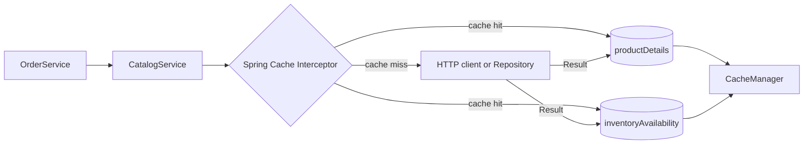
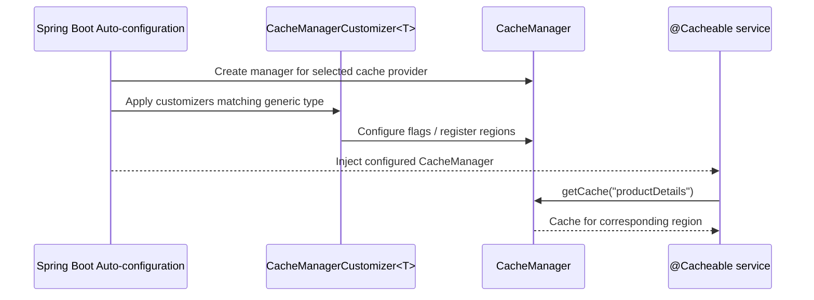

# CacheManagerCustomizer and Per-Region Cache Configuration

## 1. Why Configure Each Cache Region Individually?

In Spring Boot Integration, an HTTP request may read data from a database, Redis, an inventory service, or an external pricing feed. When data is queried repeatedly yet changes infrequently, caching reduces latency and downstream request volume. However, not all data should remain cached for the same duration.

For example, an e-commerce system might cache:

- `productDetails`: product names and descriptions; rarely changes, can stay cached for 30 minutes.
- `inventoryAvailability`: remaining stock; changes continuously, should have a very short lifetime or stay uncached if sales decisions require real-time data.
- `exchangeRates`: rates updated on a schedule; requires a dedicated TTL and refresh policy.
- `customerPermissions`: access permissions; sensitive data where permission changes require strong invalidation rather than relying solely on long TTLs.

A **cache region** (or *cache name*) is a logical namespace referenced by Spring Cache operations via `cacheNames` / `value`. Each region can define its own policies for data age, capacity, keys, and null-value handling. `CacheManager` holds and supplies `Cache` objects by region name.



**Main benefit of per-region configuration:** regions holding slowly changing metadata can optimize cache hit ratios; regions holding volatile state require shorter TTLs and stronger safeguards against stale data. A single global setting for the entire `CacheManager` is rarely enough.

### Terms to Distinguish

| Concept | Meaning | Example |
| --- | --- | --- |
| **Cache name/region** | Logical name specified by the service when accessing the cache | `productDetails` |
| **Cache key** | Identity of an individual entry *within* a region | `tenant-1:SKU-100` |
| **Cache value** | Stored object | `ProductDto` |
| **TTL** (*time to live*) | Duration an entry remains valid under policy | 30 minutes |
| **Max size/weight** | Capacity cap in caches supporting size-based eviction | Caffeine max 20,000 entries |
| **Cache eviction/invalidation** | Actively removing entries upon expiration or business updates | Delete `productDetails[tenant-1:SKU-100]` |
| **Cache backend** | Physical store holding the data | In-process RAM, Redis, JCache provider |

A region can share the same name across multiple application instances, yet with a **local** cache each instance still has independent data and expiration times. Conversely, Redis is shared across instances when they connect to the same Redis system and use identical key/prefix conventions.

## 2. How Does Spring Boot Create and Customize CacheManager?

When using cache annotations such as `@Cacheable`, the application must enable Spring's caching mechanism—usually via `@EnableCaching`—alongside the relevant dependencies. Spring Boot provides auto-configuration to construct a `CacheManager` matching the libraries, beans, and settings present in the application.

`CacheManagerCustomizer<T extends CacheManager>` is a **Spring Boot** extension point. It receives the auto-configured `CacheManager` so you can adjust flags or register custom caches before the application uses it.



Key points:

1. **Customizers depend on manager type.** `CacheManagerCustomizer<CaffeineCacheManager>` only applies when the configured manager is `CaffeineCacheManager`. If Spring Boot picks Redis, a Caffeine customizer will not customize Redis.
2. **Customizers run automatically only during eligible auto-configuration.** If the application declares its own `CacheManager` bean, Spring Boot generally does not invoke `CacheManagerCustomizer` beans on it. When building a manager manually, configure it directly or invoke customizers explicitly.
3. **One manager does not mean one TTL.** Many providers apply shared defaults; to set per-region TTLs, use the provider's native API or builder.
4. **Customization order can matter.** If multiple customizers modify cache lists, null policies, or defaults, results depend on execution order. Control order via `@Order` / `Ordered`; ideally keep one owner per region's policy.
5. **An application can have multiple `CacheManager` beans.** Then determine which manager `@Cacheable` selects via caching resolver/manager config or the `cacheManager` attribute on the annotation, rather than assuming all regions share one backend.

### Enabling Caching and Dependencies

Example for Spring Boot 3.x, Spring Framework 6.x, Java 17+:

```xml
<dependencies>
    <dependency>
        <groupId>org.springframework.boot</groupId>
        <artifactId>spring-boot-starter-cache</artifactId>
    </dependency>
</dependencies>
```

```java
import org.springframework.cache.annotation.EnableCaching;
import org.springframework.context.annotation.Configuration;

@Configuration(proxyBeanMethods = false)
@EnableCaching
public class CachingConfiguration {
}
```

`@EnableCaching` activates Spring's default proxy-based cache interception. Without this mechanism, `@Cacheable` may sit on a method as inert metadata without triggering expected cache operations.

Spring Boot generally chooses a provider based on configuration and available libraries. In projects with multiple dependencies (e.g., both Caffeine and Redis), declare the choice explicitly:

```yaml
spring:
  cache:
    type: caffeine
```

The YAML snippet above is an option for a **Caffeine** environment. The Redis section below is an **alternative option**—never combine two `spring.cache.type` values into a single profile.

## 3. CacheManagerCustomizer for Simple Cache

`ConcurrentMapCacheManager` is Spring Framework's simple manager, typically suited for examples, experiments, or low-risk data. It stores entries in an in-process `ConcurrentMap`.

Example using `simple`:

```yaml
spring:
  cache:
    type: simple
    cache-names:
      - productDetails
      - inventoryAvailability
```

`spring.cache.cache-names` declares expected cache names. With `ConcurrentMapCacheManager`, setting fixed names puts the manager in static mode; requesting an undeclared cache name returns `null` from `getCache(name)` instead of dynamically creating caches unboundedly.

Create a customizer:

```java
import org.springframework.boot.autoconfigure.cache.CacheManagerCustomizer;
import org.springframework.cache.concurrent.ConcurrentMapCacheManager;
import org.springframework.context.annotation.Bean;
import org.springframework.context.annotation.Configuration;

@Configuration(proxyBeanMethods = false)
class SimpleCacheCustomization {

    @Bean
    CacheManagerCustomizer<ConcurrentMapCacheManager> simpleCacheCustomizer() {
        return manager -> manager.setAllowNullValues(false);
    }
}
```

Here `setAllowNullValues(false)` disallows storing `null` values in the cache. When a method can actually return `null`, specify a clear policy on the annotation or service—such as `unless = "#result == null"`—and understand cache interception evaluation order.

**Fundamental limitation:** `ConcurrentMapCacheManager` offers no TTL, `maximumSize` cap, or time-based eviction like Caffeine. Declaring distinct region names **does not** give each region a different TTL. Moreover, data lives solely in the current JVM and grows with keys until evicted or the process exits. Therefore, do not use the simple manager as an unbounded production cache for high-cardinality datasets.

## 4. Caffeine: Dedicated TTL and Capacity per Cache Region

Caffeine is an **in-instance-memory** cache supporting TTLs, entry limits, access/write-based eviction, statistics, and advanced strategies. Spring uses `CaffeineCacheManager` as the adapter between `CacheManager` and native Caffeine caches.

Add the `caffeine` dependency alongside `spring-boot-starter-cache`:

```xml
<dependency>
    <groupId>com.github.ben-manes.caffeine</groupId>
    <artifactId>caffeine</artifactId>
</dependency>
```

Select Caffeine in configuration:

```yaml
spring:
  cache:
    type: caffeine
    cache-names:
      - productDetails
      - inventoryAvailability
```

If **the same policy works for all regions**, Boot supports a shared Caffeine spec:

```yaml
spring:
  cache:
    type: caffeine
    caffeine:
      spec: maximumSize=10000,expireAfterWrite=300s
```

However, `spring.cache.caffeine.spec` has no syntax for assigning **different TTLs per region name**. When per-region customization is needed, register native caches with dedicated settings via `CacheManagerCustomizer<CaffeineCacheManager>`.

### 4.1. Registering Two Regions with Distinct Policies

```java
import java.time.Duration;

import com.github.benmanes.caffeine.cache.Caffeine;
import org.springframework.boot.autoconfigure.cache.CacheManagerCustomizer;
import org.springframework.cache.caffeine.CaffeineCacheManager;
import org.springframework.context.annotation.Bean;
import org.springframework.context.annotation.Configuration;

@Configuration(proxyBeanMethods = false)
public class CaffeineRegionConfiguration {

    @Bean
    CacheManagerCustomizer<CaffeineCacheManager> caffeineRegions() {
        return manager -> {
            manager.setAllowNullValues(false);

            manager.registerCustomCache(
                    "productDetails",
                    Caffeine.newBuilder()
                            .expireAfterWrite(Duration.ofMinutes(30))
                            .maximumSize(20_000)
                            .recordStats()
                            .build());

            manager.registerCustomCache(
                    "inventoryAvailability",
                    Caffeine.newBuilder()
                            .expireAfterWrite(Duration.ofSeconds(10))
                            .maximumSize(5_000)
                            .recordStats()
                            .build());
        };
    }
}
```

`registerCustomCache(...)` registers a dedicated native Caffeine cache for the region. Each native cache maintains its own eviction schedule, capacity, and statistics. Numbers here are illustrative: actual TTLs and sizes must come from data churn, consistency needs, key counts, and available memory.

| Region | Illustrative TTL | Maximum size | Why |
| --- | --- | --- | --- |
| `productDetails` | 30 minutes from write | 20,000 entries/instance | Product info changes rarely; prioritize performance |
| `inventoryAvailability` | 10 seconds from write | 5,000 entries/instance | Stock changes quickly; limit stale display window |

**On consistency:** displaying cached stock with a few seconds of lag may be acceptable, yet the final decision to reserve/deduct stock must execute with concurrency protection against the authoritative data source. Never treat a potentially stale cache entry as the sole guarantee of available stock.

**Distinguish expire-after-write from expire-after-access:** `expireAfterWrite` measures age from value creation/write; cache read hits do not extend age. `expireAfterAccess` extends deadlines on reads; useful for some metadata, yet can retain stale values longer than expected under continuous reads. Pick based on business freshness needs.

**Local cache cost:** across three Spring Boot instances, each instance maintains its own `productDetails`; 20,000 max entries is **per instance**, not cluster-wide. TTL on each instance likewise counts from when that specific instance wrote its entry.

### 4.2. Connecting Regions to Business Logic

Example service with two distinct read methods. Underlying gateways represent existing adapters using HTTP clients or repositories to fetch real data:

```java
import org.springframework.cache.annotation.Cacheable;
import org.springframework.stereotype.Service;

@Service
public class ProductReadService {

    private final ProductApiGateway productApi;
    private final InventoryApiGateway inventoryApi;

    public ProductReadService(ProductApiGateway productApi,
                              InventoryApiGateway inventoryApi) {
        this.productApi = productApi;
        this.inventoryApi = inventoryApi;
    }

    @Cacheable(
            cacheNames = "productDetails",
            key = "#p0 + ':' + #p1",
            unless = "#result == null")
    public ProductDetails getDetails(String tenantId, String sku) {
        return productApi.fetchProduct(tenantId, sku);
    }

    @Cacheable(
            cacheNames = "inventoryAvailability",
            key = "#p0 + ':' + #p1",
            unless = "#result == null")
    public InventoryAvailability getAvailability(String tenantId, String sku) {
        return inventoryApi.fetchAvailability(tenantId, sku);
    }
}
```

Here `ProductDetails`, `InventoryAvailability`, `ProductApiGateway`, and `InventoryApiGateway` are project domain types, not Spring classes. `#p0` and `#p1` reference arguments by position, avoiding reliance on Spring reading Java parameter names at runtime.

The `tenantId:sku` key convention is crucial: the same `SKU-100` across two tenants may differ in price, permissions, or stock. Cache keys must include **every factor affecting the result**, such as tenant, locale, currency, customer segment, or data version where applicable.

### 4.3. Factors to Control When Using Caffeine

- `maximumSize` bounds estimated entry count via eviction algorithms, not exact byte size. One entry holding a huge object graph can consume vast RAM.
- `recordStats()` turns on native statistics such as hits, misses, and evictions for observability, with minor overhead.
- When a method throws, standard `@Cacheable` does not cache the exception as a success; downstream failures require dedicated retries/circuit breakers.
- Caffeine supports cache loaders and async caches, yet synchronous `@Cacheable` does not automatically turn HTTP calls non-blocking.
- High concurrent traffic hitting an expiring key can trigger a **cache stampede**; use per-key load synchronization, concurrency bounds, or refresh strategies when truly needed. `@Cacheable(sync = true)` restricts caches, conditions/`unless`, and provider support; never combine it casually with examples using `unless`.

## 5. Redis: Per-Region Configuration for Multi-Instance Shared Caching

Redis fits when multiple Spring Boot instances must share a cache, reuse lookup results across nodes, or retain cached entries across single-instance restarts. In exchange, cache operations incur network latency and require connection management, serializers, memory policies, and Redis-unavailable handling.

In Spring Boot using Redis, `RedisCacheManager` is a standard choice. Illustrative YAML configuration:

```yaml
spring:
  cache:
    type: redis
    redis:
      time-to-live: 10m
      cache-null-values: false
      use-key-prefix: true
  data:
    redis:
      host: redis.internal.example
      port: 6379
```

This is an **alternative Redis option replacing Caffeine**. `time-to-live: 10m` is the default TTL auto-configuration applies to regions without custom settings; it does not express per-region TTLs. Redis host, credentials, TLS, and topology must come from environment configuration, never hardcoded secrets.

Dependencies typically include `spring-boot-starter-cache` and `spring-boot-starter-data-redis`:

```xml
<dependency>
    <groupId>org.springframework.boot</groupId>
    <artifactId>spring-boot-starter-data-redis</artifactId>
</dependency>
```

### 5.1. Using RedisCacheManagerBuilderCustomizer

In Spring Boot, the direct way to configure Redis regions with distinct TTLs is customizing the **`RedisCacheManager` builder** before the manager is built. Spring Boot provides `RedisCacheManagerBuilderCustomizer` for this purpose.

```java
import java.time.Duration;

import org.springframework.boot.autoconfigure.cache.RedisCacheManagerBuilderCustomizer;
import org.springframework.context.annotation.Bean;
import org.springframework.context.annotation.Configuration;
import org.springframework.data.redis.cache.RedisCacheConfiguration;

@Configuration(proxyBeanMethods = false)
public class RedisRegionConfiguration {

    @Bean
    RedisCacheManagerBuilderCustomizer redisCacheRegions() {
        RedisCacheConfiguration common =
                RedisCacheConfiguration.defaultCacheConfig()
                        .disableCachingNullValues();

        return builder -> builder
                .withCacheConfiguration(
                        "productDetails",
                        common.entryTtl(Duration.ofMinutes(30)))
                .withCacheConfiguration(
                        "inventoryAvailability",
                        common.entryTtl(Duration.ofSeconds(10)));
    }
}
```

Here each region receives a separate `RedisCacheConfiguration` derived from `common`. There is no Caffeine-style per-region `maximumSize` in this code: Redis manages memory via server configuration, eviction policies, and resource limits.

**Why use the builder customizer?** `CacheManagerCustomizer<RedisCacheManager>` receives the manager after construction, whereas many Redis cache settings such as default TTL or `initialCacheConfigurations` are supplied at the **builder stage**. Hence `RedisCacheManagerBuilderCustomizer` is the right hook for per-region configuration within Spring Boot auto-configuration.

**Shared-configuration warning:** calling `RedisCacheConfiguration.defaultCacheConfig()` starts from **Spring Data Redis defaults** for serializers, key prefixes, and other settings rather than automatically inheriting all `spring.cache.redis.*` properties. In this example, `disableCachingNullValues()` is re-declared explicitly. If production uses a custom JSON serializer, default TTL, transaction awareness, or prefix rule, place them consistently in `common` and verify against real Redis. Never assume per-region configs automatically inherit every Boot manager property.

### 5.2. Redis TTL Does Not Mean Instantaneous Consistency

Suppose `inventoryAvailability` has a 10-second TTL. When a sale updates inventory in the database, the cache may continue serving the old value until expiration or explicit eviction.

- TTL bounds the **expected maximum window** a stale value lingers under expire-after-write, yet does not eliminate lag or concurrent read/update races.
- Redis does not share a **joint** ACID transaction with PostgreSQL merely because the app uses `@Transactional`.
- Cache misses can send concurrent requests to the source, requiring load bounds and stampede protection.
- The Redis server can evict keys **before TTL** under memory pressure/eviction policies. Never treat the cache as the sole source of business data.

### 5.3. Prefixes, Serializers, and Region Names

In shared caches, the region name normally prefixes the key. Logical key examples:

```text
productDetails::tenant-1:SKU-100
inventoryAvailability::tenant-1:SKU-100
```

These are **formatting examples**; physical keys vary by serializer and `CacheKeyPrefix`. Prefixes prevent collisions across regions. When Redis serves multiple apps or environments, add app/environment prefixes and maintain stable conventions to avoid cross-reading data.

For value serializers, consider:
- Compatibility across deployments as DTOs/records evolve.
- Safety when deserializing untrusted data; avoid unrestricted polymorphic typing.
- Storage footprint, latency, and observability/reconciliation.
- Ability to parse existing Redis entries during rolling upgrades.

Never change a shared cache's serializer without a migration plan, namespace version bump, or controlled cache clearing. A deserialization failure breaks every cache hit in that region until the keys expire or are removed.

## 6. How Do Cache Annotations Use Cache Regions?

Spring Cache abstraction works at method invocation level without requiring services to know Caffeine or Redis internals. Common annotations:

| Annotation | Primary effect | Notes |
| --- | --- | --- |
| `@Cacheable` | Checks cache first; on miss executes method and may store result | Choose keys carefully; use `condition` / `unless` as needed |
| `@CachePut` | Always runs method and updates cache on success | Useful to proactively refresh entries after updates |
| `@CacheEvict` | Deletes a key or multiple entries per policy | Mind DB commit timing and multi-instance impact |
| `@Caching` | Groups multiple cache annotations | Use sparingly to keep logic readable |
| `@CacheConfig` | Declares class-level defaults such as `cacheNames` | Does not define TTL/backend per region |

Example updating a product and evicting the cached entry:

```java
import org.springframework.cache.annotation.CacheEvict;
import org.springframework.stereotype.Service;

@Service
public class ProductCacheInvalidator {

    @CacheEvict(
            cacheNames = "productDetails",
            key = "#p0 + ':' + #p1")
    public void evictProduct(String tenantId, String sku) {
        // Method invoked through Spring bean/proxy after actual data
        // has been successfully updated.
    }
}
```

With DB transactions, **eviction timing is critical**. Calling `@CacheEvict` before transaction commit lets concurrent requests miss, read old DB data, and repopulate the cache with stale values. If the transaction rolls back, evicting the cache does not mean the DB changed.

You can publish a **domain event** after changes and handle it in `@TransactionalEventListener(phase = TransactionPhase.AFTER_COMMIT)` to invalidate after commit (when transactions are properly managed). In-memory post-commit events can be lost if the process crashes at that moment; for high reliability, write an **outbox record inside the DB transaction** and let a worker emit durable invalidations.

For multi-instance local caches, one instance evicting `productDetails` **does not evict** other instances' copies. You need event fan-out, pub/sub, or shared Redis. With multiple writers, define consistency goals before selecting a cache architecture.

## 7. Choosing TTLs, Keys, and Policies per Region

Reference configuration pattern for an integration system:

| Region | Data source | Indicative TTL | Invalidation | Notes |
| --- | --- | --- | --- | --- |
| `productDetails` | DB/catalog HTTP API | Minutes to tens of minutes | After product updates | Keys must include tenant/locale if needed |
| `inventoryAvailability` | Inventory API | A few seconds, or uncached | After confirmed stock changes | Never rely on stale data to authorize sales |
| `shippingQuotes` | Shipping HTTP API | Short, per carrier SLA | When address/weight/service changes | Key includes all rating inputs |
| `exchangeRates` | Exchange-rate API | Per publishing cadence | When new rate version arrives | Store source timestamp/version |
| `customerPermissions` | Identity/auth service | Ultra-short or uncached | Immediately on permission changes | Security risk; requires reliable invalidation |

This table is indicative, **not** standard TTL prescriptions. Mutation rates, staleness impact, downstream reliability, and SLOs determine proper lifetimes.

### Designing Keys to Prevent Context Mixing

A method `getProduct(String sku)` might appear to need only `sku`. Yet if prices or content vary by tenant/currency/locale, keying by `sku` alone is wrong:

```text
Wrong:
  productDetails["SKU-100"]

Right in a multi-tenant system:
  productDetails["tenant-1:vi-VN:VND:SKU-100"]
```

For multi-field keys, use a controlled `KeyGenerator` instead of ad-hoc string concatenation. Avoid putting personal data or tokens in keys; Redis keys also appear in operations/monitoring. If identifiers can contain delimiters, use a canonical encoding so distinct parameter combinations never yield identical keys.

### Null Caching and Negative Caching

With `setAllowNullValues(false)` or `disableCachingNullValues()`, `null` values are not cached. `@Cacheable(unless="#result == null")` skips storing nulls at the annotation layer and prevents provider errors when methods return null.

However, deliberately never caching "not found" results can let repeated lookups for invalid keys hammer downstream services. Some systems use **negative caching**: storing "not found" for a very short TTL via an agreed DTO/`Optional` contract with cache-penetration guards. Separate network failures from absence: never cache `500`/timeouts as "product does not exist," and keep negative TTLs short if entities may be created immediately afterward.

### Throttling and Cache Stampede

When a hot key's TTL expires, hundreds of requests can miss simultaneously and hit an HTTP endpoint. Mitigation options:

- Bound concurrent outbound HTTP calls (bulkhead) with strict timeouts.
- Use *single-flight* / synchronized per-key loading where provider-supported; understand per-JVM scope and `@Cacheable(sync = true)` constraints.
- Spread expirations using TTL jitter where the framework/provider supports it at the proper configuration layer.
- Controlled pre-expiry refresh (*refresh ahead*) if brief staleness is acceptable.
- Bounded retries/backoff; never let cache failures trigger retry storms against source systems.

## 8. Sequence of Operations When Updating DB and Cache

Caches typically hold **derived** copies of database or external API data. Explicitly define the source of truth and update order.

```mermaid
sequenceDiagram
    participant U as User/API
    participant S as Application Service
    participant DB as Database
    participant O as Outbox/After-commit event
    participant C as CacheManager
    U->>S: Update product
    S->>DB: BEGIN; UPDATE product
    DB-->>S: COMMIT
    S->>O: Emit productChanged
    O->>C: Evict productDetails[tenant:sku]
    C-->>O: Eviction complete
    S-->>U: Business result
    Note over DB,C: Must account for races and post-commit event loss
```

If using `@CachePut` to update the cache immediately with new data, ensure the data has committed and cannot be overwritten by a concurrent stale reader. For critical operations, versioning or reconciliation and re-eviction mechanisms are essential.

**A typical race:**

1. Request A misses the cache and begins reading the old database value.
2. Request B updates the database, commits, and deletes the cache entry.
3. Request A finishes reading and writes the **old value** back into the cache after deletion.

Thus "evict after commit" is an important step, yet insufficient to guarantee **linearizable consistency** in all cases. Depending on requirements, use versioned cache keys, version-checked update strategies, short TTLs, per-key synchronization, or altered read/write paths. For critical financial, stock, or authorization decisions, verify at the authoritative system instead of trusting cache unconditionally.

## 9. Testing Per-Region Policies Accurately

A test merely observing `@Cacheable` returning identical data twice proves neither per-region TTLs, size caps, nor invalidation. Layer your testing:

| Goal | Useful check | Common tools |
| --- | --- | --- |
| Right `CacheManager` type | Context creates `CaffeineCacheManager` or `RedisCacheManager` per profile | Spring Boot test context |
| Customizer applied | Region names exist, null policy and native config match | `@SpringBootTest` / small context test |
| Cache hit/miss | Call service twice with same key; verify HTTP/DB gateway called only on miss | Mockito spy/fake gateway or HTTP mock |
| Tenant/locale isolation | Same SKU across tenants/locales never shares entries | Service integration test |
| Caffeine TTL | Use controllable ticker in tests to advance time; verify region-specific expiry | Caffeine `Ticker`, avoid `Thread.sleep` |
| Redis per-region TTL | Verify real TTL and disappearance at expected intervals | Redis Testcontainer and Redis key TTL |
| Post-commit invalidation | DB commit → cache evicted; rollback → not wrongly evicted | DB + event/outbox integration test |
| Multiple instances | Change on one instance syncs to others? | Multi-process/Redis integration test |
| Downstream errors | Miss during API timeout behaves safely | WireMock / MockRestServiceServer |
| Observability | Hit/miss/eviction and cache latency emitted per region? | Micrometer/Actuator + provider metrics |

### Example Checking Created CacheManager

```java
import static org.assertj.core.api.Assertions.assertThat;

import org.junit.jupiter.api.Test;
import org.springframework.beans.factory.annotation.Autowired;
import org.springframework.boot.test.context.SpringBootTest;
import org.springframework.cache.CacheManager;
import org.springframework.cache.caffeine.CaffeineCacheManager;

@SpringBootTest
class CacheRegionConfigurationTest {

    @Autowired
    CacheManager cacheManager;

    @Test
    void shouldContainRegionsWithCaffeineManager() {
        assertThat(cacheManager)
                .isInstanceOf(CaffeineCacheManager.class);

        assertThat(cacheManager.getCache("productDetails"))
                .isNotNull();

        assertThat(cacheManager.getCache("inventoryAvailability"))
                .isNotNull();
    }
}
```

This test applies when the test environment selects Caffeine (`spring.cache.type=caffeine`) with a single default manager. It verifies the bean and region names, **not TTLs**. When dynamic region creation is enabled, `getCache(name)` can dynamically create an unconfigured region: to check proper registration, inspect `getCacheNames()` before calling `getCache(...)` and verify native cache settings appropriately.

To meaningfully test TTLs, inject a Caffeine `Ticker` in test configuration, advance virtual time, read both regions, and assert that after 15 seconds only `inventoryAvailability` expires while `productDetails` remains cached. Never write tests sleeping 10–30 minutes; they are slow and flaky. With Redis, use a Redis container matching production version to verify serialized keys, TTLs, and region-specific eviction.

### Business-Aligned Invalidation Tests

Sample workflow:

1. Load `productDetails(tenant-1, SKU-100)` once, counting one repository/HTTP gateway call.
2. Load the same key again; must hit without incrementing the call count.
3. Load the same SKU for `tenant-2`; must miss independently with no data mixing.
4. Update the product and commit DB; trigger key eviction.
5. Reload `tenant-1`; must observe updated info while `tenant-2` stays unaffected if independent.
6. Simulate transaction rollback or worker crash around events; verify recovery/reconciliation where high reliability is required.

In Spring proxy tests, never call `@Cacheable` methods via `this.getDetails(...)` inside the same bean expecting interception. Under default proxy mode, **self-invocation** bypasses caching advice. Tests must invoke via a Spring-managed bean/proxy.

## 10. Observability, Resources, and Operational Risks

Monitor metrics per region and downstream partner:

| Metric | What to watch for |
| --- | --- |
| Hit rate / miss rate | An ineffective region, or keys with excessive cardinality |
| Eviction count / cause | Caffeine hitting size limits, expiring, or explicitly evicted |
| Cache size, Redis memory/keys | Risk of RAM growth, hitting limits, or resource contention |
| Backend latency / error rate | Slow/timing-out Redis lengthening HTTP handling |
| Downstream call rate | Cache misses amplifying API or database load |
| Observed data age / stale reads | Cache retaining stale data past business needs |
| Per-region TTL and key counts | Misconfigured regions, non-expiring keys, or overlapping prefixes |

Caffeine `recordStats()` emits native stats; Micrometer can export instrumented cache metrics depending on backend support and Spring Boot config. Redis also needs server-side monitoring; never infer cache hit rates from a single metric in multi-tier caching architectures.

When the cache backend is temporarily unavailable, Spring propagates cache exceptions by default. You can use `CacheErrorHandler` to customize handling of specific cache errors, yet **swallowing all errors** can trigger a DB/API query storm. Decide fail-open vs. fail-closed based on data criticality: catalogs may fall back to the source, whereas authorization or risk controls must never fall back unsafely.

Never store tokens, sensitive sessions, personal data, or attached JPA entities in cache without explicitly designing serializers, lifetimes, access controls, and invalidation. A cache is a separate data store and must obey application security policies.

## 11. Common Configuration Mistakes

| Mistake | Consequence | Fix |
| --- | --- | --- |
| Declaring `CacheManagerCustomizer<CaffeineCacheManager>` while Boot creates a Redis manager | Customizer never runs | Set `spring.cache.type` explicitly; check actual bean |
| Declaring `@Bean CacheManager` manually and expecting Boot to auto-apply customizers | Regions/flags unconfigured | Configure manager directly or invoke customizers explicitly |
| Setting `spring.cache.caffeine.spec` expecting per-region TTLs | All regions share default policy | Use `registerCustomCache` per region or custom manager config |
| Using `ConcurrentMapCacheManager` for large datasets needing TTL | Cache bloats, entries never expire | Choose Caffeine or Redis with proper TTL/eviction |
| Configuring a new Redis region with `defaultCacheConfig()` forgetting shared serializer/prefix | Format mismatch, collisions, or deserialization errors | Align common config; test against real Redis |
| Keying only by SKU in multi-tenant systems | Cross-tenant data leak/mixing | Include full context in keys |
| Evicting before DB commit | Concurrent requests reload stale data | Prefer after-commit and address races/recovery |
| Evicting only local cache on one instance | Other instances continue serving stale data | Broadcast invalidations cluster-wide or use shared cache |
| Enabling TTL alone and assuming cache is always accurate | Stale reads still occur within TTL window | Define freshness SLA and verify source-of-truth where needed |
| No negative cache or rate limits for non-existent keys | Repeated misses hit downstream | Consider short negative TTLs and load bounds |
| Calling `@Cacheable` via self-invocation | Caching silently bypassed | Call through Spring proxy/separate bean |
| High cache hit metrics masking wrong responses | Performance gain hides consistency bugs | Test correctness, invalidation, and stale-data scenarios |

## 12. Per-Region Cache Configuration Checklist for Integration Projects

1. Identify the **authoritative data source** and acceptable staleness for each data group.
2. Choose stable, meaningful region names; include tenant/locale/currency/version in keys if they alter output.
3. Choose **local** (Caffeine) vs. **shared** (Redis) based on instance count, traffic patterns, and sync requirements.
4. Enable `@EnableCaching` and set `spring.cache.type` explicitly when multiple providers sit on the classpath.
5. Use `CacheManagerCustomizer<T>` when Boot auto-configures the manager; use provider builder customizers such as `RedisCacheManagerBuilderCustomizer` when settings must be applied pre-build.
6. Define per-region TTLs and resource caps; with Caffeine, `registerCustomCache` configures per-region policies; with Redis, `withCacheConfiguration` sets per-region TTLs.
7. Establish null/negative caching, serializers, and key namespaces; prevent sensitive data leaks.
8. Design post-mutation invalidation; account for transaction boundaries, multi-instance consistency, and crash scenarios.
9. Test actual hits/misses, TTLs, key isolation, and eviction—do not stop at verifying region names exist.
10. Track metrics, cache backend errors, downstream load, and stale-data incidents to tune configuration against reality.

**Key takeaway:** `CacheManagerCustomizer` is the hook into a **Spring Boot auto-configured `CacheManager`**. Support for **per-region** TTL, capacity limits, serialization, and eviction depends on the provider: simple `ConcurrentMapCacheManager` lacks TTL; `CaffeineCacheManager` registers dedicated native caches per region; `RedisCacheManager` configures regions via its builder. Regardless of backend, a fast cache is genuinely useful only when its keys, lifetimes, and invalidation fit the integration flow's data contract.

### References

- [Spring Boot Reference — Caching](https://docs.spring.io/spring-boot/reference/io/caching.html): configuring cache providers, cache names, and customizers.
- [Spring Boot API — CacheManagerCustomizer](https://docs.spring.io/spring-boot/api/java/org/springframework/boot/autoconfigure/cache/CacheManagerCustomizer.html).
- [Spring Framework Reference — Cache Abstraction](https://docs.spring.io/spring-framework/reference/integration/cache.html).
- [Spring Framework API — CaffeineCacheManager](https://docs.spring.io/spring-framework/docs/current/javadoc-api/org/springframework/cache/caffeine/CaffeineCacheManager.html).
- [Spring Data Redis Reference — Redis Cache](https://docs.spring.io/spring-data/redis/reference/redis/redis-cache.html).
