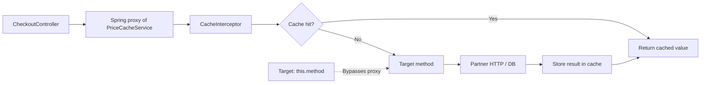
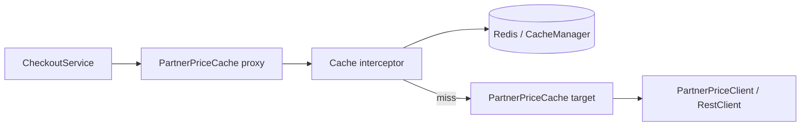
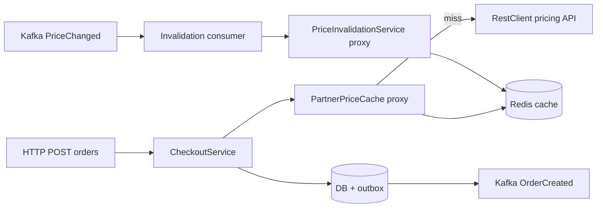

# Spring AOP, Self-Invocation, and When Annotations Have No Effect

## 1. Context: Why Does the System Still Call Downstream Despite @Cacheable?

In a **Spring Boot Integration** system, an order-creation API may look up prices via an HTTP client, read PostgreSQL through JDBC/jOOQ, check Redis state, consume Kafka/RabbitMQ, and update caches. Across multiple network dependencies, caching cuts latency, downstream load, and cost; hence Spring Cache is commonly turned on with `@EnableCaching` and `@Cacheable` placed on a service method.

Yet a very common issue arises:

```java
@Service
class PriceService {
    @Cacheable("productPrices")
    public PriceQuote findPrice(String sku) {
        return partnerClient.fetchPrice(sku);
    }

    public PriceQuote getPriceForCheckout(String sku) {
        return findPrice(sku); // Internal call on same object
    }
}
```

Suppose a controller calls `getPriceForCheckout("SKU-42")` repeatedly. Even with `@Cacheable` on `findPrice`, the partner client can still run **every single time**. Redis is not necessarily broken and TTL is not necessarily wrong: the call may be going **directly to the method on the target object**, bypassing Spring AOP's interceptor.

**Core rule:** In default proxy mode, cache annotations take effect when an eligible method is invoked **through a Spring-managed proxy**. Calling `this.findPrice(...)` or `findPrice(...)` inside the same instance does not pass back through the proxy, so cache advice never runs. Switching from JDK proxies to CGLIB via `proxyTargetClass=true` **does not fix self-invocation**.

After this lesson, you should be able to:

- Understand proxy call paths and the conditions required for `@Cacheable`, `@CachePut`, and `@CacheEvict` to apply.
- Recognize self-invocation, `private`/`final` methods, manually instantiated objects, and other conditions making annotations appear inert.
- Split beans cleanly so cache advice wraps the right business operations.
- Distinguish proxy issues from cache hits/misses, wrong keys, TTLs, `condition`/`unless` filters, or Redis backend errors.
- Test real caching through a Spring context, across threads, and against real Redis when needed.
- Pair caching with transactions, HTTP clients, databases, brokers, and controlled invalidation.

## 2. How Does Spring Cache Rely on AOP Proxies?

With `@EnableCaching` in its default `AdviceMode.PROXY` mode, Spring discovers methods carrying cache annotations and wires a **cache interceptor**. Consumers typically receive a **proxy** bean rather than calling the raw target directly in every scenario.



Typical flow for `@Cacheable`:

1. Caller obtains a Spring-container-managed bean.
2. Caller invokes an eligible public method through the proxy.
3. Cache interceptor resolves cache name, computes key from parameters, and checks `condition` if present.
4. If a valid entry exists, returns the cached value **without executing the method body**.
5. On miss, runs the body (e.g., `RestClient`/JDBC), optionally checks `unless` on the result, and writes to cache per policy.
6. Caller receives the result or any thrown exception.

This means `@Cacheable` **is not passive metadata** scanned by a separate runtime daemon; it depends on proxy creation and the actual invocation path. Understanding this also helps with `@Transactional`, `@Async`, and other Spring AOP advice, though each annotation has distinct semantics.

### 2.1. Distinguishing Target vs. Proxy

```text
Valid call path:    Controller -> proxy.findPrice() -> CacheInterceptor -> target.findPrice()
Advice skipped:     target.getForCheckout() -> this.findPrice()
Advice skipped:     new PriceService(...).findPrice() [not managed by Spring]
```

External calls into an annotated public method on a bean are intercepted. If that method then calls another annotated method **on the same bean**, the second call does not re-enter the proxy.

A common diagnostic error is spotting `@Cacheable` in source code and concluding "caching is active." Always inspect proxying **at runtime** and count actual repository/client invocations.

## 3. Enabling Cache Annotations Properly in Spring Boot

### 3.1. Dependencies and @EnableCaching

Example for Spring Boot 3.2+ (Java 17+, Spring Framework 6.1+) with compatible Spring Data Redis:

```kotlin
// build.gradle.kts; let Spring Boot dependency management control versions
implementation("org.springframework.boot:spring-boot-starter-cache")
implementation("org.springframework.boot:spring-boot-starter-data-redis")
implementation("org.springframework.boot:spring-boot-starter-actuator")
```

```java
import org.springframework.cache.annotation.EnableCaching;
import org.springframework.context.annotation.Configuration;

@Configuration
@EnableCaching
class CachingConfiguration {
}
```

`spring-boot-starter-cache` provides the cache abstraction and auto-configuration; `spring-boot-starter-data-redis` supplies the Redis implementation when Redis is chosen. Spring Boot can auto-create a `CacheManager` based on present dependencies and settings, yet having a `CacheManager` bean **does not guarantee** `@Cacheable` runs: annotation processing must be enabled with `@EnableCaching` (or equivalent config).

In applications with Caffeine, Redis, or multiple cache managers, verify which provider/bean is actually active. With multiple managers, configure `cacheManager`/`cacheResolver` explicitly; never assume every cache shares data across instances if one is actually in-memory.

### 3.2. Contract-Driven Cache Name and Key Example

Suppose pricing comes from a partner where each authenticated tenant may have distinct prices:

```java
import java.math.BigDecimal;
import java.time.Instant;

record PriceQuote(
        String sku,
        BigDecimal amount,
        String currency,
        Instant observedAt) {
}
```

```java
import org.springframework.stereotype.Component;
import org.springframework.web.client.RestClient;

@Component
class PartnerPriceClient {
    private final RestClient http;

    PartnerPriceClient(RestClient.Builder builder) {
        this.http = builder
                .baseUrl("https://pricing.internal.example")
                .build();
    }

    PriceQuote fetch(String tenantId, String sku) {
        return http.get()
                .uri("/api/prices/{sku}", sku)
                .header("X-Tenant-Id", tenantId)
                .retrieve()
                .body(PriceQuote.class);
    }
}
```

The upstream address is illustrative, not a live endpoint. Production needs TLS, authentication, connect/read timeouts, bulkheads, observability, and fallback policies. `tenantId` **must come from trusted identity/authorization**, never forwarded blindly from user-supplied request headers.

Create a dedicated service for **cached lookups**:

```java
import org.springframework.cache.annotation.Cacheable;
import org.springframework.stereotype.Service;

@Service
public class PartnerPriceCache {
    private final PartnerPriceClient partner;

    public PartnerPriceCache(PartnerPriceClient partner) {
        this.partner = partner;
    }

    @Cacheable(
            cacheNames = "partnerPrices",
            key = "'v1:' + #p0 + ':' + #p1",
            unless = "#result == null")
    public PriceQuote find(String tenantId, String sku) {
        return partner.fetch(tenantId, sku);
    }
}
```

Illustrative highlights:

- `cacheNames="partnerPrices"` selects the cache namespace; names must match `CacheManager` settings.
- `key="'v1:' + #p0 + ':' + #p1"` uses positional arguments: `#p0` is `tenantId` and `#p1` is `sku`. This avoids relying on compiler `-parameters` metadata.
- `unless="#result == null"` prevents caching null results after the method returns.
- Cache hits return stored quotes without making an HTTP call.

Validate and canonicalize inputs at the boundary **before** calling the proxy, because cache lookup and key calculation run **before** the method body executes. Placing validation solely inside `find()` allows cache hits to bypass it. Colon-concatenated keys above are safe only when values are normalized without delimiter conflicts and properly tenant-scoped. For complex keys, use a tested custom `KeyGenerator` or canonical structured key.

## 4. Self-Invocation: Internal Calls Bypass Cache Advice

### 4.1. Common Bug Pattern

```java
import org.springframework.cache.annotation.Cacheable;
import org.springframework.stereotype.Service;

@Service
class InventoryService {
    private final PartnerPriceClient partner;

    InventoryService(PartnerPriceClient partner) {
        this.partner = partner;
    }

    @Cacheable(cacheNames = "partnerPrices", key = "#p0 + ':' + #p1")
    public PriceQuote fetchPrice(String tenantId, String sku) {
        return partner.fetch(tenantId, sku);
    }

    public PriceQuote priceForCheckout(String tenantId, String sku) {
        // APPEARS to go through cache; actually calls target directly.
        return fetchPrice(tenantId, sku);
    }
}
```

If a controller calls `inventoryService.fetchPrice(...)` **through the Spring proxy**, `@Cacheable` works. When the controller calls `inventoryService.priceForCheckout(...)`, the target executes `this.fetchPrice(...)`, skipping the interceptor for `fetchPrice`. Even though `priceForCheckout()` entered through the proxy, the **internal call** never re-enters the proxy.

Why? The Spring AOP proxy wraps **outside** the target object; `this` inside a method points to the raw target instance. The JVM dispatches direct calls on the target rather than through the proxy wrapper. Adding extra annotations on internal methods does not change that call path.

### 4.2. Preferred Fix: Extract the Cached Bean

Extract price lookup into `PartnerPriceCache` (from Section 3) and inject it into the orchestrating service:

```java
import org.springframework.stereotype.Service;

@Service
public class CheckoutService {
    private final PartnerPriceCache cachedPrices;

    public CheckoutService(PartnerPriceCache cachedPrices) {
        this.cachedPrices = cachedPrices;
    }

    public PriceQuote getPriceForCheckout(String tenantId, String sku) {
        // Invokes through the Spring-injected proxy bean.
        return cachedPrices.find(tenantId, sku);
    }
}
```



Benefits of separating beans:

- Calls clearly traverse the proxy.
- Single responsibility per bean: business orchestration, cached lookup, HTTP client.
- Tests cleanly assert hits/misses by counting client invocations.
- Cache providers and TTLs can change without coupling AOP mechanics into domain services.
- Avoids coupling domain code to Spring APIs like `AopContext.currentProxy()`.

**Self-injection is discouraged as a first resort.** Injecting yourself via `@Lazy` or looking up proxies from `ApplicationContext` can work in some cases, yet introduces coupling, bean-creation ordering dependencies, circular reference hazards, and maintenance drag. Using `AopContext.currentProxy()` requires enabling `exposeProxy`, couples code directly to AOP internals, and does not cover every call path. Extracting a dedicated bean is usually cleaner.

### 4.3. Can AspectJ Intercept Self-Invocation?

You can switch to **AspectJ weaving mode** instead of proxies:

```java
import org.springframework.cache.annotation.EnableCaching;
import org.springframework.context.annotation.AdviceMode;
import org.springframework.context.annotation.Configuration;

@Configuration
@EnableCaching(mode = AdviceMode.ASPECTJ)
class AspectJCacheConfiguration {
}
```

However, this snippet is **only part of the setup**: it requires dependencies like `spring-aspects` and proper compile-time or load-time weaving. AspectJ weaves advice directly into bytecode so self-invocation is intercepted; it is not a free one-enum toggle. In most Spring Boot Integration projects, proxies plus bean separation are simpler and carry less operational risk.

## 5. Cases Where Annotations Have No Effect or Appear Inert

| Situation | What happens | How to check/fix |
| --- | --- | --- |
| `this.cachedMethod()` inside same bean | Bypasses proxy; interceptor skipped | Split bean; call through Spring-injected proxy |
| Object created with `new Service(...)` | Not container-managed, no proxy | Let Spring instantiate and inject beans |
| `@EnableCaching` omitted | Cache annotations unprocessed | Enable in a scanned/imported configuration |
| Wrong `CacheManager` or cache name | Reads wrong backend/cache or fails naming | Inspect active `CacheManager` and `cacheNames` |
| `private` method | Proxies generally cannot advise private calls | Place annotation on public bean methods |
| `final` method / `final` class | Class-based proxies cannot override `final` members | Open method/class or design with interfaces/proxies |
| JDK proxy when method exists only on concrete class | Proxy exposes interfaces, causing injection/call mismatch | Inject interface or adjust proxy config |
| Annotation only on interface | Works with interface proxies, uncertain with class-based/weaving | Prefer annotating concrete implementation |
| Called in `@PostConstruct`/constructor | Proxy may not yet be wired for self-calls | Move call to another bean after startup |
| `condition` evaluates to false | Caching skipped by design | Check SpEL and inputs |
| `unless` evaluates to true | Method runs, result not stored | Check return value and expression |
| Key varies across two calls | Two cache misses are expected semantics | Canonicalize keys, check arguments/SpEL |
| Short TTL, eviction, or cleared cache | Entry removed before next call | Inspect TTL, eviction, invalidation, Redis health |
| Multiple app replicas with local cache | One replica misses even though another cached it | Switch to distributed cache if needed |
| `null` values or wrapped return types | Provider/annotations enforce null/wrapper rules | Verify `unless`, serializer, cache config |
| Body throws exception | Exceptions are not cached by default | Add explicit error/fallback handling |
| Reactive/async return types | Caching semantics depend on version and adapter | Check Spring 6.1+ docs and test asynchronously |

Never stop diagnosing at "the proxy isn't running." **If the interceptor actually runs yet always misses**, investigate keys, backend state, expiration, serialization, or other entries in this table.

## 6. JDK Dynamic Proxies, CGLIB, and Method Visibility Limits

Spring AOP uses two common proxy mechanisms:

1. **JDK dynamic proxy:** proxies interfaces implemented by the bean; callers inject/call through the interface.
2. **Class-based proxy (CGLIB):** generates a subclass overriding eligible methods; cannot intercept `final` methods via overriding.

Spring Boot has its own AOP proxy defaults across configurations; what matters is not guessing defaults, but **verifying the actual bean proxy** and advised methods. Never expect `proxyTargetClass=true` to cure internal self-invocation.

### 6.1. Mistakes with `private` or `final`

```java
@Service
class IncorrectCacheService {

    @Cacheable("a")
    private String privateLookup(String id) { // Cannot advise via proxy
        return loadFromRemote(id);
    }

    @Cacheable("b")
    public final String finalLookup(String id) { // Cannot be overridden by CGLIB
        return loadFromRemote(id);
    }
}
```

This snippet illustrates **design mistakes**, not a complete buildable class. With proxy-based caching, public, non-final methods called from other beans produce the fewest surprises. Visibility levels like `protected` or package-private can behave differently across proxy types and framework versions; avoid relying on them for stable cache contracts.

In Kotlin, classes and methods are `final` by default. Projects use the Kotlin Spring/`all-open` plugin so Spring-annotated classes become open, or mark classes/methods `open` explicitly where proxying is needed. Verify your build setup rather than reading annotations alone.

### 6.2. Checking Proxying at Runtime

```java
import org.springframework.aop.support.AopUtils;
import org.springframework.stereotype.Component;

@Component
class CacheProxyDiagnostic {
    CacheProxyDiagnostic(PartnerPriceCache cache) {
        boolean isProxy = AopUtils.isAopProxy(cache);
        System.out.println("PartnerPriceCache is proxied: " + isProxy);
    }
}
```

This is a diagnostic snippet; production should use a properly leveled logger instead of `System.out`. `AopUtils.isAopProxy` confirms the injected object is proxied, yet **a bean can be proxied for another advice** without cache advice applying to the intended method. Combine proxy checks with dependency call counters and cache inspection for reliable proof.

## 7. @Cacheable, @CachePut, and @CacheEvict Are Not Interchangeable

| Annotation | When does the method body run? | Role |
| --- | --- | --- |
| `@Cacheable` | Skips body on cache hit; runs on miss | Read-through caching / memoization |
| `@CachePut` | **Always runs** method body, then updates cache with result | Write/synchronize value into cache |
| `@CacheEvict` | Runs method and deletes entry (by default after method succeeds) | Invalidate data after mutating operations |
| `@Caching` | Groups multiple cache annotations on one method | Combines multiple operations cleanly |
| `@CacheConfig` | Class-level defaults for `cacheNames`, `keyGenerator`, etc. | Reduces metadata repetition |

### 7.1. @Cacheable: Cache Read Work Only

```java
@Cacheable(cacheNames = "partnerPrices",
           key = "'v1:' + #p0 + ':' + #p1",
           condition = "#p0 != null && #p1 != null",
           unless = "#result == null")
public PriceQuote find(String tenantId, String sku) {
    return partner.fetch(tenantId, sku);
}
```

- `condition` runs before cache lookup and body execution; here it skips caching if inputs are missing, **without replacing business validation**.
- `unless` runs after the body returns; if true, the result is not stored.
- On cache hit, the body **never runs**. If the body both reads DB and decrements stock, writes mandatory audit logs, or fires side-effecting HTTP calls, cache hits skip those side effects. **Never place mandatory side effects inside `@Cacheable` methods.**
- Cache hits also skip validation and authorization if placed solely inside the body. Enforce authorization **before** cache lookup and include tenant/permission scope in keys.

### 7.2. @CachePut and @CacheEvict When Data Changes

Suppose an upstream event reports a price change. One design updates the source DB and then evicts the cache:

```java
import org.springframework.cache.annotation.CacheEvict;
import org.springframework.stereotype.Service;

@Service
class PriceInvalidationService {
    @CacheEvict(cacheNames = "partnerPrices",
                key = "'v1:' + #p0 + ':' + #p1")
    public void invalidate(String tenantId, String sku) {
        // Evicts entry after this method completes normally.
        // Never call this.invalidate() within the same bean expecting advice to run.
    }
}
```

A `@CachePut` method returns new data and writes it under the matching key; crucially, the stored value must match the read cache's type and semantics. When writing to the DB first and updating the cache afterward, address transaction boundaries and cache-update failures.

Never combine `@Cacheable` and `@CachePut` arbitrarily on the same method: one skips the body while the other insists on running it, yielding unpredictable semantics. Separate reads and writes across clear methods or beans.

### 7.3. `beforeInvocation` and `allEntries`

`@CacheEvict(beforeInvocation=true)` attempts eviction **before** the method executes; if the method later fails, the entry is already gone. The default `beforeInvocation=false` evicts after normal method return, which **does not automatically guarantee post-DB-commit ordering** if a transaction spans outside.

`@CacheEvict(allEntries=true)` wipes every entry in the selected cache, not just one tenant or SKU. This is very broad on shared caches. On distributed caches, weigh Redis load and cache stampedes before clearing an entire region.

## 8. Keys, Cache Names, and Data Isolation

Spring Cache defaults to `SimpleKeyGenerator`: zero arguments -> `SimpleKey.EMPTY`; one argument -> the argument itself (per key-generator rules); multiple arguments -> a `SimpleKey` holding the argument list. This default fits simple methods, **provided argument identity and equality match the cache contract**.

In multi-tenant systems, a key containing only `sku` can serve tenant A's price to tenant B. Even when Redis prefixes keys by cache name, **include tenant or appropriate data scope in the key** whenever one cache serves multiple tenants.

### 8.1. Common Key Bugs

| Issue | Example | Consequence |
| --- | --- | --- |
| Missing tenant | Key uses only `sku` | Cross-tenant data exposure/confusion |
| Mutable key object | Key holds DTO modified after put | Unpredictable misses, broken `equals`/`hashCode` |
| Ambiguous concatenation | `tenantId + sku` | `ab`+`c` collides with `a`+`bc` |
| Unversioned key format changes | Adding a pricing rule field | Misreading incompatible legacy entries |
| Unnormalized locale/case | `sku-A`, `SKU-a` | Duplicate or inconsistent business entries |
| Keys containing email/tokens | `key="#email"` | Exposure risk in Redis/logs |
| Serializer-incompatible keys | Custom object key works locally, serializes differently in Redis | Misses or cross-node conflicts |

Use verified system identities (trusted tenant IDs), stable business identifiers, and schema versions. If keys involve PII, redesign with opaque identifiers and retention/ACL controls. Never put raw keys, user IDs, or `orderId` into **metric tags**: cardinality grows per entity.

### 8.2. Parameter SpEL and Compiler Flags

```java
// Uses parameter names if the project preserves -parameters metadata.
@Cacheable(cacheNames = "partnerPrices", key = "#tenantId + ':' + #sku")
public PriceQuote find(String tenantId, String sku) { /* ... */ }

// Uses positional parameters to avoid compile-time name metadata dependency.
@Cacheable(cacheNames = "partnerPrices", key = "#p0 + ':' + #p1")
public PriceQuote find(String tenantId, String sku) { /* ... */ }
```

The code above illustrates expressions only; method bodies are omitted. If Spring cannot discover parameter names, `#tenantId`/`#sku` can fail at runtime. Verify compiler metadata, SpEL exceptions, and actual keys rather than disabling validation.

## 9. TTL, Serialization, and Cache Providers Sit Outside Spring AOP

`@Cacheable` does not establish TTL on its own. **TTL, eviction, serialization, and replication** live in provider configurations such as Redis, Caffeine, or other backends. Even calls passing properly through proxies still miss once entries expire or are evicted.

### 9.1. RedisCacheManager with Explicit TTL

With Spring Data Redis 3.x, an example configuring a single `partnerPrices` cache holding `PriceQuote`:

```java
import java.time.Duration;

import org.springframework.cache.CacheManager;
import org.springframework.context.annotation.Bean;
import org.springframework.context.annotation.Configuration;
import org.springframework.data.redis.cache.RedisCacheConfiguration;
import org.springframework.data.redis.cache.RedisCacheManager;
import org.springframework.data.redis.connection.RedisConnectionFactory;
import org.springframework.data.redis.serializer.Jackson2JsonRedisSerializer;
import org.springframework.data.redis.serializer.RedisSerializationContext;

@Configuration
class RedisPriceCacheConfiguration {

    @Bean
    CacheManager cacheManager(RedisConnectionFactory connectionFactory) {
        var serializer = new Jackson2JsonRedisSerializer<>(PriceQuote.class);

        var cacheConfig = RedisCacheConfiguration.defaultCacheConfig()
                .entryTtl(Duration.ofSeconds(90))
                .disableCachingNullValues()
                .computePrefixWith(name -> "integration:v1:" + name + "::")
                .serializeValuesWith(
                        RedisSerializationContext.SerializationPair
                                .fromSerializer(serializer));

        return RedisCacheManager.builder(connectionFactory)
                .cacheDefaults(cacheConfig)
                .build();
    }
}
```

This configuration is **illustrative solely for a cache holding `PriceQuote`**; if the same `CacheManager` serves multiple value types, configure serializers **per cache** with clear JSON versioning contracts. Never use Java JDK serialization or broad polymorphic deserialization on untrusted data without security and compatibility reviews. When value formats change, switch namespaces/versions, migrate, or clear old entries per policy.

```yaml
spring:
  data:
    redis:
      host: "${REDIS_HOST:localhost}"
      port: "${REDIS_PORT:6379}"
      connect-timeout: 1s
      timeout: 2s
```

These properties configure connectivity only. Behind Redis Sentinel/Cluster or managed Redis, configure topology, TLS, ACLs, and credentials per environment. Never hardcode passwords in source code; tune client timeouts and connection/pool limits to match dependencies.

### 9.2. When the Redis Cache Fails

A Redis connection error during read/write throws through the cache interceptor. `@Cacheable` **does not automatically fall back** to the database or upstream HTTP source. You can design a `CacheErrorHandler` to handle specific cache errors or wrap service adapters with circuit breakers/bulkheads, distinguishing:

- **Reconstructible lookup caches:** can fall back to the authoritative source when Redis is down, with rate/concurrency limits preventing stampedes.
- **Caches holding idempotency keys, permissions, quotas, or locks:** ignoring cache failures can cause duplicate side effects or quota bypasses; never default to fail-open.
- **Mass cache misses after Redis restarts:** can spike HTTP/DB load; mitigate via TTL jitter, request coalescing/single-flight, or controlled warm-up.

A cached hit also does not guarantee fresh data; evaluate acceptable staleness for stock and prices. Prices used in payment execution should be revalidated against policy before committing transactions.

## 10. Concurrency, sync=true, and Cache Stampede Limits

`@Cacheable(sync=true)` asks the cache provider to synchronize computing the value for a single key on cache misses to reduce duplicate loads. However:

- Support depends on the **actual cache provider**; never assume a cluster-wide distributed lock across all instances.
- Spring Cache restricts `sync=true` with certain attributes—for example, allowing only one cache and disallowing `unless`.
- Never use it as a business lock to debit balances, reserve stock, or deduplicate events.
- When a load is slow, callers waiting on the same key block; enforce timeouts/deadlines.
- With Redis across multiple replicas, test actual provider synchronization; a per-JVM lock does not stop cluster-wide stampedes.

Appropriate example for recomputable data:

```java
@Cacheable(cacheNames = "catalogDescriptions",
           key = "#p0", sync = true)
public String description(String sku) {
    return catalogRepository.loadDescription(sku);
}
```

This reduces duplicate computation within provider limits, without guaranteeing the repository runs only once cluster-wide. If downstream HTTP has quotas, pair `sync=true` with bulkheads/rate limiters and monitor actual call counts.

## 11. Caching and @Transactional: Not Automatically Consistent

`@Transactional` and `@CacheEvict`/`@CachePut` can both run via proxies, yet advice order and commit timing must be deliberately designed.

Example updating DB price and then evicting:

```java
@Service
class PriceCommandService {
    private final PriceRepository repository;
    private final PriceInvalidationService invalidation;

    PriceCommandService(PriceRepository repository,
                        PriceInvalidationService invalidation) {
        this.repository = repository;
        this.invalidation = invalidation;
    }

    @Transactional
    public void updatePrice(String tenantId, String sku, BigDecimal amount) {
        repository.update(tenantId, sku, amount);
        invalidation.invalidate(tenantId, sku);
    }
}
```

In this example, `PriceRepository` is an application-written repository. The problem: `invalidate()` can evict the cache **before `updatePrice()`'s DB transaction commits**. Another request sees a miss, reads the old DB price, and refills the cache; right afterward the transaction commits the new price, leaving the stale price cached until TTL.

Options to consider:

1. **Post-commit eviction** via transaction synchronization / `@TransactionalEventListener(AFTER_COMMIT)` when in-process and semantics match.
2. `TransactionAwareCacheManagerProxy` or a transaction-aware manager configured to defer puts/evictions until after commit, mindful of provider limits.
3. Versioned cache keys or conditional version-checked cache updates to curb stale overwrites.
4. Across DB → broker → multiple services, **transactional outbox** publishing `PriceChanged` after commit with idempotent invalidation consumers and recovery for late/lost events.
5. TTLs matching acceptable staleness; never treat TTL as a substitute for event invalidation.

**Warning:** Even with transaction-aware caches, Redis and the DB do not form an atomic distributed transaction. If DB writes succeed while Redis is down, fallback/reconciliation is still required. Where stale cache eviction is mandatory to avoid wrong decisions, verify state/versions directly at the authoritative source.

## 12. Caching Inside Kafka/RabbitMQ or Spring Integration Flows

In a consumer:

```text
Kafka OrderCreated
   -> Validate eventId / tenantId
   -> Business service
   -> PartnerPriceCache proxy
   -> DB update + outbox
   -> ACK/commit offset per policy
```

Caching **only accelerates reads**; it does not replace idempotency. Consumers can redeliver the same `eventId` under at-least-once delivery, and a cache hit does not prevent duplicate DB writes or payment calls. Use unique constraints, inboxes, or target idempotency keys coordinated with transactions to prevent duplicates.

In Spring Integration:

- `ServiceActivator`/handlers invoke cache beans through proxies when Spring injects the bean reference.
- If a handler calls `this.load(...)` inside the same bean, self-invocation still bypasses caching.
- When messages run on executors or reactive flows, pass cache keys explicitly from message context/data rather than relying blindly on `ThreadLocal` tenant/security contexts.
- When a Spring Integration flow updates the DB and publishes to a broker, a transactional outbox is still required to avoid losing events after commit; cache annotations provide no cross-resource atomicity.

If an annotated method returns `CompletableFuture`, `Mono`, or `Flux`, async caching depends on Spring Framework version, provider, and return type. Spring Framework 6.1+ supports adapting certain async/reactive return types, yet **never assume** all versions and providers behave identically. Test hits/misses, null/empty values, errors, and context propagation on your actual stack; avoid caching raw `Publisher` instances without checking semantics.

## 13. Tests Demonstrating Self-Invocation and the Fix

Instantiating `new Service(...)` directly in unit tests cannot prove cache advice works because no proxy exists. The test below boots a **real Spring context**, enables caching, and uses `ConcurrentMapCacheManager` as a test cache to focus on AOP behavior. This does not test Redis TTLs or serialization.

```java
import java.util.concurrent.atomic.AtomicInteger;

import org.junit.jupiter.api.Test;
import org.springframework.aop.support.AopUtils;
import org.springframework.beans.factory.annotation.Autowired;
import org.springframework.cache.CacheManager;
import org.springframework.cache.annotation.Cacheable;
import org.springframework.cache.annotation.EnableCaching;
import org.springframework.cache.concurrent.ConcurrentMapCacheManager;
import org.springframework.context.annotation.Bean;
import org.springframework.context.annotation.Configuration;
import org.springframework.test.context.junit.jupiter.SpringJUnitConfig;

import static org.junit.jupiter.api.Assertions.*;

@SpringJUnitConfig(CacheProxyBehaviorTest.TestConfig.class)
class CacheProxyBehaviorTest {

    @Autowired CounterService counter;
    @Autowired AtomicInteger repositoryCalls;

    @Test
    void externalCallIsCachedButInternalCallBypassesAdvice() {
        assertTrue(AopUtils.isAopProxy(counter));

        assertEquals(1, counter.cachedValue("A"));
        assertEquals(1, counter.cachedValue("A")); // Hit
        assertEquals(1, repositoryCalls.get());

        assertEquals(2, counter.internalCall("B"));
        assertEquals(3, counter.internalCall("B"));
        assertEquals(3, repositoryCalls.get()); // 2 internal calls -> 2 loads
    }

    @Configuration
    @EnableCaching
    static class TestConfig {
        @Bean
        CacheManager cacheManager() {
            return new ConcurrentMapCacheManager("counter");
        }

        @Bean
        AtomicInteger repositoryCalls() {
            return new AtomicInteger();
        }

        @Bean
        CounterService counterService(AtomicInteger calls) {
            return new CounterService(calls);
        }
    }

    static class CounterService {
        private final AtomicInteger calls;

        CounterService(AtomicInteger calls) {
            this.calls = calls;
        }

        @Cacheable(cacheNames = "counter", key = "#p0")
        public int cachedValue(String key) {
            return calls.incrementAndGet();
        }

        public int internalCall(String key) {
            return cachedValue(key); // Bypasses proxy
        }
    }
}
```

**Expected outcome:** calling `cachedValue("A")` through the proxy increments the counter once; two calls to `internalCall("B")` increment it twice. Using two distinct keys makes both paths clearly observable. This test uses a public, non-final method and a real Spring proxy. If a project defaults to JDK interface proxies, inject the interface; here no interface is declared so a class-based proxy is created when proxying is configured properly.

### 13.1. Testing Separated Beans Properly

In another integration test, inject `CheckoutService` and mock/stub **`PartnerPriceClient`** in the Spring context to count calls:

```text
checkoutService.getPriceForCheckout("tenant-a", "SKU-42")  # miss, 1 HTTP call
checkoutService.getPriceForCheckout("tenant-a", "SKU-42")  # hit, still 1 HTTP call
checkoutService.getPriceForCheckout("tenant-b", "SKU-42")  # different key, 2 HTTP calls
```

Verify outcomes via counters or Mockito spies on the dependency, not merely by asserting two equal responses. Equal responses **do not prove** the cache was hit. Against real Redis, use an isolated test environment/Testcontainers Redis with real TTL/serialization and verify two service instances share keys properly—never run destructive tests against production Redis.

### 13.2. Testing Conditions, TTL, Transactions, and Invalidation

| Scenario | Test | Expectation |
| --- | --- | --- |
| Self-invocation | Call annotated method from same target | Repository/client runs every time |
| Cross-bean call | Call annotated method through injected bean | Second call hits if key matches and within TTL |
| Tenant-scoped keys | Same SKU across two tenants | Two independent entries |
| `condition=false` | Call with ineligible parameters | Not cached; validation still runs |
| `unless=true` | Upstream returns null per contract | Null not cached if configured |
| Concurrent cache misses | Many concurrent requests for same key | Bounded load and `sync` semantics proven if used |
| Redis timeout | Simulate Redis down/slow | Fallback or failure matches data class, never hangs indefinitely |
| DB rollback | Mutate data then roll back | Cache never retains values from failed transactions |
| Post-commit eviction | Commit new price and read via proxy | Does not serve stale price indefinitely due to race |
| Redis TTL/serializer | Write, read, expire, restart, schema updates | Expected lifetime and wire format |
| Broker redelivery | Consumer processes same `eventId` again | Business side effects idempotent; cache not used for dedup |

Testing `@Cacheable` requires **real Spring AOP**. Testing serialization/TTL requires a real cache provider. Testing concurrent transactions requires a real DBMS and concurrent transactions; never extrapolate everything from `ConcurrentMapCacheManager`.

## 14. Diagnostic Sequence When Annotations "Do Not Run"

When logs show upstream calls repeating, inspect in order:

1. **Check the call path:** is the caller invoking the annotated method via an injected bean, or via `this.method()`/`new`/constructor/`@PostConstruct`?
2. **Check the Spring context:** is `@EnableCaching` loaded, did component scan find the bean, and does the right `CacheManager` backend exist?
3. **Check the proxy:** use `AopUtils.isAopProxy(bean)`; check whether injected by interface or concrete class, and whether methods are public and non-final.
4. **Check annotations:** placed on the proxy-intercepted concrete method; `cacheNames` and `cacheManager` match; check `condition`, `unless`, and `cacheResolver`.
5. **Check the key:** log a sanitized key in test; inspect argument order, tenant, version, serializer, and stability.
6. **Check the backend:** which Redis/Caffeine/`CacheManager` is active; check TTL/eviction, connection errors, prefixes, clears, or separate instances.
7. **Check execution:** did the method throw, is the return type supported by the provider, or are parallel/async/reactive calls involved?
8. **Check transactions and events:** uncommitted DB updates, pre-commit invalidation, or delayed events?
9. **Count actual loads:** use downstream counters/timers to verify hits/misses rather than identical responses or source annotations.

When enabling DEBUG/TRACE cache logs, verify logger names/levels for your Spring version and **never log raw cache keys containing PII**. With Micrometer, use bounded labels like `cache="partnerPrices"`, `outcome="hit"/"miss"/"error"`, `dependency="pricing"`. Never put `tenantId`, high-cardinality `sku`, `userId`, `orderId`, or `correlationId` into metric tags; detailed IDs belong only in policy-compliant logs/traces if needed.

## 15. Integration Case Study: Caching Prices in an Order Flow

A `POST /orders` API calls `CheckoutService` to look up prices, writes the order to the database, and emits `OrderCreated`. The system consumes `PriceChanged` from Kafka to invalidate stale prices.



Design questions to answer:

- **Which price is authoritative?** Prices may be cached for 90 seconds, yet actual transactions must apply price-lock/version policies and validate amounts.
- **Who may read a tenant's prices?** Authorization runs before cache lookup; keys carry tenant scope to prevent cross-group leaks.
- **How are stale prices prevented after changes?** Invalidation events can lag or redeliver; idempotent consumers and outbox/inbox protect critical state propagation.
- **What if Redis is down?** If prices are lookup-only, bounded fallback is acceptable. If a cache enforces quotas/idempotency, never fail open.
- **Could self-invocation happen?** Checkout calls `PartnerPriceCache` via an injected bean; invalidation consumers call `PriceInvalidationService` via its proxy—no internal `this.invalidate()`.
- **How do we know caching reduces load?** Measure outbound HTTP calls, cache hits/misses, p95/p99 latency, and fallback rates—without putting individual order/customer IDs into metric tags.

**Never treat `@Cacheable` as a transaction boundary.** It decides whether to skip re-executing a method; error handling, atomicity across DB/Redis/Kafka, message retries, and idempotency remain the job of domain and transactional layers.

## 16. Common Design Mistakes and Checklist

### Common Mistakes

- Annotating `@Cacheable` and invoking via `this.cachedMethod()` inside the same bean.
- Flipping `proxyTargetClass=true` expecting it to cure self-invocation without fixing the call path.
- Putting annotations on `private`/`final` methods or non-proxied classes.
- Instantiating beans manually with `new` expecting Spring to cache automatically.
- Adding the Redis starter while forgetting `@EnableCaching` or `CacheManager` setup.
- Testing caches via unit tests calling the raw target rather than the Spring proxy.
- Omitting tenant from keys, letting user A receive user B's data.
- Placing mandatory validation/authorization **only inside** a cacheable method's body.
- Caching side-effecting operations (stock decrements, payments, mandatory audit logs).
- Assuming `@Cacheable` sets TTLs or automatically falls back when Redis is down.
- Evicting cache before DB commit, creating stale-refill races.
- Using `@Cacheable(sync=true)` as a distributed lock for business exactly-once guarantees.
- Treating a cache hit as proof a consumer processed an event and acking messages.
- Putting raw cache keys or user IDs into metric tags, blowing up cardinality and leaking data.

### Pre-Deployment Checklist

- [ ] Annotated beans are Spring-managed, `@EnableCaching` and `CacheManager` verified in the target profile.
- [ ] Calls to cacheable methods go **through a Spring proxy**; no self-invocation on critical paths.
- [ ] Advised methods are public and non-final, annotated on concrete implementations; proxy/injection style aligns.
- [ ] Cache keys are stable, include tenant/scope where needed, validated before lookup, and versioned.
- [ ] `@Cacheable` wraps read operations whose bodies may be skipped on hits; no mandatory side effects.
- [ ] `@CachePut`/`@CacheEvict` update/invalidation rules match transaction boundaries.
- [ ] TTL, serialization, cache prefixes, eviction, and Redis topology configured at the provider.
- [ ] Reconstructible lookup caches separated from critical state; Redis outages cannot cause unsafe fail-open behavior.
- [ ] `sync=true` (if used) tested on the real provider; timeouts/bulkheads guard against stampedes.
- [ ] Spring context tests prove proxy interception and self-invocation; Redis integration tests included where needed.
- [ ] Tested DB commit/rollback, event redelivery, outbox/inbox, and business invalidation.
- [ ] Metrics keyed by cache/operation/outcome have bounded cardinality; logs/traces never expose keys or PII recklessly.

**Desired outcome:** Teams verify **proxy call paths** before assuming a cache annotation is active. Separating beans, designing keys/TTLs, testing with Spring contexts, and placing transactions/invalidation at the right boundaries allow caching to genuinely offload HTTP clients, databases, and brokers without corrupting data or masking integration errors.
