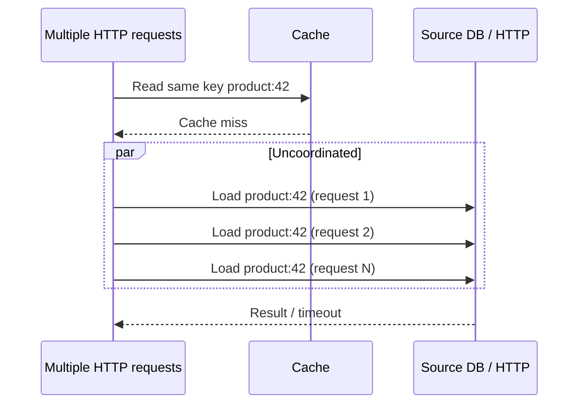
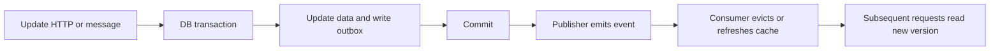

# Avoiding Cache Stampedes and Handling Cache Failures by Business Requirements

In a Spring Boot application, a cache often sits between an HTTP API and a data source such as a database, an external HTTP service, or a broker-backed read store. Caching lowers latency and source load, while creating a coordination point: when many requests simultaneously miss the cache or when the cache fails, how should the application behave?

This lesson focuses on two tightly linked decisions: **limiting concurrent requests from loading the same entry (cache stampede)** and **defining failure behavior when the cache or data source breaks based on business contracts**. Examples use Spring Cache, Caffeine, and Redis; concrete choices must fit replica count, freshness targets, and the cost of serving wrong data.

## 1. Understanding Abnormal Load Patterns on the Data Source

Suppose `GET /products/42` reads product details through a cache with a 60-second TTL. Product `42` is heavily requested. Right as the entry expires, 500 requests arrive together:

1. All requests check the cache and observe a *miss*.
2. Without coordination, all 500 requests query the database or call the external HTTP provider simultaneously.
3. The data source slows down, requests pile up, and cascading timeouts can occur.
4. Uncontrolled retries amplify the request flood.

This is a **cache stampede**, also called a *thundering herd* in this context. Losing a single very hot cache key can multiply backend load well beyond normal levels.



Distinguish three related phenomena:

| Phenomenon | Typical cause | Primary mitigation |
| --- | --- | --- |
| **Stampede** | Many concurrent requests miss **the same key** | Per-key load coalescing (*single-flight*), cross-instance coordination, bounded stale serving |
| **Cache avalanche** | Many keys expire simultaneously or widespread cache outage | Spread TTLs, cache warming, load shedding, and fallback paths |
| **Cache penetration** | Repeated requests for non-existent keys create no useful entry | Short-lived "not found" caching, input validation, and rate limiting |

All three can strike together. For instance, a Redis outage sends all requests to the DB while invalid product IDs add pointless queries on top.

## 2. Choosing Stampede Protection by Deployment Scope

No single technique fits every cache. First determine whether the cache is JVM-local, shared in Redis, or multi-tiered.

| Mechanism | Effect | Scope / limitations |
| --- | --- | --- |
| Per-key *single-flight* | Multiple callers share one source load | Limited to process or coordinator scope |
| **Jittered** TTL | Prevents many entries expiring at the exact same instant | Does not by itself stop stampedes on a single hot key |
| *Refresh ahead* / *stale-while-revalidate* | Serves still-permitted stale data while refreshing asynchronously | Needs strict age bounds; unsuitable for every domain |
| Distributed lock in Redis | Only one instance loads a given key preferentially | Needs leases, owner-crash handling, cache re-reads, and fallbacks |
| Concurrency limits, timeouts, circuit breakers | Protects DB / HTTP services on misses or cache errors | May return controlled errors when overloaded |
| Negative caching | Curbs repeated misses for confirmed non-existent data | Short TTL; never cache timeouts, 5xx errors, or improperly scoped auth results |

Usually combine multiple layers: single-flight to collapse duplicate loads, TTL jitter to prevent synchronized expiration, and concurrency limits to shield sources if the cache drops.

## 3. Single-Flight in One Instance with Spring Cache and Caffeine

For an application's local cache, `@Cacheable(sync = true)` lets Spring ask the cache provider to synchronize value computation when multiple calls miss the same key concurrently. With Caffeine, requests within the **same instance** can share one source query for that key.

Gradle example:

```gradle
dependencies {
    implementation 'org.springframework.boot:spring-boot-starter-cache'
    implementation 'com.github.ben-manes.caffeine:caffeine'
}
```

```yaml
# application.yml
spring:
  cache:
    type: caffeine
    cache-names: productById
    caffeine:
      spec: maximumSize=10000,expireAfterWrite=60s
```

```java
@Configuration
@EnableCaching
class CachingConfiguration {
}

@Service
class ProductQueryService {
    private final ProductRepository repository;

    ProductQueryService(ProductRepository repository) {
        this.repository = repository;
    }

    @Cacheable(cacheNames = "productById", key = "#p0", sync = true)
    public ProductView findById(Long productId) {
        Product product = repository.findById(productId)
                .orElseThrow(() -> new ProductNotFoundException(productId));

        return new ProductView(
                product.getId(), product.getName(), product.getPrice());
    }
}
```

The example assumes `ProductRepository`, `Product`, `ProductView`, and `ProductNotFoundException` are already defined in the application. `#p0` uses the first parameter as the cache key without relying on retained compile-time parameter names.

**How it works:** the first missing request invokes `repository.findById`. Concurrent requests for the same key wait for that in-flight load instead of hitting the DB again. Once complete, the value is cached for subsequent requests.

Key limits to remember:

- `sync = true` depends on the `Cache` implementation's capabilities. Verify on your provider; never assume every provider implements effective single-flight.
- Synchronization applies only within that cache implementation. If each instance runs its own Caffeine cache, **10 instances can still launch up to 10 loads** for the same key simultaneously; there is no cross-process lock.
- `@Cacheable` relies on Spring proxies. Calls from one method to another cacheable method **on the same object** normally bypass the proxy and skip caching.
- With `sync = true`, only one cache name is allowed and `unless` cannot be combined; post-load filtering options are restricted by the synchronous contract.
- If the DB throws an exception, no entry is stored; subsequent requests keep missing. Pair with timeouts, bulkheads, or error responses when the source is degraded.

**When it fits:** read-heavy, slowly changing data in single-instance apps or where one load per replica is acceptable. When scaling across many instances with shared Redis, local single-flight alone is insufficient for extremely hot keys.

## 4. Coordinating Multiple Instances When Using Redis

With shared Redis, a common pattern is **read cache → acquire per-key load lease → re-read cache → load source → write cache → release lease**. The coordination lock reduces source calls, and must never be treated as a transactional correctness mechanism.

```text
Read request cache:product:42
  ├─ Hit  → return data
  └─ Miss
       ├─ SET lock:product:42 <token> NX PX <lease-ms> succeeds
       │    ├─ Re-read cache:product:42
       │    ├─ If still miss: load DB / HTTP source with timeout
       │    ├─ SET data with jittered TTL
       │    └─ Release lock if token still matches (atomic operation)
       └─ Failed to acquire lock
            ├─ Wait briefly with jitter, re-read cache bounded times
            └─ Still miss: serve stale / bounded load / return 503
               per business policy
```

`SET ... NX PX ...` creates the lock only if absent and attaches auto-expiry. Each lock holder uses a unique random token; **never** release a lock with separate `GET` then `DEL` commands, because the lock can expire and be claimed by another holder between the two commands. Use Lua for atomic check-and-delete:

```lua
-- KEYS[1] = lock key; ARGV[1] = lock holder token
if redis.call('GET', KEYS[1]) == ARGV[1] then
    return redis.call('DEL', KEYS[1])
end
return 0
```

Decisions to clarify before implementing:

1. **Lease:** account for source p99 latency, network delay, and process pauses. If a lease expires before the first holder finishes, a second holder can load concurrently. Enforce timeouts, extend leases safely only if truly necessary, and never assume Redis locks guarantee *exactly-once* execution.
2. **Re-read after acquiring the lock:** another instance may have populated the entry just before you won the lock. Skipping this causes redundant source loads.
3. **Never wait indefinitely:** cap total wait time and retry attempts. If the lock stays held too long or Redis fails, provide a clear escape path.
4. **Prevent overwhelming the source when cache dies:** cap concurrent fallbacks and DB / external API rates; apply circuit breakers, bulkheads, and HTTP client deadlines where appropriate.
5. **Never rely on cache locks to guard critical writes:** expired leases, network partitions, and process stalls allow overlapping workers. For writes, use versioning/optimistic locking, DB constraints, or fencing tokens validated by the data source.

Under low traffic, distributed lock overhead can outweigh its benefit. Measure per-*hot-key* concurrency and source QPS before adopting this mechanism.

## 5. TTL Jitter and Controlled Data Refresh

### 5.1. Spreading Expiration Times

If a batch load writes 100,000 entries all with an identical 10-minute TTL, huge numbers can expire together. Add independent *jitter* per write:

```text
baseTtl = 300 seconds
jitter = random number from 0 to 60 seconds
effectiveTtl = baseTtl + jitter
```

For example, when writing to Redis, pass the computed `EX` or `PX` duration. Do not generate jitter once in global startup config and reuse it for all keys. If a rule dictates data **must never be older than 5 minutes**, do not add positive jitter beyond that bound; keep the TTL range inside the freshness budget or separate technical TTL from `updatedAt`/`version` checks.

### 5.2. Stale-While-Revalidate

When brief staleness is permitted, store two timestamps inside the entry:

```text
freshUntil = 10:05   → serve immediately before this timestamp
staleUntil = 10:07   → before this timestamp, serve stale copy and trigger refresh
10:07 onward         → stale copy invalid; apply failure policy
```

Requests arriving after `freshUntil` receive the current copy right away while a single worker refreshes asynchronously. If refresh fails, the stale entry continues serving until `staleUntil`; afterward, never serve it indefinitely. **Cache storage TTL must extend at least to `staleUntil`**, or the entry disappears before stale serving can work.

Caffeine supports `refreshAfterWrite` via `LoadingCache`/`AsyncLoadingCache`: once aged enough, reads can trigger async refreshes while returning the existing value. Configure an expiration bound too and verify failure behavior when refreshes throw. Plain `@Cacheable` with `expireAfterWrite` **does not** provide stale-while-revalidate on its own.

Serve stale data only when the data contract allows it. Product catalogs or display configs may allow tens of seconds; permissions, payment limits, balances, or transaction-deciding stock generally must not rely on stale copies.

### 5.3. Negative Caching

If an API receives heavy traffic for non-existent `productId`s, caching only hits leaves every unknown ID hitting the DB. For entries confirmed "not found," cache a value distinguishable from a cache miss—such as `Optional.empty()` or a `NotFound` type—with a short TTL.

Safety rules:

- Only negative-cache definitive responses, such as DB absence or an HTTP `404` guaranteed by the source to be stable over the TTL.
- Never turn **timeouts, network errors, HTTP 429, or 5xx** into "not found"; those are unknown or transient failures.
- If results depend on tenant, user permissions, locale, or data version, include those scope components in the key; never cache a global `403` or "not found" across all users.
- Negative-cache TTLs should be shorter or tuned separately from valid-data TTLs, especially when records may be created soon after lookup.

## 6. Classifying Errors Before Choosing Fail-Open vs. Fail-Closed

**Cache miss** is normal state; **cache unavailable** is infrastructure failure; **source unavailable** is data-source failure. These three conditions are not equivalent and must not collapse into one `catch` returning `null`.

- **Fail-open for cache:** when cache reads or writes fail, continue via the authoritative source if healthy and permitted. Example: product descriptions still read from DB while Redis is down.
- **Fail-closed for sensitive decisions:** when a critical condition cannot be verified, reject or defer the action. Example: if purchase permissions, limits, or account locks cannot be verified, never allow by default.
- **Bounded stale-if-error:** when the source fails, return cached values still within the agreed age budget, flagging degraded status if the API contract calls for it.
- **Controlled failure:** when both cache is broken and source load exceeds thresholds, return errors such as `503 Service Unavailable` with retry guidance rather than letting every request pile onto the source.

| Scenario | Product catalog read API | Payment / authorization decision |
| --- | --- | --- |
| Cache miss, DB/HTTP source healthy | Load from source, cache result | Verify at authoritative source |
| Cache GET fails, source healthy | Bypass cache with concurrency limit, log/metric | Verify directly at source; if unreachable, deny |
| Cache PUT fails after successful load | Return fresh data; accept temporarily lower hit rate | Never treat cache PUT as proof a transaction completed |
| Source fails, valid stale entry exists | Serve stale if SLA allows | Never use stale data to approve sensitive actions |
| Both cache and source fail | Return 503 or permitted stale copy | Return controlled failure, never guess valid state |
| Cache invalidation fails after update | Replay invalidation, bound staleness with TTL/version | Must enforce source consistency and explicit recovery workflow |

**Fail-open/closed is a per-operation, per-data decision**, not a single global Redis toggle. One application can fail open for marketing copy while failing closed when authorization cannot be verified.

## 7. Intentional Spring Cache Error Handling

In Spring Cache, `CacheErrorHandler` governs how exceptions from abstraction-managed cache operations are handled. By default, the simple handler rethrows exceptions. To allow source reads when cache reads fail for **eligible caches**, ignore GET errors selectively while enforcing dedicated policies for writes and evictions.

```java
@Configuration
@EnableCaching
public class CacheErrorPolicyConfiguration implements CachingConfigurer {
    private static final Logger log = LoggerFactory.getLogger(
            CacheErrorPolicyConfiguration.class);

    @Override
    public CacheErrorHandler errorHandler() {
        return new SimpleCacheErrorHandler() {
            @Override
            public void handleCacheGetError(
                    RuntimeException ex, Cache cache, Object key) {
                if (!"productById".equals(cache.getName())) {
                    throw ex;
                }
                log.warn("Cache GET unavailable: cache={}", cache.getName(), ex);
                // Allow Spring to proceed calling the source for productById.
            }

            @Override
            public void handleCachePutError(
                    RuntimeException ex, Cache cache, Object key, Object value) {
                if (!"productById".equals(cache.getName())) {
                    throw ex;
                }
                log.warn("Cache PUT unavailable: cache={}", cache.getName(), ex);
                // Fresh value already loaded from source; acceptable to skip cache PUT.
            }

            @Override
            public void handleCacheEvictError(
                    RuntimeException ex, Cache cache, Object key) {
                log.error("Cache eviction failed: cache={}", cache.getName(), ex);
                throw ex; // Force update flow to trigger dedicated handling/recovery.
            }

            @Override
            public void handleCacheClearError(RuntimeException ex, Cache cache) {
                log.error("Cache clear failed: cache={}", cache.getName(), ex);
                throw ex;
            }
        };
    }
}
```

The example assumes Spring Cache, `Logger`, and `LoggerFactory` imports are present. The GET/PUT policy here **applies solely to `productById`**; other caches still throw. Never log raw cache keys if keys hold sensitive identifiers. Furthermore, ignoring GET errors **does not** replace bounding request concurrency into the DB.

Important caveats:

1. `CacheErrorHandler` handles errors from Spring Cache operations; it does not catch errors from direct `RedisTemplate` calls, HTTP clients, repositories, or the data-loading body itself.
2. The synchronous path of `@Cacheable(sync = true)` uses `Cache.get(key, Callable)` and provider-specific exception wrapping. **Test with fault injection on your exact Spring/cache version** to confirm GET error handling behaves as expected; if fail-open is mandatory, consider explicit programmatic read-through caching with error handling right at the cache boundary.
3. Throwing on eviction failure **does not roll back the DB**. If the DB transaction committed before eviction ran, callers receive an error even though data already changed. Never blindly retry a non-idempotent write operation.
4. On critical write flows, design retryable invalidations, versioned keys, or outbox-driven sync; never rely on `@CacheEvict` alone for cross-system consistency.

## 8. Caching and Transactions: Handling Updates, Events, and Duplicates

Caches are **read-acceleration copies**, not substitutes for the source of truth. In product-update APIs or broker consumers, DB commit and invalidation order matters:



In simple flows, you can evict after transaction commit, recognizing that a crash between commit and eviction leaves the stale entry until TTL. When stronger recovery guarantees are required, record an **outbox row inside the same DB transaction**; a publisher emits the event afterward and consumers run idempotent invalidation.

Broker events can be redelivered. Evicting the same cache key repeatedly is usually idempotent, whereas incrementing stock, debiting funds, or mutating state **must not** execute multiple times on redelivery. Enforce idempotency keys, unique constraints, or database versions. Cache locks are not transaction-grade deduplication tools.

To avoid old events overwriting new data, prefer **evicting** the key so the next read fetches the latest version; if events must update cache values directly, compare versions/sequences before writing. Across multiple tenants, structure keys clearly such as `tenant:{tenantId}:product:{productId}:v{schemaVersion}`, with access boundaries and schema migration plans.

## 9. Protecting the Source with Timeouts, Retries, and Concurrency Limits

When the cache cannot serve requests, traffic shifts to the DB or HTTP client. Plan for cases where both cache and source degrade:

- **Deadline-based timeouts:** set connect, read/response, and overall load deadlines; never let callers wait indefinitely holding a single-flight slot.
- **Budgeted retries:** retry transient errors only for safe/idempotent calls, with bounded attempts and exponential backoff plus jitter; never retry 500 concurrent requests synchronously.
- **Bulkheads / semaphores:** cap how many cache misses can hit the source concurrently; when full, serve valid stale data or return an API-defined overload error.
- **Circuit breakers:** pause calling the source briefly when error rates cross thresholds to prevent cascading failures; fallbacks must respect freshness and authorization.
- **Rate limits:** throttle abnormal request bursts by client/tenant/key, especially for non-existent IDs.

For HTTP clients, distinguish genuine `404`s (eligible for negative caching) from `429`, `503`, and timeouts (never treated as non-existent). For brokers, configure ack/retry/dead-letter policies and message idempotency; a cache miss is never a reason to replay an entire business transaction automatically.

## 10. Business-Aligned Observability and Alerting

Watching hit ratio alone is insufficient: overall hit ratio can look high while a single hot key suffers stampedes upon expiration. Use Micrometer, Actuator, and application metrics/logs/tracing to track:

| Signal group | Examples to track | Meaning |
| --- | --- | --- |
| Cache | Hits/misses, evictions, TTL, latency, GET/PUT/evict errors | Detects abnormal cache behavior |
| Single-flight / lock | Waiters coalesced per key, wait duration, lock timeouts | Detects thundering herds and bottlenecks |
| Data source | DB QPS, connection pool usage, p95/p99 latency, HTTP 429/5xx | Confirms cache misses do not overload the source |
| Fallback paths | Fail-open count, stale responses served, rejections/503s, open circuits | Reveals real-world service degradation |
| Correctness | Age of returned data, invalidation lag, version mismatches | Detects freshness contract violations |

Set alert thresholds against each API's baseline. For example, if Redis errors persist and DB QPS surges, engage fallback limits before connection pools exhaust. Never attach raw product IDs, user IDs, or tenant IDs as high-cardinality metric tags; use stable low-cardinality labels and keep granular IDs in access-controlled logs/traces.

When tracing `GET /products/{id}`, separate spans for cache lookup, DB/HTTP load, and refresh to pinpoint bottlenecks accurately. Spring Boot's out-of-the-box cache metrics depend on the provider and configuration; verify which metrics actually bind rather than assuming they always appear.

## 11. Essential Test Scenarios

| Scenario | How to reproduce | Measurable expectation |
| --- | --- | --- |
| Concurrent misses on same key in one JVM | Clear entry, send 100 concurrent requests | With Caffeine and `sync=true`, source loads ~1 time per burst for that key when requests truly overlap |
| Concurrent misses across instances | Send simultaneously to multiple replicas | Local cache alone loads once **per replica**; Redis coordination reduces loads as designed |
| Synchronized TTL expiration | Load many keys together with short TTL | Jitter spreads misses; DB QPS avoids the spike seen without jitter |
| Cache GET timeout | Stop Redis or inject timeout | API fails open only for allowed data; source call concurrency stays bounded |
| Cache PUT/evict failure | Inject exception in cache provider | PUT does not break returning loaded data; evict triggers alerts and recovery |
| Source HTTP/DB failure | Return 503 or timeout from source | Errors never cached as `404`; stale served only within allowed window; controlled error afterward |
| Non-existent / newly created | Read missing ID, then create record | Negative entry expires quickly or invalidates; new record becomes visible |
| Redelivered / out-of-order events | Replay or reorder events | Business updates never run twice; older events never overwrite newer versions |
| Cross-tenant keys | Read same `productId` across two tenants | Zero cross-tenant or cross-permission leakage |

Use concurrency tests with `CountDownLatch`/barriers so requests truly start together, fake repositories with invocation counters to verify source loads, and fault injection for Redis/HTTP/DB. Tests must assert **returned responses**, **source call counts**, **latency**, **freshness**, and **error paths**; checking only that `@Cacheable` is present never proves stampede safety.

## 12. Policy Selection Workflow for an Endpoint

Before enabling caching on a new integration flow, answer step by step:

1. **What is the source of truth?** DB, external API, or broker-fed state store? Can it be queried safely during cache failures?
2. **What is the maximum tolerable staleness?** Express as concrete seconds/minutes and decide whether stale-if-error is allowed.
3. **What is the peak concurrent load?** Single instance or multiple replicas? Is local single-flight, distributed locking, or proactive refresh needed?
4. **What must the API return if cache GET, PUT, or evict fails?** Define separately for reads, writes, and sensitive business decisions.
5. **What if the source DB/API also fails?** Set timeouts, retries, fallbacks, bulkheads, and HTTP error contracts.
6. **How is data refreshed and invalidated?** Via TTL, broker events, outbox, or versions? How does it recover after a crash?
7. **How will correctness be proven?** Do tests cover concurrent misses, cache outages, source outages, stale expiration, and duplicate events?

A pragmatic setup for a product catalog often starts with Caffeine and `@Cacheable(sync = true)` at low replica counts, sensible TTLs, and source timeouts. When moving to a shared multi-replica cache, adopt Redis, jittered TTLs, and add distributed locking only when metrics show a hot key causing unacceptable load. For financial, authorization, or transactional-integrity data, verify from the authoritative source and secure idempotency/transactions before optimizing cache layers.

**Core principle:** caches cut load and latency, yet when caches miss or fail, the application must still uphold its business contract. Stampede protection guards *availability under load*; fail-open, fail-closed, freshness bounds, and invalidation guard *result correctness*.
