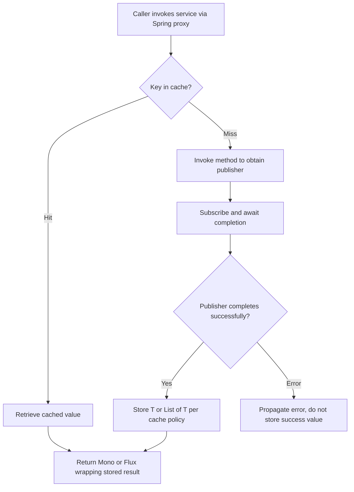

# Distinguishing Synchronous Caching from Reactive Return Types Across Versions

## Context and Objectives

In **Spring Boot Integration**, a cache often sits between a service and slow data sources such as databases, HTTP APIs, or integration adapters. Changing a service's return type from `ProductDto` to `Mono<ProductDto>` does not automatically make the caching layer asynchronous. Moreover, the very same `@Cacheable` annotation can store **the publisher object itself** or **the value emitted by the publisher**, depending on your Spring Framework version.

After this lesson, you will be able to:

- Distinguish synchronous cache access, `@Cacheable(sync = true)`, and methods returning `Mono`/`Flux`.
- Explain caching behavior prior to and starting from **Spring Framework 6.1**, including `CompletableFuture`, `Mono`, and `Flux`.
- Configure an appropriate `CacheManager` for reactive services and recognize when a cache backend can still block threads.
- Choose testing strategies, cache keys, error handling, and migration steps matching your integration flow's data contract.

## 1. Three Easily Confused Concepts

| Concept | Practical meaning | Does it guarantee non-blocking I/O? |
|---|---|---|
| **Synchronous cache API** | Operations such as `Cache.get(key)` return results directly; a remote backend may wait on I/O on the calling thread. | **No**. |
| **`@Cacheable(sync = true)`** | Asks the cache provider to coordinate computing a value for the same key when multiple calls miss concurrently (*single-flight* per provider capability). | **No**; `sync` governs coordinated computation, not reactive or non-blocking execution. |
| **Reactive return types** | `Mono<T>` represents a 0–1 element stream; `Flux<T>` represents a 0–n element stream with subscription and backpressure. | A `Mono`/`Flux` signature alone **does not** prove internal stages—including the cache—are non-blocking. |
| **Asynchronous cache retrieval** | `Cache.retrieve(...)` (Spring Framework 6.1+) uses `CompletableFuture` and requires supporting backend capabilities. | The `retrieve` operation contract is non-blocking; verify actual implementation, config, and execution path. |

For example, `@Cacheable(sync = true)` on a method returning `String` still caches a synchronous result. Conversely, `@Cacheable` on a method returning `Mono<String>` operates via Framework 6.1's reactive value adaptation even without `sync = true`.

**Verification rule:** inspect **Spring Framework version + return type + `CacheManager`/provider + proxy invocation path** together. Looking solely at the annotation or solely at `Mono` is not enough.

## 2. Version Milestones Determining Which Value Is Stored

| Version line | Behavior with `@Cacheable` returning `Mono`/`Flux` | Impact on Spring Boot development |
|---|---|---|
| **Spring Framework 5.x–6.0** | Standard caching treats `Mono`/`Flux` as a **return value** and may store the `Publisher` object itself. With cold publishers, each subscription can still re-run the query. | Seen in Spring Boot 2.x and Boot 3.0–3.1 under default managed dependencies. Never assume emitted values were memoized. |
| **Spring Framework 6.1** | Cache annotations recognize `CompletableFuture`, `Mono`, and `Flux`; caches the **completed/emitted value** rather than the publisher. | Major behavior change starting in Spring Boot **3.2**. Assess compatibility when upgrading from 3.1 to 3.2. |
| **Spring Framework 6.2** | Continues 6.1's async/reactive result adaptation. | Typically paired with Spring Boot **3.4–3.5**; inspect the provider to confirm runtime behavior. |
| **Spring Framework 7.x** | Continues `CompletableFuture`/`Mono`/`Flux` support; docs further emphasize limits around Reactor `Context` and preserving backpressure while caching. | Corresponds to Spring Boot **4.x** under default dependency management; check your actual BOM before using version-specific options. |

These Spring Boot–Spring Framework pairings are **reference defaults**, not guarantees inferred solely from Boot's version number. In projects overriding dependencies or using custom BOMs, verify the **resolved `spring-context`/Spring Framework version**. This behavioral shift belongs to **Spring Framework**, while Spring Boot mainly supplies auto-configuration and dependency management.

### Behavior Before Spring Framework 6.1

```java
@Cacheable(cacheNames = "products", key = "#p0")
public Mono<ProductDto> findProduct(String id) {
    return remoteGateway.findProduct(id); // Cold Mono, issues HTTP call on subscribe
}
```

Under the older mechanism, the cache could retain the `Mono` object returned by the method. Two calls with the same key received the same cached publisher, yet **two subscriptions** to a cold publisher could still trigger **two HTTP requests**. If the author explicitly memoized it via `Mono.cache()`, behavior differed, but that came from Reactor's own caching tied to the in-memory publisher lifecycle.

### Behavior from Spring Framework 6.1 Onward



With cache annotations from 6.1 onward, stored data depends on **result shape**:

| Method signature | What is stored on completed miss | What caller receives on hit | Key notes |
|---|---|---|---|
| `ProductDto` | `ProductDto` | `ProductDto` | Traditional synchronous caching behavior. |
| `CompletableFuture<ProductDto>` | `ProductDto` once future completes | `CompletableFuture<ProductDto>` holding cached value | Failed futures are not treated as successful results. |
| `Mono<ProductDto>` | The `ProductDto` emitted by `Mono` | `Mono<ProductDto>` reconstructed from cache via `CompletableFuture` adaptation | Does not store a raw cold `Mono` as in older versions. |
| `Flux<ProductDto>` | **The full `List<ProductDto>`** after `Flux` completes | `Flux<ProductDto>` replaying the list | Caches the **entire stream**; does not store elements incrementally as they arrive. |

`Mono.empty()` and `Flux.empty()` must be tested explicitly: whether `null`/empty results are stored depends on the abstraction and provider. Never deduce from the signature alone that empty results will or will not be cached. `onError` does not produce a successful business value to cache, yet provider errors can still occur before or during retrieval and must be handled at the integration layer.

## 3. Configuration Example: Spring Boot + WebFlux + Caffeine

This example targets **Spring Framework 6.1+**. Assume the application includes `spring-boot-starter-cache`, `caffeine`, and required Reactor/WebFlux dependencies. On Spring Boot 3.2–3.5, explicitly configuring `CacheManager` avoids relying on automatic provider selection.

```java
import org.springframework.cache.CacheManager;
import org.springframework.cache.annotation.EnableCaching;
import org.springframework.cache.caffeine.CaffeineCacheManager;
import org.springframework.context.annotation.Bean;
import org.springframework.context.annotation.Configuration;

@Configuration
@EnableCaching
public class CacheConfiguration {

    @Bean
    CacheManager cacheManager() {
        CaffeineCacheManager manager = new CaffeineCacheManager(
                "productById", "productsByCategory");
        manager.setCacheSpecification("maximumSize=10000,expireAfterWrite=300s");
        manager.setAsyncCacheMode(true); // Spring Framework 6.1+
        return manager;
    }
}
```

`setAsyncCacheMode(true)` builds native Caffeine **AsyncCache** instances supporting `Cache.retrieve(...)`; this is Spring's recommended setup for reactive caching from 6.1 onward. Default synchronous Caffeine caches do not natively expose the same async capability. Newer Spring Boot versions may offer properties for Caffeine's async mode; when supporting multiple Boot lines, explicit `CacheManager` configuration like this is easy to verify.

```java
import org.springframework.cache.annotation.Cacheable;
import org.springframework.stereotype.Service;
import reactor.core.publisher.Flux;
import reactor.core.publisher.Mono;

record ProductDto(String id, String name) {}

interface ProductGateway {
    Mono<ProductDto> findById(String id);
    Flux<ProductDto> findByCategory(String category);
}

@Service
public class ProductQueryService {
    private final ProductGateway gateway;

    public ProductQueryService(ProductGateway gateway) {
        this.gateway = gateway;
    }

    @Cacheable(cacheNames = "productById", key = "#p0")
    public Mono<ProductDto> findById(String id) {
        return gateway.findById(id);
    }

    @Cacheable(
            cacheNames = "productsByCategory",
            key = "#p0",
            unless = "#result.isEmpty()")
    public Flux<ProductDto> findByCategory(String category) {
        return gateway.findByCategory(category);
    }
}
```

**Execution trace for `findById("A1")`:**

1. The request passes through the Spring proxy and checks `productById` for key `A1`.
2. On miss, Spring invokes the method and adapts the publisher to capture the value from `gateway.findById`.
3. Once `ProductDto` is emitted, the value is stored per provider policy. Later calls with the same key return a `Mono` backed by the cached value, saving a downstream HTTP/DB round-trip.
4. For `findByCategory`, Spring waits for `Flux` completion to collect a `List<ProductDto>` before caching. While the `Flux` is mid-stream, **no complete list exists** to cache.

In `unless = "#result.isEmpty()"`, `#result` on a `Flux` method is evaluated after collecting into a `List`, allowing empty category lists to be excluded from caching. `unless` checks the **produced result**, whereas `condition` checks inputs **before execution**. That distinction is crucial when avoiding lengthy negative caching against external APIs.

> **Important limitation:** Collecting a `Flux` into a list increases memory usage and negates streaming; never use this for infinite streams (`Flux.interval`, continuous broker events), huge results, or streams needing element-by-element backpressure. For those, cache individual records/bounded queries at an appropriate layer or use a dedicated design.

## 4. Which Problem Does `sync = true` Solve?

Suppose 100 concurrent requests ask for product `A1` while the cache is cold. With `sync = false` (default), many requests can load the product simultaneously, causing a **cache stampede**. With `sync = true`, Spring asks the cache provider to coordinate loading for the same key to prevent redundant computation.

```java
@Cacheable(cacheNames = "productById", key = "#p0", sync = true)
public Mono<ProductDto> findById(String id) {
    return gateway.findById(id);
}
```

Conditions to check:

- `sync = true` is a **provider hint**; it does not create a distributed lock shared across multiple application instances. Confirm your provider's exact behavior under concurrent cache misses.
- Only **one cache name** is permitted; you cannot combine `unless` or additional cache operations on the same method. If post-checking `#result` is required, use a different flow rather than mixing `sync = true` and `unless`.
- For reactive caching, `Cache.retrieve(key, valueLoader)` must be compatibly implemented by the provider to coordinate futures; Caffeine with `setAsyncCacheMode(true)` is a clear working example.
- **Reactor `Context`**: in non-`sync` reactive caching, the subscriber on a miss supplies its `Context` to the publisher. With `sync = true`, the cache may subscribe centrally to share one computation, so you cannot assume subscriber `Context` propagates to the data loader. If output depends on tenant, locale, or permissions, pass those explicitly as parameters/keys or avoid caching context-dependent results this way.

Accordingly, `sync = true` fits results **safe to share across all callers using the same key**. Public catalog prices by SKU fit well; data governed by per-request tokens or user context requires careful key and security review before caching.

## 5. Reactive Return Types Do Not Guarantee Non-Blocking Cache Providers

Spring Cache is a generic abstraction. Two code paths can behave completely differently:

```text
Mono<T> from service  -- Spring cache adapter --> Caffeine AsyncCache
    : in-memory, supports CompletableFuture-based retrieval

Mono<T> from service  -- Spring cache adapter --> Redis/remote cache
    : verify driver, implementation, Cache.retrieve, and write path
```

A remote cache backend may perform **blocking** reads or writes; returning `Mono<T>` from the method only changes the wrapper type without removing network blocking. `Cache.retrieve(...)` was introduced in Framework 6.1 as an async retrieval contract, yet not every `Cache` implements it. Unsupported providers may throw `UnsupportedOperationException`.

Specifically for Redis, Spring Data Redis includes `RedisCacheWriter.supportsAsyncRetrieve()` starting in **3.2**; actual behavior still depends on the writer and Redis driver. Therefore, never assume "using `RedisCacheManager` makes caching reactive" or "using WebFlux makes caching non-blocking." For end-to-end non-blocking apps, verify the cache call path against API docs, runtime tests, and event-loop monitoring; consider `ReactiveRedisTemplate`/`ReactiveRedisOperations` directly when fine-grained reactive pipeline control is needed.

**Never call `block()`/`blockOptional()` on a Netty event-loop thread** to force async caching or databases into synchronous calls. If bridging a legacy blocking adapter, isolate blocking work onto an appropriate bounded scheduler and measure load rather than wrapping it in `Mono.just(...)`.

## 6. Differences with `@CachePut`, `@CacheEvict`, and Empty Results

Starting in Framework 6.1, async/reactive adaptation extends beyond `@Cacheable`:

| Annotation | Behavior when method returns a reactive type |
|---|---|
| `@Cacheable` | Checks cache first; on miss runs method and caches emitted value/snapshot when eligible. |
| `@CachePut` | Always executes method; writes result once values emit/complete per annotation contract. |
| `@CacheEvict` | By default, evicts after method processing completes; `beforeInvocation = true` evicts prior to invocation. |

With `Flux`, `@CachePut`/`@CacheEvict` may need all elements to complete before running post-execution cache work. Therefore, never assume "the publisher object was returned" means the cache is already updated or evicted. When updating a database in a transaction, verify commit timing and eviction order so stale reads cannot slip between steps; never assume cache annotations provide atomicity between database and cache.

Several policies must follow the business contract:

- **Product not found** (`Mono.empty()`): is negative caching allowed? If so, how short must the TTL be so "not found" does not hide newly created records?
- **HTTP 5xx, timeouts, broker errors:** never treat these as "no data." Typically do not cache error responses as successes; configure retries/circuit breakers and observe errors separately.
- **Personal or multi-tenant data:** keys must include a valid partition identifier. `key = "#p0"` in the examples works only when `id` is globally unique and independent of user/tenant.
- **Source data updates:** apply TTLs, `@CacheEvict`, or event-driven invalidation after successful updates, accounting for eventual consistency between cache and backend.

## 7. Migrating from Spring Boot 3.1 to 3.2 or Newer

An apparently minor upgrade can change the meaning of existing code:

```java
@Cacheable("legacyFeed")
public Flux<EventDto> streamEvents(String source) {
    return brokerAdapter.stream(source);
}
```

- **Framework 6.0:** could cache the `Flux` object (the publisher), letting each subscription keep receiving events per publisher behavior.
- **Framework 6.1+:** cache annotations attempt to collect the entire `Flux` into a `List` on miss. On an infinite stream, the list never completes—creating memory pressure and never producing a finished value to cache.

The proper fix is **removing caching from infinite event streams** and moving caching down to a bounded snapshot API, such as `Mono<List<EventDto>> findLatestEvents(...)` with explicit count and query limits. Never call `block()` to "force" a stream to finish.

Starting in Spring Framework **6.1.3**, a compatibility flag `-Dspring.cache.reactivestreams.ignore=true` (or configured in `spring.properties` on the classpath) disables special Reactive Streams publisher handling and reverts to treating publishers as synchronous values. This is strictly a **narrow migration escape hatch**, helpful for legacy code explicitly relying on `Mono.cache()`/`Flux.cache()`, not a recommended default. Before enabling it during upgrades, review your cache provider, cold/hot publishers, streaming needs, and data contracts.

Recommended review steps:

1. Check the actual resolved Framework version and locate `@Cacheable` methods returning `CompletableFuture`, `Mono`, or `Flux`.
2. Classify each stream: finite vs. infinite, dependent on `Context`/tenant or not, needing backpressure or not.
3. Verify whether `CacheManager`/provider supports `retrieve` and `sync = true` as expected; configure TTL, memory bounds, and `null` policies.
4. Test misses/hits, concurrent misses, completion/error/cancel, eviction, and downstream call counts; compare before/after upgrade.
5. Roll out flow by flow while monitoring hits/misses, errors, p95/p99 latency, memory, and backend load.

## 8. Minimum Test Scenarios

Example using a fake `ProductGateway` counting **actual downstream subscriptions** (`AtomicInteger` incremented inside `Mono.defer(...)`):

```java
AtomicInteger calls = new AtomicInteger();

Mono<ProductDto> backend(String id) {
    return Mono.defer(() -> {
        calls.incrementAndGet();
        return Mono.just(new ProductDto(id, "Keyboard"));
    });
}
```

Place this fake backend behind a **proxy-invoked Spring bean** annotated with `@Cacheable`, and use `StepVerifier` to subscribe sequentially twice with the same key:

```java
StepVerifier.create(productService.findById("A1"))
        .expectNextMatches(p -> p.id().equals("A1"))
        .verifyComplete();

StepVerifier.create(productService.findById("A1"))
        .expectNextMatches(p -> p.id().equals("A1"))
        .verifyComplete();

assertThat(calls.get()).isEqualTo(1); // expected with proper 6.1+ cache setup
```

This is a **test snippet** (requiring fixture `productService`, JUnit/AssertJ/Reactor Test imports, and fresh cache state per case), not a standalone test class. Include dedicated cases for:

| Scenario | What to prove |
|---|---|
| Miss then hit on same key | Backend is subscribed once across two sequential requests; identical results returned. |
| Two distinct keys | Each key triggers its own load; no key collisions. |
| Concurrent misses with `sync = true` | Real provider triggers only expected loads for the same key; verify sync scope for your deployment. |
| Finite 3-element `Flux` | All 3 elements replay on hit; cache holds one snapshot after completion. |
| Infinite or cancelled `Flux` | No complete entry cached; memory usage and subscription cancellation stay controlled. |
| `Mono.empty()`/`Flux.empty()` | Outcome matches null/empty policy and `unless`. |
| `Mono.error(...)` | Error reaches caller without turning into business data or caching a success. |
| Update/evict | After data changes, subsequent reads receive updated data per invalidation policy. |
| Tenant/authorization | Cache keys never leak data across tenants or users. |

Avoid testing by calling `this.findById(...)` inside the same service: in default proxy mode, **self-invocation bypasses the cache interceptor**. In integration tests, obtain the service from the Spring context and invoke it externally. Measure **downstream subscription counts**, because counting Java method invocations alone can hide the difference between caching a publisher and caching emitted data.

## 9. Quick Decision Table

| Situation | Approach |
|---|---|
| Blocking JDBC query returning plain DTO | Use an appropriate synchronous cache (Caffeine/Redis per profile) with bounded TTL; do not claim reactive execution. |
| WebFlux query returning bounded `Mono<DTO>`, Spring Framework 6.1+ | Use `@Cacheable` with a provider supporting async retrieval; consider `sync = true` if independent of subscriber context. |
| Short, bounded `Flux<DTO>` needing whole-result caching | Can cache a `List<DTO>` snapshot; set size caps and TTL. |
| Infinite `Flux` event stream or strict backpressure needs | Do not cache the entire stream with `@Cacheable`; cache small query/snapshot endpoints or use a dedicated design. |
| Upgrading from Framework 6.0 to 6.1+ | Audit the shift from caching publishers to caching emitted values, provider support, and subscription tests. |
| Redis backend for a reactive service | Verify `supportsAsyncRetrieve`, driver, and I/O paths; if needed, code directly against reactive Redis APIs. |

## References

- [Spring Framework 6.2 – Declarative Annotation-based Caching](https://docs.spring.io/spring-framework/reference/6.2/integration/cache/annotations.html): `@Cacheable` semantics, `sync`, `Mono`, `Flux`, `@CachePut`, `@CacheEvict`.
- [Spring Framework 6.1 – `Cache` API](https://docs.spring.io/spring-framework/docs/6.1.21/javadoc-api/org/springframework/cache/Cache.html): `Cache.get` and `Cache.retrieve`.
- [Spring Framework 6.1 – `CaffeineCacheManager`](https://docs.spring.io/spring-framework/docs/6.1.12/javadoc-api/org/springframework/cache/caffeine/CaffeineCacheManager.html): `setAsyncCacheMode(true)`.
- [Spring Framework 6.1 – `@Cacheable` Javadoc](https://docs.spring.io/spring-framework/docs/6.1.x/javadoc-api/org/springframework/cache/annotation/Cacheable.html): restrictions of `sync = true`.
- [Spring Framework 6.x Upgrade Notes](https://github.com/spring-projects/spring-framework/wiki/Upgrading-to-Spring-Framework-6.x): Reactive Streams handling changes and compatibility property.
- [Spring Boot – Caching](https://docs.spring.io/spring-boot/reference/io/caching.html): auto-configuration, cache providers, and Caffeine.
- [Spring Data Redis – `RedisCacheWriter` API](https://docs.spring.io/spring-data/redis/docs/3.2.x/api/org/springframework/data/redis/cache/RedisCacheWriter.html): `supportsAsyncRetrieve()`.
