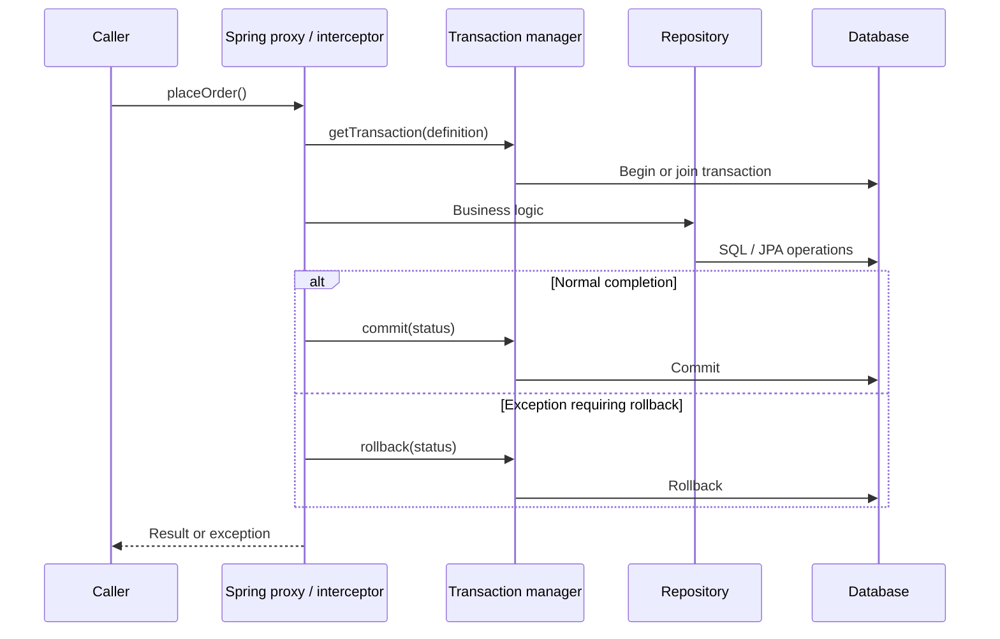
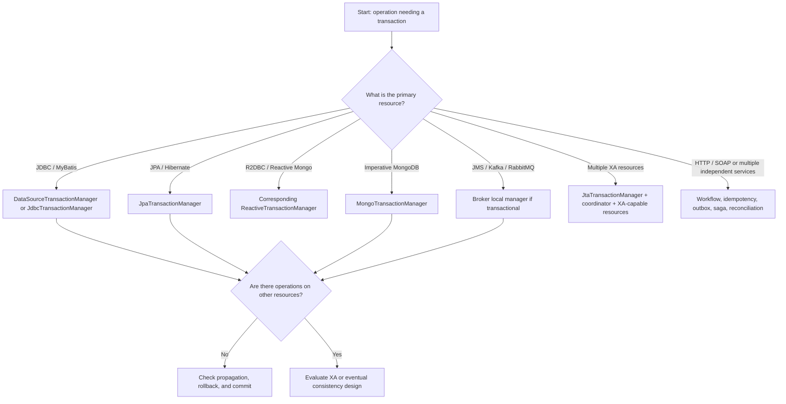
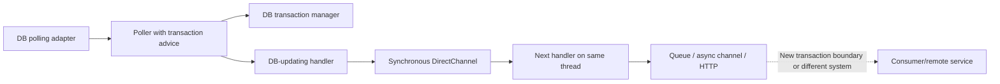
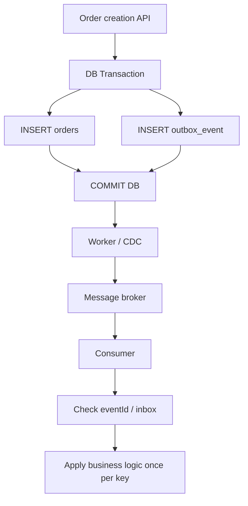

# `PlatformTransactionManager` and Choosing a Transaction Manager

## 1. The Transaction Problem in System Integration

A Spring Boot application typically accesses multiple resources: a relational database via JDBC or JPA, MongoDB, Redis, Kafka, RabbitMQ, JMS, HTTP APIs, and Spring Integration adapters. When a business flow both writes data and sends a message, the critical question is not just “should we use `@Transactional`?”, but also **which transaction is being opened, who manages it, and which operations actually participate in that transaction**.

In the **SPRING_BOOT_INTEGRATION** module, the goal is to structure system integrations across HTTP clients, databases, caches, message brokers, and Spring Integration adapters. Therefore, choosing a transaction manager directly affects how you manage configuration, data consistency, error handling, duplicate handling, testing, and observability of integration flows.

Consider an order placement service example:

1. Write the order record to PostgreSQL.
2. Call an ERP over SOAP/HTTP to check credit limit.
3. Publish an `OrderCreated` event to Kafka.

`@Transactional` can help roll back operations **on a database managed within a single transaction**, but it does not automatically cancel a SOAP command already processed by the ERP, nor does it turn writing to PostgreSQL and publishing to Kafka into an atomic commit. To solve this problem properly, you must first understand **`PlatformTransactionManager`**.

After this lesson, you will be able to:

- Explain how `PlatformTransactionManager` participates in `@Transactional`, `TransactionTemplate`, and the commit/rollback lifecycle.
- Choose an appropriate transaction manager for JDBC, JPA, JTA/XA, and messaging systems, and distinguish imperative from reactive transactions.
- Configure and specify the manager when an application has multiple `DataSource`s or multiple transactional resources.
- Identify the boundaries that a transaction manager does **not** cover and choose outbox, idempotency, reconciliation, or saga for multi-system integration flows.

## 2. What Is `PlatformTransactionManager`?

`PlatformTransactionManager` is Spring's core interface for **imperative transaction management**. It creates or joins an existing transaction according to a `TransactionDefinition`, then commits or rolls back via `TransactionStatus`.

Simplified model:

```java
public interface PlatformTransactionManager extends TransactionManager {
    TransactionStatus getTransaction(TransactionDefinition definition);
    void commit(TransactionStatus status);
    void rollback(TransactionStatus status);
}
```

`TransactionDefinition` holds policies such as **propagation**, **isolation**, **timeout**, and **readOnly**. `TransactionStatus` represents the state of the transaction execution, including the ability to mark `rollbackOnly`. A concrete transaction manager knows how to begin, bind, commit, or roll back the corresponding resource: a JDBC `Connection`, a JPA `EntityManager`, a JMS transactional session, or a transaction coordinated by a JTA coordinator.

Spring separates two responsibilities:

| Responsibility | Component | Meaning |
|---|---|---|
| Determining **when** to open/close a transaction | `@Transactional`, `TransactionInterceptor`, `TransactionTemplate` | Wraps business processing with a transaction boundary. |
| Determining **which resource** is opened/committed/rolled back | Concrete `PlatformTransactionManager` | Interacts with the database driver, persistence provider, broker, or transaction coordinator. |

Diagram of a typical `@Transactional` call:



This is a logical diagram. With `PROPAGATION_REQUIRED`, Spring can **join an existing transaction**, so each call to `getTransaction` does not necessarily create a new physical transaction. The actual mechanics also depend on the transaction manager, propagation, and resources.

### Not Every Transaction Is a Distributed Transaction

A local transaction manager is usually responsible for only a single resource or a configured resource type. For example, `DataSourceTransactionManager` manages the transaction of a JDBC `Connection` from a single `DataSource`. It cannot automatically control an HTTP request, a Kafka producer, or an independently connected database. **Being inside the same Java method does not mean operations participate in the same transaction.**

## 3. How Does `@Transactional` Use the Manager?

A simple example with Spring JDBC:

```java
import org.springframework.jdbc.core.JdbcTemplate;
import org.springframework.stereotype.Service;
import org.springframework.transaction.annotation.Transactional;

@Service
public class StockReservationService {

    private final JdbcTemplate jdbc;

    public StockReservationService(JdbcTemplate jdbc) {
        this.jdbc = jdbc;
    }

    @Transactional
    public void reserve(String sku, int quantity) {
        int updated = jdbc.update("""
            UPDATE inventory
               SET reserved = reserved + ?
             WHERE sku = ? AND stock - reserved >= ?
            """, quantity, sku, quantity);

        if (updated != 1) {
            throw new IllegalStateException("Insufficient stock");
        }

        jdbc.update("""
            INSERT INTO reservation_log(sku, quantity)
            VALUES (?, ?)
            """, sku, quantity);
    }
}
```

If both statements use the same `DataSource` and the same Spring transaction, a `RuntimeException` from the second statement will usually cause both the inventory update and the log insert to roll back. For that to happen, however, all of the following conditions must hold simultaneously:

- The method is called **through a Spring proxy/transaction interceptor** or an equivalent transaction management mechanism; direct calls within the same object (`this.reserve(...)`) are usually not intercepted by proxy-based advice.
- The selected transaction manager must manage the exact `DataSource` that `JdbcTemplate` uses.
- JDBC operations must obtain connections through Spring's integration mechanisms such as `JdbcTemplate` or `DataSourceUtils`, rather than manually opening a standalone connection outside the transaction.
- The database and table/storage engine must actually support transactions for the operations involved.
- The exception must trigger a rollback according to the configured rules; the common default is to roll back on `RuntimeException` and `Error`, and not automatically roll back on every checked exception.

If you use `@Async`, hand work off to an executor, or send a message through a broker, the transaction context bound to the current thread **does not automatically follow** the new call. For reactive processing, Spring uses a different context model covered later.

## 4. Common Transaction Managers

The implementation names below may appear across different Spring modules; dependencies and versions must be compatible with your project. The key selection criterion is the **type of resource being managed**, not just the class name.

| Manager | Resource and Suitable Context | Key Boundary |
|---|---|---|
| `DataSourceTransactionManager` | JDBC with a single `DataSource`; Spring JDBC, MyBatis, or JDBC access through Spring | Manages a local JDBC `Connection`; does not automatically link transactions of another `DataSource`. |
| `JdbcTransactionManager` | Also JDBC with a single `DataSource`; supports translating commit/rollback exceptions into Spring's `DataAccessException` hierarchy | A specialized option for JDBC; still a local transaction on a single `DataSource`. |
| `JpaTransactionManager` | JPA/Hibernate with a single `EntityManagerFactory` | Manages JPA transactions; can coordinate JDBC through the **same `DataSource`** when configured properly, but does not combine multiple independent databases into XA. |
| `JtaTransactionManager` | JTA environment, especially when a coordinator is needed for multiple **XA-capable resources** | Achieving atomic commit across multiple resources requires JTA/XA infrastructure and configuring each resource to actually participate. |
| `JmsTransactionManager` | Local transactions of a JMS `Session` with a single `ConnectionFactory` | Not automatically atomic with a database; getting JMS + DB into one XA requires appropriate JTA/XA configuration. |
| `KafkaTransactionManager` | Kafka producer transactions for the corresponding Kafka records | Does not automatically create an atomic commit between Kafka and a relational database. |
| `RabbitTransactionManager` | Local transactions of a RabbitMQ channel | Does not guarantee atomicity with another database. |
| `MongoTransactionManager` | MongoDB transactions on `ClientSession` | Requires a MongoDB deployment that supports transactions; does not automatically cover SQL, Kafka, or HTTP. |

In addition to the imperative implementations above, Spring provides **`ReactiveTransactionManager`** for non-blocking processing: for example, `R2dbcTransactionManager` for R2DBC and `ReactiveMongoTransactionManager` for reactive MongoDB. Reactive managers **do not implement `PlatformTransactionManager`**; they use the Reactor context to propagate state instead of relying solely on `ThreadLocal`.

**Redis** warrants a separate note: `MULTI`/`EXEC` commands have their own command-grouping mechanism, but they do not turn Redis into a universal XA participant when placed alongside a database inside `@Transactional`. Similarly, **HTTP/REST/SOAP has no general `PlatformTransactionManager`** to roll back a request already processed by the target system.

## 5. Choosing a Manager by Data Stack

A practical rule: identify the **primary data-access API** of the transaction, then verify whether all operations requiring atomicity live on the same resource managed by that manager.



Common selection scenarios:

1. **Application uses `JdbcTemplate` to write to PostgreSQL:** choose a JDBC manager for that specific `DataSource`.
2. **Application uses Spring Data JPA/Hibernate:** typically choose `JpaTransactionManager` tied to the corresponding `EntityManagerFactory`.
3. **Application uses JPA alongside `JdbcTemplate` on the same database:** you can usually use `JpaTransactionManager` for the whole flow if JDBC obtains connections via Spring's mechanism from the **exact same `DataSource`** used by JPA. You must verify the persistence provider's mapping and manager configuration; do not assume all cases automatically share the same connection.
4. **Application uses two independent `DataSource`s:** two local managers create two independent transactions. To guarantee an atomic commit across both, you must evaluate JTA/XA or redesign the business boundaries.
5. **Application writes to the DB and then publishes to Kafka or calls HTTP:** choose the DB manager for the DB write, and design the reliability of the outbound call/send separately.

### How Does Spring Boot Choose the Default Manager?

Spring Boot provides auto-configuration for many data stacks and can create a transaction manager when dependency/bean conditions match. For example, a pure Spring JDBC app may receive a JDBC transaction manager; a JPA app typically receives a JPA transaction manager. **Do not assume that simply having a certain starter guarantees a specific manager will be chosen**: `DataSource`s, `EntityManagerFactory` beans, user-declared beans, and transaction configuration all affect the outcome.

In a system with only one suitable transaction manager, `@Transactional` without specifying a name is usually straightforward. When there are multiple managers, you should **explicitly specify the name** to avoid depending on default manager resolution or accidental configuration changes.

## 6. JDBC: One `DataSource`, One Local Manager

For pure JDBC access, the transaction manager is bound to the `DataSource` that supplies connections to DAOs/repositories:

```java
import javax.sql.DataSource;
import org.springframework.context.annotation.Bean;
import org.springframework.context.annotation.Configuration;
import org.springframework.jdbc.support.JdbcTransactionManager;
import org.springframework.transaction.PlatformTransactionManager;

@Configuration
class JdbcTxConfiguration {
    @Bean("transactionManager")
    PlatformTransactionManager transactionManager(DataSource dataSource) {
        return new JdbcTransactionManager(dataSource);
    }
}
```

This configuration is **illustrative for when the application already has one `DataSource` and no other transaction manager bean with the same name**. In a Spring Boot project with suitable auto-configuration, declaring this bean is not strictly necessary; manual configuration must be checked to avoid duplicates and selecting the wrong manager.

Spring manages the `Connection` bound to the current thread's transaction. `JdbcTemplate` joins the transaction properly through Spring JDBC infrastructure. A connection opened manually via `DriverManager.getConnection(...)` may be unrelated to the active transaction, even if that SQL runs inside the same `@Transactional` method.

### When to Use `JdbcTransactionManager` Instead of `DataSourceTransactionManager`?

`JdbcTransactionManager` builds on `DataSourceTransactionManager` and adds the ability to translate certain exceptions occurring during commit/rollback into Spring's data-access exception hierarchy. If the entire stack is JDBC and your Spring Framework version supports it, it is a sensible choice. This **does not change the atomicity scope**: both still manage a local transaction on a single `DataSource` and do not magically become XA.

### When Do JPA and JDBC Participate in the Same Transaction?

With JPA, `JpaTransactionManager` manages the `EntityManager` and the JPA provider's transaction. If JPA code and `JdbcTemplate` both use the same underlying JDBC `DataSource`, and `JpaTransactionManager` is properly configured to expose the JDBC connection, both **can** participate in the same local transaction. Conversely, using JPA through one `EntityManagerFactory` and JDBC through a differently connected `DataSource` gives no guarantee they share the same transaction.

With Hibernate, JPA SQL operations may be deferred until `flush` or commit. Therefore, tests must verify actual write order, lock constraints, unique constraint violations, and rollback outcomes rather than just looking at Java method call order.

## 7. Applications with Multiple `DataSource`s or Multiple Managers

Suppose `ordersDataSource` and `billingDataSource` access two independent databases. Give each manager an explicit name:

```java
import javax.sql.DataSource;
import org.springframework.beans.factory.annotation.Qualifier;
import org.springframework.context.annotation.Bean;
import org.springframework.context.annotation.Configuration;
import org.springframework.jdbc.support.JdbcTransactionManager;
import org.springframework.transaction.PlatformTransactionManager;

@Configuration
class MultiDataSourceTxConfiguration {

    @Bean("ordersTxManager")
    PlatformTransactionManager ordersTxManager(
            @Qualifier("ordersDataSource") DataSource dataSource) {
        return new JdbcTransactionManager(dataSource);
    }

    @Bean("billingTxManager")
    PlatformTransactionManager billingTxManager(
            @Qualifier("billingDataSource") DataSource dataSource) {
        return new JdbcTransactionManager(dataSource);
    }
}
```

Both `DataSource`s must be configured and supplied to their respective DAOs/`JdbcTemplate`s; the snippet above intentionally shows only **the transaction manager part**. When invoking business code:

```java
import org.springframework.stereotype.Service;
import org.springframework.transaction.annotation.Transactional;

@Service
public class OrdersService {

    private final OrdersRepository orders;

    public OrdersService(OrdersRepository orders) {
        this.orders = orders;
    }

    @Transactional(transactionManager = "ordersTxManager")
    public void confirm(long orderId) {
        orders.markConfirmed(orderId);
    }
}
```

`OrdersRepository` in the example is an application abstraction and must use `ordersDataSource`. If you want to operate on billing, the billing method needs to be managed by the appropriate `billingTxManager`. **Two annotations using two managers do not create a single shared atomic transaction**. If `orders` commits successfully but `billing` fails, each local transaction may end up in a different state.

Ways to specify a manager in Spring:

| Mechanism | When to Use | Key Points |
|---|---|---|
| `@Transactional("ordersTxManager")` | The method belongs to a single resource and you want it explicit in code | The name/qualifier must resolve to a valid transaction manager. |
| `@Transactional(transactionManager = "ordersTxManager")` | Equivalent to above, clearer in complex configurations | `value` and `transactionManager` are aliases of each other. |
| Default-selected bean (`@Primary`, transaction config, Spring resolution rules) | The application has a clear convention for one primary manager | Does not replace verifying which manager the interceptor picks. |
| `TransactionManagementConfigurer` | Need a default configuration for annotation-driven transactions | `annotationDrivenTransactionManager()` returns the default `TransactionManager` for advice. |
| `TransactionTemplate` with an explicitly injected manager | Want to control transaction boundaries programmatically | Ensures the template uses the exact chosen manager. |

**Do not add `@Primary` expecting it to merge multiple local transactions together.** It only helps certain injection/bean-resolution points pick a preferred target; atomicity depends entirely on the implementation and the resources actually participating.

## 8. Managing Transactions with `TransactionTemplate`

Not every transaction is convenient to express via annotations. When only a small section of a method needs a transaction, or when a transaction must be placed inside a complex workflow, `TransactionTemplate` lets you open/close the boundary explicitly:

```java
import org.springframework.beans.factory.annotation.Qualifier;
import org.springframework.stereotype.Service;
import org.springframework.transaction.PlatformTransactionManager;
import org.springframework.transaction.support.TransactionTemplate;

@Service
public class ImportService {

    private final TransactionTemplate ordersTx;
    private final OrdersRepository orders;

    public ImportService(
            @Qualifier("ordersTxManager") PlatformTransactionManager txManager,
            OrdersRepository orders) {
        this.ordersTx = new TransactionTemplate(txManager);
        this.orders = orders;
    }

    public void importOne(ImportedOrder order) {
        // Validation or external data calls can happen before the transaction.
        ordersTx.executeWithoutResult(status -> {
            orders.insert(order);
            orders.recordImport(order.externalId());
        });
    }
}
```

`ImportedOrder` and `OrdersRepository` are illustrative domain types. `executeWithoutResult` suits callbacks without a return value. When the callback throws an exception, the template handles commit/rollback according to the semantics of `TransactionTemplate` and the corresponding `PlatformTransactionManager`. If you want to explicitly mark rollback based on a business outcome, you can call `status.setRollbackOnly()`.

Unlike proxy-based advice, `TransactionTemplate`'s callback starts the transaction right at the `execute(...)` call site, making it useful when you need to limit lock duration or separate a data write from a long HTTP call. Even so, **putting an HTTP call inside the callback does not make the HTTP call a transaction participant**.

## 9. Propagation, Isolation, Timeout, and Rollback

Choosing the right manager is only the first step. `TransactionDefinition` decides how a new call behaves when an existing transaction is already present.

| Propagation | Core Behavior | Design Notes |
|---|---|---|
| `REQUIRED` | Joins the existing transaction or creates a new one if none exists | Common default for database write operations. |
| `REQUIRES_NEW` | Suspends the current transaction and opens a new one | May require an extra connection; the inner transaction commits independently of the outer one. |
| `NESTED` | Uses a savepoint inside the current transaction when supported by manager/resource | Mostly useful with JDBC savepoints; should not be assumed to be XA or apply uniformly to all JPA providers. |
| `SUPPORTS` | Joins a transaction if one exists; otherwise executes non-transactionally | Suitable for reads that can work either way if semantics allow. |
| `MANDATORY` | Requires an existing current transaction | Helps catch callers that forgot to open a transaction. |
| `NOT_SUPPORTED` | Suspends the current transaction to run non-transactionally | Useful for sections that should not hold a transaction open. |
| `NEVER` | Throws an error if a transaction is currently active | Expresses the constraint that it must not be called inside a transaction. |

Example:

```java
@Transactional(
    transactionManager = "ordersTxManager",
    propagation = Propagation.REQUIRED,
    isolation = Isolation.READ_COMMITTED,
    timeout = 10,
    rollbackFor = OrderImportException.class
)
public void processOrder(...) {
    // Operations on ordersDataSource participate in this transaction.
}
```

Here `OrderImportException` is an application-defined checked exception; add `rollbackFor` when you want that error to trigger rollback. `Isolation.READ_COMMITTED` only takes effect if the database/driver and manager support applying it accordingly. `timeout = 10` is the **transaction timeout in seconds**, and does not replace HTTP client, JDBC query, or broker timeouts. `readOnly = true` is typically a signal/hint for the framework and driver to optimize or restrict writes in certain setups, not a security mechanism replacing database permissions.

### Rollback Rules and `rollbackOnly`

- By default, `@Transactional` usually rolls back when a `RuntimeException` or `Error` passes through the interceptor; for checked exceptions, you can use `rollbackFor` or application-level rules.
- If an exception is caught and **not** rethrown or marked for rollback, the interceptor may treat the method as completed normally and request a commit.
- An inner execution block can mark the current transaction as `rollbackOnly`. If the outer method continues and attempts to commit, Spring may throw `UnexpectedRollbackException`: do not treat this as a “random” error, but as a signal that commit cannot proceed because the transaction was already marked for rollback.
- `REQUIRES_NEW` creates a separate commit scope; it suits certain independent audit-logging needs, but can break the expectation that “everything rolls back together” and put pressure on the connection pool when nested transactions wait for connections.

### Long Transactions and Locked Resources

Avoid opening a database transaction and then waiting tens of seconds for ERP/SOAP/REST before committing. Holding connections and locks for long periods increases the risk of deadlocks, lock contention, connection pool exhaustion, and timeouts. Whenever possible, move external service calls before/outside the transaction or convert to a multi-state workflow with reconciliation. However, consider correctness: moving an HTTP call outside the transaction can open a **race window** if the business rules require data not to change between the two steps.

## 10. Transactions in Spring Integration Flows

Spring Integration orchestrates messages across channels, endpoints, transformers, handlers, pollers, and adapters. A flow might start from a database poller, invoke an HTTP outbound gateway, write to the DB, and publish an event. The transaction manager is engaged at the **transaction entry point**, for example on a transactional poller or a service/handler advised with `@Transactional`.



When configuring a poller with transaction advice, synchronous DB operations using the same connection and manager can fall under the poller's transaction scope. However, that transaction **does not automatically cross** an `ExecutorChannel`, a `QueueChannel` processed later, an external broker, an HTTP gateway, or a new thread. Once a message crosses an asynchronous boundary, the downstream consumer typically needs its own transaction, idempotency, and error-handling mechanism.

A common design mistake is assuming “the whole integration flow is in the DSL, so it is in one transaction.” You must identify precisely **which channels are synchronous**, which thread each handler runs on, which resource each adapter accesses, where transactions begin/end, and how messages are acknowledged. For polling that reads records from a DB, clarify whether reading/selecting records, marking them in-progress, and committing reside in the same transaction to prevent two workers from picking up duplicates.

## 11. Can Database, Kafka, RabbitMQ, and JMS Commit Together?

Each system has its own transaction mechanism. The existence of a broker-side transaction manager does not mean a DB manager will control the broker too.

| Combination | Local Transaction Possible? | Atomic Across Both Resources? | Common Approach |
|---|---|---|---|
| JDBC + JDBC on **same `DataSource`** | Yes | Yes, within the same DB transaction | One appropriate JDBC/JPA manager. |
| JPA + JDBC **same DB/enlisted connection** | Yes | Yes, when configured properly | `JpaTransactionManager` and proper JDBC integration. |
| Two independent databases | Yes per DB | No with two separate local managers | JTA/XA when appropriate; otherwise saga/reconciliation. |
| Database + Kafka | Local transaction in each system | Not guaranteed merely by using DB manager + Kafka manager | Transactional outbox, idempotent consumer, offset management. |
| Database + RabbitMQ | Local transaction in each system | Not guaranteed merely by two local managers | Outbox + publisher confirms, duplicate handling. |
| Database + JMS | Local transaction | Possible via JTA/XA if both JDBC and JMS resources support XA and are enlisted | XA or outbox/inbox, depending on requirements. |
| Database + HTTP/SOAP | Database has transactions; HTTP has no shared transaction mechanism | No | Workflow, idempotency, compensation, status querying. |

### Spring Kafka Transactions and Commit Order

`KafkaTransactionManager` can manage Kafka producer-side transactions. A flow can be configured to synchronize a Kafka transaction with a database transaction in the same process, but **this is not automatically a distributed 2-phase commit**. Commit order determines the failure mode: the database commits while Kafka commit fails, or vice versa (depending on configuration). Do not treat this synchronization as proof that the order and the event are always atomic.

For a “write DB, then must emit event” flow where **events must not be lost**, the transactional outbox is usually easier to verify:

1. In a **single** database transaction, write the order and an `outbox_event` record.
2. Commit the DB; both records succeed or roll back together.
3. A worker/CDC publishes events from the outbox to the broker; mark or track publication status only after an appropriate acknowledgment.
4. Consumers use `eventId` or a business key for **idempotent** processing, because redelivery/duplicate delivery can still occur.



Outbox does not guarantee the consumer **receives** only once; the goal is to commit business data and the “intent to publish an event” together, while the transport and consumer are designed to tolerate repeated delivery.

### JMS and the JTA/XA Option

If an application needs a true transaction spanning JDBC and JMS, `JtaTransactionManager` is only **Spring's bridge to a JTA environment**. To achieve XA 2-phase commit, you need a transaction coordinator, an XA driver/`XADataSource`, a JMS `XAConnectionFactory`, proper enlistment, and recovery handling. Not every broker, configuration, or framework adapter supports XA in a given runtime environment.

JTA/XA increases operational complexity: participants can end up in an in-doubt state after a crash, long transactions hold resources, and coordinator logs/recovery are required. 2PC does not replace idempotency or reconciliation for systems that do **not** participate in XA such as REST/SOAP.

## 12. Transactions and the Reactive Model

Do not use a JDBC `PlatformTransactionManager` assuming a transaction propagates across a non-blocking `Mono`/`Flux` chain. In reactive Spring, `ReactiveTransactionManager` binds the transaction to the **Reactor context**. `R2dbcTransactionManager` manages transactions on an R2DBC connection; reactive MongoDB has its own manager.

Example of `TransactionalOperator` with R2DBC:

```java
import org.springframework.r2dbc.core.DatabaseClient;
import org.springframework.stereotype.Service;
import org.springframework.transaction.reactive.TransactionalOperator;
import reactor.core.publisher.Mono;

@Service
public class ReactiveReservationService {

    private final DatabaseClient db;
    private final TransactionalOperator tx;

    public ReactiveReservationService(DatabaseClient db, TransactionalOperator tx) {
        this.db = db;
        this.tx = tx;
    }

    public Mono<Void> reserve(String sku, int quantity) {
        return db.sql("UPDATE inventory SET reserved = reserved + :q WHERE sku = :sku")
                .bind("q", quantity)
                .bind("sku", sku)
                .fetch()
                .rowsUpdated()
                .flatMap(updated -> updated == 1
                        ? Mono.<Void>empty()
                        : Mono.error(new IllegalStateException("Unknown item")))
                .as(tx::transactional);
    }
}
```

This example only demonstrates a reactive transaction and **does not check stock availability yet**; a real application needs conditional/locked updates or appropriate concurrency control. `TransactionalOperator` must be created from the exact `ReactiveTransactionManager` matching the `DatabaseClient` in use.

Do not mix blocking JPA/JDBC into a reactive chain assuming both share a transaction because of one annotation on the method. If imperative and reactive code must interoperate, define clear boundaries and consider an asynchronous architecture, since transaction contexts and execution models differ.

## 13. Calling External APIs: Where Does the Transaction End?

Consider this example:

```java
@Transactional("ordersTxManager")
public void createOrder(CreateOrderCommand cmd) {
    orders.insert(cmd);
    erpSoapClient.createOrder(cmd); // Calls external system over HTTP.
}
```

If `erpSoapClient.createOrder(...)` succeeds on the ERP side but an error causes the DB transaction to roll back, **the ERP order may still exist**. Conversely, if the DB commits and the HTTP call times out, the system may not know whether the ERP completed or not. Putting `@Transactional` on the method does not provide rollback across the network.

A safer design for write operations over HTTP/SOAP typically includes:

| Workflow State | Meaning | Next Action |
|---|---|---|
| `PENDING` | Request recorded internally, no ERP result yet | Enqueue for processing or initiate a controlled request. |
| `CONFIRMED` | ERP confirmed completion | Save the reference ID, allow the next business step. |
| `REJECTED` | ERP definitively rejected per business rules | Report appropriate error, do not blindly retry. |
| `UNKNOWN` | Connection lost/timed out after sending, unclear if ERP committed | Query status by business key/request ID; reconcile before resending. |

If the partner supports an idempotency key, use a unique key per **business intent**, keeping the same key across retries. If idempotency is unavailable, you must use a lookup API, reconciliation mechanism, or explicit operational handling. When an operation has already succeeded on another system, **compensation** can issue a business reversal command, which is not equivalent to an ACID rollback: it can fail, take time, or be unable to reverse completely.

## 14. Common Transaction Manager Mistakes

| Symptom | Likely Cause | How to Check |
|---|---|---|
| `@Transactional` still commits partially | Call bypassed proxy, exception was caught, operation used an independent connection, wrong manager | Log at entry point, inspect manager bean and actual resource, verify rollback via test. |
| `NoUniqueBeanDefinitionException` or manager not found | Multiple managers without explicit selection or mismatched bean name | Use explicit qualifier/name; inspect auto-configuration and bean definitions. |
| JPA rolls back but JDBC statements remain | JDBC uses a different `DataSource`/connection than JPA or access bypassed Spring | Compare `EntityManagerFactory`, `DataSource`, and how connections are acquired. |
| `UnexpectedRollbackException` | Inner operation marked transaction `rollbackOnly`, outer still requested commit | Trace propagation and catch sites; do not ignore rollback markers. |
| Database commits but Kafka has no event | Two systems are not atomic, crash, or broker commit failed | Check outbox/producer confirms and idempotent retries. |
| Transaction appears ineffective with `@Async` | Code runs on a different thread | Design separate transactions at the async handler and message boundary. |
| Lock timeout or connection exhaustion | Transaction holds locks/connections too long; `REQUIRES_NEW` needs extra connections | Measure transaction duration, trace HTTP inside transactions, analyze pool metrics. |
| Tests roll back cleanly but production still fails | Test wraps the entire test in `@Transactional`, never actually commits, or skips post-commit callbacks | Add integration tests with real commits and failures between steps. |

To verify whether a transaction is active in **imperative, thread-bound code**, you can use the diagnostic API:

```java
import org.springframework.transaction.support.TransactionSynchronizationManager;

boolean active = TransactionSynchronizationManager.isActualTransactionActive();
String name = TransactionSynchronizationManager.getCurrentTransactionName();
```

This is only a diagnostic signal; it **does not prove** that an HTTP/Kafka operation or another `DataSource` is enlisted. Do not build business logic depending on this check instead of designing clear boundaries.

## 15. Testing Manager Selection and Commit Boundaries

A useful test suite must prove **observable commit/rollback behavior**. Avoid tests that only assert the annotation is present or mock `PlatformTransactionManager` and assume the real database rolled back.

Scenarios worth testing:

1. **Same manager, same database:** two writes; a failure in the second must roll back the first.
2. **Checked exception:** with/without `rollbackFor`; observe whether the record commits or rolls back.
3. **Self-invocation:** call an `@Transactional` method directly within the same bean and compare with calling through the proxy.
4. **Multiple `DataSource`s:** verify each DAO actually uses connections from its named manager; prove there is no atomic commit across two local managers.
5. **JPA + JDBC:** verify shared transaction when configured on the same `DataSource`, including when `flush` fails.
6. **Database + broker/HTTP:** simulate connection loss after DB commit, duplicate deliveries, SOAP timeout after server processing; verify workflow/outbox/inbox and reconciliation rules.
7. **Propagation:** test `REQUIRES_NEW`, `NESTED` where the resource supports it, and `rollbackOnly` leading to `UnexpectedRollbackException`.

When writing Spring tests, be careful with `@Transactional` on the **test method**: Spring Test may roll back after the test by default, hiding certain commit errors or `AFTER_COMMIT` callbacks. For tests that need to prove commits, use separately controlled transactions, `TestTransaction`, or an appropriate test setup. Integration tests with real databases/brokers or Testcontainers generally provide far more reliable evidence than mocks for resource-management scenarios.

## 16. Observing and Operating Transactions

When an integration error occurs, an “HTTP request failed” metric is not enough to tell whether the database committed. Tie observability to **state transition points**:

- **Tracing:** record spans for business logic, database transactions, and outbound calls; clearly show transaction open duration, broker/HTTP dispatch points, and commit points.
- **Metrics:** transaction duration, rollback counts, deadlocks, transaction timeouts, active pool connections, broker latency, outbox backlog, and `UNKNOWN` workflows awaiting reconciliation.
- **Logs:** chosen transaction manager (in configuration/diagnostic logs), operation, correlation ID, protected business key, and standardized error codes. Do not put personal data or tokens into default logs.
- **Alerts:** increasing transactions needing reconciliation, slow outbox publishing, pool exhaustion, rising deadlocks, or spikes in commit/rollback error rates after configuration changes.

There is no need to log raw SQL and payloads for every request in production. When investigating, enable controlled transaction logging for a limited time and scope, because debug/trace logs can contain sensitive information or generate heavy load.

## 17. Checklist for Choosing a `PlatformTransactionManager`

Before writing an `@Transactional` method in an integration module:

- [ ] Identify **which resource** the operation needs atomicity on—whether one DB, one broker, or multiple systems.
- [ ] Identify the data-access API: JDBC, JPA, imperative Mongo, JMS, Kafka, RabbitMQ, or R2DBC/reactive.
- [ ] Choose the manager that manages the **exact** `DataSource`, `EntityManagerFactory`, `ConnectionFactory`, or appropriate producer.
- [ ] If there are multiple managers, name them clearly and specify `transactionManager`/`TransactionTemplate` at the business boundary.
- [ ] Check self-invocation, thread/async boundaries, connection acquisition mechanism, and effective propagation/isolation/timeout.
- [ ] Define rollback rules for technical and business errors, including checked exceptions and caught exceptions.
- [ ] For JPA + JDBC, verify they actually share the same resource within the same transaction; for two DBs, do not assume two local managers form XA.
- [ ] For DB + broker or DB + HTTP/SOAP, choose outbox/inbox, idempotency, saga, or reconciliation as required; evaluate XA if the environment supports it and it is truly needed.
- [ ] Test real commits, rollbacks, timeouts, retries, unknown outcomes, and crash recovery.
- [ ] Observe duration, commits/rollbacks, locks, outbox backlog, and transactions requiring reconciliation.

## 18. Conclusion

`PlatformTransactionManager` is Spring's abstraction for controlling **imperative transactions on concrete resources**. `@Transactional` only defines the boundary and policy; the selected manager determines which resources participate. JDBC, JPA, JMS, Kafka, RabbitMQ, MongoDB, and JTA each have different capabilities, configuration requirements, and guarantee scopes; reactive transactions use a separate `ReactiveTransactionManager`.

In practical Spring Boot integrations, choosing the right manager must go hand in hand with deciding **consistency boundaries**. Across independent databases, brokers, and HTTP/SOAP, when there is no true cross-resource transaction coordinator, manage workflow state, outbox, idempotency, compensation, and reconciliation. That is how you turn a method annotated with `@Transactional` into a reliable integration flow when network failures, retries, contract changes, and crashes happen.
