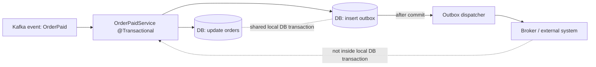
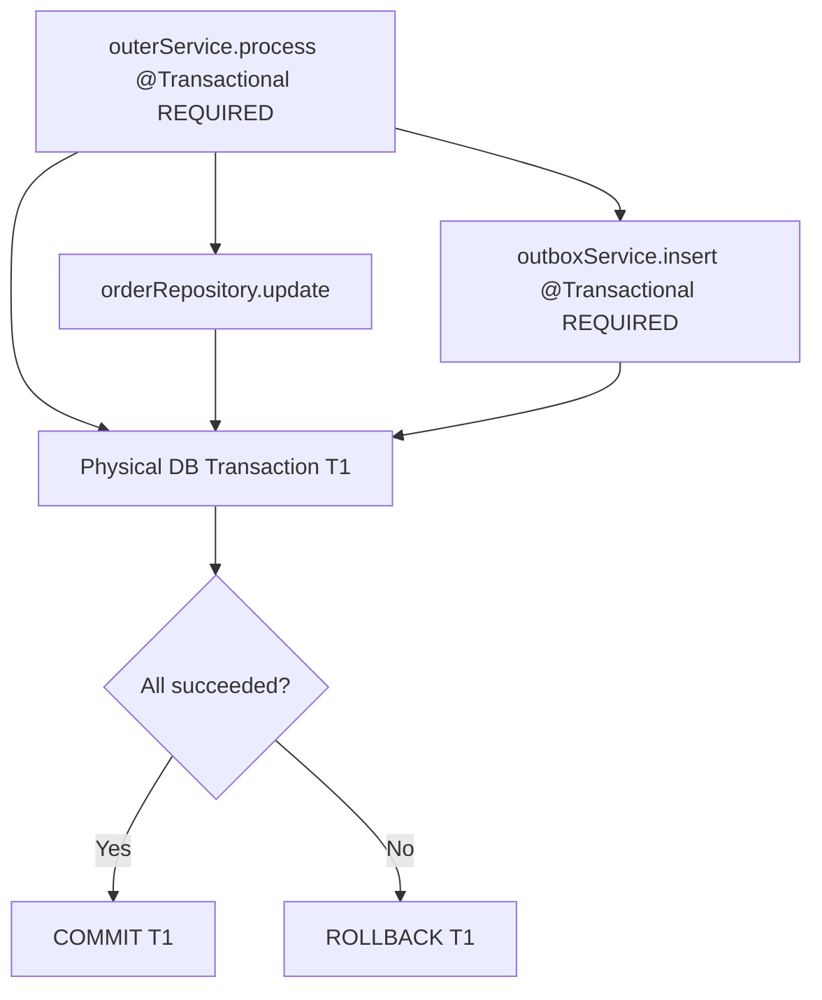

# `@Transactional`, Propagation, and Isolation

## 1. Context: Why Are Transactions Critical in Spring Boot Integration?

A Spring Boot service may read from PostgreSQL, update an order, write an outbox record, call an ERP over HTTP, evict a Redis cache, and acknowledge a Kafka/RabbitMQ message within the same business flow. If a step fails, the critical question is not just “is an exception thrown?”, but also **which operations committed, which rolled back, and which systems may have already received side effects**.

In the **`SPRING_BOOT_INTEGRATION`** module, transactions are foundational for structuring integrations across HTTP clients, databases, caches, message brokers, and Spring Integration adapters. They relate directly to **connection configuration, data contracts, error handling, transactions, duplicate handling, testing, and observability**. `@Transactional` helps define a transaction boundary in Spring; **propagation** determines whether a call joins or creates a transaction; **isolation** determines the isolation level when concurrent transactions access the same data.

Running example: a consumer receives an `OrderPaid` event, updates the order status in the database, and writes a `ShipmentRequested` event into an outbox. If the order update succeeds but the outbox insert fails, both operations must roll back. Only after commit does a separate worker send `ShipmentRequested` to the broker; the event may be redelivered, so idempotency is needed. We will explain why transactions help with the **same database** part but do not automatically solve the **cross-system** part.

By the end of this lesson, you will be able to:

- Explain how `@Transactional` controls transactions via Spring AOP and `PlatformTransactionManager`.
- Distinguish the seven propagation modes and choose `REQUIRED`, `REQUIRES_NEW`, or `NESTED` in appropriate scenarios.
- Analyze dirty read, non-repeatable read, phantom read, lost update, and the role of isolation levels.
- Identify self-invocation bugs, rollback-only, `UnexpectedRollbackException`, long transactions, and using the wrong transaction manager.
- Design short, idempotent transactions combined with outbox/reconciliation for HTTP, databases, caches, and brokers.
- Test real commit/rollback effects and concurrency behavior against the database in use.

## 2. What Do Transactions Manage and What Do They Not?

A database transaction aims for the **ACID** properties:

| Property | Meaning | Example |
|---|---|---|
| **Atomicity** | A group of changes commits or rolls back together. | Updating an order and inserting an outbox row in the same database. |
| **Consistency** | A transaction moves data between states that satisfy designed constraints. | Not violating `UNIQUE`, `FOREIGN KEY`, or controlled business invariants. |
| **Isolation** | Concurrent transactions observe and affect each other according to the isolation level. | Two consumers simultaneously trying to transition an order's status. |
| **Durability** | Committed changes are persisted according to the database's guarantees. | An updated order remains present after an application restart. |

`@Transactional` is a **declarative transaction boundary** on a Spring-intercepted call. It does not automatically provide ACID across every system the method calls. A local database transaction cannot roll back an HTTP request already sent to an ERP or a message already published to a broker. Even two independent `DataSource`s do not automatically share a transaction just because they sit inside one annotated method.



The goal is to know the **guaranteed boundary** of a transaction; anything outside that boundary must be managed with distributed mechanisms such as outbox, idempotency, intermediate states, or reconciliation.

## 3. Which Components Does Spring Use to Coordinate Transactions?

Spring provides the **`PlatformTransactionManager`** abstraction for imperative transactions. The framework uses a transaction interceptor to begin/join a transaction before invoking a method, then commit or roll back depending on the outcome. Underneath lie concrete resources and transaction mechanisms:

| Component | Role | Common Use Case |
|---|---|---|
| `DataSource` | Supplies JDBC connections. | Spring JDBC, `JdbcClient`, jOOQ over JDBC. |
| `JdbcTransactionManager`/`DataSourceTransactionManager` | Coordinates a local JDBC transaction on a single datasource. | Multiple `JdbcTemplate`/`JdbcClient` operations. |
| `JpaTransactionManager` | Coordinates JPA transactions; can coordinate JDBC on a compatible datasource when configured properly. | Spring Data JPA/Hibernate. |
| `JtaTransactionManager` | Integrates a JTA coordinator when the system has appropriate distributed transaction infrastructure. | Certain XA/2PC cases. |
| `TransactionInterceptor` | Applies propagation, isolation, timeout, and rollback rules. | Proxy-intercepted method calls. |
| `TransactionSynchronizationManager` | Binds transaction resources and state to the imperative execution context, usually the current thread. | Reusing a connection within the same local transaction. |

In Spring Boot, transaction infrastructure is typically auto-configured when the classpath, datasource/JPA provider, and required beans are present. Do not add a new `PlatformTransactionManager` simply because you hit a rollback bug; check **which bean is being selected**, which datasource it manages, and the configuration report for your actual Boot version.

Example dependency for Spring JDBC in a Spring Boot application:

```kotlin
dependencies {
    implementation("org.springframework.boot:spring-boot-starter-jdbc")
    runtimeOnly("org.postgresql:postgresql")
}
```

If the project uses Spring Data JPA, the JPA starter and `JpaTransactionManager` may be configured instead of a JDBC transaction manager. Examples in this lesson target **Spring Framework 6+/Spring Boot 3+**; core transaction APIs exist across versions, though how Boot creates or selects specific beans depends on version and configuration. When multiple transaction managers exist, you can specify a bean explicitly:

```java
@Transactional(transactionManager = "ordersTransactionManager")
public void updateOrders() {
    // Accesses the data source managed by ordersTransactionManager.
}
```

The name `ordersTransactionManager` is illustrative; that bean must actually be declared by the application. **Avoid assuming** that selecting a transaction manager by name means every datasource/remote service is managed in the same transaction.

## 4. How Is `@Transactional` Applied?

A common declaration:

```java
import org.springframework.stereotype.Service;
import org.springframework.transaction.annotation.Isolation;
import org.springframework.transaction.annotation.Propagation;
import org.springframework.transaction.annotation.Transactional;

@Service
public class OrderService {

    @Transactional(
        propagation = Propagation.REQUIRED,
        isolation = Isolation.READ_COMMITTED,
        timeout = 5
    )
    public void processOrder(long orderId) {
        // DB operations managed by a single transaction manager.
    }
}
```

Key attributes:

| Attribute | Meaning | Notes |
|---|---|---|
| `propagation` | Join, create, suspend, or require a transaction. | Defaults to `REQUIRED`. |
| `isolation` | Isolation level applied when starting a new physical transaction. | Defaults to `DEFAULT`, following database/manager. |
| `timeout` | Transaction deadline (in seconds). | Not a timeout for the entire HTTP + broker flow. |
| `readOnly` | Read-only hint for the transaction and supporting infrastructure layers. | Not a strict authorization mechanism. |
| `rollbackFor` | Additional exception types that should trigger rollback. | Useful for checked exceptions. |
| `noRollbackFor` | Exceptions that will not cause the interceptor to roll back under this rule. | Use cautiously, especially with integrity errors. |
| `transactionManager` | Name/qualifier of the selected transaction manager. | Important when multiple databases exist. |

Typically `@Transactional` is placed on a **public service method** representing a unit of business work, rather than sprinkled unconditionally on every repository method. It can be placed on a class to apply defaults to eligible methods and overridden per method; however, review applicability and proxy behavior carefully for your Spring version.

### 4.1. Proxies, Self-Invocation, and Bean Lifecycle

In the default proxy-based mode, calls must pass **through the Spring proxy** to be wrapped by the transaction interceptor. The following two situations differ:

```java
@Service
class ReportService {

    public void run() {
        saveReport(); // this.saveReport(): usually does NOT pass through the transactional proxy.
    }

    @Transactional
    public void saveReport() {
        // When only called internally like above, the annotation may have no effect.
    }
}
```

A clean solution is to move `saveReport()` to **another Spring bean** and invoke it through that bean, or place the transaction on `run()` if all steps need the same transaction. `@Transactional` on `private` methods, calls from constructors/`@PostConstruct`, or methods that cannot be intercepted by the proxy should also not be expected to work. Support for `protected`/package-private and `final` methods depends on the proxy/interface/configuration of your Spring version; a `public` method on an injected bean is the most predictable approach.

**Do not equate a direct Java call with a proxy call.** If a method is invoked via `new OrderService()` instead of retrieving the bean from the Spring context, the annotation will not automatically create a transaction. Calling an `@Transactional` method on another bean via DI routes through the normal interception mechanism.

### 4.2. Transactions Are Bound to Execution Context

With standard imperative transaction infrastructure, Spring binds transaction resources to the **current thread**. Spawning a new thread, running `@Async`, or offloading work to an executor does not automatically carry the caller's transaction to the new thread. An `@Async @Transactional` method may start its own transaction on the thread executing that method if proxy/interception applies, but that does not mean it joins the original thread's transaction.

With **R2DBC/WebFlux**, Spring uses the reactive transaction model and Reactor Context, typically with `ReactiveTransactionManager`/`TransactionalOperator`. Do not extrapolate JDBC thread-bound rules to reactive pipelines, and do not invoke blocking JDBC inside an event loop just because it is called from a method returning `Mono`.

## 5. When Does Rollback Happen?

By default, Spring's transaction interceptor rolls back when a method exits with a **`RuntimeException` or `Error`**; checked exceptions typically **do not** trigger rollback unless configured otherwise. This is a Spring rule, not a mandatory database rule for every error type.

```java
@Transactional
public void acceptOrder(OrderCommand command) {
    orderRepository.insert(command);
    if (!command.isValid()) {
        throw new IllegalArgumentException("Invalid order");
    }
    // IllegalArgumentException is unchecked -> rolls back by default.
}
```

If a step throws a checked exception indicating the whole operation must be aborted:

```java
@Transactional(rollbackFor = PartnerValidationException.class)
public void importOrder(OrderCommand command)
        throws PartnerValidationException {
    orderRepository.insert(command);
    partnerValidator.validate(command); // May throw checked exception.
}
```

`PartnerValidationException` here is an application-defined checked exception. If logic catches the exception and **does not rethrow it**, the interceptor may view the method as having succeeded and commit, unless the transaction was already marked rollback-only or code explicitly triggers rollback via the appropriate mechanism.

```java
@Transactional
public void riskyWork() {
    try {
        repository.insertSomething();
    } catch (RuntimeException ex) {
        log.warn("Insert failed", ex);
        // Without rethrowing, the outer interceptor may attempt to commit.
        // Some DB errors leave the transaction itself unable to commit.
    }
}
```

Swallowing an error to keep using a transaction after a database error (such as a statement error in PostgreSQL) often causes subsequent errors. You must explicitly decide whether error handling means **legitimately ignoring per business rules**, **rolling back the whole transaction**, or **starting an independent transaction**; do not wrap with `catch (Exception)` and assume everything remains safe.

### 5.1. Why Do We Encounter `UnexpectedRollbackException`?

An inner call with `Propagation.REQUIRED` joins the existing transaction. If the inner call's interceptor marks the transaction **rollback-only**, the outer method might catch the exception and continue. However, when the outer method tries to commit, Spring must roll back the transaction and may throw `UnexpectedRollbackException`, because the caller must not be misled into thinking the commit succeeded.

```java
@Transactional
public void outer() {
    try {
        innerService.savePart(); // @Transactional(REQUIRED), throws unchecked exception.
    } catch (RuntimeException ex) {
        log.warn("Attempt failed", ex);
    }
    // May throw UnexpectedRollbackException when outer attempts to commit.
}
```

This is not a bug where “Spring failed to roll back properly,” but the consequence of **two logical transaction scopes sharing one physical transaction**. When a failing branch should not roll back all other work, you must re-evaluate the boundary, handle validation before writing, or intentionally use `REQUIRES_NEW`/savepoints.

## 6. Propagation: Which Transaction Does This Call Use?

Spring defines several propagation levels to determine behavior when a method is invoked inside or outside an existing transaction:

| Propagation | When a Transaction Already Exists | When No Transaction Exists | When to Use? |
|---|---|---|---|
| `REQUIRED` | Joins the current transaction. | Creates a new transaction. | Most data-writing service methods. |
| `REQUIRES_NEW` | Suspends the current transaction, creates an independent transaction. | Creates a new transaction. | Saving audit/status that must commit independently. |
| `NESTED` | Creates a nested scope using a savepoint if supported by the manager. | Acts like `REQUIRED`, creates a new transaction. | Partial rollback within the same JDBC physical transaction. |
| `SUPPORTS` | Joins if one exists. | Executes without a transaction. | Contextual read operations where transactions are optional. |
| `MANDATORY` | Joins the current transaction. | Throws an error. | Enforcing that the caller owns the business transaction. |
| `NOT_SUPPORTED` | Suspends the current transaction. | Executes without a transaction. | Work that should not run inside the caller's transaction. |
| `NEVER` | Throws an error. | Executes without a transaction. | Ensuring an operation is never called inside a transaction. |

Propagation levels describe the **relationship between intercepted calls**; they do not replace isolation, row locks, or cross-system consistency guarantees. `NESTED` also depends on savepoint support from the transaction manager/database; it cannot be universally applied to every JPA transaction.

### 6.1. `REQUIRED`: Usually the Right Default

With `REQUIRED`, two service methods called in sequence can share the **same physical transaction** and the same connection bound by the corresponding manager:



Each annotation creates a **logical transaction scope** with its own rollback rules, yet those scopes share the same physical transaction when participating via `REQUIRED`. Thus, a failure in an inner call can prevent the whole transaction from committing.

### 6.2. `REQUIRES_NEW`: Independent Commit/Rollback

```java
@Service
public class AuditService {

    private final AuditRepository auditRepository;

    public AuditService(AuditRepository auditRepository) {
        this.auditRepository = auditRepository;
    }

    @Transactional(propagation = Propagation.REQUIRES_NEW)
    public void recordFailure(String requestId, String reason) {
        auditRepository.insertFailure(requestId, reason);
    }
}
```

When `recordFailure()` is called **through another bean** from a method already in a transaction, Spring suspends the outer transaction and starts a new transaction. If audit commits successfully and then outer rolls back, the audit record can still persist. If audit rolls back, it does not automatically roll back outer unless the outer exception/logic decides so.

**Resource warning:** the outer transaction may still hold a connection while the `REQUIRES_NEW` transaction requests an additional connection. If many concurrent requests do this, the connection pool must be large enough to avoid deadlock caused by threads holding outer connections while waiting for connections for new transactions. When independence is not required, do not use `REQUIRES_NEW` just to dodge an exception.

For auditing, distinguish **data that must commit alongside the business action** from **error logs that must persist even if the business action rolls back**. The former typically uses `REQUIRED`; the latter can consider `REQUIRES_NEW` or another reliable logging/auditing mechanism as required.

### 6.3. `NESTED`: Savepoint Within the Same Physical Transaction

`NESTED` creates a state-saving boundary (savepoint) inside the existing transaction when supported by `PlatformTransactionManager` and the JDBC driver. A failing nested scope can roll back to the savepoint while the outer transaction continues. However, an **outer rollback still cancels all changes, including completed nested scopes**.

```text
BEGIN T1
  UPDATE order ...
  SAVEPOINT sp1
    INSERT optional_detail ...
    -- Error in optional_detail
  ROLLBACK TO SAVEPOINT sp1
  INSERT outbox_event ...
COMMIT T1
```

Unlike `REQUIRES_NEW`, `NESTED` **does not create an independently committing physical transaction**. With `DataSourceTransactionManager` and a savepoint-capable database, this model often fits well. With JPA/Hibernate, nested capability is not supported by default for entity/persistence context state, even if some managers support JDBC-connection savepoints. Verify against your specific manager; do not assume `NESTED` works in every Spring Data JPA application.

### 6.4. `SUPPORTS`, `MANDATORY`, `NOT_SUPPORTED`, `NEVER`

These options express the **contract of a method**:

- `SUPPORTS` is useful for operations that can run inside or outside a transaction, though a sequence of non-transactional reads may still observe data changing between statements.
- `MANDATORY` forces the caller to establish a transaction beforehand; if none exists, Spring throws an exception due to unsatisfied propagation.
- `NOT_SUPPORTED` suspends the current transaction to run a block of code non-transactionally. This does not mean Spring makes side effects in that block safe or rollbackable.
- `NEVER` is suitable for operations that must be rejected if accidentally called within a transaction. It differs from `NOT_SUPPORTED` because it does not silently suspend and continue.

## 7. Isolation: Concurrent Transactions Reading/Writing Data

Propagation decides which transaction is used; **isolation** decides how much concurrent transactions can see of one another's effects. Key phenomena to distinguish:

| Phenomenon | Scenario |
|---|---|
| **Dirty read** | T2 reads data T1 modified but has **not committed yet**, and then T1 rolls back. |
| **Non-repeatable read** | T2 re-reads the same row within one transaction and sees a different value because T1 committed a change. |
| **Phantom read** | T2 re-runs a conditional query and sees a changed set of rows due to another transaction's insert/delete. |
| **Lost update** | Two transactions base writes on a read value; the later write overwrites the earlier one without detecting a conflict. |
| **Write skew** | Two transactions read the same overall constraint and then modify different rows, violating a business invariant even though they did not write the same row. |

In standard SQL, isolation levels are typically presented as follows:

| Isolation | Dirty Read | Non-Repeatable Read | Phantom Read | Notes |
|---|---|---|---|---|
| `READ_UNCOMMITTED` | Possible | Possible | Possible | Some DBs promote this level to `READ_COMMITTED`. |
| `READ_COMMITTED` | Prevented | Possible | Possible | Each statement may observe newly committed data. |
| `REPEATABLE_READ` | Prevented | Prevented | Possible at minimum SQL standard level | Many MVCC engines also prevent phantoms within a snapshot. |
| `SERIALIZABLE` | Prevented | Prevented | Prevented | Outcome is equivalent to a valid serial execution order; may require retry on conflicts. |

**This is a conceptual matrix and does not replace database specifications.** PostgreSQL implements `READ_UNCOMMITTED` as `READ_COMMITTED`; PostgreSQL's `REPEATABLE_READ` uses a stable snapshot and thus also prevents many phantom phenomena, yet **does not** prevent all serialization anomalies. InnoDB/MySQL, PostgreSQL, Oracle, and SQL Server have different snapshot behaviors, locking, and defaults. Always check the actual database/driver and test concurrent transactions.

Declaring isolation in Spring:

```java
@Transactional(isolation = Isolation.READ_COMMITTED)
public void processPaymentEvent(String eventId) {
    // SQL operations belonging to a newly created transaction here
    // use the supported/configured isolation level.
}
```

`Isolation.DEFAULT` means using the database/transaction manager default. For a method **joining an existing transaction** via `REQUIRED`, a new isolation attribute usually **does not change the isolation of the running physical transaction**. If a specific isolation level is mandatory, design the boundary at the caller and consider enabling transaction manager validation to detect mismatched expectations rather than trusting an inner method annotation to upgrade isolation.

### 7.1. Example: Non-Repeatable Read

```text
T1 (READ COMMITTED)           T2
-------------------------    -----------------------
BEGIN
SELECT status = 'PENDING'
                             UPDATE order SET status='PAID'
                             COMMIT
SELECT status = 'PAID'
COMMIT
```

With `READ_COMMITTED`, T1 can read two different values because the two `SELECT` statements run at different points in time. If the business logic needs a stable snapshot, use an appropriate isolation level, explicit locking, or atomic operation design. Do not blindly upgrade the entire system to `SERIALIZABLE` to fix one query: lock overhead, conflicts, and retries can increase significantly.

### 7.2. Example: Lost Update Despite Using a Transaction

```text
T1 reads stock = 10
T2 reads stock = 10
T1 writes stock = 9, COMMIT
T2 writes stock = 9, COMMIT
```

If two orders each purchase one item, the correct stock should be **8**. One defensive approach is an atomic DB update:

```sql
UPDATE inventory
SET available = available - :quantity
WHERE sku = :sku
  AND available >= :quantity;
```

Then check `rowsUpdated == 1`. The database must enforce the condition with proper concurrency control. With optimistic locking, include a `version` column in `WHERE`, increment version on update, and handle `0` affected rows with bounded retry or state re-read.

### 7.3. Example: Write Skew and Multi-Row Invariants

Suppose a shift must always have at least one doctor on duty. Two transactions both read that doctors A and B are on duty; T1 takes A off duty, and T2 takes B off duty. Because each transaction only writes a different row, a mechanism checking only write conflicts on **the same row** may miss that the overall invariant was broken. Depending on DB/isolation level, you may need `SERIALIZABLE` with retry, locking an entity representing the shift, or a different data model/constraint protecting the invariant.

## 8. Isolation Does Not Replace Locks, Constraints, and Idempotency

Choosing isolation is only part of a concurrency strategy, not all of it. In systems receiving duplicate events and running multiple workers, you often need to combine:

| Mechanism | What Does It Protect? | Example |
|---|---|---|
| **Unique constraint** | Prevents two rows from sharing the same business key. | `UNIQUE(source_system, external_event_id)`. |
| **Conditional update** | Transitions state only if the condition still holds. | `WHERE status = 'PENDING'`. |
| **Optimistic locking** | Detects whether the record changed since it was read. | `UPDATE ... WHERE version = :oldVersion`. |
| **Pessimistic locking** | Locks rows on demand within a transaction. | `SELECT ... FOR UPDATE` depending on database. |
| **Isolation level** | Controls visibility/conflicts between transactions. | `READ_COMMITTED`, `SERIALIZABLE`. |
| **Idempotency key** | Identifies repetition of the same request/event. | Event ID stored under a unique key. |

Example of transitioning an order only once:

```sql
UPDATE orders
SET status = 'PAID', updated_at = CURRENT_TIMESTAMP
WHERE id = :id AND status = 'PENDING';
```

If it returns `1`, the transaction just transitioned the state. If it returns `0`, the state was already different or the order does not exist. The consumer needs to read the current state or check the business key to distinguish a **valid duplicate event**, an **out-of-order event**, and **non-existent data**. Getting `0` from `UPDATE` **does not by itself prove** this is a duplicate event with identical content.

## 9. Complete Example: Updating Order and Writing Outbox in One Transaction

Suppose the application receives an `OrderPaid` message from a broker. Requirements:

1. Each `eventId` must be processed once in business terms; if the message is redelivered, do not create a duplicate outbox row.
2. Only transition the order from `PENDING` to `PAID`.
3. Writing the order status and creating the outbox row must be **atomic** within the same database.
4. Do not publish to the broker or call the ERP inside the database transaction.

Illustrative **PostgreSQL** migration:

```sql
CREATE TABLE orders (
    id BIGINT PRIMARY KEY,
    status VARCHAR(30) NOT NULL,
    updated_at TIMESTAMPTZ NOT NULL DEFAULT CURRENT_TIMESTAMP
);

CREATE TABLE consumed_event (
    event_id VARCHAR(100) PRIMARY KEY,
    payload_hash CHAR(64) NOT NULL,
    received_at TIMESTAMPTZ NOT NULL DEFAULT CURRENT_TIMESTAMP
);

CREATE TABLE outbox_event (
    event_id VARCHAR(100) PRIMARY KEY,
    aggregate_id BIGINT NOT NULL,
    event_type VARCHAR(60) NOT NULL,
    payload TEXT NOT NULL,
    published_at TIMESTAMPTZ NULL
);
```

Example service using `JdbcClient` (Spring Framework 6.1+), assuming a suitable JDBC bean exists and inputs are validated:

```java
import org.springframework.jdbc.core.simple.JdbcClient;
import org.springframework.stereotype.Service;
import org.springframework.transaction.annotation.Transactional;

@Service
public class OrderPaidHandler {

    private final JdbcClient jdbc;

    public OrderPaidHandler(JdbcClient jdbc) {
        this.jdbc = jdbc;
    }

    @Transactional
    public boolean handle(String eventId, String payloadHash,
                          long orderId, String outboxPayload) {

        int reserved = jdbc.sql("""
                INSERT INTO consumed_event(event_id, payload_hash)
                VALUES (:eventId, :payloadHash)
                ON CONFLICT (event_id) DO NOTHING
                """)
            .param("eventId", eventId)
            .param("payloadHash", payloadHash)
            .update();

        if (reserved == 0) {
            String recordedHash = jdbc.sql("""
                    SELECT payload_hash FROM consumed_event
                    WHERE event_id = :eventId
                    """)
                .param("eventId", eventId)
                .query(String.class)
                .single();

            if (!recordedHash.equals(payloadHash)) {
                throw new IllegalStateException("Event ID reused with different payload");
            }
            return false; // Message with identical content already processed previously.
        }

        int changed = jdbc.sql("""
                UPDATE orders
                SET status = 'PAID', updated_at = CURRENT_TIMESTAMP
                WHERE id = :orderId AND status = 'PENDING'
                """)
            .param("orderId", orderId)
            .update();

        if (changed != 1) {
            throw new IllegalStateException("Order not found or wrong state");
        }

        jdbc.sql("""
                INSERT INTO outbox_event(event_id, aggregate_id, event_type, payload)
                VALUES (:eventId, :orderId, 'ShipmentRequested', :payload)
                """)
            .param("eventId", eventId)
            .param("orderId", orderId)
            .param("payload", outboxPayload)
            .update();

        return true;
    }
}
```

**Transaction significance:** if `UPDATE orders` or `INSERT outbox_event` fails with an unchecked exception, the `consumed_event` row also rolls back. If processing succeeds and the broker redelivers the same `eventId`, the unique constraint causes the `reserved == 0` branch to avoid new side effects. Checking `payloadHash` detects cases where the same ID carries different data.

The sample code uses PostgreSQL's `ON CONFLICT`; MySQL/SQL Server have different syntax. The hash must be computed over a canonicalized payload per contract to avoid mistakenly treating two different serializations of the same event as different content. In production, you also need to control schema migrations, invalid states, transaction timeouts, DB permissions, and outbox lifecycle.

A separate dispatcher reads committed outbox rows, publishes to Kafka/RabbitMQ or calls an API, and then updates `published_at`/status. If publishing succeeds before the row is marked published, the dispatcher may resend: the receiver needs an **idempotent consumer**. Outbox typically yields **at-least-once delivery**; an internal transaction does not make the entire chain between DB and external systems exactly-once.

## 10. Transactions with HTTP/SOAP, Caches, and Brokers

In distributed systems, a timeout can occur **after the receiver has committed** but before the caller receives the response. Spring's rollback mechanism on the caller's database cannot infer remote state:

```mermaid
sequenceDiagram
    participant A as Spring Boot
    participant DB as Database
    participant ERP as ERP over HTTP
    A->>DB: BEGIN + write PENDING
    DB-->>A: OK
    A->>ERP: CreateOrder(requestId=42)
    ERP->>ERP: Commit order
    ERP--xA: Lost response / timeout
    A->>DB: ROLLBACK local DB
    Note over A,ERP: ERP may already have the order; local rollback does not cancel ERP order
```

Therefore, do not place an order-creation call to the ERP inside a long DB transaction expecting an HTTP exception to undo everything. Typical options:

- **Transactional outbox:** write DB changes and the outbound event in the same transaction, delivering after commit.
- **Idempotency key:** send the same request key on retry if the partner supports it, storing the corresponding result to avoid duplicate side effects.
- **State reconciliation:** query the command by business key/request ID when a previous call timed out with an unknown outcome.
- **Saga/compensation:** describe steps and compensating actions when coordinating multiple systems; compensation is a new business action rather than an ACID rollback.

### 10.1. Redis/Cache Is Not Inside the DB Transaction

Evicting the cache before the DB transaction commits can cause another request to read stale data and repopulate the cache prematurely. Evicting the cache after commit can fail, leaving the cache stale. Design TTLs, versioned keys, event-driven invalidation, or suitable retry mechanisms. `@TransactionalEventListener(phase = AFTER_COMMIT)` can help run an *in-process* callback after commit, but does not guarantee durable delivery if the app crashes right after commit. For notifications that **must not be lost**, prefer an outbox or durable queue.

### 10.2. Kafka/RabbitMQ Ack, Transactions, and Retries

Reading a message, processing the DB, and then committing the offset/ack is a common consumer pattern, yet a gap still exists: **DB commits successfully, ack fails**, causing redelivery. Idempotent writes and unique business keys address this scenario.

A Kafka or broker transaction manager can provide transactions within **that broker's mechanism**; coordinating with a DB transaction is a separate problem. Do not conclude that a local JDBC `@Transactional` makes Kafka offset commit, RabbitMQ ack, and PostgreSQL writes simultaneously atomic. If using a specific transaction synchronization policy, understand the commit order, partial-commit failure cases (one commits, one fails), and recovery plans.

## 11. Multiple DataSources, XA, and Transaction Managers

A Spring Boot application may write to an internal PostgreSQL DB, read from a partner's SQL Server, and maintain a separate database for Spring Batch metadata. Each database can have its own `DataSource` and transaction manager. Consider a method:

```java
@Transactional("ordersTransactionManager")
public void transfer() {
    ordersRepository.updateLocal();
    partnerRepository.updateRemoteDb();
}
```

You **cannot** assume `partnerRepository` participates in `ordersTransactionManager`'s transaction if it uses a different `DataSource`. Coordinating atomically across resources may require XA/JTA infrastructure with resources supporting the same coordinator, which adds complexity and operational overhead and still does not cover a typical HTTP API.

In many integration workflows, a more practical approach is identifying the **source of truth**, writing local state/outbox in one transaction, and advancing to other systems with idempotency, reconciliation, and compensation. When Spring Batch runs chunk transactions, the same holds true: committing a DB chunk does not automatically roll back an HTTP call or an already published message.

If multiple `PlatformTransactionManager` beans exist, specify the name explicitly on `@Transactional` or organize default configuration intentionally. Tests must verify that each repository is bound to the expected datasource; compiling code and having beans present does not prove transactions cover the right resources.

## 12. Transaction Timeout, `readOnly`, and Connection Pool Performance

`@Transactional(timeout = 5)` declares a transaction time limit for supporting managers; it **does not guarantee** that every HTTP call, DNS lookup, lock wait, or non-DB block will be aborted after exactly 5 seconds. Each driver, framework, and database applies transaction/statement timeouts differently. You need separate limits for queries, connection acquisition, and outbound HTTP, along with an application-level end-to-end deadline.

```java
@Transactional(readOnly = true, isolation = Isolation.READ_COMMITTED)
public OrderView getOrder(long orderId) {
    return orderRepository.findById(orderId);
}
```

`readOnly = true` is an **optimization hint/setting** that the transaction manager/JPA provider/driver may use; it is not a guarantee that every `UPDATE` statement will be strictly blocked. If a `readOnly` method joins an existing write transaction, this attribute may not alter the existing physical transaction. With JPA, flush behavior and read-only optimization also depend on the provider.

### 12.1. Do Not Hold Connections While Waiting on Remote Calls

If an `@Transactional` method reads from the DB, calls the ERP for 3 seconds, and then updates the DB, it can hold connections and locks longer than necessary. When 100 concurrent requests do this, the Hikari pool can be exhausted even though the SQL takes only a few milliseconds. A better structure is usually:

```text
Short Transaction 1: write PENDING status + outbox
COMMIT
        ↓
Worker with dedicated timeout/bulkhead: call ERP
        ↓
Short Transaction 2: record outcome / reconcile status
COMMIT
```

Splitting transactions must be grounded in business logic: if a group of SQL statements truly requires atomicity, keep them in the same transaction. The aim is to **shorten database resource hold times** without sacrificing correctness.

`REQUIRES_NEW` may request an extra connection while the outer transaction still holds one. Pool size, worker count, concurrency, isolation, and lock timeouts must be sized together. Do not raise pool size indefinitely as pending requests climb: inspect transaction duration, slow queries, remote calls inside transactions, and database connection quotas.

## 13. `@Transactional` in Spring Integration, Spring Batch, and Async Flows

Spring Integration includes `DirectChannel`, `ExecutorChannel`, pollers, HTTP/JDBC/JMS/AMQP adapters, and various message-processing patterns. In a **synchronous same-thread** flow, calls through a bean proxy can join an active transaction if the resource and manager match. When crossing an executor or queue, the boundary changes and the caller's transaction is usually **not propagated automatically to the worker**.

In Spring Batch, a chunk-oriented Step usually already has a framework-managed transaction. An `@Transactional(REQUIRED)` service called within a chunk can join that transaction; arbitrarily using `REQUIRES_NEW` per item creates independent commits and can break chunk rollback/restart assumptions. Inspect the transaction manager used by the Step and the reader/writer/checkpoint mechanics.

For message consumers, clarify **when ack occurs** relative to DB commit. For `@Async` flows, webhooks, or scheduled tasks, establish transaction boundaries at the worker entry point and bound worker concurrency to avoid exhausting the pool. Do not rely on an annotation on the initial HTTP thread to protect work executed on another thread.

## 14. Choosing Propagation and Isolation by Scenario

| Scenario | Propagation to Consider | Isolation / Extra Controls | Rationale |
|---|---|---|---|
| Update order + insert outbox in same DB | `REQUIRED` | Default or `READ_COMMITTED` per DB; unique key | Both operations must commit/roll back together. |
| Save failure audit that must persist even if business logic rolls back | `REQUIRES_NEW` | Pool sized for extra connections; independent audit data | Audit has its own commit. |
| Save optional data that can roll back separately within same JDBC transaction | `NESTED` if supported | Savepoint, verified with real manager | Drops only the optional part without independent commit. |
| Repository method that must only be called within an existing business transaction | `MANDATORY` | Verify caller actually holds a transaction | Enforces boundary owned by the application service. |
| Simple dashboard query without needing a multi-statement snapshot | `SUPPORTS` or `readOnly REQUIRED` | Distinguish screen consistency requirements | May avoid holding a long transaction. |
| Remote task that must not run inside a long DB transaction | `NOT_SUPPORTED` or split workflow | Timeout, idempotency, state machine | Prevents holding DB resources across remote calls. |
| Concurrent inventory adjustment | `REQUIRED` | Atomic conditional update, version/lock, suitable isolation | Prevents lost updates/negative stock. |
| Multi-row invariant check under concurrency | `REQUIRED` | Locks/constraints or `SERIALIZABLE` + retry | Prevents write skew per specific database. |

These are **decision guidelines**, not fixed recipes. The effective isolation of a transaction depends on the database, access pattern, and existing active transactions. Changing isolation levels should always be paired with concurrency tests and throughput/lock-contention evaluation.

## 15. Properly Testing Propagation, Rollback, and Isolation

Unit tests with mocked repositories can verify business logic flow, but **do not prove** that proxies, rollbacks, transaction managers, isolation, or locking actually work. For those properties, write integration tests using a database close to production, such as Testcontainers PostgreSQL for a PostgreSQL-backed system.

Minimum scenarios:

1. **Atomicity:** insert order + outbox, intentionally throw an exception on `INSERT outbox`, verify neither commits.
2. **Checked exception:** test the difference between default behavior and `rollbackFor` with a domain-defined exception.
3. **Self-invocation:** call through the bean proxy vs. internal call, demonstrating how the actual boundary differs.
4. **`REQUIRED` rollback-only:** inner marks rollback-only, outer catches the exception; verify commit is rejected with `UnexpectedRollbackException` where applicable.
5. **`REQUIRES_NEW`:** inner commits audit, outer rolls back, verify audit still exists.
6. **`NESTED`:** roll back to savepoint while outer commits on a savepoint-capable database/manager; if unsupported, expect an explicit error.
7. **Concurrency:** run two independent transactions updating stock or handling duplicate events concurrently, verify unique keys/conditional updates protect invariants.
8. **Timeout/lock:** create controlled lock contention, observe timeout and actual exception type.
9. **Outbox:** DB commits while simulated publisher fails, rerun dispatcher; verify consumer does not process duplicate side effects.

### 15.1. Be Careful with `@Transactional` on Test Methods

Some Spring integration tests carry `@Transactional` and the framework rolls back the test transaction at the end. This is handy for test cleanup, but can hide **post-commit behavior**, `AFTER_COMMIT` events, or cause the service under test to join a pre-existing transaction unlike production. To verify real commits, omit the transaction on the test method or use `TransactionTemplate`/Spring Test `TestTransaction` intentionally.

### 15.2. Testing Isolation Requires Two Real Transactions

To demonstrate a non-repeatable read or lost update, you need at least **two independent execution contexts/connections** and coordinated read/write timing via barriers or latches. Two sequential calls in one transaction do not create concurrency. Avoid `Thread.sleep()` hoping to hit a race: tests should use deterministic synchronization, controlled timeouts, and proper cleanup.

## 16. Observing and Troubleshooting Transaction Issues

In production, useful signals include transaction duration, commit/rollback counts, connection acquisition wait time, slow queries, lock contention, deadlocks, serialization failures, and retry counts. For integration flows, also track correlation IDs, protected business keys, outbox status, redelivery counts, and outbound commands with unknown outcomes.

| Symptom | First Check | Resolution |
|---|---|---|
| DB contains data even though method threw a checked exception | Rollback rules, exception type, and where interceptor catches errors. | Declare `rollbackFor` or change error contract when rollback is truly needed. |
| Method has `@Transactional` yet each SQL auto-commits individually | Whether call went through proxy, self-invocation, transaction manager, and datasource. | Place boundary on an injected service, select the right manager. |
| `UnexpectedRollbackException` at end of method | Inner `REQUIRED` marked rollback-only and outer caught the error. | Redefine boundaries and error-handling policy. |
| `NESTED` fails to run | Manager/driver does not support savepoints for current resource. | Consider `REQUIRES_NEW`, alternative business handling, or appropriate JDBC transaction. |
| Different read results within one transaction | Effective isolation, pre-existing transaction before annotation, DB MVCC. | Choose proper isolation/locking per requirements and test empirically. |
| High Hikari pending count, hanging requests | Transaction holding connection across HTTP, slow SQL, or prolonged locks. | Shorten transactions, decouple remote calls, inspect queries/locks. |
| Duplicate orders in ERP after timeout | Local rollback mistaken for ERP rollback; non-idempotent retry. | Reconcile by request ID, idempotency, and outbox. |
| Event published yet DB rolled back | Published before local commit or separate transactions. | Write outbox in same DB transaction, publish after commit. |
| Serialization failures spike after isolation change | Contention/write skew detected by DB. | Retry entire DB transaction with backoff and idempotency; review hot rows. |

For deeper investigation, enable Spring transaction logging at an appropriate level in diagnostic environments, monitor SQL/slow queries on the DB, and observe pool metrics via Micrometer/Actuator. Avoid logging full SQL parameters containing account numbers, customer data, or tokens; metric labels must have low cardinality. A well-logged transaction error should identify the **transaction manager, operation, state, duration, and rollback kind**, without exposing sensitive business data.

## 17. Common Misconceptions

| Misconception | Reality |
|---|---|
| “Adding `@Transactional` automatically creates a transaction.” | Only takes effect when going through proper interception, with a properly configured transaction manager/resource. |
| “Every exception rolls back.” | Defaults to rolling back on unchecked exceptions and `Error`; checked exceptions need explicit rules. |
| “I caught the exception, so the transaction can still commit.” | An inner scope may have marked rollback-only; the DB may be in an aborted state. |
| “Both `REQUIRES_NEW` and `NESTED` commit independently.” | `REQUIRES_NEW` has its own transaction; `NESTED` uses a savepoint inside the existing physical transaction. |
| “Specifying isolation on an inner method upgrades the current level.” | Usually applies only when starting a new transaction; an existing transaction keeps its original isolation. |
| “`SERIALIZABLE` means concurrency errors never happen.” | The database may reject a transaction with a serialization failure; the app needs controlled retries. |
| “`readOnly = true` guarantees writes to the DB are impossible.” | It is an optimization hint dependent on provider/driver/database behavior. |
| “`@Transactional` covers Redis, HTTP, Kafka, and PostgreSQL together.” | A local transaction only manages its manager's resources; cross-system consistency needs separate mechanisms. |
| “Retrying after a timeout is always safe.” | Remote side effects may have committed; idempotency/reconciliation is required. |
| “An `@Transactional` test rolling back at the end is enough.” | It may miss testing real commits, `AFTER_COMMIT`, or multi-connection behavior. |

## 18. Transaction Design Checklist for Integration Services

- [ ] Know clearly which `DataSource`/`PlatformTransactionManager` each operation uses.
- [ ] Place `@Transactional` boundaries on service methods invoked through a Spring proxy.
- [ ] Use `REQUIRED` for changes that must commit together; use `REQUIRES_NEW` only when independent commit is truly required.
- [ ] Verify savepoint support before using `NESTED`, especially with JPA.
- [ ] Define rollback rules for unchecked and checked exceptions; never silently swallow errors after a DB failure.
- [ ] Choose isolation based on the database and business invariants; do not upgrade isolation blindly.
- [ ] Protect concurrency with unique keys, conditional updates, and optimistic/pessimistic locking as appropriate.
- [ ] Keep transactions short; do not hold connections/locks waiting on slow HTTP/ERP calls.
- [ ] Use outbox or an equivalent strategy for DB + broker; receivers must support idempotency.
- [ ] Specify how to handle timed-out requests with unknown external outcomes.
- [ ] Define message ack/offset commit timing and redelivery handling.
- [ ] With multiple data sources, never assume a single local annotation creates a distributed transaction.
- [ ] Test real commits/rollbacks, two concurrent transactions, restarts, and event replay.
- [ ] Monitor lock waits, slow transactions, pool pending counts, rollbacks, outbox backlog, and serialization failures.

## 19. Summary

**`@Transactional` defines the transaction boundary, propagation defines the relationship with any existing transaction, and isolation defines how data is observed when multiple transactions run concurrently.** `REQUIRED` fits most business writes; `REQUIRES_NEW` creates an independent transaction; `NESTED` uses savepoints when supported. `READ_COMMITTED`, `REPEATABLE_READ`, and `SERIALIZABLE` carry different trade-offs between consistency and concurrency.

In Spring Boot integration systems, transactions must be paired with **data constraints, idempotency, outbox, controlled retries, short transactions, and operational observability**. When data flows across HTTP, multiple databases, caches, or brokers, distinguish what is guaranteed to roll back from what requires reconciliation. Designing the right boundaries helps systems withstand failures, duplicate events, and concurrency without sacrificing business correctness.
