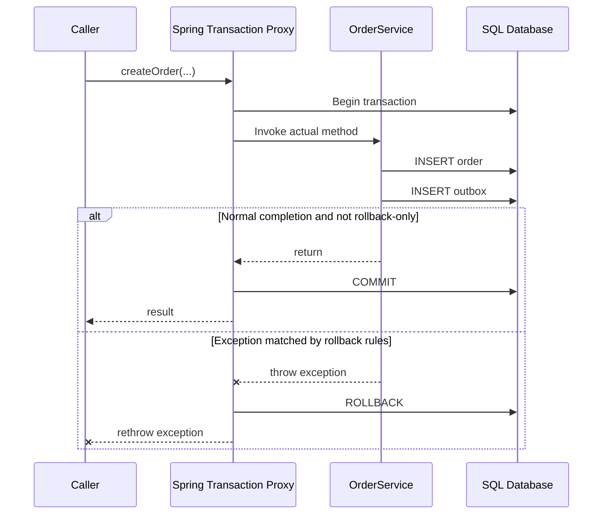
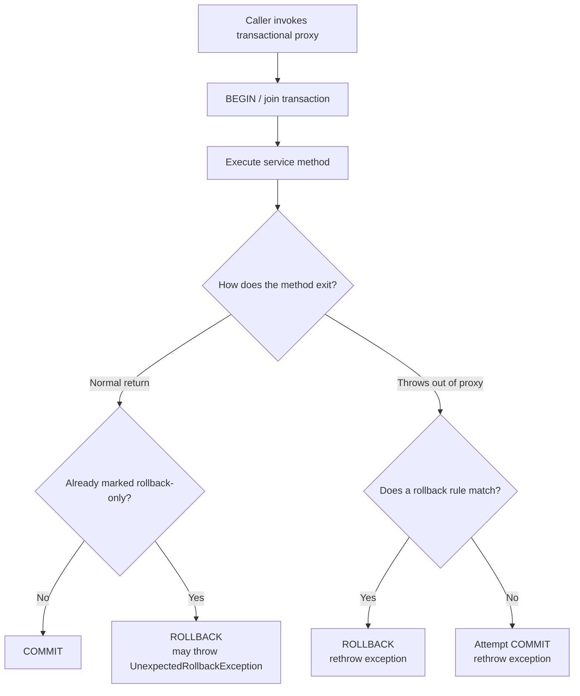
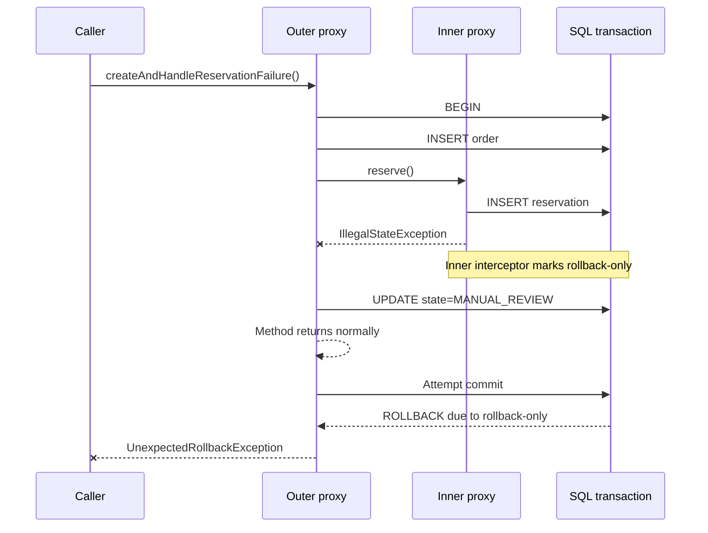
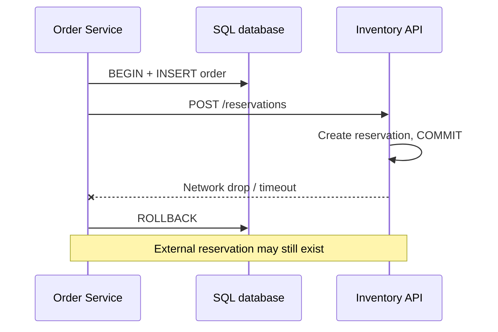
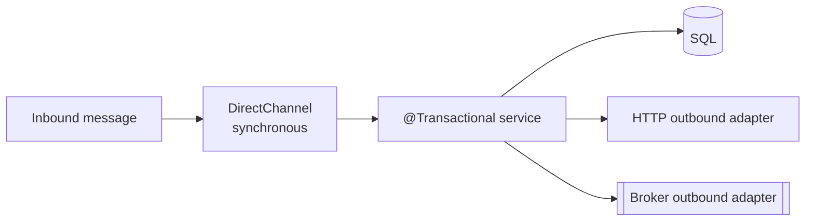
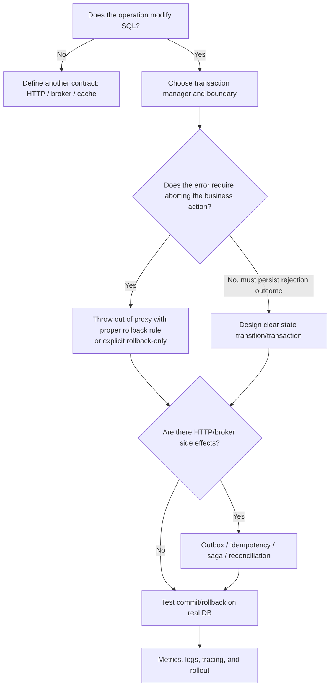

# Rollback by Exception Type and the Consequences of Catching Errors

In Spring Boot, `@Transactional` helps group data operations into **a single local transaction**: either all changes belonging to the transaction commit, or those changes roll back. However, a common misconception is thinking that **any exception causes Spring to roll back**. In reality, the default rollback decision depends on the **exception type** and whether that exception **passes through the transactional proxy boundary**.

Another equally dangerous misconception: a developer catches an exception in a `try/catch`, logs it, continues, and assumes the data rolled back automatically. If the exception is swallowed before exiting the `@Transactional` method, Spring may see the method complete normally and **commit unwanted changes**.

This lesson belongs to the **Integration Transactions** chapter of the **SPRING_BOOT_INTEGRATION** module. In systems integrating via HTTP clients, SQL, caches, message brokers, and Spring Integration adapters, understanding rollback boundaries is essential so you do not create invalid orders, emit events inconsistent with SQL data, or process duplicates after retries.

> **Scope:** The default rules describe Spring's typical transaction interceptor/proxy mechanism with Spring Framework 6.x and Spring Boot 3.x. Systems may alter rollback policies via global configuration, a custom transaction manager, or `rollbackFor`/`noRollbackFor`. More importantly, `@Transactional` **does not automatically create distributed transactions** spanning HTTP APIs, Redis, and brokers.

## 1. Learning Objectives

After this lesson, you will be able to:

1. Explain the default rollback rules for `RuntimeException`, `Error`, and checked exceptions.
2. Use `rollbackFor` and `noRollbackFor`, and distinguish configuring by **class** vs. by **exception name**.
3. Predict what happens when an exception is caught **inside** or **outside** the `@Transactional` boundary.
4. Understand rollback-only and why `UnexpectedRollbackException` can occur even when outer code caught the error.
5. Identify self-invocation bugs, propagation issues, and transactional contexts not routed through a proxy.
6. Design clear SQL transaction boundaries when integrating HTTP, caches, Kafka/RabbitMQ, or Spring Integration.
7. Write integration tests verifying **actual data after commit/rollback**, not only asserting the exception type.
8. Classify exceptions properly so retries, idempotency, outbox, and observability do not mask failures.

## 2. What Phases Does a Transaction Have?

A database transaction can be viewed as:



The **Spring transaction interceptor** opens or joins a transaction, invokes the business method, and then decides commit/rollback based on the outcome and rollback rules. The application does not necessarily execute `BEGIN` or `ROLLBACK` SQL directly; `PlatformTransactionManager` coordinates with the underlying connection/resource.

Some fundamental boundaries:

- **Resource boundary:** `DataSourceTransactionManager` or `JdbcTransactionManager` manages JDBC transactions for a single configured `DataSource`. Other transaction managers may manage other resources.
- **Transactions are local unless a dedicated distributed mechanism is used:** SQL commit does not imply HTTP, cache, or broker commit.
- **Normal method completion** is a prerequisite for commit, yet **does not guarantee commit succeeds**: connection failures, commit-time constraints, or rollback-only can still cause commit to fail.
- **Catching an exception** can alter the signal observed by the transaction interceptor.

### 2.1. Where Does Spring Inspect the Exception?

The crucial point is **whether the exception escapes through the proxy annotated with `@Transactional`**. If an error is caught and handled before the method returns, the interceptor may never see it.



This diagram shows the standard rules; **transaction propagation**, the transaction manager, and rollback-only from an inner layer can make the actual outcome differ from looking only at the final exception.

## 3. Spring's Default Rollback Rules

### 3.1. RuntimeException, Error, and Checked Exceptions

Under Spring transaction's standard default rules:

- **`RuntimeException` and subclasses**: mark for rollback.
- **`Error` and subclasses**: mark for rollback.
- **Checked exceptions** (`Exception` subclasses not extending `RuntimeException`, e.g. `IOException`): **do not mark for rollback by default**.
- When a checked exception escapes the method, the transaction manager may **commit** unless it was marked rollback-only or another error occurs.

| Exit Scenario from a Transactional Method | Default | Remarks |
| --- | --- | --- |
| No exception thrown, valid transaction | Commit | Can still fail at commit time |
| Throws `IllegalArgumentException` | Rollback | Runtime exception |
| Throws `IllegalStateException` | Rollback | Runtime exception |
| Throws `DataAccessException` | Rollback | Spring data access exception is runtime |
| Throws `NullPointerException` | Rollback | Runtime exception, though the bug must be fixed |
| Throws `AssertionError` or `OutOfMemoryError` | Rollback per rule | Do not use `Error` for business branching |
| Throws `IOException` | **Does not auto-rollback** | Checked exception |
| Throws checked `BusinessCheckedException` | **Does not auto-rollback** | Unless a rollback rule is configured |
| Error caught/swallowed inside method then returns | May commit | Interceptor does not see the caught error |
| Method returns while transaction is already rollback-only | Rollback | May throw `UnexpectedRollbackException` |

**Do not assume “a checked exception always commits”**: commit can still fail due to rollback-only state, database errors, propagation, or the transaction manager. The accurate conclusion is that **Spring by default does not request a rollback solely because a checked exception was thrown**.

### 3.2. Example of RuntimeException and IOException

Suppose we have the SQL table:

```sql
CREATE TABLE purchase_order (
    order_id VARCHAR(64) PRIMARY KEY,
    state VARCHAR(32) NOT NULL
);
```

A service using JDBC:

```java
package com.example.integration.tx;

import java.io.IOException;
import org.springframework.jdbc.core.JdbcTemplate;
import org.springframework.stereotype.Service;
import org.springframework.transaction.annotation.Transactional;

@Service
public class OrderTransactionExamples {

    private final JdbcTemplate jdbc;

    public OrderTransactionExamples(JdbcTemplate jdbc) {
        this.jdbc = jdbc;
    }

    @Transactional
    public void runtimeFailure(String orderId) {
        jdbc.update(
                "INSERT INTO purchase_order (order_id, state) VALUES (?, ?)",
                orderId, "CREATED");
        throw new IllegalStateException("Error while creating order");
    }

    @Transactional
    public void checkedFailure(String orderId) throws IOException {
        jdbc.update(
                "INSERT INTO purchase_order (order_id, state) VALUES (?, ?)",
                orderId, "CREATED");
        throw new IOException("Could not read supplementary file");
    }
}
```

With a standard JDBC transaction and both calls invoked **through the Spring proxy**:

- `runtimeFailure("ORD-1")`: runtime exception escapes through the proxy; Spring rolls back, so `ORD-1` is not saved.
- `checkedFailure("ORD-2")`: `IOException` escapes through the proxy; **by default Spring may commit** `ORD-2` and then rethrow the exception to the caller.

This sounds surprising, yet it reflects the default rollback policy rather than broken JDBC.

## 4. Customizing with `rollbackFor` and `noRollbackFor`

### 4.1. `rollbackFor` for Checked Exceptions

If an `IOException` invalidates the entire business operation, declare:

```java
@Transactional(rollbackFor = IOException.class)
public void checkedFailureMustRollback(String orderId)
        throws IOException {

    jdbc.update(
            "INSERT INTO purchase_order (order_id, state) VALUES (?, ?)",
            orderId, "CREATED");

    throw new IOException("Verification step did not complete");
}
```

When the exception escapes through the transactional proxy, the rule `rollbackFor = IOException.class` requests a rollback.

You can define a dedicated base checked business exception:

```java
public class OrderWorkflowException extends Exception {
    public OrderWorkflowException(String message) {
        super(message);
    }
}
```

```java
@Transactional(rollbackFor = OrderWorkflowException.class)
public void createOrder(String orderId) throws OrderWorkflowException {
    // Write SQL ...
    throw new OrderWorkflowException("Workflow did not complete");
}
```

Subclass-based rollback rules cover multiple business exceptions if they inherit from that type.

**Consideration:** Do not mechanically add `rollbackFor = Exception.class` to every service. It may make sense as a system-wide convention, yet some checked exceptions serve as business signals that should commit data before returning an error (such as intentionally recording a rejected state). Establish invariants and commit/rollback policies first.

### 4.2. `noRollbackFor` for an Allowed RuntimeException

Some cases require keeping SQL changes even when returning a business error—for example, recording a declined order status and informing the caller explicitly:

```java
public class BusinessDeclinedException extends RuntimeException {
    public BusinessDeclinedException(String message) {
        super(message);
    }
}
```

```java
@Transactional(noRollbackFor = BusinessDeclinedException.class)
public void recordDeclinedOrder(String orderId) {
    jdbc.update(
            "INSERT INTO purchase_order (order_id, state) VALUES (?, ?)",
            orderId, "DECLINED");

    throw new BusinessDeclinedException(
            "Order declined per policy");
}
```

If this exception escapes through the proxy and the transaction is not rollback-only for another reason, Spring attempts to **commit** the `DECLINED` status and rethrow the exception.

**Warning:** This choice needs a clear business justification. Using `noRollbackFor` to “avoid fixing exceptions” can leave partial data committed. It also **cannot clear a rollback-only state** already set by a transaction resource or an inner transactional method.

### 4.3. Combining Multiple Rules

```java
@Transactional(
    rollbackFor = { IOException.class, OrderWorkflowException.class },
    noRollbackFor = BusinessDeclinedException.class
)
public void process(String orderId) throws IOException,
        OrderWorkflowException {
    // ...
}
```

Spring picks the rule matching the actual exception type most closely (by rule specificity). Type-safe rules using `Class` are generally easier to maintain than string-name-based rules.

| Attribute | Declaration | Notes |
| --- | --- | --- |
| `rollbackFor` | `rollbackFor = IOException.class` | Type-safe, includes subclasses |
| `noRollbackFor` | `noRollbackFor = BusinessDeclinedException.class` | Overrides default rollback for matching types |
| `rollbackForClassName` | `rollbackForClassName = "com.example.OrderWorkflowException"` | Matches by name/pattern; prone to false positives if careless |
| `noRollbackForClassName` | `noRollbackForClassName = "com.example.BusinessDeclinedException"` | Same; use only with specific justification |

Spring's class-name rules use pattern matching and should not be treated as exact equality in all cases. A short name like `"Exception"` can match overly broadly. Prefer passing real classes in code.

### 4.4. Can the Default Policy Be Changed Application-Wide?

Some modern versions of Spring Framework offer options to configure a broader rollback policy, such as defaulting to rollback on **all exceptions** across the system (rather than only runtime exceptions). When such a mechanism is used, the default table above **is no longer sufficient to predict outcomes**.

Therefore, before applying this lesson to a real codebase, check:

1. The Spring Framework/Spring Boot version and its transaction management features.
2. `@EnableTransactionManagement` configuration or custom transaction attribute sources.
3. The concrete transaction manager, rollback policy, and annotations on classes/methods.
4. Regression tests for critical checked exceptions.

Do not infer policy from the `@Transactional` annotation name without knowing the runtime configuration.

## 5. Catching Exceptions **Inside** `@Transactional`: Easy Accidental Commits

### 5.1. Catching an Error and Returning as Success

Look at the following snippet:

```java
@Transactional
public void createOrderAndSwallowError(String orderId) {
    jdbc.update(
            "INSERT INTO purchase_order (order_id, state) VALUES (?, ?)",
            orderId, "PENDING");

    try {
        callValidationThatThrows();
    } catch (IllegalStateException ex) {
        // Wrong: only logs and treats as handled.
        log.warn("Validation error for order {}", orderId, ex);
    }

    // Method completes normally => interceptor may commit.
}

private void callValidationThatThrows() {
    throw new IllegalStateException("Invalid state");
}
```

If `callValidationThatThrows()` is just a plain helper method and nothing marks the transaction rollback-only, when the method finishes, Spring **sees a normal return** and may commit `PENDING`.

This is a design bug because the SQL write ran **before** a business check whose failure should discard the data.

**Usually the best fix:** validate inputs and business preconditions before writing; if an error prevents creating the order, throw an exception with an appropriate rollback rule out of the transaction.

```java
@Transactional
public void createOrderAfterValidation(String orderId) {
    validateBusinessRules(orderId); // Throws runtime exception if violated.

    jdbc.update(
            "INSERT INTO purchase_order (order_id, state) VALUES (?, ?)",
            orderId, "CREATED");
}
```

### 5.2. Catching Outside the Proxy Is Different

```java
try {
    orderService.runtimeFailure("ORD-10");
} catch (IllegalStateException ex) {
    log.warn("Order creation failed", ex);
}
```

Here `orderService` is an injected Spring bean, so the call passes through the transactional proxy. The exception **already escaped the transactional method**, giving the interceptor a chance to roll back **before the caller catches the error**.

Distinctions to keep straight:

- **Catching inside** the transactional method → can hide the exception from the interceptor.
- **Catching outside** after the proxy has processed the method → usually does not undo a rollback that already occurred.
- **Catching outside while another transaction wraps the caller** → propagation matters; the inner call may mark the shared transaction rollback-only and the caller later gets `UnexpectedRollbackException`.

You cannot decide merely by spotting the `catch` keyword; you must trace bean proxy and actual transaction boundaries.

## 6. Wanting to Catch an Error Yet Still Roll Back: Options

### 6.1. Log and Rethrow

When an error means the operation must fail, the simplest option is:

```java
@Transactional
public void createWithRethrow(String orderId) {
    try {
        insertOrder(orderId);
        callInternalStep();
    } catch (RuntimeException ex) {
        log.warn("Could not finish creating order {}", orderId, ex);
        throw ex;
    }
}
```

`throw ex` preserves the runtime exception, so default rollback rules still apply. Avoid logging the same exception across too many layers, as one error can produce dozens of duplicate log entries.

If you catch a checked `IOException` and want rollback, you must **rethrow it while declaring `rollbackFor`**, or translate it into a semantically appropriate runtime exception:

```java
@Transactional(rollbackFor = IOException.class)
public void importOrder(String orderId) throws IOException {
    insertOrder(orderId);
    readExternalDocument(); // May throw IOException.
}
```

Do not wrap every error into `IllegalStateException` solely to trigger rollback if doing so breaks upper-layer error-handling contracts.

### 6.2. Catch and Mark `rollbackOnly`

Sometimes you must return a domain result instead of throwing an exception, yet all current SQL changes still need to roll back:

```java
import org.springframework.transaction.interceptor.TransactionAspectSupport;

@Transactional
public ProcessResult tryCreate(String orderId) {
    jdbc.update(
            "INSERT INTO purchase_order (order_id, state) VALUES (?, ?)",
            orderId, "PENDING");

    try {
        performBusinessStep();
        return ProcessResult.success();
    } catch (BusinessRuleException ex) {
        TransactionAspectSupport.currentTransactionStatus()
                .setRollbackOnly();

        return ProcessResult.rejected(ex.getMessage());
    }
}
```

**`setRollbackOnly()`** marks the current transaction to roll back even though the method subsequently returns normally.

Understand precisely:

- Execution must be inside a Spring-managed transaction context; otherwise accessing current transaction status can fail.
- `setRollbackOnly()` does not start a new transaction and does not undo HTTP/broker side effects that already happened.
- If the method runs inside a nested **logical transaction scope** sharing a physical transaction, marking rollback-only can prevent the outer transaction from committing and trigger `UnexpectedRollbackException`.
- Returning a `rejected` object does not guarantee the caller receives it: if the outer transaction fails to commit, the caller may receive another exception.

`ProcessResult`/`BusinessRuleException` above are illustrative domain types. In a real system, design a clean result API and avoid coupling service code heavily to `TransactionAspectSupport` if a simpler architecture works.

### 6.3. Using `TransactionTemplate` for Explicit Decisions

When a workflow needs multiple conditional commit/rollback branches, `TransactionTemplate` can make code clearer:

```java
import org.springframework.stereotype.Service;
import org.springframework.transaction.PlatformTransactionManager;
import org.springframework.transaction.support.TransactionTemplate;

@Service
public class ExplicitOrderTransaction {

    private final TransactionTemplate tx;
    private final OrderWriter writer;

    public ExplicitOrderTransaction(
            PlatformTransactionManager transactionManager,
            OrderWriter writer) {
        this.tx = new TransactionTemplate(transactionManager);
        this.writer = writer;
    }

    public ProcessResult tryProcess(String orderId) {
        return tx.execute(status -> {
            writer.insert(orderId);
            if (!writer.isAllowed(orderId)) {
                status.setRollbackOnly();
                return ProcessResult.rejected("Invalid condition");
            }
            return ProcessResult.success();
        });
    }
}
```

`OrderWriter` is an application-implemented service/repository; `insert`/`isAllowed` in this example must use the matching transactional resource for rollback to take effect. With `TransactionTemplate`, decision-making sits directly inside the callback and does not rely on calls passing through an AOP proxy on that method.

Prefer **declarative `@Transactional`** for straightforward flows, and **programmatic transactions** when you genuinely need explicit multi-branch transaction control. Do not mix both into the same logic without understanding propagation.

## 7. `UnexpectedRollbackException`: Caught the Error, So Why Did It Still Roll Back?

### 7.1. Two Logical Transactions Sharing One Physical Transaction

By default, `@Transactional` uses `REQUIRED` propagation. When one transactional method calls another transactional method **through a proxy** while a transaction already exists, the second method usually **joins the same physical transaction**.

Example:

```java
@Service
public class InventoryReservationService {

    private final JdbcTemplate jdbc;

    public InventoryReservationService(JdbcTemplate jdbc) {
        this.jdbc = jdbc;
    }

    @Transactional
    public void reserve(String orderId) {
        jdbc.update(
                "INSERT INTO reservation (order_id, state) VALUES (?, ?)",
                orderId, "RESERVING");

        throw new IllegalStateException("Insufficient stock");
    }
}
```

Caller:

```java
@Service
public class OrderWorkflowService {

    private final JdbcTemplate jdbc;
    private final InventoryReservationService reservationService;

    public OrderWorkflowService(
            JdbcTemplate jdbc,
            InventoryReservationService reservationService) {
        this.jdbc = jdbc;
        this.reservationService = reservationService;
    }

    @Transactional
    public void createAndHandleReservationFailure(String orderId) {
        jdbc.update(
                "INSERT INTO purchase_order (order_id, state) VALUES (?, ?)",
                orderId, "PENDING");

        try {
            reservationService.reserve(orderId);
        } catch (IllegalStateException ex) {
            // Caller "handled" the business exception.
            jdbc.update(
                    "UPDATE purchase_order SET state = ? WHERE order_id = ?",
                    "MANUAL_REVIEW", orderId);
        }
    }
}
```

Assuming both methods use the same transaction manager and `reserve` is genuinely called **through the proxy**:

1. `createAndHandleReservationFailure` opens a transaction.
2. `reserve` joins the current transaction (`REQUIRED`).
3. `reserve` throws `IllegalStateException` out of **its proxy**.
4. `reserve`'s transaction interceptor marks the **shared transaction** as rollback-only.
5. The outer method catches the exception, updates status to `MANUAL_REVIEW`, and returns.
6. When outer tries to commit, Spring detects the transaction is already rollback-only, rolls back, and may throw **`UnexpectedRollbackException`**.

No `MANUAL_REVIEW` record is committed in that transaction. This protects the caller from mistakenly thinking the commit succeeded after an inner scope marked the transaction for rollback.

### 7.2. Sequence Diagram



**Difference from Section 5:** If a runtime exception is thrown and caught entirely **within the same method**, without passing through another transactional proxy and without the database itself marking the transaction failed, Spring can commit. However, when an exception escapes an inner **transactional scope** participating in the same transaction, rollback-only may be set even if the outer method catches the exception.

### 7.3. Do Not “Fix” It by Swallowing `UnexpectedRollbackException`

`UnexpectedRollbackException` signals a condition worth investigating:

- Did an inner transactional method set rollback-only?
- Did a database error render the transaction unusable?
- Was `setRollbackOnly()` called?
- Which propagation is in use (`REQUIRED`, `REQUIRES_NEW`, `NESTED`)?
- What are the concrete transaction manager and global rollback rules?

Never catch `UnexpectedRollbackException` and return HTTP 200 as if the order succeeded. Verify data state and respond with an error or trigger the corresponding recovery workflow.

## 8. How Does Propagation Affect Rollback?

### 8.1. `REQUIRED`, `REQUIRES_NEW`, and `NESTED`

| Propagation | Nature | Impact on Error/Rollback |
| --- | --- | --- |
| `REQUIRED` (default) | Joins existing transaction, or opens a new one | An inner scope can mark the shared transaction rollback-only |
| `REQUIRES_NEW` | Suspends current transaction and opens a new physical transaction | Inner can commit/roll back independently of outer |
| `NESTED` | One physical transaction with nested savepoints when manager supports it | Can roll back to savepoint while outer continues |
| `SUPPORTS` | Joins if a transaction exists, otherwise runs non-transactionally | Does not guarantee rollback is always available |
| `NOT_SUPPORTED` | Runs non-transactionally, suspending current transaction | Operations run outside transaction will not roll back with outer |
| `MANDATORY` | Requires an active transaction | Missing transaction throws an error |
| `NEVER` | Must not have a transaction | Active transaction throws an error |

### 8.2. `REQUIRES_NEW` Is Not the Default Solution

Suppose you want to persist a **failed audit event** even when the main business operation rolls back:

```java
@Service
public class AuditTrailService {

    private final JdbcTemplate jdbc;

    public AuditTrailService(JdbcTemplate jdbc) {
        this.jdbc = jdbc;
    }

    @Transactional(propagation = Propagation.REQUIRES_NEW)
    public void recordFailure(String orderId, String reason) {
        jdbc.update(
                "INSERT INTO audit_event (order_id, reason) VALUES (?, ?)",
                orderId, reason);
    }
}
```

Outer service:

```java
@Transactional
public void placeOrder(String orderId) {
    try {
        doBusinessWork(orderId);
    } catch (RuntimeException ex) {
        auditTrailService.recordFailure(orderId, "ORDER_FAILED");
        throw ex;
    }
}
```

If `auditTrailService` is **a different Spring proxy** and the transaction manager/resource supports it, the audit commits in a new transaction, and then outer rolls back. Still, keep in mind:

- `REQUIRES_NEW` usually requires an extra connection for the separate transaction while outer still holds resources, increasing pool pressure.
- The inner transaction **does not inherently participate** in outer's consistency boundary. The audit record can exist even though outer never committed.
- If you want audit persistence even when outer is already marked rollback-only, design ownership and write timing clearly.
- Within the same bean calling `this.recordFailure(...)`, the proxy may be bypassed; `REQUIRES_NEW` will not apply as expected.

### 8.3. `NESTED` and Savepoints

`NESTED` can use JDBC savepoints when supported by the transaction manager/driver, yet it is **not the same as `REQUIRES_NEW`**:

- The nested scope remains inside **one physical transaction**.
- An inner rollback to the savepoint preserves changes made before the savepoint.
- An outer rollback discards changes from the nested scope too, even if the nested scope had “completed.”
- Do not assume every `PlatformTransactionManager`, JPA provider, or transaction stack supports nested transactions.

Do not add `Propagation.NESTED` just to “catch an error and continue”: test with the exact manager, database, and failure mode.

## 9. Self-Invocation Bugs and `@Transactional` Not Firing

### 9.1. Internal Calls Bypass the Proxy

Spring's proxy-based AOP transactions normally apply advice only when calls **go through the proxy**. If a method inside the same bean calls another method via `this`, the call may bypass the interceptor:

```java
@Service
public class WrongSelfInvocationService {

    public void run(String orderId) {
        // Internal call; bypasses the @Transactional proxy on the method below.
        saveAndFail(orderId);
    }

    @Transactional
    public void saveAndFail(String orderId) {
        // SQL writes...
        throw new IllegalStateException("Will this roll back?");
    }
}
```

If a caller injects the bean and invokes `run(...)` while `run` has no transaction, `saveAndFail` is invoked directly on the target object, and `@Transactional` on `saveAndFail` may **not be applied**. If the SQL connection runs in auto-commit mode, some writes may commit immediately before the exception occurs.

You cannot deduce the outcome from the annotation alone; inspect the actual call path and active transaction.

### 9.2. Proper Organization

Extract the transactional operation into a **separately injected bean**:

```java
@Service
public class OrderWriter {

    private final JdbcTemplate jdbc;

    public OrderWriter(JdbcTemplate jdbc) {
        this.jdbc = jdbc;
    }

    @Transactional
    public void insertAndFail(String orderId) {
        jdbc.update(
                "INSERT INTO purchase_order (order_id, state) VALUES (?, ?)",
                orderId, "CREATED");

        throw new IllegalStateException("Test error");
    }
}
```

```java
@Service
public class OrderUseCase {

    private final OrderWriter writer;

    public OrderUseCase(OrderWriter writer) {
        this.writer = writer;
    }

    public void execute(String orderId) {
        writer.insertAndFail(orderId); // Invoked through bean proxy.
    }
}
```

In real codebases, other cases include placing `@Transactional` on methods not intercepted under the configured proxy mechanism (e.g., certain private/final methods or proxy/interface setups). Interception capability varies by proxy type and Spring version. Safe rule of thumb: **place transactions on a public service method called through a Spring bean proxy**, or use `TransactionTemplate` when explicit programmatic control is needed.

## 10. Catching Database Errors Has Its Own Consequences

### 10.1. The Database Has Already Aborted the Transaction

Not every SQL exception can be handled by catching it and continuing to run queries.

For instance, in PostgreSQL, when a SQL statement fails inside a transaction, the connection enters a **current transaction is aborted** state until rollback (or rollback to a properly established savepoint). Even if Java catches the exception, the next SQL statement can still fail.

```java
@Transactional
public void unsafeContinueAfterConstraintViolation(String orderId) {
    try {
        jdbc.update(
                "INSERT INTO purchase_order (order_id, state) VALUES (?, ?)",
                orderId, "NEW");
    } catch (DuplicateKeyException ex) {
        // PostgreSQL transaction may already be in an aborted state.
        log.info("Duplicate order {}", orderId);
    }

    jdbc.update(
            "UPDATE purchase_order SET state = ? WHERE order_id = ?",
            "CHECKED", orderId);
}
```

This snippet illustrates **an anti-pattern**, not the proper way to handle duplicate inserts. Even though `DuplicateKeyException` is caught, the database's physical transaction state may no longer permit running further queries.

Idempotent operations should be designed at the SQL level, for example in PostgreSQL:

```sql
INSERT INTO processed_event (source_system, event_id)
VALUES (:sourceSystem, :eventId)
ON CONFLICT (source_system, event_id) DO NOTHING;
```

Check the actual inserted row count to tell new events from duplicates. If you genuinely must recover from a SQL error inside the same transaction, design savepoints/nested transactions and test against the **exact DB/driver**; never assume `catch` alone is enough.

### 10.2. Spring `DataAccessException` Is Runtime

Spring JDBC typically translates SQL errors into subclasses of `DataAccessException` (runtime exceptions), such as `DuplicateKeyException` or `DataIntegrityViolationException`. This works well with default rollback **when the error escapes through the proxy**.

However, translating an exception to runtime does not fix an invalidated transaction, nor does it replace constraints, idempotency, or retry policies.

## 11. HTTP and Brokers: Why Catch + SQL Rollback Is Still Insufficient

### 11.1. One SQL Transaction Does Not Cover HTTP

Suppose:

```java
@Transactional
public void createOrderThenReserve(String orderId) {
    jdbc.update(
            "INSERT INTO purchase_order (order_id, state) VALUES (?, ?)",
            orderId, "CREATED");

    inventoryHttpClient.reserve(orderId);  // HTTP call to external system.

    jdbc.update(
            "UPDATE purchase_order SET state = ? WHERE order_id = ?",
            "RESERVED", orderId);
}
```

If HTTP reserve succeeds yet the final SQL statement fails:

- The SQL transaction may roll back.
- The HTTP side effect on the inventory system **does not roll back along with it**.
- The caller sees an exception, yet the external inventory already reserved the stock.

If the HTTP call times out, it is even riskier: the partner may have committed the reservation even though the client never received a response.



Therefore:

1. Keep SQL transactions **short** whenever possible, avoiding holding locks/connections while waiting on long HTTP calls.
2. Distinguish errors occurring before sending the request from **unknown outcomes** on timeout.
3. Use a stable operation ID/idempotency key when the external API supports it.
4. Have a workflow for status lookup, reconciliation, or compensating actions.
5. If the business process requires multi-step coordination, consider a **saga** or command/event architecture with durable state.

### 11.2. Transactional Outbox

One way to reduce the risk of losing a message after SQL commits is to persist business data and an **outbox event** within the **same SQL transaction**:

```sql
CREATE TABLE order_outbox (
    event_id VARCHAR(128) PRIMARY KEY,
    order_id VARCHAR(64) NOT NULL,
    event_type VARCHAR(64) NOT NULL,
    payload_json TEXT NOT NULL,
    state VARCHAR(24) NOT NULL DEFAULT 'PENDING'
);
```

Service:

```java
@Service
public class OrderCommandService {

    private final JdbcTemplate jdbc;

    public OrderCommandService(JdbcTemplate jdbc) {
        this.jdbc = jdbc;
    }

    @Transactional
    public void createOrderAndOutbox(String orderId, String eventId) {
        jdbc.update(
                "INSERT INTO purchase_order (order_id, state) VALUES (?, ?)",
                orderId, "CREATED");

        jdbc.update(
                """
                INSERT INTO order_outbox
                    (event_id, order_id, event_type, payload_json)
                VALUES (?, ?, ?, ?)
                """,
                eventId, orderId, "OrderCreated",
                "{\"orderId\":\"" + orderId + "\"}");
    }
}
```

**Snippet limitations:** Building JSON by concatenating `orderId` only illustrates operation structure; production code should serialize via Jackson or a validated mapper to prevent malformed JSON and data-layer injection. `orderId`/`eventId` must be validated and backed by unique constraints/contracts.

When the SQL transaction commits, both the order and the outbox entry are written. If it rolls back, both disappear. A worker later publishes the outbox row to a broker or calls HTTP. If the worker crashes after publishing but before marking it processed, the event may be re-emitted; an **idempotent consumer** is required.

**Outbox does not create end-to-end exactly-once delivery.** It durably persists the intent to publish; delivery/acknowledgment/retry and deduplication still must be designed.

### 11.3. Kafka/RabbitMQ and Dedicated Transaction Managers

Spring Kafka and Spring AMQP provide their own transaction, acknowledgment, and retry mechanisms per broker/client. An `@Transactional` annotation on a JDBC service **does not automatically make broker publishing part of the same physical transaction**.

When coordinating SQL and a broker:

- Verify which transaction manager is actually selected and which resources it applies to.
- If using transaction synchronization or framework coordination mechanisms, understand commit order, partial-commit possibilities, and failures between the two systems.
- For message redelivery, keep event IDs/idempotency keys stable.
- Classify transient errors (retryable) vs. permanent errors (quarantine/DLQ or contract alert).
- Test crash points before/after commit, publish, ack, and status update.

### 11.4. Synchronous and Asynchronous Spring Integration Flows

An integration flow may include gateways, transformers, routers, service activators, HTTP outbound gateways, and broker adapters.



If using a `DirectChannel` and the service is called synchronously, exceptions can propagate back to the caller and affect the transaction **when crossing the boundary properly**.

If switching to an `ExecutorChannel`, queue, poller, or broker consumer, processing may move to another thread/transaction:

- Thread-bound transaction contexts do not automatically propagate across asynchronous boundaries.
- Errors may route to `errorChannel`, a listener error handler, or the adapter's retry mechanism instead of remaining an exception on the original call stack.
- Ack/requeue/DLQ behavior depends on the endpoint, binder/adapter, and configuration.
- Catching an exception in a handler and returning success can cause the broker to **ack the message** even though data was not saved properly.

Do not infer that “having `@Transactional` on the inbound side” places all downstream async work in the same transaction.

## 12. Modeling Business Errors Instead of Arbitrary Catching

### 12.1. Classifying Errors by Recoverability

| Error Category | Example | Typical Decision |
| --- | --- | --- |
| **Invalid input/contract** | Missing event ID, unknown enum, bad schema | Reject/quarantine; usually do not retry raw payload |
| **Intentional business rejection** | Order rejected yet needs audit record | Commit rejected status per separate contract or separate transaction |
| **SQL integrity** | Unique constraint, FK violation | Roll back; use idempotent SQL for valid duplicates |
| **Transient SQL** | Deadlock/serialization failure | Retry the **entire unit of work** when safe; bound attempts |
| **HTTP 401/403** | Wrong credentials or missing permission | Investigate configuration; do not retry endlessly |
| **HTTP 429/503/timeout** | Partner overloaded, network failure | Retry with backoff/idempotency or reconciliation |
| **Broker consumer error** | Deserialization, temporary dependency outage | Error handling, nack/retry/DLQ per contract |
| **Programming bug** | Null pointer caused by bug | Roll back, fix bug, and observe |

Not every business error should be a runtime exception. If a request is technically valid but rejected by product rules, you can return a **domain result** (`Rejected`, `Pending`, `Accepted`) and set clear transaction boundaries. However, once the system decides a transaction must roll back, ensure no `catch` block returns “success” contradicting reality.

### 12.2. Where to Place `try/catch`

A readable structure:

```text
HTTP controller / listener (boundary)
    |
    |  Input translation + validation
    v
@Transactional application service
    |
    |  SQL business state + outbox
    v
Return / throw per contract
    |
    v
Controller advice or listener error handler
    |
    |  Translate exception to HTTP status / retry / DLQ
    v
Caller
```

Recommendations:

- **Controller advice/error handlers** are usually the right place to translate post-transaction exceptions into API responses/retry decisions.
- **Application services** should clearly express invariants and keep SQL operations inside the transaction.
- **Infrastructure adapters** should translate HTTP/SQL/broker errors into meaningful error types while preserving root causes and correlation IDs.
- **Do not place a broad `catch (Exception)`** returning success/null at the service layer without handling transaction status.
- If a failure state must persist even when the main transaction rolls back, use a separate workflow/transaction with an explicit contract.

## 13. Truly Testing Commit vs. Rollback

Merely asserting `assertThrows(...)` is **not enough**. Tests must verify data after the transactional proxy finishes and after rollback/commit.

### 13.1. Choosing the Database and Test Setup

Example Gradle configuration (Spring Boot 3.x):

```groovy
dependencies {
    implementation 'org.springframework.boot:spring-boot-starter-jdbc'
    runtimeOnly 'org.postgresql:postgresql'

    testImplementation 'org.springframework.boot:spring-boot-starter-test'
    testImplementation 'org.springframework.boot:spring-boot-testcontainers'
    testImplementation 'org.testcontainers:junit-jupiter'
    testImplementation 'org.testcontainers:postgresql'
}
```

When writing integration tests against real PostgreSQL, Testcontainers can provide a dynamic datasource. Spring Boot supports `@ServiceConnection` in applicable versions to automatically wire the container connection.

Minimal SQL table for tests:

```sql
CREATE TABLE purchase_order (
    order_id VARCHAR(64) PRIMARY KEY,
    state VARCHAR(32) NOT NULL
);
```

In real tests, manage schema with Flyway/Liquibase or test-context migration scripts per project convention. Do not rely on leftover tables on a developer's machine.

### 13.2. JUnit Example Verifying `runtimeFailure` vs. `checkedFailure`

```java
package com.example.integration.tx;

import static org.junit.jupiter.api.Assertions.*;

import java.io.IOException;

import org.junit.jupiter.api.BeforeEach;
import org.junit.jupiter.api.Test;
import org.springframework.beans.factory.annotation.Autowired;
import org.springframework.boot.test.context.SpringBootTest;
import org.springframework.boot.testcontainers.service.connection.ServiceConnection;
import org.springframework.jdbc.core.JdbcTemplate;

import org.testcontainers.containers.PostgreSQLContainer;
import org.testcontainers.junit.jupiter.Container;
import org.testcontainers.junit.jupiter.Testcontainers;

@SpringBootTest
@Testcontainers
class OrderTransactionExamplesIT {

    @Container
    @ServiceConnection
    static PostgreSQLContainer<?> postgres =
            new PostgreSQLContainer<>("postgres:16-alpine");

    @Autowired OrderTransactionExamples service;
    @Autowired JdbcTemplate jdbc;

    @BeforeEach
    void clean() {
        jdbc.update("DELETE FROM purchase_order");
    }

    private long count(String id) {
        Long result = jdbc.queryForObject(
                "SELECT COUNT(*) FROM purchase_order WHERE order_id = ?",
                Long.class, id);
        return result;
    }

    @Test
    void runtimeExceptionRollsBackByDefault() {
        assertThrows(IllegalStateException.class,
                () -> service.runtimeFailure("ORD-1"));

        assertEquals(0L, count("ORD-1"));
    }

    @Test
    void checkedExceptionDoesNotTriggerRollbackByDefault() {
        assertThrows(IOException.class,
                () -> service.checkedFailure("ORD-2"));

        assertEquals(1L, count("ORD-2"));
    }
}
```

**Test assumptions:**

- `purchase_order` already exists before the test method runs, e.g., via configured migrations.
- `OrderTransactionExamples` is created as a Spring bean and invoked through its proxy.
- No global rollback policy alters checked exception handling.
- No outer transaction wraps the test; the test method is **not** annotated with `@Transactional`.
- Test data is isolated and `PostgreSQLContainer` uses the same datasource as the service.

If you put `@Transactional` on the test class/method itself, Spring Test can roll back the entire test transaction at the end of the test. This **easily misleads conclusions**: the test may fail to observe independent commits at the service boundary. To verify post-commit outcomes, prefer tests without an enclosing transaction or use `TestTransaction` intentionally.

### 13.3. Testing Catching an Error and Committing

Additional test (assuming the method from Section 5 is implemented):

```java
@Test
void swallowedRuntimeExceptionCanStillCommit() {
    service.createOrderAndSwallowError("ORD-3");

    assertEquals(1L, count("ORD-3"));
}
```

If this method returns normally without rollback-only, the test shows **`PENDING` data committed**. This is a useful regression test for catching the anti-pattern before fixing the business logic.

### 13.4. Testing `rollbackFor`

```java
@Test
void checkedExceptionWithRollbackRuleRollsBack() {
    assertThrows(IOException.class,
            () -> service.checkedFailureMustRollback("ORD-4"));

    assertEquals(0L, count("ORD-4"));
}
```

The service code must include `checkedFailureMustRollback(...)` as shown in Section 4 and be invoked through the bean proxy.

### 13.5. Testing `UnexpectedRollbackException`

For `OrderWorkflowService` and `InventoryReservationService` from Section 7, assert:

```java
assertThrows(UnexpectedRollbackException.class,
        () -> workflowService
                .createAndHandleReservationFailure("ORD-5"));

assertEquals(0L, count("ORD-5"));
```

This assertion reflects **typical configuration** when an inner `REQUIRED` scope marks rollback-only and outer tries to commit; for the test to run for real, create the `reservation` table and wire the beans. Additionally, certain transaction manager/rollback configuration changes can alter the exception type or when it is thrown; tests should align with the project's runtime contract.

### 13.6. Testing Beyond a Single Thread or Single Resource

For real integrations, add tests for:

- Two requests with the same event ID to verify unique constraints/idempotent SQL.
- How inner `REQUIRES_NEW` commits independently and affects data when outer rolls back.
- A `SQLException` in PostgreSQL preventing the transaction from continuing after `catch`.
- Broker event redelivery after the consumer committed SQL but before acknowledging.
- HTTP timeout after partner commit: reconciliation/idempotency.
- SQL and outbox rolling back together on failure.
- Switching `DirectChannel` to an executor/queue changing transaction boundaries and error channel routing.

A unit test with a mocked repository **cannot replace** real JDBC/transaction manager tests, especially for propagation, constraints, and rollback-only behavior.

## 14. Logging, Metrics, and Tracing for Transactions

Some transaction bugs only surface in final logs or through data drift after multiple retries. Maintain observability across critical boundaries.

### 14.1. Signals Worth Monitoring

| Signal | Purpose |
| --- | --- |
| Transaction commit/rollback counts | Detect behavioral shifts after deployment |
| `UnexpectedRollbackException` | Spot nested scopes marking rollback-only |
| SQL constraint/deadlock/serialization errors | Identify data errors and retryable failures |
| Transaction duration and connection pool saturation | Detect transactions holding connections too long |
| HTTP outbound timeouts/429/5xx | Distinguish partner failures from SQL errors |
| Outbox oldest-event age and retry attempts | Detect data committed locally but not yet dispatched |
| Consumer redelivery/DLQ counts | Detect repeated message-processing failures |
| Correlation ID/event ID | Link inbound → SQL → broker → outbound |

Spring Boot Actuator/Micrometer can collect pool, DB, and tracing metrics when the corresponding instrumentation infrastructure is configured. However, **do not assume all transaction metrics appear automatically across every version**; instrument business metrics intentionally at services/adapters.

### 14.2. Safe Logging

When logging exceptions:

- Include `correlationId`, `eventId`, or `orderId` in controlled logs/traces.
- Never log passwords, bearer tokens, payment details, or sensitive full payloads.
- Distinguish `rollback requested`, `commit succeeded`, `commit failed`, and `unknown outcome`.
- Do not log **“rolled back successfully”** merely because a catch block executed before the transaction interceptor finished.
- Do not place high-cardinality IDs in metric labels; use low-cardinality error categories or operation names.

A correlated message:

```text
operation=createOrder
orderId=ORD-51
correlationId=trace-29c5
sqlTransaction=ROLLED_BACK
reason=BUSINESS_VALIDATION
outboxWrite=ROLLED_BACK
httpReservation=NOT_ATTEMPTED
```

This is a **conceptual log sample**; real applications must only log final states after obtaining evidence from transaction completion or operation results, not inferred from the first exception.

## 15. Common Mistakes

1. **“Checked exceptions roll back too”**: not by default unless separately configured.
2. **Catching an exception and returning HTTP 200** inside a transactional service, allowing the transaction to commit invalid data.
3. **Catching an error in outer code thinking inner rollback-only was cleared**: can result in `UnexpectedRollbackException`.
4. **Calling an `@Transactional` method via `this`** in the same bean and assuming proxy advice always runs.
5. **Putting `rollbackFor = Exception.class` everywhere** without deciding which data is allowed to commit on business rejections.
6. **Using `noRollbackFor` to mask SQL errors** that already invalidated the transaction/resource.
7. **Overusing `REQUIRES_NEW`**, holding multiple connections or committing audits/statuses uncontrollably.
8. **Holding an SQL transaction open while waiting on slow HTTP calls**, exhausting the pool and increasing lock contention.
9. **Assuming SQL rollback also rolls back brokers/HTTP/caches** even though those resources live in different systems.
10. **Thinking outbox equals exactly-once**: publishers/consumers can still retry and redeliver.
11. **Relying on default `@Transactional` test rollback** and drawing false conclusions about service-layer commits.
12. **Logging “rollback succeeded” inside a catch block**, before the transaction actually ends.
13. **Retrying an entire method with non-idempotent side effects** without guarding business keys and unknown outcomes.
14. **Ignoring which transaction manager is selected** when the app has multiple `DataSource`s or both SQL and brokers.

## 16. Decision Process When Designing Rollback

For each integration operation, answer in order:

1. **What is the business invariant?** For example, order and outbox must commit or roll back together.
2. **Which resources share one transaction manager?** Which JDBC datasource, which JPA persistence unit; are external systems involved?
3. **Which errors mean aborting the entire operation?** Validation failures, state check failures, SQL exceptions, or network errors.
4. **Which errors require saving a rejected state?** If `DECLINED` must commit, use a separate operation/transaction.
5. **Does the exception pass through the proxy?** Check public methods, self-invocation, AOP, and propagation.
6. **If caught, is the transaction already rollback-only?** Did an inner `REQUIRED` throw or did the database abort?
7. **Are there non-SQL side effects?** HTTP, caches, brokers, emails, or files; apply idempotency/outbox/saga/reconciliation accordingly.
8. **What is the retryability?** Is retrying transient failures safe? Do event IDs and operation IDs remain stable?
9. **Is it genuinely tested?** Assert SQL state after commit/rollback, broker failures, and mid-operation disconnects.
10. **Is it observable?** Logs/metrics/traces distinguish business errors, rollbacks, commit failures, and unknown outcomes.



## 17. Self-Check Questions

1. Under default `@Transactional`, does an `IOException` escaping a method reliably trigger rollback? Why or why not?
2. Why does `IllegalStateException` typically trigger rollback while a checked `OrderWorkflowException` may not?
3. How can `rollbackFor` and `noRollbackFor` change commit decisions?
4. If a transactional method writes a row, catches `IllegalArgumentException` inside, and returns normally, what can happen?
5. How does catching a runtime exception in the controller after the service proxy throws differ from catching it inside the transactional method?
6. An inner `@Transactional(REQUIRED)` throws an exception caught by outer; why might outer receive `UnexpectedRollbackException` at commit?
7. Can `setRollbackOnly()` roll back an HTTP reservation already committed on an external system?
8. How do `REQUIRES_NEW` and `NESTED` differ regarding physical transactions and savepoints?
9. Why can calling `this.saveAndFail()` prevent `@Transactional` on the inner method from taking effect?
10. Why can catching `DuplicateKeyException` in a PostgreSQL transaction and continuing to run queries fail?
11. When needing to record error audits even if the main business transaction rolls back, what should you consider about transactions and connection pools?
12. Why does a transactional outbox reduce the risk of losing events while consumers still need idempotency?
13. If a consumer catches all exceptions and acks the message, what data risks arise?
14. Why do tests annotated with `@Transactional` sometimes yield misleading conclusions about service-layer commits?
15. What tests are needed to prove both order and outbox roll back when validation fails?

### Hands-On Exercise

Design a `placeOrder` use case:

- Use PostgreSQL with `purchase_order`, `reservation`, and `order_outbox` tables.
- Write an `@Transactional` service that writes order and outbox in the same transaction.
- Create three test methods throwing: `IllegalStateException`, `IOException`, and a custom `BusinessDeclinedException`.
- Configure `rollbackFor = IOException.class` on the method that must roll back, and use `noRollbackFor` only when you genuinely want to persist a declined status.
- Write a branch that catches an error within the same method to observe an **accidental commit**, then fix it via rethrow/rollback-only.
- Create two separate beans with inner `REQUIRED` and outer catching the exception to verify `UnexpectedRollbackException`.
- Create tests without an enclosing transaction; assert database state **after** the service call.
- Add an outbox publisher simulating a crash after the broker receives the message but before marking it sent; verify the consumer can safely reprocess it.

**Completion criteria:** Every commit/rollback branch has database assertions; no HTTP/broker side effect is assumed rolled back merely because SQL rolled back; each retry has a stable ID and observability exists when outcomes are uncertain.

## 18. Key Takeaways

- `@Transactional` by default usually **rolls back on `RuntimeException`/`Error`**, and does not automatically roll back just because a checked exception escapes the method.
- **The exception must be seen by the transaction interceptor** (or the transaction marked rollback-only) for the corresponding rollback decision to be made.
- **Catching inside** can let the method return and commit; **catching outside the proxy** usually does not undo a rollback that already happened; inner `REQUIRED` marking rollback-only can cause `UnexpectedRollbackException`.
- `rollbackFor`, `noRollbackFor`, propagation, and `setRollbackOnly()` are explicit tools that must rest on business invariants, not be used to hide bugs.
- **Self-invocation via `this`** can bypass the transaction proxy; verify bean boundaries and use `TransactionTemplate` when explicit control is needed.
- SQL transactions **do not roll back HTTP, caches, or brokers**; use outbox, idempotency, bounded retries, reconciliation, or sagas depending on the scenario.
- **Tests must verify data after commit/rollback**, while covering exception paths, rollback-only, retries, and consumer redelivery.

### Official References

1. [Spring Framework — Rolling Back a Declarative Transaction](https://docs.spring.io/spring-framework/reference/data-access/transaction/declarative/rolling-back.html)
2. [Spring Framework — Transaction Propagation](https://docs.spring.io/spring-framework/reference/data-access/transaction/declarative/tx-propagation.html)
3. [Spring Framework — Annotation-driven Transaction Management](https://docs.spring.io/spring-framework/reference/data-access/transaction/declarative/annotations.html)
4. [Spring Framework — TransactionTemplate](https://docs.spring.io/spring-framework/reference/data-access/transaction/programmatic.html)
5. [Spring Framework — Test-managed Transactions](https://docs.spring.io/spring-framework/reference/testing/testcontext-framework/tx.html)

**Conclusion:** In Spring Boot integration, **rollback does not depend merely on “whether an exception occurred”**, but on exception type, rollback rules, proxy traversal, propagation, and actual transaction state. Understanding the consequences of `try/catch` helps protect SQL invariants and choose the right recovery mechanisms when flows also involve HTTP, caches, brokers, or Spring Integration.
