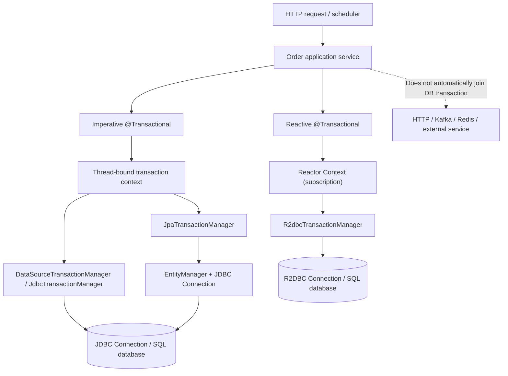
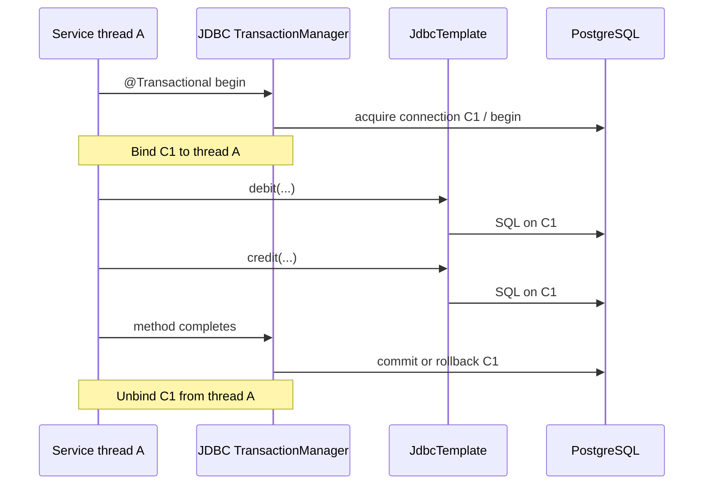
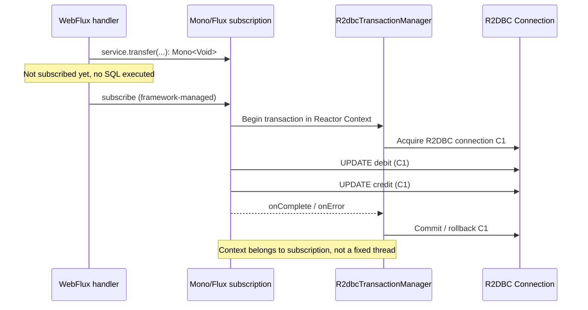
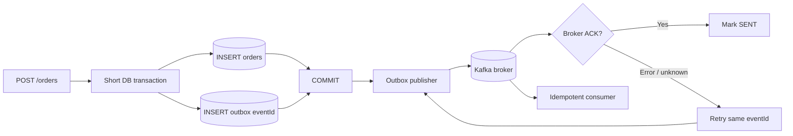
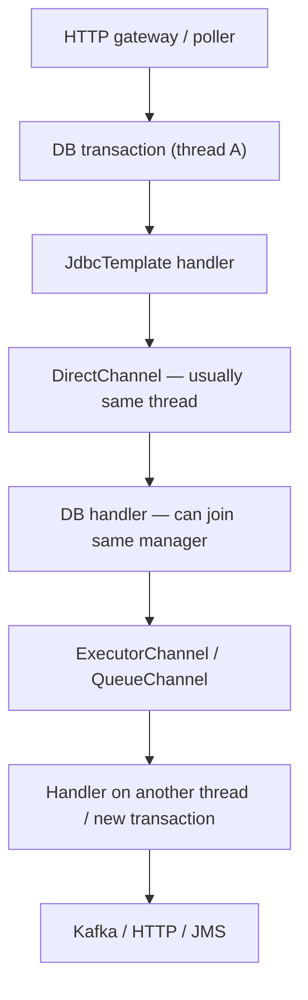
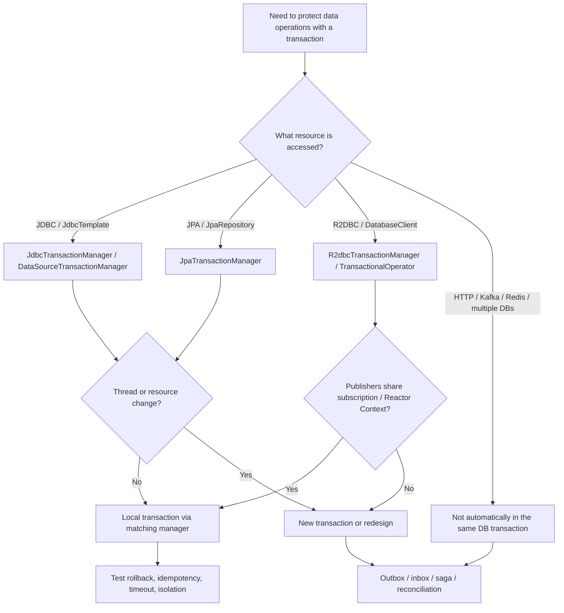

# JDBC, JPA, and Reactive Transactions Have Different Context Scopes

> **Chapter:** Integration Transactions  
> **Module:** SPRING_BOOT_INTEGRATION — structuring Spring Boot system integrations across HTTP clients, databases, caches, message brokers, and Spring Integration; focusing on configuration, data contracts, transaction boundaries, errors, deduplication, testing, and observing real-world integration flows.

## 1. Problem: Same `@Transactional`, Not the Same Transaction

An order-processing service has three ways to persist data:

1. `JdbcTemplate` writing directly to PostgreSQL.
2. `JpaRepository` saving entities through Hibernate/`EntityManager`.
3. `DatabaseClient`/`R2dbcEntityTemplate` writing asynchronously via R2DBC and returning a `Mono`.

All three can be paired with `@Transactional`, yet they **do not use the same mechanism to store transaction context**. With imperative JDBC and JPA, Spring typically binds the transaction to the **executing thread**. With reactive stacks, Spring binds the transaction to the **Reactor subscriber context** across a subscribed reactive sequence, without relying on a fixed thread.

Consequence: placing `@Transactional` on a method **does not** automatically make queries run inside a `CompletableFuture`, an `@Async` method, a lazily subscribed `Mono`, or HTTP/Kafka commands belong to the same transaction.



**A transaction is a mechanism of a specific resource and a specific execution scope**, not an annotation guaranteeing all side effects across the entire system commit or roll back together.

### 1.1. Learning Objectives

After this lesson, you will be able to:

1. Distinguish `PlatformTransactionManager` (imperative) from `ReactiveTransactionManager`.
2. Explain how `TransactionSynchronizationManager` binds connections/`EntityManager` to a thread, whereas R2DBC uses Reactor Context.
3. Configure and use `JdbcTemplate`, JPA/Hibernate, and R2DBC transactions with sound architecture.
4. Recognize why `@Async`, `CompletableFuture`, `subscribe()`, self-invocation, and `ThreadLocal` can break transaction expectations.
5. Evaluate propagation, isolation, `readOnly`, flush, rollback, and transaction-manager selection.
6. Design safely when HTTP/Kafka/Redis and multiple databases participate in the same business workflow.
7. Test rollbacks, transaction boundaries, idempotency, and observe transaction failures in Spring Boot.

## 2. Three Transaction Models — Similar External API, Different Internal Context

| Aspect | Imperative JDBC | Imperative JPA/Hibernate | Reactive R2DBC |
| --- | --- | --- | --- |
| Data API | `JdbcTemplate` / JDBC `Connection` | `EntityManager` / `JpaRepository` | `DatabaseClient` / `R2dbcEntityTemplate` |
| Transaction manager | `JdbcTransactionManager` or `DataSourceTransactionManager` | `JpaTransactionManager` | `R2dbcTransactionManager` |
| Spring interface | `PlatformTransactionManager` | `PlatformTransactionManager` | `ReactiveTransactionManager` |
| Runtime context | **Thread-bound** | **Thread-bound** `EntityManager`, typically paired with JDBC resource | **Reactor Context**, bound to subscription |
| Connection | Blocking JDBC connection | JDBC connection via JPA provider | Non-blocking R2DBC connection |
| Execution timing | Synchronous SQL method calls | Persistence context; SQL may be deferred until flush | Operations execute when publisher is subscribed |
| Scope to maintain | Same thread and matching resource binding | Same thread, persistence context, and transaction manager | Same reactive pipeline/subscription context |
| When switching threads | Transaction does not follow automatically | `EntityManager` does not follow automatically | Can continue across Reactor pipeline because context travels with subscriber |
| HTTP/Kafka side effects | Not automatically part of JDBC transaction | Not automatically part of JPA transaction | Not automatically part of R2DBC transaction |

**Spring WebFlux does not imply R2DBC** and **Spring MVC does not forbid R2DBC**. Transaction manager selection depends on the data-access stack and method style; however, mixing blocking and reactive models in one flow requires explicit context boundaries and never running blocking APIs on a Netty event loop.

### 2.1. One Transaction Differs from One HTTP Request

One HTTP request can open multiple DB transactions: read data in a short transaction, call an external partner, and then write the outcome in another transaction. Conversely, a single transaction can span multiple repository calls belonging to the same datasource and thread.

Never keep a DB transaction open across a slow HTTP call just because a service method carries `@Transactional`: connections stay held, locks linger, and the pool can stall when a partner times out.

### 2.2. Spring Boot Configuration to Understand

The Java examples below target **Spring Boot 3.2–3.5, Spring Framework 6.1+, Java 17+**. In a project containing both JDBC and R2DBC, Boot's DataSource auto-configuration has conditions tied to classpath/`ConnectionFactory`: **do not assume both stacks auto-configure automatically just because both starters exist**. If both are needed simultaneously, explicitly verify `DataSource`, `ConnectionFactory`, transaction managers, and qualifiers.

Let the Spring Boot BOM select driver, Spring Data, and Hibernate versions; when upgrading Boot/Spring major versions, verify transaction semantics and APIs against the exact version documentation rather than copying config from another release.

## 3. JDBC Transactions: Connections Held Per Thread

With Spring JDBC, `DataSourceTransactionManager`/`JdbcTransactionManager` borrows a JDBC `Connection` from `DataSource`, configures auto-commit/isolation/read-only per policy, and binds the resource to the thread while the transaction is active.

`JdbcTemplate` calls `DataSourceUtils` to obtain the connection participating in the active transaction. As a result, multiple SQL commands can share the **same DB transaction** without the service passing `Connection` into every method.

### 3.1. Dependencies and JDBC Configuration

```groovy
// build.gradle — project using the Spring Boot BOM
dependencies {
    implementation 'org.springframework.boot:spring-boot-starter-jdbc'
    runtimeOnly 'org.postgresql:postgresql'
    testImplementation 'org.springframework.boot:spring-boot-starter-test'
}
```

```yaml
# application.yml — never commit real passwords
spring:
  datasource:
    url: ${ORDERS_DB_URL}
    username: ${ORDERS_DB_USERNAME}
    password: ${ORDERS_DB_PASSWORD}
    hikari:
      maximum-pool-size: 12
      connection-timeout: 3000
```

Let Boot configure `DataSource` and the manager when conditions match. Hikari's `connection-timeout` in the example is the max time to wait for a connection from the pool (milliseconds), **distinct from** overall JDBC transaction deadlines and query timeouts. Values are only starting points and must be tuned against actual PostgreSQL/pool capacity.

### 3.2. Example: Two SQL Operations Committing/Rolling Back Together

Suppose we have `account_balance(account_id, balance)` and `transfer_audit(transfer_id, from_id, to_id, amount)` in **one PostgreSQL datasource**. Illustrative synchronous JDBC transfer code:

```java
import java.math.BigDecimal;
import org.springframework.jdbc.core.JdbcTemplate;
import org.springframework.stereotype.Service;
import org.springframework.transaction.annotation.Transactional;

@Service
public class JdbcTransferService {
    private final JdbcTemplate jdbc;

    public JdbcTransferService(JdbcTemplate jdbc) {
        this.jdbc = jdbc;
    }

    @Transactional
    public void transfer(String transferId, String fromId,
                         String toId, BigDecimal amount) {
        if (amount == null || amount.signum() <= 0) {
            throw new IllegalArgumentException("amount must be positive");
        }

        int debited = jdbc.update(
                """
                UPDATE account_balance
                   SET balance = balance - ?
                 WHERE account_id = ? AND balance >= ?
                """, amount, fromId, amount);
        if (debited != 1) {
            throw new IllegalStateException("Insufficient balance");
        }

        int credited = jdbc.update(
                """
                UPDATE account_balance
                   SET balance = balance + ?
                 WHERE account_id = ?
                """, amount, toId);
        if (credited != 1) {
            throw new IllegalStateException("Destination not found");
        }

        jdbc.update(
                """
                INSERT INTO transfer_audit
                    (transfer_id, from_id, to_id, amount)
                VALUES (?, ?, ?, ?)
                """, transferId, fromId, toId, amount);
    }
}
```

**Explanation:** if the method is called through a Spring proxy, the manager for the right datasource is active, and `IllegalStateException` is not swallowed, all three JDBC commands share the transaction: on error, both debit and credit roll back along with the audit row. In production, add a **unique constraint on `transfer_id`** and handle concurrent transfers to prevent duplicate writes from retries/timeouts. This code omits checking `fromId != toId` and isolation tuning for full payment systems; it illustrates transaction boundaries rather than a complete banking system.

### 3.3. Why Same-Thread Execution Matters



If inside the method you spawn a new thread to call `jdbc.update(...)`, that thread **does not automatically inherit connection C1**; it may acquire another connection and auto-commit independently if no suitable transaction is active. Spring JDBC and Spring-managed transactions require managed APIs: calling `dataSource.getConnection()` directly and operating/closing it manually can bypass Spring's active transaction resource binding. In Spring code, prefer `JdbcTemplate`/`DataSourceUtils` or `TransactionTemplate`.

### 3.4. `JdbcTransactionManager` and `DataSourceTransactionManager`

`JdbcTransactionManager` extends `DataSourceTransactionManager` with exception translation for commit/rollback exceptions more consistent with Spring JDBC. In Boot 3.x, the default manager depends on auto-configuration and existing beans; when choosing a manager explicitly, configure based on the **actual `DataSource`** rather than assuming `@Transactional` always selects JDBC.

```java
import javax.sql.DataSource;
import org.springframework.context.annotation.Bean;
import org.springframework.context.annotation.Configuration;
import org.springframework.jdbc.support.JdbcTransactionManager;

@Configuration(proxyBeanMethods = false)
class JdbcTxConfiguration {
    @Bean("ordersJdbcTransactionManager")
    JdbcTransactionManager ordersJdbcTransactionManager(
            DataSource ordersDataSource) {
        return new JdbcTransactionManager(ordersDataSource);
    }
}
```

This is a **configuration pattern when you intentionally need a dedicated bean**; `ordersDataSource` simply represents a properly injected datasource (use `@Qualifier` when multiple datasources exist). Do not unconditionally add extra managers into a Boot application that already has a default JDBC/JPA manager: doing so can make `@Transactional` ambiguous. In production, decide clearly **who owns the transaction manager** and which qualifier names apply.

## 4. JPA Transactions: `EntityManager` and Persistence Context

JPA uses `JpaTransactionManager` and `EntityManager` (typically implemented by Hibernate). Spring binds the `EntityManager` serving the transaction to the thread via persistence infrastructure. Unlike pure JDBC, JPA also maintains a **persistence context** holding managed entities, dirty checking, flushing, and lazy loading.

### 4.1. Dependencies and Sample Entity

```groovy
dependencies {
    implementation 'org.springframework.boot:spring-boot-starter-data-jpa'
    runtimeOnly 'org.postgresql:postgresql'
}
```

```java
import jakarta.persistence.Column;
import jakarta.persistence.Entity;
import jakarta.persistence.Id;
import jakarta.persistence.Table;
import jakarta.persistence.Version;
import java.math.BigDecimal;

@Entity
@Table(name = "purchase_orders")
public class PurchaseOrder {
    @Id
    private String id;

    @Column(nullable = false)
    private String status;

    @Column(nullable = false)
    private BigDecimal amount;

    @Version
    private Long version;

    protected PurchaseOrder() {}

    public PurchaseOrder(String id, String status, BigDecimal amount) {
        this.id = id;
        this.status = status;
        this.amount = amount;
    }

    public String getId() { return id; }
    public String getStatus() { return status; }
    public void setStatus(String status) { this.status = status; }
}
```

`@Version` enables optimistic locking when concurrent transactions update the same entity. The database schema must have the appropriate columns/indexes/constraints; do not use `hibernate.hbm2ddl.auto=create` in production in place of controlled migrations.

### 4.2. Dirty Checking and Flush Timing

```java
import org.springframework.data.jpa.repository.JpaRepository;

public interface PurchaseOrderRepository
        extends JpaRepository<PurchaseOrder, String> {
}
```

```java
import org.springframework.stereotype.Service;
import org.springframework.transaction.annotation.Transactional;

@Service
public class JpaOrderService {
    private final PurchaseOrderRepository repository;

    public JpaOrderService(PurchaseOrderRepository repository) {
        this.repository = repository;
    }

    @Transactional
    public void confirm(String id) {
        PurchaseOrder order = repository.findById(id).orElseThrow();
        if (!"NEW".equals(order.getStatus())) {
            throw new IllegalStateException("Only NEW orders can be confirmed");
        }
        order.setStatus("CONFIRMED");
        // Entity is managed; Hibernate may flush UPDATE at commit.
    }
}
```

Inside a JPA transaction, fetched entities are **managed by the persistence context**. Changing `status` can be detected via dirty checking and the SQL `UPDATE` emitted upon flush (which can occur earlier than commit depending on queries and flush mode). **`save()` or `flush()` does not mean the transaction has committed**: if an exception occurs after flush but before commit, the SQL can still roll back.

### 4.3. `JpaTransactionManager` and JDBC on the Same Database

`JpaTransactionManager` can manage JPA and, when configured properly, allow Spring JDBC accessing the **same DataSource** to join the JPA transaction. This does not mean every `JdbcTemplate` and `EntityManager` automatically share a transaction regardless of factory/manager; you need:

1. JPA's `EntityManagerFactory` and `JdbcTemplate` genuinely use the same underlying `DataSource`.
2. The transaction is managed by a transaction manager capable of exposing JDBC connections, usually `JpaTransactionManager`.
3. JDBC access goes through `JdbcTemplate`/`DataSourceUtils`, not manually opened connections outside Spring.
4. Flush JPA before raw JDBC queries if logic requires JDBC to see **unflushed** entity changes, and verify ordering/visibility.

If two different datasources are used (even on the same PostgreSQL server but different connections/DBs), a local transaction manager **does not automatically provide distributed atomic commit**.

### 4.4. JPA Pitfalls Compared to JDBC

- **Lazy loading:** accessing associations outside the transaction/persistence context can throw `LazyInitializationException`; do not keep transactions open across HTTP just to dodge this error. Use proper queries/projections/fetch strategies.
- **Open Session in View:** in web apps, when enabled it can keep the `EntityManager` open through view serialization; do not treat that as a controlled service transaction. Consider `spring.jpa.open-in-view=false` for service APIs where appropriate.
- **Flush timing:** queries run before commit can trigger Hibernate flushes; do not assume an `UPDATE` executes only at the very end of the method.
- **Read-only:** `@Transactional(readOnly=true)` is an optimization hint that can affect flush mode; it is not a hard DB write ACL.
- **Optimistic locking:** `@Version` requires a version column and exception handling; on conflict, re-read state and re-evaluate business transitions rather than retrying blindly.
- **Exceptions:** many SQL/JPA errors are translated by Spring into `DataAccessException`; distinguish constraint violations, lock conflicts, timeouts, and schema errors.

## 5. Reactive Transactions: Reactor Context Instead of Thread Binding

R2DBC provides an asynchronous/non-blocking database API built around `ConnectionFactory`. `R2dbcTransactionManager` attaches the connection and transaction state to the **Reactor Context** of a subscription. This allows the same pipeline to resume on another thread after `publishOn(...)` while still seeing the transaction context under Reactor/Spring semantics, **provided** DB calls belong to the same transaction-wrapped reactive pipeline.



### 5.1. Dependencies and R2DBC Configuration

```groovy
dependencies {
    implementation 'org.springframework.boot:spring-boot-starter-data-r2dbc'
    runtimeOnly 'org.postgresql:r2dbc-postgresql'
    testImplementation 'io.projectreactor:reactor-test'
    testImplementation 'org.springframework.boot:spring-boot-starter-test'
}
```

```yaml
spring:
  r2dbc:
    url: ${ORDERS_R2DBC_URL}
    username: ${ORDERS_R2DBC_USERNAME}
    password: ${ORDERS_R2DBC_PASSWORD}
```

For example `ORDERS_R2DBC_URL=r2dbc:postgresql://postgres:5432/orders`, **different syntax** from `jdbc:postgresql://...`. `R2dbcTransactionManager` needs an R2DBC `ConnectionFactory`; you cannot substitute a JDBC `DataSourceTransactionManager`. In projects with multiple managers, use explicit qualifiers and verify auto-configuration.

### 5.2. Transfer Example with `DatabaseClient` and `Mono`

```java
import java.math.BigDecimal;
import org.springframework.r2dbc.core.DatabaseClient;
import org.springframework.stereotype.Service;
import org.springframework.transaction.annotation.Transactional;
import reactor.core.publisher.Mono;

@Service
public class ReactiveTransferService {
    private final DatabaseClient db;

    public ReactiveTransferService(DatabaseClient db) {
        this.db = db;
    }

    @Transactional(transactionManager = "r2dbcTransactionManager")
    public Mono<Void> transfer(String fromId, String toId,
                               BigDecimal amount) {
        if (amount == null || amount.signum() <= 0) {
            return Mono.error(new IllegalArgumentException(
                    "amount must be positive"));
        }

        Mono<Long> debit = db.sql("""
                UPDATE account_balance
                   SET balance = balance - :amount
                 WHERE account_id = :fromId AND balance >= :amount
                """)
                .bind("amount", amount)
                .bind("fromId", fromId)
                .fetch()
                .rowsUpdated();

        Mono<Long> credit = db.sql("""
                UPDATE account_balance
                   SET balance = balance + :amount
                 WHERE account_id = :toId
                """)
                .bind("amount", amount)
                .bind("toId", toId)
                .fetch()
                .rowsUpdated();

        return debit
                .flatMap(count -> count == 1
                        ? Mono.empty()
                        : Mono.error(new IllegalStateException(
                                "Insufficient balance or source missing")))
                .then(credit)
                .flatMap(count -> count == 1
                        ? Mono.empty()
                        : Mono.error(new IllegalStateException(
                                "Destination missing")))
                .then();
    }
}
```

This example targets **one R2DBC database** without audit/idempotency, so it is not production-ready money transfer logic. The two updates are chained **sequentially with `then(...)`**, not executed concurrently at random on the same transactional connection. When any stage emits `onError` and reactive transaction advice is active, the transaction rolls back per the default policy.

**Core point:** calling `transfer(...)` creates/returns a `Mono<Void>`. SQL is not executed until the publisher is subscribed. Spring's reactive transaction advice wraps the publisher to open the transaction at subscription time and retain the transaction context until a terminal signal.

### 5.3. `TransactionalOperator` for Explicit Transaction Scopes

When only part of a pipeline should run inside a DB transaction, `TransactionalOperator` lets you scope it directly:

```java
import org.springframework.context.annotation.Bean;
import org.springframework.context.annotation.Configuration;
import org.springframework.r2dbc.connection.R2dbcTransactionManager;
import org.springframework.transaction.reactive.TransactionalOperator;
import io.r2dbc.spi.ConnectionFactory;

@Configuration(proxyBeanMethods = false)
class ReactiveTransactionConfiguration {
    @Bean("r2dbcTransactionManager")
    R2dbcTransactionManager r2dbcTransactionManager(
            ConnectionFactory connectionFactory) {
        return new R2dbcTransactionManager(connectionFactory);
    }

    @Bean
    TransactionalOperator r2dbcTransactionalOperator(
            R2dbcTransactionManager r2dbcTransactionManager) {
        return TransactionalOperator.create(r2dbcTransactionManager);
    }
}
```

Usage example:

```java
import org.springframework.transaction.reactive.TransactionalOperator;
import reactor.core.publisher.Mono;

public Mono<Void> updateTwoRows(
        Mono<Long> debit,
        Mono<Long> credit,
        TransactionalOperator operator) {
    return debit.then(credit).then()
            .as(operator::transactional);
}
```

This snippet illustrates syntax, assuming `debit`/`credit` are built from R2DBC publishers on the same connection factory and check `rowsUpdated` per business rules. In pipelines needing domain validation, do not ignore update counts as in the simplified snippet.

**Only declare transaction manager beans manually if needed.** Where Boot already auto-configures a qualifying R2DBC manager, an imprecise manual bean can replace it or introduce ambiguity. `TransactionalOperator` must be created from the right manager; in apps with multiple connection factories, name and select managers explicitly.

### 5.4. Reactor Context Is Not `ThreadLocal`

```java
import reactor.core.publisher.Mono;
import reactor.core.scheduler.Schedulers;

Mono<Void> pipeline = reactiveService.transfer(
        "account-A", "account-B", amount)
        .publishOn(Schedulers.parallel())
        .then();
```

Within a **single properly managed subscription**, Reactor Context can propagate across operators even as execution threads change. This **does not allow** calling blocking JDBC/JPA inside a reactive transaction assuming they share the R2DBC connection—they use different transaction mechanisms and resources.

Common ways transactions are lost or detached:

- Calling `.subscribe()` manually inside a transaction-wrapped method: can start a **separate** subscription outside the scope the caller awaits/rolls back.
- Returning `Mono` while calling `.block()` on a Netty event loop: blocks the event loop, typically an architectural violation.
- Creating a `CompletableFuture`/`@Async` and calling imperative DB APIs expecting Reactor Context to turn into a JDBC thread transaction.
- Obtaining publishers from external sources incompatible with context, or manually subscribing/returning before the publisher completes.

**Cancellation requires an explicit policy:** Spring's reactive transaction infrastructure handles terminal signals, including cancellation per version semantics; however, an HTTP caller canceling a subscription does not revoke external side effects already sent to HTTP/Kafka. External operations require idempotency and reconciliation.

## 6. `@Transactional` Is Not “Magic”: Proxies and Execution Timing

Spring typically applies `@Transactional` via **AOP proxies**. Advice runs only when a method is invoked through the appropriate proxy and the right transaction manager is resolved. One method calling another **on the same object** generally bypasses the proxy and does not automatically activate a new transaction.

### 6.1. Self-Invocation Bypasses Transactional Advice

```java
import org.springframework.stereotype.Service;
import org.springframework.transaction.annotation.Propagation;
import org.springframework.transaction.annotation.Transactional;

@Service
public class InvoiceService {
    public void runImport() {
        saveInvoice(); // this.saveInvoice(): does NOT go through the Spring proxy.
    }

    @Transactional(propagation = Propagation.REQUIRES_NEW)
    public void saveInvoice() {
        // Example: repository.save(...).
    }
}
```

**Do not assume** `saveInvoice()` opens a `REQUIRES_NEW` transaction here. When calling `runImport()` from outside, the internal call goes directly on `this`, bypassing proxy interception; the annotation on the target method may have no effect. The cleanest fix is moving the transactional method to **a separate Spring bean**, injecting it, and calling through the proxy; or using `TransactionTemplate` for explicit imperative boundaries.

Other pitfalls: methods not managed by Spring, instantiating a service with `new`, visibility/scope not intercepted per proxy configuration, `final` classes/methods with incompatible proxy modes, and interface vs. class proxy differences can all prevent annotations from behaving as expected.

### 6.2. `@Transactional` on Controllers and Overly Long Transaction Scopes

Avoid wrapping an entire controller:

```java
// Anti-pattern: calling HTTP partner inside a long DB transaction.
@Transactional
public OrderReceipt createOrder(CreateOrderRequest request) {
    OrderEntity entity = repository.save(mapToEntity(request));
    PaymentReceipt payment = paymentClient.charge(request); // network I/O
    kafkaTemplate.send("orders.created", toEvent(entity)); // async
    return toReceipt(entity, payment);
}
```

The snippet above **has no atomic commit** across the database, HTTP payment, and Kafka. While waiting on HTTP, the DB transaction holds connections/locks; `KafkaTemplate.send(...)` returns a future that may not yet be broker-ACKed when the method returns. If DB commits after Kafka already recorded the message, consumers may observe an event for an uncommitted entity.

Prefer splitting:

1. Short DB transaction to write business state + outbox in the same database.
2. Commit DB, return response/receipt per contract.
3. Independent worker sends outbox to broker, awaits ACK, updates status for retries.
4. Consumer processes idempotently; HTTP side effects carry idempotency keys and reconciliation.

### 6.3. `@Async`, `CompletableFuture`, and Thread-Bound Transactions

```java
import java.util.concurrent.CompletableFuture;
import org.springframework.scheduling.annotation.Async;
import org.springframework.stereotype.Service;
import org.springframework.transaction.annotation.Transactional;

@Service
public class AsyncAuditWriter {
    @Async
    @Transactional
    public CompletableFuture<Void> writeAudit() {
        // JDBC/JPA writes, if proxy-managed, may open
        // a NEW transaction on the @Async execution thread.
        return CompletableFuture.completedFuture(null);
    }
}
```

If an `@Transactional` service calls this bean, the caller thread's transaction **does not automatically propagate** to the `@Async` thread. The async method may open its own transaction when its advice triggers properly. The caller committing or rolling back does not automatically roll back DB work committed by the async worker.

Similarly, `CompletableFuture.supplyAsync(() -> repository.save(...))` runs in another executor and may start an independent transaction via repository/advice or run outside the caller's transaction. **Never forward thread-bound `Connection`/`EntityManager` instances to another executor** to “share a transaction”: they are not designed as cross-thread/thread-safe contexts.

If the business requires a job to be created only after DB commit, use an outbox or a properly architected durable task; `@TransactionalEventListener(phase=AFTER_COMMIT)` can work for best-effort notifications, but **is not durable if the JVM crashes right after commit**.

### 6.4. Transactions and Java 21 Virtual Threads

A virtual thread is still a Java thread for which `ThreadLocal` applies, yet **each virtual thread has its own thread context**. Adopting virtual threads does not carry thread A's JDBC transaction over to virtual thread B. Virtual threads can lower the cost of blocking I/O waits, but do not solve transaction propagation, connection pool exhaustion, or cross-system atomicity.

### 6.5. Returning `Mono` from a Method Using an Imperative Transaction Manager

```java
// Wrong model: imperative @Transactional + publisher constructed now, executed later.
@Transactional(transactionManager = "ordersJdbcTransactionManager")
public Mono<Void> updateLater() {
    return Mono.fromRunnable(() -> jdbcTemplate.update(
            "UPDATE orders SET status = 'DONE' WHERE id = ?", orderId));
}
```

When advice uses an **imperative manager**, the thread-bound transaction typically begins and ends around the **time the method constructs and returns the publisher**, before the publisher is subscribed and SQL executes. Thus, the SQL inside `Mono.fromRunnable` is not protected by that transaction. If you want an R2DBC reactive transaction, use a reactive connection factory/manager and reactive publishers. If you want JDBC, execute JDBC **synchronously inside an imperative transaction** and return the result at an appropriate boundary; do not wrap blocking JDBC in a `Mono` assuming the transaction spans subscription.

## 7. Which Transaction Manager Is Selected When Multiple Technologies Coexist?

In an app with only one JDBC `DataSource`, Boot typically configures one imperative manager. With JPA, `JpaTransactionManager` is usually chosen for JPA repositories. With R2DBC, the reactive manager is a distinct type. When an application **combines** JDBC/JPA/R2DBC or multiple databases, never guess that an unqualified `@Transactional` picks the right resource.

### 7.1. Specifying Managers by Business Domain

```java
@Transactional(transactionManager = "ordersJpaTransactionManager")
public void updateOrderJpa(String id) {
    // JPA repository ...
}

@Transactional(transactionManager = "auditJdbcTransactionManager")
public void insertAuditJdbc(String auditId) {
    // JdbcTemplate using Audit DataSource ...
}

@Transactional(transactionManager = "r2dbcTransactionManager")
public Mono<Void> updateReactive(String id) {
    // DatabaseClient using R2DBC ConnectionFactory ...
}
```

These methods are **illustrative fragments**; they only work when the beans are properly defined/named, the service is Spring-managed, and calls pass through proxies. If multiple managers exist and you omit the name, Spring may select a default or fail with ambiguity; behavior depends on application configuration. Do not let “which manager bean gets chosen” become accidental after adding a new starter.

### 7.2. A Broken Example with Two DataSources

```text
ordersDataSource ── ordersJdbcTransactionManager ── orders_db
auditDataSource  ── auditJdbcTransactionManager  ── audit_db

@Transactional("ordersJdbcTransactionManager")
  ordersJdbc.update(...)      -> transaction T1 (orders_db)
  auditJdbc.update(...)       -> does NOT automatically join T1 (audit_db)
```

Because the two `JdbcTemplate`s use two different `DataSource`s, transaction manager A **cannot atomically local-commit** database B. `auditJdbc.update` may auto-commit or use another transaction. If a later step fails, rolling back T1 will not reliably roll back audit.

When consistency is required, consider **outbox/saga/compensation**, or a distributed/XA coordinator if the system genuinely has suitable infrastructure and accepts the complexity (never assume Spring `@Transactional` equals XA).

### 7.3. When JDBC and JPA Share PostgreSQL

If JPA's `EntityManagerFactory` and `JdbcTemplate` use the same datasource, a single `JpaTransactionManager` can allow both to participate in the transaction, but verify with integration tests:

- JDBC queries see entities newly `persist`ed by JPA **only after the necessary flush**.
- If a JDBC update occurs after a JPA entity was loaded, the persistence context may **hold a stale copy**; call `refresh`/`clear` appropriately if the same state is modified outside the ORM.
- Rolling back an exception after both operations rolls back both on the same DB resource.
- When mixing JPA + JDBC operations on the same connection, timeouts, read-only flags, and isolation must be supported/applied consistently.

Do not design a persistence layer assuming “same PostgreSQL database name” suffices; `DataSource` identity, connection management, transaction manager, and session boundaries are what matter.

### 7.4. Distinguishing Transactions Across Redis, Kafka, JMS, and Spring Integration

| Resource | Transaction Manager / Mechanism | Not Equivalent To |
| --- | --- | --- |
| PostgreSQL JDBC | `JdbcTransactionManager`/`DataSourceTransactionManager` | Kafka broker ACK |
| PostgreSQL JPA | `JpaTransactionManager` | Succeeded HTTP payment |
| PostgreSQL R2DBC | `R2dbcTransactionManager` | Caller thread's JDBC transaction |
| Kafka | Kafka producer transaction/`KafkaTransactionManager` | Atomic commit with PostgreSQL |
| JMS broker | `JmsTransactionManager` or broker-local session transaction | Committing alongside JPA without a coordinator |
| Redis | Redis commands/transaction support per client/config | SQL rollback or business exactly-once |
| Spring Integration flow | Message channels, handlers, pollers, gateways, adapters | All handlers automatically sharing one DB transaction |

In Spring Integration, a synchronous `DirectChannel` typically invokes handlers on the **same thread**, so if a transaction is already active and downstream handlers use the same datasource, they can participate. However, once an `ExecutorChannel`, `QueueChannel`, poller, JMS/Kafka boundary, or reactive processing is introduced, **thread/transaction boundaries change**. Never treat a seamless-looking integration flow diagram as one seamless transaction.

## 8. Propagation: Changes Transaction Scope, Not the Resource

Spring `@Transactional` provides several `Propagation` modes. They govern how a method interacts with a transaction **within the same transaction manager/resource**, without automatically pulling in Kafka, HTTP, or a second database.

| Propagation | When Caller Has a Transaction | When No Transaction Exists | Key Points |
| --- | --- | --- | --- |
| `REQUIRED` (default) | Joins existing transaction | Opens a new transaction | Two methods are two *logical scopes* but may share one physical transaction |
| `REQUIRES_NEW` | Suspends existing transaction, opens independent physical transaction | Opens new | Can hold multiple connections concurrently, risking pool exhaustion |
| `NESTED` | Creates a savepoint inside physical transaction if supported by manager/resource | Can behave like `REQUIRED` | JDBC usually supports savepoints; do not assume JPA supports it |
| `SUPPORTS` | Joins if present | May run non-transactionally | Does not guarantee a transaction is always active |
| `MANDATORY` | Must join | Throws error | Useful to enforce caller-owned boundaries |
| `NOT_SUPPORTED` | Suspends existing transaction | Runs non-transactionally | Useful for tasks that shouldn't hold a transaction |
| `NEVER` | Throws error | Runs non-transactionally | Guards operations forbidden inside a transaction |

### 8.1. `REQUIRED` and `UnexpectedRollbackException`

```java
@Service
public class OrderFacade {
    private final InventoryService inventory;

    @Transactional
    public void placeOrder() {
        try {
            inventory.reserve(); // @Transactional REQUIRED
        } catch (IllegalStateException ignored) {
            // Caller decides to "continue".
        }
        // May hit UnexpectedRollbackException on commit.
    }
}
```

If `InventoryService.reserve()` is invoked **through a proxy** and an exception matching a rollback rule leaves the inner `REQUIRED` scope, Spring can mark the shared transaction **rollback-only**. Even if the outer method catches the exception and returns normally, Spring may throw `UnexpectedRollbackException` at commit because the transaction cannot commit as the caller expected.

Conversely, if inner code **catches the exception itself before it crosses transactional advice**, or custom rollback rules apply, you cannot assume rollback-only is always set. Inspect the exact exception path and transaction status.

### 8.2. `REQUIRES_NEW` Uses a Separate Connection

```java
@Service
public class AuditService {
    @Transactional(propagation = Propagation.REQUIRES_NEW)
    public void recordAttempt(String orderId) {
        // Writes audit in a separate transaction.
    }
}
```

If the outer transaction still holds a JDBC connection, `REQUIRES_NEW` typically requires another connection. When 100 concurrent requests run outer + inner, the connection pool must be large enough to avoid deadlock where every thread holds an outer connection while waiting for an inner connection. Spring Framework notes the pool must be sized adequately when using this pattern; never apply it unboundedly in batch jobs.

**Do not use `REQUIRES_NEW` to rescue distributed transactions:** a separately committed audit can still succeed even when the outer order rolls back. That may be intentional (auditing an attempt), but it must be explicit in the contract.

### 8.3. `NESTED` Is Not Equivalent to `REQUIRES_NEW`

With `DataSourceTransactionManager`/JDBC drivers supporting savepoints, `NESTED` can roll back operations after the savepoint without rolling back the entire parent transaction. It **does not open an independent transaction that commits durably ahead of the parent**. If the parent transaction rolls back, the nested work rolls back too.

With JPA, persistence context and savepoint management differ from JDBC; `JpaTransactionManager` does not provide nested transactions for JPA entity operations by default; do not enable `NESTED` on a JPA method expecting `JdbcTemplate`-style savepoints. Reactive managers also have driver-specific semantics and do not guarantee every propagation mode behaves like JDBC.

### 8.4. Timeout, Isolation, `readOnly`, and Rollback Rules

```java
import org.springframework.transaction.annotation.Isolation;
import org.springframework.transaction.annotation.Transactional;

@Transactional(
        isolation = Isolation.READ_COMMITTED,
        timeout = 5,
        readOnly = true)
public OrderSummary loadOrder(String id) {
    // Query DB; illustrative method.
}
```

- **Isolation:** meaningful only when supported by manager/driver/database and a corresponding transaction is created. A method joining an existing transaction usually **does not change the isolation** of that physical transaction.
- **Timeout:** not the total deadline for an entire HTTP+Kafka flow. The system still needs HTTP client timeouts, JDBC query timeouts, connection acquisition timeouts, and business deadlines.
- **`readOnly`:** generally an optimization/marking hint; does not replace DB permissions and does not guarantee `UPDATE` statements are impossible across all drivers.
- **Rollback:** Spring defaults to rolling back on `RuntimeException` and `Error`, and not checked exceptions unless configured (or customized at the version/app policy level). For exceptions that must roll back, specify `rollbackFor=...`.
- **Exception translation:** transaction rollback and how Spring translates errors from JDBC/JPA/R2DBC are related but distinct concepts.

```java
@Transactional(rollbackFor = java.io.IOException.class)
public void importFile() throws java.io.IOException {
    // IOException passing through the proxy triggers rollback per rule.
}
```

**Note:** instead of using checked exceptions to govern all infrastructure failures, clearly define business failures, permanent integration failures, transient failures, and transaction retry policies; never configure `noRollbackFor` to hide inconsistent writes.

## 9. Transactions Do Not Replace Idempotency and Business Isolation

Even when a DB transaction rolls back properly, risks remain:

1. **Lost update:** two requests load and overwrite an entity; use `@Version` optimistic locking or atomic conditional SQL.
2. **Write skew/phantom:** two transactions read a condition and update different records; apply proper isolation/locking/constraints per requirements.
3. **Duplicate request:** client times out and retries POST; use an idempotency key or unique business key.
4. **Ambiguous commit result:** losing the connection after `COMMIT` can leave the client unsure whether DB committed; reconcile by business key rather than sending a new operation with a new ID.
5. **Event redelivery:** Kafka/JMS redelivers when consumer commit/ACK fails; use an idempotent consumer and clear transaction boundaries.
6. **Transaction timeout:** a DB rollback does not revoke an HTTP payment already completed on another service.

### 9.1. Unique Constraints Are the Definitive Deduplication Guard

```sql
CREATE TABLE orders (
    id VARCHAR(80) PRIMARY KEY,
    request_key VARCHAR(120) NOT NULL UNIQUE,
    customer_id VARCHAR(80) NOT NULL,
    status VARCHAR(40) NOT NULL
);
```

When two HTTP requests with the same `request_key` arrive simultaneously, both can read `existsByRequestKey=false` before inserting. **The database unique constraint** is the decisive barrier. The application handles duplicates by looking up the already recorded result and comparing request content; never blindly treat every conflict as a successful retry.

### 9.2. Transactional Outbox for DB → Broker



Writing `orders` and `outbox` in **one JDBC/JPA transaction on the same DB** ensures they commit or roll back together. After commit, a worker publishes to Kafka keeping the **same `eventId`** and marks `SENT` only after ACK. If the worker crashes after broker ACK but before marking `SENT`, the event may be published again; consumers must deduplicate.

Outbox gives a practical **at-least-once** recovery path, not a claim of exactly-once across PostgreSQL and Kafka. If the order DB and outbox DB use different datasources/transaction managers, the same-DB atomicity benefit **disappears**.

### 9.3. JPA Code Writing Order and Outbox in the Same Database Transaction

Minimal outbox entity example:

```java
import jakarta.persistence.Column;
import jakarta.persistence.Entity;
import jakarta.persistence.Id;
import jakarta.persistence.Table;
import java.time.Instant;

@Entity
@Table(name = "order_outbox")
public class OutboxEvent {
    @Id
    private String eventId;

    @Column(nullable = false)
    private String aggregateId;

    @Column(nullable = false)
    private String eventType;

    @Column(nullable = false)
    private String payloadJson;

    @Column(nullable = false)
    private String status;

    @Column(nullable = false)
    private Instant createdAt;

    protected OutboxEvent() {}

    public OutboxEvent(String eventId, String aggregateId,
                       String eventType, String payloadJson,
                       Instant createdAt) {
        this.eventId = eventId;
        this.aggregateId = aggregateId;
        this.eventType = eventType;
        this.payloadJson = payloadJson;
        this.status = "PENDING";
        this.createdAt = createdAt;
    }
}
```

Repository:

```java
import org.springframework.data.jpa.repository.JpaRepository;

public interface OutboxEventRepository
        extends JpaRepository<OutboxEvent, String> {
}
```

Service writing business state and event in one JPA transaction:

```java
import java.math.BigDecimal;
import java.time.Instant;
import java.util.UUID;
import org.springframework.stereotype.Service;
import org.springframework.transaction.annotation.Transactional;

@Service
public class CreateOrderWithOutboxService {
    private final PurchaseOrderRepository orders;
    private final OutboxEventRepository outbox;

    public CreateOrderWithOutboxService(
            PurchaseOrderRepository orders,
            OutboxEventRepository outbox) {
        this.orders = orders;
        this.outbox = outbox;
    }

    @Transactional(transactionManager = "transactionManager")
    public String create(String orderId, BigDecimal amount) {
        PurchaseOrder order = orders.save(
                new PurchaseOrder(orderId, "NEW", amount));

        String eventId = UUID.randomUUID().toString();
        String payload = """
                {"eventId":"%s","orderId":"%s"}
                """.formatted(eventId, orderId);

        outbox.save(new OutboxEvent(
                eventId,
                orderId,
                "OrderCreated",
                payload,
                Instant.now()));
        return order.getId();
    }
}
```

**Required assumptions:** the `transactionManager` bean is actually a `JpaTransactionManager` for the **same datasource** used by both repositories, tables are migrated, and inputs are validated. `String.formatted(...)` is only safe for syntactically constrained internal IDs; production code should use a contract-compliant JSON serializer rather than formatting strings with arbitrary input. Unique `orderId` and request idempotency rules must be handled separately, as `UUID.randomUUID()` must not be regenerated for an **already committed logical event** when a client retries.

**Atomicity in SQL:** if inserting the outbox fails, the JPA transaction rolls back the order; if inserting the order fails, the outbox rolls back too. Because Kafka publishing happens in a **post-commit worker**, the DB transaction is not held open while the broker is slow.

### 9.4. Outbox Publisher Worker and Handling Unknown Outcomes

A production worker needs the following steps:

1. Select unsent outbox records using a safe lease/claim mechanism across multiple replicas.
2. Publish the record keeping the same `eventId` and aggregate key; await completion of the future from `KafkaTemplate.send(...)`.
3. Update status to `SENT` only after broker ACK.
4. On potentially transient failures, record attempt counts and schedule retries with backoff/jitter; do not infinitely retry schema/auth errors.
5. On timeout after the broker may have persisted the record, status is **unknown**; the same `eventId` may be republished and the consumer deduplicates.
6. Monitor backlog, oldest event age, and dead-letter/repair workflows for unpublishable records.

```text
DB commit order + outbox               OK
worker publishes event to Kafka        ACK success
worker crashes before marking SENT     CRASH
worker restarts and re-publishes       DUPLICATE POSSIBLE
consumer checks processed_event_id     SIDE EFFECT ONCE
```

This is why **a correct DB transaction alone is not enough to guarantee zero duplicate events**. Retry and idempotency policies must be designed end-to-end, from HTTP request ID to message event ID.

## 10. Tricky Scenarios: Thread Hops, Datasource Switches, and External I/O

### 10.1. Transaction Boundaries in Spring Integration Message Flows



Spring Integration can apply transaction advice around pollers/endpoints per configuration. However:

- `DirectChannel` can invoke downstream handlers directly on the caller thread, yet **do not assume** every handler has a transaction if it sits outside the advice scope.
- `ExecutorChannel` dispatches work to an executor thread, so the caller's imperative transaction **is not propagated automatically**.
- `QueueChannel` introduces a buffering boundary; a poller fetches messages later under its own transaction scope.
- Kafka/JMS adapters have their own acknowledgment/transaction semantics; they do not join a JDBC transaction merely by being in the same flow.
- When a flow has external side effects, define clear commit and retry ownership; never report “success” before data commits per contract.

### 10.2. WebFlux → Blocking JPA Boundary

```java
// Do not run blocking JPA repositories directly on the Netty event loop.
public Mono<OrderDto> wrong(String id) {
    return Mono.just(jpaRepository.findById(id).orElseThrow())
            .map(this::toDto);
}
```

`Mono.just(...)` evaluates its argument **eagerly when constructing the publisher**; here the JPA query executes synchronously before Reactor can switch schedulers. Using `Mono.fromCallable(...).subscribeOn(Schedulers.boundedElastic())` can isolate blocking I/O from the event loop **when legacy code integration is unavoidable**:

```java
import reactor.core.publisher.Mono;
import reactor.core.scheduler.Schedulers;

public Mono<OrderDto> legacyJpaLookup(String id) {
    return Mono.fromCallable(() -> jpaService.findOrderDto(id))
            .subscribeOn(Schedulers.boundedElastic());
}
```

Conditions: `jpaService.findOrderDto(...)` must be a method on **another bean with proper imperative `@Transactional`** and return a materialized DTO. Do not put `@Transactional` on an outer reactive controller expecting a JDBC/JPA transaction to propagate onto the `boundedElastic` thread. `boundedElastic` is a compatibility boundary, not non-blocking JDBC or a shared reactive transaction.

### 10.3. Do Not “Share Transactions” via Manual `ThreadLocal` Copying

Spring manages thread-bound transaction resources with strict lifecycle cleanup. Copying `ThreadLocal` transaction state, an `EntityManager`, or a JDBC `Connection` to another thread can:

- Violate connection/session thread-safety.
- Cause the transaction manager to commit while another thread is still using the connection.
- Leak resources after exceptions/cancellations.
- Bleed one request's transaction data into another request when executor threads are reused.

If work on a new thread needs a transaction, **open a separate transaction on that thread** using the appropriate manager/bean and design side-effect consistency explicitly. In reactive code, let Reactor Context flow through the pipeline and avoid spawning detached subscriptions.

### 10.4. Multiple Databases and Batch Chunks

Spring Batch stores `JobRepository` metadata in SQL database A, while a chunk `ItemWriter` may write to PostgreSQL B or MongoDB. If B commits while updating the checkpoint in A fails, restarting the job will replay the chunk. This is a classic example of **separate transaction manager scopes**:

| Component | Resource | If Crash Occurs Between Two Commits |
| --- | --- | --- |
| `JobRepository` | SQL metadata database A | Checkpoint not yet updated |
| `ItemWriter` | Business database B | Partial data may already be committed |
| Kafka publisher | Kafka topic | Event may be written or ACK unknown |

Practical solutions are idempotent writers (unique business keys/proper upserts), outbox, inbox, stable checkpoints, and reconciliation. Do not name a class `GlobalTransactionService` and treat it as a global ACID transaction.

### 10.5. `TransactionSynchronization` and `afterCommit` Callbacks

Spring allows registering `TransactionSynchronization` or `@TransactionalEventListener(phase = AFTER_COMMIT)` to run logic once a DB transaction succeeds. However, this callback:

- Can execute while resources are still undergoing cleanup; avoid issuing new DB writes without clear manager/propagation setup.
- Can **fail to run** if the JVM dies right after commit.
- Does not make an HTTP POST or Kafka send atomic with the DB.

Use after-commit events only for best-effort tasks or when lost events can be recovered by another durable mechanism. For mandatory notifications, **write to an outbox inside the transaction before committing**.

### 10.6. Reactive Pipelines and Non-DB Side Effects

```java
// Anti-pattern: detached subscribe; caller may return before side effect finishes.
@Transactional(transactionManager = "r2dbcTransactionManager")
public Mono<Void> createAndNotify() {
    return reactiveOrderRepository.save(order)
            .doOnNext(saved -> kafkaPublisher.send(saved).subscribe())
            .then();
}
```

This snippet assumes `kafkaPublisher.send(...)` returns a publisher and `order` exists. Calling `subscribe()` inside the callback spawns independent work; the R2DBC transaction does not wait for it to finish, and if the R2DBC transaction rolls back, the Kafka send may already have happened. Replacing `subscribe()` with `flatMap(...)` to await publishing still **does not** make DB and Kafka commit atomically. Write an outbox row within the R2DBC transaction, and let a worker publish after commit.

## 11. Testing Transactions with the Right Resource and Context

A test that merely checks the annotation exists on a method **does not prove** rollback works. You must run with the real transaction manager and database/driver, intentionally trigger a failure, and inspect data state **after the method completes**.

### 11.1. Test Levels

| Level | Tooling | Verifies |
| --- | --- | --- |
| Unit | Fake repository/gateway | Business rules, error classification, retry policies |
| JDBC integration | `@SpringBootTest` + PostgreSQL Testcontainers | Multi-statement JDBC rollback, unique keys, timeouts/locks |
| JPA integration | PostgreSQL Testcontainers + `JpaRepository` | Flush, dirty checking, `@Version`, transaction manager |
| R2DBC integration | R2DBC PostgreSQL or H2 R2DBC test | Publisher subscription, rollback on error, Reactor Context |
| End-to-end | DB + Kafka + HTTP partner stub | Outbox, crash windows, replay, idempotent consumer |

Do not use H2 to claim transaction isolation or locking behavior matches production PostgreSQL. Tests often run inside an `@Transactional` test method with a **test-managed transaction** that rolls back at the end; this can mask a service **failing** to open/commit its own transaction as expected. When testing service boundaries, leave the test method **non-`@Transactional`**, invoke the service via the Spring proxy, and query the DB after the exception returns.

### 11.2. JDBC Rollback Test: Debit Must Roll Back When Credit Fails

Example using JUnit 5 and PostgreSQL Testcontainers. Before running, initialize the test schema via migrations or test setup SQL:

```java
import java.math.BigDecimal;
import org.junit.jupiter.api.BeforeEach;
import org.junit.jupiter.api.Test;
import org.springframework.beans.factory.annotation.Autowired;
import org.springframework.boot.test.context.SpringBootTest;
import org.springframework.boot.testcontainers.service.connection.ServiceConnection;
import org.springframework.jdbc.core.JdbcTemplate;
import org.testcontainers.containers.PostgreSQLContainer;
import org.testcontainers.junit.jupiter.Container;
import org.testcontainers.junit.jupiter.Testcontainers;

import static org.assertj.core.api.Assertions.assertThat;
import static org.assertj.core.api.Assertions.assertThatThrownBy;

@Testcontainers
@SpringBootTest
class JdbcTransferTransactionIntegrationTest {
    @Container
    @ServiceConnection
    static final PostgreSQLContainer<?> postgres =
            new PostgreSQLContainer<>("postgres:16-alpine");

    @Autowired JdbcTransferService service;
    @Autowired JdbcTemplate jdbc;

    @BeforeEach
    void prepare() {
        jdbc.execute("""
                CREATE TABLE IF NOT EXISTS account_balance (
                  account_id VARCHAR(80) PRIMARY KEY,
                  balance NUMERIC(19, 2) NOT NULL
                )
                """);
        jdbc.execute("""
                CREATE TABLE IF NOT EXISTS transfer_audit (
                  transfer_id VARCHAR(80) PRIMARY KEY,
                  from_id VARCHAR(80) NOT NULL,
                  to_id VARCHAR(80) NOT NULL,
                  amount NUMERIC(19, 2) NOT NULL
                )
                """);
        jdbc.update("DELETE FROM transfer_audit");
        jdbc.update("DELETE FROM account_balance");
        jdbc.update("INSERT INTO account_balance VALUES (?, ?)",
                "A", new BigDecimal("100.00"));
    }

    @Test
    void rollbackDebitWhenDestinationDoesNotExist() {
        assertThatThrownBy(() -> service.transfer(
                "transfer-1", "A", "missing", new BigDecimal("20.00")))
                .isInstanceOf(IllegalStateException.class);

        BigDecimal balance = jdbc.queryForObject(
                "SELECT balance FROM account_balance WHERE account_id = ?",
                BigDecimal.class, "A");
        assertThat(balance).isEqualByComparingTo("100.00");
        assertThat(jdbc.queryForObject(
                "SELECT COUNT(*) FROM transfer_audit", Long.class))
                .isZero();
    }
}
```

Here the test method **has no `@Transactional`**, `JdbcTransferService` is invoked through its bean proxy, and the PostgreSQL container is the test database. If the credit step fails and balance stays `80.00`, investigate the transaction manager/datasource/proxy rather than changing the assertion. If the project also includes a JPA manager, specify the right manager for `JdbcTransferService` or verify it shares the datasource as intended.

This test code requires `spring-boot-starter-test`, `spring-boot-testcontainers`, `org.testcontainers:junit-jupiter`, `org.testcontainers:postgresql`, and the JDBC driver; a Docker runtime must be available. Running DDL directly is **for tests only**; production must use controlled migrations.

### 11.3. Testing JPA: Flush Is Not Commit

A JPA integration test should verify at least:

1. Service loads an entity, mutates state, and returns normally → reading from another transaction shows the new state.
2. Service loads an entity, mutates state, calls `entityManager.flush()`, and intentionally throws `RuntimeException` → data read from another transaction retains the old state.
3. Two transactions load the same `@Version` and both write → one hits an optimistic lock conflict without overwriting the competitor's update.
4. A JDBC query running in the same JPA transaction sees changes **only after an appropriate flush**; rollback rolls back both JDBC and JPA if they genuinely share the resource.
5. The right `JpaTransactionManager` is selected without ambiguity from another transaction manager.

Small service example proving flush does not commit:

```java
import jakarta.persistence.EntityManager;
import org.springframework.stereotype.Service;
import org.springframework.transaction.annotation.Transactional;

@Service
public class JpaFlushRollbackDemo {
    private final PurchaseOrderRepository orders;
    private final EntityManager entityManager;

    public JpaFlushRollbackDemo(PurchaseOrderRepository orders,
                                EntityManager entityManager) {
        this.orders = orders;
        this.entityManager = entityManager;
    }

    @Transactional
    public void flushThenFail(String orderId) {
        PurchaseOrder order = orders.findById(orderId).orElseThrow();
        order.setStatus("CONFIRMED");
        entityManager.flush(); // SQL may have been sent; not yet committed.
        throw new IllegalStateException("Simulated failure after flush");
    }
}
```

Call this method through its proxy, assert the exception, and re-read from a **new transaction**. If the old status remains intact, the test proves the DB rolled back despite JPA flushing. Never rely on the same persistence context cache in a test to conclude DB data rolled back; use a fresh transaction or clear the context.

### 11.4. Testing R2DBC: Transactions Only Begin Upon Subscription

A reactive test needs to verify both **terminal signals** and **final data**:

```java
import java.math.BigDecimal;
import org.junit.jupiter.api.Test;
import org.springframework.beans.factory.annotation.Autowired;
import org.springframework.r2dbc.core.DatabaseClient;
import reactor.test.StepVerifier;

import static org.assertj.core.api.Assertions.assertThat;

class ReactiveTransferTransactionTest {
    @Autowired ReactiveTransferService service;
    @Autowired DatabaseClient db;

    @Test
    void rollsBackWhenCreditFails() {
        // Assumes test database has account_balance
        // with A=100.00 and NO account "missing".
        StepVerifier.create(service.transfer(
                "A", "missing", new BigDecimal("20.00")))
                .expectError(IllegalStateException.class)
                .verify();

        StepVerifier.create(
                db.sql("""
                        SELECT balance FROM account_balance
                         WHERE account_id = :accountId
                        """)
                        .bind("accountId", "A")
                        .map((row, metadata) ->
                                row.get("balance", BigDecimal.class))
                        .one())
                .assertNext(value ->
                        assertThat(value)
                                .isEqualByComparingTo("100.00"))
                .verifyComplete();
    }
}
```

This is an **illustrative test body**: a real class needs `@SpringBootTest`/an appropriate slice context, a schema-migrated R2DBC test database, isolated setup data, and the driver/`reactor-test` on the classpath. Do not paste this fragment into a test without a Spring context expecting it to run.

To test subscription semantics, create `Mono<Void> pending = service.transfer(...)` and assert zero side effects before `StepVerifier.create(pending)` subscribes in an isolated test environment. Testing with PostgreSQL R2DBC is especially important when evaluating production-like transaction semantics; H2 R2DBC only suits basic smoke tests.

### 11.5. Testing Failures at Integration Boundaries

| Test Case | Expected Behavior |
| --- | --- |
| JDBC debit succeeds, credit fails | Rolls back debit and audit in the same DB |
| JPA flush then exception | Not committed; prior DB state preserved |
| R2DBC publisher not subscribed | SQL not executed; transaction not started |
| R2DBC pipeline `onError` between two updates | Reactive transaction rolls back both updates |
| Self-invocation of `@Transactional` | Demonstrates advice did not trigger as expected; refactor bean boundary |
| `@Async` writer called from parent transaction | Worker uses its own transaction; parent rollback does not auto-rollback worker |
| `REQUIRES_NEW` audit commits, outer rolls back | Audit persists despite order rollback — if intentional |
| Two concurrent requests with same idempotency key | DB unique constraint prevents two logical side effects |
| DB commits yet Kafka misses ACK | Outbox stays pending; worker retries |
| Kafka ACKs yet marking `SENT` fails | Replay with same `eventId`; consumer deduplicates |
| Transaction manager on wrong datasource | Test fails; do not assume all repositories share one transaction |

## 12. Observing Transactions: Metrics, Logs, and Alerts

A transaction may work correctly at the JDBC/JPA level yet still cause pool saturation or prolonged timeouts. Reliable integration systems monitor **transaction duration**, **connection pools**, **rollback reasons**, and **non-DB side-effect windows**.

### 12.1. What Should Be Measured?

| Metric / Event | Why It Matters | Alerting Notes |
| --- | --- | --- |
| Transaction duration p50/p95/p99 | Long transactions hold connections/locks | Especially when code makes HTTP calls inside DB transactions |
| Commit/rollback counts | Sudden spikes in domain, constraint, or timeout failures | Categorize rollback reasons, don't just count |
| JDBC pool active/idle/pending and acquire wait | Detects pool saturation | `REQUIRES_NEW` can hold extra connections |
| Lock wait/deadlock/serialization failures | Inappropriate concurrency/isolation | Do not retry indefinitely inside a transaction |
| JPA flush/SQL count and optimistic lock failures | Detects N+1, lost updates, races | Flush is not commit |
| R2DBC connection pool busy/acquire timeout | Detects non-blocking pool saturation | Reactive does not mean unlimited connections |
| Reactor cancellation/timeout | Publisher canceled before terminal signal | External side effects may still exist |
| Outbox pending count/oldest age/retry attempts | DB committed while broker lags | Track backlog and `eventId` replays |
| Consumer duplicate count/inbox constraint | Verifies deduplication is working | Never put `eventId` in metric labels |
| End-to-end trace HTTP → DB → outbox → broker | Investigates unknown outcomes | May span multiple independent transactions |

Spring Boot Actuator/Micrometer provides pool, DB, and tracing metrics depending on dependencies/instrumentation. **Do not assume all transaction metrics appear automatically just from `@Transactional`**; instrument services/adapters intentionally and verify actual telemetry sources. Log correlation IDs and standardized error codes, and never log passwords, tokens, sensitive SQL parameters, or full PII payloads.

### 12.2. Sample Trace Across Two Transactions

```text
traceId = req-7c91
span = order-db-tx
  resource = PostgreSQL/orders
  status = COMMITTED
  durationMs = 21
  outboxEventId = evt-45

span = outbox-publish (async worker, linked by eventId)
  broker = Kafka
  status = ACKED
  retryAttempts = 1

span = consumer-process
  resource = PostgreSQL/shipping
  duplicateDetected = false
```

Tracing across spans reveals the business flow, **not that they belong to a single ACID transaction**. Transactions end at each resource boundary; trace context is purely observability metadata.

### 12.3. When Startup Succeeds Yet Transactions Misbehave

Having `JdbcTemplate`, `JpaRepository`, or `DatabaseClient` in the Spring context is not enough to prove transactions work:

- Was the manager bean created, and what is its default name?
- Are methods invoked via proxy or self-invocation?
- Do JDBC/JPA/R2DBC use the right manager and resource?
- Are reactive operations subscribed and properly wrapped by advice?
- Do tests verify post-rollback data from a **different** transaction?
- Do queries or writers produce external non-DB side effects that cannot roll back?

In dev environments, `--debug` and the Spring Boot Conditions Evaluation Report help identify which auto-configurations took effect. You can enable Spring transaction logging at an appropriate level to inspect begin/commit/rollback, while avoiding logging raw SQL bind values or secrets in production.

## 13. Runbook When Transactions Do Not Behave as Expected

| Symptom | Possible Cause | What to Check |
| --- | --- | --- |
| Method has `@Transactional` yet two SQL statements do not roll back together | Self-invocation, wrong manager/datasource, manually acquired raw connection | Proxy, `DataSourceUtils`, bean definitions, PostgreSQL test |
| Transaction rolls back yet HTTP payment still succeeded | HTTP sits outside DB transaction | Idempotency key, reconciliation, saga/compensation |
| Kafka has an event even though DB rolled back | Sent to Kafka before commit or unawaited async send | Outbox, move publishing after commit via worker |
| `UnexpectedRollbackException` | Inner `REQUIRED` scope marked rollback-only | Inspect exception flow through advice and propagation |
| Pool exhausted when using `REQUIRES_NEW` | Outer holds connection while waiting for inner to acquire another | Pool sizing, concurrent load, reduce nested transactions |
| JPA `save/flush` then error still rolls back | Flush is not commit | Inspect data from a fresh transaction |
| JPA does not see a recent JDBC update | Persistence context cached stale entity | Flush/clear/refresh; confirm same datasource |
| `@Async` writes audit despite outer rollback | Async method runs its own transaction | Async boundary; use outbox if atomic intent is needed |
| R2DBC method returns `Mono` yet does not write to DB | Publisher was never subscribed | WebFlux/framework subscription, `StepVerifier` |
| R2DBC writes do not roll back as expected | Wrong manager, detached `subscribe()`, multiple connection factories | Reactor Context, `TransactionalOperator`, connection routing |
| WebFlux latency spikes when using JPA | Blocking call running on event loop | Switch to R2DBC or a `boundedElastic` legacy boundary |
| DB rolls back yet `JobRepository`/metadata updates | Two transaction managers or two data stores | Spring Batch chunk/repository resource boundaries |
| Retry after timeout creates duplicates | Missing stable request key, unique index, or deduplication | Idempotency + reconciliation + retry budget |
| Event not sent after commit | Process crashed between commit and Kafka send | Transactional outbox and worker recovery |
| Transaction times out yet queries keep running long | Distinct deadlines across manager, driver, HTTP client | Query timeout, pool wait, external call budget |

### 13.1. Do Not Use `@Transactional` to Fix Every Consistency Bug

When facing “lost messages” or “HTTP command executed even though DB rolled back,” wrapping an extra `@Transactional` around the outside usually:

- Does not help because the resources do not share the same manager.
- Extends connection/lock hold times.
- Makes retries harder once side effects occur.
- Creates a false expectation that Spring will roll back external systems.

Instead, map out **each resource's commit point**, idempotency conditions, and crash recovery mechanisms. Model a business operation as a state machine with states like `PENDING`, `COMMITTED`, `PUBLISHED`, `FAILED_RETRYABLE`, `RECONCILE_REQUIRED` rather than a single `success` boolean.

## 14. Decision Tree, Checklist, and Hands-On Exercise

### 14.1. Choosing a Manager by Data Scope



Decision thinking:

| Specific Problem | Starting Solution | What Not to Assume |
| --- | --- | --- |
| Two `JdbcTemplate` writes on same datasource | `@Transactional` with the right JDBC manager | A spawned thread automatically joins |
| Multiple updates through one JPA persistence context | `JpaTransactionManager`, `@Version` when needed | `flush()` equals commit |
| One SQL transaction across Reactor publishers | `R2dbcTransactionManager` and publishers in same subscription | Returning `Mono` runs a transaction without subscribing |
| Legacy JPA inside WebFlux | Dedicated imperative bean, proper bounded scheduler | Outer reactive transaction protects JDBC |
| JDBC sharing a datasource with JPA | Verify `JpaTransactionManager`, resource binding/flush | Being PostgreSQL guarantees shared transactions |
| Two independent datasources | Outbox/saga/reconciliation or intentional distributed coordinator | One annotation atomically commits two DBs |
| SQL order → Kafka event | Transactional outbox + idempotent consumer | Kafka ACK and SQL commit form one transaction |
| SQL order → HTTP payment | Idempotency key, business state machine, compensation | SQL rollback revokes payment |
| Spring Batch metadata DB separate from business DB | Restartable reader, idempotent writer/checkpoints | Checkpoints commit atomically with writer |
| Async task invoked inside a DB transaction | Durable task/outbox or separate transaction | Thread-bound resources automatically cross executors |

### 14.2. Code Review Checklist

- [ ] Identified which datasource, entity manager factory, R2DBC connection factory, and transaction manager own each operation?
- [ ] Are `@Transactional` methods called through a Spring proxy rather than self-invocation or `new`-instantiated objects?
- [ ] If multiple transaction managers exist, are explicit names/qualifiers used and tested for which manager is selected?
- [ ] For JDBC/JPA, do resources stay on the same thread and datasource without sharing `Connection`/`EntityManager` across threads?
- [ ] For R2DBC, do methods return `Mono/Flux`, start transactions upon subscribe, and keep all queries in the same Reactor Context?
- [ ] Are blocking JPA/JDBC calls kept off the Reactor Netty event loop?
- [ ] Are manual `.subscribe()` calls avoided inside transactional methods when expecting a single shared transaction?
- [ ] Are semantics of `REQUIRED/REQUIRES_NEW/NESTED`, rollback-only, isolation, `readOnly`, timeout, and checked exceptions understood?
- [ ] Are DB transactions short, avoiding waiting on HTTP partners or Kafka ACKs inside critical sections unnecessarily?
- [ ] Are unique business keys/optimistic locks in place for concurrent writes and duplicate requests?
- [ ] For external side effects, are idempotency keys, outbox/inbox, and reconciliation policies defined?
- [ ] Are retries owned by a single layer, with backoff/jitter, budgets, and handling for unknown outcomes?
- [ ] Are rollbacks tested **from another transaction**, not relying solely on `@Transactional` test method auto-rollback?
- [ ] Are reactive paths tested with `StepVerifier` and the real target database for error/cancellation outcomes?
- [ ] Do metrics track transaction duration, pool wait, rollbacks, outbox age, and trace/correlation IDs without leaking secrets?

### 14.3. Hands-On Exercise: Order Processing Across Two Models

**Context:** a service receives `POST /orders`, records state in PostgreSQL, must deduct stock, emit an `OrderCreated` event to Kafka, and call a shipping API if confirmed. Goal: across DB errors, HTTP timeouts, or Kafka broker unavailability, the system recovers without creating duplicate orders or events.

Tasks:

1. Build a JDBC version using `JdbcTemplate`, `JdbcTransactionManager`, and a unique `request_key` in PostgreSQL.
2. Build a JPA version with `PurchaseOrder`, `JpaRepository`, `JpaTransactionManager`, and `@Version`. Explain the differences between dirty checking/flush and JDBC updates.
3. Build an R2DBC version with `DatabaseClient`, `Mono`, and `R2dbcTransactionManager`; prove SQL does not execute until subscribed.
4. Intentionally throw an exception after deducting inventory and before creating the order; verify real rollback for JDBC/JPA/R2DBC.
5. Try invoking a transactional method via `this`, then refactor into two beans; explain why behavior changes.
6. Invoke an `@Async` audit writer from a parent transaction; observe the separate transaction and decide whether it matches business rules.
7. Add an outbox in the same database transaction as the order write; have a worker send to Kafka with a stable `eventId` and handle broker ACKs.
8. Simulate a crash after Kafka ACK but before updating `SENT`; ensure the consumer executes the business side effect once via an inbox unique event ID.
9. Simulate an HTTP shipment timeout after the partner already created the shipment; use an idempotency key and reconciliation instead of blindly issuing new POSTs.
10. Measure lock wait, DB pool active/pending, transaction duration, outbox backlog, and retry counts.

### 14.4. Self-Check Questions

1. Why do JDBC and R2DBC not share a transaction context even with the same `@Transactional` annotation?
2. How do `PlatformTransactionManager` and `ReactiveTransactionManager` differ in start timing and resource binding?
3. If `JdbcTemplate` uses a connection bound to thread A, does `CompletableFuture.supplyAsync(...)` automatically reuse that transaction?
4. In JPA, does `entityManager.flush()` mean data has committed?
5. Why might a JDBC query miss a JPA field change made in the same transaction before a flush?
6. What happens if `public foo()` calls `this.bar()` where `bar()` carries `@Transactional(REQUIRES_NEW)`?
7. How do `REQUIRES_NEW` and `NESTED` differ in terms of physical transactions and parent rollback?
8. Why can catching an exception from a `REQUIRED` method still lead to `UnexpectedRollbackException` at commit?
9. When both JDBC and R2DBC managers exist in the context, why specify the manager by name/qualifier?
10. Does returning an unsubscribed `Mono` execute SQL and open a transaction?
11. Why does calling `.subscribe()` inside a reactive transactional method make commit behavior unreliable?
12. Can Spring `@Transactional` roll back a Kafka record or an HTTP payment already recorded by a partner?
13. Can a local transaction guarantee atomicity between two PostgreSQL databases using two independent `DataSource`s?
14. When the DB commits successfully yet the Kafka ACK is lost, what roles do the transactional outbox and event ID play?
15. Why should tests verifying service rollback not rely solely on `@Transactional` on the test method?

**Key Takeaway:** JDBC and JPA typically maintain transactions via **thread-bound resources**; reactive R2DBC maintains transactions in the **subscription's Reactor Context**. Sharing the `@Transactional` annotation does not mean sharing a connection, manager, or scope. In Spring Boot integration, reliability comes from **resource-matched transaction managers, short and explicit commit boundaries, idempotency, outbox/inbox, budgeted retries, real rollback testing, and observability** — never from annotations alone.

### References

- [Spring Framework — Declarative Transaction Management](https://docs.spring.io/spring-framework/reference/data-access/transaction/declarative.html)
- [Spring Framework — Transaction Propagation](https://docs.spring.io/spring-framework/reference/data-access/transaction/declarative/tx-propagation.html)
- [Spring Framework — Transaction-bound Events](https://docs.spring.io/spring-framework/reference/data-access/transaction/event.html)
- [Spring Framework — Programmatic Transaction Management](https://docs.spring.io/spring-framework/reference/data-access/transaction/programmatic.html)
- [Spring Framework — R2DBC Support](https://docs.spring.io/spring-framework/reference/data-access/r2dbc.html)
- [Spring Framework — JpaTransactionManager Javadoc](https://docs.spring.io/spring-framework/docs/6.2.x/javadoc-api/org/springframework/orm/jpa/JpaTransactionManager.html)
- [Spring Framework — R2dbcTransactionManager Javadoc](https://docs.spring.io/spring-framework/docs/6.2.x/javadoc-api/org/springframework/r2dbc/connection/R2dbcTransactionManager.html)
- [Spring Boot — Working with SQL Databases](https://docs.spring.io/spring-boot/3.5/reference/data/sql.html)
- [Spring Data R2DBC — Transactions](https://docs.spring.io/spring-data/relational/reference/r2dbc/transactions.html)
- [Project Reactor — Context](https://projectreactor.io/docs/core/release/reference/advancedFeatures/context.html)
