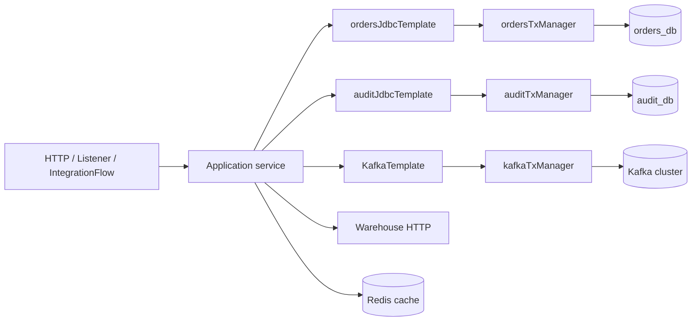
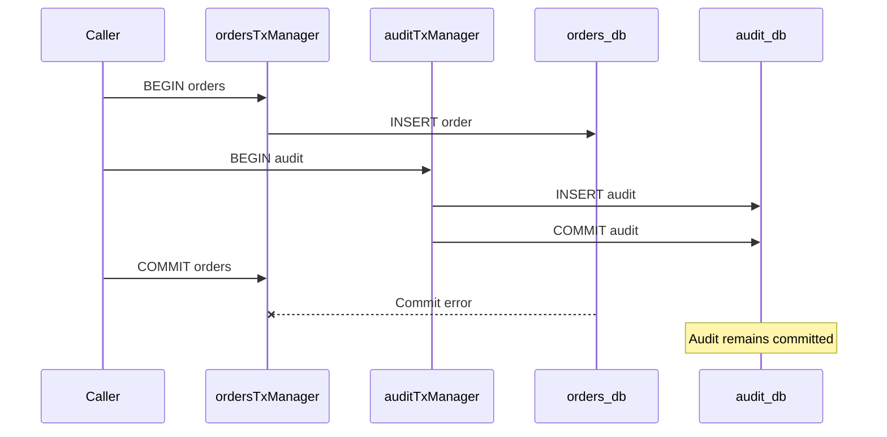
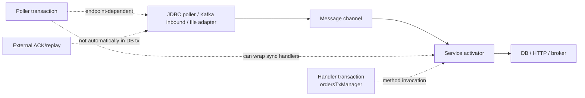
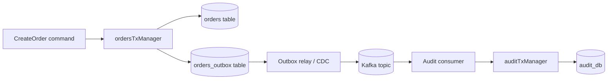
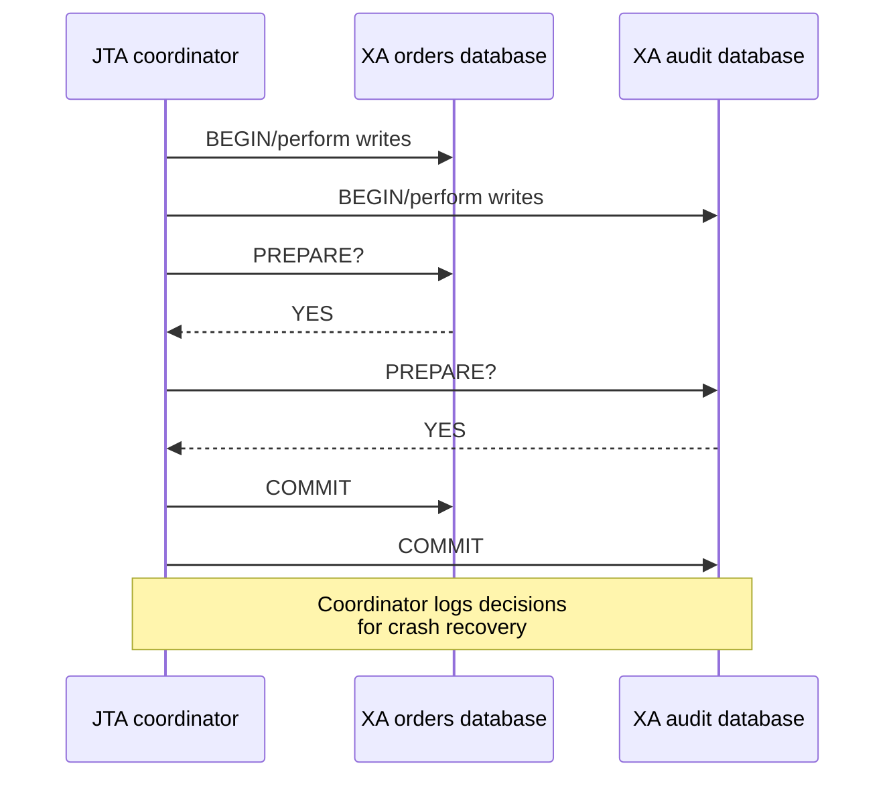
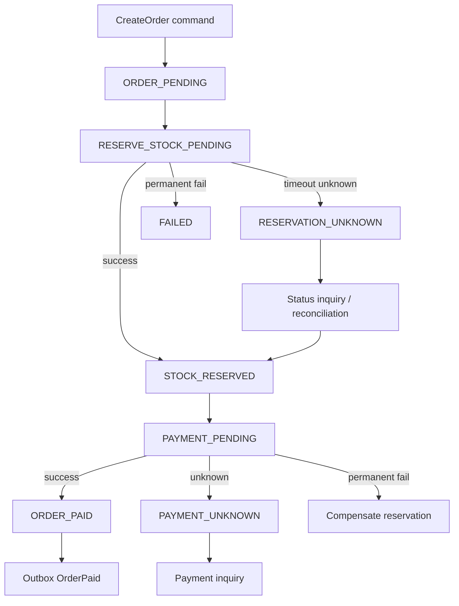

# Multiple Transaction Managers and Specifying the Right Resource

## 1. Problem: One Spring Boot Service, Multiple Transaction Types

Suppose `order-service` must:

1. Write the order into the PostgreSQL database `orders_db`.
2. Write an audit entry into the database `audit_db`.
3. Publish an `OrderCreated` event to Kafka.
4. Call `warehouse-service` over HTTP to reserve stock.
5. Refresh or invalidate Redis cache data.

A method:

```java
@Transactional
public void createOrder(CreateOrderCommand command) {
    orders.insert(command);
    audit.insert(command);
    kafkaPublisher.publish(command);
    warehouseClient.reserve(command);
    cache.evict(command.orderId());
}
```

does **not** automatically create an ACID transaction spanning the first PostgreSQL DB, the second PostgreSQL DB, Kafka, HTTP, and Redis. `@Transactional` executes through **one selected transaction manager** for that invocation. Picking the wrong manager can write a resource outside a transaction, roll back one store while committing another, or report success before the broker actually confirms.

This lesson belongs to the **Integration Transactions** chapter of **SPRING_BOOT_INTEGRATION**. The focus is configuration, transaction contracts, errors, duplicate handling, testing, and observability when Spring Boot coordinates HTTP clients, databases, caches, brokers, and Spring Integration adapters.

**After this lesson, you will be able to:**

1. Distinguish a **local transaction**, multiple local transactions, and a **distributed transaction/XA**.
2. Identify `PlatformTransactionManager`, `ReactiveTransactionManager`, `TransactionManager`, and the resource type each manager actually governs.
3. Configure two independent `DataSource`s, two `JdbcTemplate`s, and two `JdbcTransactionManager`s in Spring Boot.
4. Specify the manager with `@Transactional(transactionManager = "...")`, `@Qualifier`, and `TransactionTemplate`.
5. Understand `@Primary`, default managers, AOP proxies, propagation, isolation, and transaction synchronization when multiple managers exist.
6. Choose proper boundaries for JPA, JDBC, R2DBC, Kafka, RabbitMQ, Redis cache, and Spring Integration handlers.
7. Choose outbox/inbox, saga/reconciliation, or XA/JTA according to the guarantees actually needed.
8. Test rollbacks/cross-resource partial commits, log transaction identity, and operate failure scenarios.

> **Version note:** Main examples use Java 17+, Spring Boot 3.x, Spring Framework 6.x, Spring JDBC, PostgreSQL, and Spring Kafka compatible with project dependency management. On Spring Boot 4.x/Spring Framework 7.x, verify API names, BOMs, auto-configuration, and current semantics. Examples for JMS, RabbitMQ, R2DBC, and Kafka clarify transaction boundaries without assuming every dependency is present in a single application.

## 2. A Transaction Manager Only Manages Resources It Owns

A local transaction binds to **a single resource or a group of resources that the manager knows how to coordinate**. It governs start, commit, rollback, isolation, connection/session handling, and transaction synchronization according to that resource's capabilities.



This diagram contains **three independent transaction managers**, while the HTTP endpoint and cache do not automatically join a shared transaction with them.

| Resource / Stack | Common Manager | Scope of Guarantee |
| --- | --- | --- |
| JDBC with a single `DataSource` | `DataSourceTransactionManager` or `JdbcTransactionManager` | One local database transaction on connections from that datasource. |
| JPA/Hibernate | `JpaTransactionManager` | One `EntityManagerFactory`/persistence unit; can coordinate JDBC on the same datasource if configured properly. |
| R2DBC | `R2dbcTransactionManager` | Reactive transaction over one `ConnectionFactory`, binding context to Reactor. |
| Kafka producer | `KafkaTransactionManager` | Kafka producer transactions, supported records/offsets within Kafka's scope. |
| RabbitMQ | `RabbitTransactionManager` | Local Rabbit channel transaction; **not** XA between Rabbit and DB. |
| JMS | `JmsTransactionManager` or `JtaTransactionManager` | Local JMS session or JTA/XA if resources and infrastructure both support it. |
| JTA/XA | `JtaTransactionManager` | Can coordinate multiple XA participants via 2-phase commit, with operational limits. |
| Redis cache | `RedisCacheManager` + transaction synchronization | Can defer cache put/evict until after commit; **not** a distributed ACID transaction. |
| External HTTP/REST API | No local Spring transaction manager guarantees provider-side rollback | Requires idempotency keys, inquiry, compensation, and durable workflow state. |

### 2.1. Interfaces to Distinguish

- `TransactionManager` in Spring is the root marker interface.
- `PlatformTransactionManager` serves imperative transactions, typically JDBC/JPA and thread-bound.
- `ReactiveTransactionManager` serves reactive publisher transactions, typically with R2DBC and Reactor Context.
- `TransactionTemplate` controls imperative transactions programmatically, taking a concrete `PlatformTransactionManager`.
- `TransactionalOperator` controls reactive transactions via Publishers, taking a `ReactiveTransactionManager`.

**Do not pass an `R2dbcTransactionManager` into `TransactionTemplate` expecting it to manage JDBC.** Likewise, a `JpaTransactionManager` does not manage R2DBC connections merely because they point to the same hostname/database.

### 2.2. Resource Binding: Why the Right Manager Must Be Selected

When starting an imperative transaction, the manager obtains a connection/session, sets `autoCommit=false` or opens the corresponding transaction, and binds the resource to Spring's transaction synchronization. Templates/repositories using the **matching `DataSource`/`EntityManagerFactory`** access that transactional resource.

```text
Thread executing OrderWriteService
  Transaction context:
    DataSource ordersDataSource -> Connection A (transaction active)

ordersJdbcTemplate -> ordersDataSource -> uses Connection A
auditJdbcTemplate  -> auditDataSource  -> separate Connection B
                                          (not part of orders transaction)
```

If only `ordersTxManager` is active, `auditJdbcTemplate` **does not** automatically join the `orders_db` transaction. Connection B may auto-commit, or run inside a separate audit transaction if opened explicitly.

**Key relationship:** `@Transactional` marks the **transaction scope of a proxy call**, not “every SQL statement in this method belongs to a single transaction.”

## 3. Manager Selection Matrix Before Writing Code

| Task | Manager to Choose | Pitfall to Avoid |
| --- | --- | --- |
| Write/read `orders_db` via `ordersJdbcTemplate` | `ordersTxManager` | `auditTxManager` has no control to roll back orders. |
| Write `audit_db` via `auditJdbcTemplate` | `auditTxManager` | `ordersTxManager` provides no atomicity for audit. |
| JPA writes via `ordersEntityManagerFactory` | `ordersJpaTxManager` | Do not pick a JDBC manager pointing to another datasource. |
| Reactive R2DBC repository | `ordersR2dbcTxManager` | Reactive context differs from imperative transactions. |
| Send multiple Kafka records as one Kafka transaction | `kafkaTxManager` or Kafka transactional API | Does not guarantee DB commits alongside Kafka. |
| Process Rabbit message with local broker transaction | `rabbitTxManager` scoped to Rabbit | Broker ack is not JDBC commit. |
| Spring Integration JDBC poll and update same DB | Manager for the relevant JDBC datasource | Handler advice on another manager does not automatically cover source poll/ack. |
| DB UPDATE then Redis invalidation | DB transaction + after-commit synchronization/outbox | Redis `DEL` cannot roll back a committed DB. |

Before every `@Transactional` annotation, you should be able to state clearly: **“Which connection/session does this manager own, and what rolls back if the method fails?”**

## 4. Hands-On: Two PostgreSQL Databases, Two Local Transactions

Let's use a simple yet accurate example of multiple transaction managers: `orders_db` and `audit_db` are two distinct databases. They may be two PostgreSQL instances or two databases on the same server; the example still **never assumes** a single local JDBC transaction covers both.

### 4.1. Maven Dependencies

```xml
<!-- With Spring Boot parent/BOM managing versions -->
<dependency>
    <groupId>org.springframework.boot</groupId>
    <artifactId>spring-boot-starter-jdbc</artifactId>
</dependency>
<dependency>
    <groupId>org.postgresql</groupId>
    <artifactId>postgresql</artifactId>
    <scope>runtime</scope>
</dependency>
<dependency>
    <groupId>org.springframework.boot</groupId>
    <artifactId>spring-boot-starter-test</artifactId>
    <scope>test</scope>
</dependency>
```

`spring-boot-starter-jdbc` brings Spring JDBC, HikariCP, and appropriate transaction management; JPA is unnecessary when the example only uses JDBC. If `spring-boot-starter-data-jpa` is added later, explicitly design JPA's manager and datasource rather than letting auto-configuration “guess” wrongly.

### 4.2. Schemas in Both Databases

Run this migration on **`orders_db`**:

```sql
CREATE TABLE orders (
    command_id  VARCHAR(100) PRIMARY KEY,
    tenant_id   VARCHAR(80) NOT NULL,
    status      VARCHAR(30) NOT NULL,
    total_cents BIGINT NOT NULL CHECK (total_cents >= 0),
    created_at  TIMESTAMPTZ NOT NULL DEFAULT CURRENT_TIMESTAMP
);
```

Run a **separate** migration on `audit_db`:

```sql
CREATE TABLE audit_entries (
    event_id     VARCHAR(160) PRIMARY KEY,
    command_id   VARCHAR(100) NOT NULL,
    event_type   VARCHAR(80) NOT NULL,
    created_at   TIMESTAMPTZ NOT NULL DEFAULT CURRENT_TIMESTAMP
);
```

Under this design there are no cross-database foreign keys; audit only carries business identifiers. In production, each database needs its own retention policy, access permissions, migrations, and backups.

### 4.3. Custom DataSource Properties Configuration

```yaml
# application.yml
app:
  datasource:
    orders:
      url: ${ORDERS_JDBC_URL:jdbc:postgresql://localhost:5432/orders_db}
      username: ${ORDERS_DB_USER:orders_app}
      password: ${ORDERS_DB_PASSWORD}
      hikari:
        maximum-pool-size: 10
        minimum-idle: 2
    audit:
      url: ${AUDIT_JDBC_URL:jdbc:postgresql://localhost:5432/audit_db}
      username: ${AUDIT_DB_USER:audit_app}
      password: ${AUDIT_DB_PASSWORD}
      hikari:
        maximum-pool-size: 5
        minimum-idle: 1
```

The prefixes `app.datasource.orders.*` and `app.datasource.audit.*` are **user-defined configuration**, not two `spring.datasource.*` blocks auto-created by Spring Boot. We will bind `DataSourceProperties` explicitly for each prefix. Never commit real passwords to the repository.

### 4.4. Declaring Two `DataSource`s and Two Managers

```java
// MultiDatabaseConfig.java
package com.example.integration.tx;

import javax.sql.DataSource;
import com.zaxxer.hikari.HikariDataSource;
import org.springframework.beans.factory.annotation.Qualifier;
import org.springframework.boot.autoconfigure.jdbc.DataSourceProperties;
import org.springframework.boot.context.properties.ConfigurationProperties;
import org.springframework.context.annotation.Bean;
import org.springframework.context.annotation.Configuration;
import org.springframework.context.annotation.Primary;
import org.springframework.jdbc.core.JdbcTemplate;
import org.springframework.jdbc.support.JdbcTransactionManager;
import org.springframework.transaction.annotation.EnableTransactionManagement;

@Configuration(proxyBeanMethods = false)
@EnableTransactionManagement
public class MultiDatabaseConfig {

    @Bean("ordersDataSourceProperties")
    @Primary
    @ConfigurationProperties("app.datasource.orders")
    DataSourceProperties ordersProps() {
        return new DataSourceProperties();
    }

    @Bean("auditDataSourceProperties")
    @ConfigurationProperties("app.datasource.audit")
    DataSourceProperties auditProps() {
        return new DataSourceProperties();
    }

    @Bean("ordersDataSource")
    @Primary
    @ConfigurationProperties("app.datasource.orders.hikari")
    HikariDataSource ordersDataSource(
        @Qualifier("ordersDataSourceProperties")
        DataSourceProperties properties
    ) {
        return properties.initializeDataSourceBuilder()
            .type(HikariDataSource.class)
            .build();
    }

    @Bean("auditDataSource")
    @ConfigurationProperties("app.datasource.audit.hikari")
    HikariDataSource auditDataSource(
        @Qualifier("auditDataSourceProperties")
        DataSourceProperties properties
    ) {
        return properties.initializeDataSourceBuilder()
            .type(HikariDataSource.class)
            .build();
    }

    @Bean("ordersJdbc")
    @Primary
    JdbcTemplate ordersJdbc(
        @Qualifier("ordersDataSource") DataSource dataSource
    ) {
        return new JdbcTemplate(dataSource);
    }

    @Bean("auditJdbc")
    JdbcTemplate auditJdbc(
        @Qualifier("auditDataSource") DataSource dataSource
    ) {
        return new JdbcTemplate(dataSource);
    }

    @Bean("ordersTxManager")
    @Primary
    JdbcTransactionManager ordersTxManager(
        @Qualifier("ordersDataSource") DataSource dataSource
    ) {
        return new JdbcTransactionManager(dataSource);
    }

    @Bean("auditTxManager")
    JdbcTransactionManager auditTxManager(
        @Qualifier("auditDataSource") DataSource dataSource
    ) {
        return new JdbcTransactionManager(dataSource);
    }
}
```

**Why is this configuration valid?**

1. Both `DataSourceProperties` pull URLs and credentials from distinct prefixes; builders construct two independent `HikariDataSource` instances.
2. `ordersJdbc` **only** uses `ordersDataSource`; `auditJdbc` **only** uses `auditDataSource`.
3. `ordersTxManager` is created with the **exact same `ordersDataSource` instance** used by `ordersJdbc`. Same for `auditTxManager`.
4. `@Qualifier` avoids bean confusion during injection when multiple beans share a type.
5. `@Primary` marks orders as fallback so certain auto-configs/injections do not fail with ambiguity; **business methods must still specify managers explicitly**.
6. `@EnableTransactionManagement` enables the transaction interceptor for imperative proxy methods. Spring Boot enables this automatically in many cases, though the example declares it to make intent explicit.

Do not declare these beans manually while simultaneously assuming Spring Boot will auto-create both datasources from property groups alone. Certain auto-configurations **back off** once custom beans appear; JDBC/JPA migrations, health checks, and metrics must be configured/evaluated for **both**.

### 4.5. Dependencies Must Stay Consistent

Avoid setups like:

```java
// WRONG if JdbcTemplate uses auditDataSource while the manager governs orders.
@Transactional(transactionManager = "ordersTxManager")
public void addAudit(String eventId) {
    auditJdbc.update("INSERT INTO audit_entries ...");
}
```

The annotation above does not roll back audit alongside `orders_db` transactions. This bug is hard to notice if you only test the happy path; an auto-committed `INSERT` still looks like it “worked.”

### 4.6. Repositories Using the Matching `JdbcTemplate`

```java
// OrdersDao.java
package com.example.integration.tx;

import org.springframework.beans.factory.annotation.Qualifier;
import org.springframework.jdbc.core.JdbcTemplate;
import org.springframework.stereotype.Repository;

@Repository
public class OrdersDao {
    private final JdbcTemplate jdbc;

    public OrdersDao(
        @Qualifier("ordersJdbc") JdbcTemplate jdbc
    ) {
        this.jdbc = jdbc;
    }

    public void insert(
        String commandId, String tenantId, long totalCents
    ) {
        jdbc.update("""
            INSERT INTO orders
                (command_id, tenant_id, status, total_cents)
            VALUES (?, ?, 'PENDING', ?)
            """, commandId, tenantId, totalCents);
    }

    public long countByCommandId(String commandId) {
        return jdbc.queryForObject("""
            SELECT COUNT(*) FROM orders WHERE command_id = ?
            """, Long.class, commandId);
    }
}
```

```java
// AuditDao.java
package com.example.integration.tx;

import org.springframework.beans.factory.annotation.Qualifier;
import org.springframework.jdbc.core.JdbcTemplate;
import org.springframework.stereotype.Repository;

@Repository
public class AuditDao {
    private final JdbcTemplate jdbc;

    public AuditDao(
        @Qualifier("auditJdbc") JdbcTemplate jdbc
    ) {
        this.jdbc = jdbc;
    }

    public void insertAccepted(String commandId) {
        jdbc.update("""
            INSERT INTO audit_entries
                (event_id, command_id, event_type)
            VALUES (?, ?, 'ORDER_ACCEPTED')
            """, "accepted:" + commandId, commandId);
    }

    public long countByCommandId(String commandId) {
        return jdbc.queryForObject("""
            SELECT COUNT(*) FROM audit_entries WHERE command_id = ?
            """, Long.class, commandId);
    }
}
```

Use parameter binding rather than concatenating inputs directly into SQL. Unique keys help curb duplicate writes on command retries; however, a duplicate key exception must be classified into idempotent replay or conflict per contract, never blindly treated as success.

## 5. `@Transactional(transactionManager = "...")`: Making Boundaries Explicit

### 5.1. Independent Audit Transaction

```java
// AuditWriteService.java
package com.example.integration.tx;

import org.springframework.stereotype.Service;
import org.springframework.transaction.annotation.Transactional;

@Service
public class AuditWriteService {
    private final AuditDao audit;

    public AuditWriteService(AuditDao audit) {
        this.audit = audit;
    }

    @Transactional(transactionManager = "auditTxManager")
    public void recordAccepted(String commandId) {
        audit.insertAccepted(commandId);
    }
}
```

### 5.2. Independent Orders Transaction

```java
// OrderWriteService.java
package com.example.integration.tx;

import org.springframework.stereotype.Service;
import org.springframework.transaction.annotation.Transactional;

@Service
public class OrderWriteService {
    private final OrdersDao orders;
    private final AuditWriteService audit;

    public OrderWriteService(
        OrdersDao orders, AuditWriteService audit
    ) {
        this.orders = orders;
        this.audit = audit;
    }

    @Transactional(transactionManager = "ordersTxManager")
    public void create(
        String commandId,
        String tenantId,
        long totalCents,
        boolean simulateFailureAfterAudit
    ) {
        if (commandId == null || commandId.isBlank()
            || tenantId == null || tenantId.isBlank()
            || totalCents < 0) {
            throw new IllegalArgumentException("Invalid order command");
        }

        orders.insert(commandId, tenantId, totalCents);
        audit.recordAccepted(commandId);

        if (simulateFailureAfterAudit) {
            throw new IllegalStateException(
                "Simulated failure before orders commit"
            );
        }
    }
}
```

**What happens:**

1. Caller invokes `OrderWriteService.create(...)` **through a Spring proxy**; `ordersTxManager` begins a transaction on the orders datasource.
2. `orders.insert(...)` runs inside that orders transaction.
3. `audit.recordAccepted(...)` calls **another bean through its proxy**; `auditTxManager` begins a transaction on the audit datasource and commits upon returning.
4. When `simulateFailureAfterAudit=true`, the orders method throws a runtime exception before committing; `ordersTxManager` rolls back the **orders transaction**.
5. **The committed audit does not automatically roll back.** Two managers do not create distributed atomicity; `@Transactional` on the outer method does not make the audit transaction a child of the orders transaction.

```text
orders_db transaction:
  BEGIN -> INSERT order -> ... -> ROLLBACK

audit_db transaction:
                      BEGIN -> INSERT audit -> COMMIT

Outcome:
  orders_db: 0 order
  audit_db : 1 audit event
```

`simulateFailureAfterAudit` is **lesson fault injection**, never a business API parameter that belongs in production. In a real system, auditing a **failed** attempt may still have value, though naming the event `ORDER_ACCEPTED` would mislead. If the audit must describe **committed orders only**, use an outbox or workflow updating audit after commit rather than a direct imperative call like this.

### 5.3. Does a Propagating Exception Roll Back Both?

If `audit.recordAccepted(...)` throws a runtime exception that propagates out of `create(...)`, the **orders transaction** also normally rolls back per Spring's default rollback rules. Yet that is **two rollbacks triggered by an exception**, not proof of atomic commit. One audit transaction could already commit before orders fails to commit, or one could commit while the other fails during commit.

**Conclusion:** “Both rolled back in one test” does not prove they always commit or roll back together across every failure window.

## 6. Selecting Managers by Annotation, Bean Name, and Qualifier

### 6.1. Bean Names Are Configuration Contracts

In this example, the Spring container holds:

```text
DataSource:
  ordersDataSource -> orders_db
  auditDataSource  -> audit_db

JdbcTemplate:
  ordersJdbc -> ordersDataSource
  auditJdbc  -> auditDataSource

PlatformTransactionManager:
  ordersTxManager -> ordersDataSource
  auditTxManager  -> auditDataSource
```

The name in `@Transactional(transactionManager = "ordersTxManager")` is a **bean name or qualifier** used to pick the transaction manager. The `value` attribute is an alias:

```java
@Transactional("ordersTxManager")
public void placeOrder() { /* ... */ }

// Equivalent:
@Transactional(transactionManager = "ordersTxManager")
public void placeOrderSame() { /* ... */ }
```

Here `ordersTxManager` is the exact bean name; renaming the bean requires updating references or providing matching aliases/qualifiers. A typo can fail at runtime rather than being caught by the Java compiler as a type error.

### 6.2. `@Primary` Resolves Ambiguity but Does Not Prove “Correctness”

When two `PlatformTransactionManager` beans exist, an annotation:

```java
@Transactional
public void writeAuditOnly() {
    auditDao.insertAccepted("cmd-42");
}
```

**does not state** which manager to use. Depending on transaction infrastructure configuration, bean names, `@Primary`, `TransactionManagementConfigurer`, and Spring version, the container may pick a default or fail with ambiguity. In our sample config, `ordersTxManager` is `@Primary`, so the method above risks running under the orders transaction even though it writes to audit.

**Production rule:** when managers govern different resources, specify `transactionManager = "..."` explicitly on business entry points or define an explicit class-level default and override where needed. Never trust a manager to be right “because it happens to be the `@Primary` bean.”

### 6.3. `TransactionManagementConfigurer` If a Default Is Truly Needed

Spring supports `TransactionManagementConfigurer` to declare the default manager for annotation-driven transactions when no qualifier is given:

```java
// Alternative configuration example; unnecessary if every @Transactional
// already specifies its manager explicitly.
import org.springframework.beans.factory.annotation.Qualifier;
import org.springframework.context.annotation.Configuration;
import org.springframework.transaction.PlatformTransactionManager;
import org.springframework.transaction.annotation.TransactionManagementConfigurer;

@Configuration(proxyBeanMethods = false)
public class TransactionDefaults
    implements TransactionManagementConfigurer {

    private final PlatformTransactionManager orders;

    public TransactionDefaults(
        @Qualifier("ordersTxManager")
        PlatformTransactionManager orders
    ) {
        this.orders = orders;
    }

    @Override
    public PlatformTransactionManager
        annotationDrivenTransactionManager() {
        return orders;
    }
}
```

When using this interface, verify your Spring version and interaction with `@EnableTransactionManagement`; **do not** wire multiple conflicting configurers. A default only serves clear policy boundaries; it does not bind `auditDao` to an audit transaction automatically.

### 6.4. Constructor `@Qualifier` Differs from Selecting a Transaction Manager

```java
public OrderService(
    @Qualifier("auditJdbc") JdbcTemplate auditJdbc
) { /* ... */ }
```

This injection qualifier picks the **`JdbcTemplate`**, not the `@Transactional` manager on the method. You still must specify `@Transactional("auditTxManager")` or build a `TransactionTemplate` with the audit manager.

### 6.5. Naming Conventions Help Spot Wrong Scopes

An easy-to-review resource naming convention:

| Role | Orders | Audit |
| --- | --- | --- |
| Properties | `ordersDataSourceProperties` | `auditDataSourceProperties` |
| Connection source | `ordersDataSource` | `auditDataSource` |
| JDBC access | `ordersJdbc` | `auditJdbc` |
| Transaction manager | `ordersTxManager` | `auditTxManager` |
| Repository | `OrdersDao` | `AuditDao` |
| Service boundary | `@Transactional("ordersTxManager")` | `@Transactional("auditTxManager")` |
| Migration | Orders migration context | Audit migration context |
| Metrics | `db=orders` | `db=audit` |

Encoding the resource owner in bean names helps operations correlate rollback/pool issues with the right database.

## 7. Controlling Local Transactions with `TransactionTemplate`

For conditional workflows or when precise commit boundaries belong in code, `TransactionTemplate` is clearer than juggling ambiguous annotations.

### 7.1. Two Templates with Two Managers

```java
// TransactionTemplatesConfig.java
package com.example.integration.tx;

import org.springframework.beans.factory.annotation.Qualifier;
import org.springframework.context.annotation.Bean;
import org.springframework.context.annotation.Configuration;
import org.springframework.transaction.PlatformTransactionManager;
import org.springframework.transaction.support.TransactionTemplate;

@Configuration(proxyBeanMethods = false)
public class TransactionTemplatesConfig {

    @Bean("ordersTxTemplate")
    TransactionTemplate ordersTxTemplate(
        @Qualifier("ordersTxManager")
        PlatformTransactionManager manager
    ) {
        return new TransactionTemplate(manager);
    }

    @Bean("auditTxTemplate")
    TransactionTemplate auditTxTemplate(
        @Qualifier("auditTxManager")
        PlatformTransactionManager manager
    ) {
        return new TransactionTemplate(manager);
    }
}
```

### 7.2. Two Sequential Local Transactions

```java
// IndependentTransactionWorkflow.java
package com.example.integration.tx;

import org.springframework.beans.factory.annotation.Qualifier;
import org.springframework.stereotype.Service;
import org.springframework.transaction.support.TransactionTemplate;

@Service
public class IndependentTransactionWorkflow {
    private final TransactionTemplate ordersTx;
    private final TransactionTemplate auditTx;
    private final OrdersDao orders;
    private final AuditDao audit;

    public IndependentTransactionWorkflow(
        @Qualifier("ordersTxTemplate") TransactionTemplate ordersTx,
        @Qualifier("auditTxTemplate") TransactionTemplate auditTx,
        OrdersDao orders, AuditDao audit
    ) {
        this.ordersTx = ordersTx;
        this.auditTx = auditTx;
        this.orders = orders;
        this.audit = audit;
    }

    public void execute(
        String commandId, String tenantId, long totalCents
    ) {
        ordersTx.executeWithoutResult(status ->
            orders.insert(commandId, tenantId, totalCents)
        ); // orders COMMITS before continuing

        auditTx.executeWithoutResult(status ->
            audit.insertAccepted(commandId)
        ); // audit COMMITS independently
    }
}
```

The code makes commit boundaries **easy to read**, yet a crash window still exists:

```text
ordersTx: BEGIN -> INSERT -> COMMIT OK
                               |
                               +-> process crash
                                      |
auditTx :                          not yet BEGIN
```

There is no way to merge two sequential `TransactionTemplate` calls into an atomic distributed transaction merely by wrapping them in `try/catch`. If audit fails after orders commits, the caller needs **workflow recovery**; you cannot `rollback()` an already committed orders transaction.

### 7.3. Be Careful When Nesting Templates

```java
ordersTx.execute(status -> {
    orders.insert(commandId, tenantId, totalCents);
    auditTx.executeWithoutResult(s ->
        audit.insertAccepted(commandId)
    );
    return null;
});
```

An outer orders transaction still **does not** extend atomicity to audit. The two managers have separate resource contexts. Audit can commit before orders commits, and an orders commit error still leaves the audit row behind.

## 8. Propagation, Isolation, Rollback Rules, and Proxies

### 8.1. `REQUIRED` and `REQUIRES_NEW` Apply Within the Manager's Scope

| Attribute | When Called with Same Transaction Manager | When Two Managers Differ |
| --- | --- | --- |
| `REQUIRED` | Joins existing transaction or starts a new one. | Does not “join” the other datasource's transaction. |
| `REQUIRES_NEW` | Suspends **this manager's** active transaction (if supported), starts a new independent one. | Does not create XA; the other manager still manages its own resource. |
| `NESTED` | Can use JDBC savepoints if supported by manager/driver. | Does not create a nested distributed transaction. |
| `SUPPORTS` | Uses existing transaction if present. | Does not create a transaction for another resource. |
| `MANDATORY` | Requires an existing transaction visible to this manager. | Another manager's transaction does not satisfy it. |
| `NOT_SUPPORTED` | Can suspend an active transaction of the selected manager. | Not guaranteed to suspend resources of other managers. |

Example:

```java
@Transactional(
    transactionManager = "auditTxManager",
    propagation = Propagation.REQUIRES_NEW
)
public void recordAuditInNewAuditTransaction(...) { /* ... */ }
```

`Propagation` is a policy applied when the chosen manager sees a transaction on the **exact resource it manages**. Do not use `REQUIRES_NEW` as a tool to “split and roll back all databases.” When nesting `REQUIRES_NEW` on the **same datasource**, an extra connection is usually needed for the new transaction, so check pool capacity to avoid connection-exhaustion deadlocks.

### 8.2. One Manager Cannot Roll Back Another Manager's Committed Transaction



Even if the outer method sees the exception, one manager has no authority to “undo” a completed commit on a resource owned by another manager.

### 8.3. Default Rollback and Checked Exceptions

With standard Spring transaction annotations, defaults are:

- `RuntimeException` and `Error` trigger rollback.
- Checked exceptions usually **do not** automatically trigger rollback unless configured otherwise.

Example:

```java
@Transactional(
    transactionManager = "ordersTxManager",
    rollbackFor = java.io.IOException.class
)
public void importOrderFile() throws java.io.IOException {
    // Orders JDBC operations inside local transaction.
}
```

Do not accidentally `catch (Exception)` and return normally when the transaction must roll back. When catching errors to map domain failures, explicitly decide whether to set rollback-only or rethrow an appropriate exception. You may use `noRollbackFor` per contract, but understand its effect on transaction state and other side effects.

### 8.4. Isolation and `readOnly` Do Not Switch Transaction Managers

```java
@Transactional(
    transactionManager = "ordersTxManager",
    isolation = Isolation.READ_COMMITTED,
    readOnly = true
)
public OrderView readOrder(...) { /* ... */ }
```

Which isolation levels are supported depends on the database/driver; `readOnly=true` is usually a **hint/optimization**, not an ironclad block against writes in every environment. An audit transaction manager cannot control the isolation of an orders connection even if the annotation specifies an isolation name.

### 8.5. Spring AOP and Self-Invocation

```java
@Service
class BadService {
    public void run() {
        this.saveInAudit(); // Internal call, bypasses transaction proxy.
    }

    @Transactional(transactionManager = "auditTxManager")
    public void saveInAudit() { /* ... */ }
}
```

Under default proxy-based transaction management, `this.saveInAudit()` can **bypass** the interceptor, causing audit `INSERT`s to auto-commit. Move the method into another Spring bean, call via the proxy, or use `TransactionTemplate` explicitly.

Other cases to evaluate:

- Methods not invoked through a Spring-managed proxy.
- `private`/non-interceptable methods per proxy configuration.
- `new Thread(...)`, `@Async`, executors, and callbacks running on other threads: imperative `ThreadLocal` transactions **do not automatically propagate**.
- Errors occurring after an async task was submitted and the caller already returned: the caller's transaction may have already committed.
- In Spring Integration, endpoints/pollers on different threads may open different transactions; do not infer solely from method signatures.

### 8.6. Transaction Timeout and Duration

Do not keep a DB transaction open while doing:

```text
BEGIN orders transaction
  SELECT / UPDATE
  HTTP call to Warehouse, 10-second timeout
  Kafka publish retried 3 times
  Thread.sleep(backoff)
COMMIT
```

This holds connections, locks, and resources while waiting on other services. Use short local transactions for business data/outbox, and let independent workers perform HTTP/Kafka calls with idempotency. Transaction timeout is not a global deadline for external HTTP calls; set timeouts/budgets at each integration boundary.

## 9. JPA/Hibernate When an Application Has Multiple DataSources

An application might use JPA for orders and JDBC for audit. That requires the **matching `EntityManagerFactory` and `JpaTransactionManager`**:

```java
// Structural example when EntityManagerFactory is configured separately.
import jakarta.persistence.EntityManagerFactory;
import org.springframework.beans.factory.annotation.Qualifier;
import org.springframework.context.annotation.Bean;
import org.springframework.orm.jpa.JpaTransactionManager;

@Bean("ordersJpaTxManager")
JpaTransactionManager ordersJpaTxManager(
    @Qualifier("ordersEntityManagerFactory")
    EntityManagerFactory entityManagerFactory
) {
    return new JpaTransactionManager(entityManagerFactory);
}
```

If there are two JPA persistence units, each unit needs:

1. A matching `DataSource`.
2. An `EntityManagerFactory`.
3. A `JpaTransactionManager` for that factory.
4. `@EnableJpaRepositories`/repository scanning pointing to the right `entityManagerFactoryRef` and `transactionManagerRef`.
5. Non-overlapping schema migrations and entity packages.

Illustrative repository scanning configuration:

```java
@EnableJpaRepositories(
    basePackages = "com.example.orders.jpa",
    entityManagerFactoryRef = "ordersEntityManagerFactory",
    transactionManagerRef = "ordersJpaTxManager"
)
class OrdersJpaRepositoriesConfig {
    // Corresponding EntityManagerFactory configuration created separately.
}
```

This snippet is an **outline** for an optional JPA setup, not a complete replacement for `MultiDatabaseConfig`. When mixing JPA with JDBC **on the same datasource and persistence unit**, `JpaTransactionManager` can coordinate compatible JDBC access via Spring's transaction infrastructure if configured consistently; do not add a separate `JdbcTransactionManager` assuming both always see the same transaction/connection.

**Do not confuse:** Hibernate `Session`, Spring Data JPA repositories, and JDBC statements have different flush/connection semantics. A JDBC query executed before a JPA flush may not see changes pending in the persistence context; understand flush timing and test real behavior.

## 10. R2DBC: A Transaction Context Distinct from JDBC/JPA

Reactive database access uses `R2dbcTransactionManager`, not `JdbcTransactionManager`:

```java
// ReactiveTransactionsConfig.java
import org.springframework.beans.factory.annotation.Qualifier;
import org.springframework.context.annotation.Bean;
import org.springframework.r2dbc.connection.R2dbcTransactionManager;
import io.r2dbc.spi.ConnectionFactory;
import org.springframework.transaction.reactive.TransactionalOperator;

@Bean("ordersR2dbcTxManager")
R2dbcTransactionManager ordersR2dbcTxManager(
    @Qualifier("ordersConnectionFactory")
    ConnectionFactory connectionFactory
) {
    return new R2dbcTransactionManager(connectionFactory);
}

@Bean("ordersReactiveTx")
TransactionalOperator ordersReactiveTx(
    @Qualifier("ordersR2dbcTxManager")
    R2dbcTransactionManager manager
) {
    return TransactionalOperator.create(manager);
}
```

Above is an **add-on pattern when `ordersConnectionFactory` is configured**; do not place it in a JDBC-only project without R2DBC drivers/dependencies. In a reactive service:

```java
public Mono<OrderView> createReactive(CreateOrder cmd) {
    return ordersR2dbcRepository.save(toEntity(cmd))
        .flatMap(saved -> r2dbcOutbox.insert(saved)
            .thenReturn(toView(saved)))
        .as(ordersReactiveTx::transactional);
}
```

With `Mono`/`TransactionalOperator` chained within one Publisher, transaction state normally flows via **Reactor Context** rather than solely `ThreadLocal`. The snippet assumes `ordersR2dbcRepository`, `r2dbcOutbox`, and DTO/converters are provided by the application; the goal is illustrating the boundary.

**Unsafe practices:**

- Wrapping a blocking `JpaRepository.save(...)` inside `Mono.just(...)` and expecting it to run under an R2DBC transaction.
- Calling `subscribe()` inside a service and returning immediately, misleading the caller into assuming the transaction committed.
- Calling `block()` on a WebFlux event loop.
- Using an unqualified `@Transactional` in a context containing both imperative and reactive managers expecting Spring to guess business intent.
- Mixing JDBC writes and R2DBC writes expecting an ACID transaction across two connection factories without an appropriate transaction protocol.

In mixed-stack applications, split orchestration into clear steps: local DB transactions, outbox/inbox, and eventual consistency when communicating across resources outside one transaction.

## 11. Kafka Transaction Manager: Atomic Inside Kafka, Not Atomic with PostgreSQL

Spring Kafka provides `KafkaTransactionManager` for producer transactions when the producer factory is configured transactionally. In Spring Boot, a common configuration is:

```yaml
spring:
  kafka:
    bootstrap-servers: ${KAFKA_BOOTSTRAP_SERVERS:localhost:9092}
    producer:
      transaction-id-prefix: order-service-tx-
      key-serializer: org.apache.kafka.common.serialization.StringSerializer
      value-serializer: org.apache.kafka.common.serialization.StringSerializer
      acks: all
      properties:
        enable.idempotence: true
```

`transaction-id-prefix` lets Spring Kafka generate producer transaction IDs; across multi-instance deployments, prefix values must be organized to prevent **fencing** caused by colliding transaction IDs across instances. Check how Spring Boot auto-creates `KafkaTransactionManager` in your specific version; never declare two Kafka managers sharing one producer factory without clear intent.

### 11.1. Sending Multiple Records in One Kafka Transaction

```java
// KafkaTemplate configured with a transactional ProducerFactory.
// This is a Kafka-local transaction, NOT an orders_db transaction.
KafkaTemplate<String, String> template = /* injected bean */;
template.executeInTransaction(operations -> {
    operations.send(
        "orders.events.v1", "ORD-42",
        "{\"eventId\":\"evt-42-1\",\"type\":\"OrderCreated\"}"
    );
    operations.send(
        "orders.events.v1", "ORD-42",
        "{\"eventId\":\"evt-42-2\",\"type\":\"OrderValidated\"}"
    );
    return null;
});
```

If the Kafka transaction aborts, records in that transaction are not exposed as committed records to consumers configured with `isolation.level=read_committed`. That does not roll back an already committed PostgreSQL `INSERT`.

### 11.2. Kafka EOS Has a Specific Scope

Kafka transactions can cover **produced records** and **consumer offsets** in Kafka's read–process–write pattern when the framework is properly configured. That is a strong guarantee **within Kafka's scope**, not an exactly-once business effect across databases, emails, or HTTP.

If a service does:

```text
1. BEGIN orders_db
2. INSERT order
3. COMMIT orders_db
4. BEGIN Kafka transaction
5. SEND OrderCreated
6. COMMIT Kafka transaction
```

the process can crash between steps 3 and 4; the order exists yet the event never reached Kafka. Reversing the order can expose an event for an uncommitted order. Some integrations support **transaction synchronization** to order commits, yet a **partial-commit window** still remains; never call that 2PC/XA.

### 11.3. Should You Use `@Transactional("kafkaTxManager")`?

Yes, if you have a `KafkaTransactionManager` bean with that exact name and the handler needs a Kafka-local transaction. Conceptual example:

```java
@Transactional(transactionManager = "kafkaTxManager")
public void publishPair() {
    kafkaTemplate.send("orders.events.v1", "ORD-42", event1);
    kafkaTemplate.send("orders.events.v1", "ORD-42", event2);
}
```

Here `kafkaTemplate` comes from a transactional producer factory; verify both sends participate in that transaction. If using Spring Kafka's `executeInTransaction(...)`, that is an alternative expression; do not stack transaction boundaries arbitrarily.

**When you must guarantee no event is lost after DB commit**, choose a **transactional outbox** rather than relying on the commit order of two local transactions.

## 12. RabbitMQ/JMS and Redis: Resources Outside JDBC

### 12.1. RabbitMQ

`RabbitTransactionManager` manages local Rabbit channel transactions when configured accordingly; consumers can rely on listener container transaction/ack behavior, yet a Rabbit transaction **does not** automatically extend to PostgreSQL.

| What Happens | Possible Outcome |
| --- | --- |
| DB commits, Rabbit ack/channel fails | Message can be redelivered. |
| Rabbit publish succeeds, DB rolls back | Consumers can see an event for uncommitted data. |
| Listener calls handler then dispatches async | Ack can happen before processing if misconfigured. |
| Handler retries without an inbox | DB side effects can execute multiple times. |

Choose durable queues, publisher confirms, acknowledgments, DLX/DLT, and business inbox/idempotency per requirements. A local Rabbit channel transaction does not replace distributed consistency with a DB.

### 12.2. JMS

`JmsTransactionManager` uses local JMS session transactions; when both the JMS provider and database support XA, `JtaTransactionManager` paired with a transaction coordinator can coordinate those XA resources. Infrastructure/driver/container prerequisites are mandatory; **do not** assume every JMS setup defaults to XA or that Spring auto-configures full 2PC.

### 12.3. Redis and Caches

Redis `MULTI/EXEC` has its own semantics inside Redis, not shared ACID transactions with JDBC. Transaction-aware Spring Cache can defer `put/evict` until after DB commit:

```text
BEGIN orders DB transaction
  UPDATE order
COMMIT orders DB
AFTER_COMMIT -> evict Redis cache key
```

If the process crashes after commit and before `evict`, stale keys persist until TTL expires or durable invalidation/outbox catches up. Do not pick `ordersTxManager` expecting it to roll back a Redis `INCR` or `PUBLISH` that already ran.

### 12.4. HTTP Partners

An HTTP call to Warehouse/Payment can commit on the provider before the response is lost. Local transaction managers cannot roll back remote effects. Safe retries must rely on stable `Idempotency-Key`s, provider status-inquiry contracts, durable workflow state, and compensation when needed—never solely on HTTP `503` or timeout exceptions.

## 13. Transaction Boundaries in Spring Integration

Spring Integration separates message sources, message channels, pollers, handlers, and outbound adapters. Transaction boundaries can begin at a **poller**, an **inbound adapter/listener container**, or a **handler**, depending on configuration. An `@Transactional` on a handler **does not** automatically wrap polling, acknowledgments, executor dispatch, or third-party calls.



### 13.1. Handler Writing to the Orders Database

```java
// OrderCommandHandler.java
package com.example.integration.tx;

import org.springframework.integration.annotation.ServiceActivator;
import org.springframework.messaging.Message;
import org.springframework.stereotype.Component;
import org.springframework.transaction.annotation.Transactional;

@Component
public class OrderCommandHandler {
    private final OrdersDao orders;

    public OrderCommandHandler(OrdersDao orders) {
        this.orders = orders;
    }

    @ServiceActivator(inputChannel = "orderCommands")
    @Transactional(transactionManager = "ordersTxManager")
    public void handle(Message<CreateOrderCommand> message) {
        CreateOrderCommand cmd = message.getPayload();
        orders.insert(cmd.commandId(), cmd.tenantId(),
            cmd.totalCents());
    }
}
```

```java
// CreateOrderCommand.java
package com.example.integration.tx;

public record CreateOrderCommand(
    String commandId, String tenantId, long totalCents
) {}
```

This example requires `spring-integration-core` (usually via `spring-boot-starter-integration`) and an `orderCommands` channel registered in an `IntegrationFlow`. Actual endpoint invocation must pass through a Spring transaction proxy for the annotation to apply; verify with rollback tests and DB queries rather than guessing from annotations.

Things to verify:

- Does the inbound adapter use a `DirectChannel` or an `ExecutorChannel`? Switching threads drops imperative transaction state.
- Does the poller open its own transaction, and which datasource's manager does it use?
- Does the source adapter claim/delete the message before the handler commits?
- When the handler throws, does the exception return to the adapter/listener or get absorbed by an error channel/recovery callback?
- When are broker offsets/acks committed relative to the orders transaction?

### 13.2. Transactional Poller vs. Transactional Handler

Suppose a JDBC inbound adapter reads a pending row and marks it claimed. To put **receive/claim** and subsequent database updates inside one transaction, configure the **matching datasource's** manager at the right boundary (typically the poller or an application transaction wrapping synchronous source handling).

```text
Poller ordersTxManager:
  BEGIN orders_db transaction
    SELECT/CLAIM pending work
    send via DirectChannel
    synchronous handler updates orders_db
  COMMIT orders_db transaction
```

In this diagram, sharing the transaction depends on how the source runs SQL, synchronous channel dispatch, and using the same `DataSource`/manager. If the message traverses an executor or the poller only enqueues into another queue, the poller transaction may commit **before the handler executes**. If the poller uses `auditTxManager` while the inbound source queries `ordersDataSource`, writes may auto-commit outside the intended transaction.

Do not place transaction advice on both pollers and handlers at arbitrary layers assuming they automatically form one transaction. When using `RequestHandlerRetryAdvice`, check advice ordering:

```text
Proper target for retrying a local DB transaction:
  Retry advice
    -> BEGIN a new orders transaction
       -> handler SQL
       -> COMMIT / ROLLBACK
    -> retry if transient, starting a fresh transaction

Risk:
  BEGIN orders transaction
    -> Retry handler SQL inside an already rollback-only transaction
    -> COMMIT fails or state is invalid
```

A deadlock requires rolling back the old transaction and executing a **new unit of work**. Local DB errors differ from HTTP write timeouts: if a remote call committed before the response was lost, retrying the whole handler can duplicate external side effects.

### 13.3. Kafka/Rabbit Listener Acknowledgments

For consumers:

```text
Kafka/Rabbit delivers event
  -> BEGIN orders_db
  -> business update + inbox marker
  -> COMMIT orders_db
  -> acknowledge/commit offset
```

If the process crashes **after DB commit but before acknowledgment**, the message can be redelivered. Recording `eventId` in an inbox within the same transaction as the business update lets subsequent deliveries detect duplicates. The DB transaction manager **does not** atomically commit Kafka offsets or Rabbit acks.

If a listener hands off to an in-memory executor and acks immediately, DB work can be lost on pod crash. Define durable handoffs, retry/error handlers, and acknowledgment policies per adapter/container.

### 13.4. Channels Are Not Transactional by Default

`DirectChannel` normally dispatches synchronously on the sender's thread. `QueueChannel` and `ExecutorChannel` introduce buffering/thread boundaries; in-JVM queues are not durable across restarts. Polling sources, message stores, and brokers each have distinct transaction/ack semantics. A transaction manager **does not replace** channel, message store, or broker durability.

## 14. Commit Timing of Each Manager Must Be Controlled

### 14.1. Transaction Synchronization

Spring offers transaction synchronizations such as post-commit/completion callbacks. They help with side effects that do not need to run synchronously inside the local transaction:

```text
orders DB transaction:
  BEGIN
  UPDATE order
  COMMIT
  afterCommit callback -> evict Redis key
```

However:

- Callbacks are **not durable queues**; a process crash before the callback loses the action.
- A failing callback **cannot roll back** an already committed DB transaction.
- When multiple transaction managers are active on the same thread, understand which scope registered the synchronization and which commit triggers the callback; **never** treat every `afterCommit` as confirmation that all resources committed.
- On reactive stacks, transaction state lives in Reactor Context and synchronization APIs/semantics differ from imperative code; never copy `ThreadLocal` callbacks mechanically.

### 14.2. “Last Resource” and Commit Ordering Do Not Create 2PC

Suppose a Spring transaction synchronization chain commits the database and then commits Kafka. If the DB commits and Kafka fails to commit, the system is in a partial-commit state. Reversing commit order introduces the opposite window where Kafka commits and the DB fails. Naming managers, reordering advice, or using `REQUIRES_NEW` does not eliminate those two failure windows.

### 14.3. `ChainedTransactionManager`: A Historical Warning

In the Spring Data/Kafka ecosystem, classes like `ChainedTransactionManager` once existed to start multiple local transactions and commit them sequentially. Those classes have been deprecated in relevant library branches and must never be used as a promise of atomic 2PC.

**Fundamental flaw:** once the first transaction commits and the second fails at commit time, the chain can only report a partial commit; it **cannot roll back the earlier commit**. Never choose a chained manager as an “easier-than-XA yet atomic” shortcut. For strict consistency requirements, choose outbox/saga, or XA/JTA where genuinely supported.

## 15. More Reliable Design: Transactional Outbox

Suppose the orders database is the source of truth and audit/Kafka follow downstream:



The main operation needs only **one** local orders transaction to:

1. Insert/update the order with a stable business command ID.
2. Insert the outbox event in the same transaction.
3. Commit both or roll back both.

The relay publishes the event after commit. The audit service consumes the event using its own audit transaction and an inbox marker/unique event ID to deduplicate. This is **recoverable eventual consistency**, not an instant atomic commit across two databases.

### 15.1. Outbox Table in the Orders Database

```sql
-- Migration in orders_db, alongside the orders table.
CREATE TABLE orders_outbox (
    event_id       VARCHAR(160) PRIMARY KEY,
    command_id     VARCHAR(100) NOT NULL,
    event_type     VARCHAR(80)  NOT NULL,
    payload_json   TEXT NOT NULL,
    published      BOOLEAN NOT NULL DEFAULT FALSE,
    created_at     TIMESTAMPTZ NOT NULL DEFAULT CURRENT_TIMESTAMP
);

CREATE INDEX idx_orders_outbox_pending
    ON orders_outbox(published, created_at);
```

### 15.2. Outbox DAO Using **`ordersJdbc`**

```java
// OrdersOutboxDao.java
package com.example.integration.tx;

import org.springframework.beans.factory.annotation.Qualifier;
import org.springframework.jdbc.core.JdbcTemplate;
import org.springframework.stereotype.Repository;

@Repository
public class OrdersOutboxDao {
    private final JdbcTemplate jdbc;

    public OrdersOutboxDao(
        @Qualifier("ordersJdbc") JdbcTemplate jdbc
    ) {
        this.jdbc = jdbc;
    }

    public void recordCreated(
        String commandId, String payloadJson
    ) {
        jdbc.update("""
            INSERT INTO orders_outbox
                (event_id, command_id, event_type, payload_json)
            VALUES (?, ?, 'OrderCreated', ?)
            """,
            "order-created:" + commandId,
            commandId,
            payloadJson
        );
    }
}
```

### 15.3. Saving Order + Outbox in One Transaction

```java
// OrderCommandService.java
package com.example.integration.tx;

import org.springframework.stereotype.Service;
import org.springframework.transaction.annotation.Transactional;

@Service
public class OrderCommandService {
    private final OrdersDao orders;
    private final OrdersOutboxDao outbox;
    private final OrderEventSerializer eventSerializer;

    public OrderCommandService(
        OrdersDao orders,
        OrdersOutboxDao outbox,
        OrderEventSerializer eventSerializer
    ) {
        this.orders = orders;
        this.outbox = outbox;
        this.eventSerializer = eventSerializer;
    }

    @Transactional(transactionManager = "ordersTxManager")
    public void create(CreateOrderCommand cmd) {
        orders.insert(
            cmd.commandId(), cmd.tenantId(), cmd.totalCents()
        );
        outbox.recordCreated(
            cmd.commandId(),
            eventSerializer.orderCreatedJson(cmd)
        );
    }
}
```

`OrderEventSerializer` is a **custom application interface/adapter** to build JSON payloads per the event contract, not a built-in Spring class:

```java
// OrderEventSerializer.java
package com.example.integration.tx;

public interface OrderEventSerializer {
    String orderCreatedJson(CreateOrderCommand command);
}
```

An implementation can use Jackson `ObjectMapper` to serialize a DTO containing `eventId`, `commandId`, `tenantId`, timestamps, and schema version per contract. Never concatenate unescaped input into JSON strings.

**Key property:** both `OrdersDao` and `OrdersOutboxDao` use the **same `ordersJdbc`/`ordersDataSource`**. Because the service method uses `ordersTxManager`, both `INSERT`s run in **one local transaction**. This is straightforward to prove with a rollback test.

### 15.4. Relay and Audit Consumer

```text
orders_db:
  committed order + committed outbox row

relay:
  poll/claim outbox -> publish Kafka with stable eventId
  wait for broker ack -> mark published

audit consumer:
  consume event -> BEGIN auditTxManager
  INSERT audit entry + inbox marker/eventId
  COMMIT audit_db -> ack broker
```

If the relay publishes successfully and crashes before marking published, the event may be published again. The audit consumer needs **idempotency** (unique `event_id` or inbox ID), rather than relying on Kafka producer idempotence to prevent application-level replays after restart.

To avoid **multiple relays claiming** the same outbox row simultaneously, use an appropriate claim/lease/locking mechanism (e.g., PostgreSQL `FOR UPDATE SKIP LOCKED` in a short transaction, or CDC). Avoid holding a database transaction open across a long Kafka network timeout whenever possible; design separate worker leases and states.

### 15.5. When Audit Requires “Exactly One Event”

An audit table with `event_id PRIMARY KEY` blocks duplicate inserts. If additional side effects exist (sending emails, calling HTTP), use an inbox/workflow record to prevent duplicate execution after consumer restarts. The inbox marker and audit row must be written in the **same audit transaction**. Committing the inbox first while a downstream side effect fails later could cause replays to skip work erroneously.

### 15.6. What If Eventual Consistency Is Unacceptable?

Ask: does the business genuinely require simultaneous atomic commits across two databases, or does it simply need **zero lost commands, zero duplicate side effects, and reconcilability**? For many integration systems, outbox + retry/reconciliation is chosen because failure modes are explicit and operationally simpler than distributed transactions.

If an atomic commit across two transactional resources is strictly required, evaluate JTA/XA, each resource's capabilities, infrastructure, and recovery costs in the next section.

## 16. XA/JTA: When a True Transaction Coordinator Is Needed

**Two-phase commit (2PC)** can coordinate multiple XA resources:



With Spring, `JtaTransactionManager` integrates with an external JTA provider/transaction coordinator (such as Narayana or an application server container, depending on infrastructure) and **XA-capable `DataSource`/connection factories**. Swapping a single bean from `JdbcTransactionManager` to `JtaTransactionManager` is not enough.

### 16.1. Mandatory Requirements

- Both resources must support XA and implement prepare/commit/rollback/recovery properly.
- `DataSource`s must be configured as real XA datasources and enlisted in the coordinator.
- Coordinator transaction logs must be durable; crash recovery must be verified.
- Timeouts, prepared transactions, database locks, and operational privileges must be tightly controlled.
- Failover must be tested before and after `PREPARE`/`COMMIT`, not just testing “two `INSERT`s succeed together.”

### 16.2. Limits of XA with Kafka/HTTP/Redis

Kafka transactions are **not standard XA participants** for `JtaTransactionManager`; typical HTTP APIs are not XA either. Redis caches do not automatically join 2PC across databases. Therefore, even if two XA PostgreSQL resources commit together, outbox/saga is still needed for side effects outside that XA set.

### 16.3. Operational Cost

XA brings prepare/commit overhead, distributed locks, coordinator logs, risks of in-doubt transactions, and complex recovery procedures. Do not adopt XA just because one method calls two repositories; examine whether application boundaries can be redesigned so state requiring atomicity resides in **one database transaction**.

## 17. Saga, Compensation, and Unknown-Outcome States

When a workflow spans orders DB → Warehouse HTTP → Payment API → Kafka, no single local Spring transaction manager can roll everything back. Replace it with **resumable workflow state**, idempotency keys, and compensation.



Principles:

1. Every logical command carries an ID that remains stable across HTTP retries, message redelivery, and restarts.
2. Persist workflow state inside an **appropriate local DB transaction**, never solely in memory.
3. On a remote call read timeout, never deduce the remote side failed to commit; state may be `UNKNOWN_OUTCOME`.
4. Only retry commands with side effects when an idempotency guarantee or reliable status inquiry exists.
5. Compensation (e.g., `releaseReservation`) is a new business command that also needs idempotency/retry/reconciliation.
6. Never mislabel compensation as distributed rollback: compensation does not erase prior history and can fail itself.

**Picking the right manager makes local transactions meaningful; cross-system consistency additionally requires a workflow protocol.**

## 18. Failure-Mode Matrix with Multiple Managers

| Failure Window | Orders DB | Audit DB | Kafka/HTTP | Right Response |
| --- | --- | --- | --- | --- |
| Validation fails before transaction | Not written. | Not written. | Not called. | Fail fast; do not retry same payload. |
| Orders JDBC insert runs then rolls back | No committed row. | Not written. | Not called. | Retry local transaction if error is transient. |
| Audit commits, orders rolls back | No order. | Audit row exists. | Not called. | Reconcile; never assume all-or-nothing. |
| Orders commits, audit unavailable | Order exists. | Not audited. | Flow-dependent. | Outbox/retry audit; cannot roll back committed orders. |
| Orders commits, crash before Kafka publish | Order exists. | May lack audit. | Missing event. | Outbox still holds event pending publish. |
| Kafka publishes then crashes before marking sent | Order exists. | May lack audit. | Event present, will republish. | `eventId`/inbox/idempotent consumer. |
| Consumer commits audit, crashes before offset commit | Order exists. | Audited. | Kafka redelivery. | Unique `eventId`, no duplicate audit insert. |
| Warehouse commits yet HTTP response lost | Order may exist. | Unrelated. | Unknown remote side effect. | Stable idempotency key/status inquiry. |
| Redis eviction fails after DB commit | Updated. | Unrelated. | Stale cache. | TTL + outbox invalidation/alert. |
| Kafka listener fails deserialization | Should not update business data. | Should not write audit. | Poison record. | Quarantine/DLT; do not retry indefinitely. |

**An error managed by another manager is not proof that your current manager rolled back.** Check real DB state, committed offsets/outbox rows, and traces to verify actual state.

## 19. Testing with Two Real Databases: Proving Which Resource Owns Each Transaction

**The single most important test** for this topic makes one manager roll back while the other commits, and then queries state directly from **both databases**.

### 19.1. Testcontainers for Two PostgreSQL Instances

With Maven, add BOM-compatible test dependencies:

```xml
<dependency>
    <groupId>org.testcontainers</groupId>
    <artifactId>postgresql</artifactId>
    <scope>test</scope>
</dependency>
<dependency>
    <groupId>org.testcontainers</groupId>
    <artifactId>junit-jupiter</artifactId>
    <scope>test</scope>
</dependency>
```

A Spring Boot test can override **both custom property groups** via `@DynamicPropertySource`:

```java
// MultiTransactionIntegrationTest.java
package com.example.integration.tx;

import static org.junit.jupiter.api.Assertions.*;

import org.junit.jupiter.api.BeforeEach;
import org.junit.jupiter.api.Test;
import org.springframework.beans.factory.annotation.Autowired;
import org.springframework.beans.factory.annotation.Qualifier;
import org.springframework.boot.test.context.SpringBootTest;
import org.springframework.jdbc.core.JdbcTemplate;
import org.springframework.test.context.DynamicPropertyRegistry;
import org.springframework.test.context.DynamicPropertySource;
import org.testcontainers.containers.PostgreSQLContainer;
import org.testcontainers.junit.jupiter.Container;
import org.testcontainers.junit.jupiter.Testcontainers;

@SpringBootTest
@Testcontainers
class MultiTransactionIntegrationTest {

    @Container
    static final PostgreSQLContainer<?> ordersDb =
        new PostgreSQLContainer<>("postgres:16-alpine");

    @Container
    static final PostgreSQLContainer<?> auditDb =
        new PostgreSQLContainer<>("postgres:16-alpine");

    @DynamicPropertySource
    static void dynamicProperties(DynamicPropertyRegistry registry) {
        registry.add(
            "app.datasource.orders.url",
            ordersDb::getJdbcUrl
        );
        registry.add(
            "app.datasource.orders.username",
            ordersDb::getUsername
        );
        registry.add(
            "app.datasource.orders.password",
            ordersDb::getPassword
        );
        registry.add(
            "app.datasource.audit.url",
            auditDb::getJdbcUrl
        );
        registry.add(
            "app.datasource.audit.username",
            auditDb::getUsername
        );
        registry.add(
            "app.datasource.audit.password",
            auditDb::getPassword
        );
    }

    @Autowired OrderWriteService orderWriter;
    @Autowired OrdersDao orders;
    @Autowired AuditDao audit;

    @Autowired
    @Qualifier("ordersJdbc")
    JdbcTemplate ordersJdbc;

    @Autowired
    @Qualifier("auditJdbc")
    JdbcTemplate auditJdbc;

    @BeforeEach
    void reset() {
        // DDL only for self-contained test; production uses a migration tool.
        ordersJdbc.execute("""
            CREATE TABLE IF NOT EXISTS orders (
                command_id VARCHAR(100) PRIMARY KEY,
                tenant_id VARCHAR(80) NOT NULL,
                status VARCHAR(30) NOT NULL,
                total_cents BIGINT NOT NULL
            )
            """);
        auditJdbc.execute("""
            CREATE TABLE IF NOT EXISTS audit_entries (
                event_id VARCHAR(160) PRIMARY KEY,
                command_id VARCHAR(100) NOT NULL,
                event_type VARCHAR(80) NOT NULL
            )
            """);
        ordersJdbc.update("DELETE FROM orders");
        auditJdbc.update("DELETE FROM audit_entries");
    }

    @Test
    void ordersRollbackDoesNotUndoCommittedAudit() {
        assertThrows(IllegalStateException.class,
            () -> orderWriter.create(
                "cmd-rollback", "tenant-a", 250_000L, true
            )
        );

        assertEquals(0L,
            orders.countByCommandId("cmd-rollback"));
        assertEquals(1L,
            audit.countByCommandId("cmd-rollback"));
    }

    @Test
    void normalCallCommitsBothLocalTransactions() {
        orderWriter.create(
            "cmd-success", "tenant-a", 250_000L, false
        );

        assertEquals(1L,
            orders.countByCommandId("cmd-success"));
        assertEquals(1L,
            audit.countByCommandId("cmd-success"));
    }
}
```

**Prerequisites for this example:**

- Project has a Spring Boot application class in a package scan covering `MultiDatabaseConfig`, DAOs, and services.
- Docker/Testcontainers is available in the test environment.
- Each PostgreSQL instance has matching schema fixtures, without extra unshown constraints causing unrelated failures.
- If using Flyway/Liquibase, run real migrations or separate test migrations per DB; never accidentally run one auto-migration against both DBs.
- **Do not put `@Transactional` on the test class/methods** when observing real commits/rollbacks in services. An enclosing test transaction causes assertions to run before commit.
- These tests prove semantics for this configuration and flow, not resilience against every crash/failover/partial commit during database/broker outages.

### 19.2. Testing `TransactionTemplate` Rolls Back the Right DataSource

```java
// Can be placed in a test with ordersTxTemplate and OrdersDao injected.
assertThrows(IllegalStateException.class,
    () -> ordersTxTemplate.executeWithoutResult(status -> {
        orders.insert("cmd-tx", "tenant-a", 1000L);
        throw new IllegalStateException("rollback orders");
    })
);

assertEquals(0L, orders.countByCommandId("cmd-tx"));
```

With an equivalent test for `auditTxTemplate`, verify `audit_entries` rolls back. If a similar test leaves a row behind, investigate:

1. Which manager is the transaction template using?
2. Which datasource is the DAO using?
3. Did code manually open a connection via `DriverManager` or another datasource instance bypassing Spring transactions?
4. Did `@Async`/another thread run the SQL?
5. Was there `REQUIRES_NEW`, a caught exception, or an unintended manual commit?

### 19.3. Tests with Multiple Managers Require Dedicated Assertions

| Test | Expectation |
| --- | --- |
| Orders write then throw runtime exception | Orders row rolls back. |
| Audit write then throw runtime exception | Audit row rolls back. |
| Audit commits then orders throws | Audit exists, orders missing; demonstrates partial commit. |
| `@Transactional("auditTxManager")` on orders DAO | Test exposes that orders does **not** roll back as desired. |
| Method calls `this.innerTransactional()` | Detects self-invocation bypassing proxy. |
| `@Async` method calls JDBC | Does not assume caller thread's transaction propagated. |
| Checked exception without `rollbackFor` | Test confirms the project's active rollback rules. |
| Two transaction managers active simultaneously | Each datasource uses its own connection/scope. |
| Outbox `INSERT` in same orders transaction | If outbox fails, order rolls back. |
| Orders DB commits then relay crashes | Outbox row remains and can replay. |
| Duplicate Kafka publish after restart | Audit inbox/unique event ID prevents duplicate side effects. |
| Redis cache evict fails after commit | DB still committed; TTL/alert/recovery present. |
| Kafka listener commits DB then crashes before offset commit | Event redelivered without duplicate orders/audit. |

### 19.4. Is Mocking the Transaction Manager Enough?

Mocking `PlatformTransactionManager` can verify that a method calls `getTransaction()`/`commit()`/`rollback()`, yet **does not prove SQL used the right transactional connection**. To verify proper resource routing, run integration tests against two real datasources, read data after commit/rollback, and inject faults.

## 20. Verifying and Observing Which Manager Is Active in Production

### 20.1. Log at the Right Level Without Exposing Data

To investigate local transactions, you can enable DEBUG/TRACE on select Spring transaction loggers **in test environments or for bounded windows**. Example:

```yaml
# Use only temporarily for controlled testing/troubleshooting.
logging:
  level:
    org.springframework.transaction.interceptor: TRACE
    org.springframework.jdbc.datasource.DataSourceTransactionManager: DEBUG
```

Logger names and messages can vary across Spring versions; never rely on a log line as proof of ACID. Avoid broad SQL parameter/body logging in production, as it can expose PII, credentials, or sensitive business data.

Signals worth recording in structured logs:

```json
{
  "service": "order-service",
  "operation": "createOrder",
  "resource": "orders_db",
  "transactionManager": "ordersTxManager",
  "outcome": "ROLLED_BACK",
  "errorCategory": "SIMULATED_FAILURE",
  "correlationId": "trace-example"
}
```

This is an **illustrative application log schema**, not JSON generated automatically by Spring. Record resource/manager separately for audit and outbox; if one logical command spans multiple transactions, do not collapse them into one “transaction success” metric.

### 20.2. `TransactionSynchronizationManager` Is Diagnostic-Only

In imperative code, `TransactionSynchronizationManager` provides APIs like:

```java
boolean active =
    TransactionSynchronizationManager
        .isActualTransactionActive();
```

However, `active=true` **does not tell you which datasource owns the transaction**. Tooling/tests can inspect the resource holder of a specific `DataSource`, yet internal introspection should never become business logic. In reactive code, this `ThreadLocal` check does not reflect the full Reactor transaction context.

### 20.3. Resource-Scoped Metrics

| Metric/Signal | Why It Is Needed |
| --- | --- |
| Orders Hikari active/idle/pending connections | Detects orders pool saturation or long-held connections. |
| Audit Hikari active/idle/pending | Separates audit DB outages from orders DB outages. |
| Transaction commit/rollback counts and duration | Shows which manager fails or has overly long transactions. |
| Database deadlocks/lock waits | Helps determine whether retries need a fresh transaction. |
| Outbox pending count/oldest age | Detects orders committing while Kafka/audit lags behind. |
| Kafka consumer lag/retries/DLT | Detects slow events, poison messages, or replays. |
| Idempotency/inbox duplicate count | Measures redeliveries and side-effect protection. |
| Reconciliation pending/age | Spots state drift between two DBs/services. |
| Cache invalidation failures/latency | Reveals Redis serving stale data after commit. |

Boot Actuator/Micrometer provides JVM, datasource/pool, SQL, or Kafka metrics depending on configuration, yet **does not automatically generate domain metrics** such as oldest-outbox-age, partial commits, or reconciliation counts. Those require dedicated code/query instrumentation.

Name pools clearly such as `orders-pool` and `audit-pool` when using Hikari metrics. Avoid using raw `commandId`, email, or order ID as metric labels due to high cardinality and data exposure risks.

## 21. Runbook When Partial Commit Is Detected

**Scenario:** a customer reports an order exists, yet the audit system or Kafka consumer never saw the event.

1. Query `commandId`/event ID from the source of truth `orders_db`; verify whether the row committed.
2. Check the transaction manager and datasource used by the order-writing code; do not stop at checking `@Transactional` is present.
3. Inspect `orders_outbox` to see if the corresponding event exists, its published status, and last attempt.
4. Check Kafka publisher acknowledgments, consumer group lag, retries, and DLT.
5. Query `audit_db` by event ID/command ID to distinguish **not yet processed** from **processed with lost response/ack**.
6. If the order exists without an outbox event, investigate whether any write path bypassed the service transaction/outbox.
7. If the outbox has not published yet, trigger controlled replay keeping the `eventId` unchanged.
8. If audit already has the event, do not write it a second time; return idempotent state or drop duplicate per contract.
9. If Warehouse/Payment HTTP was involved, inquire by key before resending commands with side effects.
10. After recovery, add regression tests for that failure window and alerts for early detection.

**Never delete audit rows, reset Kafka offsets, or re-charge payments just to turn a dashboard “green.”** Every replay/compensation action needs an owner, an audit trail, and idempotency guards.

## 22. Common Mistakes

| Mistake | Consequence | Fix |
| --- | --- | --- |
| One `@Transactional` method calling two datasources expecting atomicity | One database commits while the other rolls back. | Define explicit local scopes; use outbox/XA as needed. |
| Using unqualified `@Transactional` when multiple managers exist | Default manager may manage the wrong resource. | Explicitly specify `transactionManager="..."`. |
| Treating `@Primary` datasource as “covering all datasources” | Only selects one bean for injection, not other connections. | Pair DAO/template/manager per resource. |
| `auditJdbc` uses audit datasource while annotation names orders manager | Audit `INSERT` may auto-commit. | Match the exact datasource instance and manager. |
| Two separate `JdbcTransactionManager`s on the same datasource nested arbitrarily | Confusing boundaries managing the same underlying resource. | Standardize on one manager per resource or design scopes intentionally. |
| Changing `@Transactional(REQUIRES_NEW)` to “enable XA” | Only suspends/starts local transactions on that manager. | Use real JTA/XA participants or workflow orchestration. |
| Treating `NESTED` as a distributed transaction | JDBC savepoints do not span another database. | Understand savepoint/local manager limits. |
| Self-invocation `this.save()` | Bypasses proxy transaction advice. | Call via bean/proxy or `TransactionTemplate`. |
| Expecting `@Async` to propagate JDBC transactions | SQL runs on another thread outside scope. | Open boundaries on the worker thread. |
| Catching exceptions and returning normally when rollback is required | Manager may partially commit. | Rethrow/mark rollback-only per contract. |
| Assuming checked exceptions always roll back | Default rule usually does not roll back checked exceptions. | Configure `rollbackFor` and test. |
| Using an R2DBC manager to govern JDBC/JPA | Different context and connection infrastructure. | Keep imperative and reactive TMs separate. |
| `JpaTransactionManager` pointing to the wrong `EntityManagerFactory` | Repositories write outside intended persistence unit. | Wire matching EMF/repository scanning. |
| Treating Kafka EOS as DB+Kafka 2PC | DB commit and Kafka publish can diverge. | Use outbox/inbox for cross-system consistency. |
| Treating `KafkaTemplate.send` future return as broker ACK | Work may not have published yet. | Await async completion/relay state and retry properly. |
| Treating Rabbit acknowledgment as JDBC commit | Message can redeliver after DB commit. | Inbox/idempotent consumer and ack after commit. |
| Assuming Redis evict after DB update is atomically committed | Crash can leave stale cache. | TTL + outbox invalidation where needed. |
| Treating `ChainedTransactionManager` as 2PC | Can partial-commit. | Never advertise atomicity; choose XA or eventual consistency. |
| Unit testing only with a mocked transaction manager | Cannot verify SQL actually ran on a transactional connection. | Two-database Testcontainers and rollback tests. |
| Confusing transaction timeout with HTTP timeout | Long-held locks, retry storms. | Short local transactions, separate external budgets. |

## 23. Design and Review Checklist

1. **Inventory resources:** JDBC/JPA/R2DBC datasources, Kafka, Rabbit/JMS, Redis, and HTTP.
2. **Designate sources of truth:** which system owns business state and unique IDs?
3. **Name every manager clearly:** resource → datasource/factory → manager → DAO/repository.
4. **Annotate explicitly:** `@Transactional(transactionManager = "...")` on business entry points when multiple managers exist.
5. **Check propagation and proxies:** `REQUIRED/REQUIRES_NEW/NESTED` only apply per manager; clarify self-invocation and async boundaries.
6. **Keep transactions short:** never hold DB locks during HTTP calls, Kafka retries, or user waits.
7. **Select the consistency model:** single local DB, outbox/inbox, saga/reconciliation, or JTA/XA where conditions permit.
8. **Separate ack from commit:** crash after DB commit before broker ack causes replay; use idempotency markers.
9. **Build a failure matrix:** for each failure window, what state are both DBs and external systems left in?
10. **Write integration tests:** two real DBs, independent commits/rollbacks, wrong manager check, outbox crash/replay, consumer duplicates.
11. **Observe per resource:** connection pools, deadlocks, transaction duration, outbox age, Kafka lag, DLT, and reconciliation.
12. **Prepare runbooks:** who runs DLQ redrives, lease expiry recovery, and compensation without duplicating effects.

**Self-Check Questions**

1. Which manager does an unqualified `@Transactional` select when a context has multiple `PlatformTransactionManager`s?
2. Why does `@Qualifier("auditJdbc")` not replace `@Transactional("auditTxManager")`?
3. If the orders transaction rolls back after the audit transaction committed, does audit roll back too? Why or why not?
4. Does `REQUIRES_NEW` turn two databases into an XA transaction?
5. In JDBC code, what rule governs the resource type/instance referenced by manager and template?
6. Why does testing with two PostgreSQL containers prove far more than mocking `PlatformTransactionManager`?
7. What component must `JpaTransactionManager` bind to, and when can JDBC on the same datasource participate?
8. What is the difference between `PlatformTransactionManager` and `ReactiveTransactionManager`?
9. Does a Kafka producer transaction automatically roll back PostgreSQL if Kafka commit fails?
10. If orders DB committed yet the Kafka event never published, how does the outbox enable recovery?
11. If a consumer committed the audit DB yet crashed before Kafka offset commit, why is an inbox/unique event ID needed?
12. Why does `@TransactionalEventListener(AFTER_COMMIT)` not replace a durable outbox?
13. Are a Spring Integration poller transaction and a handler transaction always the same scope?
14. When should JTA/XA be considered, and which systems typically do not participate in XA?
15. Why should metrics separate the orders pool from the audit pool instead of measuring generic “database latency”?

## 24. References

- [Spring Framework — Declarative Transaction Management](https://docs.spring.io/spring-framework/reference/data-access/transaction/declarative.html): transaction interception, annotations, and proxy semantics.
- [Spring Framework — `@Transactional` Settings](https://docs.spring.io/spring-framework/reference/data-access/transaction/declarative/annotations.html): manager selection, propagation, isolation, and rollback rules.
- [Spring Framework — Programmatic Transaction Management](https://docs.spring.io/spring-framework/reference/data-access/transaction/programmatic.html): `TransactionTemplate` and `TransactionalOperator`.
- [Spring Framework — Transaction Strategies](https://docs.spring.io/spring-framework/reference/data-access/transaction/strategies.html): platform transaction managers, JDBC, JPA, JTA.
- [Spring Boot — Configure Two DataSources](https://docs.spring.io/spring-boot/how-to/data-access.html#howto.data-access.configure-two-datasources): `DataSourceProperties`, `@Primary`, and binding.
- [Spring Boot — SQL Databases](https://docs.spring.io/spring-boot/reference/data/sql.html): JDBC/JPA configuration and datasource management.
- [Spring Framework — R2DBC](https://docs.spring.io/spring-framework/reference/data-access/r2dbc.html): reactive database access and transaction management.
- [Spring Integration — Transaction Support](https://docs.spring.io/spring-integration/reference/transactions.html): polling/handler transaction boundaries.
- [Spring Integration — Poller Support](https://docs.spring.io/spring-integration/reference/endpoint.html#polling-consumer): polling consumers and transaction advice.
- [Spring for Apache Kafka — Transactions](https://docs.spring.io/spring-kafka/reference/kafka/transactions.html): `KafkaTransactionManager` and transactional producer behavior.
- [Spring for Apache Kafka — Exactly Once Semantics](https://docs.spring.io/spring-kafka/reference/kafka/exactly-once.html): scope of EOS in Kafka.
- [Spring AMQP — Transactions](https://docs.spring.io/spring-amqp/reference/amqp/transactions.html): local Rabbit transactions and transaction synchronization.
- [Spring Framework — Transaction-bound Events](https://docs.spring.io/spring-framework/reference/data-access/transaction/event.html): `@TransactionalEventListener` and after-commit.
- [Testcontainers — PostgreSQL Module](https://java.testcontainers.org/modules/databases/postgres/): integration tests with real databases.
