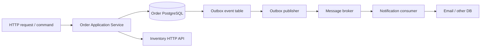
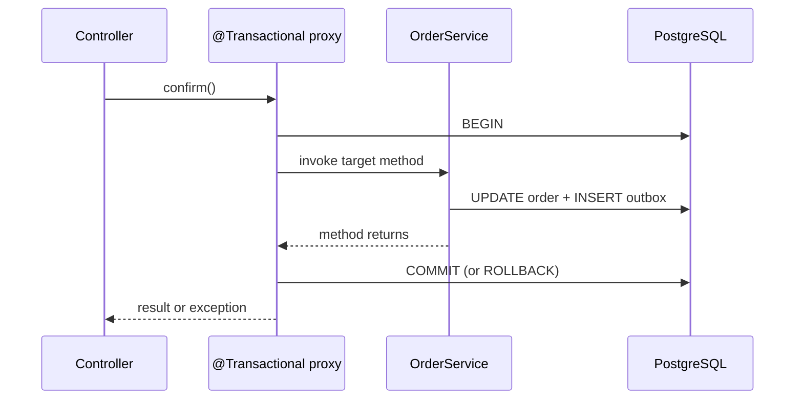
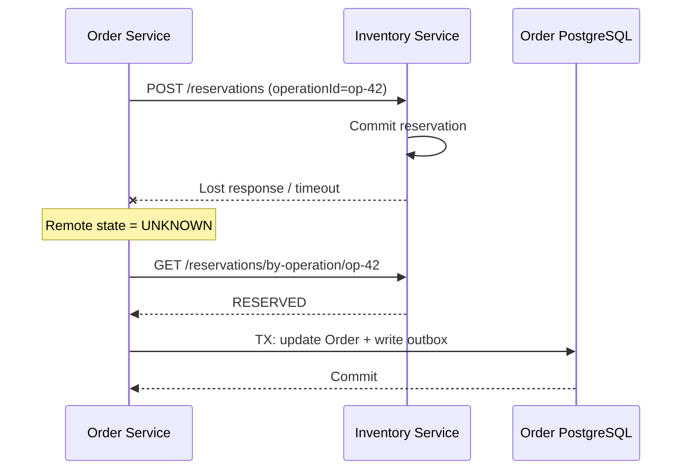
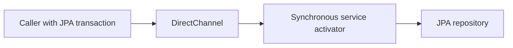
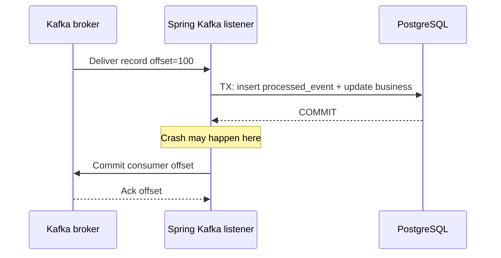
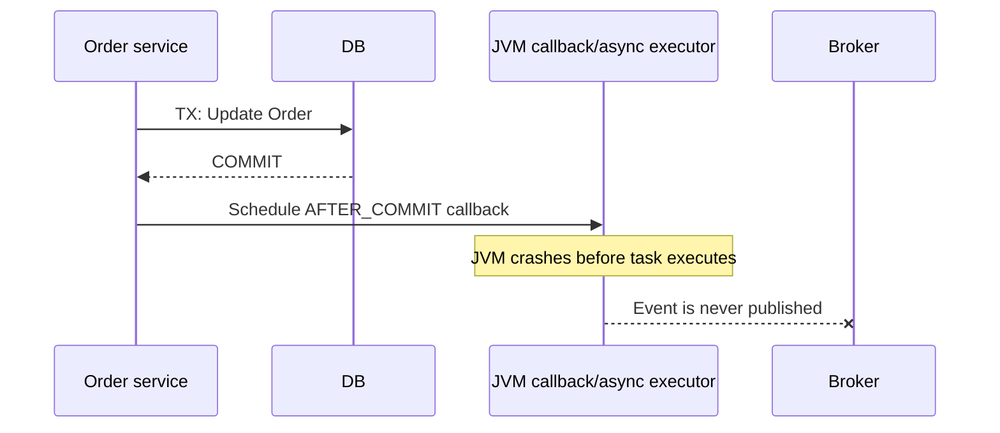
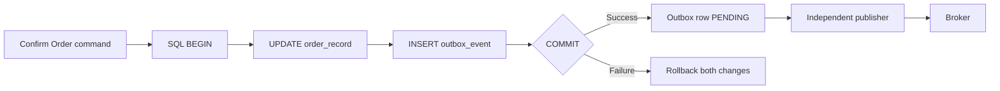
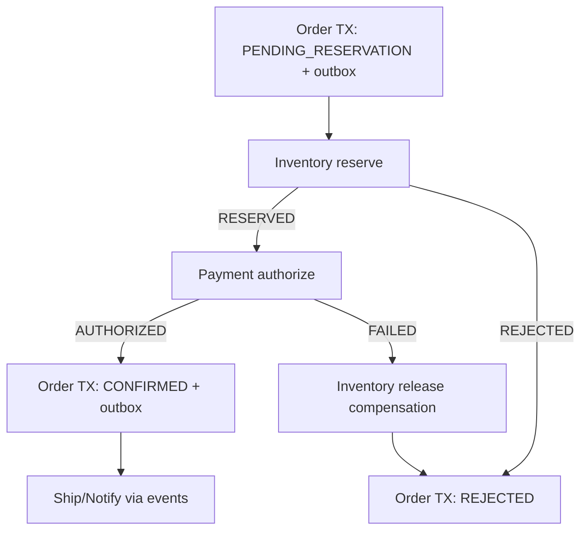

# Transaction Propagation Limits Across HTTP, Asynchronous Flows, or Messaging

## 1. One Transaction Does Not Automatically Cross Every Integration Boundary

In Spring Boot, an order confirmation use case might perform the following steps:

1. Update the order status in PostgreSQL via JPA.
2. Call the Inventory Service over HTTP to reserve stock.
3. Publish an `OrderConfirmed` event to RabbitMQ or Kafka.
4. Update a Redis cache and send an email.

Annotating the Java method containing all these steps with `@Transactional` **does not mean all systems participate in a single atomic transaction**. A transaction manager governs only the resources bound to it: `JpaTransactionManager` typically manages a JPA/database transaction; `DataSourceTransactionManager` manages JDBC connections; message brokers have their own transaction/ack mechanisms. An HTTP request sent to another service **does not carry the caller's SQL transaction**.

Consequence: PostgreSQL can roll back while Inventory has already reserved stock; Kafka can receive a message before the database commits; or the database commits yet the process dies before acknowledging the source message. These situations are not “Spring transaction bugs” but **consistency boundaries between independent systems** that require explicit design.

This lesson belongs to the **Integration Transactions** chapter of the **SPRING_BOOT_INTEGRATION** module: structuring Spring Boot integrations across HTTP clients, databases, caches, message brokers, and Spring Integration adapters, focusing on **configuration, data contracts, transactions, errors, duplicate handling, testing, and observability**. We will distinguish the real guarantees a transaction provides at each boundary and build verifiable recovery workflows.

### 1.1. Learning Objectives

After this lesson, you will be able to:

- Identify which transaction manager manages which resources and where commit/rollback points lie.
- Explain why `@Transactional` does not propagate automatically across HTTP, `@Async`, `CompletableFuture`, `ExecutorChannel`, or brokers.
- Distinguish thread-bound imperative transactions from Reactor-context reactive transactions.
- Analyze failure windows between **database commit**, **HTTP response**, **broker publish confirm**, and **consumer ack/offset commit**.
- Design transactional outbox, idempotent inbox/consumers, and state-driven saga/compensation.
- Apply timeouts, retry budgets, idempotency keys, and error handling at the right layer instead of retrying blindly.
- Test rollbacks, crashes, redeliveries, late responses, and concurrent duplicates using PostgreSQL/Testcontainers, broker fixtures, or HTTP mocks.

> **Version assumptions:** Examples use Java 17+, Spring Boot 3.2+, Spring Framework 6.x, Spring Data JPA, and Spring Integration 6.x. For PostgreSQL, locking and `ON CONFLICT` follow PostgreSQL semantics. Ack mechanics, transaction managers, advice, connector factories, and auto-configuration vary by starter/version; verify against your running version. Illustrative snippets omit imports, packages, and some bean/migration setup.

### 1.2. End-to-End Flow and Commit Boundaries

Suppose endpoint `POST /orders/{id}/confirm` must reserve stock before confirming:



There are at least **four independent commit or acknowledgment points**: the PostgreSQL transaction; the transaction/state inside Inventory; the broker confirming receipt of the publish; and the consumer recording state and committing ack/offset. They do not merge into one atomic transaction just because the calls originate from one application service.

## 2. Map of Transaction Boundaries

### 2.1. Distinguishing “Same Transaction” from “Same Trace”

| Boundary | Does Caller's JPA Transaction Propagate Automatically? | Mechanism to Use |
|---|---|---|
| JPA repository called on same thread and transaction manager | Can join if using the same `EntityManagerFactory` and compatible context | `@Transactional` at service, matching manager |
| `JdbcTemplate` sharing a datasource with JPA | Can share the JDBC transaction under compatible configuration | Test connection/manager; do not infer from matching JDBC URL |
| HTTP `RestClient`/`WebClient` to another microservice | **No** | Idempotency, status inquiry, saga/compensation |
| `@Async`/`CompletableFuture.supplyAsync` | **Does not auto-propagate** imperative transactions | Separate transaction in worker bean |
| Spring Integration `DirectChannel` | Same thread by default; can join current transaction | Verify proxy/advice/manager |
| Spring Integration `ExecutorChannel` | **Does not auto-propagate** thread-bound transactions | Open transaction in handler/consumer |
| Spring Integration `QueueChannel` with polling thread | Does not propagate across enqueue/dequeue | Separate transaction at poller/handler; durable store if needed |
| Kafka/RabbitMQ/JMS delivery | No shared PostgreSQL transaction automatically | Ack/offset, idempotency, outbox |
| Redis, SMTP, object storage, remote RPC | **No** | Contracts, retry/compensation, outbox when needed |
| Reactor R2DBC chain using `ReactiveTransactionManager` | Can propagate via **Reactor Context** within same reactive execution | `TransactionalOperator` or reactive `@Transactional` with right manager |

**Sharing a trace ID, correlation ID, or HTTP header does not mean sharing a database transaction.** Traces observe steps, whereas transaction managers control individual resources and commits.

### 2.2. The Transaction Manager Actually Determines Scope

Spring provides transaction managers with distinct scopes:

```text
Imperative:
  PlatformTransactionManager
    - JpaTransactionManager
    - DataSourceTransactionManager / JdbcTransactionManager
    - JtaTransactionManager when JTA infrastructure is present

Reactive:
  ReactiveTransactionManager
    - R2dbcTransactionManager
    - corresponding reactive managers if available
```

`JpaTransactionManager` starts and ends a JPA transaction for one `EntityManagerFactory`; Hibernate may flush SQL before commit, yet **flush is not commit**. `JtaTransactionManager` can only coordinate resources enlisted in compatible JTA/XA infrastructure; it does not turn a regular HTTP REST API into an XA participant. Kafka/RabbitMQ also do not automatically join PostgreSQL transactions via 2PC.

### 2.3. Three Outcomes to Distinguish After a Request

Every integration call falls into one of three outcome categories:

| Outcome | Interpretation | Caller Decision |
|---|---|---|
| `SUCCESS` with valid response/ack | Confirmed per contract | Advance business state; downstream final steps may still be pending |
| `FAILED` confirmed | Downstream explicitly rejected/rolled back | Handle error or transition to rejected state |
| `UNKNOWN` due to timeout/disconnect | Unknown whether server committed or not | Query status by operation ID; do not resend as a brand-new operation |

The most dangerous mistake in distributed integration is lumping `UNKNOWN` into `FAILED`. An HTTP `SocketTimeoutException` usually only proves **the client did not receive the result in time**, not that the remote database rolled back.

### 2.4. Consistency Contracts by Use Case

Before picking techniques, write down the invariants to protect:

- **Within one database:** “If the order moved to `CONFIRMED`, its corresponding outbox record must also exist.”
- **Between Order and Inventory:** “An order may only confirm with a valid reservation; the reservation is canceled if the workflow fails per policy.”
- **Between database and broker:** “A committed `OrderConfirmed` event has a replay path after a broker outage.”
- **On the consumer side:** “An event delivered twice produces only one business effect.”

Some invariants can be enforced with SQL transactions and unique constraints. Invariants spanning HTTP/brokers require **eventual consistency**, idempotency, and compensating/reconciliation processes.

## 3. Why Do Imperative Transactions Not Cross Threads Automatically?

### 3.1. Thread-Bound Transaction Context in Spring

For imperative JPA/JDBC, Spring normally binds transaction resources to the **executing thread** via `TransactionSynchronizationManager`. When a caller passes through a Spring AOP proxy:



When code spawns a new thread, executor task, or async callback, **the new thread is not automatically bound to the same JPA transaction**.

```java
@Service
public class IncorrectOrderService {
    private final OrderRepository orders;
    private final OutboxRepository outbox;

    @Transactional
    public void confirm(String orderId) {
        orders.confirm(orderId);
        CompletableFuture.runAsync(() ->
                outbox.save(new OutboxEvent(orderId)));
        // Not awaited, no coordinated rollback.
    }
}
```

In this example, `orders.confirm` and `outbox.save` can run in **two different transactions**, or the executor task can fail after the method already returned. Throwing an exception inside `CompletableFuture` does not automatically roll back the caller's transaction. The task might not even start before the caller commits.

**Right approach:** if `Order` and `Outbox` require atomicity in the same database, write both **synchronously in one transaction**. If a task does not require atomicity, give the task its own transaction with proper state and retries.

### 3.2. `@Async` Does Not Share the Caller's Transaction

```java
@Service
class OrderService {
    private final EmailJobService emailJobs;

    @Transactional
    public void confirm(String orderId) {
        // Database changes...
        emailJobs.enqueueAsync(orderId);
    }
}

@Service
class EmailJobService {
    @Async
    @Transactional
    public void enqueueAsync(String orderId) {
        // This is a separate transaction on the async thread,
        // provided the call goes through the Spring proxy and right manager.
    }
}
```

Constraints:

1. `@Async` must be enabled/configured and invoked through the corresponding Spring proxy/bean boundary.
2. `@Transactional` on the worker can start a **new transaction**, not “extend” the caller's transaction.
3. The worker can execute before the caller commits and miss uncommitted data, or the caller can roll back after the worker finishes.
4. In-memory executor queues are not crash-durable by default; scheduling a task does not guarantee execution.
5. Async errors must be captured via `Future`/`CompletableFuture`, error handlers, or durable work queues; the controller cannot catch exceptions occurring after returning a response.

Do not use `@Async` to “send email after commit” when the business requirement is **never losing notifications after a JVM crash**. A durable outbox/email job table is far more reliable.

### 3.3. Proxy/Self-Invocation Remains a Prerequisite

`@Transactional` and `@Async` under standard Spring AOP proxies are intercepted only when the caller invokes through the proxy. Calling `this.persist()` inside the same object does not activate `persist()`'s transaction metadata. An object constructed with `new` outside Spring has no transaction interceptor either.

Separate application services with `public` transactional methods called from controllers/listeners/worker beans. Never self-inject a proxy or stretch transaction boundaries up to controllers just to work around self-invocation.

### 3.4. Transaction Callbacks and Uncleaned Resources

Spring provides `TransactionSynchronization`/`@TransactionalEventListener` to run phase callbacks such as `AFTER_COMMIT`. This is an **in-JVM event**, not a durable broker event. The callback runs after commit while the process stays alive; if the JVM crashes right after commit before the callback runs, the work can be lost.

Watch out: during `AFTER_COMMIT`, some transaction resources may still remain attached prior to cleanup. If the callback performs **new database writes**, it needs a clearly opened new transaction (e.g., `REQUIRES_NEW` on another bean), or better yet, record the work inside the outbox during the original transaction. Never trust a `repository.save` inside an after-commit callback to commit independently on its own.

## 4. HTTP Is a Network Boundary, Not a Transaction Channel

### 4.1. Anti-Pattern: Calling HTTP with Side Effects Inside `@Transactional`

```java
@Service
public class UnsafeConfirmationService {
    private final OrderRepository orders;
    private final InventoryHttpGateway inventory;

    @Transactional
    public void confirm(String orderId, String operationId) {
        OrderEntity order = orders.findById(orderId)
                .orElseThrow();
        inventory.reserve(orderId, operationId); // HTTP POST
        order.confirm();
        // If flush/commit fails afterward, the reservation is not undone.
    }
}
```

Suppose the HTTP POST succeeds and Inventory commits a reservation in its database, yet Order Service's PostgreSQL throws a unique constraint error at flush. Spring rolls back Order's transaction; **Inventory receives no automatic rollback command**.

Conversely, if Order Service holds a DB transaction open while waiting 5 seconds on HTTP, it holds connections/row locks and drives up pool contention. Thus it **adds zero atomicity** while prolonging local transactions.

### 4.2. Four Scenarios Around an Inventory Call

| Failure Timing | Local Order DB | Inventory Service | Correct Behavior |
|---|---|---|---|
| Before sending HTTP | Uncommitted | No operation seen | Return error; operation can be retried |
| Inventory commits yet response lost | May be uncommitted | May be `RESERVED` | Query status by operation ID |
| Inventory returns success, Order DB rolls back | `PENDING`/unconfirmed | `RESERVED` | Compensate/cancel reservation or reconcile |
| Order DB commits, HTTP response to caller lost | `CONFIRMED` | `RESERVED` | Caller retries with **same operation ID**, returns saved outcome |



**Do not** deduce “timeout = remote failed.” A TCP reset, gateway timeout, or `ReadTimeoutException` only means the caller did not receive a reliable response, which can happen either before or after the server committed.

### 4.3. Idempotency Keys Must Be Stable Per Logical Operation

A request with side effects should carry an ID unchanged across attempts:

```http
POST /api/v1/reservations HTTP/1.1
Idempotency-Key: reserve:TENANT-A:O-1001:v1
Content-Type: application/json

{"orderId":"O-1001","sku":"SKU-42","quantity":2}
```

The HTTP block illustrates a wire contract; real APIs must define and validate keys, tenants, and payloads. A safe server policy:

- Unique constraint on `(tenant_id, operation_id)`.
- If the same key and same payload were already processed, return the stored result/operation status.
- If the same key arrives with a different payload, return a conflict without executing a new operation.
- If still in progress, return a clear `PROCESSING` status with a retry-after hint or status lookup endpoint.
- Keep retention/tombstones long enough to handle redeliveries and late retries.

Never generate a fresh `UUID.randomUUID()` **inside an HTTP interceptor per retry**. Idempotency belongs at the application command boundary and must remain consistent across the network.

### 4.4. Timeouts and Retries Only Decide When to Stop Waiting

For `RestClient`/`WebClient`, configure:

1. Appropriate connect/TLS/read/response timeouts.
2. An **overall deadline** across multiple attempts.
3. Retry conditions by HTTP method and contract (e.g., GET is safe; POST only when downstream enforces idempotency).
4. Backoff, jitter, rate limits, and circuit breakers.
5. `UNKNOWN` state paired with reconciliation for side-effecting timeouts.

A retry policy cannot merge remote resources into one transaction. `@Transactional(rollbackFor = Exception.class)` on the caller only alters the **local manager's** rollback rules; it does not make a POST rollbackable by JPA.

### 4.5. Two Valid HTTP Orchestration Patterns

**Separating HTTP before the write transaction:**

```text
Read/validate basic command
  -> HTTP reserve with stable idempotency key
  -> reconcile if outcome unknown
  -> short @Transactional Order update + outbox
```

This avoids holding DB transactions over the network, yet still requires compensation if HTTP reserve succeeded and the DB commit failed.

**State machine and asynchronous command:**

```text
TX 1: create ReservationAttempt(PENDING) + outbox ReserveStock
Commit
  -> worker sends ReserveStock command to Inventory
  -> Inventory replies RESERVED / REJECTED
TX 2: apply reply idempotently + order/outbox update
Commit
```

The second approach suits longer workflows requiring crash recovery and event redelivery resilience. Both must define reservation expiry/timeouts, idempotent cancellation, and how to handle replies arriving after an attempt closed.

### 4.6. HTTP Tracing Headers Are Not Transaction Context

You may propagate `traceparent`/correlation IDs for observability, yet never treat them as proof that downstream participates in the caller's PostgreSQL transaction. Never send internal connection/transaction IDs to a remote service expecting automatic enlistment. When strong cross-service consistency is required, design a distributed workflow or re-evaluate ownership boundaries instead of masking it with headers.

## 5. Spring Integration: Transactions Across Channels, Handlers, and Pollers

### 5.1. `DirectChannel` Can Keep the Same Thread, Only Along Compatible Call Paths

`DirectChannel` usually invokes subscriber handlers **synchronously on the sending thread**. If an application service has opened an imperative JPA transaction and sends a message via `DirectChannel`, a synchronous handler can observe the thread-bound transaction context **provided** it uses the matching transaction manager/resource.



This **does not** mean every Spring Integration endpoint joins a transaction automatically: if the caller opened no transaction, the handler has none; if the handler touches another JDBC datasource or uses `REQUIRES_NEW`, scopes differ; if the flow switches to an executor or queue, the transaction context breaks.

### 5.2. `ExecutorChannel` Changes the Thread Boundary

```text
Caller thread:
  @Transactional OrderService
      -> ExecutorChannel.send(message)
      -> enqueue task to executor
      -> caller continues / commits / rolls back

Worker thread:
  MessageHandler.handleMessage(...)
      -> separate transaction if proxy/advice applies
```

If the caller rolls back after `ExecutorChannel` accepted the task, the worker may still send HTTP requests or publish to a broker. Conversely, executor overload or a JVM crash can drop the task even though the caller committed.

Executor queues and rejection policies are **backpressure/lifecycle concerns**, not durability guarantees. To emit events after commit without losing them on restart, write an outbox in the transaction and let a worker read from durable storage.

### 5.3. `QueueChannel` Decouples Send from Poll

`QueueChannel` may hold messages in memory or use a configured `ChannelMessageStore`; being named `QueueChannel` **does not mean it is a durable RabbitMQ/JMS queue**. Sending to the channel successfully does not mean downstream processed the message or the database committed.

```text
Inbound HTTP / JPA transaction
    -> QueueChannel.send()
    -> return / commit

Poller later:
    -> receive()
    -> handler
    -> own local transaction / failure handling
```

With a durable `ChannelMessageStore`, configure storage, serialization, transactions, and recovery properly; a local JPA commit and a queue store writing to a different resource are still not automatically atomic.

### 5.4. Poller Transaction Advice Governs Only Its Wrapped Scope

A Spring Integration poller can be advised by a transaction interceptor. When polling from a JDBC/JMS source and processing synchronously on the same thread, transaction advice can wrap a bounded unit of work.

However:

- Advice must select the exact `PlatformTransactionManager` matching the source and transactional logic.
- The poller may cover only synchronous receive/handler execution within its configured scope, **not** work handed off to another executor/queue.
- If the source is a broker, message acknowledgment/rollback follows broker semantics rather than JDBC rollback.
- If a channel/handler writes to a different datasource, distributed atomicity is not provided unless proper enlistment infrastructure exists.
- Errors swallowed by a handler/`errorChannel` can make upstream treat processing as successful; configure error propagation/ack per contract.

To test accurately, simulate an exception in the handler and inspect **both the source message state and the local DB** after rollback/redelivery.

### 5.5. Outbound Adapters Do Not Turn a Flow into a Distributed Transaction

```text
JDBC inbound -> transformer -> HTTP outbound -> RabbitMQ outbound
```

A multi-step flow does not have “one commit across everything” unless resource managers genuinely enlist in a shared configured transaction. HTTP has no standard XA participant for arbitrary REST calls. If an HTTP side effect finishes and RabbitMQ publishing fails, JDBC rollback will not undo the HTTP call.

For reliable integration flows:

- Separate the **message normalization/routing layer** from the **business-state commit layer**.
- Persist **outbox/processing status** inside the same local DB transaction.
- Base broker ack policy on handler outcomes and idempotency.
- Design retries/DLQs/reconciliation per adapter rather than slapping `@Transactional` on the gateway.

### 5.6. Error Channels, Exceptions, and Acks

In a synchronous flow, exceptions can propagate back to the caller and roll back the transaction interceptor per rules. Once a message crosses an async handoff, exceptions happen on another worker and may route to `errorChannel` or a dedicated error handler instead of returning to the sending thread.

Therefore:

1. Identify which adapter/container owns **ack/offset**.
2. When `errorChannel` receives a failure, who moves the message to retry/DLQ?
3. Does turning an exception into an `ErrorMessage` make the producer view it as “succeeded”?
4. If the handler DB committed yet output processing failed, is there durable replay?
5. On message redelivery, does a unique operation ID block duplicate side effects?

Never assume “the framework routed the error to `errorChannel`” means business consistency was automatically restored.

## 6. Broker Messages: Ack, Offset, and Transactions Are Not Database Commits

### 6.1. Three Crucial Events in Message-Driven Processing

For a consumer handling `OrderConfirmed`:

```text
Event delivered to consumer
    -> Business database transaction starts
    -> INSERT processed_event + UPDATE notification_task
    -> Business database COMMIT
    -> Broker ACK / Kafka offset commit
```

This ordering is generally better than acking **before** database commit. Even when committing before ack:

- DB commits, process crashes before ack → broker may **redeliver** the same message.
- DB rolls back, handler throws → broker may redeliver per retry policy.
- Broker ack succeeds after handler → does not prove the SMTP email reached the user.
- If the handler catches the exception and returns normally, the container may ack a message **never processed properly**.

The common solution is **at-least-once delivery + idempotent consumer**. Never confuse “message delivered at least once” with “side effect happens exactly once”; the latter requires unique constraints, state machines, and business contracts.

### 6.2. RabbitMQ: Publisher Confirms Differ from Consumer Acks

| RabbitMQ Mechanism | What It Confirms | What It Does Not Confirm |
|---|---|---|
| `RabbitTemplate.convertAndSend` returning | Client finished the API send call; message may still be in local/network buffers depending on mode | Does not prove broker persisted/routed/delivered |
| Publisher confirm | Broker acknowledged publish per confirm config | Consumer processed and committed database |
| Publisher return | Message could not route to a queue under matching mandatory flags and callbacks | Does not replace confirm or business ack |
| Consumer ack | Broker can remove the message from the queue | Database/email side effects committed unless the handler ensures it |
| Channel transaction (AMQP) | Commits/rolls back AMQP operations on that channel | Not automatically atomic with a PostgreSQL transaction |

**Spring AMQP** provides `RabbitTransactionManager` for local AMQP channel transactions and options to synchronize with other transactions per configuration. That does not merge two resources into an XA/2PC database+RabbitMQ transaction; inside the failure window, the second commit can still fail after the first commits. Do not replace an outbox by guessing “both `JpaTransactionManager` and `RabbitTransactionManager` are present so it's one transaction.”

### 6.3. Rabbit Listener Calling a Transactional Service

```java
// Imports and bean/queue setup omitted.
@Component
public class OrderEventListener {
    private final OrderEventApplicationService service;

    public OrderEventListener(
            OrderEventApplicationService service) {
        this.service = service;
    }

    @RabbitListener(queues = "orders.events.v1")
    public void onMessage(OrderConfirmedEvent event) {
        service.apply(event); // Transactional method on another bean.
        // Under compatible AUTO ack mode, the container acks
        // after the listener completes normally.
    }
}
```

This snippet assumes queues, converters, container factories, ack modes, and retry/DLQ are configured. `@RabbitListener` **does not auto-create** full queue/binding/JSON mappings. In `MANUAL` ack mode, the listener must ack/nack via explicit APIs in application-managed order; do not apply `AUTO` ack conclusions to `MANUAL` mode.

### 6.4. Kafka: Offset Commit Is Consumer Progress, Not SQL Commit

A Kafka consumer can read an event at offset 100, write to the database, and then have the container commit offset 101. If the database commits and the process crashes before offset commit, offset 100 is read again. If offset commits **before** database commit and the database later fails, the event can be skipped without effect.



In Spring Kafka, `AckMode`, listener container transaction configuration, and error handlers determine exactly when offsets commit. When using Kafka transactions, read-process-write **within Kafka** can provide atomicity across Kafka records and consumed offsets under compatible configuration; **PostgreSQL outside Kafka remains a separate resource**.

Never claim nested `@Transactional("kafkaTransactionManager")` and `@Transactional("jpaTransactionManager")` form an atomic distributed commit. Transaction synchronization/chained managers offer best-effort ordering with failure windows; to guarantee events are emitted from database writes, use a transactional outbox/CDC with idempotent consumers.

### 6.5. JMS: Local Transacted Sessions, XA, and JTA

JMS supports `Session.SESSION_TRANSACTED` and broker-scoped acknowledgments/transactions. A JMS transacted session can roll back sends/receives **within JMS scope**, but does not automatically roll back a JPA transaction on a separate database.

When both the JMS provider and datasource genuinely support XA, JTA/2PC can coordinate enlisted resources via a transaction coordinator. Requirements include:

- Compatible resource adapters/`XADataSource`/`XAConnectionFactory` and transaction manager.
- Recovery logs, transaction identifiers, crash recovery, and operational monitoring.
- Verifying broker/provider support, locks/timeouts, and throughput impact.
- Handling heuristic outcomes/recovery scenarios.

**HTTP REST calls do not become XA participants** just by enabling JTA. For typical microservices, XA carries significant cost and complexity; outbox, saga, and idempotency are usually easier to operate and observe.

### 6.6. Broker Transactions Belong Only to the Broker Domain

| Use Case | Available Local Transaction | What Else Is Needed? |
|---|---|---|
| Kafka consumer reads record and producer writes another | Kafka transaction if fully configured | Read-committed/producer settings, handling other databases |
| RabbitMQ producer sends multiple AMQP messages | Channel transaction or publisher confirms per requirements | Routing/returns, outbox if source data lives in DB |
| JMS receive and send in same transacted session | JMS local transaction | DB integration or XA if truly available |
| PostgreSQL update Order + outbox row | JPA/JDBC transaction on same DB | Publisher, confirms/retries, idempotent consumer |
| PostgreSQL update + remote HTTP POST | Local SQL transaction only | Saga/compensation/idempotency/status inquiry |

Each row can be valid individually, yet **you cannot add transaction managers together to get a single combined commit**.

## 7. Reactive Flows: Transactions Live in Reactor Context, Not Every Thread

### 7.1. `ReactiveTransactionManager` Differs from `PlatformTransactionManager`

In R2DBC, `ReactiveTransactionManager`/`R2dbcTransactionManager` normally passes transaction context through **Reactor Context** during publisher subscription. This is not the thread-local model of `JpaTransactionManager`.

```java
// Reactive repository/domain types must be implemented.
@Service
public class ReactiveOrderService {
    private final DatabaseClient database;

    public ReactiveOrderService(DatabaseClient database) {
        this.database = database;
    }

    @Transactional(transactionManager = "r2dbcTransactionManager")
    public Mono<Long> updateStatus(String orderId) {
        return database.sql("""
                    UPDATE customer_order
                       SET status = 'CONFIRMED'
                     WHERE id = :orderId
                       AND status = 'PENDING'
                    """)
                .bind("orderId", orderId)
                .fetch()
                .rowsUpdated();
    }
}
```

Here the `Mono` runs upon **subscription**, and the reactive transaction interceptor manages the publisher lifecycle accordingly. Do not put a JPA `PlatformTransactionManager` on a method returning `Mono` expecting the imperative transaction to stay alive until subscription.

### 7.2. Subscription Boundaries Define a Reactive Transaction

`TransactionalOperator` can define explicit scopes:

```java
@Component
public class ReactiveOrderWorkflow {
    private final ReactiveOrderRepository orders;
    private final ReactiveOutboxRepository outbox;
    private final TransactionalOperator tx;

    public ReactiveOrderWorkflow(
            ReactiveOrderRepository orders,
            ReactiveOutboxRepository outbox,
            ReactiveTransactionManager manager) {
        this.orders = orders;
        this.outbox = outbox;
        this.tx = TransactionalOperator.create(manager);
    }

    public Mono<Void> confirm(String orderId) {
        return orders.confirm(orderId)
                .then(outbox.insertOrderConfirmed(orderId))
                .as(tx::transactional)
                .then();
    }
}
```

`ReactiveOrderRepository`/`ReactiveOutboxRepository` are illustrative abstractions that must be implemented against the **same reactive connection factory/transaction manager**. The entire publisher chain must be subscribed through the operator. Calling standalone `subscribe()` inside `map`/`flatMap` detaches work from the transaction context and creates unobserved side effects.

### 7.3. Reactive Does Not Propagate Transactions Across HTTP or Brokers

`Mono.zip(httpA, httpB)` can await two HTTP calls in one reactive flow, yet **those two remote services do not join the caller's R2DBC transaction**. Likewise, Reactor Context can carry tracing or transaction context across Reactor-managed scheduler hops within a compatible chain, not across a network hop to another service's PostgreSQL.

Place WebClient HTTP calls **outside** reactive DB transactions whenever possible so reactive connections are not held over the network. If the HTTP result drives an update, open a short reactive transaction and **re-verify invariants/versions** before writing.

### 7.4. Beware Mixing JPA and R2DBC

```java
@Transactional("jpaTransactionManager")
public Mono<Void> unsafeMix() {
    jpaRepository.save(...);
    return r2dbcRepository.save(...).then();
}
```

This reflects a broken expectation: the JPA method can return before the `Mono` is subscribed; the imperative JPA transaction may already have committed/rolled back. R2DBC executes later in its own reactive context. Even calling `.block()` inside a JPA method does not enlist the R2DBC connection into the same transaction, while risking event-loop blocking or prolonged transactions.

When JPA and R2DBC must interoperate, design **separate transaction steps**, events/outbox, and idempotency rather than expecting two transaction managers to share one scope.

### 7.5. Reactor Retries Do Not Roll Back Remote Side Effects

`retryWhen(...)` resubscribes to the upstream publisher. If upstream includes a side-effecting POST or an already committed transaction, retries can repeat effects. Distinguish operator retries on a **read-only call** from **use-case retries** equipped with operation IDs, state checks, and compensation. A reactive pipeline can guard a local R2DBC transaction, not make HTTP POST or Kafka publish idempotent.

## 8. Failure-Window Matrix: Same Observed Error, Different Outcomes

### 8.1. Order Database and Broker Publish

A common anti-pattern:

```java
@Transactional
public void confirmBad(String orderId) {
    orderRepository.confirm(orderId);
    rabbitTemplate.convertAndSend(
            "orders.exchange", "confirmed",
            new OrderConfirmedEvent(orderId));
}
```

Actual execution order here can be **send before database commit**. Even if `convertAndSend` returns cleanly, Hibernate can still fail on flush/commit. The broker then holds an `OrderConfirmed` event for an order that never committed. Conversely, calling the broker **after** commit without an outbox leaves a window where the JVM can crash between commit and send, losing the event.

| Design | Failure Window | Consequence |
|---|---|---|
| Publish inside `@Transactional` before DB commit | Publish succeeds, DB rolls back | Ghost event: consumer sees event without state |
| DB commits then publish directly | Process crashes before publish | Lost event: DB changed without event |
| DB commits then `@TransactionalEventListener(AFTER_COMMIT)` publishes | Process crashes before callback | Lost event unless a recovery mechanism exists |
| DB + outbox in one SQL transaction | DB rolls back | No inconsistent state/outbox |
| Outbox worker publishes then marks `SENT` | Crash after broker confirm, before marking `SENT` | Duplicate publish possible |

**Conclusion:** to protect both business rows and event publishing intent together, the SQL transaction should write **both business state and outbox records**. Broker delivery uses retries/confirms and consumer deduplication.

### 8.2. Database Commit and Consumer Ack

| Order | Crash Window | Analysis |
|---|---|---|
| Ack before database commit | DB rolls back after ack | Business effect can be lost |
| Database commit before ack | Crash before ack | Can redeliver and double-process |
| DB commit + inbox unique event ID, then ack | Crash before ack | Redelivery is safe if inbox is correct and commit is atomic |
| External call then write inbox | External side effect succeeds, inbox commit fails | Side effect may repeat; downstream idempotency needed |

Never try to “fix” duplicates by acking early. Instead, **embrace controlled redelivery** and prevent duplicate effects with durable data.

### 8.3. `@Async` and After-Commit Events



`@TransactionalEventListener(AFTER_COMMIT)` is useful for **best-effort** actions or where durable replay already exists, such as deleting a TTL-backed cache entry. It does not replace an outbox for critical notifications/events. Meanwhile `@Async` only shifts execution timing/thread; by itself it does not make callbacks crash-durable.

### 8.4. Terminal Business States Are the Final Guard

A late message arriving after a timeout can still trigger a handler even when broker and outbox work properly. Persist a state machine such as:

```text
PENDING_RESERVATION
  | reserved -> CONFIRMED
  | refused  -> REJECTED
  | timeout  -> TIMED_OUT
  | cancel   -> CANCELLED

Terminal states:
  CONFIRMED, REJECTED, TIMED_OUT, CANCELLED
```

When handling retries/duplicates, the application service must check:

- Same `operationId` with same payload already processed → return saved result.
- Same `operationId` with different payload → conflict, do not apply new command.
- Reply for an already `CANCELLED`/`TIMED_OUT` attempt → ignore or run contractual compensation.
- A new attempt with a different ID → never mix with replies/compensation of an old attempt.

Do not use a random `broker messageId` as a business operation ID if messages can be rebuilt/redelivered with changed IDs.

## 9. Transactional Outbox: One SQL Commit for Order and Publishing Intent

### 9.1. Why Is an Outbox a Normal Local Transaction?

Create two tables in the **same PostgreSQL datasource**: `order_record` and `outbox_event`. When confirming an order, the application service updates Order and inserts an outbox record inside the same JDBC/JPA transaction. PostgreSQL guarantees they **commit together or roll back together**.



Outbox does not require a database transaction spanning the message broker. It simply guarantees **intent to publish** commits alongside business state so workers can retry after failures.

### 9.2. Minimal PostgreSQL Schema

```sql
CREATE TABLE order_record (
    id            VARCHAR(80) PRIMARY KEY,
    status        VARCHAR(32) NOT NULL,
    version       BIGINT NOT NULL DEFAULT 0
);

CREATE TABLE processed_command (
    operation_id  UUID PRIMARY KEY,
    order_id      VARCHAR(80) NOT NULL,
    processed_at  TIMESTAMPTZ NOT NULL DEFAULT CURRENT_TIMESTAMP
);

CREATE TABLE outbox_event (
    event_id       UUID PRIMARY KEY,
    aggregate_id   VARCHAR(80) NOT NULL,
    event_type     VARCHAR(60) NOT NULL,
    schema_version INT NOT NULL,
    payload_json   JSONB NOT NULL,
    status         VARCHAR(20) NOT NULL DEFAULT 'PENDING',
    claim_token    UUID,
    claimed_until  TIMESTAMPTZ,
    attempt_count  INT NOT NULL DEFAULT 0,
    created_at     TIMESTAMPTZ NOT NULL DEFAULT CURRENT_TIMESTAMP,
    sent_at        TIMESTAMPTZ,
    CONSTRAINT ck_outbox_status
        CHECK (status IN ('PENDING', 'CLAIMED', 'SENT'))
);

CREATE INDEX idx_outbox_claim
    ON outbox_event (status, claimed_until, created_at);
```

Use Flyway/Liquibase (or versioned migration tooling) in projects instead of running manual DDL at production startup. `processed_command.operation_id` and `outbox_event.event_id` require real database unique constraints; checking `existsById` before inserting still leaves race conditions.

In multi-tenant systems, include `tenant_id` in schemas and enforce uniqueness/authorization per tenant. For high-volume outboxes, plan partitioning/retention, proper indexing, `SENT` row cleanup, and protection for sensitive payload data.

### 9.3. Command/Event Contract with Stable IDs

```java
// Data that must traverse HTTP/brokers in a versioned manner.
public record ConfirmOrderCommand(
        String orderId,
        UUID operationId
) {}

public record OrderConfirmedEvent(
        int schemaVersion,
        UUID eventId,
        String orderId
) {}
```

This example sets `eventId = operationId` **only because one confirmation command produces one event**. When an operation emits multiple events, generate distinct yet **stable** event IDs mapped to the operation ID. Never let consumers invent a new `eventId` upon each delivery.

### 9.4. Transactional JDBC Application with PostgreSQL

```java
// OrderConfirmationService.java — imports omitted
@Service
public class OrderConfirmationService {
    private final JdbcTemplate jdbc;
    private final ObjectMapper mapper;

    public OrderConfirmationService(
            JdbcTemplate jdbc,
            ObjectMapper mapper) {
        this.jdbc = jdbc;
        this.mapper = mapper;
    }

    @Transactional
    public void confirm(ConfirmOrderCommand cmd) {
        if (cmd == null || cmd.orderId() == null
                || !cmd.orderId().matches("[A-Za-z0-9_-]{1,80}")
                || cmd.operationId() == null) {
            throw new IllegalArgumentException(
                    "Invalid ConfirmOrderCommand");
        }

        int firstTime = jdbc.update("""
            INSERT INTO processed_command(operation_id, order_id)
            VALUES (?, ?)
            ON CONFLICT (operation_id) DO NOTHING
            """, cmd.operationId(), cmd.orderId());

        if (firstTime == 0) {
            String previousOrderId = jdbc.queryForObject("""
                SELECT order_id
                FROM processed_command
                WHERE operation_id = ?
                """, String.class, cmd.operationId());

            if (!cmd.orderId().equals(previousOrderId)) {
                throw new IllegalArgumentException(
                        "operationId already used for another order");
            }
            return; // Same logical command already processed.
        }

        int updated = jdbc.update("""
            UPDATE order_record
               SET status = 'CONFIRMED',
                   version = version + 1
             WHERE id = ?
               AND status = 'PENDING_RESERVATION'
            """, cmd.orderId());

        if (updated != 1) {
            throw new IllegalStateException(
                    "Order is not in a confirmable state");
        }

        OrderConfirmedEvent event = new OrderConfirmedEvent(
                1, cmd.operationId(), cmd.orderId());

        String payload;
        try {
            payload = mapper.writeValueAsString(event);
        } catch (JsonProcessingException ex) {
            throw new IllegalStateException(
                    "Unable to serialize outbox event", ex);
        }

        jdbc.update("""
            INSERT INTO outbox_event(
                event_id, aggregate_id, event_type,
                schema_version, payload_json
            )
            VALUES (?, ?, 'ORDER_CONFIRMED', 1, ?::jsonb)
            """, event.eventId(), event.orderId(), payload);
    }
}
```

**Guaranteed boundary:** if the method is invoked **through the Spring transaction proxy**, `JdbcTemplate` uses the same `DataSource`/`PlatformTransactionManager`, and PostgreSQL commits cleanly, all three changes (`processed_command`, `order_record`, `outbox_event`) commit together. If the `UPDATE` or outbox insert fails, the entire transaction rolls back.

`INSERT ... ON CONFLICT DO NOTHING` is PostgreSQL-specific: two concurrent requests with the same `operationId` will not both succeed. While one transaction has inserted without committing yet, the second waits for uniqueness resolution before receiving its result. With multiple managers/datasources, select the right manager explicitly; this example assumes **one** Boot-configured JDBC datasource.

**Limitations to handle proactively:**

- Once processed, a later request with the same operation ID but **different business payload** must also be rejected. This example only stores `orderId`; if commands carry SKU, quantity, price, or tenant, store and compare a hash of **all outcome-determining fields**.
- Unique event IDs do not guarantee event ordering across multiple operations on the same order. If downstream needs ordering, use aggregate sequences/partition keys and explicit state versions.
- If the order was already `CONFIRMED` by a different operation, the method throws for the new operation; callers classify conflicts and reconcile state rather than forcing an overwrite.
- Commit-time exceptions can still surface **after the method body returns**; controllers should treat success as the proxy call returning cleanly without errors.
- If using JPA instead of JDBC, write the Order entity and Outbox entity via repositories under the same `JpaTransactionManager`; confirm they share the same persistence unit and transaction.

### 9.5. Atomicity in the Same DB Means Never Sending Immediately Inside the Method

Do not add:

```java
@Transactional
public void confirmBad(ConfirmOrderCommand cmd) {
    // Update Order + INSERT outbox ...
    rabbitTemplate.convertAndSend("orders", event);
}
```

because it reopens the window of publishing to the broker before commit. The outbox worker sends **after** the `PENDING` row commits and can replay across broker outages.

## 10. Outbox Publisher: Claim, Publish, Confirm, Mark `SENT`

### 10.1. Do Not Hold a Database Transaction While Waiting on the Broker

Workers should not do:

```text
BEGIN SQL transaction
SELECT outbox FOR UPDATE
PUBLISH to broker (wait seconds on network)
UPDATE outbox SET SENT
COMMIT SQL
```

This design holds row locks and SQL connections across network I/O. When the broker slows down, pools and locks stall. It **still fails to create an atomic commit** across broker+PostgreSQL, since the broker can receive the message before SQL commits.

A recoverable alternative:

```text
TX A (short):
  Claim a batch of PENDING or expired claims
  Assign claim_token and claimed_until
  COMMIT

Outside SQL TX:
  Publish each event to broker
  Await/check broker confirm per contract

TX B (short):
  UPDATE outbox SENT only if claim_token still matches
  COMMIT
```

If a crash happens after TX A before publishing, the lease expires and another worker reclaims it. If a crash happens after publish confirm before TX B, another worker may republish: that is why consumers require idempotency.

### 10.2. Safe Batch Claiming with PostgreSQL

SQL example using PostgreSQL `FOR UPDATE SKIP LOCKED`:

```sql
-- Execute inside a short transaction.
WITH candidates AS (
    SELECT event_id
      FROM outbox_event
     WHERE status = 'PENDING'
        OR (status = 'CLAIMED'
            AND claimed_until <= CURRENT_TIMESTAMP)
     ORDER BY created_at, event_id
     LIMIT :batch_size
     FOR UPDATE SKIP LOCKED
)
UPDATE outbox_event AS outbox
   SET status = 'CLAIMED',
       claim_token = :claim_token,
       claimed_until = CURRENT_TIMESTAMP + INTERVAL '30 seconds',
       attempt_count = attempt_count + 1
  FROM candidates
 WHERE outbox.event_id = candidates.event_id
RETURNING outbox.event_id,
          outbox.aggregate_id,
          outbox.event_type,
          outbox.schema_version,
          outbox.payload_json;
```

`:batch_size`/`:claim_token` are named parameters bound by the worker; within one call, a token can be shared across a batch, yet must be random/unique per claim batch. With concurrent workers, row locks and `SKIP LOCKED` reduce contention on the same rows. `claimed_until` acts as a lease for recovery when workers crash.

**Additional design considerations:** claim timeouts rely on DB time; lease length must match publisher latency, attempt counts, and any heartbeat/renewal strategy. An old worker could still finish publishing after its lease expired and another worker reclaimed the row; **fencing tokens do not stop the broker from receiving duplicates**, they only prevent the stale worker from corrupting outbox state. Consumers still must deduplicate.

### 10.3. Mark `SENT` After Broker Confirm

```sql
UPDATE outbox_event
   SET status = 'SENT',
       sent_at = CURRENT_TIMESTAMP,
       claim_token = NULL,
       claimed_until = NULL
 WHERE event_id = :event_id
   AND status = 'CLAIMED'
   AND claim_token = :claim_token;
```

Check updated row count:

- `1`: worker still owned the claim and marked sent successfully.
- `0`: claim may have transferred ownership or status changed; never silently treat as marked successfully. Reconcile and let the new worker proceed by state.

When broker publishing fails/times out, **never mark `SENT`**. Either let the `CLAIMED` lease expire or transition back to `PENDING` with backoff/`next_attempt_at` in an owner-token-checked transaction; enforce max attempts, dead-letter policies, and alerts for poison events.

### 10.4. What Does Publisher Confirm Mean?

With RabbitMQ, enable and handle **publisher confirms**, and if you need routing guarantees to queues, handle **returns/mandatory** per contract semantics. Simply calling `convertAndSend` and returning does not prove the broker persisted and routed the message. With Kafka, inspect the send future/result and configure `acks`, retries, and idempotent producers as needed; broker acknowledgment still does not prove consumer business commit.

```text
Outbox row PENDING
    -> claim
    -> broker publish attempt
    -> broker acceptance/confirm
    -> mark SENT in PostgreSQL
    -> consumer delivery
    -> consumer business COMMIT
    -> consumer ack/offset
```

`SENT` status means **the publisher received confirmation per the publish contract**, not that the email was sent or the consumer processed it. If end-to-end completion is required, build a `consumer_processed`/business acknowledgment event with correlation IDs and dedicated timeouts/compensation.

### 10.5. CDC Alternative to Worker Polling

Some systems use change data capture (CDC) reading the database commit log to emit outbox events. This reduces polling load and can preserve commit-log ordering, yet still requires:

- Event envelope and versioning rules.
- Connector offset/recovery handling across restarts.
- Idempotent consumers because CDC connectors/brokers can replay.
- Handling connector lag and WAL/binlog retention.
- Managing schema migrations and record deletion/compaction.

CDC does not make consumer business side effects exactly-once if a target DB or HTTP API receives the same message twice.

## 11. Idempotent Inbox: Committing Processing and Dedup Marker Together

### 11.1. Processing Table Per Consumer

A single `OrderConfirmed` event may be consumed by multiple consumers: an email worker, an analytics worker, and a loyalty worker. Never use a single global dedup table that blocks other consumers because one consumer already handled the event. Key by **`(consumer_name, event_id)`** or an equivalent processing identifier.

```sql
CREATE TABLE processed_message (
    consumer_name VARCHAR(120) NOT NULL,
    event_id      UUID NOT NULL,
    processed_at  TIMESTAMPTZ NOT NULL DEFAULT CURRENT_TIMESTAMP,
    PRIMARY KEY (consumer_name, event_id)
);

CREATE TABLE notification_job (
    job_id        UUID PRIMARY KEY,
    order_id      VARCHAR(80) NOT NULL,
    status        VARCHAR(20) NOT NULL DEFAULT 'PENDING',
    created_at    TIMESTAMPTZ NOT NULL DEFAULT CURRENT_TIMESTAMP
);
```

The consumer transaction must write `processed_message` in the **same transaction** as the business SQL effect. If the dedup marker commits first and the business SQL fails later in another transaction, redelivery will see “already processed” and skip an effect that never happened.

### 11.2. Idempotent SQL Handler

```java
// NotificationInboxService.java — imports omitted
@Service
public class NotificationInboxService {
    private final JdbcTemplate jdbc;

    public NotificationInboxService(JdbcTemplate jdbc) {
        this.jdbc = jdbc;
    }

    @Transactional
    public void accept(OrderConfirmedEvent event) {
        if (event == null || event.schemaVersion() != 1
                || event.eventId() == null
                || event.orderId() == null) {
            throw new IllegalArgumentException(
                    "Invalid OrderConfirmedEvent");
        }

        int inserted = jdbc.update("""
            INSERT INTO processed_message(
                consumer_name, event_id)
            VALUES ('email-worker', ?)
            ON CONFLICT DO NOTHING
            """, event.eventId());

        if (inserted == 0) {
            return; // Same consumer/event already recorded in DB.
        }

        jdbc.update("""
            INSERT INTO notification_job(job_id, order_id)
            VALUES (?, ?)
            """, event.eventId(), event.orderId());
    }
}
```

This example uses `notification_job.job_id = eventId` because each event creates exactly one notification job in this consumer. The SQL transaction ensures marker and job commit together. If the notification insert fails, the marker rolls back too; the broker can safely redeliver.

**Remaining boundary:** creating a notification job does not equal sending the email. The email worker must send over SMTP post-commit with its own retry/duplicate handling and `UNKNOWN` state handling if the provider accepted the message yet the response was lost. Never call `JavaMailSender.send(...)` between two SQL statements thinking JDBC rollback can retract an email.

### 11.3. Listener and Ack After Service Transaction

```java
@Component
public class NotificationEventListener {
    private final NotificationInboxService inbox;

    public NotificationEventListener(
            NotificationInboxService inbox) {
        this.inbox = inbox;
    }

    @RabbitListener(queues = "orders.notification.events")
    public void on(OrderConfirmedEvent event) {
        inbox.accept(event);
    }
}
```

Assumes the listener container uses a matching `AUTO` acknowledgment policy and an error handler that **does not swallow database errors**. Once `inbox.accept` succeeds, the proxy transaction commits before returning to the listener. If the process crashes after commit and before broker ack, the message redelivers; `processed_message` prevents a duplicate notification job.

With Kafka, apply the same pattern when listeners write to the DB: let the DB transaction commit cleanly before the container/consumer commits offsets per the chosen ack policy; on restart/partition rebalance, records may be redelivered. Never attempt to fold offset commit into the DB transaction assuming they belong to the same resource.

### 11.4. Do Not Catch SQL Errors to “Ignore Duplicates” Inside an Aborted Transaction

Anti-pattern:

```java
@Transactional
public void unsafeHandle(OrderConfirmedEvent event) {
    try {
        jdbc.update(
                "INSERT INTO processed_message VALUES (?, ?, now())",
                "email-worker", event.eventId());
    } catch (DataIntegrityViolationException duplicate) {
        // Not certain every constraint violation is the expected duplicate;
        // PostgreSQL transaction may already be aborted.
    }
    jdbc.update("INSERT INTO notification_job ...");
}
```

In PostgreSQL, many SQL errors render the transaction unusable until rollback unless properly handled with savepoints. Using `INSERT ... ON CONFLICT DO NOTHING` targeting an **explicit constraint** is intentional and safe; if unexpected errors occur, roll back and let retry/error handling classify them.

### 11.5. Local Inbox Does Not Automatically Deduplicate Earlier External Side Effects

If a consumer calls Payment/Inventory over HTTP and only afterward writes `processed_message`:

```text
Remote HTTP commits successfully
  -> local INSERT processed_message fails
  -> broker redelivers
  -> HTTP side effect executes again
```

A local inbox does not protect external side effects triggered **before** the marker commits. When a consumer must issue side-effecting HTTP commands, use downstream idempotent operation IDs, workflow/outbox tables, and reconciliation. For multi-step remote flows, design a saga instead of an “all-powerful” handler transaction.

## 12. Saga and Compensation: Multiple Local Transactions Instead of an Imaginary Single One

### 12.1. What Does a Saga Handle?

When a business flow spans multiple services owning separate databases, a **saga** composes multiple local transactions with corresponding compensating steps. It **does not** give the entire workflow atomic isolation like an SQL transaction. While a saga runs, some steps are already committed and intermediate states must be exposed/observed.

Order confirmation example:



**Important:** `release reservation` is a **compensating business command**, not a remote rollback inside Inventory's database. It can fail, time out, arrive late, or be retried. Sagas require persisted state and their own retry/reconciliation mechanisms.

### 12.2. State Machine and Per-Step Invariants

Durable state structure:

| State | Milestone | Next Action |
|---|---|---|
| `PENDING_RESERVATION` | Attempt created + reserve command in outbox | Await Inventory reply |
| `RESERVED` | Inventory reserved stock successfully | Send payment authorization |
| `PAYMENT_AUTHORIZED` | Payment auth succeeded | Confirm order in local transaction |
| `COMPENSATING` | A post-reserve step failed | Send release/cancel command |
| `CONFIRMED` | Order committed successfully | Publish event/notify |
| `REJECTED` | Inventory/payment definitively rejected | Return rejected outcome |
| `TIMED_OUT` | Deadline expired while state remains unclear | Reconcile/compensate per policy |
| `MANUAL_REVIEW` | Cannot safely auto-reconcile | Escalate to operations |

**Do not map every exception to `REJECTED`:** on a timeout after a side effect, the system lacks enough information to claim the remote side rejected; an `UNKNOWN`/`RECONCILING` state may be necessary before transitioning to terminal state.

### 12.3. Orchestration vs. Choreography

- **Orchestration:** a process manager/saga coordinator holds state and decides which step, timeout, and compensation to issue next. Suits multi-branch workflows needing auditability and complex rules.
- **Choreography:** services react to events and emit subsequent events. Less centralized, though correlation, ordering, timeouts, and global visibility can be harder.

Either way, carry `correlationId`/`operationId` across messages with versioning, never substituting trace IDs for business keys. If even one service skips idempotency, duplicate events can still trigger duplicate effects.

### 12.4. Compensation Does Not Completely Erase History

If Inventory reserved stock and Payment authorized funds before the user canceled, releasing the reservation and voiding authorization may leave a final state resembling “unconfirmed,” yet:

- Asynchronous processing/reversal fees may already exist.
- Sent emails/SMS cannot be “rolled back.”
- Analytics/audit trails must preserve valid history instead of deleting records.
- Compensating steps can fail transiently and require durable commands and retries.

Sagas provide **controlled eventual consistency**, not ACID across all services. Define timeout/compensation policies and operational ownership before taking live traffic.

### 12.5. Compensation Must Also Be Idempotent

A `ReleaseReservation(operationId)` command can be emitted twice if a worker crashes. Inventory must recognize a dedicated release operationId or implement a contract like “release if reserved, return already released if done.”

```text
Reserve operation: reserve:TENANT-A:O-1001
Release operation: release:TENANT-A:O-1001
```

They are **two distinct logical operations**, each with an operation key stable across retries. Never generate a new key per delivery attempt. If Inventory already auto-expired the reservation via TTL, the release command needs clear semantics so “reservation not found” does not loop retries forever.

## 13. “After-Commit” Mechanisms and Durability Limits

### 13.1. `@TransactionalEventListener(AFTER_COMMIT)`

Spring can invoke a listener when an internal event is published during a transaction and that transaction commits successfully:

```java
public record OrderChanged(String orderId) {}

@Service
public class LocalOrderApplicationService {
    private final ApplicationEventPublisher events;
    private final OrderRepository orders;

    @Transactional
    public void change(String orderId) {
        OrderEntity order = orders.findById(orderId)
                .orElseThrow();
        order.changeState();
        events.publishEvent(new OrderChanged(orderId));
    }
}

@Component
public class CacheInvalidationListener {
    private final StringRedisTemplate redis;

    @TransactionalEventListener(
            phase = TransactionPhase.AFTER_COMMIT)
    public void onOrderChanged(OrderChanged event) {
        redis.delete("orders:v1:" + event.orderId());
    }
}
```

Limitation: the callback exists only in the JVM with no persistent queue by default; if a crash occurs between SQL commit and callback execution, Redis cache may remain un-invalidated. For caches with TTLs and read-through version checks, that risk may be acceptable depending on data sensitivity. For financial events or guaranteed notifications, write a durable outbox.

`@TransactionalEventListener` will not fire if an event is published **outside a transaction** when `fallbackExecution` is `false` (the default). Do not enable `fallbackExecution = true` globally to hide missing transactions, as “run after commit” semantics break when no transaction exists.

### 13.2. `@Async` + `AFTER_COMMIT`

```java
@Async
@TransactionalEventListener(
        phase = TransactionPhase.AFTER_COMMIT)
public void notifyAsync(OrderChanged event) {
    // runs on executor after commit, while process stays alive
}
```

This is a convenience for best-effort tasks and **creates no durable handoff**. If the job fails, the callback will not automatically resume after a restart. If the callback needs to write to a database, it must start its own transaction via the proper manager and bean boundary; never rely on the already-committed JPA transaction.

### 13.3. `TransactionSynchronization` and `afterCompletion`

Lower-level APIs can register a `TransactionSynchronization` to receive `beforeCommit`, `afterCommit`, and `afterCompletion` callbacks. Use this only when strictly coordinating with in-JVM transaction lifecycles and understanding resource cleanup.

**Do not** use this callback to send irreversible HTTP POSTs assuming exactly-once behavior. `afterCommit` only prevents sending prior to commit; it does not eliminate crashes between commit and send, provide durable retries, or block duplicates if callers/workers replay.

### 13.4. Redis Cache Invalidation and Stale-Data Races

A concurrent worker can:

1. Read Order version 3 before the writer transaction commits version 4.
2. Writer commits and deletes cache.
3. Old worker finishes its read and populates cache with version 3 after invalidation.

Hence, “delete cache after commit” **does not guarantee strong consistency**. For critical data, use version-aware cache keys/writes, short TTLs, read-side validation, or bypass cache during transactional decisions. Redis `MULTI`/`EXEC` transactions, if used, also do not commit atomically with PostgreSQL.

### 13.5. Combining Outbox with After-Commit Callbacks

A solid combination:

```text
TX SQL:
  Update Order
  Insert outbox OrderChanged
COMMIT
  -> AFTER_COMMIT callback wakes up publisher (best-effort)
  -> Periodic scanner/CDC still reads PENDING outbox
```

The callback reduces latency on the healthy path, while **outbox scanning/replay** guarantees work survives crashes or callback failures. Never make the callback the sole path to the broker.

### 13.6. Transactions with Object Storage and Files

A system might upload an invoice to S3-compatible object storage and store metadata in PostgreSQL. Those two actions are not atomic under a JPA transaction:

- Upload succeeds, metadata insert rolls back → orphaned object.
- Metadata commits before upload, upload fails → DB points to a missing object.

Use `UPLOADING`/`READY`/`FAILED` states, predictable/immutable object keys, an outbox upload worker, idempotency, and garbage collection for orphan objects. Never expect `@Transactional` to roll back object storage alongside SQL.

## 14. Testing Transaction Boundaries with Real Data and Real Failures

### 14.1. Unit Tests Do Not Prove Cross-Resource Commits

Verifying with Mockito that `rabbitTemplate.convertAndSend` or `outboxRepository.save` was called does not prove PostgreSQL commits, Kafka offsets, or Rabbit acks happen in the right order. Separate testing goals:

| Test Type | What It Proves | What It Does Not Prove |
|---|---|---|
| Pure unit test | State transitions, idempotency rules, error classification | Real JPA/JDBC transactions |
| `@DataJpaTest` | Mappings, repository queries, constraints on test DB | Real commits if test rolls back by default |
| `@SpringBootTest` + PostgreSQL Testcontainers | Local SQL transactions/unique constraints/locking | Broker ack or HTTP side effects |
| Socket-level HTTP mock server | Timeouts, HTTP status, response decoding | Whether remote DB rollback occurred |
| RabbitMQ/Kafka Testcontainers | Real broker publish/consume/ack/redelivery | Exactly-once effects on another DB |
| Crash/restart integration test | Work recovery from outbox/inbox/durable stores | Every production failure mode |
| Multi-instance contention test | Races, leases, unique constraints | Production infrastructure throughput/HA |

**Note on `@DataJpaTest`:** this test slice typically starts a transaction and rolls it back after the test. An `@Transactional(REQUIRED)` service called inside the test transaction may simply join the test transaction, so `saveAndFlush` assertions do not prove real outer commits. For commit/after-commit verification, use `@SpringBootTest` **without `@Transactional` on the test method**, or drive `TestTransaction` explicitly.

### 14.2. Maven Dependencies for PostgreSQL Integration Tests

```xml
<dependencies>
  <dependency>
    <groupId>org.springframework.boot</groupId>
    <artifactId>spring-boot-starter-jdbc</artifactId>
  </dependency>
  <dependency>
    <groupId>org.postgresql</groupId>
    <artifactId>postgresql</artifactId>
    <scope>runtime</scope>
  </dependency>
  <dependency>
    <groupId>org.springframework.boot</groupId>
    <artifactId>spring-boot-starter-test</artifactId>
    <scope>test</scope>
  </dependency>
  <dependency>
    <groupId>org.springframework.boot</groupId>
    <artifactId>spring-boot-testcontainers</artifactId>
    <scope>test</scope>
  </dependency>
  <dependency>
    <groupId>org.testcontainers</groupId>
    <artifactId>junit-jupiter</artifactId>
    <scope>test</scope>
  </dependency>
  <dependency>
    <groupId>org.testcontainers</groupId>
    <artifactId>postgresql</artifactId>
    <scope>test</scope>
  </dependency>
</dependencies>
```

Projects can add Flyway/Liquibase test dependencies and the migrations shown earlier. `@ServiceConnection` in supported Spring Boot versions supplies PostgreSQL endpoints to auto-configuration when compatible modules/drivers exist; containers require a Docker runtime in CI. Never let tests fall back to a production database if Docker is unavailable.

### 14.3. Happy-Path Test: Order and Outbox Commit Together

```java
// OrderOutboxIT.java — imports/static imports omitted
@SpringBootTest(
        webEnvironment = SpringBootTest.WebEnvironment.NONE)
@Testcontainers
class OrderOutboxIT {

    @Container
    @ServiceConnection
    static PostgreSQLContainer<?> postgres =
            new PostgreSQLContainer<>("postgres:16-alpine");

    @Autowired
    OrderConfirmationService service;

    @Autowired
    JdbcTemplate jdbc;

    @Test
    void commitsOrderAndOutboxTogether() {
        String orderId = "O-" + UUID.randomUUID();
        UUID operationId = UUID.randomUUID();
        jdbc.update("""
            INSERT INTO order_record(id, status, version)
            VALUES (?, 'PENDING_RESERVATION', 0)
            """, orderId);

        service.confirm(
                new ConfirmOrderCommand(orderId, operationId));

        assertEquals("CONFIRMED", jdbc.queryForObject(
                "SELECT status FROM order_record WHERE id=?",
                String.class, orderId));

        assertEquals(1, jdbc.queryForObject(
                "SELECT count(*) FROM outbox_event "
                + "WHERE event_id=? AND status='PENDING'",
                Integer.class, operationId));

        assertEquals(1, jdbc.queryForObject(
                "SELECT count(*) FROM processed_command "
                + "WHERE operation_id=?",
                Integer.class, operationId));
    }
}
```

Running this example requires corresponding schema migrations, a Spring Boot application class, a Jackson `ObjectMapper` bean, and a valid datasource/transaction manager. The test method is not annotated `@Transactional`, so the service invocation through the Spring proxy commits **before the JDBC assertions query**.

### 14.4. Rollback Test When Failure Occurs After SQL Executed

Throwing an exception **before JDBC updates execute** does not prove rollback. Create a test-only fixture bean:

```java
@TestConfiguration(proxyBeanMethods = false)
class RollbackFixtureConfiguration {
    @Bean
    RollbackFixture rollbackFixture(JdbcTemplate jdbc) {
        return new RollbackFixture(jdbc);
    }
}

class RollbackFixture {
    private final JdbcTemplate jdbc;

    RollbackFixture(JdbcTemplate jdbc) {
        this.jdbc = jdbc;
    }

    @Transactional
    public void changeThenFail(String orderId, UUID eventId) {
        jdbc.update("""
            UPDATE order_record
               SET status='CONFIRMED', version=version+1
             WHERE id=?
            """, orderId);

        jdbc.update("""
            INSERT INTO outbox_event(
                event_id, aggregate_id, event_type,
                schema_version, payload_json)
            VALUES (?, ?, 'ORDER_CONFIRMED', 1, ?::jsonb)
            """, eventId, orderId, "{}");

        throw new IllegalStateException("failure after SQL");
    }
}
```

The test imports `RollbackFixtureConfiguration`, seeds an order first, calls `rollbackFixture.changeThenFail(...)` through the injected Spring bean/proxy, asserts `IllegalStateException`, and queries via a fresh JDBC connection/transaction:

```java
assertThrows(IllegalStateException.class,
        () -> rollbackFixture.changeThenFail(orderId, eventId));

assertEquals("PENDING_RESERVATION", jdbc.queryForObject(
        "SELECT status FROM order_record WHERE id=?",
        String.class, orderId));
assertEquals(0, jdbc.queryForObject(
        "SELECT count(*) FROM outbox_event WHERE event_id=?",
        Integer.class, eventId));
```

Assumes the test method is not wrapped in a default-rollback test transaction. The `UPDATE`/`INSERT` statements ran in the JDBC transaction and were then rolled back by the unchecked exception. This is stronger evidence than mocking repository calls.

### 14.5. Testing Duplicate Submission of the Same Operation ID

Send `ConfirmOrderCommand(orderId, operationId)` twice sequentially through the service:

```java
service.confirm(command);
service.confirm(command);

assertEquals(1, jdbc.queryForObject(
        "SELECT count(*) FROM processed_command "
        + "WHERE operation_id=?",
        Integer.class, operationId));
assertEquals(1, jdbc.queryForObject(
        "SELECT count(*) FROM outbox_event "
        + "WHERE event_id=?",
        Integer.class, operationId));
```

If the same `operationId` arrives with a different `orderId`, the service must reject with a conflict. This tests sequential idempotency; to test races, run two independent transactions/threads with the same `operationId` coordinated via latch/barrier and assert only one outbox row succeeds. Never share one JPA `EntityManager` or JDBC connection across threads.

### 14.6. Testing Redelivery After DB Commit, Before Broker Ack

With a broker test fixture:

1. Publish `OrderConfirmedEvent(eventId=E)` to the test queue.
2. Consumer calls `NotificationInboxService.accept(E)` and commits the DB marker + notification job.
3. Simulate a crash/channel drop **before ack**, or intentionally withhold ack in `MANUAL` mode tests.
4. Broker redelivers `E` to another consumer/delivery attempt.
5. Assert `processed_message` has only one row for `email-worker, E` and `notification_job` has only one row.
6. Safely ack after the duplicate is recognized.

Do not insist that “the listener method is invoked only once”: in an at-least-once broker, multiple invocations are legal; the invariant is that the **business effect applies only once**.

### 14.7. Testing the Outbox Crash Window After Publish Confirm

Verify the sequence:

```text
Given  outbox event E is PENDING
When   worker A claims E
And    broker receives E and returns publisher confirm
And    worker A crashes before marking SENT
Then   outbox E stays CLAIMED or returns to PENDING after lease
When   worker B reclaims and republishes E
Then   broker may hold two copies of E
And    consumer inbox creates only one business effect
```

A fake test that simply calls `publish` and throws can test lease/pending logic, yet proving real broker redelivery/duplicate publishing requires RabbitMQ/Kafka test infrastructure and controllable failure hooks. When broker confirm times out, the outcome is also `UNKNOWN`: never mark `SENT` without reliable confirmation.

### 14.8. Testing HTTP “Server Committed Yet Client Timed Out”

Build a stateful HTTP mock:

- `POST /reservations` with `Idempotency-Key=R-42` writes a reservation into the test store.
- Server intentionally delays/closes the connection before the client receives the response.
- Client observes a timeout without knowing whether the reservation committed.
- Client calls `GET /reservations/by-operation/R-42` and receives `RESERVED`.
- Retrying POST (if allowed by contract) with the **same ID** does not create a second reservation.

The test must assert server-fixture state, not merely that the client threw `ResourceAccessException`. If the mock server lacks persistence, use a thread-safe in-memory map keyed by unique ID or Testcontainers running the real service.

### 14.9. Testing `@Async` and Reactor Boundaries

For `@Async`:

- Use a controllable test executor to run the worker **before the caller commits**; the worker must not depend on seeing uncommitted data.
- Have the caller roll back after enqueueing the task; the task does not automatically roll back.
- Shut down the process or reject the executor task after caller commit; non-durably stored work can be lost.

For Reactor R2DBC:

- Use `StepVerifier` to subscribe to the real chain and test commit/rollback.
- An unsubscribed publisher creates no side effects; asserting only that a `Mono` was returned is insufficient.
- Write a test proving a reactive DB operator does not roll back an already-succeeded external HTTP side effect.
- Never use JPA's `ThreadLocal` to check if a reactive transaction is active.

### 14.10. Minimum Scenario Matrix

| Fault Injection | Expectation |
|---|---|
| Outbox insert SQL fails | Order rolls back; no event committed |
| Domain exception after JDBC update | Order/outbox roll back together |
| Broker unavailable | Outbox stays pending/claimed for retry |
| Crash after broker accept, before mark `SENT` | Duplicate publish possible; consumer remains idempotent |
| Consumer DB fails before ack | Redelivery and marker/effect rollback |
| Consumer DB commits, crashes before ack | Duplicate delivery without duplicate effect |
| Two messages with same `operationId` arrive concurrently | Unique constraint blocks duplicate commit |
| HTTP POST times out after server commit | `UNKNOWN` then reconciled using stable key |
| Saga compensation fails | `COMPENSATING` state with retry/alert, never faking success |
| `@Async` task fails | Does not automatically roll back caller transaction |
| `ExecutorChannel` handoff fails | Executor error/backpressure; no “end-to-end rollback” |
| `QueueChannel` JVM restart | In-memory queue may lose messages; test durable stores/replay separately |
| Reactive resubscription | Does not apply side effects twice when idempotency is required |

## 15. Observing Transactions Across Components

### 15.1. A Trace Does Not Replace Transaction Logs or Outbox State

A distributed trace may show:

```text
trace_id = 1234
  order.confirm        68 ms
    jdbc.update        12 ms
    jdbc.outbox.insert  8 ms
  outbox.publish      210 ms
    rabbit.publish    180 ms
  consumer.handle      45 ms
    jdbc.inbox.insert   8 ms
    jdbc.job.insert    10 ms
```

Traces reveal latency and correlation, yet a successful `rabbit.publish` span **does not** prove consumer SQL committed. Measure business commits, acks/offsets, and outbox/inbox states separately; if a workflow spans minutes or restarts, a single trace may not capture every retry.

### 15.2. Important Metrics

| Metric or Event | Purpose | Notes |
|---|---|---|
| `order_transaction_committed_total` | Count of successful local business commits | Increment after real commit, not immediately on `save` |
| `order_transaction_rollback_total` | Track SQL rollbacks/constraints/conflicts | Separate business rejections from system failures |
| `outbox_pending_count` | Work waiting to publish | Also track oldest pending age |
| `outbox_claimed_expired_total` | Abandoned leases and worker crashes/timeouts | Can spike during outages |
| `outbox_publish_attempt_total` | Total broker publish attempts | Can exceed event count |
| `outbox_publish_confirm_total` | Broker-confirmed publish attempts | Not equivalent to consumer commits |
| `consumer_redelivery_total` | Measure broker retries/redeliveries | Do not treat as proof of duplicate business effect |
| `consumer_duplicate_suppressed_total` | Inbox blocked duplicate effects | Track per consumer |
| `consumer_db_commit_failures_total` | Detect consumer-side DB outages | Separate poison events/validation errors |
| `saga_pending_age_seconds` | Workflows nearing/exceeding deadlines | Tag by tenant/type with bounded cardinality |
| `saga_compensation_failures_total` | Unfinished compensating steps | Requires alerts/manual review |
| `http_unknown_outcome_total` | POST timeouts with unknown outcomes | Spikes require reconciliation/downstream fixes |
| `jdbc_pool_pending_connections` | Spot transactions holding connections too long | Analyze alongside HTTP/broker latencies |

Do not assume Spring Boot Actuator or Micrometer **auto-generates all these domain metrics**. Instrument application services, outbox workers, broker consumers, and saga coordinators explicitly. Record outcomes after confirmation rather than treating `repository.save` returning as proof of commit.

### 15.3. Low-Cardinality Labels and Safe Log Correlation

Metric labels should stay bounded:

```text
flow=order_confirmation
component=outbox|consumer|inventory_http
outcome=success|retry|timeout|rollback|duplicate
error_category=network|constraint|schema|authorization
```

Never put unbounded `orderId`, `operationId`, `eventId`, emails, unbounded tenant IDs, raw URIs, or broker offsets in metric tags: each new value explodes time series and leaks data. Correlation/event IDs belong in structured logs/traces **under access and retention policies**, with PII, credentials, and sensitive payloads redacted.

### 15.4. Alerts Should Track Business Deadlines, Not Just Queue Depth

A queue holding 100 events drained in seconds may be normal; a single event pending for 60 minutes even when queue depth is 1 is alarming.

Useful alerts:

- `oldest_outbox_pending_age` exceeds SLO.
- Rising `claim_expired` or `publish_confirms_missing` rates.
- Rising `consumer_DB_commit_failures` or DLQ depth.
- A `CONFIRMED` Order lacking a matching outbox row (invariant breach).
- Sagas stuck in `UNKNOWN`/`COMPENSATING` beyond deadline.
- Downstream HTTP `429`/`5xx`/timeout spikes paired with growing reconciliation backlogs.
- Rising JDBC pool pending counts/long-running transactions during HTTP outages.

Pair every alert with a **safe replay runbook**; never let operators click “replay all messages” without idempotency and scope bounds.

### 15.5. Transaction Logging in Debug/Test Environments

In protected environments, enable detailed logging levels:

```yaml
logging:
  level:
    org.springframework.transaction: DEBUG
    org.springframework.jdbc: DEBUG
    org.springframework.orm.jpa: DEBUG
```

Never enable SQL parameter logging/raw payload logging indiscriminately in production: it exposes tokens, emails, and payment info while slowing the system. Seeing an `INSERT` log does not prove commit; verify via transaction outcome and rows visible from another transaction.

### 15.6. Readiness, Liveness, and Backpressure

An HTTP health endpoint reporting “UP” does not prove broker publishers, outbox scanners, and saga reconcilers are making progress. Track health/metrics for critical dependencies, without letting liveness probes kill containers on brief broker outages (which worsens backlogs/retries). Distinguish:

- **Liveness:** the process is running.
- **Readiness:** the process is ready for new workload per policy.
- **Business progress:** outbox age, consumer lag, saga completion, and DLQ.

When the broker is down, you may keep accepting commands while outbox capacity permits, enforcing quotas/backpressure if the outbox DB grows too large. Conversely, if PostgreSQL cannot persist Order+outbox, fail fast and never emit unrecoverable external HTTP side effects before durable persistence.

## 16. Troubleshooting: Proving Where Transactions Actually Ended

### 16.1. Common Failure Table

| Symptom | First Hypothesis | Evidence to Gather |
|---|---|---|
| JPA rolls back yet Inventory keeps stock reserved | HTTP does not participate in JPA transaction | Reservation status by `operationId` |
| Order commits yet RabbitMQ has no event | Post-commit publish lost/crashed without outbox | Outbox row/worker logs/confirms |
| Broker receives event for an uncommitted Order | Published prior to flush/commit | Transaction timeline and event timestamp |
| Message processed twice | Crash after SQL commit before broker ack | Inbox unique keys and redelivery records |
| `@Async` runs despite caller rollback | Task ran on its own thread/transaction | Executor trace, transaction manager, DB state |
| `ExecutorChannel` handler misses recent data | Handoff occurred before caller committed | Thread names, commit timeline, query isolation |
| `QueueChannel` loses messages on restart | In-memory queue/store | Channel store configuration and replay source |
| Poller exception yet source still acks | Error handler swallowed error or wrong ack policy | Source container ack/advice/error channel |
| Kafka offset committed, DB row missing | Ack/offset before DB commit, or error swallowed | Listener config + SQL logs |
| `UnexpectedRollbackException` in service | Inner transaction marked rollback-only | Root exception, propagation, and proxy |
| HTTP POST times out then duplicate reservation occurs | Retry used a new ID or lacked dedup | Client/server operation IDs |
| Outbox row stuck `CLAIMED` for a long time | Worker crash, non-expiring lease, broker outage | Claim token/lease expiry/publisher metrics |
| Outbox row `SENT` yet consumer hasn't processed | `SENT` only confirms broker publish | Consumer lag, DLQ, inbox, business state |
| Saga `TIMED_OUT` then `RESERVED` reply arrives | Late/out-of-order reply without state guard | Attempt version and compensation |
| Reactive method returns `Mono` yet SQL never runs | Never subscribed or wrong transaction manager | `StepVerifier`, reactive logs/DB state |
| JPA method returns `Mono` and DB updates at wrong time | Imperative/reactive transaction scope mismatch | Manager, subscription time, call graph |
| Double metric counts with only one business row | HTTP retries/duplicate deliveries or double instrumentation | HTTP attempts vs. operation commits |

### 16.2. Root-Cause Investigation Runbook

**Step 1 — Identify one logical operation.** Collect `operationId`, `eventId`, `orderId`, and workflow attempts from reliable sources; verify tenant ownership rather than relying on a single trace ID.

**Step 2 — Build a cross-system timeline.** Record timestamps of local SQL begin/commit/rollback, HTTP request/response/timeout, broker publish confirm, consumer delivery, consumer DB commit, ack/offset commit, and compensation. If timestamps are missing, add instrumentation before fixing.

**Step 3 — Check transaction managers and call boundaries.** Was `@Transactional` called through a proxy? Are multiple datasources/managers present? Did `@Async`/`ExecutorChannel`/`QueueChannel`/Reactor subscriptions alter scope?

**Step 4 — Check local invariants.** Did Order and outbox commit together? Do `processed_command`/`processed_message` have unique constraints? Was a separate transaction created unintentionally via `REQUIRES_NEW` or self-invocation?

**Step 5 — Check network/broker contracts.** Do HTTP side effects carry operation IDs and status endpoints? Are Rabbit publisher confirms/returns enabled properly? Are Kafka ack/offset and error handlers configured properly? Can messages be redelivered?

**Step 6 — Check restart/retry handling.** Does `CLAIMED` outbox have lease expiry and fencing? If the worker published before crashing, can consumers deduplicate? Does a terminal saga attempt block late replies?

**Step 7 — Write a reproduction test.** Never conclude solely from `@Transactional` logs or `200 OK`; inject faults right at the crash/commit window.

**Step 8 — Fix at the right layer and run regressions.** Fix transaction boundaries, unique constraints, idempotency, ack/offset modes, durable outbox/inbox, or compensation per root cause; avoid merely raising timeouts.

### 16.3. When an Exception Is Caught Yet the Transaction Still Rolls Back

If an inner `@Transactional(propagation=REQUIRED)` method throws an unchecked exception across its proxy, the interceptor may mark the shared transaction rollback-only. The outer method catches the error and returns normally, yet when outer tries to commit, Spring may throw `UnexpectedRollbackException`.

This is **not** an async transaction “propagating” wrongly; it occurs on the same thread and physical transaction. Fix: clearly define which errors fail the whole use case, stop swallowing errors, and do not scatter `REQUIRES_NEW` to mask rollback-only.

### 16.4. When a Worker Loses the Result After the Broker Processed It

If a publisher call times out after the broker actually persisted the message, there is no generic way to deduce the outcome from the client exception alone. Keep the outbox pending/claimed to retry and enforce consumer idempotency; if the broker supports query/confirm semantics, use them per contract. Never mark `SENT` without reliable confirmation, and never “delete outbox because the caller attempted to send.”

### 16.5. Running Multiple Replicas

Two outbox workers can claim the same row without proper DB locking/atomic updates; two consumers can concurrently receive duplicates/parallel partitions. Use unique constraints, leases/fencing tokens, and proper transaction isolation.

**Do not rely on in-memory `synchronized`/`ConcurrentHashMap` to guard side effects across multiple pods.** When per-aggregate ordering is needed, choose partition keys like `orderId`, event sequences/versions, and optimistic/row locking in the business DB; broker partition ordering alone may be insufficient across retries, redrives, and multiple topics.

### 16.6. Security and Replay Permissions

Outbox/inbox tables hold event payloads and transaction keys. You must:

- Control read/modify/replay permissions per service/tenant.
- Validate schema versions and source signatures/authorization before processing messages.
- Never allow forged events to mark `CONFIRMED` merely by knowing an `orderId`.
- Cap payload sizes and retention; never log raw payment credentials.
- Audit manual replay/compensation actions and enforce idempotency.
- Separate poison messages (invalid schema/unauthorized) from transient failures; poison messages belong in quarantine/DLQ, not infinite retries.

A developer permitted to click “retry all” in staging must not automatically hold that privilege in production, as replays can trigger real HTTP calls and mutate live data.

## 17. Exercises, Architectural Decisions, and Checklist

### 17.1. Choosing the Right Pattern by Requirement

| Requirement | Preferred Pattern | Primary Guarantee |
|---|---|---|
| Update Order and write event intent in same PostgreSQL | `@Transactional` + outbox table | Atomic local SQL commit |
| Emit event to Kafka/RabbitMQ after DB commit | Outbox publisher/CDC + broker confirm | Replayable after outages/crashes |
| Consumer receives the same event multiple times | Inbox marker + unique constraint in same DB transaction | Idempotent local business effect |
| HTTP POST may time out after remote commit | Stable `operationId` + status inquiry | Detects/prevents duplicate side effects |
| Multi-service workflow with compensation | Saga/state machine + outbox | Controlled eventual consistency |
| Best-effort Redis cache eviction | `AFTER_COMMIT` listener + TTL/version | Avoids invalidating before rollback; non-durable |
| Emails that must never be lost | Durable notification job/outbox worker | Retryable path; still needs duplicate handling |
| JDBC polling with local DB update | Transaction advice on matching datasource/handler scope | Atomic within managed resource |
| Reactive R2DBC DB pipeline | `ReactiveTransactionManager`/`TransactionalOperator` | Commit/rollback inside reactive connection scope |
| Short synchronous side-effect-free HTTP GET | `RestClient`/`WebClient` with timeouts/bulkheads | Clear response/timeout without XA |

### 17.2. Exercise A — Find Transaction Boundaries in Code

Given:

```java
@Transactional
public void checkout(String orderId) {
    orderRepository.confirm(orderId);
    inventoryHttpClient.reserve(orderId);
    rabbitTemplate.convertAndSend("orders", orderId);
    CompletableFuture.runAsync(
            () -> notificationRepository.save(...));
}
```

Task: mark which JPA transaction each step belongs to, which steps may run after/outside commit, and build a table of at least five fault windows. Redesign into an application service writing Order + outbox in one SQL transaction plus workers with idempotency/compensation.

**Passing criteria:** state clearly that HTTP does not roll back with JPA, the broker may publish before DB commits, the async worker does not inherit the caller's transaction, and email/notifications are not durable if merely enqueued in JVM memory.

### 17.3. Exercise B — ACK Before vs. After Database Commit

A Rabbit listener in `MANUAL` mode receives `OrderConfirmed(E)` and runs:

```text
Variant 1: basicAck(E) -> database.commit(E)
Variant 2: database.commit(E) -> basicAck(E)
```

Simulate a JVM crash between the two steps; for each variant, explain **lost effect** vs. **duplicate delivery**. Add a `processed_message(consumer_name,event_id)` unique constraint and an integration test showing two deliveries of `E` create only one notification job.

**Passing criteria:** never claim ack+SQL share a transaction, and never prevent redelivery by acking before the local effect commits.

### 17.4. Exercise C — HTTP Timeout After Remote Success

Design a test server exposing:

```text
POST /reservations  Idempotency-Key: R-1001
GET  /reservations/by-operation/R-1001
```

Make the server commit the reservation and delay the response past the client's read timeout. The client must classify `UNKNOWN`, query status, and avoid creating a second reservation. Repeat with a different payload under the same key: downstream returns a conflict.

**Passing criteria:** preserve a stable key, implement status inquiry, and never convert timeouts into `REJECTED` without evidence.

### 17.5. Exercise D — Outbox Leases and Crashes

Using PostgreSQL Testcontainers, create two workers A and B:

1. A claims event E with token A and a short lease.
2. A publishes E and “crashes” before marking `SENT`.
3. Lease expires; B claims E with token B and republishes.
4. B marks `SENT` with token B.
5. Simulated recovery of A attempts to mark `SENT` with token A; update count must be 0.
6. Consumer inbox discards duplicate effect when receiving both copies of E.

**Passing criteria:** duplicate publication is tolerated while business effects do not repeat; stale workers cannot overwrite newer claims.

### 17.6. Exercise E — Spring Integration Thread Boundaries

Create three flow tests receiving a command and invoking a service:

- Flow 1: `DirectChannel` from a transactional service to a synchronous handler.
- Flow 2: `ExecutorChannel` to a worker with its own `@Transactional`.
- Flow 3: `QueueChannel` + poller.

In each flow, intentionally throw an exception in the handler and inspect caller transaction rollback/commit and message state. Capture thread names/transaction context in tests via diagnostics; never use `TransactionSynchronizationManager.isActualTransactionActive()` as a substitute for SQL commit assertions.

**Passing criteria:** distinguish synchronous exception propagation from asynchronous failure handling; verify `errorChannel`/ack/poller transaction advice.

### 17.7. Exercise F — Saga Compensation

Build the workflow `PENDING_RESERVATION → RESERVED → PAYMENT_AUTHORIZED → CONFIRMED`. Payment fails after Inventory reserved; the coordinator sends `ReleaseReservation` with a fixed operation ID, retries on timeout, and enters a terminal state only after confirming compensation per policy.

Test the case where Inventory returns `RESERVED` **after** the attempt already `TIMED_OUT`. The coordinator must not flip a terminal Order to `CONFIRMED`; it must reconcile or release according to state/version.

### 17.8. Exercise G — Reactive Transactions and Resubscription

Using R2DBC Postgres/Testcontainers:

- Use `TransactionalOperator` around two SQL writes in the same DB, force an exception, and verify rollback after subscription.
- Return a `Mono` without subscribing; prove zero SQL effects occurred.
- Put an external HTTP mock POST in the chain, let remote commit before R2DBC errors; explain why HTTP did not roll back.
- Add `retryWhen` and observe the upstream POST may rerun; fix via idempotency keys/state.

### 17.9. Self-Check Questions

1. Why does `@Transactional` in Order Service fail to roll back an HTTP POST in Inventory?
2. What does `JpaTransactionManager` manage, and why does `@Async` not automatically join the caller's transaction?
3. A `DirectChannel` can stay on the same thread; does that automatically mean every handler shares the DB transaction?
4. How do `ExecutorChannel` and `QueueChannel` change transaction scope and error propagation?
5. Can poller transaction advice wrap an outbound HTTP call with remote atomic commit?
6. Do `RabbitTransactionManager`/AMQP channel transactions guarantee committing together with PostgreSQL?
7. How does Kafka's internal read-process-write exactly-once differ from updating PostgreSQL?
8. How do JMS `SESSION_TRANSACTED` and JTA/XA differ, and why does HTTP REST not join XA automatically?
9. How do `ReactiveTransactionManager` and `PlatformTransactionManager` differ in carrying transaction context?
10. Why do `Mono.zip`/`retryWhen` not make remote side effects transactional or idempotent?
11. What happens if a broker publish runs before DB commit and the DB rolls back?
12. What happens if the DB commits first yet the JVM crashes before publishing?
13. What does an outbox guarantee, and why can duplicate publishes still occur?
14. Why does a publisher confirm not mean the consumer processed the event successfully?
15. Why must an inbox marker commit alongside the business effect in the same local SQL transaction?
16. When redelivery occurs after DB commit but before ack, which invariant should the application protect?
17. What states can an HTTP timeout after POST reflect, and how should you reconcile?
18. Is compensation the same as rolling back a committed database in another service?
19. Does `@TransactionalEventListener(AFTER_COMMIT)` survive JVM crashes? Can it be used to wake an outbox worker?
20. Why is a standard `@DataJpaTest` insufficient to prove real commits?
21. Why should `operationId` or `orderId` not be metric tags for every request?
22. When outbox pending age climbs while the broker queue remains empty, which steps should you check?

### 17.10. Pre-Production Checklist

- [ ] Documented the **resource/transaction manager** for every step, never calling everything “the same transaction.”
- [ ] Local SQL transactions enclose changes needing atomicity on the same datasource, e.g., Order + outbox.
- [ ] `@Transactional` routes through Spring proxies on appropriate methods/beans; no reliance on self-invocation opening new transactions.
- [ ] JPA/JDBC transactions and row locks are never held waiting on HTTP/brokers/emails wherever avoidable.
- [ ] `@Async`/`ExecutorChannel`/`QueueChannel` have dedicated consumer transactions, error handling, and durability.
- [ ] Spring Integration pollers/advice pick the matching transaction manager and cover only the intended scope.
- [ ] With Reactor/R2DBC, reactive transactions are created/subscribed properly; JPA transactions are not used for async publishers.
- [ ] Side-effecting HTTP POST/PUT calls carry stable operation IDs, idempotency contracts, timeouts, and `UNKNOWN` reconciliation.
- [ ] Broker publishers check confirms/returns or Kafka send futures per contract, never marking `SENT` unconditionally.
- [ ] Outbox rows include unique event IDs, schema versions, claim leases/tokens, retries, and cleanup/retention.
- [ ] Inboxes use unique consumer/event markers **inside the same SQL transaction** as local business effects.
- [ ] Consumer ack/offset policies never mask DB failures; redelivery is a tested operational path.
- [ ] Never claim XA/2PC from multiple local transaction managers; real JTA/XA requires recovery tests.
- [ ] Sagas define state machines, deadlines, idempotent compensation, late-reply handling, and manual review.
- [ ] `@TransactionalEventListener(AFTER_COMMIT)` is only best-effort or an optimization atop a durable path.
- [ ] Crash tests cover before/after SQL commit, broker publish confirm, mark `SENT`, and consumer ack.
- [ ] Real SQL commit tests are not masked by default test transaction rollbacks.
- [ ] Metrics/tracing separate publish attempts, confirms, consumer deliveries, business commits, and saga completions.
- [ ] Secrets, tenant IDs, event payloads, and manual replays enforce proper auth/authz/retention.
- [ ] Runbooks define who may redrive DLQs, expire leases, and compensate without causing duplicate effects.

**Key Takeaway:** A Spring transaction manager governs only **resources enlisted in its transaction**. **HTTP, async threads, Reactor publishers, Spring Integration channels, and message brokers each introduce distinct execution/commit boundaries**—no simple “`@Transactional` propagation” guarantees ACID across them. For safe integration, keep **short local transactions in application services**, persist outboxes alongside business state, use broker confirms and idempotent inboxes, model `UNKNOWN`/compensation for HTTP or sagas, and test **crashes, redeliveries, timeouts, and concurrency** against real resources.
