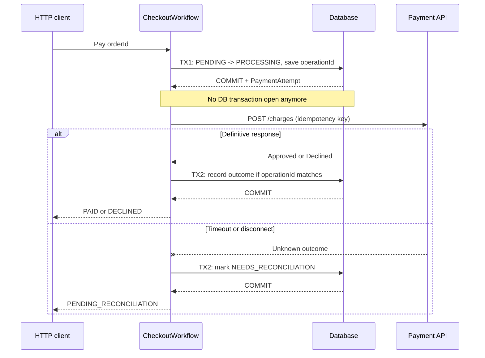
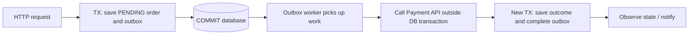
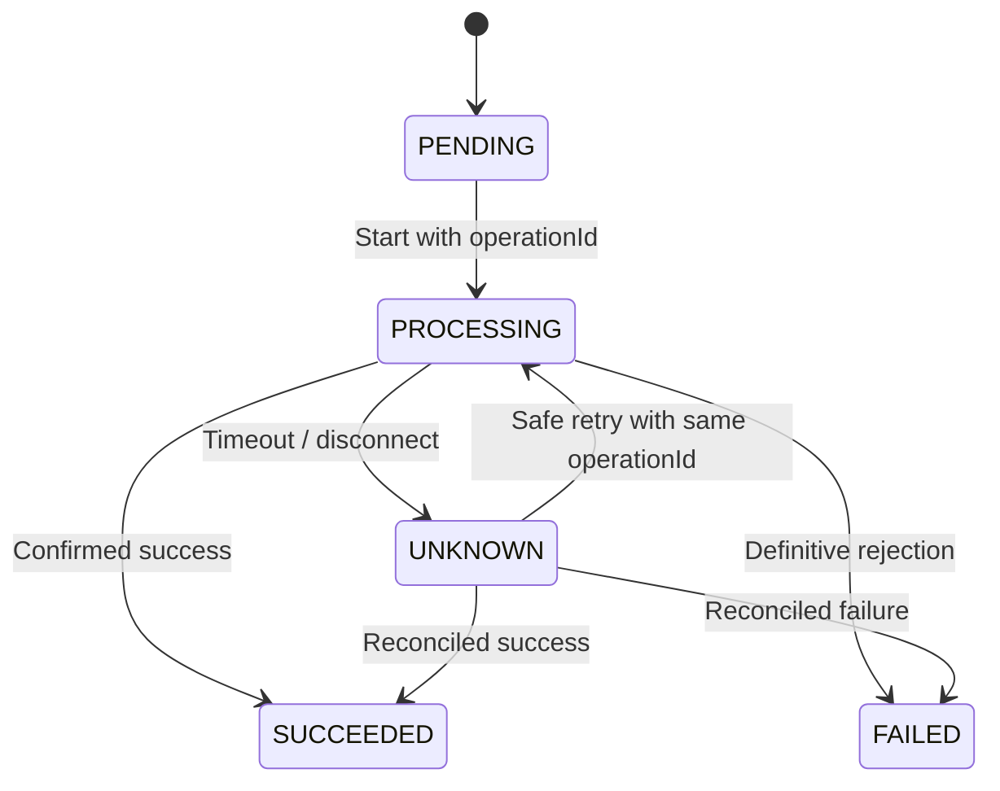

# Do Not Hold Database Transactions Open While Waiting on External Services

## 1. The Problem Lies at the Boundary Between Database and Network

In a **Spring Boot Integration** application, a business flow frequently accesses local data while also calling HTTP APIs, sending messages, or connecting to external systems. For example, when a customer pays for an order, the application updates the `orders` table in PostgreSQL and sends a charge request to a payment gateway.

What you must avoid is opening a **database transaction** before a network call and only executing `COMMIT` or `ROLLBACK` after receiving the response. The response time of an external system is outside the database's control: it might take tens of milliseconds, several seconds, time out, or fail to respond at all.

Consider the following implementation:

```java
@Service
public class CheckoutService {
    private final OrderRepository orders;
    private final PaymentGateway payments;

    public CheckoutService(OrderRepository orders, PaymentGateway payments) {
        this.orders = orders;
        this.payments = payments;
    }

    @Transactional
    public void pay(UUID orderId) {
        Order order = orders.findByIdForUpdate(orderId).orElseThrow();

        // HTTP may be slow or time out, yet the DB transaction remains open.
        PaymentResult result = payments.charge(
            order.getPaymentOperationId(), order.getAmount());

        order.applyPaymentResult(result);
    }
}
```

`findByIdForUpdate` here represents a row-locking query (`SELECT ... FOR UPDATE`). While `payments.charge(...)` waits on HTTP, the row lock and transaction stay active. With JPA, JDBC connections may be acquired lazily, yet **once the database has been queried**, the connection is normally held until the transaction ends. Exact connection retention and SQL emission timing depend on the JPA provider, JDBC driver, transaction manager, and configuration; do not assume every `@Transactional` grabs a connection immediately at method entry.

```mermaid
sequenceDiagram
    participant C as HTTP client
    participant S as CheckoutService
    participant DB as Database
    participant P as Payment API
    C->>S: POST /orders/{id}/pay
    S->>DB: BEGIN; SELECT ... FOR UPDATE
    DB-->>S: Order, row lock held
    S->>P: POST /charges
    Note over S,DB: DB transaction stays open during network wait
    P-->>S: 200 OK (after 3 seconds)
    S->>DB: UPDATE orders; COMMIT
    S-->>C: Result
```

### Practical Consequences

| Consequence | Why It Happens | Common Symptoms |
| --- | --- | --- |
| Prolonged data locks | Locked rows are not released while waiting on HTTP | Concurrent updates to the same order are blocked; rising lock waits or deadlocks |
| Connection pool exhaustion | Transactions hold JDBC connections while waiting to finish | `HikariPool` runs out of connections; other requests time out acquiring a connection |
| Reduced throughput | Each slow request increases concurrent open transactions | P95/P99 latency spikes, throughput drops despite simple SQL queries |
| Difficult recovery | HTTP may succeed even if the app fails afterward | Payment gateway charged the card yet DB recorded failure |
| Cascading failures | DB resources remain tied up when upstream/downstream stalls | One faulty external API degrades unrelated features |

Illustrative example: if a flow takes 20 ms of DB work plus 3 seconds waiting on an external API **within the same transaction**, resource hold time dwarfs actual SQL work. As concurrency climbs, pressure on pools and locks climbs with it. This is a transaction-boundary design issue, not merely SQL query tuning.

## 2. `@Transactional` Does Not Make HTTP Part of an ACID Transaction

Spring's `@Transactional` typically manages transactions through a `PlatformTransactionManager`, such as `JpaTransactionManager` or `DataSourceTransactionManager`. It coordinates the resources that manager governs: SQL commands and data state in the corresponding database. A regular HTTP API **does not participate in this transaction**.

Suppose the system executes in this order:

1. `BEGIN` and update `orders`.
2. Call `POST /charges`; the payment gateway charges the customer.
3. `orders.save(...)` or `COMMIT` fails due to database unavailability, a unique constraint, or a deadlock.
4. The DB transaction rolls back; **the charge request does not automatically roll back**.

Even when the HTTP call happens inside an `@Transactional` method, that annotation does not turn the HTTP call into a distributed transaction. Specialized protocols/systems with dedicated transaction coordinators can be designed differently, yet regular HTTP must never be assumed capable of sharing commit/rollback with a DB.

The two types of timeouts also differ:

- `@Transactional(timeout = ...)` is a limit associated with the Spring-managed transaction; enforcement and cancellation timing depend on the transaction manager and active operations. **It does not replace** HTTP client connect/response timeouts.
- HTTP client connect timeout, read/response timeout, and retry caps protect the network call, yet **do not safely conclude** the DB transaction if boundaries are poorly designed.

Important note: **an HTTP timeout does not mean the external system did not execute the operation**. The request may have arrived and succeeded while the response was lost. Especially for payments, shipment creation, or document issuance, treat such outcomes as *unknown* until reconciled.

## 3. Principles for Splitting Transaction Boundaries

Perform database-related steps in **short, well-scoped transactions**, and perform external system calls **after the preceding transaction has completed** or before the next transaction begins.

```text
Avoid:
  BEGIN DB -> read/lock -> call HTTP (wait on network) -> update -> COMMIT

Prefer:
  BEGIN DB -> write PENDING status + operationId -> COMMIT
  call HTTP with operationId (no open DB transaction)
  BEGIN DB -> write outcome with state check -> COMMIT
```

Options depend on business requirements:

| Scenario | Structuring Approach | Mandatory Considerations |
| --- | --- | --- |
| Only calling a read API to enrich data | Call the external API first; then open a short DB transaction to write | Read data may change in between; verify version/conditions when writing |
| User needs a response within the same HTTP request | Separate an orchestration method (without `@Transactional`) from short DB methods | Idempotency, intermediate states, timeouts, and reconciliation |
| External work can run async and must survive crashes | Write business state + **transactional outbox** in one transaction; worker runs later | At-least-once delivery, idempotent consumers, retries, dead-lettering, progress observability |
| Flow spans multiple services and must undo business steps | **Saga** with persisted state and compensating actions | Compensation is a new action; can fail and must be retried |

Splitting transactions does not eliminate all consistency errors. It keeps the DB from waiting on external systems and **forces the design to explicitly model** each step succeeding or failing independently.

## 4. Synchronous Example: Two Short DB Transactions Around a Payment Call

In the example below, the payment gateway supports an **idempotency key**: multiple requests sharing the same business key are processed as a single payment operation per the provider's contract. An order holds a fixed `paymentOperationId` for that payment attempt; never generate a new key on each retry.

Role separation:

- `CheckoutWorkflow` orchestrates the sequence, **without `@Transactional` on the overarching method**.
- `OrderTransactions` is **another Spring bean** containing short DB write steps annotated with `@Transactional`.
- `PaymentGateway` uses an HTTP client, invoked after `startPayment` returns and the first transaction has committed.

```java
@Service
public class CheckoutWorkflow {
    private final OrderTransactions orderTransactions;
    private final PaymentGateway paymentGateway;

    public CheckoutWorkflow(OrderTransactions orderTransactions,
                            PaymentGateway paymentGateway) {
        this.orderTransactions = orderTransactions;
        this.paymentGateway = paymentGateway;
    }

    // Do not open a DB transaction spanning the entire workflow.
    public CheckoutOutcome pay(UUID orderId) {
        PaymentAttempt attempt = orderTransactions.startPayment(orderId);
        // Transaction #1 has already COMMITTED before the line below.

        PaymentResult result;
        try {
            result = paymentGateway.charge(
                attempt.operationId(), attempt.amount());
        } catch (GatewayOutcomeUnknownException ex) {
            // Timeout/disconnect: do not assume it was declined.
            orderTransactions.markPendingReconciliation(
                attempt.orderId(), attempt.operationId());
            return CheckoutOutcome.PENDING_RECONCILIATION;
        }

        // Transaction #2: apply response after exiting the network call.
        orderTransactions.recordPaymentResult(
            attempt.orderId(), attempt.operationId(), result);
        return result.approved()
            ? CheckoutOutcome.PAID
            : CheckoutOutcome.DECLINED;
    }
}
```

```java
@Service
public class OrderTransactions {
    private final OrderRepository orders;

    public OrderTransactions(OrderRepository orders) {
        this.orders = orders;
    }

    @Transactional
    public PaymentAttempt startPayment(UUID orderId) {
        Order order = orders.findById(orderId).orElseThrow();
        order.startPaymentIfAllowed(); // PENDING -> PROCESSING, create/keep operationId
        return new PaymentAttempt(order.getId(),
            order.getPaymentOperationId(), order.getAmount());
    }

    @Transactional
    public void recordPaymentResult(UUID orderId, UUID operationId,
                                    PaymentResult result) {
        Order order = orders.findById(orderId).orElseThrow();
        order.applyPaymentResultIfCurrent(operationId, result);
    }

    @Transactional
    public void markPendingReconciliation(UUID orderId, UUID operationId) {
        Order order = orders.findById(orderId).orElseThrow();
        order.markUnknownIfCurrent(operationId);
    }
}
```

This snippet illustrates transaction boundaries; `Order`, `PaymentAttempt`, `PaymentResult`, `CheckoutOutcome`, `PaymentGateway`, and exceptions are application domain types. The `...IfCurrent` methods must verify **matching `operationId` and current state** so late updates never overwrite newer results. Under concurrent requests, `startPaymentIfAllowed` also needs protection via `@Version` (optimistic locking), an `UPDATE ... WHERE status = 'PENDING'` checking updated row counts, or a DB lock held **only during the short transaction**.

### Correct Timeline



**Gaps to address before going to production:**

1. **Crash after transaction #1, before calling HTTP:** order sits in `PROCESSING` without ever sending the charge. A background job must scan overdue records to recover or re-execute with the same `operationId`.
2. **Crash after HTTP succeeds, before transaction #2:** gateway collected funds yet DB stays `PROCESSING`. Reconcile by `operationId`, then record the outcome in a new transaction.
3. **Failure after transaction #2 commits, before HTTP response reaches the client:** client may retry. The endpoint must return the existing outcome or resume under the same idempotency key; never unconditionally trigger a new charge.
4. **Two requests paying the same order concurrently:** ensure only one flow can initiate a new attempt; subsequent attempts receive the in-progress status or recorded outcome.
5. **Late response arriving after reconciliation:** apply changes only if `operationId` matches and the state transition is valid. Prevent race bugs from reverting `PAID` back to `UNKNOWN`.

If the user does not need an immediate result, do not hold their HTTP thread waiting on the payment gateway: return `202 Accepted` with a tracking ID and let a worker continue. However, merely calling `@Async` does not guarantee work survives a process crash; use a durable queue or outbox for high reliability.

## 5. More Durable Example: Short Transaction + Transactional Outbox

**Transactional outbox** closes the dangerous gap between writing business state to the DB and dispatching requests to external systems. Within **one short DB transaction**, write both the order state and an outbox row requesting processing. When `COMMIT` succeeds, both records coexist. A worker reads the outbox afterward and calls the API/broker.

```java
@Service
public class OrderApplicationService {
    private final OrderRepository orders;
    private final OutboxRepository outbox;

    public OrderApplicationService(OrderRepository orders,
                                   OutboxRepository outbox) {
        this.orders = orders;
        this.outbox = outbox;
    }

    @Transactional
    public UUID submitOrder(CreateOrderCommand command) {
        Order order = Order.pendingPayment(command);
        orders.save(order);

        // Same local DB transaction; strictly do not call HTTP here.
        outbox.save(OutboxEvent.paymentRequested(
            order.getId(), order.getPaymentOperationId()));

        return order.getId();
    }
}
```

Processing flow diagram:



In a real implementation, the worker should:

- **Claim work in a short transaction**, using leases, `SKIP LOCKED` (if supported by the DB), or equivalent synchronization. Release the transaction before calling HTTP; never hold `SELECT FOR UPDATE` across a network call.
- Use `eventId` to identify the outbox row and a stable `operationId` when calling the payment gateway. If publishing over Kafka/RabbitMQ, carry these IDs in messages so consumers can deduplicate.
- Upon receiving a definitive result, **open a new transaction** to update order state and outbox completion state. On timeout, record `UNKNOWN`/needs-reconciliation and schedule a re-check.
- If the worker crashes after calling the external service but before marking completion, the event may be reprocessed. Thus **outbox guarantees request data is not lost once committed, not automatically exactly-once external side effects**. External idempotency keys and idempotent consumers are mandatory parts of the design.
- Apply bounded retries with backoff so permanently failing jobs do not block the queue; route to dead-letter or manual review states when needed. If a provider lacks idempotency support, prefer querying status before retrying an operation.

Never treat `@TransactionalEventListener(phase = AFTER_COMMIT)` or an in-memory post-commit callback as a durable queue. Callbacks can be lost if the app crashes right after DB commit. Use them to **wake up a worker** to reduce latency; the outbox row in the DB remains the source of truth for recovery.

## 6. Data Consistency When Two Systems Cannot Commit Together

When the DB and an external API cannot share one transaction, we typically choose **eventual consistency**: the system may temporarily hold states like `PENDING`, `PROCESSING`, or `UNKNOWN`, and converge to `SUCCEEDED` or `FAILED` once a definitive outcome arrives. Design state transitions as part of the business contract.

Example of a simple state machine:



Not every `5xx`, `IOException`, or timeout should immediately transition to `FAILED`. A `DECLINED` response with an explicit reason code from the provider can be a definitive failure; a response lost mid-flight is usually `UNKNOWN`.

If the flow involves multiple steps such as *reserve stock → charge payment → book shipping*, apply a **Saga**: each step commits individually, durably persists progress, and executes appropriate compensating actions when a step fails. For instance, after charging funds yet failing to book shipping, the service may request a refund. **A refund is a new business operation** that can fail or take time; it is nothing like SQL `ROLLBACK`.

For contended data, choose a concurrency control strategy across HTTP boundaries:

- **Optimistic locking** (`@Version`) or conditional updates `UPDATE ... WHERE id=? AND version=?` to detect stale writes.
- **Conditional state transitions** so stale responses cannot overwrite newer states; add unique constraints on `(provider, operation_id)` where appropriate.
- **Time-bounded reservation states** if resources must be held before calling a service, with jobs to release or extend upon expiry.
- **Never pass a managed JPA entity** from an ended transaction to HTTP/workers assuming it stays tracked; pass immutable DTOs with `id`, version, and needed fields, and reload inside a fresh transaction.

## 7. Fixes That Look Right Yet Still Keep Transactions Long

| Approach | Problem |
| --- | --- |
| Adding `@Transactional(readOnly = true)` to a method with an HTTP call | `readOnly` does not close the transaction before the network call and does not guarantee connections are released |
| Putting `@Transactional(propagation = REQUIRES_NEW)` on a helper then calling HTTP while parent still has `@Transactional` | Parent transaction may still stay open/suspended during the wait; adding a child transaction does not move HTTP outside the parent's lifetime |
| Calling another `@Transactional` method via `this.method()` | Under default proxy-based transactions, self-invocation usually bypasses the interceptor; the expected transaction boundary may not be created |
| Simply increasing HikariCP pool size | Delays pool exhaustion, yet prolonged locks, tied-up resources, and consistency bugs remain |
| Retrying `POST /charges` with a new operation ID after a timeout | Risks charging multiple times if the earlier request succeeded |
| Publishing to Kafka/broker while the DB transaction is uncommitted | Consumers can observe events for uncommitted data; DB rollback still cannot retract published messages |
| Using `@Async` for external calls without durable state | Crashes/restarts can lose tasks residing only in memory |

Under Spring's proxy model, place transactional steps in a separate bean like `OrderTransactions`, or use `TransactionTemplate` for explicit transaction scopes. Ensure the transaction **has ended** before the HTTP call starts. To verify, enable transaction logging in a test environment and compare commit timestamps against outbound HTTP spans.

## 8. Configuration, Operations, and Testing

### Timeouts and Retry Caps at Network Boundaries

HTTP clients (`RestClient`, `WebClient`, or others) must configure connection and response/read timeouts aligned with the external service's SLA, alongside appropriate retry counts, backoff, and concurrency limits. For operations with side effects, only auto-retry when an **idempotency key** or safe verification flow exists. A circuit breaker/bulkhead prevents an overloaded downstream from stalling upstream, yet does not replace splitting transaction boundaries.

There is no single optimal timeout value: it depends on real P95/P99 latencies, provider SLAs, and endpoint time budgets. Configure DB transaction timeouts independently to cap runaway SQL; never use DB timeouts to control HTTP calls.

### Observing the Right Signals

Correlate `traceId`, `orderId`, and `operationId` (limiting sensitive data in logs):

| Metric / Trace | Interpretation |
| --- | --- |
| DB transaction duration, lock waits, deadlocks | Detects transactions held open too long or data contention |
| HikariCP active/idle/pending connections and pool wait time | Detects connection pressure and requests holding connections too long |
| HTTP latency, timeouts, 4xx/5xx by downstream | Distinguishes network/external slowness from SQL slowness |
| Overdue `PROCESSING`/`UNKNOWN` records, outbox age, retry counts | Spots incomplete work or flows stuck mid-step |
| Deduplicated outcomes skipped and reconciliation counts | Verifies idempotency and recovery in real operation |

### High-Value Test Cases

1. **Slow HTTP:** mock payment API holds the request for several seconds. Meanwhile, verify the orchestration flow has no open DB transaction and an independent DB update is not blocked by locks from the payment flow.
2. **HTTP succeeds, DB outcome update fails:** simulate a commit error; after restart, the reconciliation job records the completed payment accurately without sending a second charge.
3. **HTTP times out after downstream processed it:** repeat request with the same idempotency key or query status; ensure only one side effect exists.
4. **Two concurrent requests for the same `orderId`:** only one passes `PENDING -> PROCESSING`; late responses cannot overwrite terminal states.
5. **Worker crashes after publishing/calling API:** reprocessing the outbox/message produces no duplicate side effects and eventually reaches a consistent state.

Testcontainers enables integration tests against a real DB to observe commits, unique constraints, locks, and optimistic locking; WireMock or an HTTP test server lets you control timeouts, network errors, and delayed responses. With JPA, proactively `flush`/commit in failure scenarios since `save(...)` does not always execute SQL immediately.

## 9. Checklist When Designing a New Integration Flow

- Identify steps that **strictly require ACID within the same database** and close the transaction right after them.
- Keep HTTP calls, broker publishes, emails, or I/O with unbounded latency out of DB transactions.
- Define intermediate states and stable business keys (`operationId`/idempotency key) before calling external systems.
- Distinguish **definitive** failures from **unknown** outcomes caused by timeouts or disconnects.
- Use an outbox/durable queue when work must survive crashes; embrace potential redeliveries and deduplicate where side effects occur.
- Use versioning or conditional state transitions to prevent races and late-response overwrites.
- Provide reconciliation, safe retries, alerts for overdue operations, and test crash windows around every `COMMIT`.

**Practical rule:** let DB transactions protect a brief set of local data changes. Treat every call to an external system as an independent step that can be slow, fail, succeed without a response, or execute more than once. Designing around those realities is what keeps Spring Boot Integration reliable across HTTP, databases, caches, message brokers, and Spring Integration adapters in production.
