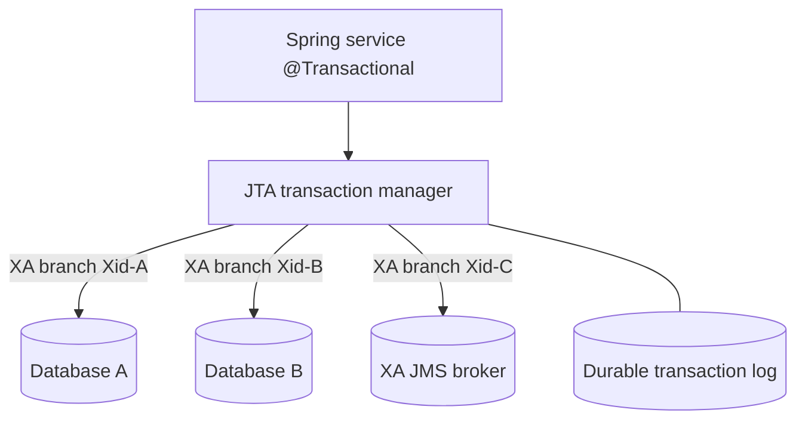
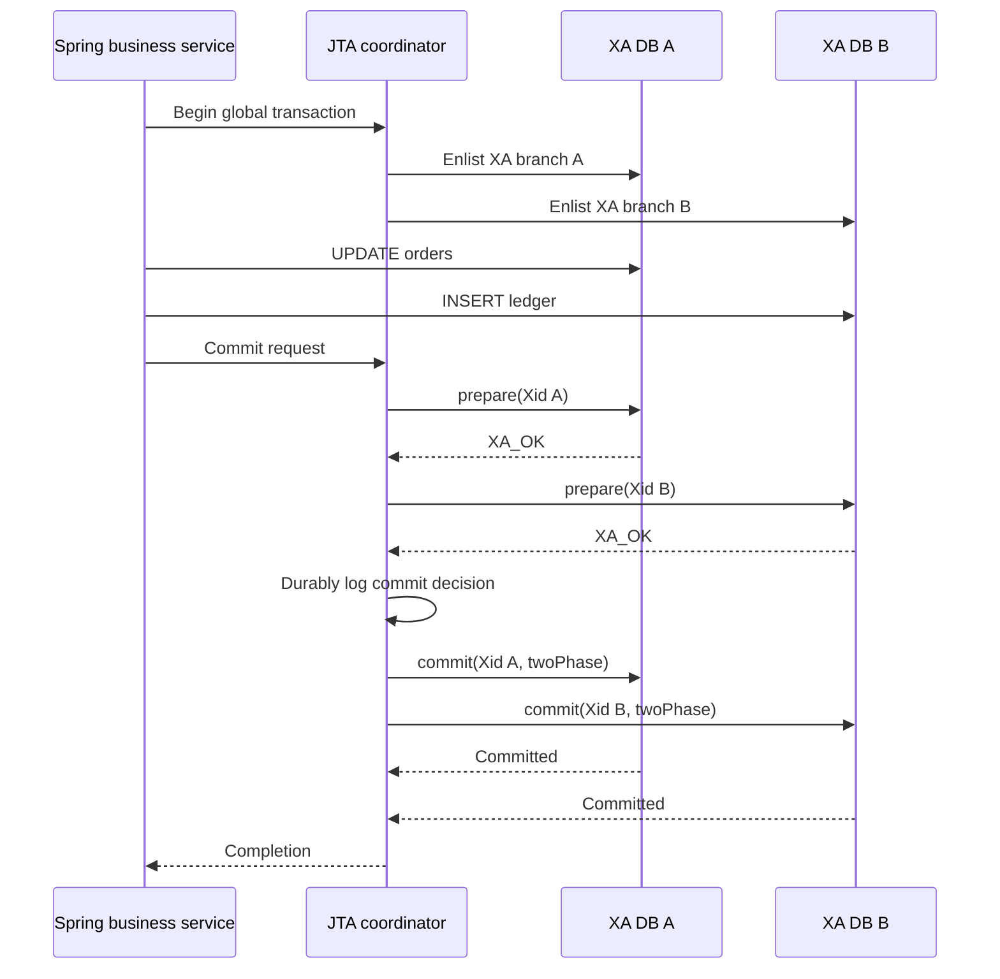
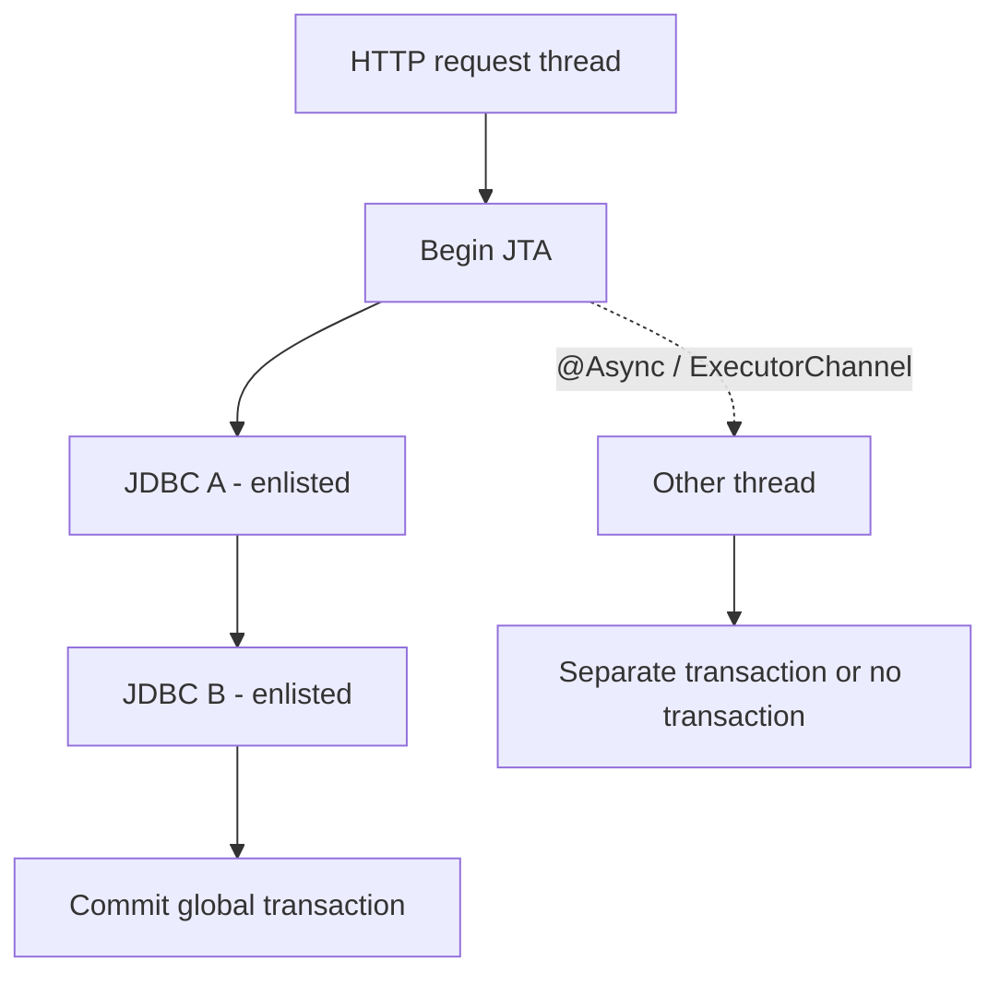
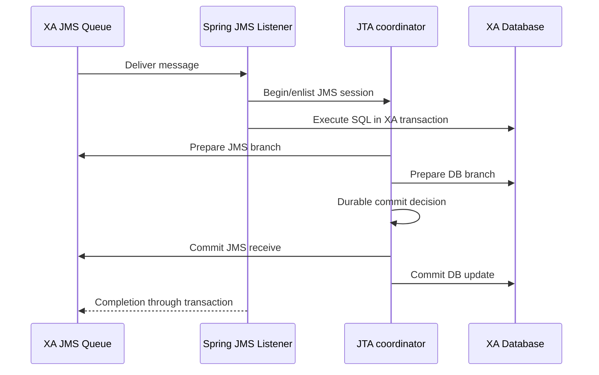
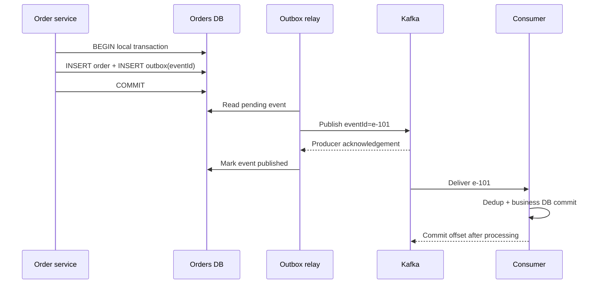
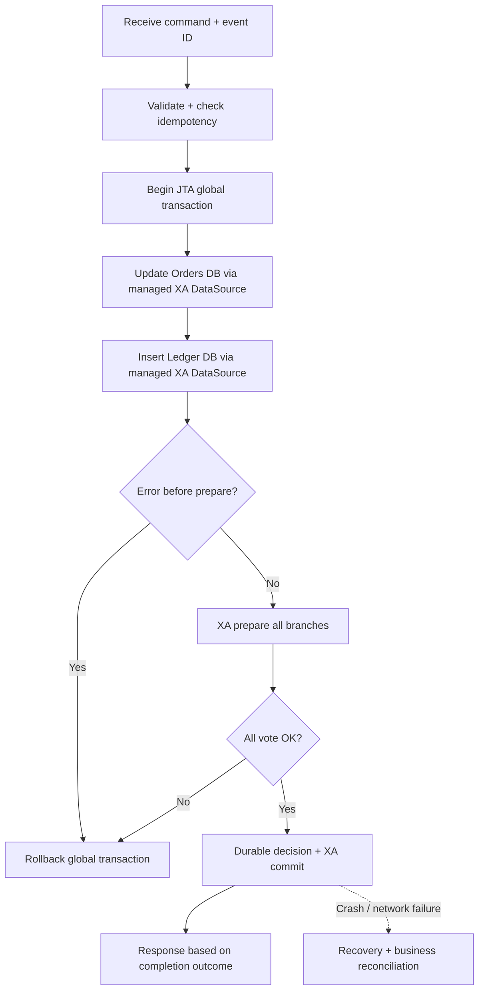

# JTA, XA, and Prerequisites for Coordinating Multiple Resources

In a Spring Boot application, `@Transactional` can help a single database operation commit or roll back consistently. Yet what happens if **the same request** must update two independent databases, or both write to a DB and acknowledge consuming a JMS message? Those two changes do not automatically become a single transaction just by sitting in the same Java method.

**JTA (Jakarta Transactions)** defines the transaction coordination API and semantics; **XA** is the protocol allowing *resource managers* (e.g., an XA-capable DB or JMS broker) to participate in a distributed transaction, typically via **two-phase commit (2PC)**. Using JTA/XA imposes strict requirements on resources, drivers, connection pools, transaction managers, execution flows, and crash recovery. This topic belongs to the **Integration Transactions** chapter in the `SPRING_BOOT_INTEGRATION` module: coordinating HTTP clients, databases, caches, message brokers, and Spring Integration according to the consistency level appropriate for each system.

This lesson answers three practical questions: **when are distributed transactions needed**, **which conditions actually permit coordination via JTA/XA**, and **when should you choose outbox, idempotency, or saga instead**.

## 1. From a Local Transaction to Multiple Resources

A local transaction usually involves one resource manager: for example, a single `DataSource` connecting to PostgreSQL. Spring's `DataSourceTransactionManager` (or `JdbcTransactionManager` depending on configuration) drives commit/rollback on the thread-bound JDBC connection; `JpaTransactionManager` drives the corresponding JPA transaction. They **do not automatically coordinate multiple independent systems**.

Suppose a service updates order state in DB A and inserts a ledger entry in DB B:

```java
public void completeOrder(String orderId) {
    orderRepository.markCompleted(orderId); // DB A
    ledgerRepository.insertEntry(orderId);  // DB B
}
```

If DB A commits and DB B fails, the application can leave an order marked completed without a ledger entry. Even with `@Transactional` added, the outcome still depends on **which transaction manager is selected** and whether both resources are actually enlisted into the same global transaction.

| Scenario | Typically Sufficient Transaction | Problem to Solve |
| --- | --- | --- |
| Multiple tables in one database, same transaction manager | Local DB transaction | Choosing isolation, locks, constraints, rollback |
| Two physically independent databases, needing joint commit/rollback | JTA/XA **if both support it and are configured properly** | 2PC, recovery, global coordination |
| Database and JMS broker both supporting XA | Can use JTA/XA when both enlist | Avoiding committing DB while losing JMS ack/send |
| Database and external HTTP API | HTTP requests cannot normally join XA | Outbox, idempotency, saga/compensation |
| Database and Kafka | Kafka transactions are not automatically JTA `XAResource`s | Outbox/CDC and consumer idempotency or specific integration strategy |
| Database and Redis cache | Redis normally does not join JTA/XA | Cache-aside, post-commit invalidation, retries |
| Multiple services owning separate databases | Usually no shared cross-service transaction | Eventual consistency, saga, reconciliation workflows |

Distinguish **multiple connections** from **multiple resource managers**: two `DataSource`s pointing to the same DB may not strictly require XA, yet guaranteeing atomicity across two independent connections/transactions still requires examining whether one true local transaction or supported coordination can be used. Meanwhile, XA does not eliminate isolation issues across resource managers or make every external service lock data together.

## 2. Distinguishing JTA, XA, and Transaction Managers

| Component | Role | Example |
| --- | --- | --- |
| **JTA API** | Contract for starting, ending, inspecting status, and associating transactions with execution threads | `jakarta.transaction.UserTransaction`, `TransactionManager`, `TransactionSynchronizationRegistry` |
| **XA protocol** | Contract for a transaction coordinator to tell resource managers to start/end, prepare, commit, roll back, and recover | `javax.transaction.xa.XAResource`, `Xid` at the Java XA layer |
| **Transaction coordinator / JTA implementation** | Manages global transactions, Xids, 2PC, logs, and recovery | Narayana, Atomikos, or environment-appropriate implementation |
| **XA-capable resource manager** | Executes transaction branches, prepares, and persists state for recovery | XA/2PC-capable DB, XA-capable JMS provider |
| **XA-aware connection pool / wrapper** | Allocates connections and enlists `XAResource` into the current JTA transaction | XA-managed `DataSource` or `XAConnectionFactory` with proper adapters |
| **Spring transaction abstraction** | Selects the transaction manager and applies `@Transactional` to business methods | `PlatformTransactionManager`, `JtaTransactionManager` |

**JTA is an API, not a self-contained coordinator with recovery.** Adding `jakarta.transaction-api` does not magically equip Spring Boot with distributed transaction logs, XA pools, or recovery mechanisms. You must choose a maintained implementation and configure it for your Spring Boot/Jakarta version.

A common package-name trap: modern Jakarta application APIs live in `jakarta.transaction`, whereas Java's driver-level **XA** interfaces remain defined under `javax.transaction.xa.XAResource` and `javax.transaction.xa.Xid`. Do not rename XA packages to `jakarta.transaction.xa` in code simply because other JTA annotations moved to `jakarta`.

### 2.1. Global Transactions, Branches, and `Xid`

A *global transaction* can span multiple *branches* across individual resource managers. XA identifies transactions using an `Xid` consisting of a format ID, global transaction ID, and branch qualifier. The coordinator assigns/persists these identifiers to track which branches belong to which transaction and recover after disconnects.



Not every connection joining a global transaction gets the same branch qualifier. A resource manager may optimize or join branches as supported, yet **applications never compute or reuse `Xid`s manually**; that is the responsibility of the transaction manager and adapters.

### 2.2. `@Transactional` Has More Than One Behavior

In Spring:

- Spring's `@Transactional` (`org.springframework.transaction.annotation.Transactional`) uses the transaction manager chosen by Spring. It can drive a local transaction or JTA depending on beans/configuration.
- `jakarta.transaction.Transactional` is the JTA transaction annotation; Spring environments may interpret it, yet manager selection and attributes differ.
- Spring's `@Transactional(transactionManager = "jtaTransactionManager")` can specify the JTA coordinator bean; the annotation alone **never converts** an ordinary `DataSource` into an XA resource.
- Standard transaction interceptors rely on Spring proxies: internal `this.method()` calls bypass the proxy and miss expected interception. Spawning threads, `@Async`, reactive/async boundaries, or sending through queues also do not automatically propagate transaction context.

Spring's `JtaTransactionManager` acts as a bridge between Spring's transaction abstraction and the JTA runtime. The underlying coordinator handles enlistment/2PC/recovery; Spring simply drives them according to the active configuration.

## 3. How Does Two-Phase Commit (2PC) Work?

With **two or more true XA branches**, the transaction coordinator normally executes two phases: **prepare (vote)** and **commit/rollback (decision)**. Each resource manager must retain prepared transaction state until receiving the final decision, even across a coordinator restart.



Conceptual phases:

1. **Begin / enlistment:** open the global transaction; XA-aware connections enter the transaction and resource managers receive their branches.
2. **Business work:** SQL or JMS operations execute within the transaction without committing independently.
3. **Prepare:** the coordinator asks each participant whether it can guarantee commit/rollback capability. Participants vote OK, read-only, or error. Unless all agree, the coordinator decides to roll back all involved branches.
4. **Durable decision:** once eligible to commit, the coordinator persists the decision so it can recover across crashes.
5. **Second phase:** the coordinator sends commit to prepared participants, records results, and cleans up logs per implementation rules.

If only **one XA resource** is actually enlisted, the coordinator may apply *one-phase optimization* (single-phase commit). Thus, not every `@Transactional` backed by `JtaTransactionManager` executes 2PC.

### 3.1. What 2PC Solves and What It Does Not

2PC aims for **atomic commit** across resources adhering to the XA protocol: it prevents one participant from silently committing on its own when the global transaction must roll back. It does not automatically guarantee:

- That every HTTP API, Redis, email server, Kafka producer, filesystem, or other client can join XA.
- Uniform isolation across DBs with differing isolation modes. Each DB still needs proper isolation and constraints.
- That client HTTP retries become exactly-once commands. Clients can lose responses after the global transaction already committed.
- High availability when coordinator/participants disconnect. Prepared transactions can **hold locks and block progress** while awaiting decisions.
- Immunity from all anomalies: admin mistakes, missing recovery logs, heuristic completions, or non-compliant resource managers can still yield inconsistent outcomes.

### 3.2. What Happens When a Failure Occurs Between Phases?

| Failure Point | Possible State | Recovery Path |
| --- | --- | --- |
| Before prepare | Transaction has no global commit decision yet | Roll back once coordinator/resources detect failed transaction |
| A participant votes rollback | Cannot commit globally | Coordinator rolls back remaining branches |
| After all prepare, before durable decision | Some participants still hold prepared branches | Recovery determines valid decision; strictly avoid guessing and deleting branches |
| Coordinator logged commit, hasn't reached all participants | Some resources committed, others remain prepared/in-doubt | Restart coordinator with durable log and replay decision |
| Network ack of `commit` is lost | Participant may have committed | Rely on recovery and XA state; never blindly issue new business transactions |
| Administrator forces rollback of a prepared branch despite coordinator commit decision | **Heuristic mixed outcome** can occur | Intervene and reconcile via controlled procedures |

An **in-doubt transaction** is a transaction that prepared yet whose resource manager does not know or has not completed the final decision. Prepared branches can hold row locks, transaction IDs, or other resources for prolonged periods. Such incidents demand recovery mechanisms and observability, not infinite retries of business methods.

### 3.3. Heuristic Outcomes and the Limits of “Atomic”

A resource manager can unilaterally commit or roll back under exceptional conditions (e.g., manual intervention or timeout policies), producing heuristic rollback/commit/mixed/hazard outcomes. In Java XA, codes like `XA_HEURRB`, `XA_HEURCOM`, `XA_HEURMIX`, and `XA_HEURHAZ` signal states requiring handling; calling `forget` only clears heuristic records under eligible conditions and **never repairs inconsistent data**.

Therefore, never advertise JTA/XA as an absolute guarantee under all failures and operational actions. Atomicity depends on every participant obeying the protocol, durable coordinator decision logging, working recovery, and zero unexpected heuristic overrides.

## 4. Mandatory Prerequisites for Coordinating Multiple Resources with XA

Simply enabling `@Transactional` and adding a coordinator name in `application.yml` is insufficient. Verify the **entire chain**:

| Requirement | Questions to Answer |
| --- | --- |
| XA-capable resource managers | Do the DBs/JMS brokers implement XA, transaction prepare, and recovery? Are required server features enabled? |
| XA-capable drivers/connection factories | Are `XADataSource` or `XAConnectionFactory` compatible with current versions and protocols? |
| XA-aware pooling/wrapping | Does the pool supply connections that enlist in global transactions without accidental local commits? |
| Working JTA coordinator | Are a runtime transaction manager, transaction logs, and post-restart recovery configured? |
| Stable resource identity | Does each resource have a stable, unique name/ID so the coordinator can locate it after a crash? |
| Single global transaction | Do all operations needing atomicity run in the same JTA context and enlist properly? |
| No interleaved non-XA side effects | Are HTTP, Redis, Kafka, files, or emails invoked inside the transaction without participating in XA? |
| Coordinator durability | Do transaction logs sit on safe persistent storage surviving restarts/failovers? |
| Rollback semantics | Are exceptions, timeouts, propagation, and rollback rules configured accurately? |
| Operations and recovery | Are prepared transactions, timeouts, heuristic outcomes monitored, with a recovery runbook ready? |

### 4.1. An XA Driver Alone Is Not Enough

A driver providing `javax.sql.XADataSource` is only the **starting ingredient**. Applications need an XA-aware pool/connection manager wrapping it, exposing a `DataSource` to Spring Data JDBC/JPA/`JdbcTemplate`, and registering `XAResource` with the JTA coordinator at the proper time.

If one repository uses `ordersXaManagedDataSource` while a second points to `DriverManagerDataSource` or an ordinary local-transaction pool, the global transaction protects only part of the work. Both SQL statements may appear to run, yet on rollback after an error, DB B retains committed rows.

Never manually call `xaDataSource.getXAConnection().getConnection()` inside business services and invoke `commit()`: doing so bypasses JTA adapter enlistment, connection lifecycle, and recovery.

### 4.2. Resource Identity and Recovery Logs

The transaction manager must know which resource holds an unfinished `Xid`. Resource names (e.g., `orders-db`, `ledger-db`) must remain stable across restarts so the coordinator matches participants. Two **physically distinct resource managers** must never share one identity just because both are PostgreSQL; moreover, how “same resource manager” is identified depends on the pool/implementation—follow its documentation.

With multiple Spring Boot instances:

- Each coordinator node needs an identifier matching the implementation's recovery/cluster model; never let independent nodes accidentally share the same coordinator identity.
- Preserve transaction logs on supported durable storage; ephemeral volumes wiped on pod restarts destroy 2PC decisions.
- Resource managers must retain prepared transactions until decisions complete. For instance, PostgreSQL requires enabling/configuring prepared transactions (`max_prepared_transactions`) for XA/2PC; defaults or managed setups may disable it.
- The recovery process must be able to reconnect to resource managers with valid credentials/drivers even after credential rotation.

Never delete prepared transactions or transaction logs to “quickly clear locks” without understanding the global decision. Premature manual cleanup can turn a recoverable transaction into permanent cross-system corruption.

### 4.3. Thread Binding and Timeouts

In traditional Spring, transaction context normally binds to the thread. A call chain over Spring Integration's `DirectChannel` can stay on the same thread, whereas `ExecutorChannel`, `@Async`, `CompletableFuture.supplyAsync`, external schedulers, or separate-process broker consumers **do not automatically enlist in the caller's transaction**.



For a message broker to join XA, its endpoint/adapter must use an **XA-aware connection and listener/session** enlisted in the right transaction—not merely sit in the same Java method. Even when sender and receiver live in the same service, receiving the broker-redelivered message occurs in a separate transaction from the producer's completed transaction.

JTA timeouts must cover participant waits plus prepare/commit phases. Never hold a global transaction open waiting on slow HTTP APIs or multi-minute user approvals: prepared transactions and locks strain DBs/brokers, while HTTP cannot roll back automatically.

## 5. Spring Boot Configuration: Choosing the Coordinator and XA-Aware Resources

A JTA/XA deployment requires at least four parts:

1. Select a transaction manager implementation supporting your Java, Spring Boot, and Jakarta Transactions versions.
2. Declare each XA driver/connection factory and let the XA-aware provider produce **managed** `DataSource` or `ConnectionFactory` beans.
3. Ensure Spring's `PlatformTransactionManager` uses the matching JTA bridge instead of accidentally picking a local transaction manager for services requiring global transactions.
4. Configure durable logs, recovery, resource names, timeouts, and health/metrics before production.

Each vendor has its own starter, beans, pool properties, and recovery settings. **Spring Boot does not provide a single generic XA YAML schema that works across every driver and every JTA coordinator.** Therefore, the snippet below is an *illustrative application configuration design*, not built-in Spring Boot properties:

```yaml
# application.yml — CUSTOM namespace, requires code/provider binding.
integration:
  distributed-transaction:
    coordinator: narayana-or-supported-provider
    timeout: 30s
    recovery-log-location: /var/lib/app-jta-log
    resources:
      orders:
        unique-name: orders-db
        xa-datasource-class: vendor.jdbc.OrdersXADataSource
      ledger:
        unique-name: ledger-db
        xa-datasource-class: vendor.jdbc.LedgerXADataSource
```

The placeholder driver class names above are **not real classes**. In real implementations, substitute actual XA-capable drivers for your databases, real provider properties, secret credentials, and matching server settings. Creating the log directory alone is not enough: the coordinator must be configured to use that durable storage with read/write permissions and proper node recovery ownership.

### 5.1. Bean Wiring Diagram

```text
Orders XADataSource ─┐
                     ├─ XA-aware connection pool / provider ─> managed DataSource A
Ledger XADataSource ─┘                                      └─> managed DataSource B
                                   │
                                   ▼
                    JTA coordinator + durable recovery log
                                   │
                                   ▼
                     Spring JtaTransactionManager
                                   │
                                   ▼
                 @Transactional business service
                    ├── JdbcTemplate A
                    └── JdbcTemplate B
```

This is a responsibility diagram, not a rule that both XA datasources share one pool. Each resource usually has its own pool/adapter recognized by the same coordinator. `JdbcTemplate` can work with provider-supplied managed `DataSource`s; if using JPA, persistence units, JTA integration, and connection providers must also be compatible—avoid accidentally running `RESOURCE_LOCAL` transactions alongside it.

**Do not declare two `DataSourceTransactionManager` beans expecting Spring to coordinate them automatically.** `ChainedTransactionManager` or sequential two-manager commits also cannot replace 2PC: if the first commits and the second fails, rollback cannot undo the first commit.

### 5.2. `JdbcTemplate` Bean Example for Two Enlisted Resources

Assuming your XA provider already registered two managed datasource beans:

```java
@Configuration(proxyBeanMethods = false)
public class JdbcIntegrationConfig {

    @Bean("ordersJdbc")
    JdbcTemplate ordersJdbc(
            @Qualifier("ordersManagedXaDataSource") DataSource dataSource) {
        return new JdbcTemplate(dataSource);
    }

    @Bean("ledgerJdbc")
    JdbcTemplate ledgerJdbc(
            @Qualifier("ledgerManagedXaDataSource") DataSource dataSource) {
        return new JdbcTemplate(dataSource);
    }
}
```

This is valid Spring configuration **once both provider-registered XA DataSource beans actually exist**. This snippet neither creates XA drivers, executes 2PC on its own, nor replaces the JTA setup above. Main imports: `javax.sql.DataSource`, `org.springframework.jdbc.core.JdbcTemplate`, `org.springframework.beans.factory.annotation.Qualifier`, `org.springframework.context.annotation.Bean`, and `Configuration`.

### 5.3. Transaction Manager Must Match Bean and Scope

```java
@Service
public class SettlementService {
    private final JdbcTemplate orders;
    private final JdbcTemplate ledger;

    public SettlementService(
            @Qualifier("ordersJdbc") JdbcTemplate orders,
            @Qualifier("ledgerJdbc") JdbcTemplate ledger) {
        this.orders = orders;
        this.ledger = ledger;
    }

    @Transactional(
            transactionManager = "jtaTransactionManager",
            rollbackFor = Exception.class)
    public void settle(UUID eventId, String orderId, BigDecimal amount) {
        int changed = orders.update(
                """
                UPDATE orders
                   SET settlement_status = 'SETTLED',
                       settlement_event_id = ?
                 WHERE order_id = ?
                   AND settlement_status = 'PENDING'
                """,
                eventId, orderId);
        if (changed != 1) {
            throw new IllegalStateException(
                    "Order cannot transition from PENDING");
        }

        ledger.update(
                """
                INSERT INTO ledger_entries (event_id, order_id, amount)
                VALUES (?, ?, ?)
                """,
                eventId, orderId, amount);
    }
}
```

Example assumptions:

- The Spring bean named `jtaTransactionManager` is a `PlatformTransactionManager` wired to an active JTA coordinator.
- Both `JdbcTemplate`s use **managed XA `DataSource`s** capable of enlisting in `settle(...)`'s global transaction.
- `orders` resides in DB A; `ledger_entries` resides in DB B; schemas enforce column constraints and `UNIQUE(event_id)` in ledger.
- `settle(...)` is called externally through the Spring proxy on a thread holding the transaction context, with no interleaved HTTP/non-XA side effects.

If `ledger.update` fails **before prepare**, the transaction is marked for rollback and both DB A's update and DB B's insert must roll back under the global transaction. If an error arises during commit after prepare, **recovery** may be required rather than immediately assuming rollback from a caller exception.

This snippet does not yet handle duplicate requests per business contract. If the same `eventId` is resent after commit because the HTTP response was lost, `changed=0` will raise an error. A production API must check committed state by idempotency key, return the stored result for identical requests, and reject matching keys with differing payloads.

Never deduce from the mere presence of an annotation that both resources enlisted. Verify coordinator logs, active XA branches, SQL on each DB, and intentional rollback tests.

### 5.4. Rollback Rules and Propagation

Spring `@Transactional` normally rolls back on unchecked exceptions or `Error`, while checked exceptions require explicit rules like `rollbackFor` to roll back. Catching an exception and returning normally allows the interceptor to proceed with commit unless the transaction was already marked rollback-only.

`REQUIRES_NEW` creates a new independent transaction per the active transaction manager and context; that new transaction can commit even if the outer transaction rolls back. `NOT_SUPPORTED` can suspend the transaction. When a flow requires atomicity across both DBs, avoid accidentally calling an inner service with scope-splitting propagation or letting another transaction manager handle part of the work.

On transaction timeout, resources and coordinator handle rollback/recovery per contract; **timeout does not mean an in-flight HTTP call was canceled or that remote side effects did not happen**.

## 6. JMS + Database: A Classic Fit for XA

One scenario requiring multi-resource coordination is a consumer receiving messages from an **XA-capable JMS provider**, updating a database, and acknowledging receipt only when the global transaction succeeds:



With proper XA, DB writes and JMS consumption acknowledgment share the same global transaction, preventing **DB commit followed by JVM crash before ack** from causing uncoordinated redelivery. Specific requirements apply:

1. The broker implements **JMS XA** and exposes `XAConnectionFactory`/`XASession` or container-supported equivalent.
2. The listener container genuinely uses the JTA transaction manager, XA-aware connection/session, and enlists the JMS branch. Using `@JmsListener` or `sessionTransacted=true` with a local JMS transaction alone is insufficient.
3. JDBC connections to the DB use an XA-managed `DataSource` inside the same global JTA transaction, with no manual commits.
4. Message conversion and business services run inside the matching transaction context; business errors trigger rollback as intended.
5. Broker/DB/coordinator maintain transaction recovery, stable resource identities, and durable logs; listeners reconnect/restart safely.

Handler pattern:

```java
@Component
public class ShipmentJmsHandler {
    private final ShipmentService shipmentService;

    public ShipmentJmsHandler(ShipmentService shipmentService) {
        this.shipmentService = shipmentService;
    }

    @JmsListener(
            destination = "shipment.commands",
            containerFactory = "xaJmsListenerContainerFactory")
    public void handle(ShipmentCommand command) {
        shipmentService.apply(command);
    }
}
```

Here `xaJmsListenerContainerFactory` **must be explicitly configured by the developer with an XA-aware JMS connection factory and matching JTA manager**. Spring Boot does not create that bean merely because its name contains `xa`. `ShipmentCommand` and `ShipmentService` are illustrative business types; `shipmentService.apply` must use the XA datasource if writing to the DB, enlisted prior to global commit.

When using Spring Integration JMS inbound/outbound adapters, verify whether each adapter uses a JMS XA session and where transactions begin. A synchronous `DirectChannel` can stay on the listener's execution path, whereas dispatching into an `ExecutorChannel` or `QueueChannel` and returning decouples downstream work from committing atomically with the original JMS receive.

**Kafka is not JMS.** Kafka producer transactions/consumer offsets use Kafka's own mechanisms; never treat `KafkaTemplate` or `@KafkaListener` as JTA/XA resources just because a Spring transaction manager exists. For Kafka + database, an outbox/idempotent consumer design is usually clearer and easier to operate.

## 7. Mixed Resources: Non-XA Resources Change Your Guarantees

Suppose a global transaction contains:

```text
XA PostgreSQL       -> supports prepare/commit/recover
XA JMS broker       -> supports prepare/commit/recover
HTTP partner API    -> only POST/GET, NO XAResource
Redis cache         -> plain SET/DEL commands, NO XAResource
Kafka publisher     -> separate Kafka transaction, does NOT auto-join JTA XA
```

The coordinator can truly coordinate only participants **properly enlisted via the XA protocol**. Calling an HTTP partner or writing Redis inside an `@Transactional` method does not make them roll back alongside SQL.

### 7.1. Committing One Resource Earlier and Another Later

Some frameworks/providers offer **last resource commit optimization** (LRCO), **last resource gambit**, or **last resource commit participant** to combine one non-XA resource with XA resources in hopes of narrowing the failure window. This approach **does not provide the strong atomicity of full-XA 2PC**: the non-XA resource may commit before the coordinator finishes committing XA branches, and a failure right there leaves divergent state.

Never adopt LRCO just because it “requires fewer driver changes” without assessing heuristic mismatch risks and data impact. Some transaction managers strictly forbid enlisting multiple non-XA resources; allowing one special participant is not license to mix arbitrary non-XA connections/brokers.

### 7.2. Why Transactions Do Not Cover HTTP, Redis, or Filesystems

These endpoints generally lack `XAResource.prepare(Xid)`, durable prepared branches, and `recover`. For example:

```java
@Transactional
public void process() {
    orderRepository.save(order);
    partnerHttpClient.createShipment(order); // Outside DB transaction
    redis.delete("orders:" + order.id());   // Outside DB transaction
}
```

If the HTTP partner already created a shipment and the DB then rolls back, there is no XA rollback for HTTP. If the Redis cache was evicted and the DB rolled back, the cache may reload old data—sometimes tolerable, though proper post-commit invalidation or cache-aside strategies are needed. If HTTP times out, the partner may have processed it, so retries need idempotency keys and reconciliation.

When atomicity between **two XA-capable databases** is genuinely required, JTA/XA can fit. When coordinating **systems lacking a shared transaction protocol**, the problem is workflow and eventual-consistency design, which transaction annotations alone cannot solve.

## 8. When to Choose XA, Outbox, or Saga?

Do not default to XA as the “strongest option to use everywhere.” XA adds prepare/commit latency, coordinator and recovery dependencies, resource blocking under network partitions, and operational burden across multi-service environments. If business requirements permit eventual consistency and involve HTTP/Kafka, outbox or saga is usually far more practical.

| Approach | Scope of Guarantee | When to Consider | Limitations |
| --- | --- | --- | --- |
| **Local DB transaction** | Atomic within one database transaction | Multiple tables/repositories in one DB sharing connection/manager | Does not automatically protect DB + external systems |
| **JTA/XA 2PC** | Atomic commit across qualifying XA participants | Two XA DBs/XA JMS needing joint commit/rollback, with recovery capability | Blocking, coordinator logs, XA pools/drivers, heuristic recovery, operational cost |
| **Transactional outbox** | Local commit of business data + event row; relay delivers at least once | DB → Kafka/RabbitMQ/HTTP workers | Possible duplicates, eventual-consistency lag, requires dedup |
| **CDC from outbox** | Tails committed DB changes to publish events | Reducing polling overhead using compatible connectors/change streams | Still requires connector monitoring, replay, ordering, and consumer idempotency |
| **Saga (orchestration/choreography)** | Coordinates multiple local transactions with compensating actions | Multi-service workflows, HTTP APIs, long-running tasks | Compensating actions cannot always undo everything; complex state |
| **Idempotency + reconciliation** | Prevents duplicate effects and detects state drift | Retries, timeouts, callbacks, event redelivery | Requires business keys, result storage, and reconciliation tooling |

### 8.1. Example: DB + Kafka via Outbox



If the relay dies after Kafka accepted the message but before the DB marks it published, the same event ID can be republished. Consumers use `processed_events` or unique constraints to achieve a single business effect. Outbox **does not guarantee end-to-end exactly-once**, yet gives a clear recovery path when DB commits succeed and publishing fails.

### 8.2. Example: HTTP Payment + Shipment via Saga

```text
OrderCreated -> ReserveInventory -> AuthorizePayment -> CreateShipment
                       │                 │                  │
                   on failure        on failure         on failure
                       ▼                 ▼                  ▼
                  MarkFailed        ReleaseInventory     Cancel/Refund
```

Each step is a local transaction or API call. If shipment creation fails after payment was authorized, the workflow can void the authorization or refund per policy. This is **compensation**, not an ACID rollback: an already-sent email or incurred bank fee may not be completely reversible.

Sagas require durable operation IDs, per-step idempotency keys, bounded retries, intermediate states, deadlines, and reconciliation for unknown outcomes. Never keep a global XA transaction open while waiting on partners or users.

### 8.3. Decision Rules

- If all changes live in **one** resource manager: prefer local transactions and DB constraints.
- If **multiple** resource managers are involved, all provide genuine XA, strict atomic commit is mandatory, and you can operate coordinator/recovery: evaluate JTA/XA via failure/recovery testing.
- If HTTP, Kafka, Redis, or separate services without shared XA participate: design outbox, idempotency, saga, or compensation per business requirements.
- If independent steps are retryable: decouple flows and persist durable job state to shorten locks and transactions.

In every option, still deduplicate **client commands**. A transaction can commit flawlessly yet lose the HTTP response back to the client; if the client retries order creation without an idempotency key, the system can still create two transactionally valid orders.

## 9. Complete Two-Database Design in Spring Boot

Suppose an accounting system splits into two databases for organizational reasons: `orders` stores orders and `ledger` stores ledger entries. A `settle(orderId, amount)` command may report success only when **both the order status and the ledger entry commit**. Define invariants clearly before configuring XA:

- An `orderId` transitions from `PENDING` to `SETTLED` only once in business terms.
- Each `settlementEventId` creates at most one entry in the ledger.
- Amount and currency must match the verified order; never trust `amount` blindly from the request.
- If either resource manager fails to prepare, the entire transaction must roll back.
- When the coordinator does not know the commit outcome, never retry by creating a new transaction before checking status by event ID.

### 9.1. Data Constraint Schema

Minimal SQL model (each block executed in its respective database):

```sql
-- Database A: orders
CREATE TABLE orders (
    order_id VARCHAR(100) PRIMARY KEY,
    amount NUMERIC(18, 2) NOT NULL,
    currency CHAR(3) NOT NULL,
    settlement_status VARCHAR(20) NOT NULL,
    settlement_event_id UUID UNIQUE
);

-- Database B: ledger
CREATE TABLE ledger_entries (
    event_id UUID PRIMARY KEY,
    order_id VARCHAR(100) NOT NULL,
    amount NUMERIC(18, 2) NOT NULL,
    currency CHAR(3) NOT NULL,
    recorded_at TIMESTAMP NOT NULL DEFAULT CURRENT_TIMESTAMP
);
```

This example shows basic constraints; production needs status checks, foreign keys where feasible, double-entry ledgering, isolation tuning, and load-matched indexes. **Foreign keys cannot natively reference across two physically independent databases.** XA coordinates commits across resources, yet does not supply cross-DB referential constraints.

### 9.2. Processing Order and Verification Points



A common bug is the **duplicate check ordering**. If a client retries after missing an HTTP response, the app can inspect `settlement_event_id` and ledger `event_id` to return the persisted result. However, because the two tables reside in separate DBs, pre-transaction status queries are also subject to races; enforce unique constraints and explicit transaction states rather than trusting `findByEventId()` alone.

When a Spring service invokes repositories through proxies, verify:

- The right `JtaTransactionManager` bean is chosen; resources enlisted into the **same** transaction ID.
- Repositories do not use local `@Transactional(propagation = REQUIRES_NEW)` under a different transaction manager.
- All SQL operations keep connections within transaction scope without offloading to schedulers/async threads.
- If publishing post-commit events, use an outbox or suitable post-commit hook. An `afterCommit` callback calling a broker directly can still fail; callbacks alone provide no durable replay.

### 9.3. Isolation and Lock Duration

XA provides atomic commit across DB A and DB B, yet the two DBs may run `READ COMMITTED` or differing isolation levels. Two concurrent requests could both pass a “sufficient balance” check and create invalid ledger entries unless proper constraints/locks or isolation are applied. **2PC does not fix business race conditions.**

Keep global transactions brief: ensure indexed queries, consistent lock ordering, clear timeouts, and never call HTTP partners inside. If DB A blocks on a lock after DB B already prepared, DB B holds resources impacting unrelated requests.

## 10. Production XA Recovery and Operations

A production JTA coordinator must execute **crash recovery**, not merely succeed when both DBs are healthy.

### 10.1. What Must Survive Restarts

| Data / State | Why It Must Persist | Risk If Lost |
| --- | --- | --- |
| Transaction coordinator log | Tracks commit/rollback decisions and pending branches | Prepared branches cannot be resolved properly |
| Resource manager identity | Locates the exact database/JMS provider during recovery | Coordinator cannot recognize prepared branches |
| XA prepared branches in DB/JMS | Preserves commit/rollback capability after crashes | Logged decisions cannot complete |
| Recovery credentials and driver config | Re-authenticates to run `recover`/`commit`/`rollback` | Prolonged in-doubt transactions |
| Business event/request ID | Reconciles commands after lost responses | Retries may create duplicate business commands |
| Metrics and log correlation | Pinpoints failures in prepare, decision, or completion | Hard to find which participant holds locks |

In containers/Kubernetes, check whether the coordinator supports standalone nodes or clustered recovery per provider architecture. Log paths on ephemeral volumes vanish on pod replacement; mount durable storage as documented by the implementation. Never share one transaction log across multiple nodes in ways unsupported by the provider.

### 10.2. Runbook for In-Doubt Transactions

A safe investigation procedure:

1. Record the `global transaction ID`/`Xid`, resource names, start time, transaction age, and coordinator status; preserve existing logs.
2. Inspect DB/JMS resources for prepared/in-doubt branches and verify whether the coordinator has an active recovery task for them.
3. Verify the coordinator can reconnect with current drivers/credentials; fix infrastructure or config issues first.
4. Run recovery via the transaction manager's official mechanism; monitor until the global decision is applied consistently across participants.
5. If a heuristic outcome occurred, collaborate with data owners to reconcile and run controlled compensating/repair actions with an audit trail.
6. After recovery, verify business invariants (settled orders match ledger entries), then clean up transaction logs/heuristic records per provider procedures.

Never guess by checking “DB A has the row so force-commit DB B.” DB A might reflect another transaction or an unresolved prepared branch; always read the global decision from coordinator logs. Likewise, never purge prepared transactions solely to drop locks without verifying what the `Xid` represents.

### 10.3. Metrics and Alerts

Monitor at least:

| Group | Suggested Metrics | What to Detect |
| --- | --- | --- |
| Transactions | Active global transactions, commits, rollbacks, timeouts | Long-running transactions or error spikes |
| Two-phase commit | Prepare duration, commit duration, branches per transaction | Rising XA latency or complexity |
| Recovery | In-doubt count, failed recoveries, oldest branch age | Transactions stuck after incidents |
| Resource health | Pool exhaustion, DB lock waits, JDBC/JMS connection errors | Prepared transactions stalling the system |
| Heuristic | Mixed/hazard/heuristic completion counts | Data divergence risks requiring investigation |
| Business | `SETTLED` orders lacking ledger entries and vice versa | Cross-system invariant violations |

Exact metric names depend on the transaction manager, JDBC driver, JMS provider, and instrumentation. Combine Actuator/Micrometer with coordinator logs and DB admin queries; do not assume Spring Boot exports all XA metrics automatically under `/actuator/metrics`.

## 11. Testing Multi-Resource Transactions at the Right Boundaries

A test calling two repositories and asserting both DBs contain rows does not prove XA is configured. You must test that **both resources truly participate in 2PC** and that the system recovers across process/network failures.

| Scenario | Expected Outcome |
| --- | --- |
| Both DBs healthy | Both changes commit in the same global transaction |
| DB A update succeeds, DB B insert throws before prepare | Both A and B roll back |
| Resource B fails to prepare | Coordinator rolls back; A must not commit independently |
| Coordinator crashes after prepare / before commit finishes | Recovery from durable log resolves prepared branches |
| One resource temporarily disconnects after commit decision logged | In-doubt branch commits once resource returns |
| Callback or HTTP response lost after commit | Client retries with same idempotency key; no new business transaction created |
| Misconfigured `REQUIRES_NEW` or local manager | Test detects mutations escaping the global transaction |
| Work dispatched to `@Async` or `ExecutorChannel` | Test demonstrates transaction context does not auto-propagate |
| XA JMS listener + XA DB, handler throws | JMS message is not permanently consumed; DB changes roll back |
| XA JMS listener + XA DB, commit succeeds | Delivery acknowledged alongside DB transaction per contract |
| Kill coordinator after commit decision | Recovery proceeds; no blind replay of business commands needed |
| Pool exhaustion or transaction timeout | Errors classified cleanly; system does not hang indefinitely |
| Controlled fault-injected heuristic outcome | Logs, alerts, runbook, and reconciliation trigger properly |

Meaningful test example for the Spring service in Section 5:

```java
@Test
void secondXaDatabaseFailureRollsBackFirstDatabase() {
    UUID eventId = UUID.randomUUID();
    String orderId = createPendingOrderInOrdersDatabase();

    configureLedgerDatabaseToRejectNextInsert();

    assertThatThrownBy(() ->
            settlementService.settle(eventId, orderId, new BigDecimal("125.00")))
            .isInstanceOf(RuntimeException.class);

    assertThat(ordersDb.statusOf(orderId)).isEqualTo("PENDING");
    assertThat(ledgerDb.exists(eventId)).isFalse();
}
```

`createPendingOrderInOrdersDatabase`, `configureLedgerDatabaseToRejectNextInsert`, `ordersDb`, and `ledgerDb` are project-authored test fixtures, not Spring APIs. Use two real XA-capable databases paired with the JTA coordinator and XA-aware managed `DataSource`s. Mocking repositories or testing against a single in-memory H2 datasource cannot prove two-database 2PC.

Specifically, testing **real crashes** requires running the coordinator in a process/container that can be stopped and restarted with *the same recovery log*; throwing ordinary exceptions before commit never exercises prepared/in-doubt phases. Some DBs require enabling prepared transaction support in server config before running these tests.

## 12. Common Misconceptions

| Misconception | Accurate Explanation |
| --- | --- |
| “Adding `@Transactional` rolls back two databases.” | Only when resources and transaction manager are configured appropriately; local managers do not turn into XA automatically. |
| “Adding `jakarta.transaction-api` gives me a JTA coordinator.” | The API supplies no durable logs, recovery, or XA-aware pools. |
| “The driver has `XADataSource`, so the app runs 2PC automatically.” | Requires managed datasources, enlistment, a JTA coordinator, resource identities, and recovery. |
| “Two local Spring transaction managers commit atomically if called back-to-back.” | Sequential commit ordering leaves a window where the first commits and the second fails. |
| “JTA transactions and XA resources are the same thing.” | JTA is the coordination API; XA is the participant/resource-manager protocol. |
| “2PC equals serializable across all DBs.” | Atomic commit does not enforce isolation or business invariants across resources. |
| “Everything inside `@Transactional` rolls back.” | HTTP, files, Redis, and Kafka are not XA participants by default. |
| “`@Async` stays in the caller's transaction.” | Separate threads do not automatically carry transaction context. |
| “JMS `sessionTransacted=true` means DB + JMS XA.” | Local JMS transactions do not enlist with DB transactions. |
| “Kafka transactions join JTA XA automatically.” | Kafka has its own transaction model; Kafka + DB boundaries must be designed separately. |
| “If commit times out, it definitely rolled back.” | The coordinator may have already decided to commit; recovery and business reconciliation are needed. |
| “We can drop prepared transactions when DB locks linger.” | Risks violating the global decision and causing heuristic inconsistency. |
| “XA solves duplicate requests too.” | Client retries after lost HTTP responses still need idempotency keys and unique constraints. |
| “XA is always better than outbox/saga.” | XA carries blocking/recovery overhead and works only with XA-capable resources; choose by business requirements. |

## 13. Pre-Deployment Checklist for JTA/XA

A development team should explicitly answer:

1. **Atomicity need:** which resources truly require joint immediate commit/rollback? Can operations be consolidated into one DB transaction or use eventual consistency?
2. **XA capability:** does every DB/JMS provider have compatible drivers, server config, XA interfaces, and recovery?
3. **Enlistment:** are `DataSource`/`ConnectionFactory` beans managed via proper XA-aware pools, and do services inject those exact beans?
4. **Coordinator:** which JTA implementation runs, which `JtaTransactionManager` does Spring use, and do logs and resource identities survive restarts?
5. **Transaction context:** do all operations requiring atomicity run inside one global transaction without being split by `REQUIRES_NEW`, local managers, or async hops?
6. **Non-XA resources:** how are HTTP, Redis, Kafka, files, and email handled via outbox, idempotency, saga, invalidation, or reconciliation?
7. **Rollback and timeouts:** have exceptions, propagation, isolation, lock durations, and end-to-end timeouts been tested against real semantics?
8. **Recovery:** who monitors prepared/in-doubt branches, triggers recovery, and handles heuristic outcomes? Are logs/credentials/drivers valid after failover?
9. **Deduplication:** does every command/event carry a stable business ID, unique constraints, and safe result lookup on timeout retries?
10. **Testing:** have you tested two real resources, prepare failures, process crashes, post-decision disconnects, restarts, concurrent requests, and recovery?
11. **Observability:** do alerts cover transaction timeouts, prolonged locks, recovery failures, heuristic results, and business-invariant reconciliation?

JTA/XA fits when **multiple resource managers genuinely support XA**, a shared atomic commit decision is required, and the team can operate coordinator/recovery infrastructure. When a Spring Boot flow connects databases with HTTP, Kafka, Redis, or independent services, define clear transaction boundaries and use outbox, idempotency, sagas, or reconciliation as needed. Consistency comes from **enlistment prerequisites, recovery mechanisms, and real business constraints**, never from `@Transactional` alone.
