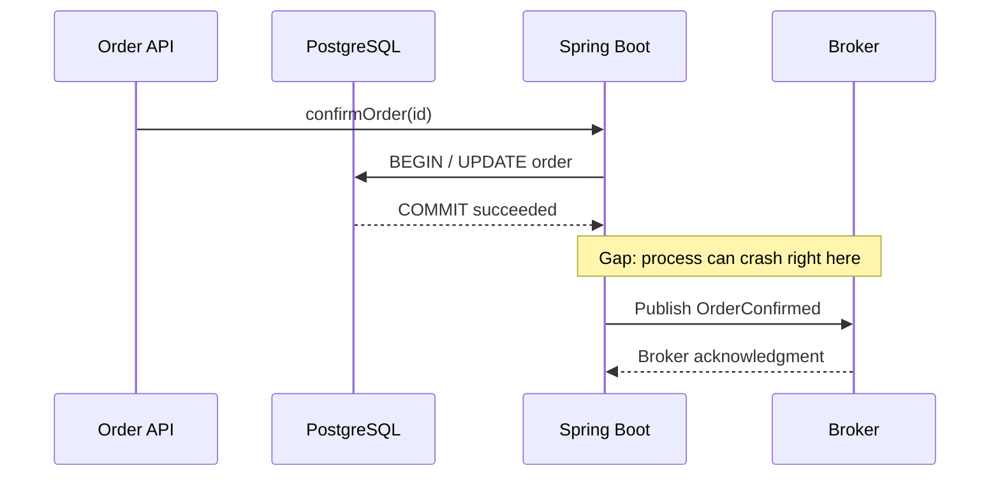
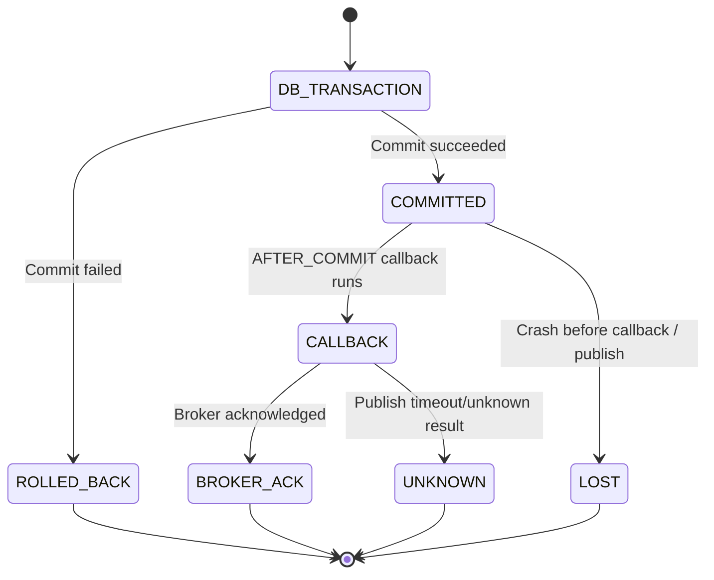
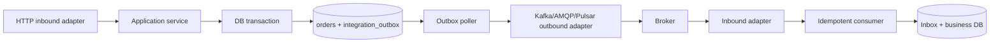

# After-Commit Events and the Message-Loss Gap

A Spring Boot service confirms an order by updating PostgreSQL and then emitting an `OrderConfirmed` event to Kafka, RabbitMQ, or Apache Pulsar. To avoid emitting an event for an order that was never actually saved, developers can use `@TransactionalEventListener(phase = AFTER_COMMIT)`. This handles **execution ordering**: the callback runs only after the database transaction commits cleanly. Yet one question remains: **if the application crashes after commit and before the broker receives the message, who will resend the event?**

This belongs to the **Integration Transactions** chapter in the `SPRING_BOOT_INTEGRATION` module: organizing flows across HTTP clients, databases, caches, brokers, and Spring Integration adapters while governing data contracts, transactions, retries, duplicates, testing, and observability. This lesson distinguishes **after-commit events** from **durably persisted events**, designs a transactional outbox, and examines the failure gaps a local transaction alone cannot close.

Examples use Java 17+, Spring Boot 3.x, Spring Data JPA, PostgreSQL, and Kafka. The same concepts apply to RabbitMQ/Pulsar, though publisher confirms, acknowledgments, and retries must be configured for each broker's API.

## 1. A Database Transaction Does Not Span the Broker

Suppose `confirmOrder(orderId)` must produce two effects:

1. `UPDATE orders SET status = 'CONFIRMED' ...` in PostgreSQL.
2. Publish `OrderConfirmedV1` so shipping and invoicing services start their work.

The system wants **no confirmation event if the order did not commit**, and **every confirmed order eventually produces an event**. An ordinary JPA transaction governs only the database operations enlisted in it; it does not automatically commit alongside Kafka, RabbitMQ, Pulsar, or HTTP APIs.



Both naive orderings have flaws:

| Ordering | Boundary Failure | Consequence |
| --- | --- | --- |
| **Publish before commit** | Broker receives event yet DB rolls back | Consumers see “order confirmed” while DB state stays `PENDING`. |
| **Commit before publish** | DB commits then process crashes/loses power before publish | Order is `CONFIRMED` with no message for consumers to process. |
| **Publish after commit, broker timeout** | Broker may have persisted it while callback missed confirmation | Resending can produce a **duplicate message**. |
| **Publish succeeds, consumer crashes before ACK** | Broker redelivers | Consumer may execute side effects a second time. |

Thus, the properties to prove are **never emitting uncommitted events**, **never losing publish intent on process crash**, and **safe duplicate consumption**. An annotation deciding callback timing alone cannot guarantee all three.

## 2. Spring Application Events Differ from Message Brokers

Spring's `ApplicationEventPublisher.publishEvent(...)` emits an **in-process application event**. By default, events dispatch to matching listeners inside the same JVM; the call itself neither writes messages to a broker nor creates a durable queue.

Service example:

```java
public record OrderConfirmedEvent(
        UUID eventId, UUID orderId, long orderVersion) {
}

@Service
public class OrderApplicationService {
    private final OrderRepository repository;
    private final ApplicationEventPublisher events;

    public OrderApplicationService(
            OrderRepository repository,
            ApplicationEventPublisher events) {
        this.repository = repository;
        this.events = events;
    }

    @Transactional
    public void confirm(UUID orderId) {
        Order order = repository.findById(orderId).orElseThrow();
        order.confirm();
        repository.flush(); // If incremented @Version is needed.
        events.publishEvent(new OrderConfirmedEvent(
                UUID.randomUUID(), orderId, order.getVersion()));
    }
}
```

`Order` and `OrderRepository` are illustrative domain types; each `public` top-level Java type lives in its own file. `confirm()` must enforce state transitions and idempotency. `UUID.randomUUID()` in this example must be generated **only once per logical event**; if an HTTP request can be re-executed after a timeout, the producer needs an operation ID/idempotency rule to avoid creating additional distinct events for the same transition.

If you register a regular listener:

```java
@Component
class ImmediateListener {
    @EventListener
    void on(OrderConfirmedEvent event) {
        // Regular callback runs when the event is dispatched.
        // Under default synchronous configuration, this point may
        // still be INSIDE confirm()'s transaction.
    }
}
```

This listener does not wait for commit merely because it has `@EventListener`. A synchronous listener can call the broker **before** `confirm()` commits, and the transaction can subsequently roll back. If the application event multicaster is configured asynchronously, separate thread and transaction contexts also apply. Never assume “Spring event = published broker message.”

## 3. What Does `@TransactionalEventListener(AFTER_COMMIT)` Solve?

Spring supports binding listeners to a transaction phase:

```java
import org.springframework.context.event.EventListener;
import org.springframework.stereotype.Component;
import org.springframework.transaction.event.TransactionPhase;
import org.springframework.transaction.event.TransactionalEventListener;

@Component
public class OrderCommittedListener {
    private final OrderEventGateway gateway;

    public OrderCommittedListener(OrderEventGateway gateway) {
        this.gateway = gateway;
    }

    @TransactionalEventListener(phase = TransactionPhase.AFTER_COMMIT)
    public void afterCommit(OrderConfirmedEvent event) {
        gateway.publish(event);
    }
}
```

`OrderEventGateway` is an adapter sending messages to a broker. Within a properly managed Spring transaction, the `AFTER_COMMIT` callback runs only after a successful commit. If the transaction rolls back, the callback **is not invoked**.

| `TransactionPhase` | When It Runs | Used For | Notes |
| --- | --- | --- | --- |
| `BEFORE_COMMIT` | Before commit completes | Pre-commit checks/actions | Transaction can still roll back afterward. |
| `AFTER_COMMIT` | After commit succeeds | Best-effort cache invalidation, non-critical notifications | Process crash after commit can drop the callback or publish. |
| `AFTER_ROLLBACK` | After rollback | Metrics, best-effort cleanup, reacting to rollbacks | Does not turn rollback into a new transaction. |
| `AFTER_COMPLETION` | After commit **or** rollback | Cleanup/telemetry across all outcomes | Distinguishing outcomes requires appropriate context. |

`@TransactionalEventListener` defaults to `AFTER_COMMIT`, yet spelling out `phase` helps readers verify the contract. `fallbackExecution` defaults to `false`: if an event is published **without a compatible transaction**, the transactional listener normally **does not run**. Setting `fallbackExecution = true` runs the callback even with no transaction, which can violate the “only publish after commit” assumption. Decide this explicitly.

### Reminder About Proxies and Transaction Boundaries

`@Transactional` is normally applied via Spring AOP proxies on calls passing through a bean. Calling `this.confirm()` inside the same class does not create a transaction the way a proxy call does. An event published without an active transaction can be skipped by a transactional listener. Tests must invoke application services just like production, through real Spring beans.

For reactive transactions, Spring supports Reactor-based transaction contexts in applicable versions; events and transaction context propagation must be designed specifically for them. Examples in this lesson use imperative/JPA thread-bound transactions and cannot be applied verbatim to R2DBC and an async `Mono` flow.

## 4. Two Pitfalls Right Inside After-Commit Callbacks

### 4.1. Writing to the Database Inside `AFTER_COMMIT` Does Not Automatically Start Another Commit

After commit finishes, Spring may still hold transaction resources (e.g., connection/`EntityManager`) during part of the callback lifecycle. If the callback invokes a repository/JPA method with default `REQUIRED` propagation, code may attach to the old resource context even though **no new commit occurs** for those new writes. Never infer from `save()` not throwing an exception that callback data committed.

If you need to write an independent audit record **after** the main transaction finishes, use **another Spring bean** with a new transaction:

```java
@Service
public class AuditAfterCommitService {
    private final AuditRepository auditRepository;

    public AuditAfterCommitService(AuditRepository auditRepository) {
        this.auditRepository = auditRepository;
    }

    @Transactional(propagation = Propagation.REQUIRES_NEW)
    public void writeAudit(OrderConfirmedEvent event) {
        auditRepository.save(new AuditRecord(
                event.eventId(), event.orderId()));
    }
}
```

The listener calls `auditAfterCommitService.writeAudit(event)` through the bean proxy; `REQUIRES_NEW` opens a fresh transaction. However, **post-commit audit writes still have a crash gap**: if the process dies before the callback executes, no audit row is written. When audit data is mandatory business data, persist it inside the **primary transaction** or a durable outbox.

### 4.2. `@Async` Switches Threads, It Does Not Provide Durability

Combining `@Async` with `@TransactionalEventListener(AFTER_COMMIT)` offloads publishing from the request thread. This reduces caller wait time in some cases, yet **the task resides in the executor's memory**. If the JVM dies, in-memory queued tasks may vanish; exceptions inside an async listener also cannot roll back an already-committed transaction.

If a callback throws immediately after commit, the exception might surface to the caller via callback/framework paths, yet **the database already committed**. Never return an HTTP error that lets the client create a brand-new order unconditionally; an error response after commit can make clients retry the same business action. Request idempotency and persisted outcome state solve this scenario.

## 5. State Model and Failure Windows



`LOST` in the diagram means **losing the publishing intent from application memory** when no durable record exists to recover from. `UNKNOWN` means it is unclear whether the broker persisted it; safe retries must expect the same event to appear multiple times.

| Failure Point | Database State | Broker State | `AFTER_COMMIT` Only | Outbox |
| --- | --- | --- | --- | --- |
| Error before commit | Rolled back | Not sent | No callback; appropriate | Both business row and outbox row roll back. |
| Crash after commit, before callback | Committed | Not sent | **Message can be lost permanently** | Outbox row stays `PENDING`; another worker can send it. |
| Callback calls publish yet network fails | Committed | May not have received | No durable retry record by default | Outbox row stays eligible for retry. |
| Broker received, client loses ACK | Committed | May have received | Retries risk duplicates; no durable history | Retry with same event ID; consumer deduplicates. |
| Publish succeeds then process dies before marking sent | Committed | Received | Callback loses progress state | Outbox retries, creating duplicate delivery without losing event. |
| Consumer commits DB then dies before ACK | Committed on consumer | Broker redelivers | Uncontrolled by producer | Consumer inbox/idempotency protects it. |

The aim of reliable design is not eliminating every duplicate via an “exactly once” promise, but **never losing intent after commit** and **making redeliveries free of duplicate side effects**.

## 6. When Is a Post-Commit Callback Enough vs. When Do You Need an Outbox?

| Requirement | `@TransactionalEventListener(AFTER_COMMIT)` | Transactional Outbox |
| --- | --- | --- |
| Runs only after successful commit | Yes | Yes, publishers only see committed outbox rows. |
| Does not emit on rollback | Yes on normal path | Yes, outbox row rolls back with data. |
| Recovers from JVM crash between commit/publish | **Not guaranteed automatically** | Yes, when DB durably stores outbox and dispatcher runs. |
| Auto-retries when broker is temporarily unavailable | Requires separate mechanism | Built cleanly atop persisted state, leases, and retry schedules. |
| Tolerates duplicate publishes | Still needs idempotency | Still needs idempotency. |
| Operational cost | Low | Outbox table, dispatcher, metrics, cleanup, and runbooks. |
| Best fit | Best-effort cache invalidation, non-critical telemetry | Mandatory events for orders, payments, invoices, shipments. |

Other alternatives:

- **CDC from transaction logs:** write an outbox inside the transaction and have Debezium/connectors tail the WAL/binlog to publish. Still requires managing connector offsets, schemas, retries, duplicates, and ordering.
- **Durable event publication registries:** e.g., Spring Modulith mechanisms persisting publication status, suitable when adopting that abstraction and verifying its storage/recovery mechanics. Do not confuse with plain `ApplicationEventPublisher`.
- **Broker transactions, XA/2PC:** have niche use cases, yet do not appear automatically just by enabling `@Transactional` or broker transactions. Two resource managers, failure recovery, and coordination costs require dedicated design and verification.
- **Periodic reconciliation:** for modest needs, scanning `CONFIRMED` orders lacking a recorded publication can work, though it needs a durable trail and stable event identification so new messages aren't minted arbitrarily.

The following sections build a **polling outbox** with PostgreSQL to expose every failure window clearly.

## 7. Event Contract: Identity and Content Must Remain Stable

Never send JPA/Hibernate entities directly to a broker; construct an immutable DTO:

```java
import java.time.Instant;
import java.util.UUID;

public record OrderConfirmedV1(
        UUID eventId,
        int schemaVersion,
        UUID orderId,
        long aggregateVersion,
        Instant occurredAt,
        String correlationId) {
}
```

| Field | Role |
| --- | --- |
| `eventId` | Idempotency key of a logical event; **unchanged** across publish retries. |
| `orderId` | Aggregate ID and broker partition key, routing same-order events intentionally. |
| `aggregateVersion` | State version assigned by the order owner inside the transaction, helping consumers spot stale/gapped events. |
| `schemaVersion` | JSON/Avro/Protobuf contract version, distinct from `aggregateVersion`. |
| `occurredAt` | Timestamp when the business event occurred; never a replacement for sequences. |
| `correlationId` | Links requests/traces across flows; never a replacement for `eventId`. |

Ideally, `eventId` is created once when handling a valid command and saved alongside the outbox row. When the poller retries, it reads the **exact persisted payload**, never regenerating a new `UUID.randomUUID()` or current timestamp.

With multiple producer replicas, `aggregateVersion` must increment atomically, e.g., via `@Version`/optimistic locking. If one transaction emits multiple events for the same aggregate, define an explicit `eventSequence` rule so versions do not collide without ordering meaning.

## 8. Designing the Transactional Outbox Table

PostgreSQL migration example via Flyway/Liquibase, in the same database as `orders`:

```sql
CREATE TABLE integration_outbox (
    event_id            UUID PRIMARY KEY,
    operation_id        VARCHAR(120) NOT NULL UNIQUE,
    aggregate_type      VARCHAR(64) NOT NULL,
    aggregate_id        UUID NOT NULL,
    aggregate_version   BIGINT NOT NULL,
    event_type          VARCHAR(100) NOT NULL,
    schema_version      INTEGER NOT NULL,
    payload             TEXT NOT NULL,
    status              VARCHAR(16) NOT NULL DEFAULT 'PENDING',
    attempts            INTEGER NOT NULL DEFAULT 0,
    next_attempt_at     TIMESTAMPTZ NOT NULL DEFAULT CURRENT_TIMESTAMP,
    claim_token         UUID,
    claimed_until       TIMESTAMPTZ,
    published_at        TIMESTAMPTZ,
    last_error_code     VARCHAR(80),
    created_at          TIMESTAMPTZ NOT NULL DEFAULT CURRENT_TIMESTAMP,
    CONSTRAINT ck_outbox_status CHECK
        (status IN ('PENDING', 'IN_FLIGHT', 'PUBLISHED', 'DEAD'))
);

CREATE INDEX idx_outbox_pending
    ON integration_outbox (next_attempt_at, created_at)
    WHERE status = 'PENDING';

CREATE INDEX idx_outbox_expired
    ON integration_outbox (claimed_until)
    WHERE status = 'IN_FLIGHT';
```

`operation_id` in this schema assumes **each logical business command emits exactly one outbox event**. It prevents two executions of the same command from creating two distinct events on client retry. If one command can emit multiple events, replace uniqueness with `(operation_id, event_type, event_sequence)` or an equivalent composite identifier.

`payload` stores JSON as `TEXT` to keep the example simple; `JSONB` can be used with mappings/queries verified on real PostgreSQL. Either way, never store serialized entities containing lazy proxies or sensitive internal fields. Event DTOs and schema versions form the producer's public contract.

Statuses:

| Status | Meaning | Action |
| --- | --- | --- |
| `PENDING` | Event committed, no publisher currently holds ownership | Eligible to be claimed once `next_attempt_at` arrives. |
| `IN_FLIGHT` | A worker claimed it with an active lease | Being sent/awaiting broker confirm; reclaimable after lease expiry. |
| `PUBLISHED` | Publisher received broker confirm and persisted this status | Skipped by normal polling. |
| `DEAD` | Exhausted retry budget or permanent error needing intervention | Investigate, fix root cause, controlled redrive. |

`PUBLISHED` only says **the broker confirmed receipt per the producer contract**, not that consumers processed it cleanly. Durability against data loss also depends on replication, acknowledgment policies, retention, and broker settings.

## 9. Writing Business State and Outbox in One Transaction

One implementation approach with Spring Data JPA: map `IntegrationOutboxRecord` to `integration_outbox` with `eventId`, `operationId`, `aggregateId`, `payload`, metadata, and `status=PENDING`; have the repository share the **exact same `EntityManagerFactory`/`PlatformTransactionManager`** as `OrderRepository`.

```java
@Service
public class ConfirmOrderUseCase {
    private final OrderRepository orders;
    private final IntegrationOutboxRepository outbox;
    private final ObjectMapper objectMapper;
    private final Clock clock;

    public ConfirmOrderUseCase(
            OrderRepository orders,
            IntegrationOutboxRepository outbox,
            ObjectMapper objectMapper,
            Clock clock) {
        this.orders = orders;
        this.outbox = outbox;
        this.objectMapper = objectMapper;
        this.clock = clock;
    }

    @Transactional
    public UUID confirm(UUID orderId, String operationId) {
        // In a real system: check whether operationId was already processed
        // and enforce optimistic concurrency before confirming.
        Order order = orders.findById(orderId).orElseThrow();
        order.confirm();
        orders.flush(); // Synchronize @Version if the event needs the new version.

        UUID eventId = UUID.randomUUID();
        OrderConfirmedV1 event = new OrderConfirmedV1(
                eventId, 1, orderId, order.getVersion(),
                clock.instant(), operationId);

        String json = serialize(event);
        outbox.save(IntegrationOutboxRecord.pending(
                eventId, operationId, "Order", orderId,
                order.getVersion(), "order.confirmed.v1", 1, json));
        return eventId;
    }

    private String serialize(OrderConfirmedV1 event) {
        try {
            return objectMapper.writeValueAsString(event);
        } catch (JsonProcessingException ex) {
            throw new IllegalStateException("Cannot encode order event", ex);
        }
    }
}
```

This is an **orchestration pattern**: supply `Order`, `IntegrationOutboxRecord`, repositories, validation/idempotency, and imports from your project. `orders.flush()` is not commit; a subsequent exception rolls back both the order change and the outbox insert. Sharing the same transaction manager is mandatory. If the outbox resides in a different database, local `@Transactional` will not span both.

### Do Not Rely on Unlocked `findByOperationId` Then Insert

Two concurrent requests sharing `operationId` can both read “does not exist yet.” Database unique constraints must provide the final guard; on conflict, one transaction rolls back and the application re-reads the committed outcome in a new transaction to return the **same business result**. Also verify that the same `operationId` with a different request body is a contract conflict, never silently treated as the same command.

Executing `order.confirm()` must be idempotent per the state machine: if the order is already `CONFIRMED`, return the existing status/event when matching the same operation; never generate a new `eventId` on each client retry.

### Why Not Publish Directly Inside This Method?

If `kafkaTemplate.send(...)` is called inside the transaction, the broker can receive the message even when the order transaction ultimately rolls back. If you only “register an after-commit callback,” the crash gap remains. `outbox.save(...)` persists the **committed intent to publish alongside business state**; an independent worker then delivers it.

## 10. Publisher Claiming Outbox Batches with Locks and Leases

When multiple replicas run outbox dispatchers concurrently, each worker must claim eligible rows in a short transaction. PostgreSQL supports `FOR UPDATE SKIP LOCKED`, allowing other workers to skip already-claimed rows.

SQL example **executed inside a transaction**:

```sql
WITH picked AS (
    SELECT event_id
    FROM integration_outbox
    WHERE (status = 'PENDING'
           AND next_attempt_at <= CURRENT_TIMESTAMP)
       OR (status = 'IN_FLIGHT'
           AND claimed_until < CURRENT_TIMESTAMP)
    ORDER BY created_at, event_id
    FOR UPDATE SKIP LOCKED
    LIMIT :batchSize
)
UPDATE integration_outbox AS o
SET status = 'IN_FLIGHT',
    claim_token = :newClaimToken,
    claimed_until = CURRENT_TIMESTAMP + INTERVAL '45 seconds',
    attempts = attempts + 1
FROM picked
WHERE o.event_id = picked.event_id
RETURNING o.event_id, o.aggregate_id, o.event_type,
          o.schema_version, o.payload, o.claim_token;
```

The `RETURNING` clause yields the claimed batch. `:newClaimToken` is a fresh UUID per claim round (which can be shared across one batch); every subsequent completion/state update must carry this token. Size lease duration to batch length, broker wait time, and worker count; if a worker stalls longer than the lease, another worker can reclaim and republish the same event.

**Important note on ordering:** `ORDER BY created_at` in the claim query does not guarantee consumers receive events in order **for the same aggregate** when multiple publishers send in parallel. When ordering is mandatory, claim only the next un-published event per aggregate, shard workers by `aggregateId`, or guard consumers with `aggregateVersion` and gap handling. `SKIP LOCKED` only distributes claim work; it does not solve ordering.

A DAO using `JdbcTemplate` can run the SQL above inside an `@Transactional` method, **committing the claim transaction before calling the broker**. Use the outbox PostgreSQL's own transaction manager and avoid holding DB row locks across network calls:

```java
@Repository
public class OutboxClaimDao {
    private final NamedParameterJdbcTemplate jdbc;

    public OutboxClaimDao(NamedParameterJdbcTemplate jdbc) {
        this.jdbc = jdbc;
    }

    @Transactional
    public List<ClaimedOutbox> claim(UUID token, int limit) {
        // NamedParameterJdbcTemplate.query(SQL_CLAIM, params, rowMapper)
        // with the SQL above; map RETURNING columns into DTOs.
        return queryClaimRows(token, limit);
    }
}
```

`queryClaimRows` and `ClaimedOutbox` are illustrative components you must implement; this class is not a standalone compilable snippet. If combining JPA and JDBC in one transaction, confirm they share the same physical datasource/transaction manager and test on PostgreSQL; never deduce shared transactions merely from matching JDBC URLs.

## 11. Publish, Broker Confirm, and Separate Status Update

A poller invokes the claim DAO and sends each event **after the claim commits**. With Spring Kafka, `KafkaTemplate` allows awaiting `CompletableFuture<SendResult<...>>`:

```java
@Component
public class KafkaOutboxDispatcher {
    private final OutboxClaimDao claims;
    private final OutboxStateService states;
    private final KafkaTemplate<String, String> kafka;

    public KafkaOutboxDispatcher(
            OutboxClaimDao claims,
            OutboxStateService states,
            KafkaTemplate<String, String> kafka) {
        this.claims = claims;
        this.states = states;
        this.kafka = kafka;
    }

    @Scheduled(fixedDelayString = "${app.outbox.poll-delay-ms:1000}")
    public void dispatch() {
        UUID claimToken = UUID.randomUUID();
        for (ClaimedOutbox row : claims.claim(claimToken, 10)) {
            try {
                kafka.send("orders.events.v1",
                        row.aggregateId().toString(), row.payload())
                        .get(10, TimeUnit.SECONDS);
                states.markPublished(row.eventId(), claimToken);
            } catch (InterruptedException interrupted) {
                Thread.currentThread().interrupt();
                states.scheduleRetry(row.eventId(), claimToken,
                        "INTERRUPTED");
                return;
            } catch (Exception ex) {
                states.scheduleRetry(row.eventId(), claimToken,
                        "BROKER_PUBLISH_FAILED");
            }
        }
    }
}
```

This snippet needs Spring Scheduling (`@EnableScheduling`), the Kafka starter, imports, and `OutboxStateService`/`ClaimedOutbox` beans. To stay focused on transactions, the example calls `get(timeout)` on a **dedicated scheduler thread**, never an HTTP event loop. In production, bound batch/in-flight sizes, size the scheduler thread pool, handle graceful shutdown, and guard against deadlines exceeding the lease. Async publishing with aggregated confirms is also viable as long as state invariants hold.

`states.markPublished(...)` and `states.scheduleRetry(...)` open a **fresh database transaction** after publish/timeout rather than reusing the claim transaction. Ownership-checked update example:

```sql
UPDATE integration_outbox
SET status = 'PUBLISHED',
    published_at = CURRENT_TIMESTAMP,
    claim_token = NULL,
    claimed_until = NULL,
    last_error_code = NULL
WHERE event_id = :eventId
  AND claim_token = :claimToken
  AND status = 'IN_FLIGHT';
```

If affected rows equals `0`, the worker **no longer owns the active claim**; log/metric it and inspect state. Retries must likewise check `WHERE event_id = :eventId AND claim_token = :claimToken`, set `next_attempt_at` with exponential backoff plus jitter, reset `status='PENDING'`, clear `claim_token`/`claimed_until`, and rely on the attempt increment already recorded at claim time. Once retry budget runs out, transition to `DEAD` with an error code and recovery runbook; avoid tight infinite loops.

### Broker Confirm Does Not Equal “Exactly Once”

For Kafka, await the send future and configure matching producer reliability, such as `acks=all` paired with cluster-managed replication/ISR policies. If a timeout occurs after the broker appended the record, `markPublished` does not execute; the poller resends after lease/retry. Keep the **exact same `eventId` in payload/headers** rather than creating a new event.

RabbitMQ uses publisher confirms/correlation data; Pulsar uses producer `MessageId`/acks. Each broker has distinct semantics. Kafka producer idempotence curbs duplicates from **a single producer's network retries**, yet does not replace an inbox when the **application outbox resends the same logical event in another round/instance**.

`claim_token` stops a stale worker from overwriting row state after lease expiry; it is **not** a broker-enforced fencing token blocking stale publishes. A worker whose lease expired may still publish; consumers must deduplicate.

## 12. Recovering `IN_FLIGHT`, Retries, and Cleanup

A reliable dispatcher must handle process kills while holding rows:

1. Claim moves `PENDING → IN_FLIGHT` and commits.
2. Worker dies before publish: `claimed_until` expires, another worker reclaims and sends.
3. Worker dies after broker received the event yet before `PUBLISHED`: another worker resends the **same event**.
4. Worker loses network and `get(timeout)` leaves broker state uncertain: treat as **unknown outcome**, schedule bounded retry, and expect duplicates.
5. Worker is killed inside the `markPublished` transaction: transaction rolls back, row stays eligible for retry after lease.

`next_attempt_at` decouples retry scheduling from immediate failure; use backoff based on `attempts` and error category:

```text
Attempt 1 fails -> retry after 1s + jitter
Attempt 2 fails -> retry after 2s + jitter
Attempt 3 fails -> retry after 4s + jitter
...
Limit reached -> DEAD; alert and controlled redrive
```

Never store long error messages/stack traces containing PII/credentials in `last_error_code`. Store a short error code for grouping, and place details in secured logs tied to correlation/event IDs.

`PUBLISHED` rows can be archived/purged per retention policies, yet never purge immediately while audits, broker timeout investigations, or consumer reconciliations still need them. Retention deletion must follow policy and never strip proof that an event was published.

## 13. Consumers Must Be Idempotent Because Outbox Can Replay

Transactional outbox provides **at-least-once** delivery attempts to the broker under normal operations and retries/reconciliation. It **does not** eliminate duplicate sends. Consumers therefore need an inbox strategy or unique constraints at the data store.

Example PostgreSQL consumer table:

```sql
CREATE TABLE processed_integration_event (
    consumer_name VARCHAR(80) NOT NULL,
    event_id      UUID NOT NULL,
    processed_at  TIMESTAMPTZ NOT NULL DEFAULT CURRENT_TIMESTAMP,
    PRIMARY KEY (consumer_name, event_id)
);
```

Inside one `@Transactional` covering both the inbox and projection update:

```java
@Service
public class OrderEventConsumerService {
    private final JdbcTemplate jdbc;

    public OrderEventConsumerService(JdbcTemplate jdbc) {
        this.jdbc = jdbc;
    }

    @Transactional
    public void apply(OrderConfirmedV1 event) {
        int inserted = jdbc.update("""
                INSERT INTO processed_integration_event
                    (consumer_name, event_id)
                VALUES (?, ?)
                ON CONFLICT DO NOTHING
                """, "shipping-projection-v1", event.eventId());

        if (inserted == 0) {
            return; // Already committed cleanly in a previous attempt.
        }

        int updated = jdbc.update("""
                UPDATE shipping_order_projection
                SET order_status = 'CONFIRMED'
                WHERE order_id = ?
                  AND order_status = 'PENDING'
                """, event.orderId());

        if (updated != 1) {
            throw new IllegalStateException(
                    "Cannot confirm projection for " + event.orderId());
        }
    }
}
```

This example assumes `shipping_order_projection` exists and the event applies only when the projection is `PENDING`; real systems must handle state machines, late events, and `aggregateVersion`. If `updated != 1`, the exception rolls back **both the inbox marker** and the projection so the message can retry—never mark an event processed when business logic failed to apply. Concurrent consumers receiving the same event contend on the unique key, ensuring only one transaction applies the internal side effect when both operations share the **same database/transaction manager**.

With a Spring Kafka listener in record acknowledgment mode, call the service synchronously:

```java
@KafkaListener(
        topics = "orders.events.v1",
        groupId = "shipping-projection-v1")
public void consume(String json) throws JsonProcessingException {
    OrderConfirmedV1 event =
            objectMapper.readValue(json, OrderConfirmedV1.class);
    consumerService.apply(event); // Commit before listener returns success.
}
```

`objectMapper` and `consumerService` are listener dependencies. Configure deserialization, error handlers, retries/DLT, and consumer offsets/ack mode for your Spring Kafka stack; this snippet illustrates **business ordering** rather than complete consumer configuration. If DB commit succeeds and the process dies before offset commit/broker ACK, the event is redelivered and the inbox blocks repeat updates.

For external HTTP APIs, a local database inbox **does not automatically make POST safe** if the side effect happens before the DB transaction commits. Use partner-honored idempotency keys, pending/reconciliation states, or outbox commands; never hold a long DB transaction over HTTP pretending it gives exactly-once semantics.

## 14. Connecting Spring Integration Flows

In Spring Integration, HTTP gateways, transformers, service activators, and broker outbound adapters can be wired into one flow. Yet **channel boundaries** determine threads and transactions; using the flow DSL does not create a shared transaction across database and broker.



With a `DirectChannel`, handlers typically run synchronously on the caller's thread; `ExecutorChannel`/queue channels can switch threads and transaction contexts. Placing an outbound adapter after `.handle(repository::save)` **does not ensure** the publish rolls back if the database rolls back.

A durable integration flow design:

1. Inbound adapter translates the message into a command DTO, validates it, and invokes an application service.
2. Application service writes business state **and outbox** inside a local transaction.
3. Poller or CDC reads **only committed data** and sends events to the outbound broker adapter.
4. Consumer inbound adapter writes inbox + state inside a transaction, then ACKs per adapter contract.
5. Error channels, retries, and dead-letter channels preserve failure trails; never treat a logged `ErrorMessage` as proof the outbox published or consumer ACKed.

For Spring Integration pollers using transaction advice, clarify **which exact steps the transaction spans**. Polling, transforming, and performing network I/O inside one transaction can hold DB row locks/connections far too long. The claim-then-commit-before-publish pattern from Section 10 yields cleaner operational boundaries.

## 15. Testing Transactions and Crash Windows

A unit test asserting `@TransactionalEventListener` fires after commit is useful, yet **does not prove messages survive a JVM kill**. Testing requires multiple levels.

### 15.1. Database Test: Order and Outbox Commit/Roll Back Together

Use PostgreSQL Testcontainers, Flyway/Liquibase running real schemas, and an `@SpringBootTest` calling `ConfirmOrderUseCase` through its bean proxy. **Do not** put `@Transactional` on the whole test method when verifying real commits, because test-managed transactions roll back after the test and mask after-commit behavior.

```java
@Test
void confirmsOrderAndStoresOutboxAtomically() {
    UUID orderId = fixtures.createPendingOrderCommitted();

    UUID eventId = useCase.confirm(orderId, "request-5001");

    assertEquals("CONFIRMED", fixtures.loadStatus(orderId));
    assertTrue(outboxQuery.existsPending(eventId));
}

@Test
void rollbackDoesNotLeaveOutboxEvent() {
    UUID orderId = fixtures.createPendingOrderCommitted();

    assertThrows(IllegalStateException.class,
            () -> faultyUseCase.confirmThenFail(
                    orderId, "request-5002"));

    assertEquals("PENDING", fixtures.loadStatus(orderId));
    assertFalse(outboxQuery.existsByOperationId("request-5002"));
}
```

These are **illustrative assertions**; `fixtures`, `faultyUseCase`, and `outboxQuery` must be implemented for your project. `confirmThenFail` must call `flush()` before throwing inside the same transaction to prove already-executed SQL still rolls back, and assertion queries must read via a **fresh transaction**. Never mock the outbox repository and call it an atomicity test.

### 15.2. Failure-Injection Matrix

| Injection Point | Required Outcome |
| --- | --- |
| Before DB commit | Order rolls back; **no** outbox row exists to publish. |
| After DB commit, before first poll | Order + `PENDING` survive app restart. |
| After claim commit, before network publish | `IN_FLIGHT` lease expires; another instance reclaims; zero lost events. |
| Broker persists event yet publisher times out | Same `eventId` can be resent; consumer applies once. |
| Broker confirm succeeds yet process dies before `PUBLISHED` | New publisher resends; inbox deduplicates. |
| `markPublished` DB update fails | Outbox is not marked complete; retries with same ID. |
| Lease expires while old worker still publishes | Stale worker fails to update status due to mismatched claim token; consumer deduplicates. |
| Consumer commits projection, crashes before broker ACK | Broker redelivers; inbox recognizes duplicate and ACKs safely. |
| Invalid event schema/poison message | Bounded retries or DLT/quarantine; never ACK as complete without saving state. |
| Two replicas claim batches concurrently | Never claim the same active-lease row; post-expiry duplicates lose zero events. |
| Broker down for hours | `PENDING`/retry backlog climbs with alerts; outbox rows are never dropped by failed retries. |

To simulate **real crashes**, run two processes/pods/containers against a real database and broker, kill the publisher at a deterministic hook, and start another instance. Throwing exceptions inside the same JVM tests transactions, yet does not fully simulate dropped connections, lost callbacks, or unrecorded ACKs.

### 15.3. Testing `@TransactionalEventListener` to See Its Limits

A test can register a listener recording when it fires, then:

1. Publish an event inside `TransactionTemplate.execute(...)`.
2. Assert `AFTER_COMMIT` callback has not run while the transaction is still open.
3. After `TransactionTemplate` returns/commits, assert the callback ran once.
4. Throw an exception to roll back another transaction; assert `AFTER_COMMIT` callback did not run.
5. Publish an event without a transaction (`fallbackExecution=false`); assert the callback is skipped.

This test verifies **lifecycle rules**. It does not close the gap where “commit finished yet the process died before the callback.” Proof of durability comes from having an outbox row **committed alongside business changes** and recovery tests restarting the publisher.

## 16. Operating the Outbox: Never Let Backlogs Grow Silently

An outbox only helps if a worker/connector is running, retry schedules are monitored, and a path exists to handle `DEAD` rows. Useful signals:

| Metric or Log | Purpose | When to Alert |
| --- | --- | --- |
| `outbox.pending.count`, `outbox.oldest.pending.age` | Spots committed events not yet published | Message age exceeds SLO, backlog grows steadily. |
| `outbox.inflight.count`, `outbox.claim.expired` | Reveals dead workers / overly short leases | `IN_FLIGHT` rows expire repeatedly. |
| `outbox.publish.success`, `outbox.publish.failure` | Observes broker/producer health | Rising failures, falling throughput. |
| `outbox.publish.confirm.latency` | Tunes timeouts and lease durations | Latency approaches lease or timeout. |
| `outbox.retry.attempts`, `outbox.dead.count` | Investigates permanent errors / exhausted retries | `DEAD` rows appear or retry storms occur. |
| `consumer.inbox.duplicate`, `consumer.error`, `consumer.lag` | Spots redeliveries and apply errors | Duplicates spike alongside broker timeouts or stuck consumers. |
| `eventId`, `operationId`, `aggregateId`, `traceId` in structured logs | Traces a journey end-to-end | Unable to reconcile DB rows against broker publishes. |

Avoid putting high-cardinality `eventId`/`orderId` in Prometheus labels; keep them in controlled logs/traces. Never log tokens, passwords, payment details, or sensitive payloads in errors/outbox records without proper retention, encryption, and access control.

`DEAD` recovery runbook:

1. Identify root cause: bad contract, missing topic, permissions, broker outage, schema/serialization, or code bug.
2. Inspect the original outbox row (`eventId`, `operationId`, payload, attempts) and any downstream broker/consumer state.
3. Fix the root cause first; reset status to `PENDING` with backoff and an audit trail per procedure, **without changing `eventId`**.
4. Redrive in small batches with rate limits while watching duplicates/lag; halt if errors recur.
5. Verify `PUBLISHED` rows genuinely received proper broker confirms; reconcile any missed business records if a broken deployment occurred.

A cleanup job can archive `PUBLISHED` rows past retention. Never purge `PENDING`/`IN_FLIGHT`/`DEAD` rows simply because they are “old” without an approved data-loss and recovery policy.

## 17. Common Mistakes

| Mistake | Consequence | Fix |
| --- | --- | --- |
| Calling Kafka/RabbitMQ inside JPA `@Transactional` | Publish can succeed before DB rolls back | Use outbox or a verified consistency mechanism. |
| Thinking `AFTER_COMMIT` equals durable delivery | Crash gap loses messages | Write durable intent before commit via outbox. |
| Calling `@Async` treating it as a reliable queue | Process crash loses in-memory tasks | Durable dispatcher/CDC; retries and monitoring. |
| Setting `fallbackExecution=true` without rules | Listener runs even without a transaction | Define phase/contract explicitly; test no-transaction paths. |
| Writing audit via `REQUIRED` inside after-commit callbacks | May lack a new commit | `REQUIRES_NEW` for best-effort separate writes; durable audits belong in the main transaction. |
| Updating business row in DB A, outbox in DB B | One local transaction cannot commit both | Co-locate outbox with source of truth or design proper coordination. |
| Minting a new event ID on each publish retry | Consumers cannot deduplicate the logical event | Persist `eventId`/payload once in outbox. |
| Marking `PUBLISHED` before broker confirm | Can lose messages when publish actually fails | Update status only after confirmation. |
| Ignoring unknown-outcome timeouts | Retries can cause duplicates | At-least-once + inbox/idempotency. |
| Claiming rows and holding the transaction open while calling broker | Prolonged DB locks, pool exhaustion, deadlocks | Claim/commit first, publish outside transaction, mark in a new transaction. |
| Lease expires while stale worker still marks published | Corrupts ownership/status | Match `claim_token`, monitor lease expirations. |
| Using `SKIP LOCKED` and claiming per-aggregate ordering is guaranteed | Parallel publishers can reorder publishes | Partition/serialize by key or enforce consumer version guards. |
| Consumer writes inbox after ACK | Crash loses dedup protection | Commit inbox + business logic before ACK. |
| Having an outbox table with no alerts/recovery | Messages sit stuck indefinitely | Monitor backlog, retries, `DEAD`, and maintain runbooks. |

## 18. Design Checklist and Exercise

Before shipping an integration requiring reliable messaging, check:

- [ ] Defined database transaction boundaries and broker acknowledgment boundaries.
- [ ] Distinguished in-process `ApplicationEventPublisher` from broker-accepted messages.
- [ ] `@TransactionalEventListener(AFTER_COMMIT)` used only where best-effort is acceptable or backed by durable publication.
- [ ] Event DTO carries a stable `eventId`, aggregate key, schema version, and needed correlation fields.
- [ ] Business row and outbox row written in the **same local transaction**; rollback discards both.
- [ ] Publisher claims in short transactions with leases, ownership tokens, timeouts, and durable retries.
- [ ] Broker confirms verified; `PUBLISHED` written only after confirm.
- [ ] Consumers implement inbox/idempotency and version/state guards; ACK after business commit.
- [ ] Tested crashes after commit before publish, unknown-outcome timeouts, publish followed by crash before marking, and consumer crashes before ACK.
- [ ] Defined per-aggregate ordering policies, DLQ/`DEAD`, backlog alerts, cleanup, and redrive procedures.
- [ ] Tested on real PostgreSQL + real broker, including at least two concurrent dispatchers/replicas.

**Hands-on exercise:** implement `POST /orders/{id}/confirm` with PostgreSQL and Kafka. First publish via `@TransactionalEventListener(AFTER_COMMIT)`, then intentionally kill the process after DB commit and before the callback, observing a `CONFIRMED` order with no message. Next, add `integration_outbox` in the same transaction as the order; build a dispatcher claiming with `FOR UPDATE SKIP LOCKED`, publishing while awaiting broker confirm, and marking `PUBLISHED`. Test killing the worker after claim, and after broker confirm before marking; verify the event eventually arrives—occasionally duplicated yet always carrying the same `eventId`. Finally, add an inbox table on the consumer and prove an order applies once even when Kafka redelivers the message.

**Key takeaway:** `AFTER_COMMIT` decides **when** a callback may run, whereas an outbox stores **durable proof of intent to publish** inside the business transaction itself. The gap between commit and broker can still cause duplicate publishes during recovery; sound design embraces controlled at-least-once delivery, keeps event identity stable, and makes consumers idempotent so the system stays accurate after crashes.
