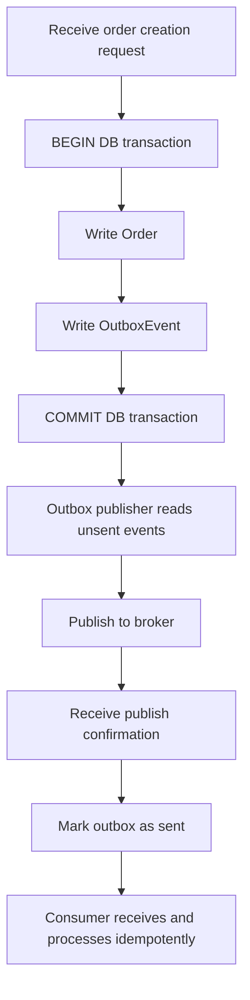

# Testing Faults Between Steps to Verify Transaction Boundaries

## 1. Why Deliberately Inject Faults in an Integration Flow?

In **Spring Boot Integration**, a single business operation often crosses multiple components: persisting via JPA/JDBC, calling an HTTP client, updating a cache, sending messages to a broker, or routing messages through Spring Integration adapters. Those steps may live inside one Java method, yet they **do not automatically belong to the same transaction**.

For example, when creating an order, the app writes the order to PostgreSQL, writes an `OrderCreated` event to an outbox table, and later another process publishes the event to a broker. If saving the outbox fails, both the order and the outbox must roll back. If the broker is temporarily down **after** the database committed, the order and outbox must stay intact so the event can be resent. These are two distinct boundaries requiring two distinct sets of test expectations.

Intentional fault testing (*fault injection*) triggers an exception or outage at a known point in the flow and then inspects the **actual state** of each resource. The goal is not merely asserting whether a method throws an exception, but proving data is committed, rolled back, replayed, or compensated as designed.

### Distinguishing Boundary Types

| Component | Controllable Boundary | What Must Not Be Assumed |
|---|---|---|
| One database through the same `PlatformTransactionManager` | Writes participating in the same transaction commit/roll back atomically | That `save()` or `flush()` already committed |
| Two Spring `@Transactional` methods with `REQUIRED` | Typically share the current transaction when called through a Spring proxy and the same manager | That each method always gets an independent transaction |
| `REQUIRES_NEW` method via Spring proxy | Creates its own transaction that can commit while the outer transaction remains open | That outer rollback erases data committed by the inner transaction |
| HTTP API, external cache, another target system | Has its own error contract, idempotency, or compensating action | That JPA rollback automatically undoes a succeeded HTTP request |
| Broker and database | Can coordinate redelivery, local transactions, or an outbox | That putting `@Transactional` on one method yields an atomic DB+broker commit |

**Testing principle:** for each step that can fail, you must be able to answer (1) which transaction committed by that moment; (2) which components hold side effects that cannot roll back; (3) whether messages may be redelivered; and (4) how the next execution handles recovery.

## 2. Mapping States and Fault-Injection Points

Consider an order creation workflow using **database transaction + transactional outbox**:



Test injection points should be named after **business steps or transaction milestones**, not specific line numbers:

| Injection Point | Order DB State | Outbox State | Next Expectation |
|---|---|---|---|
| Before writing order | No order | No event | Request fails, safe to retry |
| After `Order` `flush`, before writing outbox | Order rolled back | No event | No orphaned order left behind |
| After both records `flush`ed, before commit | Both rolled back | Both rolled back | No half-written changes |
| After commit, before publisher sends to broker | Order saved | `PENDING` event | Next sweep can publish the event |
| Broker received event, publisher dies before marking `SENT` | Order saved | May stay `PENDING` | Duplicate send possible; consumer must deduplicate |
| Consumer wrote DB yet failed before commit | Consumer DB transaction rolls back | Unrelated | Broker redelivers per configured ack/retry policy |

Note: `flush` pushes SQL down to the DB within the active transaction, surfacing constraint errors earlier; **`flush` is not equivalent to `commit`**. Exceptions thrown before commit roll back the transaction by default if they are `RuntimeException` or `Error` and not overridden by custom rollback rules.

## 3. Example: Testing Order and Outbox Rollback with Spring Boot

The example below focuses on **a single database transaction**. A fault point is placed after each write to catch cases where the two writes are no longer atomic. Code uses Spring Data JPA and Spring Boot 3.1+; standard imports are omitted to focus on the mechanism.

### 3.1. Data Model and Service Under Test

```java
@Entity
@Table(name = "customer_order")
class OrderRecord {
    @Id
    private UUID id;

    @Column(nullable = false)
    private String state;

    protected OrderRecord() {} // JPA

    OrderRecord(UUID id, String state) {
        this.id = id;
        this.state = state;
    }
}

@Entity
@Table(name = "outbox_event")
class OutboxRecord {
    @Id
    private UUID id;

    @Column(nullable = false)
    private UUID orderId;

    @Column(nullable = false)
    private String eventType;

    protected OutboxRecord() {} // JPA

    OutboxRecord(UUID id, UUID orderId, String eventType) {
        this.id = id;
        this.orderId = orderId;
        this.eventType = eventType;
    }
}

interface OrderRepository extends JpaRepository<OrderRecord, UUID> {}

interface OutboxRepository extends JpaRepository<OutboxRecord, UUID> {
    boolean existsByOrderId(UUID orderId);
}

enum FailurePoint {
    AFTER_ORDER_FLUSH,
    AFTER_OUTBOX_FLUSH
}

interface FailureProbe {
    void hit(FailurePoint point);
}

@Component
class NoFailureProbe implements FailureProbe {
    @Override
    public void hit(FailurePoint point) { /* normal environment */ }
}

@Service
class PlaceOrderService {
    private final OrderRepository orders;
    private final OutboxRepository outbox;
    private final FailureProbe probe;

    PlaceOrderService(OrderRepository orders,
                      OutboxRepository outbox,
                      FailureProbe probe) {
        this.orders = orders;
        this.outbox = outbox;
        this.probe = probe;
    }

    @Transactional
    public void place(UUID orderId) {
        orders.saveAndFlush(new OrderRecord(orderId, "CREATED"));
        probe.hit(FailurePoint.AFTER_ORDER_FLUSH);

        outbox.saveAndFlush(new OutboxRecord(
            UUID.randomUUID(), orderId, "OrderCreated"));
        probe.hit(FailurePoint.AFTER_OUTBOX_FLUSH);
        // Commit occurs when the @Transactional proxy call exits cleanly.
    }
}
```

In real codebases, `FailureProbe` can be replaced with another test seam such as a mock or fake. Never turn fault points into an openly triggerable production endpoint. The sample simply illustrates deterministic exception injection.

### 3.2. Integration Testing with a Real Database

Running PostgreSQL via Testcontainers exercises real JDBC/JPA and the real transaction manager, instead of merely verifying calls on a mocked repository. With Gradle, relevant test dependencies typically include:

```groovy
testImplementation 'org.springframework.boot:spring-boot-starter-test'
testImplementation 'org.springframework.boot:spring-boot-testcontainers'
testImplementation 'org.testcontainers:junit-jupiter'
testImplementation 'org.testcontainers:postgresql'
testRuntimeOnly  'org.postgresql:postgresql'
```

```java
@SpringBootTest
@Testcontainers
class PlaceOrderTransactionIT {
    @Container
    @ServiceConnection
    static PostgreSQLContainer<?> postgres =
        new PostgreSQLContainer<>("postgres:16-alpine");

    @Autowired PlaceOrderService service;
    @Autowired OrderRepository orders;
    @Autowired OutboxRepository outbox;
    @Autowired SwitchableFailureProbe probe;

    @TestConfiguration
    static class FaultConfig {
        @Bean
        @Primary
        SwitchableFailureProbe testFailureProbe() {
            return new SwitchableFailureProbe();
        }
    }

    static class SwitchableFailureProbe implements FailureProbe {
        private volatile FailurePoint failAt;

        void failAt(FailurePoint point) { failAt = point; }
        void clear() { failAt = null; }

        @Override
        public void hit(FailurePoint point) {
            if (point == failAt) {
                throw new IllegalStateException("Injected at " + point);
            }
        }
    }

    @BeforeEach
    void resetFailurePoint() {
        probe.clear();
    }

    @Test
    void errorAfterOrderFlushRollsBackOrder() {
        UUID id = UUID.randomUUID();
        probe.failAt(FailurePoint.AFTER_ORDER_FLUSH);

        assertThrows(IllegalStateException.class, () -> service.place(id));

        assertFalse(orders.existsById(id));
        assertFalse(outbox.existsByOrderId(id));
    }

    @Test
    void errorAfterOutboxFlushRollsBackBothWrites() {
        UUID id = UUID.randomUUID();
        probe.failAt(FailurePoint.AFTER_OUTBOX_FLUSH);

        assertThrows(IllegalStateException.class, () -> service.place(id));

        assertFalse(orders.existsById(id));
        assertFalse(outbox.existsByOrderId(id));
    }

    @Test
    void successCommitsOrderAndOutboxTogether() {
        UUID id = UUID.randomUUID();

        service.place(id);

        assertTrue(orders.existsById(id));
        assertTrue(outbox.existsByOrderId(id));
    }
}
```

Before running the sample, ensure test schema configuration (`ddl-auto` or matching Flyway/Liquibase migrations) and Docker/Testcontainers are active. `@ServiceConnection` auto-wires container connection details in supporting Spring Boot versions.

**What makes this test trustworthy:** the test methods above are **not** annotated with `@Transactional`. `service.place(id)` runs through the Spring proxy; the transaction has already committed or rolled back when the method returns or throws. Subsequent `existsById` and `existsByOrderId` queries inspect the actual post-transaction database state. Putting `@Transactional` on the test method causes Spring Test to roll back the whole test transaction at test end, creating the illusion that the service rolled back even if the service actually succeeded inside the test transaction.

Using a fresh UUID per test avoids order dependency and manual cleanup across tests. Because `FailureProbe` is a shared stateful bean, if running tests **in parallel**, replace the fault injector with per-test isolated beans/contexts or disable parallelization for this test class.

## 4. Post-Commit Testing: DB, HTTP, and Brokers Do Not Share One Boundary

### 4.1. Failure Immediately After Database Commit

To test the *post-commit* moment properly, place the fault **outside** the transactional service call:

```java
@Component
class OrderWorkflow {
    private final PlaceOrderService placeOrderService;
    private final BrokerPublisher publisher;

    OrderWorkflow(PlaceOrderService placeOrderService,
                  BrokerPublisher publisher) {
        this.placeOrderService = placeOrderService;
        this.publisher = publisher;
    }

    // No @Transactional on this orchestration method.
    public void createAndPublish(UUID orderId) {
        placeOrderService.place(orderId);  // DB commits before returning.
        publisher.publishPending();        // May throw if broker is unavailable.
    }
}
```

Suppose `publisher.publishPending()` fails. The test must verify `OrderRecord` and `OutboxRecord` **still exist**, the event remains in pending state, and a subsequent publisher run delivers the event to the broker. In Section 3's minimal example, outbox omitted status columns; production implementations need `PENDING`/`SENT`, retry timestamps, claim/lease locking, and guards against two publishers picking the same row. Tests here should exercise the system's actual outbox implementation.

If an outer method already opened a transaction with `@Transactional(REQUIRED)`, `placeOrderService.place()` can **join the outer transaction**, meaning the DB has not committed when the inner method returns. Never treat a method return boundary as proof of commit without checking propagation and the active transaction manager.

### 4.2. HTTP Succeeds Then Database Rolls Back

Consider calling a synchronous payment gateway directly inside a DB transaction:

```java
@Transactional
public void placeAndCharge(UUID orderId) {
    orders.save(new OrderRecord(orderId, "CREATED"));
    paymentClient.charge(orderId); // HTTP 200: payment system processed it.
    throw new IllegalStateException("Fault after successful charge");
}
```

If `paymentClient.charge()` executed a real charge, the exception at the end only rolls back the app's DB data; it **does not automatically refund**. Integration tests should use an HTTP stub that tracks call counts and returns success, then assert both: the order does not exist in the DB, yet the charge request was sent and the simulated target recorded the side effect. This test exposes a design missing a recovery plan, not a Spring rollback bug.

Typical fixes include idempotency keys, persisted processing states, sagas/compensating actions, or offloading HTTP calls to a worker reading durable requests. For HTTP timeouts, also test the **unknown whether target processed** case: safe retries via idempotency keys or status queries, never assuming timeout means the remote transaction failed.

### 4.3. Broker Received It Yet Producer Failed to Record Completion

An outbox publisher usually follows: read `PENDING` → send to broker → receive ack → mark `SENT`. Kill/fail the publisher **after broker ack but before updating the outbox**; on rerun, the record may be published a second time. Reasonable expectations are *at-least-once delivery* paired with idempotent consumers, not *exactly-once* across systems by default.

On the consumer side, store `eventId` in a `processed_message` table with a unique key inside the **same transaction** as business changes:

```java
@Transactional
public void handle(OrderCreated event) {
    if (processedMessageRepository.existsById(event.eventId())) {
        return;
    }

    inventoryRepository.reserve(event.orderId());
    processedMessageRepository.save(
        new ProcessedMessage(event.eventId()));
}
```

This is only an outline: `existsById()` followed by `save()` has a race condition under concurrent consumers processing the same event. Production implementations need a **DB unique constraint**, duplicate-insert handling, and safe ordering. Tests must deliver the same `eventId` multiple times, including concurrently if permitted, and confirm stock is deducted only once. Also test ack/offset settings separately: DB rollback does not guarantee broker redelivery if the listener already acknowledged prematurely.

### 4.4. `REQUIRES_NEW`, Caches, After-Commit Events, and Async Flows

Several constructs alter test outcomes even within the same call stack:

- **`REQUIRES_NEW`:** another service called via a Spring proxy can commit an audit row independently. After an outer rollback, verify the audit row remains while outer business data rolled back, if intentional. Do not assume annotations work on `this.innerMethod()` in the same object because self-invocation usually bypasses proxies.
- **Cache/Redis:** direct cache writes usually sit outside JPA transactions. Fault tests after modifying cache must confirm stale data is not retained; consider post-commit eviction/updates or suitable consistency patterns.
- **`@TransactionalEventListener(AFTER_COMMIT)`:** the handler runs after commit, yet a crash can drop in-memory events; test recovery paths and use an outbox when durable emission is required.
- **`@Async`, schedulers, message listeners, Spring Integration channels/adapters:** crossing thread or message boundaries can start a different transaction from the entry point. Test each consumer/handler and redelivery rather than assuming transaction contexts cross threads automatically.
- **Checked exceptions and error handling:** Spring rolls back by default on unchecked exceptions, not checked exceptions; you can declare `@Transactional(rollbackFor = ...)`. If code catches and swallows an error, the transaction can commit normally. Inject faults both where exceptions throw and inside `catch` branches to test actual rules.

## 5. Designing a Staged Fault-Test Suite

A valuable test suite needs at least one **happy path** and failure paths with explicit expectations. For DB → outbox → broker → consumer → target system, structure it as follows:

| Test Case | How to Inject Fault | Mandatory Evidence |
|---|---|---|
| Normal order creation | No fault | Order and outbox commit together; event processed once in business terms |
| Error after writing order | Throw after `saveAndFlush(Order)` | No Order; no Outbox |
| Error after writing outbox | Throw after `saveAndFlush(Outbox)` | No Order; no Outbox |
| DB commits, publisher fails | Broker refuses connection or publisher throws after DB transaction ends | Order/Outbox persist; resend succeeds once broker recovers |
| Broker received then publisher dies | Fault after broker ack, before updating `SENT` | Duplicate publish may occur; consumer applies side effect once |
| Consumer fails before DB commit | Throw after consumer DB write | Consumer DB changes roll back; message reprocessed per retry/ack policy |
| HTTP succeeds then internal error | HTTP stub returns 2xx, fault after HTTP | Target side effect observed; confirms compensation/idempotency strategy |
| Timeout or unknown HTTP outcome | Stub holds connection past timeout yet processes request | Retry with same idempotency key creates no duplicate side effects |
| `REQUIRES_NEW` child transaction | Commit audit in separate bean, then throw in outer transaction | Audit commits, outer transaction data rolls back per design |

To make these cases repeatable:

1. **Define state invariants first.** For instance: “No committed Order lacks a matching outbox event,” “One `eventId` never deducts stock twice,” “An HTTP retry never charges twice.”
2. **Choose exact fault-injection points.** Clearly separate pre-commit, post-commit, pre-ack, and post-ack. Use exceptions, HTTP fakes/stubs, controlled broker container stops, or publisher test hooks. Inject one primary fault per case.
3. **Use real resources at the boundary under verification.** JPA rollback tests need a real database and transaction manager; mocked repositories cannot prove commit/rollback. HTTP clients can use stub servers; brokers and redelivery can use broker test containers.
4. **Inspect data after transactions finish.** Query over a fresh connection/transaction, asserting both expected rows present and rolled-back rows absent. For async flows, await a state condition with a bounded timeout (e.g., Awaitility); avoid fixed `Thread.sleep()`.
5. **Retry after recovery.** Rerun publishers/consumers, resend the same request ID or event ID, check final data, and count side effects. Asserting only HTTP statuses or mock call counts does not prove business invariants.
6. **Keep failure causes observable.** Attach `orderId`, `eventId`, attempt number, and processing status to logs/traces/metrics while avoiding sensitive payloads. Test output should distinguish rollbacks, retries, dead-lettering, and compensating actions.

## 6. Common Mistakes That Lead Tests to Wrong Conclusions

**“The test passed because the database ended up empty.”** If the whole test is wrapped in `@Transactional`, rows may vanish because the *test framework* rolled back, not the service. Always include a happy-path test verifying rows persist after the service call finishes.

**“The service threw an exception so everything definitely rolled back.”** Check exception type, `rollbackFor`/`noRollbackFor`, propagation, transaction manager, proxy traversal, and any `catch` blocks. Logging “rollback” without querying the DB post-transaction is insufficient.

**“Calling `flush` means data committed.”** `flush` only syncs the persistence context with the database inside the active transaction. Injecting a fault right after `flush` is great for proving already-sent SQL still rolls back when the transaction fails.

**“If the publisher sends once, the consumer processes once.”** Disconnects or crashes between broker ack and status updates can cause duplicate sends. Test redelivery and idempotency on both producer and consumer sides.

**“An error in one service rolls back HTTP, Redis, and the broker too.”** DB transaction boundaries do not cover those systems by default. Sometimes a good test outcome is **exposing a surviving side effect**, motivating proper compensation or recovery design.

## 7. Completion Criteria

Transaction boundary verification is satisfactory only when live tests prove: writes **within the same DB transaction** commit/roll back atomically; **committed** changes survive failures in subsequent steps; **non-transactional** side effects are identified and handled via retries, idempotency, or compensation; and crash replays do not corrupt business state.

Instead of expecting an entire integration chain to be a single transaction, treat every commit, publish, ack, and downstream service call as a **potential point of failure**. Post-fault state maps paired with direct data assertions provide real evidence that an integration flow is sound.
