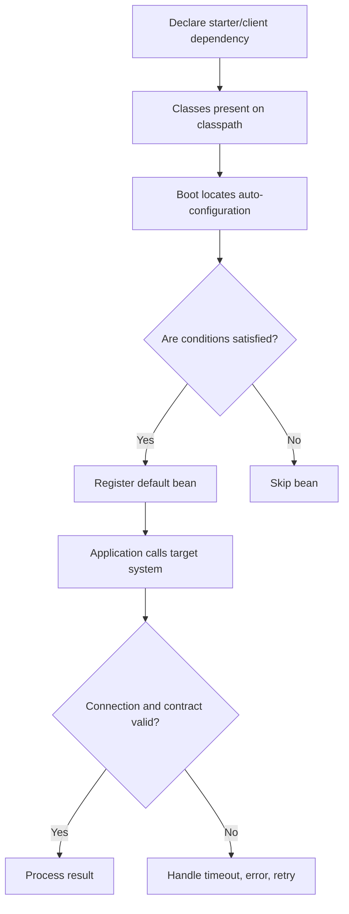

# Starters, Client Libraries, and Auto-Configuration Activation Conditions

> **Chapter:** Connection Configuration  
> **Scope:** Spring Boot Integration — organizing connections to HTTP APIs, databases, caches, message brokers, and Spring Integration adapters.

## 1. Why understand starters, clients, and auto-configuration?

Suppose an order application needs to call a shipping API over HTTP, persist data to PostgreSQL, read from Redis, and publish events via RabbitMQ. To make a connection work, three independent questions must be answered:

1. **Are the right libraries present?** Dependencies determine which drivers, clients, and APIs exist on the classpath.
2. **Who creates and configures the connection beans?** Spring Boot can automatically create `RestClient.Builder`, `DataSource`, `RedisConnectionFactory`, or `RabbitTemplate` when conditions are met.
3. **Is the connection actually usable?** The existence of a bean does not guarantee that DNS, networking, TLS, credentials, or the target service are valid and ready. Depending on the technology, the connection may be tested at startup or when handling a request.

| Component | Responsibility | Example | Does not automatically guarantee |
| --- | --- | --- | --- |
| **Starter** | Dependency bundle to get started with an integration | `spring-boot-starter-data-redis`, `spring-boot-starter-amqp` | That the target server is running |
| **Client library/driver** | Provides the protocol API and implementation | Spring Web `RestClient`, JDBC driver, Lettuce | That every suitable bean is created in the context |
| **Auto-configuration** | Automatically registers default beans based on classpath, properties, and existing beans | `DataSource`, `RabbitTemplate` | Knowing URLs, secrets, timeouts, and business logic if unconfigured |
| **Application configuration** | Specifies endpoints, credentials, and bean customizations | `application.yml`, `@ConfigurationProperties`, `@Bean` | Compensating for a missing driver |
| **Spring Integration adapter** | Connects a message flow to a protocol | `spring-integration-http`, `spring-integration-amqp` | Designing the business flow automatically |

**A starter is not synonymous with auto-configuration being active.** A starter is a dependency bundle; Boot only registers beans when the appropriate conditions are satisfied.



## 2. Choosing starters and client libraries by need

The table below uses common names in **Spring Boot 3.x**, Java 17 and above. When using Spring Boot 4.x or a major upgrade, check artifact names, packages, properties, and BOMs according to your project's version line.

| Need | Dependency | Typical Bean/API | Additional configuration needed |
| --- | --- | --- | --- |
| Synchronous HTTP | `spring-boot-starter-web` (Spring Web) | `RestClient`, `RestClient.Builder` | Base URL, HTTP timeouts, TLS, authentication |
| Reactive HTTP | `spring-boot-starter-webflux` | `WebClient`, `WebClient.Builder` | Timeout, connector, reactive model |
| JDBC/SQL | `spring-boot-starter-jdbc` + driver | `DataSource`, `JdbcTemplate` | URL, driver, credentials, pool |
| JPA | `spring-boot-starter-data-jpa` + driver | `EntityManagerFactory`, repository | Entities, schema/migration, transactions |
| Redis | `spring-boot-starter-data-redis` | `RedisConnectionFactory`, `StringRedisTemplate` | Host, SSL/credentials, serializer, TTL |
| RabbitMQ | `spring-boot-starter-amqp` | `RabbitTemplate`, listener infrastructure | Broker, vhost, queue/exchange, routing, ack |
| Kafka | `org.springframework.kafka:spring-kafka` | `KafkaTemplate`, consumer factory | Bootstrap servers, serializers, consumer group |
| Spring Integration | `spring-boot-starter-integration` + adapter | `IntegrationFlow`, channels, gateways | Declaring flows/handlers and protocol adapters |

Example when **only** synchronous HTTP calls with Spring Web are needed:

```groovy
// build.gradle — project already uses Spring Boot BOM/dependency management
dependencies {
    implementation 'org.springframework.boot:spring-boot-starter-web'
    testImplementation 'org.springframework.boot:spring-boot-starter-test'
}
```

If using JDBC with PostgreSQL, add the corresponding dependencies:

```groovy
dependencies {
    implementation 'org.springframework.boot:spring-boot-starter-jdbc'
    runtimeOnly 'org.postgresql:postgresql'
}
```

If a Spring Integration message flow needs an HTTP connection:

```groovy
dependencies {
    implementation 'org.springframework.boot:spring-boot-starter-integration'
    implementation 'org.springframework.integration:spring-integration-http'
}
```

These are **three independent choices**, not a requirement for every application to install all of them. Let Spring Boot's BOM manage compatible versions, and avoid pinning mismatched versions of Spring Framework, Integration, and clients manually.

In Spring Framework 6.1+ / Boot 3.2+, `RestClient` provides a synchronous API; `WebClient` fits the reactive model. Adding WebFlux to the classpath does not automatically turn a blocking HTTP call into a non-blocking one. Choose the client based on the application's processing architecture.

## 3. Auto-configuration activation conditions

`@SpringBootApplication` includes the mechanism that enables auto-configuration. At startup, Boot discovers registered auto-configurations, evaluates their conditions, and creates the matching beans.

| Condition | Meaning | Scenario |
| --- | --- | --- |
| `@ConditionalOnClass` | Class must be present on the classpath | Only support RestClient if Spring Web is present |
| `@ConditionalOnMissingClass` | Class is absent | Choose a fallback option |
| `@ConditionalOnBean` | A bean of the required type/name already exists | Only create an adapter when a connection factory exists |
| `@ConditionalOnMissingBean` | No matching bean exists yet | Allow the application to override the default client |
| `@ConditionalOnProperty` | Property matches the required value | Only enable integration when `partner.api.enabled=true` |
| `@ConditionalOnWebApplication` | Matches the web application type | Configure servlet/reactive endpoints |
| `@ConditionalOnResource` | Required resource is present | Integration depending on a classpath resource |

Conditions on the same configuration are usually combined with **AND** logic: a missing class, a mismatched property, or a pre-existing custom bean can prevent the default configuration from being registered. With `@ConditionalOnBean` and `@ConditionalOnMissingBean`, configuration processing order also matters because conditions observe only the beans already processed at the time of evaluation.

Example condition:

```java
@ConditionalOnProperty(
    prefix = "partner.api",
    name = "enabled",
    havingValue = "true")
```

| `partner.api.enabled` | Condition |
| --- | --- |
| `true` | Matches |
| `false` | Does not match |
| Not declared | Does not match, unless `matchIfMissing=true` is used |
| Value other than `true` | Does not match |

**Not every starter has a `*.enabled` property.** The `partner.api.enabled` flag is just a convention defined for this example. For a specific library, you must read the actual conditions of its auto-configuration.

### 3.1. Typical conditions for each technology

**HTTP:** Boot can provide a `RestClient.Builder` if the supporting RestClient components are present. A `RestClient` bean for a specific partner is usually created by the application or an internal starter because the framework cannot guess the base URL and authentication policy.

**JDBC:** The starter provides the JDBC API, but the default datasource still depends on a driver, a JDBC URL, or a suitable embedded database. If the user already defines a custom `DataSource`, the default configuration usually backs off. Insufficient configuration can cause **startup to fail**, rather than simply omitting the bean.

**Redis:** Boot can provide `RedisConnectionFactory` and templates when the corresponding library is present; creating the bean does not guarantee Redis is reachable. TTL, keys, serializers, and behavior when Redis loses connectivity must be specified separately.

**RabbitMQ:** Can register the connection factory, `RabbitTemplate`, and listener infrastructure. Broker, exchanges, queues, routing, acks, and error handling policies are still required for messages to reach their destination.

**Spring Integration:** Having core or adapters on the classpath only provides the capability to define endpoints. An `IntegrationFlow` with channels, routers, transformers, and handlers does not appear automatically from business intent.

## 4. Managing connection configuration

Separate hosts, credentials, timeouts, and enable/disable flags from Java code. Use `application.yml`, environment variables, or external configuration sources according to Boot's configuration precedence rules.

Example configuration dedicated to a partner HTTP API:

```yaml
partner:
  api:
    enabled: ${PARTNER_API_ENABLED:false}
    base-url: ${PARTNER_API_BASE_URL:https://partner.example.invalid}
```

`example.invalid` is only an illustrative domain name, not a real endpoint. When enabling the feature in a running environment, a valid URL must be supplied. Defaulting `enabled=false` helps keep the connection inactive when environment information is incomplete.

Example for other integrations (**add only what is actually used**):

```yaml
spring:
  datasource:
    url: ${DB_JDBC_URL}
    username: ${DB_USERNAME}
    password: ${DB_PASSWORD}
  data:
    redis:
      host: ${REDIS_HOST:localhost}
      port: ${REDIS_PORT:6379}
  rabbitmq:
    host: ${RABBIT_HOST:localhost}
    port: ${RABBIT_PORT:5672}
    username: ${RABBIT_USERNAME}
    password: ${RABBIT_PASSWORD}
```

In Boot 3.x, Redis commonly uses the `spring.data.redis.*` namespace. Read the documentation for your actual version when upgrading. Placeholders without default values (e.g. `DB_JDBC_URL`) must be supplied in the target environment; do not commit real passwords to the repository or logs.

Three groups of configuration should be distinguished:

- **Addressing and routing:** host, port, base URL, JDBC URL, broker address/vhost.
- **Connectivity and security:** TLS, secrets, proxy, pool size, connect timeout, and read timeout.
- **Business semantics:** bounded retries, idempotency keys, transactions, TTL, dead-letter queues, duplicate handling.

Boot helps bind these values into beans; Boot cannot automatically decide the right transaction, retry, and data contract for every system.

## 5. End-to-end example: conditional auto-configured HTTP client

Suppose an internal library provides a way to call a shipping partner API. Requirements:

- Create `PartnerGateway` only when `partner.api.enabled=true`.
- When the user has already declared their own `PartnerGateway` bean, the default configuration must back off.
- When the integration is enabled without a valid base URL, the application fails configuration validation at startup.
- The definition can live inside a reusable auto-configuration module.

The example uses **Java 17, Spring Boot 3.2+, and `RestClient`**; package names must be added according to your project's source layout.

### 5.1. Contract and implementation

```java
// PartnerGateway.java
public interface PartnerGateway {
    String fetchOrder(String orderId);
}
```

```java
// RestPartnerGateway.java
import org.springframework.web.client.RestClient;

public final class RestPartnerGateway implements PartnerGateway {
    private final RestClient client;

    public RestPartnerGateway(RestClient client) {
        this.client = client;
    }

    @Override
    public String fetchOrder(String orderId) {
        return client.get()
                .uri("/orders/{id}", orderId)
                .retrieve()
                .body(String.class);
    }
}
```

For simplicity, the gateway returns `String`. In a real product, use DTOs with explicit schemas and validation, and define behavior for empty bodies, HTTP status mapping, timeouts, and authentication tokens.

### 5.2. Binding configuration with `@ConfigurationProperties`

```java
// PartnerApiProperties.java
import java.net.URI;
import org.springframework.boot.context.properties.ConfigurationProperties;

@ConfigurationProperties(prefix = "partner.api")
public record PartnerApiProperties(URI baseUrl) {
}
```

The record receives `partner.api.base-url` via relaxed binding. It groups the configuration of an integrated system into one clear object instead of scattering multiple `@Value` annotations with string keys.

### 5.3. Registering the bean when conditions are satisfied

```java
// PartnerClientAutoConfiguration.java (Spring Boot 3.x)
import java.net.URI;
import org.springframework.boot.autoconfigure.AutoConfiguration;
import org.springframework.boot.autoconfigure.condition.ConditionalOnClass;
import org.springframework.boot.autoconfigure.condition.ConditionalOnMissingBean;
import org.springframework.boot.autoconfigure.condition.ConditionalOnProperty;
import org.springframework.boot.autoconfigure.web.client.RestClientAutoConfiguration;
import org.springframework.boot.context.properties.EnableConfigurationProperties;
import org.springframework.context.annotation.Bean;
import org.springframework.web.client.RestClient;

@AutoConfiguration(after = RestClientAutoConfiguration.class)
@ConditionalOnClass(RestClient.class)
@ConditionalOnProperty(
        prefix = "partner.api",
        name = "enabled",
        havingValue = "true")
@EnableConfigurationProperties(PartnerApiProperties.class)
public class PartnerClientAutoConfiguration {

    @Bean
    @ConditionalOnMissingBean(PartnerGateway.class)
    PartnerGateway partnerGateway(RestClient.Builder builder,
                                  PartnerApiProperties properties) {
        URI baseUrl = properties.baseUrl();
        if (baseUrl == null || !baseUrl.isAbsolute()) {
            throw new IllegalStateException(
                    "partner.api.base-url must be an absolute URI");
        }
        RestClient client = builder.baseUrl(baseUrl.toString()).build();
        return new RestPartnerGateway(client);
    }
}
```

Read the code in order:

1. `@ConditionalOnClass(RestClient.class)` requires the client API to be present. In a standard Boot 3.2+ example with the Web starter, Boot also provides a `RestClient.Builder` bean; if an application packages dependencies differently so the builder is absent, a builder must be provided or an appropriate guard condition added.
2. `@ConditionalOnProperty` only activates the configuration class when the property has the value `true`. When the flag is missing, no gateway is registered.
3. `@ConditionalOnMissingBean` gives precedence to the user's bean. `@AutoConfiguration(after = RestClientAutoConfiguration.class)` specifies processing order relative to **Boot 3.x** HTTP auto-configuration.
4. When enabled without a base URL or with a non-absolute URI, fail early so operators can fix the environment.
5. The `RestClient.Builder` bean is managed by Boot and can receive shared customizers. Partner-specific timeouts, authentication, proxies, and retry policies still need explicit configuration.

These pieces can live in an independent auto-configuration module. For Spring Boot 3.x to discover the configuration from a dependency JAR automatically, create a resource at the exact path:

```text
META-INF/spring/org.springframework.boot.autoconfigure.AutoConfiguration.imports
```

Example contents (replace with your actual package):

```text
com.example.partner.PartnerClientAutoConfiguration
```

If this is only a client used inside **the application itself**, you can use a `@Configuration` class with `@Bean` and include it in component scanning. The `AutoConfiguration.imports` mechanism serves for distributing configuration through reusable libraries/starters, and is not mandatory for every application bean.

### 5.4. Allowing the application to replace the bean

```java
import org.springframework.context.annotation.Bean;
import org.springframework.context.annotation.Configuration;

@Configuration
class CustomPartnerConfiguration {
    @Bean
    PartnerGateway partnerGateway() {
        return orderId -> "Mock response for order " + orderId;
    }
}
```

When this bean exists, `@ConditionalOnMissingBean(PartnerGateway.class)` prevents the default bean from being created. This is the **back-off** mechanism, creating an extension point for testing and custom implementations. If multiple beans of the same type exist, the application must manage selection with `@Qualifier` or `@Primary` at injection points.

### 5.5. Testing configuration branches without making network calls

`ApplicationContextRunner` starts a lightweight Spring context, well suited to verifying bean presence based on classpath, properties, and other beans. Example using JUnit 5/AssertJ from `spring-boot-starter-test`:

```java
import org.junit.jupiter.api.Test;
import org.springframework.boot.autoconfigure.AutoConfigurations;
import org.springframework.boot.test.context.runner.ApplicationContextRunner;
import org.springframework.web.client.RestClient;

import static org.assertj.core.api.Assertions.assertThat;

class PartnerClientAutoConfigurationTest {
    private final ApplicationContextRunner runner = new ApplicationContextRunner()
            .withConfiguration(
                    AutoConfigurations.of(PartnerClientAutoConfiguration.class))
            .withBean(RestClient.Builder.class, RestClient::builder)
            .withPropertyValues(
                    "partner.api.base-url=https://partner.example.invalid");

    @Test
    void disabledWhenFlagIsMissing() {
        runner.run(context ->
                assertThat(context).doesNotHaveBean(PartnerGateway.class));
    }

    @Test
    void createsGatewayWhenEnabled() {
        runner.withPropertyValues("partner.api.enabled=true")
                .run(context ->
                        assertThat(context).hasSingleBean(PartnerGateway.class));
    }

    @Test
    void customGatewayWins() {
        runner.withPropertyValues("partner.api.enabled=true")
                .withBean(PartnerGateway.class, () -> id -> "stub")
                .run(context -> {
                    assertThat(context).hasSingleBean(PartnerGateway.class);
                    assertThat(context.getBean(PartnerGateway.class)
                            .fetchOrder("A-1")).isEqualTo("stub");
                });
    }
}
```

The test explicitly registers `RestClient.Builder` to isolate and verify the gateway's configuration logic. It does **not** verify a real HTTP connection. Client tests should also include a mock/test HTTP server covering timeouts, HTTP 4xx/5xx, authentication, JSON contracts, and duplicate requests.

## 6. Verifying from bean to live connection

| Layer | What to verify | Example mismatch |
| --- | --- | --- |
| Build/classpath | Compatible starter, client, driver, and versions | JDBC API present, but PostgreSQL driver missing |
| Spring context | Whether auto-configuration matches; whether a bean is overridden | `@ConditionalOnMissingBean` backs off |
| Properties | Whether profile, URL, credentials, TLS, and timeouts are right | Missing environment variable, expired token |
| Network/service | Whether DNS, firewall, port, broker, and API are reachable | Connection refused, TLS handshake error |
| Data/business logic | Whether schema, serializer, retry, transaction, and idempotency are right | Duplicate messages, malformed JSON, inconsistent data |
| Operations | Whether metrics, tracing, correlation IDs, logs, and alerts are sufficient | No distinction between timeout and 4xx, logs leak secrets |

For each connection type, the development team must also decide:

- **HTTP:** connect/read timeouts, authentication, HTTP status mapping, bounded retries. Retrying write operations is only safe when the API has an appropriate idempotency mechanism.
- **Database:** pool size, connection wait time, migrations, transaction boundaries; avoid holding a DB transaction open while waiting on slow HTTP calls.
- **Redis:** TTL, serializers, namespaces, cache misses, fallbacks; a cache is not implicitly the primary source of truth.
- **Broker:** publisher confirms/acks, dead-lettering, retries, duplicate delivery, idempotent consumers. Writing to the DB and sending to RabbitMQ do not automatically form an atomic transaction.
- **Spring Integration:** channels, executors, backpressure, error channels, and message traceability across adapters.

### 6.1. Diagnosing "why is there no bean?"

1. Inspect the dependency tree: are the right client, adapter, and version present?
2. Check property names/values, active profiles, and environment variables; do not assume every starter has an `enabled` flag.
3. Check whether a bean declared by the application or another library causes `@ConditionalOnMissingBean` not to match.
4. Enable the conditions report with `--debug` in a development environment and read the *Conditions Evaluation Report*: which configurations matched, which were skipped, and why.
5. When Spring Boot Actuator is present, the `conditions` endpoint can help diagnose if enabled and properly secured; never expose diagnostic endpoints to the public Internet.
6. Once the bean exists, run a controlled live operation to distinguish network/credential/contract errors from bean registration issues.

```bash
java -jar app.jar --debug
```

You can disable a Boot auto-configuration using `spring.autoconfigure.exclude` with its class name, though the impact can be broader than a single client. For internally developed integrations, a flag like `partner.api.enabled` usually expresses intent more clearly.

## 7. Combined scenario: order service

The application receives orders, stores them in PostgreSQL, checks Redis, calls a shipping API, publishes `OrderPlaced` to RabbitMQ, and orchestrates a processing flow via Spring Integration.

| Task | Infrastructure Boot helps with | What the team must design |
| --- | --- | --- |
| Persist orders | DataSource, template or JPA, transaction manager when conditions are met | Schema/migrations, transactions, pool |
| Cache | Redis connection factory/template | Keys, TTL, serializer, handling cache unavailable |
| Shipping HTTP | RestClient builder; partner gateway enabled only by configuration | URL, token, timeout, data contract, idempotency |
| Publish events | AMQP connection factory/template | Queue/exchange/routing, confirms, outbox or consistency strategy |
| Flow orchestration | Spring Integration core and adapters | Channels, flows/handlers, error handling, retries |

For example, while the shipping API is being rolled out gradually, setting `partner.api.enabled=false` avoids creating the default gateway in environments that are not ready yet. When enabled, the gateway requires a real URL and credentials. It can be replaced with a mock `PartnerGateway` in tests via `@ConditionalOnMissingBean`.

In this flow, **registering clients** and **ensuring business consistency** are two separate responsibilities. Spring Boot helps create connections/clients, but does not inherently guarantee that a PostgreSQL write and a RabbitMQ publish succeed together. Where high reliability is required, consider a transactional outbox, idempotent consumers, retries, and appropriate monitoring.

## 8. Self-check questions

1. Why is adding `spring-boot-starter-amqp` not enough to guarantee messages reach the broker and are processed by consumers?
2. Distinguish `@ConditionalOnClass` from `@ConditionalOnBean`. Why do bean-related conditions depend on configuration order?
3. If `partner.api.enabled` is omitted, does the example create `PartnerGateway`? If it should be enabled by default, how must the condition change and what are the operational risks?
4. Why does having a `RestClient.Builder` bean not mean you already have a client for a specific partner API?
5. Both Redis and PostgreSQL have connection beans in the context: what does that tell you, and what does it **not** yet tell you about service health?
6. When an application wants to use its own `PartnerGateway` implementation, what must it declare for the back-off mechanism to work?

**Takeaway:** starters solve **dependencies**; clients/drivers implement the **protocol**; auto-configuration provides **conditional beans**; application configuration together with transaction, error, and observability design determines **whether the integration operates accurately and safely**.

### References

- [Spring Boot — Auto-configuration](https://docs.spring.io/spring-boot/reference/using/auto-configuration.html)
- [Spring Boot — Creating Your Own Auto-configuration](https://docs.spring.io/spring-boot/reference/features/developing-auto-configuration.html)
- [Spring Framework — REST Clients](https://docs.spring.io/spring-framework/reference/integration/rest-clients.html)
- [Spring Integration — Reference](https://docs.spring.io/spring-integration/reference/)
