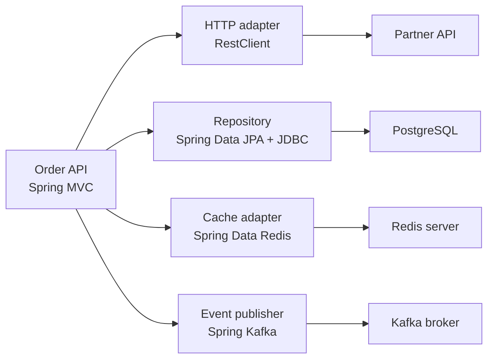
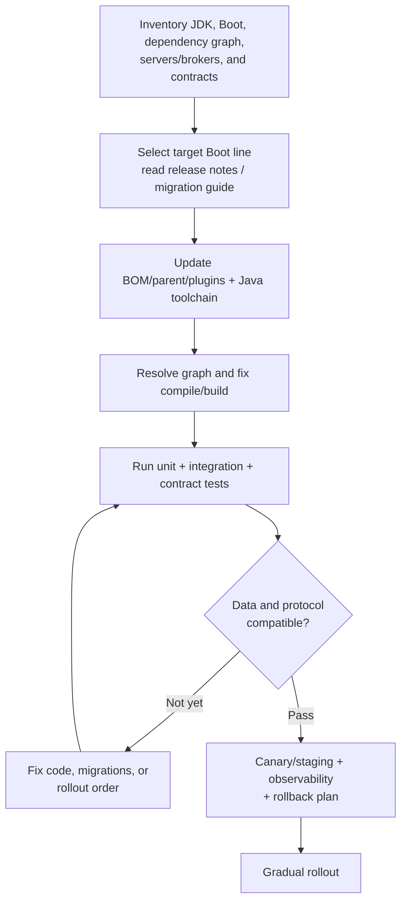

# Dependency Version Management with Spring Boot and Compatibility Verification

## 1. Why is version management part of connection configuration?

In a **SPRING_BOOT_INTEGRATION** application, a single business flow might use `RestClient` for HTTP calls, JDBC/JPA for database updates, Redis for caching, Kafka/RabbitMQ for event messaging, and Spring Integration for organizing adapters. Each connection depends on a **set of libraries**: Spring Framework, Spring Data, database drivers, HTTP clients, broker clients, serialization libraries, security, and observability.

For example, an order service has a processing chain:



If one component upgrades `spring-core` independently while another keeps an older `spring-web`, or a driver/client is chosen outside its supported range, the application can **compile cleanly yet fail at runtime**: `NoSuchMethodError`, `ClassNotFoundException`, wrong authentication mechanism, incompatible serializer, or a broker feature unsupported by the server.

Spring Boot solves **synchronizing library versions on the classpath** through a curated set of versions managed and tested together. However, compatibility between the application and **PostgreSQL servers, Redis servers, Kafka brokers, partner APIs, and message schemas** still must be verified separately.

After this lesson, you will be able to:

- Explain the roles of the Spring Boot parent POM, **BOM** (`spring-boot-dependencies`), starters, and transitive dependencies.
- Configure version management with **Maven** and **Gradle**, and know when a separate version declaration is needed.
- Read dependency trees to find the actual resolved versions at compile, test, and runtime.
- Build a compatibility matrix for Java, Spring Boot, Spring Framework/Data, drivers, brokers/servers, and data contracts.
- Organize testing, upgrades, rollbacks, and change control to reduce integration incidents.

> **Example note:** The build snippets use **Spring Boot 3.5.0** as a released syntax reference, **not a recommendation to pin to this patch version**. Real projects should choose a supported Spring Boot line and appropriate patch release at deployment time, checking release notes and support matrices of related dependencies. Spring Boot 3.x requires at least Java 17; the Boot 4 line may change package names, starters, and managed components and should be evaluated as a major upgrade.

## 2. Distinguishing version layers

In an integrated system, "version" is more than just the number written next to a dependency.

| Version layer | Example | Who manages it? | What needs verification? |
| --- | --- | --- | --- |
| Runtime | Java 17/21, JVM vendor | Deployment platform and build toolchain | Matches Spring Boot and library requirements |
| Framework | Spring Boot, Spring Framework, Spring Security | Boot-managed version set and project config | APIs, configuration, extension points, and breaking changes |
| Data/integration libraries | Spring Data JPA/Redis, Spring Kafka, Spring Integration | Usually managed by Boot BOM | Supported release train alignment and adapter semantics |
| Client/driver | PostgreSQL JDBC, Lettuce, Kafka clients, RabbitMQ client | Boot BOM or controlled override | Protocol compatibility, security, retries, serialization |
| External server | PostgreSQL, Redis, Kafka broker, RabbitMQ | Operations team / vendor | Client-server compatibility, TLS, features, and cluster upgrades |
| Data contract | REST v1/v2, event schema v3, DB migrations | API/schema owners | Backward/forward compatibility under independent deploys |
| Build/test plugins | Maven/Gradle, Java compiler, test plugins | Build config and CI governance | Toolchain, reproducibility, test/build behavior |

**A BOM cannot guarantee every layer in this table.** It manages the dependency versions declared within the BOM; it does not fix brokers and does not validate live data exchanged between two systems.

## 3. Spring Boot BOM, starters, and transitive dependencies

### 3.1. What is a BOM?

A **Bill of Materials (BOM)** in Maven is a POM that publishes a curated list of managed versions via `dependencyManagement`. Spring Boot publishes its BOM under the coordinates:

```text
org.springframework.boot:spring-boot-dependencies:<spring-boot-version>
```

For example, an application declares:

```xml
<dependency>
    <groupId>org.springframework.kafka</groupId>
    <artifactId>spring-kafka</artifactId>
</dependency>
```

When the application uses Boot's BOM and this dependency is managed by the BOM, Maven selects the corresponding version **without writing `<version>`** on the dependency itself. Avoid manually entering an independent Spring Kafka version just because it is newer, as that version may require a different combination of Spring Framework, Kafka clients, or Java.

A BOM **does not add dependencies to the classpath by itself**. It only specifies the version when a dependency is requested. Importing the BOM also **does not** automatically enable Spring Boot auto-configuration, configure beans, or add build plugins.

### 3.2. What does a starter do?

A starter is a convenience dependency that brings in a commonly used group of libraries:

```text
spring-boot-starter-web
  ├─ Spring Web + Spring MVC
  ├─ JSON (depending on starter/version configuration)
  ├─ Embedded server (for the default web starter)
  └─ Related supporting libraries
```

Examples:

| Need | Common dependency | Notes |
| --- | --- | --- |
| Synchronous HTTP with `RestClient` | `spring-boot-starter-web` or Spring Web as needed | `RestClient` is a synchronous API in Spring Framework |
| JPA/Hibernate | `spring-boot-starter-data-jpa` | Still requires a JDBC driver for a real database |
| Redis cache/data | `spring-boot-starter-data-redis` | Usually brings in a Boot-managed Redis client |
| Kafka producer/consumer | `org.springframework.kafka:spring-kafka` | Right dependency for Spring Kafka integration on Boot 3.x |
| RabbitMQ with Spring AMQP | `spring-boot-starter-amqp` | Requires broker host and credentials configuration |
| Spring Integration EIP flows | `spring-boot-starter-integration`, plus appropriate adapter modules | Add only the needed adapters, such as HTTP, JDBC, AMQP, or Kafka |
| Application testing | `spring-boot-starter-test` and specialized test dependencies | HTTP, integration, and contract tests as needed |

Starters intentionally pull in **transitive dependencies**. Adding `spring-boot-starter-web` does not mean adding just one JAR. Always inspect the full dependency graph before drawing conclusions about the classpath or version safety.

### 3.3. Declared dependencies vs. resolved dependencies

Suppose we declare:

```text
spring-boot-starter-data-redis
```

The build tool resolves the starter's libraries as well, such as Spring Data Redis and the associated client/driver. If the project also declares a Redis client directly with a different version, the dependency graph can contain multiple requests for the same module. The rules for **choosing the final version differ between Maven and Gradle**, and are also affected by dependency management, constraints, conflict resolution, and overrides.

Never assume versions based only on what you see in `pom.xml` or `build.gradle`; always inspect the **resolved** versions in the right configuration/classpath.

## 4. Maven Option 1: using `spring-boot-starter-parent`

For standalone Maven applications not forced to inherit from another corporate parent, the common approach is to use the Boot parent:

```xml
<!-- pom.xml: abbreviated example, replace illustrative version before deployment -->
<project xmlns="http://maven.apache.org/POM/4.0.0"
         xmlns:xsi="http://www.w3.org/2001/XMLSchema-instance"
         xsi:schemaLocation="http://maven.apache.org/POM/4.0.0
                             https://maven.apache.org/xsd/maven-4.0.0.xsd">
    <modelVersion>4.0.0</modelVersion>

    <parent>
        <groupId>org.springframework.boot</groupId>
        <artifactId>spring-boot-starter-parent</artifactId>
        <version>3.5.0</version>
        <relativePath/>
    </parent>

    <groupId>example.integration</groupId>
    <artifactId>order-service</artifactId>
    <version>1.0.0</version>

    <properties>
        <java.version>17</java.version>
    </properties>

    <dependencies>
        <dependency>
            <groupId>org.springframework.boot</groupId>
            <artifactId>spring-boot-starter-web</artifactId>
        </dependency>
        <dependency>
            <groupId>org.springframework.boot</groupId>
            <artifactId>spring-boot-starter-data-jpa</artifactId>
        </dependency>
        <dependency>
            <groupId>org.postgresql</groupId>
            <artifactId>postgresql</artifactId>
            <scope>runtime</scope>
        </dependency>
        <dependency>
            <groupId>org.springframework.kafka</groupId>
            <artifactId>spring-kafka</artifactId>
        </dependency>
        <dependency>
            <groupId>org.springframework.boot</groupId>
            <artifactId>spring-boot-starter-test</artifactId>
            <scope>test</scope>
        </dependency>
    </dependencies>

    <build>
        <plugins>
            <plugin>
                <groupId>org.springframework.boot</groupId>
                <artifactId>spring-boot-maven-plugin</artifactId>
            </plugin>
        </plugins>
    </build>
</project>
```

Explanation:

1. `spring-boot-starter-parent` inherits dependency management from Boot and provides corresponding Maven/plugin defaults.
2. Dependencies managed by Boot's BOM do not need a version on each declaration.
3. `org.postgresql:postgresql` is the JDBC driver, placed in `runtime` scope when the application does not need driver-specific APIs at compile time.
4. `spring-kafka` integrates with Kafka; **Boot's BOM does not create a broker**. The broker still must be deployed and compatible.
5. `spring-boot-maven-plugin` is used to package/run the Boot application; it is distinct from `spring-boot-starter-*` dependencies.

With this setup, intentionally bumping the Boot parent version updates **many related libraries** to the Boot-managed version set. Still, you must review release notes, check the dependency tree, and run real tests before deploying.

## 5. Maven Option 2: importing the BOM when using a custom parent

Many companies have a parent POM managing repositories, plugins, or build standards. Maven allows only **one direct parent** per module; if you already inherit a corporate parent, the application can import Boot's BOM inside `dependencyManagement`.

```xml
<!-- Snippet from pom.xml of a module using a different parent -->
<properties>
    <spring-boot.version>3.5.0</spring-boot.version>
</properties>

<dependencyManagement>
    <dependencies>
        <dependency>
            <groupId>org.springframework.boot</groupId>
            <artifactId>spring-boot-dependencies</artifactId>
            <version>${spring-boot.version}</version>
            <type>pom</type>
            <scope>import</scope>
        </dependency>
    </dependencies>
</dependencyManagement>

<dependencies>
    <dependency>
        <groupId>org.springframework.boot</groupId>
        <artifactId>spring-boot-starter-web</artifactId>
    </dependency>
</dependencies>
```

When only importing the BOM:

- You receive Boot's **dependency management**, but **not** the plugin defaults and build configurations from `spring-boot-starter-parent`.
- Maven plugin versions, Java compiler settings, resource filtering, repackaging, and related build configurations must be managed separately in the corporate parent or the module's POM.
- If multiple BOMs manage the same artifact, declaration order and nesting level can affect the resolved version; always inspect the **effective POM**.
- Do not assume overriding a property defined in an imported BOM will override the version the same way it does when inheriting the parent directly; with BOM imports, declare explicit dependency management overrides if needed.

Commands to inspect the effective POM and dependency graph:

```bash
mvn help:effective-pom -Doutput=effective-pom.xml
mvn dependency:tree
mvn dependency:tree -Dincludes=org.springframework.kafka:spring-kafka
mvn dependency:tree -Dincludes=org.apache.kafka:kafka-clients
```

These commands are diagnostic operations **in a sample project**. `effective-pom.xml` is only an output file where the learner runs the command; this lesson does not create or modify any build files in the repository being authored.

## 6. Gradle: plugins, BOMs, and conflict resolution

The Spring Boot Gradle plugin handles build, packaging, and application execution tasks. To manage dependencies according to Boot, use a compatible **dependency-management plugin** or **native Gradle platform** support.

### 6.1. Option A — using `io.spring.dependency-management`

```groovy
// build.gradle (Groovy DSL), Spring Boot 3.5.0 example
plugins {
    id 'java'
    id 'org.springframework.boot' version '3.5.0'
    id 'io.spring.dependency-management' version '1.1.7'
}

java {
    toolchain {
        languageVersion = JavaLanguageVersion.of(17)
    }
}

repositories {
    mavenCentral()
}

dependencies {
    implementation 'org.springframework.boot:spring-boot-starter-web'
    implementation 'org.springframework.boot:spring-boot-starter-data-redis'
    implementation 'org.springframework.kafka:spring-kafka'
    runtimeOnly 'org.postgresql:postgresql'

    testImplementation 'org.springframework.boot:spring-boot-starter-test'
}

tasks.named('test') {
    useJUnitPlatform()
}
```

When `io.spring.dependency-management` is applied alongside the Boot Gradle plugin, Spring Boot automatically configures importing the `spring-boot-dependencies` BOM matching the Boot plugin version. Thus most dependencies above do not need explicit versions. **Plugin version `1.1.7` is illustrative only**; in a real project, choose a supported plugin version compatible with your Boot/Gradle versions.

### 6.2. Option B — using native Gradle `platform(...)`

You can also import the BOM natively with Gradle without `io.spring.dependency-management`:

```groovy
plugins {
    id 'java'
    id 'org.springframework.boot' version '3.5.0'
}

repositories {
    mavenCentral()
}

dependencies {
    implementation platform(
        org.springframework.boot.gradle.plugin.SpringBootPlugin.BOM_COORDINATES
    )
    testImplementation platform(
        org.springframework.boot.gradle.plugin.SpringBootPlugin.BOM_COORDINATES
    )

    implementation 'org.springframework.boot:spring-boot-starter-web'
    implementation 'org.springframework.kafka:spring-kafka'
    testImplementation 'org.springframework.boot:spring-boot-starter-test'
}
```

`SpringBootPlugin.BOM_COORDINATES` points to the BOM corresponding to the Boot Gradle plugin version. Other configurations such as `annotationProcessor` may also need the platform added if they use BOM-managed dependencies.

**Key difference to remember:** Gradle's native platform adds version constraints into dependency resolution; when another version request exists in the graph, the outcome depends on Gradle's resolution rules. `enforcedPlatform` forces versions more aggressively, but can affect other dependencies and library publishing; do not use it merely to hide an uninvestigated conflict. Use `dependencyInsight` to inspect **which version was selected and why**.

```bash
./gradlew dependencies --configuration runtimeClasspath
./gradlew dependencyInsight --dependency spring-kafka --configuration runtimeClasspath
./gradlew dependencyInsight --dependency kafka-clients --configuration runtimeClasspath
./gradlew dependencies --configuration testRuntimeClasspath
```

On Windows, you can use `gradlew.bat` instead of `./gradlew` in the corresponding terminal. In multi-module projects, run it on the module/configuration that actually packages the application.

### 6.3. Choose one consistent management policy

| Scenario | Suitable policy |
| --- | --- |
| Standalone Maven application | Use Boot parent if no other inheritance constraints exist |
| Maven with corporate parent | Import Boot BOM and manage build plugins separately |
| Gradle app with dependency-management plugin | Let Boot plugin import the BOM; verify plugin compatibility |
| Gradle preferring native constraints | Use `platform(...)` and inspect dependency resolution |
| Multi-module monorepo | Establish unified rules for Boot/Framework, BOM, and Java versions per module group |
| Published library used by multiple apps | Evaluate published BOM/constraints and how tightly the library depends on Boot |

Do not mix multiple version management mechanisms without understanding their precedence. A project combining Boot BOM, Spring Cloud BOM, corporate BOM, and various `force`/overrides might run, but classpath debugging becomes difficult without clear conventions.

## 7. Which versions must move together?

Distinguish **Boot-managed libraries** from **external system versions**.

### 7.1. Spring Framework, Spring Data, and Spring Integration

Spring Boot selects versions of Spring Framework, the Spring Data release train, and integration modules aligned with the Boot branch. Upgrading `spring-web`, `spring-context`, or `spring-data-commons` individually can produce a classpath mixing old and new APIs, causing failures that appear only when beans initialize or endpoints run.

Avoid:

```xml
<!-- Illustrates an approach prone to version drift, NOT recommended -->
<dependency>
    <groupId>org.springframework</groupId>
    <artifactId>spring-web</artifactId>
    <version>CHOSEN_VERSION</version>
</dependency>
```

In a Boot application, **prefer Boot-managed dependencies**. When an override is genuinely needed due to a security vulnerability or bug:

1. Check whether a Spring Boot patch release already updates the affected dependency.
2. Read the release notes/migration guide of the framework and the overridden module.
3. Keep the override scope as narrow as possible, with a tracked issue and owner.
4. Inspect the dependency graph and run full compatibility tests.
5. Remove the override once you upgrade to a Boot release that manages the fix.

### 7.2. Kafka client and Kafka broker

`spring-kafka` depends on Spring APIs and the Kafka Java client. Kafka brokers run on their own version. Client and broker versions can communicate across multiple protocol generations, however:

- Do not assume **every** new client feature works against an older broker.
- Check the compatibility matrix for versions, SASL/TLS security, producer idempotence/transactions, group protocols, and rolling cluster upgrade policies.
- If a message is sent and the producer times out before receiving an ack, even matching versions do not eliminate duplicate delivery; event contracts and idempotency must still be designed.

### 7.3. Database driver and database server

Boot's BOM may manage `org.postgresql:postgresql`, while the database server is deployed independently. A compatible driver does not guarantee that:

- Every SQL feature, data type, or extension exists on an older server.
- Schema migrations are safe for both pre-deploy and post-deploy application versions.
- Default transaction isolation, timeouts, TLS/hostname verification, or connection pooling meet requirements.

For JDBC/JPA, also verify compatibility across **Hibernate dialect, actual schema, and migration tools**. Test both read/write operations and migrations when upgrading a major database version.

### 7.4. Redis, RabbitMQ, HTTP client

| Component | Common compatibility risks |
| --- | --- |
| Redis client (Lettuce/Jedis) ↔ Redis server | Authentication, TLS, protocol/features, cluster/sentinel, new commands |
| Spring AMQP ↔ RabbitMQ client/broker | Protocol, listener acknowledgment, publisher confirms, topology/quorum queues |
| `RestClient` ↔ HTTP partner | Status/headers, JSON schema, TLS, Content-Type, timeouts, and API versions |
| Spring Integration ↔ adapter/broker/client | Ack modes, retries, transaction boundaries, error channels, and message semantics |
| Cache serializer ↔ existing cached data | JSON field/class names, binary format, TTL, key naming during rollout |

Sometimes library versions are completely compatible, yet a **partner JSON schema change** still breaks the application. Version management must therefore go hand-in-hand with contract testing and data migration planning.

## 8. Compatibility matrix for an integration service

Before any significant upgrade, the team should maintain a summary matrix:

| Component | Current version | Target version | Required compatibility evidence |
| --- | --- | --- | --- |
| JDK | e.g. Java 17 | Java 21 | Boot/driver support, compiler target, integration tests |
| Spring Boot | Current version | Chosen patch/line | Release notes, migration guide, BOM |
| Spring Data / Integration | Per current BOM | Per target BOM | No arbitrary overrides; repository/adapter tests |
| PostgreSQL JDBC/server | Actual driver + server | New combination | Driver compatibility, migration/transaction/TLS |
| Kafka clients/brokers | Resolved client + brokers | New combination | Kafka matrix, publish/consume/transaction tests |
| Redis client/server | Resolved version + server | New combination | Auth/TLS, serialization, TTL, cluster mode |
| HTTP/event contracts | API v1, event schema v2 | New API/event schema | Consumer-driven contracts, compatibility rules, replay |

This is a **template framework**, not a claim that "Java 21 is always compatible with every driver" or "new Kafka clients always work with older brokers." Fill in **actual** versions from the build, runtime, clusters, and official vendor documentation.

### Two-dimensional verification

**Dimension A – application classpath:** Does Boot's BOM manage the dependency? Which version did Maven/Gradle resolve? Are there mismatched `org.springframework` modules, serializers, logging bindings, or client libraries?

**Dimension B – external protocols and data:** Does the server/broker support the client version and features in use? Is it backward compatible during rolling instance deployments? Can previously written schemas and data formats still be read?

A project that checks only Dimension A easily breaks on deployment: compilation passes, yet consumers cannot read older messages, TLS connections fail, or migrations break older running instances.

## 9. Investigating dependency conflicts in a project

### 9.1. Read the symptom first, but inspect the graph to conclude

| Symptom | Likely cause | How to gather evidence |
| --- | --- | --- |
| `NoSuchMethodError` in Spring/Jackson/Kafka APIs | Code compiled against an API version different from runtime | Inspect `runtimeClasspath`, dependency tree, and packaged JAR |
| `ClassNotFoundException` / `NoClassDefFoundError` | Missing module or API version mismatch | Check scopes, exclusions, shading, and transitive dependencies |
| `ClassCastException` between classes with the same library name | Multiple classloaders/JARs or schema mismatch | Identify runtime classloader/JAR and dependency graph |
| Beans fail to initialize after Boot upgrade | Auto-configuration changes, different starter/driver/API | Check condition evaluation report and root stack trace |
| `javax.persistence` missing in Boot 3 | Not yet migrated to Jakarta namespace | Audit `jakarta.persistence` and supporting libraries |
| Kafka consumer fails only on a new feature | Older broker or client/server config mismatch | Record actual broker/client versions, test that specific feature |
| DB errors during migrations | Incompatible schema/driver/server changes | Verify migration order and queries against matching DB version |
| Cache fails reading old entries | Serializer or schema changed | Test compatibility with pre-existing cached data |

Error messages are **clues**, not sole proof. For example, `NoSuchMethodError` can come from a missing deployed JAR, a custom classloader, or misresolved dependencies; always verify the exact bytecode loaded at runtime.

### 9.2. Checking the right dependency and the right classpath

Maven:

```bash
mvn dependency:tree -Dverbose
mvn dependency:tree -Dincludes=org.springframework:spring-core
mvn dependency:tree -Dincludes=org.postgresql:postgresql
mvn dependency:tree -Dincludes=io.lettuce:lettuce-core
```

Gradle:

```bash
./gradlew dependencyInsight --dependency spring-core --configuration runtimeClasspath
./gradlew dependencyInsight --dependency lettuce-core --configuration runtimeClasspath
./gradlew dependencies --configuration runtimeClasspath
./gradlew dependencies --configuration testRuntimeClasspath
```

`runtimeClasspath` is critical: test and compile classpaths can resolve differently due to scopes, plugins, optional dependencies, or publication metadata. For packaged fat JARs or container images, inspect the actual built/deployed artifact rather than only reading the source branch.

Maven resolves versions using dependency management rules and nearest-definition distance; Gradle uses its own resolution and conflict-handling engine. Do not treat `pom.xml` and `build.gradle` as identical mechanisms.

### 9.3. Distinguishing exclusions from root-cause fixes

Suppose an integration SDK pulls in an unwanted HTTP client version. You can exclude a transitive dependency:

```xml
<dependency>
    <groupId>com.example.partner</groupId>
    <artifactId>partner-sdk</artifactId>
    <version>1.8.0</version>
    <exclusions>
        <exclusion>
            <groupId>org.apache.httpcomponents.client5</groupId>
            <artifactId>httpclient5</artifactId>
        </exclusion>
    </exclusions>
</dependency>
```

This snippet **illustrates syntax only**; `com.example.partner:partner-sdk:1.8.0` is a fictional artifact, not a real library to install. An exclusion makes sense only when you know what supplies a compatible replacement HTTP client and that the SDK does not rely on APIs exclusive to the excluded version.

Blindly excluding dependencies can turn a version conflict into a missing-class error. Usually the better fix is upgrading the SDK to a version supporting your Boot release, or picking a compatible version per vendor guidance.

## 10. Managing overrides for CVEs or bugs

No BOM eliminates the need for security updates. When a dependency scanner flags a CVE, follow this sequence:

1. **Verify:** Is the vulnerable version actually present in the runtime JAR and reachable code paths? Review the advisory and exploitation conditions.
2. **Prefer a Spring Boot patch update:** Boot patch releases frequently update managed dependencies with matching test coverage.
3. **Evaluate the minimal override:** If no Boot patch exists yet or remediation deadlines are tight, identify the library to bump, API compatibility, and transitive impacts.
4. **Inspect the entire graph:** Ensure no older version remains on the runtime classpath or in packaging plugins.
5. **Run real functional tests:** HTTP, JDBC, cache, broker, serialization, TLS/authorization, retries, and failure handling.
6. **Document time-bound overrides:** Record the reason, issue number, owner, and removal condition when upgrading Boot.

Maven example when an individual artifact override is **genuinely needed**:

```xml
<!-- Syntax example; choose a verified version, do not use the placeholder -->
<dependencyManagement>
    <dependencies>
        <dependency>
            <groupId>org.apache.kafka</groupId>
            <artifactId>kafka-clients</artifactId>
            <version>VERIFIED_VERSION</version>
        </dependency>
    </dependencies>
</dependencyManagement>
```

This XML **cannot build as-is** because the version is an intentional placeholder. In a real project, substitute a concrete version verified against your Spring Kafka and Kafka broker versions. Never treat a single override as a complete CVE fix if another library shades or bundles an older copy elsewhere.

### BOM, constraints, and dependency locking

| Mechanism | Purpose | Watch out for |
| --- | --- | --- |
| Spring Boot BOM | Align versions of managed libraries | Does not manage the entire Java ecosystem or server versions |
| Dependency constraint/override | Select a specific version for a justified reason | Can break the combination tested by Boot |
| Gradle dependency locking | Lock resolution results for reproducible builds | Requires actively updating and reviewing lockfiles |
| Maven dependency management + version pins | Manage versions via POM/effective POM | Requires full management of plugins and repository metadata |
| Vulnerability scanning / SBOM | Identify components, advisories, and provenance | Does not prove exploitability or runtime compatibility by itself |

Controlled version management also requires trusted artifact/repository sources, plugin change policies, and checksum/signature/provenance controls per organizational standards.

## 11. Upgrading Boot 2 → Boot 3, Boot 3.x → Boot 4: treat as architectural changes when needed

For **Boot 2 → Boot 3**, key changes include:

- Java baseline moves to **17**.
- Spring Framework 6 and many APIs migrate from `javax.*` to the **`jakarta.*`** namespace for Jakarta EE (JPA, Servlet, Validation).
- Libraries using Spring Data, Spring Security, Hibernate, Micrometer, and certain starters/APIs must be compatible with the new version set.
- Configuration, custom auto-configurations, security filter chains, or older adapters may require code changes.

Example:

```java
// Previously, older Java EE/Jakarta libraries commonly used:
// import javax.persistence.Entity;

// In applications using Jakarta Persistence:
import jakarta.persistence.Entity;
```

**Do not** upgrade `spring-core` alone to a new major line to "try out the new Boot" while keeping other Spring modules on an older Boot release. Upgrade **across the entire compatible Boot line** and test integration adapters.

For **Boot 3.x → Boot 4**, consult the official migration guide and support matrix. Do not assume all starters, Java packages, third-party libraries, or custom auto-configurations remain unchanged. Especially for partner SDKs, build plugins, and Spring Integration adapters, verify vendor support for the new Boot line.

### Recommended upgrade path



Minor and patch upgrades also warrant appropriate verification, scaled to risk. Major upgrades of frameworks, drivers, or schemas require deeper assessment than low-impact patch updates.

## 12. Connection configuration example: building the right versions is not enough

Assuming the Maven dependencies from section 4 are chosen, the application might configure:

```yaml
# application-local.yml, for local development example only
spring:
  datasource:
    url: jdbc:postgresql://localhost:5432/orders
    username: ${DB_USERNAME}
    password: ${DB_PASSWORD}

  kafka:
    bootstrap-servers: localhost:9092
    consumer:
      group-id: order-service
      auto-offset-reset: earliest
```

This configuration is **illustrative** and omits TLS and authentication mechanisms required in production. In deployment:

- JDBC must verify the real driver and server, pooling, transaction isolation, migrations, timeouts, and TLS verification.
- Kafka must verify broker version, advertised listeners, security protocol, serializers/deserializers, consumer semantics, and duplicate-handling guarantees.
- Data/event exchange across service versions must follow contracts independent of dependency versions.
- Secrets must come from a secret manager or proper environment variables, never committed to source control.

An application running `Spring Boot 3.x + Boot-managed Spring Kafka` can still be **contract-incompatible** with an older consumer if a producer changes event schemas without schema evolution rules.

## 13. Compatibility testing: multiple layers, multiple points in time

### 13.1. Structuring test layers

| Test layer | What to confirm | Tools/strategy |
| --- | --- | --- |
| Build + resolution | Dependency graph has no unexpected versions; compile/test/runtime classpaths align | Maven `dependency:tree`, `effective-pom`; Gradle `dependencyInsight` |
| Unit tests | Services, mappings, retry/backoff, error classification work with new APIs | JUnit, Mockito, Spring test slices |
| HTTP integration tests | Status, headers, JSON, timeouts, TLS against mock/real server | Mock server with real TLS when needed, SSL config tests |
| DB integration tests | Driver, schema, transactions, isolation, migrations, and queries | Testcontainers or test DB matching production |
| Cache integration tests | Serialization, TTL, key versions, cache invalidation | Suitable Redis test instance, cached data from prior version |
| Broker integration tests | Publish, consume, ack, retry, DLQ, protocol, and permissions | Kafka/RabbitMQ test instance or integration environment |
| Contract tests | API/event/schema still compatible with prior producer/consumer versions | Consumer-driven contracts, schema registry checks |
| Staging/canary | Real endpoints, security, load, and latency compatibility | Telemetry, rollback drills, and rolling upgrades |

### 13.2. Running integration tests against real server versions

Do not test in CI solely against a "latest" database/broker image when production runs a different version. A sound strategy:

1. **Baseline test:** test against current server and driver versions to confirm no regressions before upgrading.
2. **Target test:** test against the server and driver versions to be deployed.
3. **Mixed-version scenario:** if instances roll out independently, test new producers with old consumers and vice versa (within the supported contract window).
4. **Failure test:** simulate timeouts, disconnects, broker rebalances, retries, replays, and restarts to catch behavioral changes.
5. **Migration test:** upgrade schemas in an order that keeps currently running application versions working.

Example "expand → migrate → contract" migration:

```text
Release 1: add new column while keeping old column.
Release 2: application reads both old and new formats; run backfill.
Release 3: once all old instances are replaced, drop support for old column/format.
```

This is a **data and deployment-ordering compatibility** concern, not something solved by swapping a driver or BOM alone.

## 14. Build reproducibility, supply-chain security, and version governance

Across multi-service systems, declaring the same BOM does not guarantee identical artifacts. Pay attention to:

- **Wrapper:** pin Maven/Gradle wrapper versions or standardized build toolchains.
- **Toolchain:** explicitly specify both the compile-time Java version and the container Java runtime.
- **Repositories:** configure trusted repositories and mirror/proxy rules; avoid ad-hoc repositories.
- **Snapshots/dynamic versions:** avoid `SNAPSHOT`, `+`, or unnecessary version ranges in production artifacts.
- **Dependency locks and provenance:** use lockfiles/manifests, trusted artifact origins, SBOMs, or component inventory reports to control what enters each release.
- **Release notes and advisories:** monitor security fixes and bug fixes for Spring Boot, database drivers, Kafka clients, Spring Data, HTTP stacks, and all components actually used.

Do not track only the Boot version while neglecting the container image. An image using a different JDK from CI or built from an older dependency graph can cause hard-to-reproduce runtime differences.

### Review workflow for dependency changes

A PR upgrading dependencies should state:

1. **Reason:** CVE, known bug, required feature, or end-of-support.
2. **Exact changes:** which parent/BOM/plugin, newly resolved dependency versions, JDK, and transitive impacts.
3. **Compatibility matrix:** affected servers/brokers/APIs; release notes or migration guides reviewed.
4. **Verification:** compile, unit, integration, contract, migration, and failure-mode tests.
5. **Operations:** rollout plan, logs/metrics to watch, rollback path, or backward-compatibility guarantees.

## 15. Practical scenario: upgrading Spring Boot for order-service

Suppose a service runs on an older Boot version with PostgreSQL and Kafka. The team needs to apply a Boot patch release for a security vulnerability in the HTTP stack, while a partner SDK transitively pulls in its own HTTP client version.

**Reasonable order of action:**

1. Record the current Boot version, target patch, runtime JDK, and `dependency:tree`/`dependencyInsight` before making changes.
2. Upgrade the Boot parent/BOM/plugin per project guidelines. Keep Spring Framework, Spring Data, and Spring Kafka managed by Boot unless a justified exception applies.
3. Inspect the new graph: which HTTP client actually lands on the runtime classpath? Does the partner SDK require different APIs? Are there duplicate JARs or broken exclusions?
4. Compile and run unit tests, `RestClient` integration tests with TLS, JDBC transaction tests, and Kafka publish/consume tests against matching server versions.
5. Run contract tests with old and new event payloads; simulate duplicate messages and timeouts to verify idempotency still holds.
6. Deploy to canary and watch handshake failures, latency, retries, consumer lag, dead-letter queues, and serialization errors.
7. If a rollback is needed, ensure the DB schema and emitted events remain readable by the prior version; otherwise adjust the rollout strategy.

This walks from the dependency graph to protocol and data contracts. Changing a version number without verifying anything outside the JVM is not enough to prove an integration flow is safe.

## 16. Common mistakes and how to avoid them

| Mistake | Possible consequence | How to avoid |
| --- | --- | --- |
| Specifying versions for every Boot-managed dependency | Breaks tested combinations; makes Boot upgrades harder | Only specify versions for unmanaged dependencies or approved overrides |
| Using Boot Gradle plugin without dependency management | Versions fail to align as expected | Apply the dependency-management plugin or native `platform(...)` explicitly |
| Importing BOM and assuming Maven parent build config is inherited | Compiler/build plugins may be missing or mismatched | Configure plugins separately; inspect the effective POM |
| Upgrading individual Spring Framework modules across branches | `NoSuchMethodError`, broken beans, or behavioral changes | Upgrade via the Boot BOM and verify the entire graph |
| Inspecting only `pom.xml`/`build.gradle` | Misses transitive versions and runtime conflicts | Inspect resolved dependency tree/`runtimeClasspath` |
| Assuming Boot manages broker/server versions | Protocol errors or unsupported features | Maintain a client-server matrix and test against real versions |
| Testing only against the newest server image | Misses current production constraints | Test against both current and target server versions |
| Changing serializers without considering existing cache/messages | Unable to read pre-deploy data | Version schemas/keys, run contract tests, plan migrations |
| Keeping CVE overrides without a removal plan | Accumulates exceptions that block future upgrades | Track issues, narrow scope, and re-align with the BOM |
| Using unpinned plugins/drivers or snapshot artifacts | Unreproducible builds and poor traceability | Pin versions, govern repositories, and maintain SBOMs |

## 17. Checklist for a Spring Boot integration project

1. **Choose Boot/JDK versions:** ensure both are supported and receive security patches.
2. **Pick one BOM policy:** Maven parent/import or Gradle dependency-management/platform; avoid conflicting rules.
3. **Declare dependencies by need:** choose only the starters/adapters actually used; do not manually version managed modules.
4. **Inspect actual classpaths:** compile, test, runtime, transitive dependencies, and released artifacts.
5. **Build a client-server matrix:** DB, Redis, Kafka/RabbitMQ, HTTP SDKs, TLS/security, and features in use.
6. **Version contracts:** REST, event schemas, cache keys/serializers, and database migrations aligned with deploy order.
7. **Test across layers:** unit, integration with matching servers, contracts, failure/retry/idempotency, and canary.
8. **Govern overrides:** document reason, compatibility evidence, owner, and removal plan.
9. **Monitor operations:** latency, timeouts, connection failures, broker lag, SQL/migration errors, serialization, and rollout health.

### Self-check questions

**1.** When using `spring-boot-starter-parent`, why do `spring-kafka` and `postgresql` usually not require explicit version tags?

**2.** When a Maven project already has a corporate parent, how do you use the Spring Boot BOM? Does importing the BOM bring in the Boot parent's build plugin configuration?

**3.** In Gradle, why should you run `dependencyInsight` even when `platform(...)` is declared?

**4.** A Spring Boot service compiles cleanly after a dependency upgrade, yet the Kafka consumer fails to read older events. Which compatibility issues did BOM version management solve, and which remain?

**5.** When a CVE is reported in a transitive dependency, why check for a Spring Boot patch release before adding a manual override?

**6.** What scenarios must be tested if a database schema changes while half of the application instances still run the older version?

## Conclusion

Dependency version management in Spring Boot keeps **a consistent, tested set of Java libraries** via the parent/BOM and appropriate starters or Spring modules. With either Maven or Gradle, always verify resolved runtime versions, avoid unjustified overrides, and govern security updates carefully. Still, the success of an integration flow depends equally on **compatibility between clients and external servers/brokers and on data contracts across coexisting versions**. Combine the BOM with a compatibility matrix, integration/contract tests, migration strategies, and rollout observability to upgrade Spring Boot safely.
