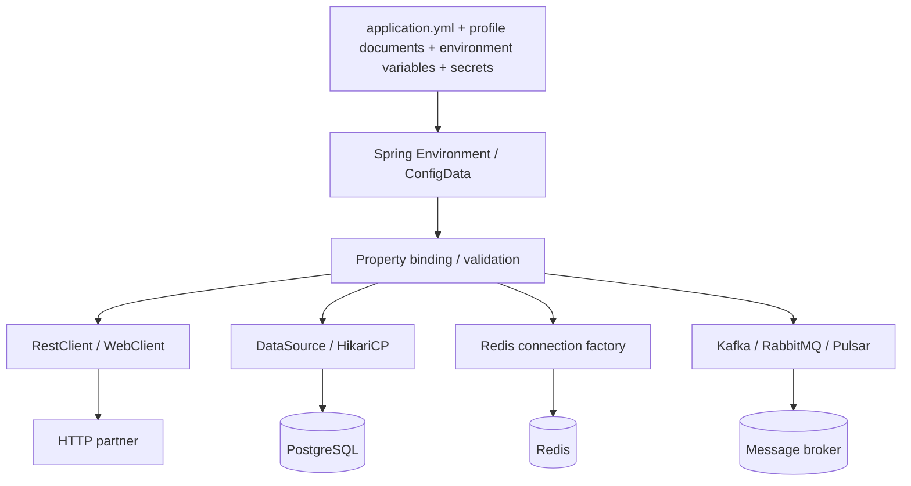

# Properties, Environment Variables, and Environment-Specific Connection Configuration

> **Chapter:** Connection Configuration  
> **Module:** SPRING_BOOT_INTEGRATION — system integration in Spring Boot via HTTP clients, databases, caches, message brokers, and Spring Integration adapters; focusing on configuration management, data contracts, transactions, errors, deduplication, testing, and observability of real flows.

## 1. The problem: one artifact, multiple runtime environments

An order application uses `RestClient` to call a payment service, JDBC to persist to PostgreSQL, Redis for caching, and Kafka to publish `OrderCreated`. Across developer machines, CI, staging, and production, **Java code should not change merely because host addresses, credentials, or timeouts differ**.

Things that must vary by environment include:

- Service addresses: HTTP base URL, JDBC URL, Redis host, Kafka bootstrap servers, RabbitMQ/Pulsar brokers.
- Connection identities: username/password, API key, token, certificates, and truststore.
- Resource limits: connection counts, timeouts, concurrency, batch sizes, retry budgets.
- Integration policies: enabling/disabling an adapter, using a stub locally, enforcing TLS in production.
- Observability settings: log levels, tracing exporters, low-cardinality metric tags.

Spring Boot calls this approach **externalized configuration**: package the same application artifact, while supplying appropriate configuration through files, environment variables, command-line arguments, or supported secret/configuration systems.



The diagram only illustrates the configuration flow. **A successfully created bean does not prove that the connection to the target system is ready**: authentication, DNS, TLS, topic permissions, and network issues may surface only when sending a request or opening a connection.

### 1.1. Learning objectives

After this lesson, you will be able to:

1. Distinguish properties, property sources, profile-based configuration, and secret values.
2. Name environment variables properly and understand relaxed binding when mapping to Spring Boot properties.
3. Organize `local`, `test`, `staging`, and `prod` configurations without duplicating source code.
4. Use `@ConfigurationProperties`, validate constraints, and build explicitly configured HTTP client beans.
5. Configure JDBC, Redis, and brokers per environment while avoiding unsafe default values.
6. Test configuration overrides, detect configuration drift, handle secrets, and observe connection errors.

## 2. Key configuration terminology

| Term | Example | Role |
| --- | --- | --- |
| **Property key** | `spring.datasource.url` | Configuration identifier name |
| **Property value** | `jdbc:postgresql://db:5432/orders` | Value used to configure a client |
| **Property source** | `application.yml`, env vars, system properties, CLI | Source supplying key/value pairs into `Environment` |
| **Profile** | `local`, `test`, `prod` | Selects configuration/bean groups tied to an environment |
| **Placeholder** | `${DB_URL}` or `${APP_PORT:8080}` | Resolves a value from `Environment`, optionally with a default |
| **Relaxed binding** | `SPRING_DATASOURCE_URL` → `spring.datasource.url` | Accepts formatting variations of property names |
| **Configuration properties** | `@ConfigurationProperties(prefix="integration.partner")` | Binds a property group into a typed, validated object |
| **Config data** | application files, config import, config tree | Mechanism for loading configuration sources during startup |
| **Secret** | API key, password, private key | Sensitive value requiring dedicated storage and distribution channels |

**Core rule:** keep *addresses, credentials, and connection parameters* out of Java code, but **do not treat every setting as a secret**. Hostnames/timeouts are configuration; passwords/tokens/private keys are secrets requiring separate lifecycle controls.

## 3. Precedence order: when a property appears in multiple places

Spring Boot aggregates multiple sources into a single `Environment`. When the same key has multiple values, **the higher-precedence source wins**. Under standard application execution (excluding special test configurations), familiar sources from **highest → lowest** can be pictured as:

| Source | Example | Notes |
| --- | --- | --- |
| Command-line argument | `--server.port=9090` | Typically takes precedence over config files and OS environment |
| `SPRING_APPLICATION_JSON` | `{"server":{"port":9090}}` | Can hold multiple properties as JSON; do not use it to dump secrets carelessly |
| Java system property | `-Dserver.port=9090` | Passed at JVM startup |
| OS environment variable | `SERVER_PORT=9090` | Common in containers/Kubernetes |
| Profile/imported config data | `application-prod.yml` | Exact winning/losing behavior depends on location, import order, and ConfigData rules |
| Default config data | `application.yml` | Holds shared, non-sensitive configuration |
| Application default properties | Defaults supplied in SpringApplication initialization code | Used only when no higher-precedence source provides a value |

**Note:** this is a summary of **commonly encountered sources**, not an exhaustive list of every property source. Test-specific sources like `@TestPropertySource`, `@SpringBootTest(properties=...)`, and `@DynamicPropertySource` have their own precedence. Rules for profile/imported files are also more nuanced than "profiles always override everything." When conflicts arise, inspect the effective value and **property origin** in the running environment.

For example, if `application.yml` has `server.port: 8080`, environment variable `SERVER_PORT=8181`, and CLI `--server.port=8282`, the final value in standard execution is **8282**.

### 3.1. Precedence within ConfigData

With Spring Boot's default configuration loading:

- `application.yml` holds shared configuration.
- `application-prod.yml` loads when the `prod` profile is active and can override keys from the base file.
- When multiple profiles are active, profile declaration order and document order can affect final properties; complex setups should be verified rather than guessed.
- Sources imported via `spring.config.import` have their own precedence and ordering rules in ConfigData.
- Environment variables generally override loaded config data, though not necessarily CLI/system properties.

**Connection configuration should not depend on deep, hard-to-trace override layers.** If `KAFKA_BOOTSTRAP_SERVERS` is injected by a deployment pipeline, avoid simultaneously overriding the same key via CLI flags and unmanaged config files.

## 4. Naming environment variables properly for Spring Boot

Spring Boot applies **relaxed binding** for `@ConfigurationProperties`. When converting a canonical property name into an environment variable name, the standard convention is:

1. Replace dots with underscores.
2. Remove dashes within each name segment.
3. Convert everything to uppercase.

Examples:

| Property | Environment variable | Notes |
| --- | --- | --- |
| `spring.datasource.url` | `SPRING_DATASOURCE_URL` | JDBC URL |
| `spring.datasource.username` | `SPRING_DATASOURCE_USERNAME` | DB username |
| `spring.datasource.hikari.maximum-pool-size` | `SPRING_DATASOURCE_HIKARI_MAXIMUMPOOLSIZE` | Note: `maximum-pool-size` → `MAXIMUMPOOLSIZE`, no extra underscore required between words |
| `spring.data.redis.host` | `SPRING_DATA_REDIS_HOST` | Redis |
| `spring.kafka.bootstrap-servers` | `SPRING_KAFKA_BOOTSTRAPSERVERS` | Dashes are removed in canonical conversion; apps can also use custom names via placeholders |
| `spring.rabbitmq.host` | `SPRING_RABBITMQ_HOST` | RabbitMQ |
| `spring.pulsar.client.service-url` | `SPRING_PULSAR_CLIENT_SERVICEURL` | Pulsar broker binary URL |
| `integration.partner.base-url` | `INTEGRATION_PARTNER_BASEURL` | Application-defined property |

**Distinguish:** Boot's canonical direct-binding convention vs. using **custom-named environment variable placeholders**:

```yaml
integration:
  partner:
    base-url: ${PARTNER_BASE_URL}
```

In this example, the actual variable is `PARTNER_BASE_URL` because **the placeholder references that exact name**, without relying on Spring Boot deriving it from `integration.partner.base-url`. This approach is often more readable for compound names with multiple hyphens.

### 4.1. Do not guess arbitrarily about hyphens

Some environment variables in the ecosystem appear as `SPRING_KAFKA_BOOTSTRAP_SERVERS`, but the canonical binder transformation removes `-`, so the independently verifiable canonical form is `SPRING_KAFKA_BOOTSTRAPSERVERS`. When wired via YAML:

```yaml
spring:
  kafka:
    bootstrap-servers: ${KAFKA_BOOTSTRAP_SERVERS}
```

`KAFKA_BOOTSTRAP_SERVERS` is completely unambiguous and easy to manage. Avoid assuming a Kafka starter is broken just because an env var did not apply; first inspect the **final bound property**.

For environment variables holding **lists**, maps with special keys, or deeply nested structures, rules can differ from plain strings: list indices are wrapped with underscores in variable names, and map keys with punctuation may need YAML/JSON binding. For complex structures, prefer ConfigData files with clear schemas over a tangle of hard-to-test env vars.

## 5. Designing shared and profile-specific configuration

A clear structure keeps **safe, non-sensitive defaults** in `application.yml`, while using `application-local.yml`, `application-test.yml`, `application-staging.yml`, and `application-prod.yml` for explicit differences. The blocks below are **illustrative file contents**, not a requirement to create additional files while studying this lesson.

### 5.1. Shared configuration: application.yml

```yaml
# application.yml
spring:
  application:
    name: order-integration

  datasource:
    driver-class-name: org.postgresql.Driver
    url: ${ORDERS_DB_URL}
    username: ${ORDERS_DB_USER}
    password: ${ORDERS_DB_PASSWORD}
    hikari:
      maximum-pool-size: 12
      connection-timeout: 3000 # milliseconds (HikariCP)

  data:
    redis:
      host: ${REDIS_HOST}
      port: ${REDIS_PORT:6379}

  kafka:
    bootstrap-servers: ${KAFKA_BOOTSTRAP_SERVERS}
    producer:
      acks: all

integration:
  partner:
    base-url: ${PARTNER_BASE_URL}
    api-key: ${PARTNER_API_KEY}
    connect-timeout: 1s
    response-timeout: 3s
```

Properties under `integration.partner` are defined by **the application**; they do not automatically create an HTTP client unless the application writes a configuration class that uses them. Keys such as `spring.datasource.*`, `spring.data.redis.*`, and `spring.kafka.*` are auto-configured by Spring Boot **when the corresponding libraries and conditions are present**.

In this example, missing any of `ORDERS_DB_URL`, `ORDERS_DB_USER`, `ORDERS_DB_PASSWORD`, `REDIS_HOST`, `KAFKA_BOOTSTRAP_SERVERS`, `PARTNER_BASE_URL`, or `PARTNER_API_KEY` should be treated as a configuration error for an application that **genuinely requires all of those connections**. If a module does not use Redis/Kafka, **do not require those values unnecessarily**; split adapters or feature flags so the application only requires enabled dependencies.

**Never provide default production credentials** in placeholders, e.g. avoid `${DB_PASSWORD:admin123}`. Non-sensitive ports or timeouts may have defaults (such as `REDIS_PORT:6379`), while avoiding accidental fallback to local endpoints in production deployments.

### 5.2. Local profile: application-local.yml

```yaml
# application-local.yml
spring:
  datasource:
    hikari:
      maximum-pool-size: 4

logging:
  level:
    com.example.integration: DEBUG

integration:
  partner:
    connect-timeout: 2s
    response-timeout: 5s
```

This file overrides only values that legitimately differ from the shared configuration. Hosts, passwords, and API keys are still supplied by the local runtime environment, such as shell exports or IDE run configurations; **do not store secrets in committed files**.

If local runs replace the partner with a mock server, point `PARTNER_BASE_URL` to the mock endpoint in the dev environment. When running inside a container, hostnames must resolve **within the container network**; do not assume `localhost` always refers to the host machine.

### 5.3. Staging profile: application-staging.yml

```yaml
# application-staging.yml
spring:
  datasource:
    hikari:
      maximum-pool-size: 8

integration:
  partner:
    connect-timeout: 1s
    response-timeout: 4s
```

Staging typically mirrors production in broker/TLS/schema structure, while keeping accounts, topics, databases, and data separate. **Never share production topics or credentials**, even if staging shares infrastructure clusters.

### 5.4. Production profile: application-prod.yml

```yaml
# application-prod.yml
spring:
  datasource:
    hikari:
      maximum-pool-size: 20

management:
  endpoint:
    health:
      show-details: never

integration:
  partner:
    connect-timeout: 1s
    response-timeout: 2s
```

Do not put production URLs and secrets directly in this file. They come from the deployment environment or secret store. Timeout and Hikari pool sizes must be tuned alongside application concurrency, PostgreSQL connection limits, and partner SLAs; the numbers above are illustrative only.

**Do not assume the `prod` profile activates automatically when an image runs on Kubernetes.** The active profile must be selected explicitly by the launch environment.

### 5.5. Activating profiles

Example from a Unix shell:

```bash
export SPRING_PROFILES_ACTIVE=local
export ORDERS_DB_URL='jdbc:postgresql://127.0.0.1:5432/orders_local'
export ORDERS_DB_USER='app_local'
# ORDERS_DB_PASSWORD and PARTNER_API_KEY must come from a secret/dev environment
export REDIS_HOST='127.0.0.1'
export KAFKA_BOOTSTRAP_SERVERS='127.0.0.1:9092'
export PARTNER_BASE_URL='http://127.0.0.1:8089'
java -jar app.jar
```

Or at launch time:

```bash
java -jar app.jar --spring.profiles.active=staging
```

These commands illustrate how to pass configuration; they are **not enough to launch** if required secrets have not been provided. `SPRING_PROFILES_ACTIVE` or `--spring.profiles.active=...` selects the active profile; `SPRING_PROFILES_DEFAULT` can supply a default when no profile is active, but defaults should not replace an explicit production deployment decision.

### 5.6. Multi-document configuration in a single file

Instead of separate files, Spring Boot also supports multiple YAML documents separated by `---` using `spring.config.activate.on-profile`:

```yaml
app:
  feature:
    directory-lookup-enabled: false
---
spring:
  config:
    activate:
      on-profile: prod
app:
  feature:
    directory-lookup-enabled: true
```

This is a **standalone example** separate from the `application-*.yml` file set above. Choose one consistent style so precedence stays easy to trace. Do not place `spring.profiles.active` or `spring.profiles.default` inside a **profile-activated document**, because Spring Boot restricts where profile-selection properties may appear.

In environments with multiple optional dimensions, `spring.profiles.group.*` can group logical profiles (e.g. `prod` activating `observability`), though it also increases precedence complexity: add tests verifying the active profiles and resolved values.

## 6. @ConfigurationProperties: grouping HTTP client config with strong types

Using `@Value("${integration.partner.base-url}")` works for a single trivial property, but when you have a URL, authentication, and multiple timeouts, `@ConfigurationProperties` is clearer and easier to validate at startup.

### 6.1. Dependency for Bean Validation

Example for Spring Boot 3.2–3.5, Java 17+:

```groovy
dependencies {
    implementation 'org.springframework.boot:spring-boot-starter-web'
    implementation 'org.springframework.boot:spring-boot-starter-validation'
    testImplementation 'org.springframework.boot:spring-boot-starter-test'
}
```

Let Boot's BOM manage versions of Spring Framework, Jakarta Validation, and HTTP clients. Validation here uses `jakarta.validation.constraints.*` from Boot 3.x.

### 6.2. Immutable record and validation

```java
import java.net.URI;
import java.time.Duration;
import jakarta.validation.constraints.NotBlank;
import jakarta.validation.constraints.NotNull;
import org.springframework.boot.context.properties.ConfigurationProperties;
import org.springframework.validation.annotation.Validated;

@Validated
@ConfigurationProperties(prefix = "integration.partner")
public record PartnerProperties(
        @NotNull URI baseUrl,
        @NotBlank String apiKey,
        @NotNull Duration connectTimeout,
        @NotNull Duration responseTimeout) {

    public PartnerProperties {
        if (connectTimeout != null &&
                (connectTimeout.isNegative() || connectTimeout.isZero())) {
            throw new IllegalArgumentException(
                    "connect-timeout must be positive");
        }
        if (responseTimeout != null &&
                (responseTimeout.isNegative() || responseTimeout.isZero())) {
            throw new IllegalArgumentException(
                    "response-timeout must be positive");
        }
    }
}
```

**Key points to understand:**

- Boot 3.x can constructor-bind records without requiring `@ConstructorBinding` in this case.
- `base-url` → `baseUrl` via relaxed binding; `1s` and `3s` are converted to `Duration`.
- `@NotNull`/`@NotBlank` cause missing required values to fail configuration early rather than waiting for the first HTTP request.
- Having `@ConfigurationProperties` on a class is not enough by itself: **the bean must be registered** via `@ConfigurationPropertiesScan`, `@EnableConfigurationProperties`, or appropriate Boot configuration.
- A record holding `apiKey` must never be automatically logged via `toString()`: the secret value could appear in plaintext. Never log a configuration properties object containing tokens or passwords.

### 6.3. Initializing RestClient from bound properties

```java
import java.net.http.HttpClient;
import org.springframework.boot.context.properties.EnableConfigurationProperties;
import org.springframework.context.annotation.Bean;
import org.springframework.context.annotation.Configuration;
import org.springframework.http.client.JdkClientHttpRequestFactory;
import org.springframework.web.client.RestClient;

@Configuration(proxyBeanMethods = false)
@EnableConfigurationProperties(PartnerProperties.class)
public class PartnerHttpConfiguration {

    @Bean("partnerRestClient")
    RestClient partnerRestClient(RestClient.Builder builder,
                                 PartnerProperties properties) {
        HttpClient jdkClient = HttpClient.newBuilder()
                .connectTimeout(properties.connectTimeout())
                .build();

        JdkClientHttpRequestFactory factory =
                new JdkClientHttpRequestFactory(jdkClient);
        factory.setReadTimeout(properties.responseTimeout());

        return builder
                .baseUrl(properties.baseUrl().toString())
                .requestFactory(factory)
                .defaultHeader("X-Api-Key", properties.apiKey())
                .build();
    }
}
```

This example illustrates **an adapter owning its own configuration**, not a rule that every partner uses an `X-Api-Key` header; real systems must use whatever authentication mechanism the partner requires, such as OAuth2 or mTLS. A Boot-configured `RestClient.Builder` may carry shared customizers; replacing the request factory as shown here requires verifying that SSL bundles, pooling, and monitoring configured elsewhere are still preserved as intended.

Never pass dynamic URLs or tokens from user requests into `baseUrl` or default headers without validation; avoid SSRF and credential leaks to unapproved hosts. When integrating multiple partners, create separate clients with explicit `@Qualifier` names.

### 6.4. Fail fast is not the same as connectivity

`@ConfigurationProperties` validation verifies **configuration format and constraints**, not whether:

- The partner's DNS resolves or its certificate is valid.
- The database is up, schemas are migrated, and the account has privileges.
- Kafka has the right topics/ACLs or consumer groups can process messages.
- Redis or LDAP is reachable from the right network namespace.

Evaluate readiness/health and write dedicated integration tests for each required dependency. A service may choose to **fail startup** if a critical dependency is unreachable, or start in a **not ready** state and recover; this choice depends on SLAs and operational design.

## 7. Managing secrets: environment, ConfigData imports, and config trees

Environment variables are convenient for passing passwords/tokens into a process, yet they are **not inherently secure**: values can leak through orchestration specs, debug dumps, diagnostic tools, shell history, or process environment read access. Choose the delivery channel based on your organization's security policy; never store secrets in source code or committed YAML.

### 7.1. Passing secrets via placeholders

```yaml
spring:
  datasource:
    username: ${ORDERS_DB_USER}
    password: ${ORDERS_DB_PASSWORD}

integration:
  partner:
    api-key: ${PARTNER_API_KEY}
```

**Do not provide fake defaults** for production credentials. If local testing requires test credentials, keep them in **uncommitted** dev configuration or scoped test secrets.

### 7.2. Importing a secret directory as a config tree

Spring Boot supports `configtree:`: each file under a directory is read as a property of the same name. For example, a mounted secret volume:

```text
/run/secrets/
├── spring.datasource.password
└── integration.partner.api-key
```

Each file contains only **the secret value** (not a `key=value` line). Import it in configuration:

```yaml
spring:
  config:
    import: "configtree:/run/secrets/"
```

If `spring.datasource.password` contains the actual password, that secret becomes property `spring.datasource.password`. Same for `integration.partner.api-key`. The mounted directory must exist when importing **without** the `optional:` prefix, which helps catch deployment mistakes early.

In local environments without that mount, you may use:

```yaml
spring:
  config:
    import: "optional:configtree:/run/secrets/"
```

However, **do not make required secrets optional in production** just so the application "starts anyway." Remember that a config tree is a ConfigData source; its values are still subject to precedence against environment variables and CLI arguments. Avoid configuring the same secret across multiple uncontrolled sources.

To use dedicated secret providers like Vault, AWS Secrets Manager, or Kubernetes external secrets, you need the corresponding integration library/config compatible with your Boot version and organization setup. Do not assume `spring.config.import=vault:...` works out of the box without installing and configuring the matching plugin.

### 7.3. Secret rotation and update timing

Spring Boot binds configuration properties when the application context is created; **updating a secret file or environment variable while the application is running does not automatically refresh credentials in every client**. Many clients hold connection pools, credential caches, or TLS contexts.

For rotation:

1. Determine whether the service receives change notifications or needs a rolling restart/bean recreation.
2. Provide an overlap window where both old and new credentials are valid if the backend supports it.
3. Verify reconnect behavior for DataSource, Redis, LDAP, Kafka, and HTTP clients after rotation.
4. Separate authentication failures from transient errors; do not retry indefinitely with an invalidated password.
5. Never log old or new configuration values during diagnostics.

## 8. Tailoring configuration per connection type

Each starter has its own prefix and structure. The examples below illustrate **settings needed for each specific connector**, and do not imply an application must enable all of them. Add dependencies/starters only for integrations you actually use.

### 8.1. JDBC/PostgreSQL and HikariCP

```yaml
spring:
  datasource:
    url: ${ORDERS_DB_URL}
    username: ${ORDERS_DB_USER}
    password: ${ORDERS_DB_PASSWORD}
    hikari:
      maximum-pool-size: ${DB_POOL_MAX:12}
      connection-timeout: 3000
```

Notes:

- `url` is a JDBC URL (e.g. `jdbc:postgresql://postgres:5432/orders`), not `http://...`.
- With `spring-boot-starter-jdbc` or the JPA starter and the PostgreSQL driver present, Boot can auto-configure `DataSource`/HikariCP from the classpath.
- A pool maximum of 12 connections does **not** mean 12 concurrent requests system-wide; across 10 instances, total connections can be many times larger. Check against the DB's `max_connections` plus migrations and background jobs.
- `spring.datasource.hikari.connection-timeout` in HikariCP uses milliseconds. Pool acquisition timeout **differs** from the driver's network connect timeout and SQL query timeout.
- Do not hold DB transactions open while waiting unnecessarily on partner HTTP calls or broker ACKs; design consistency boundaries with an outbox where appropriate.

**Especially for migrations:** `spring.flyway.*` or `spring.liquibase.*` can share the main DataSource or use a dedicated DataSource. Never point staging migrations at the production DB through a misconfigured environment variable.

### 8.2. Redis/cache

```yaml
spring:
  data:
    redis:
      host: ${REDIS_HOST}
      port: ${REDIS_PORT:6379}
      password: ${REDIS_PASSWORD}
      timeout: 2s
```

If Redis does not require a password in a test environment, you do not need to declare the password property in that profile; in production, configure auth and TLS as supported by the cluster.

A Redis cache may degrade when the cache is unavailable **if business rules allow it**; Redis used for deduplication state or distributed locks has different safety requirements. Never treat a Redis failure as "the record definitely does not exist" if doing so could cause duplicate orders or payments.

For Redis Sentinel or Cluster, the property set and topology differ from a standalone node. Do not merely swap a single hostname and expect automatic failover or cluster slot routing to work.

### 8.3. Apache Kafka

```yaml
spring:
  kafka:
    bootstrap-servers: ${KAFKA_BOOTSTRAP_SERVERS}
    producer:
      acks: all
      properties:
        "[enable.idempotence]": true
```

`bootstrap-servers` is used only to fetch initial metadata. Kafka brokers may return different **advertised listeners**; clients must be able to reach those addresses as well. A very common issue occurs when code runs inside a container while the broker advertises `localhost` or an IP valid only on another host.

`acks=all` defines the producer acknowledgment level; it does **not** prove a consumer has processed the message. An idempotent producer prevents certain duplicates during producer retries, but does **not** replace an `eventId` and idempotent consumers when the application replays the same logical event.

When Kafka uses SASL/TLS, configure the security protocol, mechanism, auth, and truststore via secure config/secrets per your Kafka client/cluster version documentation. Never disable certificate validation to "fix" connection errors.

### 8.4. RabbitMQ / AMQP

```yaml
spring:
  rabbitmq:
    host: ${RABBITMQ_HOST}
    port: ${RABBITMQ_PORT:5672}
    username: ${RABBITMQ_USER}
    password: ${RABBITMQ_PASSWORD}
    virtual-host: ${RABBITMQ_VHOST:/}
```

When using `amqps://`, TLS, or URI-style broker addresses, verify the exact properties and security settings rather than just changing the port. A virtual host in RabbitMQ is a distinct logical scope requiring explicit permissions. Connecting to the broker successfully does not guarantee that queues/exchanges/bindings exist or that publish/consume permissions are granted.

### 8.5. Apache Pulsar

```yaml
spring:
  pulsar:
    client:
      service-url: ${PULSAR_BROKER_URL:pulsar://localhost:6650}
    admin:
      service-url: ${PULSAR_ADMIN_URL:http://localhost:8080}
```

This is a local example; in staging/prod, **do not fall back to localhost**. The Pulsar binary URL (`pulsar://` or TLS `pulsar+ssl://`) differs from the HTTP(S) admin URL. If authentication is required, configure client and admin credentials separately. Reachability of both broker and admin endpoints must be verified.

### 8.6. LDAP / directory

```yaml
spring:
  ldap:
    urls: ${LDAP_URL}
    base: ${LDAP_BASE_DN}
    username: ${LDAP_BIND_DN}
    password: ${LDAP_BIND_PASSWORD}
```

Prefer `ldaps://` or StartTLS according to policy. `base` is the base DN for searches, not the bind account's DN; `username` is the bind identity. If LDAP authenticates end users, adding the Spring Data LDAP starter alone is not enough to implement authentication/authorization; you need Spring Security LDAP or an appropriate identity layer.

### 8.7. HTTP client for an external partner

```yaml
integration:
  partner:
    base-url: ${PARTNER_BASE_URL}
    api-key: ${PARTNER_API_KEY}
    connect-timeout: ${PARTNER_CONNECT_TIMEOUT:1s}
    response-timeout: ${PARTNER_RESPONSE_TIMEOUT:3s}
```

These are **custom properties**, so the application must create `RestClient`/`WebClient`, apply timeouts, authentication, observation, and concurrency limits itself. Switching profiles does not change how external APIs handle retries: an HTTP POST timeout can leave the outcome **unknown**. Keep an idempotency key or reconcile before resending.

### 8.8. Spring Integration and adapters

For Spring Integration HTTP/JMS/AMQP/file adapters, beans are typically configured on top of standardized `ConnectionFactory` or `RestClient/WebClient` beans. Keep connection configuration owned in **one place** and inject it into the corresponding adapters.

If an adapter should only run in production, guard its configuration with `@ConditionalOnProperty` or `@Profile`. Choose the default carefully: when a feature flag is omitted, the adapter should **not** accidentally activate due to a typo in a property name. Avoid letting a live producer/consumer bean run locally unless test endpoints are intentionally configured.

## 9. Distributing configuration via Docker, Kubernetes, and CI

### 9.1. Running in containers: do not misunderstand localhost

Inside a Docker network, `localhost` inside the Spring Boot container **usually refers to that container itself**, not the PostgreSQL/Kafka/Redis container or the host machine.

For example, when service hostnames on the same network are `postgres`, `redis`, and `kafka`, you can set:

```text
SPRING_PROFILES_ACTIVE=staging
ORDERS_DB_URL=jdbc:postgresql://postgres:5432/orders
REDIS_HOST=redis
KAFKA_BOOTSTRAP_SERVERS=kafka:9092
PARTNER_BASE_URL=https://partner-staging.example.org/api
```

This illustrates the configuration variables; do not commit plaintext secrets into Docker Compose files or CI logs. DNS and advertised listeners must match the actual runtime network.

### 9.2. Kubernetes ConfigMap and Secret

A common deployment separates:

| Kind | Examples | Appropriate channel |
| --- | --- | --- |
| Non-secret | `SPRING_PROFILES_ACTIVE`, timeouts, pool size, Kafka bootstrap hostname | ConfigMap / reviewed GitOps config |
| Secret | DB password, partner API key, broker credentials, private key | Kubernetes Secret / External Secrets / secret manager per policy |
| Mounted config tree | Files `spring.datasource.password`, `integration.partner.api-key` | Volume mount + `spring.config.import=configtree:/...` |

A Kubernetes `Secret` is **not automatically encrypted-at-rest or completely safe**: you must enforce RBAC, cluster encryption-at-rest, auditing, rotation, and container access controls. ConfigMaps must never store passwords or tokens.

When configuration is injected via environment variables, pods typically require a rolling restart to pick up new values. When secrets are mounted as files, volume updates may occur, yet Java clients inside the application still will not necessarily rebind credentials or rebuild connection pools. Test rotation/rollouts rather than assuming a file update immediately reconfigures the app.

### 9.3. CI and test environments

CI should use dedicated test databases/brokers or Testcontainers; never grant production access to build environments. You can use a `test` profile and test property overrides to minimize required secrets.

For parallel test runs, allocate dynamic resources (container ports, database names, topic names) independently; do not hard-code all tests to a shared `localhost:5432`. Test outcomes depend on the actual configuration source used by the test; assert the bound values rather than merely checking that a YAML file exists.

## 10. Enabling/disabling connections per environment without side effects

In Spring Boot, having a dependency on the classpath does not mean local or staging environments should open every production connection. Certain adapters, listeners, or publishers actively start work at application startup. Design explicit **feature flags** and conditional bean creation instead of using "empty URLs" to turn services off.

### 10.1. @Profile and @ConditionalOnProperty

```java
import org.springframework.boot.autoconfigure.condition.ConditionalOnProperty;
import org.springframework.context.annotation.Configuration;

@Configuration(proxyBeanMethods = false)
@ConditionalOnProperty(
        prefix = "integration.partner",
        name = "enabled",
        havingValue = "true")
class PartnerIntegrationFeatureConfiguration {
    // Register active adapters/handlers when the feature is enabled.
}
```

If `integration.partner.enabled` is omitted, this condition **does not match** (because `matchIfMissing` defaults to false). For integrations with side effects (auto-starting consumers, pollers, scheduled publishers), this is a safe default.

Example:

```yaml
integration:
  partner:
    enabled: ${PARTNER_INTEGRATION_ENABLED:false}
```

For live producers/adapters, you can use `@ConditionalOnProperty` or `@Profile("prod")`, but never treat profiles as **authorization**: if someone accidentally activates `prod` locally, the app could connect to production. Network policies, credentials, and permissions must still be enforced at the infrastructure level.

**Important note on validation:** if `PartnerProperties` is registered context-wide and marks secret/URL fields as required, validation can fail even when the adapter feature is disabled. For optional integrations, **place the required properties binding and client bean inside the conditional branch**, or design nullable properties with conditional validation. Do not wrap only the handler while leaving properties bound unconditionally.

### 10.2. Choosing fail-open vs. fail-closed by business rule

| Dependency | When unavailable | Decision |
| --- | --- | --- |
| Primary DB for orders | Cannot read/write order state | Usually fail closed or readiness=false |
| Billing HTTP partner | Unknown whether payment was executed | Do not auto-retry POST without idempotency; reconcile |
| Redis for display profile cache | Can fall back to source of truth if SLA allows | Can degrade gracefully, record metric |
| Redis as idempotency store | Cannot guarantee deduplication | Never silently skip deduplication |
| Kafka producer for required events | Broker unreachable or ACK unknown | Persist to durable outbox, bounded worker retries |
| LDAP for account status checks | Cannot verify permissions/login | Usually fail closed; never treat timeout as "valid user" |

This is a **business integration policy**, not a property source choice. Sound connection configuration must align with contracts and recovery policies, not just hostnames.

## 11. Testing: verify bound values, not just valid YAML syntax

### 11.1. Pure configuration tests with ApplicationContextRunner

`ApplicationContextRunner` in Spring Boot Test creates a lightweight context with specified properties without launching the whole app or making network calls. Example verifying `PartnerProperties` and the `RestClient` bean from section 6:

```java
import java.net.URI;
import java.time.Duration;
import org.junit.jupiter.api.Test;
import org.springframework.boot.test.context.runner.ApplicationContextRunner;
import org.springframework.web.client.RestClient;

import static org.assertj.core.api.Assertions.assertThat;

class PartnerConfigurationTest {
    private final ApplicationContextRunner runner =
            new ApplicationContextRunner()
                    .withUserConfiguration(PartnerHttpConfiguration.class)
                    .withBean(RestClient.Builder.class, RestClient::builder);

    @Test
    void bindsPropertiesAndCreatesClientWithoutNetworkCall() {
        runner.withPropertyValues(
                "integration.partner.base-url=https://partner.example.invalid/api",
                "integration.partner.api-key=placeholder-test-secret",
                "integration.partner.connect-timeout=500ms",
                "integration.partner.response-timeout=2s")
                .run(context -> {
                    assertThat(context).hasNotFailed();
                    PartnerProperties props =
                            context.getBean(PartnerProperties.class);
                    assertThat(props.baseUrl()).isEqualTo(
                            URI.create("https://partner.example.invalid/api"));
                    assertThat(props.connectTimeout()).isEqualTo(
                            Duration.ofMillis(500));
                    assertThat(props.responseTimeout()).isEqualTo(
                            Duration.ofSeconds(2));
                    assertThat(context).hasBean("partnerRestClient");
                });
    }

    @Test
    void rejectsMissingRequiredApiKey() {
        runner.withPropertyValues(
                "integration.partner.base-url=https://partner.example.invalid/api",
                "integration.partner.connect-timeout=500ms",
                "integration.partner.response-timeout=2s")
                .run(context -> assertThat(context).hasFailed());
    }
}
```

This test proves **binding, validation, and bean creation**; it does not prove DNS, TLS, authentication, or network timeouts. In production, never use an arbitrary "test" secret to verify credential validity; verify integrations in a dedicated test environment.

### 11.2. Using Testcontainers for dynamic connection parameters

For JDBC integrations, instead of hard-coding port `5432` in CI, use `@DynamicPropertySource`:

```java
import org.junit.jupiter.api.Test;
import org.springframework.boot.test.context.SpringBootTest;
import org.springframework.test.context.DynamicPropertyRegistry;
import org.springframework.test.context.DynamicPropertySource;
import org.testcontainers.containers.PostgreSQLContainer;
import org.testcontainers.junit.jupiter.Container;
import org.testcontainers.junit.jupiter.Testcontainers;

@Testcontainers
@SpringBootTest
class OrdersDatabaseIntegrationTest {

    @Container
    static final PostgreSQLContainer<?> postgres =
            new PostgreSQLContainer<>("postgres:16-alpine");

    @DynamicPropertySource
    static void databaseProperties(DynamicPropertyRegistry registry) {
        registry.add("spring.datasource.url", postgres::getJdbcUrl);
        registry.add("spring.datasource.username", postgres::getUsername);
        registry.add("spring.datasource.password", postgres::getPassword);
    }

    @Test
    void datasourceConnects() {
        // Execute a real JDBC query/transaction,
        // do not merely assert that the Spring context started.
    }
}
```

This example assumes test dependencies `spring-boot-starter-test`, `org.testcontainers:junit-jupiter`, `org.testcontainers:postgresql`, and the PostgreSQL JDBC driver. The test must also provide **other** required properties (HTTP partner, Redis, broker) or disable/mock their adapters.

In Boot versions with service connection support, `@ServiceConnection` can let Boot auto-supply connection details for supported containers. That serves as an alternative to part of `@DynamicPropertySource`; there is no need to combine both without reason.

### 11.3. Essential configuration tests

| Test | What to assert |
| --- | --- |
| Missing `PARTNER_API_KEY` | Context fails only when that integration is actually required; does not silently run with an empty key |
| `response-timeout=3s` | Binder produces `Duration.ofSeconds(3)` |
| Property in `application.yml` vs CLI/env | Higher-precedence source wins as expected |
| `application-prod.yml` | Active `prod` profile takes effect without inheriting local endpoints |
| `spring.config.import=configtree:...` | Secret files read under the right keys with proper mount permissions |
| Testcontainers PostgreSQL | App connects to the container's **dynamic host/port**, not an external CI DB |
| Redis/Kafka/RabbitMQ/Pulsar | Connects on the test network with valid auth/TLS/ACL/schema |
| Adapter disabled | Secondary listener/poller/producer beans do not start |
| Secret rotation | Client reload or rolling restart works per designed workflow |
| Downstream timeout | No infinite retries, no thread/connection leaks, error metric recorded |

**Do not conclude production is configured properly from an integration test running the `test` profile.** Run dedicated smoke tests for connectivity, permissions, DNS/TLS, and readiness in staging before release.

## 12. Debugging when runtime values are not what you expect

### 12.1. Common errors table

| Symptom | Possible cause | What to check |
| --- | --- | --- |
| `Could not resolve placeholder ...` | Missing env var / ConfigData | Secret injection, key typos, active profile, config imports |
| `Failed to bind properties under ...` | Wrong type or validation error | Duration, URI, boolean, dots/hyphens in property names |
| Works locally, fails to start in CI | IDE environment differs from CI | Required variable list, CI secret scopes |
| App still calls local endpoint on cluster | `localhost` fallback or inactive profile | Resolved base URL, `SPRING_PROFILES_ACTIVE`, CLI overrides |
| DB pool timeout despite right URL | Pool exhausted, DB max connections, or long-held transactions | Hikari metrics, active/pending connections, thread/transaction traces |
| Kafka fails to connect though bootstrap responds | Wrong `advertised.listeners` for network | Broker metadata, DNS/ACL/TLS from the actual container |
| Broker connects but publish gets 403/auth error | Insufficient topic ACLs/permissions | Separate transport connectivity from authorization |
| Disabled adapter via flag still fails missing secret | Properties bound/validated unconditionally | Config properties registration and bean conditions |
| Rotated secret yet app uses old key | Client/cache retains startup credentials | Reload/recreate connection factory, rolling restart |
| Actuator reports healthy yet flow fails | Health indicator does not cover contract/end-to-end | Smoke test send/read, auth, and schema |

### 12.2. Conditions Evaluation Report and effective configuration

In dev:

```bash
java -jar app.jar --debug
```

The auto-configuration conditions report shows whether `DataSource`, Kafka, Redis, HTTP clients, listeners, etc. were auto-configured or overridden by user beans. Still, condition matching **does not replace** verifying live connectivity.

Spring Boot Actuator provides endpoints like `/actuator/env` and `/actuator/configprops` to inspect property sources and bindings in authorized environments. **Never expose them publicly**; enforce access control, masking/sanitization, and logging policies. Never rely solely on masking to protect secrets if untrusted users can access actuator endpoints.

When tracing the **origin** of a property, prefer origin metadata (file/location/property source) over printing raw credentials. For secrets, you usually only need to know "whether it is provided" and "which approved config source supplied it," without logging the value itself.

### 12.3. Observing connections after startup

An integration dashboard should monitor:

- HTTP clients: request counts, p95/p99 latency, connect/read timeouts, retries, 429/503, pool acquire failures.
- JDBC/Hikari: active/idle/pending connections, connection timeouts, query latency, transaction duration.
- Redis: connection/command errors, timeouts, cache hit/miss rates, impact on idempotency stores.
- Kafka/RabbitMQ/Pulsar: producer ACK latency, publish failures, consumer lag/backlog/redeliveries.
- Spring Integration adapters: processed event counts, failures, DLT/recovery, and flow duration.
- Readiness: whether critical dependencies can accept load; do not turn health checks into probes with unbounded side effects.

Specific metrics/traces depend on dependencies, actuator, Micrometer registries, and enabled instrumentation; **do not assume every metric appears automatically just by adding a starter**. Avoid metric tags containing full URLs, JWTs, account IDs, or high-cardinality values.

## 13. Real-world scenario: misconfiguration affecting transactions and events

Consider a staging deployment:

```text
SPRING_PROFILES_ACTIVE=staging
ORDERS_DB_URL=jdbc:postgresql://postgres-staging:5432/orders
REDIS_HOST=redis-staging
KAFKA_BOOTSTRAP_SERVERS=kafka-staging:9092
PARTNER_BASE_URL=https://partner-staging.example.org/api
```

During deployment, `KAFKA_BOOTSTRAP_SERVERS` is accidentally populated with the production broker address. The application may still **start cleanly**, the producer can connect, and test events get published to the production topic if the account has overly broad permissions.

This is not merely a YAML mistake. Defense in depth requires multiple layers:

1. **Config contract:** validate environment names, allowed hostnames/topics, and data types at startup.
2. **Isolation:** staging credentials must lack access to production topics/brokers; network policies must block cross-environment traffic.
3. **Deployment review:** govern ConfigMap/Secret mappings and environment variables in the pipeline.
4. **Smoke tests:** verify endpoints, TLS/ACLs, and test topics in the target environment before accepting traffic.
5. **Observability:** log profile names, normalized cluster names, and connectivity results — **never** log secrets.
6. **Consistency:** events may be duplicated or misrouted; maintain idempotent consumers and investigation/reconciliation procedures rather than just changing the URL and ignoring already-sent data.

Likewise, if `ORDERS_DB_URL` points to production, impact can be severe from the very first migration or transaction. **Precedence and profiles select values, but they are not security boundaries**; actual access controls limit the blast radius.

## 14. Checklist and self-check questions

### 14.1. Pre-production integration checklist

- [ ] Verified exact Boot/Framework versions, starters, and dependency management?
- [ ] Separated shared config from profile config; zero secrets in Git?
- [ ] Confirmed `SPRING_PROFILES_ACTIVE` and resolved URLs match the target deployment environment?
- [ ] Understood precedence across ConfigData, environment, Java system properties, CLI, and test overrides?
- [ ] Bound application properties as typed `@ConfigurationProperties` with validation on required fields?
- [ ] Guarded optional integrations with feature flags/conditions so unused adapters do not start?
- [ ] Tested hostnames, ports, `advertised.listeners`, proxies, certificates, and ACLs from the container's network?
- [ ] Configured and verified connect/read/pool/total timeouts, max connections/concurrency, and retry budgets?
- [ ] Delivered secrets via approved channels with rotation policies, excluded from logs and public Actuator endpoints?
- [ ] Avoided confusing initialized beans with ready connections and satisfied contracts?
- [ ] Designed clear boundaries for DB transactions, broker publishes, retries, and idempotency?
- [ ] Added automated config-binding tests and integration tests for required connections?
- [ ] Classified config errors, TLS/auth errors, transient connectivity errors, and data contract errors for proper recovery?

### 14.2. Practice questions

1. When `application.yml`, `application-prod.yml`, OS environment, and CLI all set `server.port`, which source typically has highest precedence?
2. Why should you use `${PARTNER_API_KEY}` instead of `${PARTNER_API_KEY:secret123}` for credentials?
3. How does `@ConfigurationProperties` differ from `@Value` when managing multiple timeouts and URLs?
4. Why does a successfully initialized `RestClient` bean not prove the payment API is reachable?
5. What is the difference between a `local` profile and a true security boundary?
6. Why can a Spring Boot container not always reach Kafka at `localhost:9092`?
7. If Redis is only a display cache, how can error handling differ from Redis acting as an idempotency store?
8. After a mounted secret changes, why might many clients continue using the old credentials?
9. Why might disabling a listener with `@ConditionalOnProperty` still fail validation on an unconditionally registered config properties bean?
10. What extra checks ensure staging cannot publish messages into production?

**Takeaway:** Spring Boot configuration is a **deployment contract**: manage **sources and precedence** properly, configure **per profile**, deliver **secrets securely**, bind **typed + validated** properties, test **real connectivity**, and guarantee **transactions, retries, idempotency, and observability** across integrations. The same artifact must run across environments without code edits or credential leaks.

### References

- [Spring Boot — Externalized Configuration](https://docs.spring.io/spring-boot/reference/features/external-config.html)
- [Spring Boot — Working with Profiles](https://docs.spring.io/spring-boot/reference/features/profiles.html)
- [Spring Boot — Type-safe Configuration Properties](https://docs.spring.io/spring-boot/reference/features/external-config.html#features.external-config.typesafe-configuration-properties)
- [Spring Boot — Config Tree Imports](https://docs.spring.io/spring-boot/reference/features/external-config.html#features.external-config.files.configtree)
- [Spring Boot — SQL Databases](https://docs.spring.io/spring-boot/reference/data/sql.html)
- [Spring Boot — Apache Kafka](https://docs.spring.io/spring-boot/reference/messaging/kafka.html)
- [Spring Framework — REST Clients](https://docs.spring.io/spring-framework/reference/integration/rest-clients.html)
