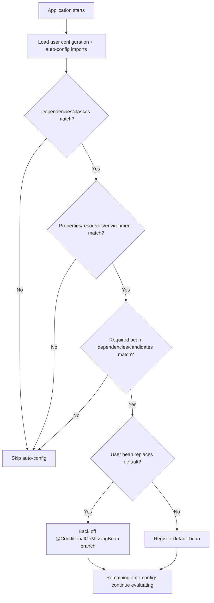
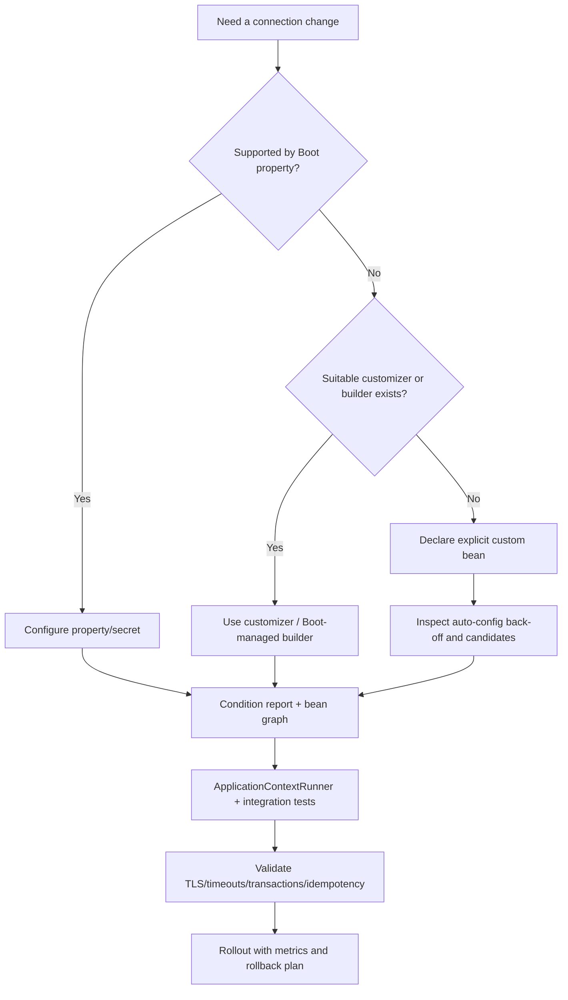

# Boot-Created Beans, Back-Off Conditions, and Customization Points

In Spring Boot, adding a *starter* can immediately give your application a `DataSource`, `JdbcTemplate`, `RestClient.Builder`, `WebClient.Builder`, `KafkaTemplate`, or connection beans for Redis/JMS/RabbitMQ without the developer **writing a single `@Bean`**. This mechanism is called **auto-configuration**: Spring Boot inspects libraries on the classpath, external configuration, and existing beans, and decides whether to register default configurations.

That convenience is also the source of subtle integration bugs. For example, an application runs fine until the team declares a custom `DataSource` to tune pooling; from that moment on, Boot's default bean no longer appears. Or a `RestClient` is built directly with `RestClient.builder()`, missing system-wide customizers, codecs, and observation. In an application with two Kafka producers or two `ConnectionFactory` beans, `@Primary` helps resolve injection ambiguity, yet **does not make every transaction flow and adapter automatically pick the right source**.

This lesson belongs to the **Connection Configuration** chapter of the **SPRING_BOOT_INTEGRATION** module. The module's goal is organizing Spring Boot integrations across HTTP clients, databases, caches, message brokers, and Spring Integration adapters, focusing on **configuration, data contracts, transactions, errors, deduplication, testing, and observability**. Here we examine Boot's automatic bean creation, when it **backs off**, appropriate customization points, and how to prove your configuration is actually in effect.

> **Version scope:** API names and examples mainly target **Spring Boot 3.x / Spring Framework 6.x, Java 17+**. Features such as `RestClient` arrived in Spring Framework 6.1 and are supported by Spring Boot 3.2+; Spring Boot 4.x introduces package and starter changes. Auto-configuration details can vary across Boot releases and providers. In real systems, always inspect the **condition report and bean graph of the exact runtime version**, rather than inferring from a blog post or a single starter dependency.

## 1. Learning objectives

After this lesson, you will be able to:

1. Explain the differences between **component scanning**, **user configuration**, **auto-configuration**, and **externalized configuration**.
2. Read the semantics of `@ConditionalOnClass`, `@ConditionalOnMissingBean`, `@ConditionalOnBean`, `@ConditionalOnSingleCandidate`, and `@ConditionalOnProperty`.
3. Predict when Spring Boot creates or **skips** `DataSource`, `JdbcTemplate`, HTTP-client builders, and Redis/Kafka/RabbitMQ/JMS infrastructure beans.
4. Distinguish three customization levels: **properties**, **builder/customizer**, and **explicit `@Bean` declaration**.
5. Understand the impact of custom beans on auto-configuration and multi-bean scenarios involving `@Primary`, `@Qualifier`, or custom transaction managers.
6. Diagnose missing beans, wrong beans, ambiguous beans, and "properties have no effect" using condition reports, Actuator, and startup logs.
7. Test auto-configuration decisions with `ApplicationContextRunner` and live connections with Testcontainers.
8. Design connection configuration with explicit control over secrets, timeouts, transactions, error handling, idempotency, and observability.

## 2. Bean creation layers to distinguish

A Spring bean can originate from several sources:

| Source | Example | Characteristics |
| --- | --- | --- |
| **Component scan** | `@Component`, `@Service`, `@Repository` | Scans packages and registers application types |
| **User configuration** | `@Configuration` with `@Bean DataSource` | Application declares beans directly |
| **Imported configuration** | `@Import(...)` | Module/application brings in additional bean definitions |
| **Spring Boot auto-configuration** | `DataSourceAutoConfiguration` | Registers beans conditionally; typically **backs off** if the user declares one |
| **Framework infrastructure** | Transaction proxies, bean post-processors | Supports lifecycle, AOP, validation, conversion, etc. |
| **Environment-managed object** | JNDI `ConnectionFactory` or `DataSource` | Provisioned by the runtime environment and exposed to the Spring context via bean/auto-config |

Example:

```java
@Service
public class OrderService {
    private final JdbcTemplate jdbc;

    public OrderService(JdbcTemplate jdbc) {
        this.jdbc = jdbc;
    }
}
```

`OrderService` comes from component scanning; `JdbcTemplate` can be auto-configured by Boot if a suitable `DataSource` exists. These two mechanisms are **not the same thing**. If the application defines its own `JdbcTemplate`, Boot may skip creating the default one while other beans continue to be auto-configured.

### 2.1. What does `@SpringBootApplication` do?

```java
@SpringBootApplication
public class IntegrationApplication {
    public static void main(String[] args) {
        SpringApplication.run(IntegrationApplication.class, args);
    }
}
```

`@SpringBootApplication` combines related mechanisms:

- `@SpringBootConfiguration`: designates the root application configuration.
- `@EnableAutoConfiguration`: enables auto-configuration.
- `@ComponentScan`: scans components within the appropriate package scope.

**Common misconception:** Adding `spring-boot-starter-jdbc` does not make Boot invent a `DataSource` without required configuration/conditions, and scanning `@Service` does not create database connections directly. Starters mainly supply dependencies so auto-configurations become **eligible under the right conditions**.

### 2.2. External properties are not beans

In `application.yml`:

```yaml
spring:
  datasource:
    url: ${ORDERS_JDBC_URL}
    username: ${ORDERS_DB_USERNAME}
    password: ${ORDERS_DB_PASSWORD}
```

These are **configuration values**, not a `DataSource` instance. Auto-configuration or user-declared beans must read and bind them into executable objects.

If the application instantiates a `DataSource` in code without binding `spring.datasource.*`, these properties may **have no effect** on that bean, even though the YAML is valid and IDEs provide autocomplete for the keys.

## 3. How is auto-configuration activated?

### 3.1. "Starter present" does not equal "bean guaranteed"

In Spring Boot, auto-configuration classes ship in libraries, are registered for Boot to import, and are evaluated as conditional configurations. In Spring Boot 3.x, registration normally uses the resource:

```text
META-INF/spring/org.springframework.boot.autoconfigure.AutoConfiguration.imports
```

Conceptually, an auto-configuration looks like:

```java
@AutoConfiguration
@ConditionalOnClass(PartnerClient.class)
@EnableConfigurationProperties(PartnerProperties.class)
public class PartnerClientAutoConfiguration {

    @Bean
    @ConditionalOnMissingBean(PartnerClient.class)
    PartnerClient partnerClient(PartnerProperties properties) {
        return new PartnerClient(properties.baseUrl());
    }
}
```

This is an **illustrative pattern** for an internal starter, not a built-in Spring Boot class. It means:

1. Consider this configuration only when `PartnerClient` is on the classpath.
2. Bind client properties if the auto-configuration applies.
3. Create a default `PartnerClient` only if no matching bean already satisfies the condition.
4. If the application declares its own `PartnerClient`, auto-configuration typically **backs off** so the user retains control.

Not every auto-configuration shares the same conditions or level of back-off. **Read the condition report or the source of the specific auto-configuration** to know for certain.

### 3.2. Common conditions

| Annotation | Checks | Common misinference |
| --- | --- | --- |
| `@ConditionalOnClass` | Specified class is on the classpath | Having the library does not mean the broker/DB is ready |
| `@ConditionalOnMissingClass` | Class is absent | Used for fallback branches by dependency |
| `@ConditionalOnBean` | A matching bean definition exists | Application beans may need to be declared with the right type |
| `@ConditionalOnMissingBean` | No matching bean exists within condition scope | Declaring a custom bean can stop Boot from creating the default |
| `@ConditionalOnSingleCandidate` | Exactly one candidate matches, or one primary candidate | Two datasources without a clear winner prevent dependent beans |
| `@ConditionalOnProperty` | Property matches the condition rule | `enabled=false` can remove a bean needed for injection |
| `@ConditionalOnResource` | Specified resource is found | Missing file skips the configuration branch |
| `@ConditionalOnWebApplication` | App is a matching web application | CLI/batch apps may lack web infrastructure |
| `@ConditionalOnNotWebApplication` | Not running as a web application | Easy to misjudge mode in tests |
| `@Profile` | Spring profile is active | Not equivalent to Boot's full condition framework |

Conditions can be placed at the **class level** or **method level**, and multiple conditions typically must all pass simultaneously.

### 3.3. Backing off does not mean deleting an already-created bean

`@ConditionalOnMissingBean` is typically evaluated while Spring processes bean definitions. When a user-defined bean is already known, the auto-configuration branch **does not register** the default bean.

**Do not imagine it as:** Boot creates a bean, spots a custom one, and deletes the old bean. Also avoid using `@ConditionalOnMissingBean` arbitrarily inside early-processed `@Configuration` classes: conditions only see bean definitions already processed at evaluation time. That is why this annotation belongs primarily in **auto-configurations** with well-defined ordering.

### 3.4. Decision flow diagram



An auto-configuration class often contains **multiple sub-branches**. One bean backing off does not automatically disable all other related auto-configurations.

## 4. Understanding "Boot-created beans" accurately

Spring Boot does not immediately instantiate every runtime object when reading YAML. There are distinct layers:

```text
Spring Boot auto-configuration
       |
       +-- DataSource bean (HikariDataSource)
       |     |
       |     +-- Physical JDBC connections (created as the pool operates)
       |
       +-- RestClient.Builder bean
       |     |
       |     +-- RestClient built by the application via build()
       |            |
       |            +-- HTTP connection pool / request factory
       |
       +-- KafkaTemplate bean
       |     |
       |     +-- ProducerFactory / Kafka producer clients
       |
       +-- RedisConnectionFactory bean
             |
             +-- Redis connections / provider client
```

**Having a bean in the Spring context** does not mean a network connection has been opened, a broker has authenticated, a SQL schema is ready, or business data has been processed. Therefore:

- Use the condition report to learn **why a bean was registered**.
- Use health checks and integration tests to verify **external resources are reachable**.
- Use business tests to verify **contracts, transactions, and side effects**.

These three verification layers answer three separate questions.

## 5. DataSource: the most critical back-off case

### 5.1. Without a custom DataSource declaration

In a Spring Boot 3.x JDBC project:

```groovy
dependencies {
    implementation 'org.springframework.boot:spring-boot-starter-jdbc'
    runtimeOnly 'org.postgresql:postgresql'
}
```

```yaml
spring:
  datasource:
    url: ${ORDERS_JDBC_URL}
    username: ${ORDERS_DB_USERNAME}
    password: ${ORDERS_DB_PASSWORD}
    hikari:
      pool-name: OrdersPool
      maximum-pool-size: 12
      connection-timeout: 3000
      validation-timeout: 1000
      max-lifetime: 1500000
```

When conditions match and HikariCP is selected, Spring Boot creates a `HikariDataSource` configured from `spring.datasource.*` and `spring.datasource.hikari.*`.

**Note:** The Hikari timeouts above are in milliseconds; JDBC driver-specific timeouts may use different units. A `DataSource` bean existing does not guarantee PostgreSQL has accepted connections, especially when pools open connections lazily or the network is unavailable.

### 5.2. When the application declares its own DataSource

```java
@Configuration(proxyBeanMethods = false)
public class CustomDataSourceConfiguration {

    @Bean
    DataSource customDataSource() {
        HikariDataSource source = new HikariDataSource();
        source.setJdbcUrl("jdbc:postgresql://db.example:5432/orders");
        source.setUsername("orders_app");
        source.setMaximumPoolSize(8);
        return source;
    }
}
```

This is an **example explaining back-off**, **not a production configuration**: never hard-code endpoints/usernames, it lacks secrets/TLS, and it omits passwords and proper connection lifecycle setup.

When a user `DataSource` bean exists, Boot's default `DataSource` auto-configuration branch **does not create a second bean**.

Important consequences:

- `spring.datasource.hikari.maximum-pool-size=12` in YAML **does not automatically apply** to `new HikariDataSource()` above unless your code binds it via `@ConfigurationProperties` or a matching mechanism.
- Other auto-configurations, such as `JdbcTemplateAutoConfiguration`, **can still work** with your supplied `DataSource` if their conditions pass.
- If two `DataSource` beans exist without a single candidate, dependent beans may not be created or injection becomes ambiguous.
- Spring Boot may follow different logic when the app registers an `XADataSource` or R2DBC `ConnectionFactory`; never treat `DataSource` as the only condition across all versions.

### 5.3. Customize pools with properties first

If your goal is simply increasing `maximumPoolSize`, setting `poolName`, `connectionTimeout`, or `maxLifetime`, **prefer `spring.datasource.hikari.*`** over declaring `@Bean DataSource`.

Benefits:

1. Keeps Boot's auto-configuration and dependency management intact.
2. Avoids manually managing pool lifecycle, credentials, and TLS/driver properties.
3. Easy to override by environment and secrets.
4. Does not inadvertently disable an auto-configuration branch.
5. Easy to inspect via `configprops`, metrics, and integration tests.

Declare your own `DataSource` only when you need a **genuinely different creation mechanism**: multiple datasources with distinct policies, routing datasources, JNDI, special vendor settings, or lifecycles unsupported by properties.

### 5.4. When you must create a DataSource manually

Use `DataSourceProperties` or `@ConfigurationProperties` to read settings instead of hard-coding:

```java
@Configuration(proxyBeanMethods = false)
@EnableConfigurationProperties(DataSourceProperties.class)
public class ExplicitOrdersDataSourceConfiguration {

    @Bean
    @ConfigurationProperties("spring.datasource.hikari")
    HikariDataSource ordersDataSource(
            DataSourceProperties properties) {
        return properties
                .initializeDataSourceBuilder()
                .type(HikariDataSource.class)
                .build();
    }
}
```

Illustrative imports:

```java
import com.zaxxer.hikari.HikariDataSource;
import org.springframework.boot.autoconfigure.jdbc.DataSourceProperties;
import org.springframework.boot.context.properties.ConfigurationProperties;
import org.springframework.boot.context.properties.EnableConfigurationProperties;
import org.springframework.context.annotation.Bean;
import org.springframework.context.annotation.Configuration;
```

This shows how to **reuse `DataSourceProperties` registered via `@EnableConfigurationProperties` and bind Hikari settings when creating a custom DataSource** in Spring Boot 3.x, rather than registering a duplicate `DataSourceProperties` bean alongside Boot's own. With multiple datasources, use **separate prefixes** like `app.datasource.orders` and `app.datasource.reporting` instead of having two places read `spring.datasource.*`.

Declaring `@Bean DataSource` shifts ownership: the application is now responsible for configuring that bean. You must verify TLS, credentials, pool metrics, transaction managers, and shutdown behavior.

## 6. JdbcTemplate, NamedParameterJdbcTemplate, and transaction managers

### 6.1. Having a DataSource does not guarantee every dependent bean

`JdbcTemplateAutoConfiguration` in Spring Boot 3.x typically applies only when a suitable `DataSource` candidate exists—either a single `DataSource` or a `@Primary` candidate—along with required classpath conditions.

When the application **has no custom `JdbcOperations`/`JdbcTemplate` bean**, Boot can create `JdbcTemplate`. Likewise, Boot can provide `NamedParameterJdbcTemplate` when its conditions hold.

```java
@Service
public class OrderRepository {

    private final JdbcTemplate jdbc;

    public OrderRepository(JdbcTemplate jdbc) {
        this.jdbc = jdbc;
    }

    public long countOrders() {
        Long value = jdbc.queryForObject(
                "SELECT COUNT(*) FROM orders", Long.class);
        return value == null ? 0L : value;
    }
}
```

There is no need to call `new JdbcTemplate(...)` inside every repository when Boot already creates the bean.

### 6.2. When declaring a custom JdbcTemplate

```java
@Bean
JdbcTemplate orderJdbcTemplate(
        @Qualifier("ordersDataSource") DataSource dataSource) {

    JdbcTemplate template = new JdbcTemplate(dataSource);
    template.setQueryTimeout(8); // Seconds.
    return template;
}
```

Your bean can make the default `JdbcTemplate` branch back off. This customization makes sense when specific timeouts or behavior are required, provided you:

- Name beans clearly when multiple `JdbcTemplate` instances exist.
- Inject the right `DataSource` via `@Qualifier`.
- Remember that some libraries look for `JdbcOperations`/`NamedParameterJdbcOperations`.
- Never use a template bound to the reporting datasource to write orders.
- Never assume transaction manager auto-configuration still picks the right datasource once multiple beans exist.

### 6.3. Transaction managers do not "follow the template name"

Consider a service:

```java
@Transactional
public void createOrder() {
    ordersJdbc.update(...);
    reportingJdbc.update(...);
}
```

**Never assume** two `JdbcTemplate` instances share one JDBC transaction if they use two independent datasources. `@Transactional` picks a transaction manager per configuration rules; a typical manager governs a single resource.

When an application uses multiple datasources:

- Declare explicit transaction managers as needed.
- Specify `@Transactional(transactionManager = "ordersTransactionManager")` on the orders flow.
- Do not combine two-resource writes in one method and expect atomicity without properly configured distributed transactions.
- Consider outbox/saga/idempotent integration when propagating state across multiple systems.

**DataSource back-off does not solve transaction boundaries on its own.**

## 7. Multiple DataSources: @Primary, @Qualifier, and single candidate

### 7.1. Two beans of the same type

Example:

```java
@Bean("ordersDataSource")
DataSource ordersDataSource() {
    // Build from orders DB configuration.
    return ...;
}

@Bean("reportingDataSource")
DataSource reportingDataSource() {
    // Build from reporting DB configuration.
    return ...;
}
```

This is **pseudocode**; `...` is not valid Java and must be replaced with real factories/configuration.

If a constructor requests a `DataSource` without a qualifier:

```java
public OrderService(DataSource dataSource) {
    this.dataSource = dataSource;
}
```

Spring may throw `NoUniqueBeanDefinitionException` when multiple candidates exist without disambiguation.

### 7.2. Selecting with @Primary

```java
@Bean("ordersDataSource")
@Primary
DataSource ordersDataSource() {
    return buildOrdersDataSource();
}
```

`@Primary` lets Spring prefer one bean when injecting by type across multiple candidates. It can also satisfy `@ConditionalOnSingleCandidate`, depending on the auto-configuration.

However, `@Primary` **does not**:

- Merge two databases into one transaction.
- Force every `JmsTemplate`/`KafkaTemplate`/`RedisTemplate` to pick your desired source.
- Switch credentials or endpoints for other clients.
- Replace `@Qualifier` on the reporting flow.
- Automatically select `transactionManager` across modules with multiple managers.

### 7.3. When should you use @Qualifier?

Whenever code targets a specific business destination:

```java
@Service
public class ReportingService {

    private final JdbcTemplate reportsJdbc;

    public ReportingService(
            @Qualifier("reportingJdbcTemplate")
            JdbcTemplate reportsJdbc) {
        this.reportsJdbc = reportsJdbc;
    }
}
```

An explicit business adapter should bind to an explicit bean. `@Primary` is useful for defining a **sensible default**, whereas `@Qualifier` prevents **ambiguity on non-default flows**.

### 7.4. Bean names are not always decisive

In Spring, matching considers type, qualifiers, `@Primary`, and sometimes parameter names. Never rely on "matching parameter name happens to pick the right bean" on critical integration paths when multiple beans share a type. Declare explicit qualifiers or intentional injection, and test which bean is actually wired.

## 8. JPA and R2DBC: distinct from JDBC auto-configuration

### 8.1. JPA depends on multiple beans

Adding `spring-boot-starter-data-jpa` pulls in JPA/Hibernate infrastructure when:

- Required classes, dependencies, and conditions are met.
- A suitable `DataSource` is available.
- No user infrastructure bean causes a back-off.
- Entity/repository package scanning and persistence config align.

A custom `EntityManagerFactory` or `JpaTransactionManager` affects JPA auto-configuration branches specifically, yet **do not infer from one such bean that all JDBC beans vanish**. JDBC and JPA share the datasource, but are wired by separate auto-configuration classes.

### 8.2. R2DBC ConnectionFactory can alter JDBC decisions

For reactive SQL, `io.r2dbc.spi.ConnectionFactory` is a different abstraction from `javax.sql.DataSource`. In some Spring Boot 3.x setups, if an R2DBC `ConnectionFactory` exists, standard JDBC `DataSource` auto-configuration may **back off**.

Do not assume adding both JDBC and R2DBC starters creates both connections automatically. If an application genuinely needs both:

- Inspect the condition report for `DataSourceAutoConfiguration` and `R2dbcAutoConfiguration`.
- Create and name beans explicitly as needed.
- Use the matching transaction managers (JDBC/JPA vs. R2DBC).
- Avoid mixing reactive and imperative transactions across two resources expecting atomicity.

## 9. HTTP clients: RestClient, WebClient, and RestTemplate

### 9.1. An essential summary table

| API | What Boot usually auto-configures | What not to assume |
| --- | --- | --- |
| `RestClient` (Spring Framework 6.1+) | Boot-configured `RestClient.Builder` when classpath/conditions match | Boot does not create a dedicated `RestClient` per partner |
| `WebClient` | Boot-configured `WebClient.Builder` when WebFlux client classpath matches | No pre-configured WebClient with partner URL/name |
| `RestTemplate` | `RestTemplateBuilder` supported in Boot 3.x | Boot typically **does not create a `RestTemplate` instance** per API |
| Declarative HTTP interface `@HttpExchange` | Backed by HTTP client adapter/proxy factory | Declaring an interface alone does not guarantee all Boot versions auto-register proxy beans |

Builders are **extension points** letting applications build per-partner clients while inheriting Boot-managed components: request factories, codecs, TLS bundles, observation, or customizers **when actually configured on that builder**.

### 9.2. Why not call RestClient.builder() directly everywhere?

Example:

```java
RestClient direct = RestClient.builder()
        .baseUrl("https://partner.example")
        .build();
```

This creates a valid Spring Framework client, but **does not guarantee** receiving customizations from Spring Boot's managed `RestClient.Builder`.

A better bean in Spring Boot 3.2+:

```java
@Configuration(proxyBeanMethods = false)
public class PartnerHttpConfiguration {

    @Bean("partnerRestClient")
    RestClient partnerRestClient(
            RestClient.Builder bootManagedBuilder,
            @Value("${integration.partner.base-url}") String baseUrl) {

        return bootManagedBuilder
                .baseUrl(baseUrl)
                .build();
    }
}
```

Illustrative imports:

```java
import org.springframework.beans.factory.annotation.Value;
import org.springframework.context.annotation.Bean;
import org.springframework.context.annotation.Configuration;
import org.springframework.web.client.RestClient;
```

Boot's `RestClient.Builder` is typically scoped so each injection receives an independent customizable builder. Even so, never store one mutable builder as a singleton and mutate `baseUrl` across threads to call different partners.

### 9.3. RestClientCustomizer for customizing all Boot-managed builders

Spring Boot 3.2+ provides `RestClientCustomizer` in its corresponding package:

```java
@Configuration(proxyBeanMethods = false)
public class OutboundClientDefaults {

    @Bean
    RestClientCustomizer integrationRestClientCustomizer() {
        return builder -> builder.defaultHeader(
                "X-Integration-Client", "orders-service");
    }
}
```

Import:

```java
import org.springframework.boot.web.client.RestClientCustomizer;
```

Customizer beans are applied to auto-configured builders per Spring Boot's mechanism. **Never attach a shared Authorization bearer token on a global builder** when calling multiple partners with distinct identities; attach tokens per client/tenant/request within clear security boundaries.

Do not declare a custom `RestClient.Builder` returning `RestClient.builder()` just to add headers or observation: doing so can make Boot **back off its default builder** and drop other customizations.

### 9.4. WebClientCustomizer and reactive HTTP

Similarly for `WebClient` in Spring Boot 3.x:

```java
@Bean
WebClientCustomizer integrationWebClientCustomizer() {
    return builder -> builder.defaultHeader(
            "X-Integration-Client", "orders-service");
}
```

A per-partner client:

```java
@Bean("inventoryWebClient")
WebClient inventoryWebClient(
        WebClient.Builder builder,
        @Value("${integration.inventory.base-url}") String baseUrl) {
    return builder.baseUrl(baseUrl).build();
}
```

Imports:

```java
import org.springframework.boot.web.reactive.function.client.WebClientCustomizer;
import org.springframework.web.reactive.function.client.WebClient;
```

Do not assume `WebClient` is always end-to-end non-blocking: calling `block()` is still blocking and demands attention to thread models, timeouts, pools, and transaction boundaries. A Boot-managed WebClient builder does not automatically provide retries, circuit breakers, or idempotency for every request.

### 9.5. Request timeouts do not appear automatically from auto-configuration

Boot provides configuration hooks and builders; **timeouts must be explicitly designed** for your client stack:

- Connect timeout (TCP/TLS).
- Response/read timeout.
- Pool acquisition timeout.
- Overall operation deadline.
- Retry budget/backoff.
- Cancellation and cleanup.
- Idempotency key for POSTs with side effects.

Timeout APIs for `ClientHttpRequestFactory`, Reactor Netty, or HTTP client libraries vary by Boot/Spring version. Never copy HikariCP timeout properties onto an HTTP client expecting the same behavior.

## 10. Kafka: having KafkaTemplate does not make all producers identical

### 10.1. Beans Boot can provide

When Spring Kafka is on the classpath and conditions pass, Boot can auto-configure infrastructure beans such as:

- `ProducerFactory` and `ConsumerFactory`.
- `KafkaTemplate`.
- `KafkaAdmin` or other admin infrastructure depending on config.
- Default listener container factory for `@KafkaListener`.
- Properties, converters, and transaction-related configuration conditionally.

Crucially: **not every bean in this list is guaranteed to appear**. They depend on classpath, custom beans, properties, broker client stack, and Boot version.

### 10.2. Typical properties

```yaml
spring:
  kafka:
    bootstrap-servers: ${KAFKA_BOOTSTRAP_SERVERS}
    producer:
      acks: all
      properties:
        enable.idempotence: true
    consumer:
      group-id: orders-processor
      auto-offset-reset: earliest
```

These properties do not automatically guarantee:

- Unique event IDs.
- Atomic SQL commit with Kafka send.
- Consumers never receiving duplicate messages.
- Schema compatibility.
- Kafka keys enforcing per-aggregate ordering.
- Safe retries after producer acknowledgment timeouts.

Those are **flow design requirements**, not bean creation concerns.

### 10.3. Declaring a custom KafkaTemplate

```java
@Bean("auditKafkaTemplate")
KafkaTemplate<String, String> auditKafkaTemplate(
        @Qualifier("auditProducerFactory")
        ProducerFactory<String, String> factory) {
    return new KafkaTemplate<>(factory);
}
```

A custom `KafkaTemplate` can cause the default template branch to back off depending on conditions. If the app also uses `@KafkaListener`, consumer/listener factory auto-configuration may continue working.

Do not expect every publisher to pick `auditKafkaTemplate` merely because of the name "audit." Use qualifiers and separate properties per producer. When using Kafka transactions, distinguish `KafkaTransactionManager` from JDBC transactions and verify commit ordering and outbox/idempotency.

## 11. RabbitMQ, JMS, and environment-managed resources

### 11.1. RabbitMQ

With Spring AMQP and matching properties, Boot can create `ConnectionFactory`, `RabbitTemplate`, listener container factories, and related configuration.

```yaml
spring:
  rabbitmq:
    host: ${RABBIT_HOST}
    port: ${RABBIT_PORT:5672}
    username: ${RABBIT_USERNAME}
    password: ${RABBIT_PASSWORD}
```

Declaring a custom `CachingConnectionFactory` or `RabbitTemplate` can cause a default branch to back off. Never assume publisher confirms, mandatory returns, DLQs, or retry policies are automatically configured for business needs just because the bean exists.

### 11.2. JMS ConnectionFactory

JMS commonly follows two models:

1. **Spring Boot/application-managed:** provider client and properties create `jakarta.jms.ConnectionFactory` via auto-configuration.
2. **Environment-managed:** the application server provisions a ConnectionFactory via JNDI; Spring Boot/`JndiTemplate` looks up that bean.

Boot 3.x example:

```yaml
spring:
  jms:
    jndi-name: ${JMS_CONNECTION_FACTORY_JNDI:java:comp/env/jms/OrdersCF}
```

This JNDI name only works when the runtime has a real resource binding. It does not create brokers or mappings automatically. In Boot 3.x, you must use **Jakarta JMS (`jakarta.jms`)**; an older `javax.jms.ConnectionFactory` object from a legacy runtime cannot be cast to it.

When a user `ConnectionFactory` bean exists, default factory creation backs off, yet `JmsTemplate` or listener factories **may still be auto-configured on top of the existing bean** under their own conditions.

### 11.3. Same simple name ConnectionFactory, different interfaces

You may encounter several types named `ConnectionFactory`:

- `jakarta.jms.ConnectionFactory`: JMS.
- `org.springframework.amqp.rabbit.connection.ConnectionFactory`: RabbitMQ.
- `org.springframework.data.redis.connection.RedisConnectionFactory`: Redis.
- `io.r2dbc.spi.ConnectionFactory`: R2DBC.

The simple name "ConnectionFactory" is ambiguous: they are **completely different interfaces**. Importing the wrong type leads to compile errors, injection mismatches, or mismatched auto-config conditions. This matters especially when working across Kafka, SQL, cache, and brokers simultaneously.

## 12. Redis and CacheManager: having a connection vs. having a business cache

### 12.1. Spring Data Redis

With Redis dependencies and matching classpath, Spring Boot can auto-configure:

- `RedisConnectionFactory` (e.g. backed by Lettuce depending on dependencies).
- `RedisTemplate`/`StringRedisTemplate` under matching conditions.
- Timeout, database index, and client options per version.

Example:

```yaml
spring:
  data:
    redis:
      host: ${REDIS_HOST}
      port: ${REDIS_PORT:6379}
      password: ${REDIS_PASSWORD:}
      timeout: 2s
```

Never assume `RedisTemplate` being present means Redis is reachable or key serialization suits all data contracts.

### 12.2. Cache abstraction is a separate layer

`@Cacheable` requires Spring caching infrastructure to be enabled, typically via `@EnableCaching` or equivalent. `CacheManager` is auto-configured based on classpath, cache provider, and conditions.

```java
@Configuration(proxyBeanMethods = false)
@EnableCaching
public class CachingConfiguration {
}
```

If you declare a custom `CacheManager`, Boot skips creating the default manager. Even then, a Redis cache manager does not automatically supply:

- Domain-appropriate TTLs.
- Forward/backward-compatible serialization schemas during rolling deployments.
- Tenant-isolated cache keys.
- Cache invalidation after SQL commit.
- Cache stampede protection.
- SQL–cache–broker consistency.

When customizing default TTL or serializers, check `RedisCacheManagerBuilderCustomizer` or properties before replacing the entire `CacheManager`; extension points depend on your Boot and Spring Data Redis versions.

### 12.3. Two RedisConnectionFactory beans for two clusters

When one Redis serves caching and another holds distributed locks, configure separate factories with qualifiers, dedicated templates, and independent transaction/durability policies. `@Primary` only sets a default injection candidate; it does not replace explicitly assigning each module to the right cluster and testing failover/reconnects.

## 13. Spring Integration: auto-configured infrastructure does not build your flow

Spring Integration introduces `MessageChannel`, `IntegrationFlow`, gateways, transformers, routers, error channels, inbound/outbound adapters, and pollers.

When dependencies and conditions match, Boot enables Spring Integration infrastructure. Yet **nothing automatically generates a business flow** like "SQL → HTTP → Kafka" simply because all three starters are present.

Java DSL example:

```java
@Configuration(proxyBeanMethods = false)
public class IntegrationFlowConfiguration {

    @Bean
    IntegrationFlow orderNotifications(
            OrderNotificationHandler handler) {

        return IntegrationFlow
                .from("orderNotificationInput")
                .handle(handler, "handle")
                .get();
    }
}
```

This is an explicit flow definition, not something Boot infers from `OrderNotificationHandler`. `OrderNotificationHandler` is an application component you implement.

### 13.1. A bean existing does not mean the channel uses the right ConnectionFactory

A JMS inbound adapter may use a container-provided `jakarta.jms.ConnectionFactory`, while a Rabbit outbound adapter uses `org.springframework.amqp.rabbit.connection.ConnectionFactory`. If multiple factories of the same type exist, inject with qualifiers, pick the right destinations and transaction managers, and verify the wiring.

### 13.2. Thread and transaction boundaries

`DirectChannel` generally invokes handlers synchronously on the caller's thread; `ExecutorChannel`, pollers, or broker adapters can switch threads and transactions. Auto-configuration does not propagate Spring transaction contexts across arbitrary asynchronous boundaries.

When a flow receives a message, writes SQL, and acks a broker:

- Identify where the ack happens.
- Identify which transaction manager covers which SQL work.
- Use inbox/idempotency to survive redeliveries.
- Use an outbox when SQL commits and downstream messages must still be emitted.
- Never swallow all exceptions and return success, causing premature adapter acks.

## 14. Three levels of customization: which should you pick?

| Level | Example | Pros | Caution |
| --- | --- | --- | --- |
| **1. Properties** | `spring.datasource.hikari.maximum-pool-size` | Minimal code, easy profile/secret overrides | Only applies if a bean binds via matching auto-config |
| **2. Customizer/Builder** | `RestClientCustomizer`, injected builder | Keeps Boot defaults, composable | Must use the Boot-provided builder; customizer order may matter |
| **3. Explicit `@Bean`** | Custom `DataSource`, multi-provider `KafkaTemplate` | Full control | Can cause Boot to back off; you own lifecycle and dependencies |
| **4. Auto-configuration exclusion** | `spring.autoconfigure.exclude` | Disables an auto-config for architectural reasons | Can unexpectedly drop multiple infrastructure beans |

**Decision order:** prefer level 1 → 2 → 3, and exclude auto-configuration only when you understand the full bean graph and reason. "I don't see a bean" is **not a reason** to enable everything or register duplicate beans.

### 14.1. Properties have their own extension points

Declare typed configs per partner:

```java
package com.example.integration.config;

import java.net.URI;
import java.time.Duration;

import org.springframework.boot.context.properties.ConfigurationProperties;

@ConfigurationProperties(prefix = "integration.partner")
public record PartnerConnectionProperties(
        URI baseUrl,
        Duration responseTimeout,
        int maxAttempts
) {}
```

Registration:

```java
@SpringBootApplication
@ConfigurationPropertiesScan
public class IntegrationApplication {
    public static void main(String[] args) {
        SpringApplication.run(IntegrationApplication.class, args);
    }
}
```

With:

```yaml
integration:
  partner:
    base-url: ${PARTNER_BASE_URL}
    response-timeout: 3s
    max-attempts: 3
```

`@ConfigurationProperties` enables type-safe binding, yet **does not validate business rules automatically**; add Bean Validation or explicit validation logic (URI scheme, `timeout > 0`, bounded `maxAttempts`) when needed. Using Jakarta Bean Validation annotations requires a matching validation starter/provider.

### 14.2. Isolate configuration per partner

With multiple HTTP partners, avoid using a global `RestClientCustomizer` to apply partner A's base URL or auth token to all clients. Instead, build distinct `@Bean("inventoryRestClient")` and `@Bean("billingRestClient")` instances from the Boot-configured builder with each partner's properties, credentials, and timeouts.

A stronger security policy is **scoping config properly from the start**, rather than sharing headers globally and trying to strip them per route.

## 15. Declaring custom beans: avoiding unintended back-offs

### 15.1. Creating a bean of one type does not always replace another by name

Suppose you build a client:

```java
@Bean("partnerTemplate")
RestClient partnerTemplate(RestClient.Builder builder) {
    return builder.baseUrl("https://partner.example").build();
}
```

This returns `RestClient`, a **different type** from `RestClient.Builder`. Declaring a finished client does not prevent Boot from providing the builder; conditions typically inspect the specific type the auto-configuration produces.

Conversely:

```java
@Bean
RestClient.Builder customRestClientBuilder() {
    return RestClient.builder();
}
```

can cause Boot's auto-configured `RestClient.Builder` to **back off**, losing customizations Boot would have applied. If you only need headers, filters, observation, or a request factory, prefer a customizer or the injected builder.

### 15.2. `@ConditionalOnMissingBean` in libraries

When authoring an internal Spring Boot starter:

```java
@AutoConfiguration
@ConditionalOnClass(PartnerTransport.class)
@EnableConfigurationProperties(PartnerConnectionProperties.class)
public class PartnerTransportAutoConfiguration {

    @Bean
    @ConditionalOnMissingBean(PartnerTransport.class)
    PartnerTransport partnerTransport(
            PartnerConnectionProperties properties) {
        return new DefaultPartnerTransport(properties);
    }
}
```

These are **internal API examples**; `PartnerTransport` and `DefaultPartnerTransport` are written by your organization. The auto-config must be listed in the imports resource if packaged as a standalone starter.

**Do not treat `@ConditionalOnMissingBean` as a general "low-priority bean selector" in arbitrary `@Configuration` classes:** it evaluates during definition registration and depends on processing order. In normal applications, explicit bean declarations or clear `@Profile`/`@ConditionalOnProperty` conditions are far more predictable.

### 15.3. Broad impact of auto-configuration exclusions

Example:

```java
@SpringBootApplication(
        exclude = DataSourceAutoConfiguration.class)
public class NoSqlOnlyApplication {}
```

If the application genuinely uses no JDBC, excluding it can be reasonable. If the service still relies on `JdbcTemplate` or Flyway, excluding `DataSourceAutoConfiguration` can prevent many downstream beans from forming.

Property-based equivalent:

```yaml
spring:
  autoconfigure:
    exclude:
      - org.springframework.boot.autoconfigure.jdbc.DataSourceAutoConfiguration
```

**Never use exclusion merely to "silence a startup error about a missing JDBC URL"** without understanding why the SQL starter is on the classpath and which module expects a `DataSource`. If an unintended JDBC dependency crept in, fix the dependencies. If SQL is actually needed, excluding auto-config only hides the root problem.

## 16. Cascading back-off across dependent beans

### 16.1. `@ConditionalOnMissingBean`: downstream layers may continue

Consider a dependency chain:

```text
DataSourceAutoConfiguration
  -> DataSource

JdbcTemplateAutoConfiguration
  -> JdbcTemplate / NamedParameterJdbcTemplate

TransactionAutoConfiguration / manager-related config
  -> transaction infrastructure/manager conditionally

JPA auto-configuration (if JPA present)
  -> EntityManagerFactory and related beans
```

When a custom `DataSource` appears:

- The default `DataSource` creation branch backs off.
- `JdbcTemplate` can still auto-configure against your **custom `DataSource`**.
- JPA/transaction auto-configurations can still run if other conditions hold.
- If multiple `DataSource` beans exist with no single candidate, downstream branches may back off too.

Thus, claiming "I created bean X so Boot turned off all auto-config" is usually **inaccurate**. Inspect which specific branches matched or did not match.

### 16.2. `@ConditionalOnBean` and `@ConditionalOnSingleCandidate`

`JdbcTemplate` auto-configuration needs a `DataSource`—it cannot construct a template from properties alone if no `DataSource` exists. If **multiple** `DataSource` beans exist with no clear choice, Boot may skip creating a default template.

Two scenarios:

```text
Case A:
  ordersDataSource (single)
  -> JdbcTemplate auto-config can create the bean

Case B:
  ordersDataSource
  reportingDataSource
  no @Primary
  -> Single-candidate condition may not match

Case C:
  ordersDataSource @Primary
  reportingDataSource
  -> Certain auto-configs can select primary
```

**Consequence:** Adding a small reporting `DataSource` can cause an existing auto-configured bean to **vanish on restart**. Integration tests should cover multi-datasource scenarios whenever a system genuinely uses multiple databases.

## 17. Customizers, ordering, and property precedence

### 17.1. Customizers only apply through the right builder path

A customizer for Boot-managed `WebClient.Builder` does **not** apply to static `WebClient.builder()` calls. Likewise, a Spring-managed `RestClient.Builder` does not govern an `HttpClient` created internally by a third-party SDK.

To manage clients uniformly:

- Require clients to be built via injected beans/builders.
- Wrap external SDK adapters behind an application interface.
- Centralize ownership of base URLs, auth, TLS, timeouts, and tracing.
- Verify effective runtime settings with mock HTTP servers and telemetry.

### 17.2. Customizer ordering can change results

If two customizers both set default headers, request factories, or codecs on the same builder, the later customizer can overwrite or append depending on the API.

In Spring, `@Order`/`Ordered` can order supported extension points. Still, ordering **is no substitute** for clear separation of concerns: keep global customizers to cross-cutting headers/observation, and place partner-specific settings on each partner client bean.

### 17.3. Property precedence

Spring Boot loads properties from application configs, environment variables, command-line arguments, and config imports/secret stores according to documented precedence rules. The same key can be overridden at runtime.

Example:

```yaml
integration:
  partner:
    base-url: "https://sandbox.partner.example"
```

An environment variable `INTEGRATION_PARTNER_BASE_URL` can override that value via relaxed binding and property-source precedence.

**Never stop diagnosing at "the YAML looks right" while ignoring runtime property sources.** When investigating, inspect `/actuator/env` or Boot diagnostic tools with proper access controls and sanitization; never expose secrets while checking effective config.

## 18. Profiles, `@ConditionalOnProperty`, and feature toggles

### 18.1. Selecting implementations by environment

Example interface:

```java
public interface PartnerGateway {
    PartnerResponse send(PartnerRequest request);
}
```

In an illustrative app, two implementations might be registered:

```java
@Configuration(proxyBeanMethods = false)
public class PartnerGatewayConfiguration {

    @Bean
    @Profile("local")
    PartnerGateway fakePartnerGateway() {
        return new LocalFakePartnerGateway();
    }

    @Bean
    @Profile("!local")
    PartnerGateway httpPartnerGateway(
            RestClient.Builder builder,
            PartnerConnectionProperties properties) {
        return new HttpPartnerGateway(
                builder.baseUrl(properties.baseUrl().toString())
                        .build());
    }
}
```

`PartnerResponse`, `PartnerRequest`, `LocalFakePartnerGateway`, and `HttpPartnerGateway` are **illustrative project classes**.

Using profiles to select connection modes requires verifying that **exactly one implementation** is registered in each target environment. Projects often combine multiple active profiles; `@Profile("!local")` does not replace explicit operational controls when staging/prod setups grow complex.

### 18.2. ConditionalOnProperty

```java
@Bean
@ConditionalOnProperty(
        prefix = "integration.partner",
        name = "enabled",
        havingValue = "true")
PartnerSyncJob partnerSyncJob(PartnerGateway gateway) {
    return new PartnerSyncJob(gateway);
}
```

If `integration.partner.enabled=false`, `PartnerSyncJob` is not registered. If another bean injects `PartnerSyncJob` unconditionally via constructor, startup fails.

Feature toggles require a clear model:

- When disabled, **do not start scheduled jobs/consumers**, and check whether other beans still expect that dependency.
- Do you need a no-op implementation, `ObjectProvider`, or optional injection?
- Could already-received messages be stranded?
- Does the toggle interact with idempotency, retries, or job state in SQL?

**Never use a feature toggle to silently drop messages that require durable processing.**

## 19. Why isn't the bean appearing? Evidence-based diagnosis

### 19.1. Condition Evaluation Report

In Spring Boot, enabling debug at startup prints the condition evaluation report:

```bash
java -jar integration-app.jar --debug
```

Or configure appropriate logging levels in development. The report typically groups entries under:

- **Positive matches**: conditions that matched.
- **Negative matches**: conditions that did not match.
- **Unconditional classes** or additional sections depending on version.

Conceptual example:

```text
DataSourceAutoConfiguration matched:
  - required classes were found

DataSourceConfiguration.Hikari did not match:
  - @ConditionalOnMissingBean found an existing DataSource

JdbcTemplateAutoConfiguration matched:
  - a single candidate DataSource exists
```

This is **illustrative output**, not verbatim logs from a running app. Exact messages and class names can change across Boot versions.

### 19.2. Actuator `/conditions` and `/beans`

With Spring Boot Actuator:

```groovy
dependencies {
    implementation 'org.springframework.boot:spring-boot-starter-actuator'
}
```

Diagnostic endpoints can be enabled in development environments:

```yaml
management:
  endpoints:
    web:
      exposure:
        include: "health,info,conditions,beans,configprops"
```

- `/actuator/conditions`: condition evaluation report.
- `/actuator/beans`: beans in the context, types, and dependencies per endpoint capabilities.
- `/actuator/configprops`: bound properties.
- `/actuator/health`: health indicator results.

**Warning:** Never expose `beans`, `conditions`, `configprops`, or `env` publicly in production. Enforce authentication/authorization, network restrictions, and sanitization; they can reveal internal structure or sensitive configuration. Enable only per operational policy.

### 19.3. Checklist for diagnosing missing beans

1. Are the dependency and provider classes actually on the classpath?
2. Are Boot/Spring versions and the Jakarta namespace compatible?
3. Was the auto-configuration imported or excluded?
4. Did `@ConditionalOnProperty` or `@Profile` disable the branch?
5. Do required dependency beans (`DataSource`, `ConnectionFactory`, etc.) exist?
6. Did a custom bean of the same type cause `@ConditionalOnMissingBean` to back off?
7. Are there multiple beans missing `@Primary` (single candidate) or a `@Qualifier`?
8. Does the produced bean's type/proxy match the condition?
9. Is a `@Configuration` class outside the component scan path?
10. Did bean instantiation fail after the definition was registered?
11. Did properties bind to **the exact bean instance actually injected**?
12. Is the external resource down—meaning the real issue is network, credentials, or TLS?

Do not jump straight to "add `@Primary`" when the root cause is a missing classpath library or an excluded auto-configuration.

## 20. When the bean exists, yet the connection fails or targets the wrong system

### 20.1. Three distinct questions

```text
A. Does the Spring context contain the bean?
B. Is the bean configured with the right endpoint/credentials/timeouts?
C. Is the external resource healthy and the business contract valid?
```

Three questions require three verification tools:

| Question | Tool |
| --- | --- |
| A | Condition report, `ApplicationContextRunner`, bean graph |
| B | `@ConfigurationProperties` tests, property binding checks, mock HTTP, config inspection |
| C | Testcontainers / real test services, health/readiness, end-to-end tests |

If `KafkaTemplate` exists with the wrong `bootstrap-servers`, the condition report looks completely clean. If `RestClient` was created yet the HTTP partner returns 401, do not look for the cause in `@ConditionalOnMissingBean`.

### 20.2. Troubleshooting "property has no effect"

Common causes:

- Custom bean does not bind Boot properties.
- Wrong property prefix or property renamed in your Boot version.
- App is running a different active profile than expected.
- Environment variable overrides YAML.
- Multiple beans exist and code injects the wrong one.
- Config was read too early in a constructor or outside the proper lifecycle.
- SDK/builder was constructed statically, bypassing Boot customizers.
- Connection pool was created before credential rotation and needs recreation.

For runtime config changes, **never assume updating an environment variable on a running process refreshes every connection pool**. Most beans are constructed once at startup; use an explicit reload/recreation mechanism or controlled rolling restart.

## 21. Testing back-off with ApplicationContextRunner

`ApplicationContextRunner` in `spring-boot-test` spins up a minimal `ApplicationContext`, applies selected auto-configurations, and verifies bean graphs and conditions per scenario.

### 21.1. Test dependencies

```groovy
dependencies {
    implementation 'org.springframework.boot:spring-boot-starter-jdbc'
    runtimeOnly 'org.postgresql:postgresql'

    testImplementation 'org.springframework.boot:spring-boot-starter-test'
}
```

### 21.2. Verifying a custom DataSource causes the default branch to back off

```java
package com.example.integration.config;

import static org.assertj.core.api.Assertions.assertThat;

import javax.sql.DataSource;

import com.zaxxer.hikari.HikariDataSource;

import org.junit.jupiter.api.Test;
import org.springframework.boot.autoconfigure.AutoConfigurations;
import org.springframework.boot.autoconfigure.jdbc.DataSourceAutoConfiguration;
import org.springframework.boot.test.context.runner.ApplicationContextRunner;
import org.springframework.context.annotation.Bean;
import org.springframework.context.annotation.Configuration;

class DataSourceAutoConfigurationTest {

    private final ApplicationContextRunner runner =
            new ApplicationContextRunner()
                    .withConfiguration(AutoConfigurations.of(
                            DataSourceAutoConfiguration.class));

    @Test
    void userDataSourceWinsOverBootDefault() {
        runner
                .withUserConfiguration(CustomDataSourceConfig.class)
                .run(context -> {
                    assertThat(context).hasSingleBean(DataSource.class);
                    assertThat(context.getBean(DataSource.class))
                            .isSameAs(context.getBean("customDataSource"));
                });
    }

    @Configuration(proxyBeanMethods = false)
    static class CustomDataSourceConfig {

        @Bean
        DataSource customDataSource() {
            // Test checks bean definitions only; does not open a DB connection.
            return new HikariDataSource();
        }
    }
}
```

**What this test proves:** With the custom `DataSource` in the context, only one `DataSource` bean is registered in this test context. It does **not** prove PostgreSQL connectivity works or that Hikari properties bound properly.

### 21.3. Testing the positive path requires a matching classpath/driver

To verify Boot **auto-creates** a `DataSource` when no custom bean exists, use an embedded DB like H2 **strictly for auto-configuration tests**:

```groovy
testImplementation 'com.h2database:h2'
```

Example:

```java
@Test
void bootCreatesDataSourceWhenDriverAndPropertiesPresent() {
    runner
            .withPropertyValues(
                "spring.datasource.url=jdbc:h2:mem:autoconfigtest",
                "spring.datasource.driver-class-name=org.h2.Driver")
            .run(context -> {
                assertThat(context).hasSingleBean(DataSource.class);
                assertThat(context).hasBean("dataSource");
            });
}
```

This test reuses `runner` from above **without** adding `CustomDataSourceConfig`. With H2 properly on the classpath, Boot typically creates a default-named datasource. In projects with additional auto-configs or custom aliases, bean names can vary; focus primarily on type, configuration, and behavior.

### 21.4. Test the condition report instead of guessing

`ApplicationContextRunner` also lets you inspect `ConditionEvaluationReport` or attach `ConditionEvaluationReportLoggingListener` in tests to pinpoint failing conditions. This is invaluable when writing a **custom starter** to test:

- Dependency present vs. missing on classpath.
- User bean present vs. absent.
- Property enabled true vs. false.
- Single bean vs. multiple beans.
- Missing configuration / invalid endpoint.
- Conditional behavior across profiles or environments.

Never settle for checking that code compiles; assert explicitly which beans are created or backed off.

## 22. Testing live connections and `@ServiceConnection`

### 22.1. Bean graph tests do not replace integration tests

Beyond `ApplicationContextRunner`, test real connectivity for critical infrastructure:

- PostgreSQL/Testcontainers for datasource, transactions, and Hikari.
- Kafka container for producer acks, consumer groups, and redelivery.
- RabbitMQ container for routing, publisher confirms, and queue policies.
- Redis container for TTL, serializers, reconnects, and failover.
- MockWebServer/WireMock for HTTP status codes, timeouts, headers, and retries.
- Real JNDI-enabled runtime for managed JMS ConnectionFactory when production uses an application server.

### 22.2. Testcontainers `@ServiceConnection` (Boot 3.1+)

Example:

```java
package com.example.integration.sql;

import static org.junit.jupiter.api.Assertions.assertEquals;

import org.junit.jupiter.api.Test;
import org.springframework.beans.factory.annotation.Autowired;
import org.springframework.boot.test.context.SpringBootTest;
import org.springframework.boot.testcontainers.service.connection.ServiceConnection;
import org.springframework.jdbc.core.JdbcTemplate;

import org.testcontainers.containers.PostgreSQLContainer;
import org.testcontainers.junit.jupiter.Container;
import org.testcontainers.junit.jupiter.Testcontainers;

@SpringBootTest
@Testcontainers
class OrdersJdbcIT {

    @Container
    @ServiceConnection
    static PostgreSQLContainer<?> postgres =
            new PostgreSQLContainer<>("postgres:16-alpine");

    @Autowired
    JdbcTemplate jdbc;

    @Test
    void datasourceActuallyConnects() {
        Integer value = jdbc.queryForObject(
                "SELECT 1", Integer.class);
        assertEquals(1, value);
    }
}
```

Test dependencies:

```groovy
testImplementation 'org.springframework.boot:spring-boot-starter-test'
testImplementation 'org.springframework.boot:spring-boot-testcontainers'
testImplementation 'org.testcontainers:junit-jupiter'
testImplementation 'org.testcontainers:postgresql'
```

`@ServiceConnection` supplies **connection details** to matching auto-configurations when a container is recognized. It does not automatically create repositories, migrations, or transaction managers if the app overrides beans or conditions do not match.

With a **custom `DataSource`**, test that it actually picks up the container's endpoint/credentials; a custom bean hard-coding a production URL may **bypass `@ServiceConnection`** and accidentally touch the wrong environment during tests.

### 22.3. Do not test only `SELECT 1`

Also add tests for:

- SQL transaction rollback when a second INSERT fails.
- Unique constraints / idempotency.
- Connection pool acquisition timeouts and stale sessions.
- Kafka/Rabbit publisher acknowledgments vs. business commits.
- Cache serialization and pre-existing stale entries across deploys.
- HTTP 429/503/timeouts, cancellation, and retry budgets.
- Spring Integration async boundaries affecting transactions/acks.
- Outbox/inbox behavior when a process crashes after SQL commit or broker ack.

When migrating from a Boot-created bean to a custom bean, these integration tests catch regressions that bean graph tests miss.

## 23. Secure configuration: secrets, SSL/TLS, and health

### 23.1. Never hard-code secrets in `@Bean`

Wrong:

```java
@Bean
DataSource unsafeDataSource() {
    HikariDataSource ds = new HikariDataSource();
    ds.setJdbcUrl("jdbc:postgresql://db.prod/orders");
    ds.setUsername("admin");
    ds.setPassword("hardcoded-password");
    return ds;
}
```

Instead, read from the Spring environment/secret manager via `@ConfigurationProperties`, use least-privilege accounts, and configure TLS per driver/provider. Restrict access across CI, logs, Actuator, and error pages as well.

### 23.2. SSL customization must not strip verified defaults

Creating a custom HTTP request factory or TLS context just to "fix a handshake error" can inadvertently disable certificate and hostname verification. Similarly, creating custom Redis/JMS/Kafka connection factories without copying TLS settings can leave traffic in plaintext.

Customization is sound only when it:

- Loads proper truststores/certificates from secure config/secret sources.
- Verifies hostnames and certificate chains.
- Manages rotation with appropriate connection re-initialization.
- Includes tests for TLS failures and invalid credentials.
- Never substitutes security with `trust-all` in production.

### 23.3. Health checks distinguish process, connection, and business readiness

Having a bean does not mean external services are ready:

| Level | Question | Example |
| --- | --- | --- |
| Bean registration | Does the Spring context have the required bean? | `DataSource`/`KafkaTemplate` |
| Connection health | Can a connection to the peer be opened/verified? | JDBC `SELECT 1`, broker metadata |
| Capability health | Are privileges and state ready for operations? | DB schema present, queue provisioned |
| Business health | Do end-to-end operations meet SLAs and invariants? | Order + outbox, consumer processing cleanly |

Liveness should generally report the process is alive if it can recover; readiness should reflect dependencies essential to incoming traffic. Do not kill and restart every pod during a broker outage if an outbox safely buffers work in SQL.

## 24. Observability after configuration changes

A small bean change can have wide side effects:

- Creating a new Hikari pool manually can lose default metrics and timeouts.
- Replacing an HTTP builder can drop tracing/observation filters.
- Creating a custom `KafkaTemplate` can omit producer ack settings.
- Replacing a JMS factory can prevent transaction enlistment.
- Creating a `RedisTemplate` with a different serializer can break reads of existing cache entries.
- Using multiple DataSources can make transaction managers pick the wrong source.

### 24.1. Metrics worth monitoring

| Component | Metrics/signals |
| --- | --- |
| JDBC/Hikari | Active, idle, pending, acquire duration, timeouts |
| HTTP client | Connect/response latency, 429/5xx, error type, retries |
| Kafka/Rabbit/JMS | Send/confirm latency, redeliveries, DLQ, consumer lag/queue age |
| Redis | Connection errors, cache hit/miss, stale/corrupt entries |
| Transactions | Rollback counts, deadlocks, unexpected rollbacks, commit failures |
| Outbox/inbox | Oldest pending event, duplicates/conflicts, retry attempts |
| Auto-config/beans | Startup errors, missing/ambiguous beans, condition report diffs |

Available metrics depend on Actuator/Micrometer, driver/provider instrumentation, and custom business metrics; **do not assume Boot emits every metric from every provider out of the box**.

### 24.2. Structured logging

```text
component=orders-datasource
configSource=spring.datasource.hikari
beanName=ordersDataSource
poolName=OrdersPool
operation=borrow-connection
result=TIMEOUT
errorCategory=POOL_SATURATION
correlationId=trace-c2d7
```

Never log passwords, bearer tokens, credentialed URIs, or raw payloads containing PII. Never put high-cardinality values like `orderId` or `eventId` into metric labels. A log line saying "Auto-config matched" is not proof every database query will succeed.

## 25. Common anti-patterns

1. **"Adding a starter guarantees the bean exists."** False—classpath, missing-bean, property, and dependency conditions all apply.
2. **"Boot always creates a `RestTemplate`/`RestClient` for every partner."** No; it typically supplies a builder, while applications create partner clients.
3. **Calling `RestClient.builder()` everywhere** and wondering why customizers/tracing are missing.
4. **Declaring a `DataSource` bean just to raise pool size**, breaking expectations around `spring.datasource.hikari.*`.
5. **Adding a bean of the same type and assuming Boot still creates the default bean.** Certain branches will back off.
6. **Assuming back-off disables the entire auto-configuration.** Many sub-branches may continue running.
7. **Having two DataSources without explicit qualifiers or transaction managers.**
8. **Believing `@Primary` solves distributed transactions.** It only affects bean candidate selection.
9. **Excluding auto-configuration to hide a missing-URL startup error**, accidentally stripping SQL infrastructure.
10. **Declaring custom Kafka/Rabbit/JMS ConnectionFactory beans while forgetting TLS, pooling, and publisher confirms.**
11. **Relying on `RedisTemplate` existence to conclude `@Cacheable` is active with the right TTL.**
12. **Assuming Spring Integration builds integration flows automatically just because dependencies are present.**
13. **Skipping the condition report** when a bean disappears after a minor edit.
14. **Reading `application.yml` while ignoring environment variable or profile overrides.**
15. **Exposing Actuator `/beans` or `/configprops` publicly**, leaking internal configuration.
16. **Using a local mock to prove production database/broker connectivity.**
17. **Creating an HTTP/JDBC client per request**, exhausting sockets/pools and breaking lifecycle control.
18. **Swapping beans without testing retries, transactions, and idempotency**, letting distributed failures corrupt business state.
19. **Confusing unrelated provider classes because they share the name `ConnectionFactory`.**
20. **Blaming Boot auto-config exclusively** when the root cause is networking, secrets, schema, or a broker outage.

## 26. Controlled configuration change workflow

For every request to "modify a connection bean," proceed in this order:

1. Identify **the exact bean currently injected** by name, type, and qualifier.
2. Find the auto-configuration that created it and its governing conditions.
3. Check **properties** first: does a supported configuration key already exist?
4. If properties fall short, look for an official **customizer, builder, or provider config**.
5. Only when different ownership is required, declare an explicit **custom `@Bean`** with clear type and qualifier.
6. Re-read the condition report: which branches matched, backed off, or vanished?
7. With multiple beans, assign `@Primary`, `@Qualifier`, and transaction managers explicitly.
8. Verify secrets, SSL, credential rotation, timeouts, and pool lifecycle.
9. Write `ApplicationContextRunner` tests both **with** and **without** your custom bean.
10. Run integration tests against PostgreSQL/Kafka/RabbitMQ/Redis/mock HTTP matching the flow.
11. Verify rollback/ack, retries, inbox/outbox, message ordering, and duplicate side effects.
12. After rollout, monitor metrics, tracing, and health to catch traffic-dependent issues.



## 27. Self-check questions

1. Which core configuration mechanisms does `@SpringBootApplication` combine?
2. How do `@ConditionalOnClass` and `@ConditionalOnMissingBean` differ?
3. Why can adding a `@Bean DataSource` stop Boot from creating the default `HikariDataSource`?
4. If you instantiate `new HikariDataSource()` manually, does `spring.datasource.hikari.maximum-pool-size` bind to it automatically?
5. After the default DataSource backs off, why can `JdbcTemplateAutoConfiguration` still operate?
6. When two DataSources exist without `@Primary`, which beans can single-candidate conditions affect?
7. Do `@Primary` and `@Qualifier` change the transaction boundary across two databases?
8. Why does Boot creating `RestClient.Builder` not mean you already have a `RestClient` per partner?
9. What can static `RestClient.builder()` miss compared to Boot's injected builder?
10. When should you use `RestClientCustomizer` instead of redefining `RestClient.Builder`?
11. Does having a `KafkaTemplate` bean guarantee durable event publishing and exactly-once consumer processing?
12. Which package/interface `ConnectionFactory` types do `JmsTemplate` and `RabbitTemplate` use?
13. Does a JNDI JMS `ConnectionFactory` automatically enlist in XA transactions?
14. Is having a `RedisTemplate` enough for `@Cacheable` to work with the right cache provider and TTL?
15. Why don't business `IntegrationFlow` definitions appear automatically just from adding Spring Integration dependencies?
16. When a property has no effect, besides the bean graph and property precedence, what else must you check?
17. What startup failure can `@ConditionalOnProperty` (when `enabled=false`) trigger?
18. How does the Condition Evaluation Report help distinguish positive and negative matches?
19. Should `/actuator/beans` and `/actuator/conditions` be publicly exposed in production?
20. What can `ApplicationContextRunner` verify that a mocked JDBC test cannot?
21. What does `@ServiceConnection` handle in Testcontainers, and what does it not guarantee?
22. When replacing a custom HTTP client bean, what timeout, TLS, retry, and observability risks should be tested?
23. When changing a `DataSource`, how should you test rollback and outbox behavior?
24. Why isn't the simple name "ConnectionFactory" enough to pick the right import?
25. What criteria justify a custom bean over property-based configuration?

### Hands-on exercise

Build a Spring Boot application integrating **PostgreSQL, an HTTP inventory API, and Kafka/RabbitMQ** (choose one broker), then complete the following:

1. Use Boot starters to auto-create the default `DataSource` and `JdbcTemplate`. Write tests asserting the beans exist when classpath and properties are present.
2. Tune the Hikari pool via `spring.datasource.hikari.*`; confirm effective settings via `configprops`, metrics, or a test.
3. Add a custom `DataSource` in an isolated test context and prove the default DataSource auto-configuration backs off.
4. Introduce a second DataSource; observe the missing single-candidate/ambiguous injection failure and resolve it with `@Primary`/`@Qualifier`.
5. Build a per-partner `RestClient` or `WebClient` from the Boot-managed builder; add a shared customizer and test that headers/observation apply.
6. Contrast that with a client built directly via the static builder; identify which customizations are no longer guaranteed.
7. Configure `KafkaTemplate` or `RabbitTemplate`, publish a test event, and verify broker acknowledgment per configuration.
8. Define an explicit `IntegrationFlow`; demonstrate that adding the Spring Integration starter alone does not build business flows.
9. Use Testcontainers for PostgreSQL/broker and a mock HTTP server to test timeouts, TLS/auth errors, retries, and message redelivery.
10. Add `@Transactional` writing an order + outbox row; deliberately fail the outbox INSERT to assert rollback. Never publish to the broker inside a SQL transaction and treat it as atomic.
11. Use `ApplicationContextRunner` to test conditions: missing class, user bean present, property enabled/disabled, and multiple candidates.
12. Enable `/actuator/conditions` and `/actuator/beans` **only in a secured test environment**; record which branches back off when adding a custom bean.
13. Write a rollout checklist covering secrets, endpoints, timeouts, pools, transaction managers, idempotency, monitoring, and rollback plans.

**Completion criteria:** The application establishes clear ownership for every connection bean, auto-config/back-off branches are tested, clients receive intended properties and customizers, multi-resource wiring has no ambiguity, and SQL–HTTP–broker failure modes are never masked by seemingly "automatic" configuration.

## 28. Takeaways

- **Auto-configuration is a set of conditional decisions**, not an unconditional list of created beans.
- **Starters supply dependencies**, while actual bean creation depends on classpath, existing beans, properties, profiles, and explicit conditions.
- **`@ConditionalOnMissingBean` drives back-off**: when the application provides a matching bean, the default branch skips registration.
- **Back-off is scoped per branch**; a custom `DataSource` does not necessarily disable `JdbcTemplate`, JPA, or transaction infrastructure.
- **Prefer properties → customizer/builder → explicit `@Bean`**, avoiding manual pool/HTTP client management unless necessary.
- **Multiple resources require explicit qualifiers and transaction managers**; `@Primary` solves only part of bean selection.
- **Having a bean does not mean connectivity works**, and having a broker client does not guarantee exactly-once delivery or consumption.
- **Condition reports, Actuator, `ApplicationContextRunner`, and Testcontainers** answer different questions; use them together.
- In **SPRING_BOOT_INTEGRATION**, every connection bean change must be evaluated alongside **timeouts, TLS, transactions, outbox/inbox, retries, idempotency, schema compatibility, and observability**.

### Official references

1. [Spring Boot — Auto-configuration](https://docs.spring.io/spring-boot/reference/using/auto-configuration.html)
2. [Spring Boot — Creating Your Own Auto-configuration](https://docs.spring.io/spring-boot/reference/features/developing-auto-configuration.html)
3. [Spring Boot — Externalized Configuration](https://docs.spring.io/spring-boot/reference/features/external-config.html)
4. [Spring Boot — SQL Databases](https://docs.spring.io/spring-boot/reference/data/sql.html)
5. [Spring Boot — Calling REST Services](https://docs.spring.io/spring-boot/reference/io/rest-client.html)
6. [Spring Boot — Kafka](https://docs.spring.io/spring-boot/reference/messaging/kafka.html)
7. [Spring Boot — AMQP](https://docs.spring.io/spring-boot/reference/messaging/amqp.html)
8. [Spring Boot — Redis](https://docs.spring.io/spring-boot/reference/data/nosql.html)
9. [Spring Boot — JMS](https://docs.spring.io/spring-boot/reference/messaging/jms.html)
10. [Spring Boot — Testing Auto-configuration](https://docs.spring.io/spring-boot/reference/features/developing-auto-configuration.html#features.developing-auto-configuration.testing)
11. [Spring Boot — Testcontainers](https://docs.spring.io/spring-boot/reference/testing/testcontainers.html)
12. [Spring Boot Actuator — Endpoints](https://docs.spring.io/spring-boot/reference/actuator/endpoints.html)

**Conclusion:** In Spring Boot, the right question is not "Does Boot create that bean automatically?" but **"Where is the actual bean created, under which conditions, which configuration did it receive, and where are its responsibility boundaries?"** Understanding back-off helps you choose the right customization level, preserve critical defaults, diagnose missing or miswired beans with evidence, and build an integration system that can be tested, observed, and recovered safely when HTTP, SQL, Redis, broker, or Spring Integration connections change.
