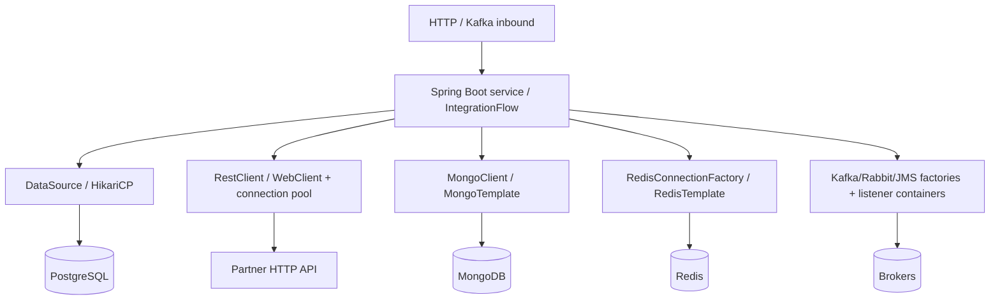
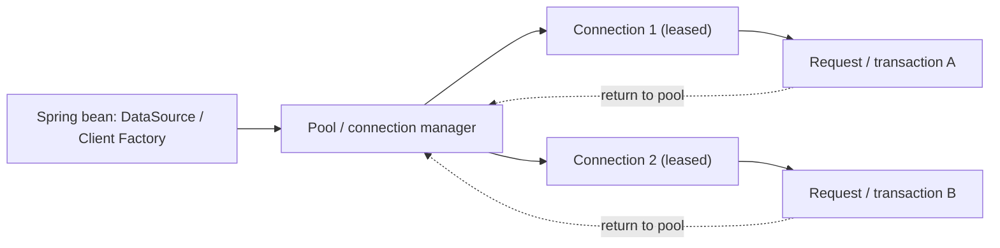
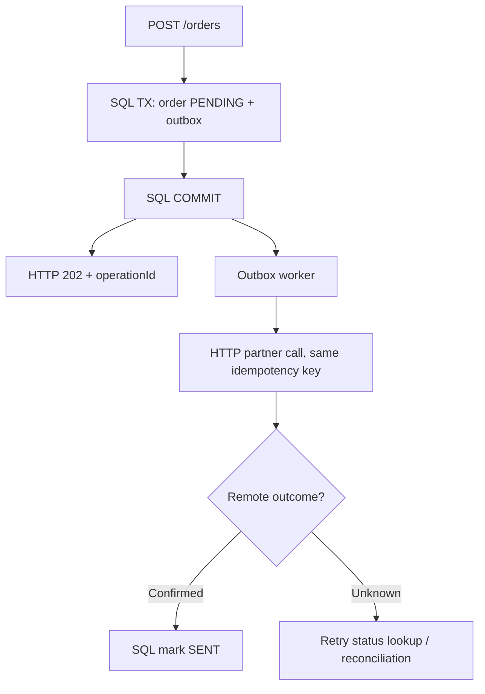
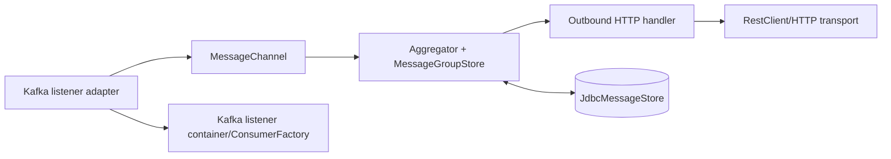
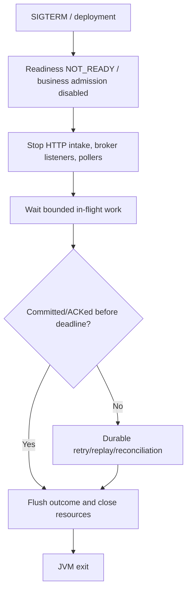
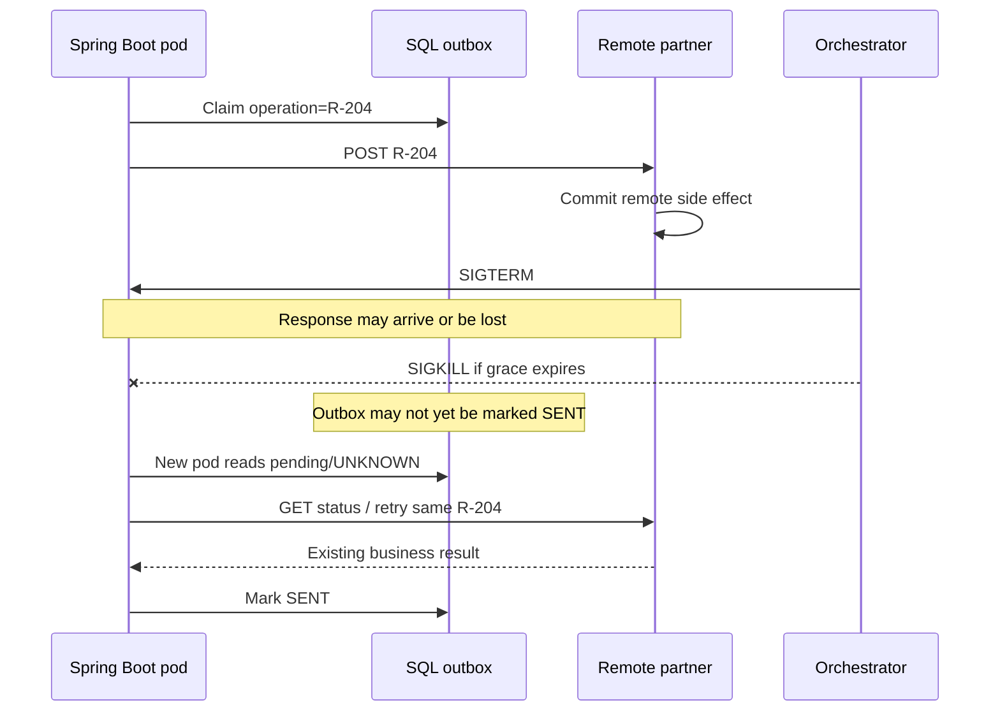

# Connection Lifecycle and Shared Resource Management

> **Chapter:** Connection Configuration  
> **Scope:** Within the **SPRING_BOOT_INTEGRATION** module, Spring Boot orchestrates integrations across HTTP clients, SQL/NoSQL databases, Redis/cache, Kafka/RabbitMQ/JMS, RSocket, and Spring Integration adapters. This lesson focuses on **who creates, who owns, who shares, and who closes connections/resources**, how to configure pools and timeouts, coordinate graceful shutdown, control errors, prevent duplicates, manage transactions, test, and observe real integration flows.

## 1. The problem: multiple connection types coexisting in one service

An order-processing service does the following:

1. Receives an HTTP request, validates it, and persists the command and outbox record to PostgreSQL.
2. Calls a partner API using `RestClient` or `WebClient`.
3. Reads/writes Redis cache for metadata.
4. Consumes events from Kafka and emits notifications via RabbitMQ.
5. Reads state from MongoDB and sends messages into a Spring Integration flow.

If every request constructs its own HTTP client, MongoDB client, or broker connection and abandons it, the system quickly hits **exhausted sockets, threads, file descriptors, connection pools, overloaded brokers, and JVMs hanging on deploy**. Conversely, sharing a single JDBC `Connection` or transaction across concurrent requests causes **cross-request state leaks** and concurrency bugs.



**Core principle:** share **factories, thread-safe clients, and pools**; never share **request-scoped or non-thread-safe connections, transactions, or sessions** unless the API explicitly permits it.

### Learning objectives

After this lesson, you will be able to:

- Distinguish **shared resources**, **pooled leases/connections**, and **per-request/per-transaction state**.
- Leverage Spring Boot auto-configuration instead of unnecessarily creating new clients or pools.
- Configure `RestClient`, `WebClient`, HikariCP, Redis, MongoDB, and broker clients with proper lifecycles.
- Use `@Bean`, `@PreDestroy`, `SmartLifecycle`, and `ContextClosedEvent` appropriately.
- Choose timeouts, concurrency limits, pool sizes, and queue capacities based on real demand.
- Avoid closing shared clients when a single request cancels or fails.
- Coordinate shutdown with in-flight HTTP/broker messages and durable outboxes.
- Design for crashes at any instant using idempotency, retries, and reconciliation.
- Use metrics and integration tests to detect connection leaks, starvation, stale connections, and shutdown issues.

## 2. Ownership model: three lifecycle levels

| Level | Examples | Who creates it? | Who closes it? |
| --- | --- | --- | --- |
| **Application-scoped** | `DataSource`, `MongoClient`, `ConnectionProvider`, `RabbitTemplate`, `KafkaTemplate`, shared `RSocketRequester` | Spring Boot auto-config or application `@Bean` | Spring context or **bean owner**, in order |
| **Operation/transaction-scoped** | Pooled JDBC `Connection`, JPA `EntityManager`, Mongo `ClientSession`, JMS `Session`, an HTTP request | Framework/service at operation time | Framework / try-with-resources / transaction boundary after the operation |
| **Subscription/task-scoped** | RSocket stream subscription, response body stream, `FileInputStream`, executor task, broker delivery | Caller/consumer/worker | Upon complete/error/cancel or when consumer finishes work |

**Ownership is a contract, not just a lifetime.** A `WebClient` instance may live for the entire app, while each `Mono` from `retrieve()` represents an individual operation. A `DataSource` lives for the entire process, while a `Connection` borrowed from it returns to the pool after each transaction.

### 2.1. The "create once, reuse many times" rule

Safe to share when the library explicitly documents thread safety/reusability:

```text
Spring bean / singleton:
  RestClient
  WebClient
  JdbcTemplate / NamedParameterJdbcTemplate
  MongoTemplate
  RedisTemplate / StringRedisTemplate
  KafkaTemplate
  RabbitTemplate
  ConnectionFactory / ProducerFactory / DataSource / MongoClient

Per operation:
  SQL transaction / Connection
  HTTP request body / response stream
  Mongo session / transaction
  JMS Session (typically not thread-safe)
  Kafka Consumer (not thread-safe)
  Reactive Subscription / RequestContext
```

This is a **general classification pattern**; always verify against the specific library version and configuration mode. For instance, mutating a request object or modifying a template's configuration at runtime can break thread safety even when the template class itself supports reuse.

### 2.2. Never store per-user state in a singleton

```java
// ANTI-PATTERN: singleton service holding the latest request's Authorization.
@Service
class UnsafePartnerClient {
    private String currentBearerToken;

    void setToken(String token) {
        this.currentBearerToken = token;
    }
}
```

Concurrent requests can overwrite each other's tokens or tenants. Use **request-local parameters**, security contexts appropriate to the execution model, or explicit message metadata with clear policies; never store credentials or request bodies in mutable fields of a singleton client.

## 3. Separating factory, pool, connection, and operation



A **pool size of 20** means at most roughly 20 physical connections **within that specific pool** (depending on implementation), not that the system only accepts 20 HTTP requests or 20 Java threads.

| Situation | What happens |
| --- | --- |
| No free connection, pool below max | Pool may open a new physical connection |
| Pool at max, all connections leased | Caller waits up to `acquire/connectionTimeout`, then fails if expired |
| Transaction succeeds and closes handle properly | Connection typically **returns to the pool**, without closing the physical socket immediately |
| DB/reverse proxy drops an idle socket | Next use may hit a stale/closed connection, requiring pool validation/eviction |
| Application context shuts down | Pool stops issuing new leases and closes physical connections per lifecycle |

**"Closing a connection" means different things**: `connection.close()` on a pooled JDBC Connection returns it to the pool, whereas `MongoClient.close()` or `ConnectionProvider.dispose()` destroys the **shared root resource**. Never call the owner's close method after each request.

## 4. Spring Bean lifecycle as the foundation of ownership

Spring Boot creates and wires many factories and pools when matching dependencies and properties are present. When Boot owns them, the framework manages bean lifecycles. When you **create additional resources manually**, you must define their destructor/stop contracts.

### 4.1. Lifecycle mechanisms

| Mechanism | Purpose | Notes |
| --- | --- | --- |
| `@Bean(destroyMethod="close")` | Registers a destroy method on a context-owned bean | Do not apply to borrowed objects or clients owned by another bean |
| `@PreDestroy` | Closes file handles or light cleanup on bean destruction | Never block indefinitely waiting for long workflows |
| `DisposableBean` | Alternative destruction callback | Unnecessary if `@Bean` `destroyMethod` suffices |
| `ContextClosedEvent` | Observes context shutdown starting | Does not guarantee in-flight work has drained |
| `SmartLifecycle` | Orders start/stop by phase, supports async stop callback | Callback must be invoked once this component's stop work completes |
| `LifecycleProcessor` / shutdown phases | Coordinates `Lifecycle`/`SmartLifecycle` beans | Timeout is **per phase**, not for the whole app |
| `server.shutdown=graceful` | Gives web server time to finish active requests | Does not drain Kafka, outbox, or custom executors automatically |

### 4.2. Spring singleton does not mean JVM-cluster global

A singleton bean is a singleton **per application context** (usually one instance per process), not shared across JVMs or pods. Three replicas maintain **three Hikari pools, three HTTP connection pools, and three Redis clients**. Calculate capacity **cluster-wide**, not per pod.

### 4.3. `@Bean` destroy method

```java
package com.example.integration.resources;

import org.springframework.context.annotation.Bean;
import org.springframework.context.annotation.Configuration;

@Configuration(proxyBeanMethods = false)
class IntegrationResourceConfiguration {

    @Bean(destroyMethod = "close")
    FileBackedCursorStore cursorStore() {
        return new FileBackedCursorStore("/var/lib/app/checkpoints");
    }
}
```

`FileBackedCursorStore` is an **illustrative application class** that implements `close()`; this snippet is not a built-in Spring API. The key takeaway: the owning bean creates the resource and registers it to close once when the context shuts down. Never instantiate `new FileBackedCursorStore(...)` inside individual handlers expecting Spring to close it.

**If a bean receives a resource owned elsewhere** (such as Boot's `DataSource`), do not call `dataSource.close()` inside the handler's `@PreDestroy`. Only the pool owner is responsible for closing the pool after consumers have stopped.

## 5. Configuration organized at the application level, not scattered per request

An illustrative local configuration:

```yaml
spring:
  datasource:
    url: ${APP_JDBC_URL:jdbc:postgresql://localhost:5432/integration_dev}
    username: ${APP_JDBC_USER:integration_app}
    password: ${APP_JDBC_PASSWORD}
    hikari:
      maximum-pool-size: 12
      minimum-idle: 2
      connection-timeout: 1500
      validation-timeout: 1000
      idle-timeout: 600000
      max-lifetime: 1800000

  lifecycle:
    timeout-per-shutdown-phase: 25s

  task:
    execution:
      shutdown:
        await-termination: true
        await-termination-period: 20s
    scheduling:
      shutdown:
        await-termination: true
        await-termination-period: 20s

server:
  shutdown: graceful

integration:
  partner:
    base-url: ${PARTNER_BASE_URL:http://localhost:8089}
    connect-timeout: 1s
    response-timeout: 3s
    max-connections: 80
    max-in-flight: 16
```

In `spring.datasource.hikari`, the numeric timeouts are **milliseconds** per Hikari's property conventions, whereas `spring.lifecycle.timeout-per-shutdown-phase` and Boot's task shutdown properties use `Duration` values such as `25s`. Always verify actual version bindings; **do not assume identical units across properties**.

`integration.partner.*` are **custom properties**; writing these keys does not make Boot configure an HTTP pool automatically. You must bind and apply them in Java configuration. Supply secrets via environment or secret managers; **never commit real passwords/tokens** to the repository.

### 5.1. `@ConfigurationProperties` for typed settings

```java
package com.example.integration.partner;

import java.net.URI;
import java.time.Duration;
import org.springframework.boot.context.properties.ConfigurationProperties;

@ConfigurationProperties(prefix = "integration.partner")
public record PartnerClientProperties(
        URI baseUrl,
        Duration connectTimeout,
        Duration responseTimeout,
        int maxConnections,
        int maxInFlight
) {}
```

```java
@Configuration(proxyBeanMethods = false)
@EnableConfigurationProperties(PartnerClientProperties.class)
class PartnerClientConfiguration {
    // HTTP client beans follow in the next section.
}
```

This is a **class snippet** requiring imports for `Configuration`, `EnableConfigurationProperties`, and the typed properties record above. Add Bean Validation or constructor checks where needed to ensure positive timeouts, `maxConnections > 0`, allowlisted URI scheme/host, and `maxInFlight <=` an appropriate downstream budget. Never let callers pass arbitrary unvalidated base URLs (SSRF risk).

## 6. RestClient: reusing the client and bean-owned HTTP pool

`RestClient` (Spring Framework 6.1+, standard in Spring Boot 3.2+) is a **blocking** HTTP client. `RestClient` is typically created once and reused across requests; individual HTTP requests and responses have their own lifecycles.

### 6.1. Simple pattern using Boot's configured builder

```java
package com.example.integration.partner;

import org.springframework.context.annotation.Bean;
import org.springframework.context.annotation.Configuration;
import org.springframework.web.client.RestClient;

@Configuration(proxyBeanMethods = false)
class SimplePartnerConfiguration {

    @Bean
    RestClient partnerRestClient(
            RestClient.Builder builder,
            PartnerClientProperties props) {
        return builder
                .baseUrl(props.baseUrl().toString())
                .build();
    }
}
```

Reuse the `partnerRestClient` bean; **never** call `RestClient.create(url)` inside a per-message loop. The simple pattern picks a request factory from dependencies/auto-configuration; when tight pool limits and explicit timeouts are required, configure a **concrete request factory/transport** as in section 6.2.

### 6.2. Apache HttpClient 5 example with connection pooling

Add `org.apache.httpcomponents.client5:httpclient5` under compatible dependency management. Then define **one pool + one client** owned by Spring:

```java
package com.example.integration.partner;

import org.apache.hc.client5.http.classic.HttpClient;
import org.apache.hc.client5.http.config.RequestConfig;
import org.apache.hc.client5.http.impl.classic.CloseableHttpClient;
import org.apache.hc.client5.http.impl.classic.HttpClients;
import org.apache.hc.client5.http.impl.io.PoolingHttpClientConnectionManager;
import org.apache.hc.client5.http.impl.io.PoolingHttpClientConnectionManagerBuilder;
import org.apache.hc.core5.util.Timeout;
import org.springframework.beans.factory.annotation.Qualifier;
import org.springframework.context.annotation.Bean;
import org.springframework.context.annotation.Configuration;
import org.springframework.http.client.HttpComponentsClientHttpRequestFactory;
import org.springframework.web.client.RestClient;

@Configuration(proxyBeanMethods = false)
public class PooledPartnerClientConfiguration {

    @Bean(destroyMethod = "close")
    CloseableHttpClient partnerApacheClient() {
        PoolingHttpClientConnectionManager manager =
                PoolingHttpClientConnectionManagerBuilder
                        .create()
                        .build();
        manager.setMaxTotal(80);
        manager.setDefaultMaxPerRoute(20);

        RequestConfig config = RequestConfig.custom()
                .setConnectionRequestTimeout(Timeout.ofSeconds(1))
                .setResponseTimeout(Timeout.ofSeconds(3))
                .build();

        return HttpClients.custom()
                .setConnectionManager(manager)
                .setDefaultRequestConfig(config)
                .evictExpiredConnections()
                .build();
    }

    @Bean("pooledPartnerRestClient")
    RestClient pooledPartnerRestClient(
            RestClient.Builder builder,
            @Qualifier("partnerApacheClient")
            CloseableHttpClient apacheClient,
            PartnerClientProperties props) {
        return builder
                .baseUrl(props.baseUrl().toString())
                .requestFactory(
                        new HttpComponentsClientHttpRequestFactory(apacheClient))
                .build();
    }
}
```

**Example limitations:** Verify Apache HttpClient 5 APIs/options against the BOM-managed version. For production readiness, also configure **connect/socket timeouts** on the connection manager/socket config per client version, TLS trust/mTLS, idle eviction policies, and HTTP client metrics. `setConnectionRequestTimeout` caps **waiting to borrow a connection from the pool**, not the TCP connect timeout; `setResponseTimeout` is the request-layer response timeout, not necessarily the overall workflow deadline.

### 6.3. Who gets to close it?

```text
Spring ApplicationContext
  owns CloseableHttpClient partnerApacheClient
     owns PoolingHttpClientConnectionManager
  exposes RestClient pooledPartnerRestClient
     borrows transport on every HTTP exchange

Business code calls:
  restClient.post()/get()
  ...consume/close response as appropriate...

On shutdown:
  stop accepting new HTTP work
  drain in-flight requests
  Spring destroys apacheClient -> closes underlying pool
```

**Never call `apacheClient.close()` in the `finally` block of a business method.** Doing so closes the shared pool after the first request, causing every subsequent request to fail with "connection pool shut down."

### 6.4. HTTP response streams must be closed

With `retrieve().body(MyDto.class)`, the HTTP client/adapter manages response cleanup once the body is consumed. However, when using `exchange(...)` or consuming raw response streams, **you are responsible for consuming/closing the stream per the API**. Never return a raw `InputStream` tied to a closed connection across boundaries without a clear ownership contract.

## 7. WebClient/Reactor Netty: connection pools and event loops

`WebClient` provides a reactive API, typically backed by Reactor Netty when matching dependencies are present. Besides a **connection pool**, Reactor Netty manages **event-loop resources**; spawning uncontrolled `HttpClient`/`ConnectionProvider`/`LoopResources` instances increases sockets, threads, and scheduling overhead.

### 7.1. Shared client with dedicated pool closed by the owning bean

```java
package com.example.integration.partner;

import java.time.Duration;
import io.netty.channel.ChannelOption;
import org.springframework.beans.factory.annotation.Qualifier;
import org.springframework.context.annotation.Bean;
import org.springframework.context.annotation.Configuration;
import org.springframework.http.client.reactive.ReactorClientHttpConnector;
import org.springframework.web.reactive.function.client.WebClient;
import reactor.netty.http.client.HttpClient;
import reactor.netty.resources.ConnectionProvider;

@Configuration(proxyBeanMethods = false)
public class ReactivePartnerClientConfiguration {

    @Bean(destroyMethod = "dispose")
    ConnectionProvider partnerConnectionProvider() {
        return ConnectionProvider.builder("partner-http")
                .maxConnections(80)
                .pendingAcquireMaxCount(160)
                .pendingAcquireTimeout(Duration.ofSeconds(1))
                .maxIdleTime(Duration.ofSeconds(30))
                .maxLifeTime(Duration.ofMinutes(5))
                .build();
    }

    @Bean("partnerWebClient")
    WebClient partnerWebClient(
            WebClient.Builder builder,
            @Qualifier("partnerConnectionProvider")
            ConnectionProvider provider,
            PartnerClientProperties props) {
        HttpClient transport = HttpClient.create(provider)
                .option(ChannelOption.CONNECT_TIMEOUT_MILLIS, 1000)
                .responseTimeout(Duration.ofSeconds(3));

        return builder
                .baseUrl(props.baseUrl().toString())
                .clientConnector(new ReactorClientHttpConnector(transport))
                .build();
    }
}
```

This requires `spring-webflux` and Reactor Netty client dependencies. `ConnectionProvider` is bean-owned; `WebClient` **need not be closed after each request**. `destroyMethod="dispose"` initiates provider disposal; if you need to **await full completion** within a finite window before JVM exit, coordinate via Reactor Netty/Spring lifecycle APIs for your version rather than assuming an async dispose call completes synchronously.

**Never dispose Reactor Netty's global resources while HTTP or RSocket traffic is still active.** When using default resources managed by Spring Boot/Reactor Netty, let their owner manage lifecycle. When creating custom providers/loops, declare ownership explicitly.

### 7.2. One connection can serve multiple requests

HTTP/1.1 keep-alive reuses connections across sequential requests; HTTP/2 multiplexes multiple streams over a single connection when supported by transport and server. Therefore:

- `maxConnections=80` does **not** mean "at most 80 concurrent HTTP requests" across all protocols.
- Pool wait timeout differs from HTTP response timeout.
- Measure actual concurrency, pending acquire queues, and HTTP/2 stream limits.
- Idle/stale connections may be closed by proxies before `maxIdleTime`.
- Reactor Netty event loops handle network I/O; **never run blocking JDBC on an event loop**.

### 7.3. WebClient does not turn blocking operations into non-blocking ones

```java
// ANTI-PATTERN: blocking JDBC inside a reactive event-loop.
webClient.get().uri("/orders/42").retrieve()
        .bodyToMono(OrderReply.class)
        .map(reply -> jdbcTemplate.queryForObject(
                "SELECT status FROM orders WHERE order_id=?",
                String.class, reply.orderId()));
```

`jdbcTemplate` is a blocking API. If it must be called from a reactive pipeline, offload **only the blocking unit** to an appropriate scheduler:

```java
Mono<String> status = webClient.get()
        .uri("/orders/42")
        .retrieve()
        .bodyToMono(OrderReply.class)
        .flatMap(reply -> Mono.fromCallable(() ->
                jdbcTemplate.queryForObject(
                        "SELECT status FROM orders WHERE order_id=?",
                        String.class, reply.orderId()))
                .subscribeOn(Schedulers.boundedElastic()));
```

This snippet requires importing `Mono` and `Schedulers` with `OrderReply`/`jdbcTemplate` defined. `boundedElastic` is not a DB connection pool and does not automatically create SQL transactions. Under high concurrency, still bound total pending work and the Hikari pool.

### 7.4. Bounding data volume during downloads

A `WebClient` deserializing millions of JSON objects via `collectList()` can trigger OOM even with a 10-connection HTTP pool. Design streaming/bounded buffers, byte limits, `Flux` backpressure, and paginated contracts. When canceling a stream, close the subscription/response resource per the API; **never dispose the shared `WebClient`/`ConnectionProvider`** just because one caller canceled.

## 8. Pool sizing: measure rather than picking arbitrarily large numbers

Too small a pool causes queuing; too large a pool creates excess sockets, DB context switching, TLS handshakes, file descriptors, and CPU overhead. Resources are finite on both the **caller** and the **server**.

### 8.1. Approximate rule of thumb

For relatively steady workloads, **Little's Law** helps estimate average concurrency:

\[
L \approx \lambda \times W
\]

- `L`: average number of in-flight operations at a stage.
- `λ`: arrival rate (operations/second).
- `W`: average time (seconds) each operation occupies that stage.

For example, if a service sends roughly **200 HTTP calls/second** and each call occupies a connection for **0.08 seconds** on average, average concurrency at this stage is around **16**. Do not assume the pool must always be exactly 16: p95/p99 latency, bursts, HTTP/2 multiplexing, retries, upstream rate limits, and headroom determine production settings.

### 8.2. Calculating totals across replicas

```text
Spring Boot replicas      = 12
Hikari max pool per pod   = 20
Potential DB connections  = 12 × 20 = 240

During a rolling deployment:
  old pods and new pods can coexist temporarily
  -> peak connection demand exceeds steady state
```

Compare against PostgreSQL `max_connections`, connections reserved for admin/maintenance, other services, transaction poolers/proxies, and failover margin. **Raising Hikari from 20 to 200 per pod will not make PostgreSQL commit transactions faster.**

### 8.3. Priority rules for choosing pool sizes

1. Measure request rates, p95/p99 latency, peak concurrency, and queue waits.
2. Know server-side limits: DB connections, partner rate limits, broker channels, Redis max clients.
3. Share one pool per **logical purpose/endpoint** where possible instead of spinning up separate pools per bean unnecessarily.
4. Bound **max in-flight** work before pools saturate completely.
5. Keep acquisition timeouts short to fail fast / apply backpressure instead of blocking threads indefinitely.
6. Test under slow dependencies, instance crashes, scaling out, and overlapping deployments.
7. Monitor saturation and tune from telemetry; do not tweak settings impulsively after every single timeout.

## 9. JDBC/HikariCP: shared DataSource, per-transaction Connection

Spring Boot JDBC usually auto-configures `HikariDataSource` when HikariCP is on the classpath and not overridden. `JdbcTemplate`, JPA/jOOQ, or Spring Batch can share the `DataSource` (when wired to the same bean), yet must never share **a single manual JDBC Connection** across concurrent threads.

### 9.1. A service using JdbcTemplate

```java
package com.example.integration.orders;

import org.springframework.jdbc.core.JdbcTemplate;
import org.springframework.stereotype.Repository;

@Repository
public class OrderReadRepository {
    private final JdbcTemplate jdbc;

    public OrderReadRepository(JdbcTemplate jdbc) {
        this.jdbc = jdbc;
    }

    public String findStatus(String orderId) {
        return jdbc.queryForObject(
                "SELECT status FROM orders WHERE order_id = ?",
                String.class,
                orderId);
    }
}
```

Never call `dataSource.getConnection()` ad-hoc and forget to close it; `JdbcTemplate` acquires and releases connections according to Spring JDBC semantics. If using raw JDBC directly:

```java
try (Connection connection = dataSource.getConnection();
     PreparedStatement statement = connection.prepareStatement(
             "SELECT status FROM orders WHERE order_id=?")) {
    statement.setString(1, orderId);
    try (ResultSet rs = statement.executeQuery()) {
        if (!rs.next()) {
            throw new IllegalStateException("Order not found");
        }
        return rs.getString(1);
    }
}
```

This snippet is **outside a Spring-managed transaction**. Inside `@Transactional`, calling raw `dataSource.getConnection()` without Spring transaction utilities can grab a different connection outside the active transaction. Prefer `JdbcTemplate` or `DataSourceUtils` when coordinating with a transaction manager.

### 9.2. Hikari timeouts, idle, and maxLifetime

| Property | Meaning | Pitfall |
| --- | --- | --- |
| `maximumPoolSize` | Upper bound on connections managed by the pool | Sum across pods can exceed DB capacity |
| `minimumIdle` | Idle connections the pool tries to retain | Not a "minimum request count"; extra idle connections consume sockets |
| `connectionTimeout` | Wait time to borrow a connection from the pool | Not the SQL query timeout |
| `validationTimeout` | Timeout for checking connection liveness when needed | Must be less than `connectionTimeout` per Hikari constraints |
| `idleTimeout` | Idle duration before a connection becomes eligible to retire (with conditions) | Does not close an actively leased connection |
| `maxLifetime` | Maximum lifetime of a pooled connection | Does not forcibly kill an in-use connection mid-transaction |
| `keepaliveTime` | Pings idle connections to avoid network/DB idle drops | Subject to minimum interval and must be under `maxLifetime` |
| `leakDetectionThreshold` | Logs warnings if a connection is held too long | Can trigger false positives on valid long transactions |

**Hikari pools JDBC connections**, not SQL execution schedulers. A transaction running 100 sequential queries can hold one connection for a long time; an `@Async` task starts a separate transaction on a different thread.

### 9.3. A connection leak means holding too long or failing to return

Bad example:

```java
// ANTI-PATTERN: borrowing a Connection and retaining it in a singleton field.
class UnsafeOrderDAO {
    private final Connection connection;

    UnsafeOrderDAO(DataSource ds) throws SQLException {
        this.connection = ds.getConnection();
    }
}
```

This connection can be shared across threads or never returned to the pool. Use `JdbcTemplate`, short transaction boundaries, and try-with-resources whenever low-level JDBC is unavoidable.

### 9.4. Transaction timeout and DB statement timeout are two different things

- **Pool acquisition timeout:** timed out waiting for a connection from the pool.
- **Connect timeout:** timed out establishing a TCP connection to the DB.
- **Statement/query timeout:** SQL statement ran too long.
- **Transaction timeout:** transaction exceeded the manager's configured budget.
- **Socket/read timeout:** client waited too long for network bytes.

Classify errors accurately instead of raising `connectionTimeout` to hide slow SQL. A query blocked on a 60-second lock will not improve by adding 100 pool connections.

## 10. Local SQL transactions do not wrap remote HTTP calls

A service wants to save an order, call a partner, and update status:

```java
@Transactional
public void submitOrder(OrderCommand command) {
    orders.insertPending(command);
    partnerRestClient.post()
            .uri("/reservations")
            .body(command)
            .retrieve()
            .toBodilessEntity();
    orders.markReserved(command.orderId());
}
```

This is a **transaction anti-pattern**, not production code to copy. The JDBC transaction holds connections and locks while waiting on partner HTTP; if HTTP times out after the partner committed, SQL rollback **cannot undo** the remote reservation.

### 10.1. Use short local transactions and an outbox



**Proper connection ownership:** the request thread uses a brief JDBC connection to commit the outbox; the worker borrows connections briefly to claim and update state, **never keeping a DB connection/transaction open across the HTTP call**. The partner HTTP client uses its own connection pool.

### 10.2. Commit before broker ACK

In a Kafka/Rabbit/JMS → SQL flow:

1. Receive message, validate schema/tenant.
2. SQL transaction writes **inbox unique event ID + business effects + outbox**.
3. Commit SQL.
4. ACK broker / commit offset per container semantics.

Crashing after SQL commit before ACK causes redelivery. Thus **idempotency + a durable inbox** are mandatory for consistency. Never pass a `Connection` from the listener thread to another thread to "keep the transaction alive across async steps."

## 11. JPA, jOOQ, and Spring Batch: same pool, different contexts

SQL abstractions each have distinct lifecycles:

| Component | Usually safe to share? | What not to do |
| --- | --- | --- |
| `DataSource`/`HikariDataSource` | Application-scoped | Do not create a separate pool per repository |
| `JdbcTemplate`/`NamedParameterJdbcTemplate` | Singleton bean, thread-safe when config is immutable | Do not retain a raw `Connection` in a singleton |
| jOOQ `DSLContext` | Injectable/reusable when wired with Spring transaction integration | Do not share a mutable `ResultQuery` being built across requests |
| JPA `EntityManagerFactory` | Application-scoped factory | Do not recreate per HTTP request |
| JPA `EntityManager` | Context-bound, typically thread-confined | Do not store a real `EntityManager` in a singleton and share it |
| Spring Batch `JobRepository` | Shared process infrastructure | Uses its own metadata schema and transactions |
| Stateful Spring Batch reader/writer | Typically Step/Job scoped | Do not share mutable cursors across concurrent `JobExecutions` |

### 11.1. Never hold a persistence context across remote workflows

A `@Transactional` JPA service binds a persistence context to the transaction. Making a 30-second HTTP call inside that transaction holds the `EntityManager`, connection, and locks, and lazy loading after context close will fail.

**Split work along boundaries:** short SQL transaction to persist business state and outbox; worker sends remote calls; short SQL transaction to record the outcome. Never rely on `OpenEntityManagerInView` to "hold a connection until the HTTP response returns" for slow integrations.

### 11.2. Spring Batch needs checkpoints, not one job-wide connection

Jobs importing millions of records should use **chunk transactions** that borrow and return JDBC connections per chunk and commit checkpoints via `JobRepository`. When a Step performs HTTP or SFTP calls, external side effects must be idempotent; **never hold one JDBC transaction open for 30 minutes** hoping a restart avoids duplicates.

As concurrent Steps/jobs scale up, check **total concurrency across Batch + HTTP + broker listeners + API** against Hikari's max pool size. Services running both Batch jobs and live HTTP traffic need pool reservations or throttling so batch jobs cannot starve live APIs.

## 12. MongoDB: shared MongoClient, per-operation ClientSession

The MongoDB Java driver maintains a **cluster topology view** and per-server connection pools. One `MongoClient` is typically created per cluster/identity config and reused application-wide by `MongoTemplate` and Spring Data repositories. Creating a client per request multiplies connections, background monitoring threads, and disrupts failover.

### 12.1. Use auto-configuration when sufficient

```yaml
spring:
  data:
    mongodb:
      uri: ${MONGODB_URI:mongodb://localhost:27017/integration_dev}
```

Spring Boot creates `MongoClient`/`MongoTemplate` from matching properties and dependencies. In production, configure TLS, auth, replica sets/sharding in the URI, and tune timeouts/pools via driver settings or `MongoClientSettings` per Boot version.

**Do not declare an extra `MongoClient` with the same connection details just for one repository** when the auto-configured client already handles it. For multiple Mongo clusters or credentials, create and name separate beans with clear owners.

### 12.2. Custom MongoClient when pool settings are needed

```java
package com.example.integration.mongo;

import java.util.concurrent.TimeUnit;
import com.mongodb.ConnectionString;
import com.mongodb.MongoClientSettings;
import com.mongodb.client.MongoClient;
import com.mongodb.client.MongoClients;
import org.springframework.beans.factory.annotation.Value;
import org.springframework.context.annotation.Bean;
import org.springframework.context.annotation.Configuration;

@Configuration(proxyBeanMethods = false)
class MongoClientConfiguration {

    @Bean(destroyMethod = "close")
    MongoClient integrationMongoClient(
            @Value("${integration.mongo.uri}") String uri) {
        ConnectionString connection = new ConnectionString(uri);

        MongoClientSettings settings = MongoClientSettings.builder()
                .applyConnectionString(connection)
                .applyToConnectionPoolSettings(pool -> pool
                        .maxSize(40)
                        .minSize(4)
                        .maxWaitTime(2, TimeUnit.SECONDS))
                .build();

        return MongoClients.create(settings);
    }
}
```

`integration.mongo.uri` is a **custom property** that must be provided. In newer MongoDB Java driver versions, some methods have updated overloads/recommendations; verify against your driver/BOM. When declaring a custom `MongoClient`, Spring Boot may back off default client auto-configuration; verify `MongoTemplate` injects **the right bean/cluster** and no unintended duplicate clients exist.

### 12.3. Connection vs. ClientSession

The MongoDB driver borrows and returns physical connections internally. For transactions:

```java
try (ClientSession session = mongoClient.startSession()) {
    session.startTransaction();
    try {
        // Run operations using the session per driver contract.
        session.commitTransaction();
    } catch (RuntimeException ex) {
        session.abortTransaction();
        throw ex;
    }
}
```

This is an **illustrative transaction session snippet**. With Spring Data transaction management, prefer `MongoTransactionManager` and `@Transactional` when the topology supports it instead of mixing raw sessions incompatibly into repository code. **Never share a `ClientSession` across threads/requests**; close it on completion or error.

### 12.4. MongoDB does not need Spring Cloud LoadBalancer

The MongoDB driver discovers replica set/sharded cluster topology and routes reads/writes according to its **read/write preferences**. Never place a round-robin HTTP load balancer in front of MongoDB to pick primaries/secondaries randomly. Let the driver's pooling and topology discovery operate directly.

## 13. Redis/Lettuce: share the factory, never misuse raw connections

Spring Data Redis typically auto-configures `RedisConnectionFactory` and `RedisTemplate`/`StringRedisTemplate`. With Lettuce, many operations share a thread-safe native connection depending on configuration, yet **transactions, blocking commands, and Pub/Sub** have distinct semantics; never assume every Redis connection object can be shared indiscriminately.

### 13.1. Cache/repository using StringRedisTemplate

```java
package com.example.integration.redis;

import java.time.Duration;
import org.springframework.data.redis.core.StringRedisTemplate;
import org.springframework.stereotype.Service;

@Service
public class PartnerMetadataCache {
    private final StringRedisTemplate redis;

    public PartnerMetadataCache(StringRedisTemplate redis) {
        this.redis = redis;
    }

    public void cacheVersion(String partnerId, String version) {
        redis.opsForValue().set(
                "partner:version:" + partnerId,
                version,
                Duration.ofMinutes(10));
    }
}
```

`StringRedisTemplate` is a reusable bean. Each operation borrows and releases Redis connections per Spring Data Redis factory semantics. Never instantiate `LettuceConnectionFactory` inside `cacheVersion`, and never call `redis.getConnectionFactory().getConnection().close()` arbitrarily after template calls.

### 13.2. Redis native connections and exceptions

Read the API contract carefully when touching raw connections:

- With `RedisConnectionFactory#getConnection()`, the caller must release it per Spring API/transaction context; never keep a raw wrapper in a singleton.
- Lettuce native connections offer specific thread-safety guarantees, but **blocking commands and Pub/Sub** generally require dedicated connections so they do not block shared traffic.
- `MULTI/EXEC`, pipelines, and callback contexts are stateful; never let two threads interleave commands from two transactions on one connection.
- Redis Cluster/Sentinel relies on Redis driver topology discovery, not HTTP load balancing.

### 13.3. Cache TTL is distinct from connection lifecycle

`TTL=10 minutes` is the lifetime of a **cache entry**. It does not mean the Redis TCP connection stays open for 10 minutes and then closes. An expired cache key never calls for `RedisConnectionFactory.destroy()`. Never run `FLUSHALL` in `@PreDestroy`: other replicas may still rely on the same Redis, and wiping the cache can trigger a stampede.

### 13.4. Redis is not implicitly a durable ledger

If code returns HTTP `202 Accepted` after only writing a task to a Redis cache with eviction/TTL, durability across restarts or node failures is not guaranteed. For business work that must not be lost, persist to a broker or SQL outbox with verified durability semantics. Using Redis for distributed locks or idempotency requires analyzing expiry, crash windows, and fencing tokens.

## 14. Kafka: shared ProducerFactory/KafkaTemplate, container-owned Consumers

Kafka clients follow two different ownership models:

- `KafkaProducer` is designed for concurrent reuse per Kafka's client contract; Spring Kafka manages producers via `ProducerFactory` and `KafkaTemplate`.
- `KafkaConsumer` is **not thread-safe**; never share one consumer across threads. Spring Kafka listener containers own Kafka consumers, poll loops, partition assignments, and ACK/commit lifecycles.

### 14.1. Spring Boot configuration

```yaml
spring:
  kafka:
    bootstrap-servers: ${KAFKA_BOOTSTRAP_SERVERS:localhost:9092}
    producer:
      acks: all
      properties:
        enable.idempotence: true
    consumer:
      group-id: order-projection
      enable-auto-commit: false
      auto-offset-reset: earliest
```

`auto-offset-reset: earliest` takes effect when **no valid committed offset exists** for a partition under Kafka semantics; it does not replay every message on every restart. In production, choose retention, consumer group IDs, and offset reset policies intentionally rather than copying `earliest` from tutorials.

`enable.idempotence=true` and `acks=all` strengthen producer guarantees within Kafka, yet **do not** make SQL or HTTP side effects exactly-once. Configure serializers, authentication, TLS, delivery/retry timeouts, and broker replication appropriately.

### 14.2. Reusable KafkaTemplate

```java
package com.example.integration.kafka;

import org.springframework.kafka.core.KafkaTemplate;
import org.springframework.stereotype.Component;

@Component
public class OrderEventPublisher {
    private final KafkaTemplate<String, String> kafka;

    public OrderEventPublisher(KafkaTemplate<String, String> kafka) {
        this.kafka = kafka;
    }

    public void publish(String orderId, String eventJson) {
        kafka.send("orders.confirmed.v1", orderId, eventJson);
    }
}
```

**This snippet is fire-and-forget in application logic**: `send(...)` returns a future and **does not prove broker acknowledgment by itself**. In production, handle completion/errors, retries/outboxes, and failure policies. Never create and close a new producer per event to avoid churn.

### 14.3. Spring Kafka listener containers own consumers

```java
@KafkaListener(
        topics = "orders.confirmed.v1",
        groupId = "order-projection")
void onConfirmed(ConsumerRecord<String, String> record,
                 Acknowledgment acknowledgment) {
    orderProjectionService.processOnce(record.value());
    acknowledgment.acknowledge();
}
```

This snippet assumes the listener container uses **manual acknowledgment mode** and `processOnce` completes its SQL business commit **before** returning. If business logic fails, do not ACK; let error handlers and DLT policies handle recovery. Do not copy this signature when auto-commit or an incompatible ACK mode is active.

**During shutdown:** container stopping and consumer poll/offset commits are managed by Spring Kafka. Avoid calling `consumer.close()` manually inside handlers or `System.exit(0)` on SIGTERM. For slow handlers, align concurrency, `max.poll.interval.ms`, task deadlines, and shutdown grace periods.

### 14.4. Kafka connections differ from HTTP pools

Kafka bootstrap addresses supply **cluster metadata**, after which the Kafka client manages broker connections and partition leadership directly. Never route Kafka broker URLs through `@LoadBalanced RestClient` or arbitrary DNS round-robin because the protocol requires reaching specific advertised broker listeners.

## 15. RabbitMQ: shared ConnectionFactory, managed channels/consumers

RabbitMQ/AMQP distinguishes **TCP connections**, **channels**, and **consumers**. One TCP connection carries multiple AMQP channels; channels maintain ordering and confirm state and should not be shared freely across threads unless supported by the API.

### 15.1. Spring AMQP uses CachingConnectionFactory

```yaml
spring:
  rabbitmq:
    host: ${RABBIT_HOST:localhost}
    port: ${RABBIT_PORT:5672}
    username: ${RABBIT_USER:guest}
    password: ${RABBIT_PASSWORD:guest}
    cache:
      channel:
        size: 25
    publisher-confirm-type: correlated
    publisher-returns: true
    listener:
      simple:
        prefetch: 20
        concurrency: 2
        max-concurrency: 4
```

Spring Boot typically auto-configures `CachingConnectionFactory` and `RabbitTemplate`. Match settings to your Spring AMQP/Boot version documentation; production must use TLS/auth and never leave `guest/guest` outside trusted local setups.

**`spring.rabbitmq.cache.channel.size=25` is a cache size**, not an automatic hard limit on total channels across all modes. Inspect `channelCheckoutTimeout`, cache mode, and live configuration to understand actual limits. Likewise, do not treat `prefetch=20` as a global per-instance backlog limit when multiple consumers exist.

### 15.2. Reusable RabbitTemplate

```java
package com.example.integration.rabbit;

import org.springframework.amqp.rabbit.core.RabbitTemplate;
import org.springframework.stereotype.Component;

@Component
class NotificationPublisher {
    private final RabbitTemplate rabbit;

    NotificationPublisher(RabbitTemplate rabbit) {
        this.rabbit = rabbit;
    }

    void publish(String routingKey, String json) {
        rabbit.convertAndSend(
                "notifications.exchange",
                routingKey,
                json);
    }
}
```

Like Kafka, returning from `convertAndSend` **does not prove the message is durable on the broker or acknowledged by a consumer**. Publisher confirms/returns, broker durability/routing, and outbox/retry require explicit policies.

### 15.3. Channel lifecycle and ACKs

Spring AMQP listener containers manage consumers and channels; under manual ACK, acknowledge on the matching channel and delivery tag **after the durable business commit**. Never capture a channel in a callback and hold it long-term in another executor ignoring thread safety and delivery lifecycles.

If a connection closes before ACK, the broker may redeliver unacked messages; **inbox idempotency** must handle replays even when the same business event arrives on a new connection or channel. Distinguish publisher confirms (broker accepted publish) from consumer ACKs (delivery processed)—they are two different contracts.

## 16. JMS: ConnectionFactory reuse, stateful Sessions

JMS providers like ActiveMQ/Artemis use `ConnectionFactory` to create JMS connections and sessions. `JmsTemplate` is reusable, and `DefaultMessageListenerContainer` manages listeners. **JMS `Session` instances are generally not thread-safe**, so never hold a `Session` in a singleton service shared across requests.

### 16.1. Role of CachingConnectionFactory

Spring JMS provides `CachingConnectionFactory` to cache sessions and related resources, yet avoid wrapping factories in multiple redundant pooling/caching layers without understanding how `JmsTemplate` and listener containers manage sessions. Some providers supply their own pooled connection factories.

**Listener container configs often require different `ConnectionFactory` and session/consumer caching than producers.** Follow provider/Spring JMS docs and test redelivery and transactions rather than applying one caching strategy blindly to all clients.

### 16.2. JMS transactions differ from SQL transactions

```text
Receive JMS delivery
  -> SQL TX: inbox + business result -> COMMIT
  -> JMS session ACK/COMMIT
```

If SQL commits and the JMS ACK is lost in a crash, the message will be redelivered. A local JMS session transaction **does not** commit atomically with a PostgreSQL transaction. XA/JTA can address parts of this depending on infrastructure, at the cost of complexity and failure recovery overhead; never assume a Boot app has distributed transactions automatically.

## 17. RSocketRequester: reuse the connection, do not dispose per stream

RSocket operates over TCP/WebSocket and supports request–response, fire-and-forget, request-stream, and request-channel. Many logical interactions share a single RSocket connection, so **connection lifetime** differs from HTTP request lifetimes.

### 17.1. Shared requester

```java
package com.example.integration.rsocket;

import org.springframework.beans.factory.annotation.Value;
import org.springframework.context.annotation.Bean;
import org.springframework.context.annotation.Configuration;
import org.springframework.messaging.rsocket.RSocketRequester;

@Configuration(proxyBeanMethods = false)
public class RSocketClientConfiguration {

    @Bean(destroyMethod = "close")
    SharedPartnerRequester sharedPartnerRequester(
            RSocketRequester.Builder builder,
            @Value("${integration.rsocket.host}") String host,
            @Value("${integration.rsocket.port}") int port) {
        return new SharedPartnerRequester(builder.tcp(host, port));
    }
}
```

```java
package com.example.integration.rsocket;

import org.springframework.messaging.rsocket.RSocketRequester;
import reactor.core.publisher.Flux;

public final class SharedPartnerRequester implements AutoCloseable {
    private final RSocketRequester requester;

    public SharedPartnerRequester(RSocketRequester requester) {
        this.requester = requester;
    }

    public Flux<OrderChange> changes(ChangeQuery query) {
        return requester.route("orders.changes.v1")
                .data(query)
                .retrieveFlux(OrderChange.class);
    }

    @Override
    public void close() {
        requester.rsocket().dispose();
    }
}
```

`OrderChange` and `ChangeQuery` are application-defined DTOs; the RSocket transport must be reachable, and codecs/auth/routes must match the server. The wrapper is the **owning bean** for the requester; `close()` runs on context destruction, **not** after each `changes(...)` call. More advanced clients with retries, reconnects, or requester pools require corresponding ownership and teardown logic rather than assuming one socket suffices.

### 17.2. Canceling one stream must not close the shared requester

```java
Flux<OrderChange> firstTen = requester.changes(query)
        .take(10);
```

`take(10)` cancels the upstream subscription once 10 elements arrive. It must **never be treated** as a signal to "close the RSocket connection and all other streams." When draining during shutdown, decide which streams finish or cancel, persist checkpoints, and dispose the requester **after** in-flight work settles within the deadline.

### 17.3. Reconnect does not replace idempotency

RSocket resume is a conditional protocol feature requiring proper setup; a fresh connection or retried request-stream can replay prior events. When writing stream items to SQL, checkpoints must reflect **business commits**, not merely items read off the socket. On request–response payment/booking calls, timeouts or cancellations do not prove the remote side did not commit.

## 18. Spring Integration: endpoints create and own consumer resources

In Spring Integration, an `IntegrationFlow` can connect HTTP inbound/outbound, JDBC, Kafka/RabbitMQ, Redis, SFTP, file pollers, and `MessageChannel`s. **Channels do not automatically own every connection**: adapters/endpoints, client factories, listener containers, schedulers, and executors each have distinct lifecycles.



### 18.1. Stopping in order from sources to downstream

During shutdown:

1. Close the **admission gate** so no new business operations are accepted.
2. Stop `@KafkaListener`, Rabbit/JMS inbound adapters, and pollers/schedulers claiming jobs.
3. Allow already-accepted messages to finish within a deadline.
4. Commit SQL/inbox/outbox and send ACKs per contract before resources close.
5. Stop/dispose outbound clients, connection pools, and transports.
6. Close owner-managed datasource, cache, and broker resources.

**This is the target logical order**, not a guarantee that frameworks invoke all callbacks in this exact sequence automatically. Verify lifecycle phases and stop contracts for your concrete endpoints.

### 18.2. DirectChannel and ExecutorChannel differ in threads and transactions

`DirectChannel` normally invokes handlers on the sender's thread, allowing transaction context propagation across synchronous steps with the right manager. `ExecutorChannel` dispatches work to another thread, meaning **thread-bound JDBC transactions no longer apply** in downstream handlers. Never pass a transaction-scoped `Connection` through a channel inside message headers.

### 18.3. Persistent message stores do not replace a business outbox

`JdbcMessageStore` can persist aggregator state and `JdbcChannelMessageStore` can back a `QueueChannel` per its semantics, yet once a message is released, the business handler may still crash before committing. Whenever outputs trigger remote side effects, maintain **durable results/outbox/idempotency** and reconciliation for crash windows.

## 19. Files/SFTP and non-pool resources

A file integration flow manages `InputStream`s, parsers, and remote SFTP sessions. These are **resources that must be closed**, even though they do not behave like HTTP or JDBC pools.

| Resource | Typical owner | Rule |
| --- | --- | --- |
| `InputStream`/`BufferedReader` | File-processing worker | Close on complete/error/cancel; use try-with-resources |
| SFTP `SessionFactory` | Application/adapter bean | Reuse factory per supported caching/ownership |
| SFTP `Session` | Remote operation/adapter callback | Return to cache or close per API; never retain in singleton |
| File polling watcher/scheduler | Spring Integration endpoint/task scheduler | Stop polling before closing files or session factory |
| Serializer/compressor streams | Single record/batch/request | Flush/close per output completion semantics |

### 19.1. File success requires atomic publishing

Closing a `FileOutputStream` after writing does not guarantee the file reached the partner or downstream committed it. A common pattern:

```text
Write report.tmp
  -> flush/close
  -> verify checksum/record count
  -> atomic rename on same filesystem if supported
  -> record manifest + business status
  -> partner picks up report.csv
```

With SFTP, rename atomicity depends on the server, filesystem, and protocol; never assume atomic cross-directory renames on every server. On retries, use stable file IDs/checksums to avoid sending duplicate files.

## 20. ThreadPoolTaskExecutor and TaskScheduler: bounded queues

Connection pools are only half the story. If 5,000 concurrent threads/tasks contend for **12 JDBC connections**, the rest queue up or time out. That causes thread starvation even when database CPU looks idle.

### 20.1. Spring-owned custom executor

```java
package com.example.integration.workers;

import org.springframework.context.annotation.Bean;
import org.springframework.context.annotation.Configuration;
import org.springframework.scheduling.concurrent.ThreadPoolTaskExecutor;

@Configuration(proxyBeanMethods = false)
public class WorkerPoolConfiguration {

    @Bean("integrationWorkerExecutor")
    ThreadPoolTaskExecutor integrationWorkerExecutor() {
        ThreadPoolTaskExecutor executor =
                new ThreadPoolTaskExecutor();
        executor.setCorePoolSize(8);
        executor.setMaxPoolSize(8);
        executor.setQueueCapacity(100);
        executor.setThreadNamePrefix("integration-worker-");
        executor.setWaitForTasksToCompleteOnShutdown(true);
        executor.setAwaitTerminationSeconds(20);
        return executor;
    }
}
```

Spring manages lifecycle, initialization, and shutdown for `ThreadPoolTaskExecutor` beans; manually instantiated executors outside the context must be initialized and shut down explicitly. **`setWaitForTasksToCompleteOnShutdown(true)` may let already-queued tasks run during shutdown** depending on version and Spring lifecycle behavior; if new tasks perform HTTP side effects while grace deadlines are tight, this may not fit. Enforce explicit **intake/admission stopping** instead of equating "await termination" with "stop accepting new jobs."

### 20.2. Bounded queue capacity protects the system

`queueCapacity=100` prevents unbounded RAM growth, yet once full it triggers **task rejection** or backpressure depending on executor and caller. Callers need an explicit policy: HTTP 429/503, broker nack/retry, durable outbox, or immediate rejection. Never silently drop business work just to keep a queue-size gauge at 0.

### 20.3. Using Boot-managed executors when appropriate

```yaml
spring:
  task:
    execution:
      pool:
        core-size: 8
        max-size: 16
        queue-capacity: 100
      shutdown:
        await-termination: true
        await-termination-period: 20s
```

These properties apply to **Boot's auto-configured executor** subject to version conditions and classpath beans. They do **not automatically** govern `ExecutorService` instances created with `Executors.newFixedThreadPool()`, nor a custom `ThreadPoolTaskExecutor` declared as in section 20.1. Task schedulers have their own `spring.task.scheduling.*` group.

### 20.4. Scheduled tasks and pollers

If `@Scheduled` claims outbox jobs, stop scheduling before closing the `DataSource` or HTTP client. When pollers read from brokers or SQL, cap batch sizes and poll concurrency; never scan or claim millions of pending jobs right before shutdown. Any non-durable in-memory queue must be evaluated against `SIGKILL`.

## 21. Graceful shutdown: stop accepting new work before closing pools

An ideal shutdown does not start with `dataSource.close()`. When the application receives SIGTERM:



This is a **target sequence**, not a guarantee that every framework invokes hooks in this exact order. Web servers, listener containers, schedulers, and bean destruction span separate lifecycles; coordinate owners, dependencies, and test on your exact Spring Boot version.

### 21.1. Enabling web graceful shutdown

```yaml
server:
  shutdown: graceful

spring:
  lifecycle:
    timeout-per-shutdown-phase: 25s
```

`server.shutdown=graceful` enables web server graceful shutdown per implementation; it **does not automatically drain Kafka consumers, outbox schedulers, or long-lived RSocket streams**. `timeout-per-shutdown-phase` applies **per phase**, not as a total JVM cap. A custom bean blocking inside `@PreDestroy` can still drag out shutdown.

### 21.2. Closing the admission gate via ContextClosedEvent

```java
package com.example.integration.lifecycle;

import org.springframework.context.event.ContextClosedEvent;
import org.springframework.context.event.EventListener;
import org.springframework.stereotype.Component;

@Component
public class AdmissionGate {
    private boolean accepting = true;
    private int acceptedInProgress;

    public synchronized boolean tryEnter() {
        if (!accepting) {
            return false;
        }
        acceptedInProgress++;
        return true;
    }

    public synchronized void leave() {
        if (acceptedInProgress <= 0) {
            throw new IllegalStateException("Unbalanced exit");
        }
        acceptedInProgress--;
    }

    public synchronized int inProgress() {
        return acceptedInProgress;
    }

    @EventListener(ContextClosedEvent.class)
    public synchronized void stopAccepting() {
        accepting = false;
    }
}
```

This gate tracks **only work explicitly wrapped by `tryEnter()/leave()`**. It has no automatic visibility into Kafka deliveries, HTTP streams, or outbox jobs. To coordinate those, listener and poller adapters must stop intake and use dedicated trackers or valid lifecycle callbacks.

### 21.3. Using the gate in a synchronous API

```java
@PostMapping("/integration/operations")
ResponseEntity<?> accept(@RequestBody NewOperation command) {
    if (!gate.tryEnter()) {
        return ResponseEntity.status(503)
                .header("Retry-After", "10")
                .body("Instance is draining");
    }
    try {
        String operationId = submissionService.persistAccepted(command);
        return ResponseEntity.accepted()
                .body(new AcceptedOperation(operationId, "PENDING"));
    } finally {
        gate.leave();
    }
}
```

This is a **controller method skeleton** with injected `gate` and `submissionService`; `NewOperation` and `AcceptedOperation` are application DTOs. `persistAccepted` must commit a **durable job/outbox** before returning 202, with validation, authorization, and a stable idempotency key. On DB errors, return an error response rather than 202.

**With WebFlux or async MVC**, a `try/finally` around a method returning `Mono`/`DeferredResult` finishes **before the asynchronous work completes**. Tie counter release to **subscription termination/cancellation** or async completion handlers instead of copying the synchronous MVC pattern verbatim.

## 22. SmartLifecycle: phased stopping without prematurely closing dependencies

`SmartLifecycle` is Spring's contract for starting/stopping components and asynchronous stop callbacks. Generally, **higher phases start later and stop earlier**; Spring's lifecycle processor waits for callbacks across beans in each phase.

### 22.1. Example owner stopping only new batch claims

```java
package com.example.integration.lifecycle;

import java.util.concurrent.atomic.AtomicBoolean;
import org.springframework.context.SmartLifecycle;
import org.springframework.stereotype.Component;

@Component
public class OutboxAdmissionLifecycle implements SmartLifecycle {
    private final AtomicBoolean running = new AtomicBoolean();

    @Override
    public void start() {
        running.set(true);
    }

    @Override
    public void stop() {
        running.set(false);
    }

    @Override
    public void stop(Runnable callback) {
        running.set(false);
        callback.run();
    }

    @Override
    public boolean isRunning() {
        return running.get();
    }

    @Override
    public int getPhase() {
        return 100;
    }

    public boolean mayClaimJob() {
        return running.get();
    }
}
```

**Intentional limitation:** this bean is responsible solely for **stopping new batch claims**. Invoking `callback.run()` immediately after flipping the flag fits **only that responsibility**. It **does not prove in-flight outbox jobs have drained**. When a component owns active worker tasks that must finish, invoke the callback **only after workers drain or abort per policy**—never invoke it early while claiming shutdown is clean.

`getPhase()=100` is illustrative, **not a magic number**. Inspect the phases of listener containers, HTTP servers, schedulers, DataSource/resource owners, and dependent beans; test real shutdowns. When beans inject resources from other beans, dependency graphs also govern destruction order.

### 22.2. Never wait indefinitely inside `@PreDestroy`

```java
// ANTI-PATTERN:
@PreDestroy
void stop() {
    while (activeJobs.get() > 0) {
        Thread.sleep(1000); // can wait forever
    }
}
```

This snippet omits `InterruptedException` handling and any deadline; it exists only to illustrate a design flaw. An unbounded destroy hook can cause the orchestrator to forcibly kill the process. Instead, stop intake first, perform a **bounded drain** within your shutdown budget, and let durable pending work recover after restart.

### 22.3. When stopping asynchronously

A `SmartLifecycle.stop(Runnable callback)` implementation may use another worker to wait for in-flight tasks. Ensure **that executor is still alive**, handle task rejection, and invoke the callback **exactly once** when stop responsibilities finish. Never schedule the callback onto an executor already destroyed in an earlier phase.

## 23. Kubernetes and process termination budgets

In Kubernetes, when a pod terminates, the runtime enforces a **termination grace period**. If the app fails to exit before that deadline, the process is killed without finishing `@PreDestroy`, flushes, or ACKs.

```yaml
apiVersion: apps/v1
kind: Deployment
metadata:
  name: orders-integration
spec:
  replicas: 3
  selector:
    matchLabels:
      app: orders-integration
  template:
    metadata:
      labels:
        app: orders-integration
    spec:
      terminationGracePeriodSeconds: 90
      containers:
        - name: app
          image: example/orders-integration:1.0.0
          ports:
            - containerPort: 8080
          readinessProbe:
            httpGet:
              path: /actuator/health/readiness
              port: 8080
            periodSeconds: 5
```

This manifest illustrates lifecycle and readiness only; it **is incomplete for production security, resources, and health probes**. `terminationGracePeriodSeconds` includes `preStop` hooks (if any), endpoint propagation, application shutdown, and JVM exit. Cumulative shutdown phase and await timeouts can easily overrun this budget.

### 23.1. Budgeting against wall-clock time

```text
Total K8s grace                  = 90s
Endpoint propagation / preStop   = ~5s (if configured)
Stop intake                      = ~3s
Max bounded drain                = ~60s
Close resources + JVM exit       = ~10s
Safety margin                    = remaining time
```

This breakdown is **an example**; measure against real workloads, server implementations, and infrastructure. **Never** set `spring.lifecycle.timeout-per-shutdown-phase=25s` and assume the JVM exits within 25 seconds total: multiple phases can wait sequentially.

### 23.2. SIGKILL and OOM bypass graceful hooks

A design that is safe only when `@PreDestroy` runs is **insufficient**. On `SIGKILL`, node crash, or OOM, in-memory tasks/queues vanish, remote HTTP side effects may be left **UNKNOWN**, and broker messages may redeliver. Persist obligations durably and test restarts/replays with all cleanup hooks bypassed.

## 24. Cancellation, timeouts, and per-operation resource ownership

An HTTP caller timing out or a reactive stream canceling **does not automatically mean**:

- The remote SQL transaction rolled back.
- The Kafka publish was erased from the log.
- The Redis write did not occur.
- The SFTP upload left no file.
- The JDBC connection already returned to the pool.
- The shared RSocket connection should be disposed.

### 24.1. Boundary reference table

| Signal | What it can stop | What it does not prove |
| --- | --- | --- |
| HTTP request timeout | Caller stops waiting for the response | That remote side effects did not commit |
| Reactor `cancel()` | Subscription stops requesting more items | That all async/background tasks were undone |
| Hikari acquisition timeout | Failed to borrow a JDBC connection before deadline | That any running SQL query was canceled |
| Mongo client socket timeout | Network operation did not finish cleanly | That the database did not apply the write |
| Kafka consumer stop | Stops polling/dispatching per container semantics | That SQL changes committed atomically with offset |
| Rabbit channel close | Unacked deliveries may be requeued | That publisher confirms succeeded |
| RSocketRequester dispose | Closes underlying connection and streams | That the partner rolled back operations |
| Spring `ContextClosedEvent` | Application shutdown has started | That all beans stopped and all resources closed |

### 24.2. Lifetime of a response body stream

When downloading large files via an HTTP client:

1. The client and pool are singletons.
2. Each response body stream belongs to **one HTTP operation**.
3. Consume the stream with bounded buffers into a temporary file.
4. Close the body stream on completion, error, or cancellation.
5. Record the manifest/checksum and update state inside a business transaction.
6. Never close the singleton HTTP client inside the download method's `finally` block.

If the caller disconnects, decide whether **downloads resume via `Range`/`ETag` or restart**; never treat a partial file as complete.

## 25. Secret rotation, TLS, and "long-lived existing connections"

Updating a secret or certificate does not automatically make existing pooled connections adopt the new credentials or certificates.

### 25.1. Typical rotation sequence

```text
T0: Secret version 1 active; pool holds v1 connections
T1: Provision secret version 2; backend accepts both v1 and v2
T2: Reload/reconfigure new client or recreate pool per policy
T3: Old connections drain/evict within deadline
T4: Verify new client authenticates with v2
T5: Revoke secret version 1 after overlap window
```

**Never assume** changing an environment variable while the JVM runs updates `DataSource`, `MongoClient`, or `RabbitConnectionFactory` credentials automatically. Depending on the API, you may need to rebuild clients/pools, rotate via a capability provider, or perform a rolling restart.

### 25.2. Avoiding outages on active traffic

- Include an **overlap credential window** when the backend supports it.
- Set appropriate max connection lifetimes/retirement so older sockets cycle out over time.
- Monitor health and metrics to verify canary pools authenticate cleanly.
- **Never close the old pool while in-flight tasks have not drained**; enforce a deadline if old credentials are about to expire.
- Issue distinct secrets per HTTP partner, MongoDB, Redis, and broker rather than one shared admin credential.
- Verify TLS peer identity, CA chains, mTLS certificate lifecycles, and service audiences.

### 25.3. TLS trust changes are more than a config string

`RestClient`, Reactor Netty, Redis, Mongo, and AMQP drivers expose different TLS configuration APIs. When a partner certificate expires, **never "fix" it by disabling hostname verification or enabling trust-all SSL**. Establish clear truststore/mTLS ownership, rotate properly, and test handshakes in an environment matching production routing and identity.

## 26. Multi-tenant, multi-cluster, and caching clients by identity

A multi-tenant integration system may call different partners per tenant. There are three options:

| Design | Useful when | Risks |
| --- | --- | --- |
| Shared client/transport, per-request credentials | Same endpoint/trust domain and HTTP client allows per-request auth | Must never leak tenant A's token to tenant B |
| One client/pool per bounded partner/credential set | TLS/auth/proxy/pool policies differ clearly | Multiple pools consume sockets, threads, and memory |
| Dynamic per-tenant client/pool creation without bounds | Only with strictly controlled lifecycle and cache eviction | Thousands of tenants → thousands of pools, exhausted FDs |

### 26.1. Avoiding per-tenant connection pool explosion

```text
500 tenants
× 1 MongoClient + 1 Redis factory + 1 HTTP pool / tenant
× 10 idle connections / pool
= 15,000 idle connections (illustrative example)
```

This rough calculation is **only to show scale**, before counting driver monitor threads and cluster members. If separate credentials/pools are genuinely required, enforce quotas, LRU/TTL eviction with safe closing, reference counting, or an owner ensuring active clients are never closed mid-use. Never spin up a fresh client per tenant request and leave cleanup to GC.

### 26.2. Include tenant scope in business keys

An outbox record or Kafka event ID is sometimes unique **only per tenant**. Use composite keys such as `(tenantId, operationId)` in inbox/ledger tables; derive tenant identity from authenticated principals or trusted metadata, never blindly trusting arbitrary strings from HTTP callers.

### 26.3. Preventing SSRF and cross-tenant routing

Never take `partnerBaseUrl` from a JSON body and feed it into a shared `WebClient`; that opens access to `localhost`, cloud metadata services, Redis admin ports, or internal pods. Map **allowlisted partner IDs → configured endpoints**, validate URI schemes, hosts, network boundaries, and TLS identities.

## 27. Observing pool and resource lifecycles

Pool troubles typically show up first in **queue wait times and in-flight counts**, not just total open connections.

| Metric / signal | Meaning |
| --- | --- |
| Hikari `active`, `idle`, `pending`, `max` | Is the pool busy or saturated? |
| JDBC acquisition time / timeouts | How long are threads waiting for a connection? |
| SQL query/transaction duration | Are connections held by slow queries or locks? |
| HTTP pool active/idle/pending acquire | Is the outbound client queuing pending requests? |
| HTTP connect vs. response latency | Is latency in TCP/TLS or remote processing? |
| Reactor Netty event-loop pending tasks | Are blocking calls or heavy CPU mappings running on event loops? |
| Mongo pool checked-out / wait queue | Slow Mongo queries or client overprovisioning? |
| Redis command latency, connections, reconnects | Hot keys, network errors, or blocking commands? |
| Kafka producer send/ack latency, consumer lag | Slow broker throughput, retries, or poll processing? |
| Rabbit channel/connection count, unacked deliveries | Channel churn, prefetch limits, or slow consumers? |
| Executor active threads, queue depth, rejected tasks | Queue saturation upstream of pools/DB? |
| RSocket active connections/streams, cancellations | Are long-lived connections cleaned up properly? |
| Shutdown duration, unfinished jobs, forced kills | Are stop budgets and recovery adequate? |

These names represent **metric groups to observe**, not exact series names present in every Boot version. Use Actuator/Micrometer and driver-specific metrics; enable instrumentation on each resource owner.

### 27.1. Hikari leak detection is not the only signal

`leakDetectionThreshold` warns when a connection stays checked out too long, though valid long transactions can trigger it too. Conversely, repeated short leaks may accumulate without tripping a high threshold. Combine:

- Query/transaction traces and timings.
- `active/pending` connection counts and pool acquisition errors.
- Thread dumps when requests hang.
- Database-side active sessions, locks, and `idle-in-transaction` states.
- Code reviews of exception, cancellation, and early-return paths.

**Never log SQL parameters containing PII or tokens** in production just to debug pools. Use SQL fingerprints and correlation IDs.

### 27.2. Metric cardinality

Avoid using `orderId`, arbitrary `tenantId`, `eventId`, raw URLs/hosts, or user IDs as metric labels. Instead use:

```text
client=partner-payments
pool=partner-http
operation=reserve
outcome=timeout
backend_type=http
route=/reservations
```

Never place dynamic pod IPs or millions of operation IDs in metric labels; use distributed tracing with proper retention and security policies to investigate individual requests.

### 27.3. Example ownership-aligned shutdown logs

```text
event=drain_start instance=orders-pod-12
event=kafka_intake_stopped in_flight=8
event=outbox_claim_stopped in_flight=3 pending_durable=204
event=drain_progress http_active=2 jdbc_active=5 outbox_active=1
event=clients_disposing reactor_provider=partner-http
event=jdbc_pool_closed pool=orders-db
event=shutdown_complete elapsed_ms=17800
```

These events are an **instrumentation example**, not logs automatically emitted by Spring. "Pool closed" does not prove durable broker/outbox backlogs are zero; it only indicates that resource owner finished its stop phase.

## 28. Failure matrix: different symptoms can share one root cause

| Symptom | Common cause | Verification and fix |
| --- | --- | --- |
| Hikari `Connection is not available, request timed out` | Long-held connection, tiny pool, DB lock, or leak | Check active/pending counts, query times, idle-in-transaction |
| PostgreSQL `too many connections` | Sum of pools × pods exceeds DB capacity | Budget connections cluster-wide with rollout margin |
| HTTP `Connection pool shut down` | Owning bean closed by another handler/request | Search for `close()/dispose()` in request paths |
| HTTP pending acquire timeout | Pool saturated, slow partner, retry amplification | Cap in-flight calls, timeouts, inspect pool metrics |
| Reactor Netty event loop blocked | Blocking JDBC/I/O inside `map/doOnNext` | Thread dumps, BlockHound/tests, offload to scheduler |
| HTTP responses reset during deploy | Pool/web server disposed before draining, stale connections | Fix lifecycle order, graceful shutdown, readiness |
| MongoDB connection count climbs steadily | New `MongoClient` per request/tenant never closed | Audit client beans, sockets, monitor threads |
| Mongo `WaitQueueTimeoutException` | Driver pool saturated, slow queries, tight `maxWait` | Inspect Mongo pool metrics and slow queries |
| Redis timeouts on cache misses | Blocking/pubsub misusing shared resource, Redis overloaded | Check client config, server latency, connection lifecycle |
| Duplicate Kafka messages after pod restart | SQL committed before offset commit (normal redelivery) | Inbox unique key, manual ACK/commit policy |
| Kafka consumer constantly rebalancing | Handler blocks past `max.poll.interval.ms`, session issues | Check consumer lag, `max.poll.interval.ms`, partition ownership |
| RabbitMQ unacked count growing | Slow handlers, large prefetch, misconfigured manual ACK | Adjust concurrency, ACK/commit timing, DLQ policy |
| Rabbit channel count climbing | Creating channels/connections per request without caching/closing | Check `CachingConnectionFactory` metrics and ownership |
| JMS session errors | Sharing JMS `Session` across threads, premature close | Fix listener/container threading and session caching |
| RSocket streams killed when one request cancels | Disposing shared requester inside `doFinally` | Separate stream cancellation from owner teardown |
| Scheduler still sends after SIGTERM | Unmanaged custom executor, intake stopped too late | Use `SmartLifecycle`, `ContextClosedEvent`, task shutdown |
| Redis/Mongo auth fails after credential change | Old pool holds v1 connections/credentials | Implement rotation lifecycle and pool recreation |
| HTTP succeeds yet broker event lost | SQL, ACK, and publish not durably coordinated | Transactional outbox, broker confirms, reconciliation |

**Never fix every failure by raising pool sizes or timeouts.** Pool exhaustion is often a **symptom** of SQL locks, slow downstreams, retry storms, or long transactions. Expanding pools can overload databases and partners even faster.

### 28.1. Pool starvation investigation steps

1. Identify the exact resource: Hikari, Apache HTTP, Reactor Netty, Mongo, Redis, or channel pool.
2. Confirm **which bean owns that pool**, its scope, and target endpoint/identity.
3. Measure checked-out connections, pending queues, and hold times.
4. Capture thread dumps/traces for operations holding resources.
5. Inspect SQL locks, backend latencies, TCP resets, and token expirations.
6. Check for repeated client creation, missing closes, early returns, or infinite retries.
7. When throttling concurrency or bounding queues, enforce durable retry/ack policies instead of dropping work.
8. Test under staging/production-like load before tuning pools and timeouts.

### 28.2. Never treat "server timed out" as "no state needs saving"

An HTTP client can time out after a remote POST has already succeeded. If the caller logs only a connection error without recording operation state, the application cannot tell whether to retry or reconcile. For payments, orders, and file transfers, persist an operation ID, payload fingerprint, last attempt, and **UNKNOWN** status whenever outcome confirmation fails.

## 29. Testing ownership and lifecycle with integration tests

### 29.1. Layered test checklist

| Test layer | What to prove |
| --- | --- |
| Client factory unit test | Same Spring bean/client is injected across consumers; config matches |
| HTTP transport pool test | Two requests reuse the pool without closing after the first |
| WebClient cancel test | Canceling one stream does not dispose shared pool/requester |
| Hikari exhaustion test | Times out cleanly when max connections are held; zero leaks after error |
| SQL transaction test | Connections release after commit, rollback, and exceptions |
| Mongo lifecycle test | Single `MongoClient` reused; sessions close after operations |
| Redis lifecycle test | Template reused; cache TTL does not destroy the factory |
| Kafka/Rabbit/JMS redelivery test | No ACK before business commit; idempotent replay |
| Spring Integration flow test | Endpoints stop before resource owners destroy |
| Executor rejection test | Full queue returns HTTP 503 or durable retry, no silent drop |
| Graceful shutdown test | In-flight finishes, intake stops, pools close last |
| SIGKILL test | Accepted work recovers even without cleanup hooks |
| Secret rotation test | New connections use new credentials; old connections drain |
| Multi-replica test | Combined pools stay within backend capacity; rolling overlap verified |

**Mock-only tests cannot prove sockets or pools close properly.** Use real backends or Testcontainers, socket-backed mock HTTP servers, and actual process/container stops.

### 29.2. Testing RestClient bean reuse

```java
package com.example.integration.partner;

import static org.assertj.core.api.Assertions.assertThat;

import org.junit.jupiter.api.Test;
import org.springframework.beans.factory.annotation.Autowired;
import org.springframework.boot.test.context.SpringBootTest;
import org.springframework.web.client.RestClient;

@SpringBootTest
class RestClientOwnershipIT {
    @Autowired
    RestClient partnerRestClient;

    @Autowired
    PartnerGateway gateway;

    @Test
    void usesApplicationScopedClient() {
        // Test skeleton: PartnerGateway is an app-defined class
        // configured to inject this exact RestClient.
        assertThat(partnerRestClient).isNotNull();
        assertThat(gateway).isNotNull();
        // Verify identity/injection via config or a test-only accessor;
        // do not merely compare two DTO responses.
    }
}
```

**This is a wiring test skeleton**, not proof of network pool reuse. With multiple `RestClient` beans, add `@Qualifier`; if no single `partnerRestClient` bean exists, injection will fail. Verify real pooling using live HTTP test servers and transport metrics.

### 29.3. Testing JDBC connection release after exceptions

```java
@Test
void jdbcConnectionIsReleasedAfterFailure() {
    // Test setup injects HikariDataSource ds.
    int before = ds.getHikariPoolMXBean().getActiveConnections();

    assertThatThrownBy(() -> service.failInsideTransaction())
            .isInstanceOf(RuntimeException.class);

    // In an isolated environment, wait briefly if needed for operations to settle.
    await().untilAsserted(() ->
            assertThat(ds.getHikariPoolMXBean().getActiveConnections())
                    .isEqualTo(before));
}
```

This snippet lives **inside a test class** using AssertJ and Awaitility (optional dependency) with `ds` and `service` supplied by test setup. If concurrent operations run, asserting `active == before` can flake due to noise; isolate the test database/container and verify transaction scopes and pool metrics accordingly.

### 29.4. Testing bounded pool saturation

Test design:

1. Configure a Hikari pool with `max=2` against PostgreSQL Testcontainers.
2. Two workers borrow connections and hold them via latches with short test timeouts.
3. A third worker requests a connection and asserts a finite `connectionTimeout`.
4. Release both latches inside `finally`.
5. Assert the pool recovers and subsequent tests borrow connections cleanly.
6. Never use unbounded `Thread.sleep` or leave transactions hanging in CI.

**Never call `DataSource.getConnection()` without try-with-resources inside tests themselves.** Any test simulating leaks must clean up in `finally` to avoid poisoning the rest of the suite.

### 29.5. Testing HTTP pooling with reuse and timeouts

Run a real stub HTTP server (WireMock/MockWebServer or test server) where request #1 returns 200, request #2 returns 503 or delays, and request #3 returns 200:

- After request #2, the pool continues serving request #3.
- Connect/response/pool acquisition timeouts behave within expected bounds.
- When the server closes keep-alive connections, the client opens replacements without retaining stale resources indefinitely.
- One slow request cannot exhaust the pool when `maxInFlight` caps concurrency.
- Closing the Spring context triggers the owner's close callback and rejects new work.

**Avoid asserting "the exact same TCP socket must be reused" in every test**: HTTP versions, keep-alive rules, proxies, and pool policies vary. Assert behavior and metrics rather than fragile socket identities.

## 30. Testing shutdown and forced kills at exact failure points

A process-level integration test can:

1. Run the Spring Boot service as a **separate process/container** against real SQL/broker instances.
2. Submit a command that the application **commits to the outbox**.
3. Let the worker start an HTTP call to a slow stub.
4. Send SIGTERM and verify the app **stops claiming** new jobs.
5. Have the stub respond within the grace period; verify the worker persists the result and pools close afterward.
6. Repeat with an unresponsive stub; let the grace period expire and send **SIGKILL**.
7. Start a new instance; observe outbox `UNKNOWN/RETRY_WAIT` status, reconciliation, and retries reusing the idempotency key.
8. Audit the partner ledger: at most one business side effect per operation ID despite multiple request attempts.



**What the test must prove:** clean resource closing reduces disruption during rolling deployments, yet **protection against lost or duplicated business side effects must hold even when shutdown hooks never run**.

### 30.1. Verifying lifecycle callbacks

A test calling `applicationContext.close()` verifies that:

- `ContextClosedEvent` closes the admission gate.
- `SmartLifecycle.stop(Runnable)` is invoked.
- Owning beans / `@PreDestroy` close clients and pools.

However, closing the context **does not simulate** `SIGKILL`, pod eviction, load balancer propagation, broker rebalances, or half-open TCP sockets. Supplement with process/Kubernetes-level tests for true operational confidence.

### 30.2. Do not hard-code internal shutdown orders in tests

Do not assert a rigid sequence of internal framework class names that might shift across Boot releases. Test **invariants** instead:

```text
After drain_start:
  No new jobs are claimed by the stopping process.
  Resource clients stay open while already-accepted handlers still need them.
  Every durable accepted job commits or recovers on retry after restart.
  Pools do not leak on exceptions, cancellations, or timeouts.
```

As long as invariants hold, exact internal ordering can safely evolve with Spring lifecycle phases and versions.

## 31. Upgrading and changing pool configurations during rolling deployments

Raising `maximumPoolSize` from 12 to 40 per pod can trigger a **DB connection surge** while old and new pods run side by side.

### 31.1. Rollout plan

1. **Inventory:** list all resource factories/pools, owners, dependency versions, and backend capacities.
2. **Baseline:** measure active/idle/pending counts, query durations, connection errors, and retries.
3. **Preflight:** compute total connections during old+new replica overlap, plus secrets, TLS, and compatibility.
4. **Canary:** deploy one replica with the new config; watch timeouts, connection counts, pool waits, and backend CPU/locks.
5. **Rolling:** tune maxSurge/maxUnavailable, readiness probes, and graceful shutdown.
6. **Verify:** check outbox/broker lag, SQL sessions, remote call latency, and duplicate rates.
7. **Rollback:** avoid bundling schema/semantic changes with pool changes; keep a clean rollback config ready.

Never roll out a pool increase before verifying backend capacity covers old + new pools together.

### 31.2. Multi-DataSource and transaction managers

When `integrationDataSource` and `businessDataSource` coexist:

- Give each pool an explicit `@Qualifier`, pool name, and metrics.
- Point `@Transactional(transactionManager="businessTransactionManager")` to the right manager.
- Ensure Spring Integration `JdbcMessageStore`, Spring Batch `JobRepository`, and JPA repositories do not silently bind to the wrong `DataSource`.
- Never assume a transaction on DB A rolls back DB B.
- Sum connections across both pools when they target the same database server.

When changing a password or host for one `DataSource`, rotate/rebuild only that owner's pool without disrupting unrelated clusters.

## 32. Practical exercise: bounding resources for an order integration service

### 32.1. Problem statement

The `orders-integration` service has:

- An HTTP API peaking at 300 requests/second.
- A PostgreSQL database capped at 200 user connections shared across all services.
- 6 Spring Boot pods, each running a Kafka listener and an outbox scheduler.
- A REST partner rate-limited at 100 calls/second with p99 latency of 2 seconds.
- A Redis cache storing partner metadata.
- Every Kafka message persisted to inbox and outbox before ACK.
- Up to 8 concurrent pods during rolling deployments.

**Requirements:** lose zero accepted work, stay within connection budgets, leak zero connections on exceptions, and avoid duplicating partner side effects under timeouts or retries.

### 32.2. Suggested design

| Resource | Owner / scoping | Configuration direction |
| --- | --- | --- |
| Hikari DataSource | One bean/pod; connections per transaction | Size max pool from **cluster-wide** DB budget, never per single pod |
| JDBC transactions | Per operation/chunk | Never wait on partner HTTP inside transactions |
| Partner RestClient/WebClient | One or a few beans per trust domain | Bounded pool, connect and response timeouts |
| Partner concurrency | Global per pod + distributed rate limit if needed | Prevent Kafka + HTTP + Batch combined from breaching partner rate limit |
| Redis ConnectionFactory | One bean/pod per cluster/credentials | Reuse template; TTL on keys only |
| Kafka listener container | Framework owner | Stop before pools close; ACK after durable commit |
| Outbox scheduler | Spring-managed executor | Stop claiming on drain; lease/retry/reconcile |
| Telemetry | App + backend exporters | Pool waits, pending tasks, DB sessions, latency, UNKNOWN outcomes |

### 32.3. Illustrative budget calculation

Suppose **144 JDBC connections** are allocated across 8 surge pods, leaving headroom for admin and other services:

```text
144 / 8 pods = 18 JDBC connections/pod
If maxPoolSize = 18:
  at peak, 8 pods use at most roughly 144 connections from this service

This does not mean 18 maximizes throughput;
  measure transaction durations, SQL locks, and real concurrency.
```

This counts **one Hikari pool per pod**. Add any Batch, JPA, or metadata DataSources targeting the same DB. With 200 total DB connections, never claim 144 for `orders-integration` without confirming the budget of other services.

With partner `rate limit=100/s`, if 8 independent pods each limit themselves to 100/s, the cluster can still fire **800/s**. Enforce cluster-wide rate limiting, partitioned work, or a coordinated broker/outbox dispatcher to honor the agreed ceiling.

### 32.4. Failure scenarios to test

1. Kafka message received, SQL commit unfinished: kill pod → redelivery, no premature ACK.
2. SQL inbox/outbox committed, ACK lost: same event ID arrives again → no duplicate job created.
3. Remote HTTP processed, response times out → status marked `UNKNOWN`, retried with same operation ID.
4. All 18 JDBC connections busy → bounded wait, does not spawn 1,000 unbounded threads.
5. Partner stalls 30 seconds → concurrency/rate limits prevent retry storms and DB lock buildup.
6. User cancels HTTP stream → shared singleton `WebClient` is not disposed.
7. Redis connection fails → cache falls back per contract without treating cache as a durable ledger.
8. SIGTERM arrives during active Batch/JMS/Rabbit listeners → bounded drain and recovery of pending work.
9. Secret rotation → new connections adopt new credentials; old connections retire cleanly.
10. Rolling 6→8 pods → total DB connections and producer/client pools stay within budget.

### 32.5. Acceptance criteria

```text
[ ] No client or pool created inside request or per-message loops.
[ ] Every resource has an explicit owner and destroy/stop contract.
[ ] No SQL transaction wraps long HTTP calls.
[ ] No ACK before durable business commit.
[ ] Business inbox/outbox handles replays and UNKNOWN outcomes.
[ ] Connection acquisition and response timeouts are bounded.
[ ] Thread queues, pool sizes, and concurrency are bounded.
[ ] Redis/Mongo/RSocket stream cancellation never closes shared clients.
[ ] Shutdown stops intake before closing clients and pools.
[ ] Forced kill + restart loses zero accepted jobs.
[ ] Dashboards distinguish pool exhaustion from backend slowness.
[ ] Secrets and tenant contexts never sit in mutable singleton fields.
```

## 33. Common anti-patterns

1. **"Creating a new `RestClient`/`WebClient` per request is safer."** Usually unnecessary and spawns excess pools/transports.
2. **"Singleton means I can keep mutable request state in fields."** Wrong: leaks tokens/tenants and causes races.
3. **"Calling `dataSource.getConnection()` in the constructor reuses it well."** Wrong: leaks/holds connections and is not thread-safe.
4. **"`Connection.close()` on Hikari always closes the physical socket."** Usually returns it to the pool.
5. **"Raising `maxPoolSize` always makes processing faster."** Wrong: backend resource limits and locks are often the true bottleneck.
6. **"Pool acquisition timeout is the SQL query timeout."** Wrong: they govern two separate stages.
7. **"An HTTP response timeout proves the partner never committed."** Wrong: the outcome may be `UNKNOWN`.
8. **"`@Transactional` rolls back HTTP and SQL together."** Wrong: a local DB transaction cannot roll back remote services.
9. **"Closing `CloseableHttpClient` in `finally` after every HTTP call."** Wrong: breaks the shared pool.
10. **"Reactive `WebClient` lets you call blocking JDBC on the event loop."** Wrong: it still blocks I/O threads.
11. **"`maxConnections` bounds total app concurrency everywhere."** Wrong: multiple pools, protocols, and HTTP/2 multiplexing behave differently.
12. **"When an HTTP stream cancels, dispose all Reactor Netty resources."** Wrong: breaks other active requests.
13. **"Changing Redis TTL changes TCP connection lifetime."** Wrong: key TTL and connection lifecycles are independent.
14. **"Recreate `MongoClient` per query to stay connected."** Wrong: defeats driver pooling and topology reuse.
15. **"Share a `KafkaConsumer` across threads like `KafkaTemplate`."** Wrong: consumers are not thread-safe.
16. **"Producer `send` returning means the broker persisted it and the consumer ACKed."** Wrong: futures/confirms are separate.
17. **"Rabbit channel cache size is an absolute channel limit."** Not in all configurations.
18. **"A JMS `Session` can be shared freely across listener threads."** Wrong: requires container/session ownership.
19. **"One RSocket stream canceling should immediately close the shared requester."** Wrong: the connection may serve other streams.
20. **"Waiting forever in `@PreDestroy` equals graceful shutdown."** Wrong: orchestrators enforce deadlines and crashes skip hooks.
21. **"Enabling `server.shutdown=graceful` drains Kafka and pollers automatically."** Wrong: requires explicit coordination.
22. **"Boot's task shutdown settings govern manually constructed executors."** Wrong: only Boot-managed executors unless wired explicitly.
23. **"An in-memory cache/buffer is a durable business queue."** Wrong: lost on JVM crash.
24. **"A shared client can hold a mutable bearer token field."** Wrong: causes cross-tenant credential leaks.
25. **"After secret rotation, all pooled connections pick up the new password automatically."** Never guaranteed.
26. **"Circuit breakers and retries only help and never add load."** Wrong: retry storms can multiply attempts.
27. **"A mocked HTTP unit test proves sockets don't leak."** Wrong: requires transport/integration tests.
28. **"Hikari `leakDetectionThreshold` always indicates a code leak."** Wrong: valid long transactions cause false positives.
29. **"Once an integration group completes, all remote side effects are done."** Wrong: outbox and reconciliation have separate boundaries.
30. **"A pod only needs to respect its own connection budget."** Wrong: account for all replicas and deployment surges.

## 34. Prioritized production checklist

1. **Inventory resources:** HTTP clients, JDBC DataSources, MongoClients, Redis factories, Kafka/Rabbit/JMS, RSocket, SFTP, schedulers/executors.
2. **Assign explicit owners:** Which bean creates, borrows, and disposes each resource; Boot-owned vs. app-owned?
3. **Check thread safety:** Share clients/templates/factories; never share non-thread-safe sessions, transactions, or Connections.
4. **Leverage Boot auto-config:** Override transports/pools only when justified and tested; avoid duplicate clients for the same purpose.
5. **Typed configuration:** Validate URIs/timeouts/limits, externalize secrets, never hard-code tokens.
6. **Bound every queue:** Connection pools, pending acquires, executor queues, broker prefetch, file batches, max in-flight.
7. **Stage-by-stage time budgets:** Separate connect, acquire, response, SQL, business deadline, and shutdown grace timeouts.
8. **Keep transactions short:** Never hold DB connections across network waits; commit local state and outbox only.
9. **Ensure durability:** Accepted jobs belong in a ledger, outbox, or retained broker topic—never promise durability from memory queues.
10. **Acknowledge properly:** Commit/ack Kafka/Rabbit/JMS after durable outcomes; make consumers idempotent for replays.
11. **Handle cancellation cleanly:** Clean up operation-scoped handles without disposing shared clients when one stream cancels.
12. **Tune liveness/readiness:** Stop taking new jobs while draining; avoid failing liveness on brief downstream outages.
13. **Order shutdown:** Stop intake → drain within deadline → close outbound clients → close pools/factories.
14. **Plan crash recovery:** `SIGKILL`/OOM skips hooks; use retries and reconciliation for `UNKNOWN` states.
15. **Enforce security:** TLS/mTLS, secret rotation, per-tenant auth, allowlisted destinations, SSRF protection.
16. **Size cluster-wide:** Sum pool sizes across replicas, batch jobs, and rolling deployment overlaps.
17. **Observe deeply:** Active/idle/pending pool metrics, connection waits, SQL locks, HTTP timeouts, broker lag, executor queues, resource teardown.
18. **Test thoroughly:** Pool exhaustion, exception cleanup, cancellation, graceful and forced shutdown, restart/redelivery.
19. **Release safely:** Canary pool/timeout/secret updates with rollback configs and verification metrics.
20. **Maintain runbooks:** Document owners and steps for pool exhaustion, backend outages, stale TLS credentials, duplicate jobs, and `UNKNOWN` remote outcomes.

### Self-check questions

1. Why should a `DataSource` be long-lived while a JDBC `Connection` should never be kept in a singleton?
2. What does `Connection.close()` usually do on a Hikari-managed connection?
3. How do HTTP **connection acquisition**, **connect**, and **response timeouts** differ?
4. When should you build a custom Apache HttpClient pool instead of using Boot's default `RestClient.Builder`?
5. Why do `WebClient` and `ConnectionProvider` have different owners and lifecycles?
6. Does `maxConnections=80` always cap concurrent HTTP requests at 80?
7. Why shouldn't `JdbcTemplate` be called directly on a Reactor Netty event loop?
8. How does Little's Law help estimate concurrency at a stage, and what are its limitations?
9. With 12 pods each configured at Hikari `max=20`, how should you budget database capacity?
10. Why cannot `@Transactional` guarantee rolling back a partner HTTP `POST`?
11. When should you use an outbox instead of holding a SQL transaction across a remote call?
12. Should `MongoClient` be recreated per query to refresh topology?
13. Why shouldn't `ClientSession` or JMS `Session` be shared across threads?
14. How does a Redis cache key TTL relate to TCP connection lifetime?
15. What level of durability do `KafkaTemplate.send` and `RabbitTemplate.convertAndSend` prove?
16. How does a Kafka consumer differ from a producer regarding thread safety?
17. What solves Kafka message redelivery when a crash happens after SQL commit but before offset commit?
18. Can you close a shared `RSocketRequester` inside one stream's `doFinally(CANCEL)`?
19. Does `ContextClosedEvent` mean all work has drained or only that shutdown has started?
20. When implementing `SmartLifecycle.stop(Runnable)`, when should the callback be invoked?
21. Why might a custom `ThreadPoolTaskExecutor` ignore Boot's task shutdown properties?
22. When a worker queue is full, why is silently dropping business commands unacceptable?
23. How does credential/certificate rotation affect existing pooled connections?
24. If every tenant gets its own dedicated pool, what resource exhaustion risks arise?
25. When Hikari active connections hit max, does that always mean the pool size should be increased?
26. What is the difference between testing Spring context close and testing `SIGKILL`?
27. Why must rollout calculations include overlapping old and new pods instead of steady state alone?
28. Which minimum metrics show that a slow HTTP partner is causing both HTTP pools and the DB to back up?
29. How do you prevent duplicate reservations when an HTTP retry lands on another instance?
30. Is an accepted job sitting only in an in-memory executor queue safe against a JVM crash?

## 35. References

- [Spring Boot — Features / Externalized Configuration](https://docs.spring.io/spring-boot/reference/features/external-config.html): environment configuration, typed config, and profiles.
- [Spring Boot — SQL Databases](https://docs.spring.io/spring-boot/reference/data/sql.html): DataSource, Hikari, JDBC/JPA, and transaction integration.
- [Spring Boot — Graceful Shutdown](https://docs.spring.io/spring-boot/reference/web/graceful-shutdown.html): web server shutdown and lifecycle phase timeouts.
- [Spring Framework — Bean Lifecycle](https://docs.spring.io/spring-framework/reference/core/beans/factory-nature.html): init/destroy methods, `SmartLifecycle`, and ownership.
- [Spring Framework — REST Clients](https://docs.spring.io/spring-framework/reference/integration/rest-clients.html): `RestClient`, `WebClient`, and HTTP client contracts.
- [Reactor Netty — Reference Guide](https://projectreactor.io/docs/netty/release/reference/): `ConnectionProvider`, TCP/HTTP client timeouts, connection pooling, and resource lifecycles.
- [HikariCP — Configuration](https://github.com/brettwooldridge/HikariCP): pool sizing, timeouts, `maxLifetime`, and leak detection.
- [Spring Data MongoDB](https://docs.spring.io/spring-data/mongodb/reference/): `MongoClient`, mapping, sessions, and transactions.
- [Spring Data Redis](https://docs.spring.io/spring-data/redis/reference/): Lettuce connection factory, templates, transactions, and Pub/Sub.
- [Spring for Apache Kafka](https://docs.spring.io/spring-kafka/reference/): producer/consumer factories, listener containers, offsets, and acknowledgments.
- [Spring AMQP](https://docs.spring.io/spring-amqp/reference/): `CachingConnectionFactory`, `RabbitTemplate`, listener lifecycles, and confirms.
- [Spring Framework — JMS](https://docs.spring.io/spring-framework/reference/integration/jms.html): `JmsTemplate`, sessions, and listener containers.
- [Spring Framework — RSocket](https://docs.spring.io/spring-framework/reference/rsocket.html): requesters, connections, streaming, and cancellation.
- [Spring Integration](https://docs.spring.io/spring-integration/reference/): channels, inbound/outbound adapters, message stores, and endpoint lifecycles.
- [Kubernetes — Pod Lifecycle](https://kubernetes.io/docs/concepts/workloads/pods/pod-lifecycle/): probes, termination grace periods, and SIGTERM.

**Takeaway:** **Shared resources must have clear owners, appropriate scopes, and timely teardown.** In Spring Boot, reuse factories, clients, and pools designed for concurrency, while **never** sharing operation-scoped connections, sessions, subscriptions, or transaction state arbitrarily. Pools do not replace backpressure, timeouts do not replace idempotency, and graceful shutdown does not replace crash recovery. A reliable integration system requires **bounded sockets/threads/queues, per-stage timeouts, short SQL transactions, durable inbox/outbox, proper ACKs, observability, and testing under disconnects or forced JVM kills**. Once these boundaries are established, working with RestClient, WebClient, Hikari, MongoDB, Redis, Kafka, RabbitMQ, JMS, RSocket, and Spring Integration becomes consistent and operationally predictable.
