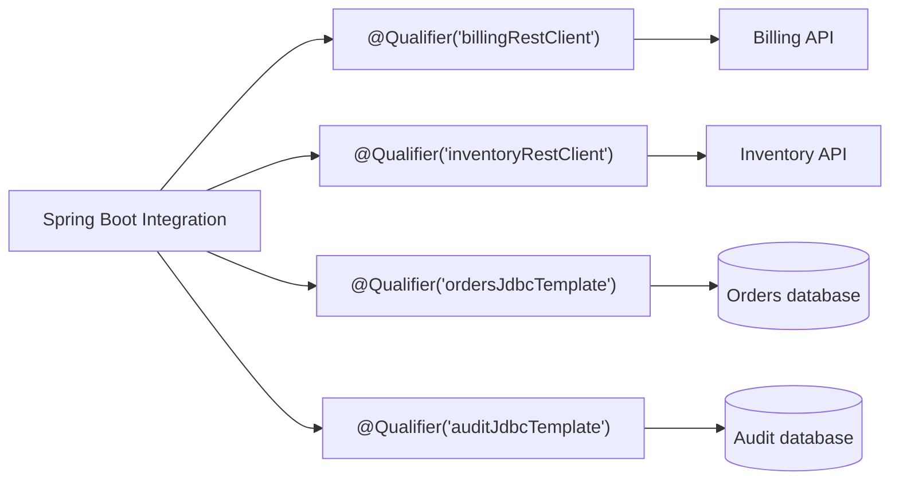

# Connecting to Multiple Systems of the Same Type and Disambiguating Beans with Qualifiers

## 1. The problem: same Java type, different target systems

In the **Spring Boot Integration** module, applications regularly exchange data with multiple systems through HTTP clients, databases, caches, message brokers, or Spring Integration adapters. A single service may call **two REST APIs**, read and write **two databases**, or publish messages to **two brokers**. These connections can share the exact same Java type, yet their addresses, credentials, timeouts, data scopes, and error handling differ completely.

For example, an order synchronization application needs:

- `billingRestClient`: calls the billing system at `billing.example.org`.
- `inventoryRestClient`: calls the inventory system at `inventory.example.org`.
- `ordersDataSource`: writes order data to the operational database.
- `auditDataSource`: writes audit records to an independent database.

Both HTTP clients have type `RestClient`; both database connections have type `DataSource`. Writing `@Autowired RestClient client` or `@Autowired DataSource dataSource` leaves Spring unsure which object to inject. Without clear default bean rules, the program can hit the wrong endpoint or database, especially when auto-configuration also contributes beans.

**The goal** is to create each bean with a distinct identity, bind separate configuration per target system, and specify the exact bean at each injection point using `@Qualifier`. That resolves integration routing at object construction time instead of relying on bean creation order or accidental variable-name matches.



## 2. How does Spring choose a bean?

Spring manages beans by **name**, **type**, and associated metadata. When an injection point requests type `RestClient`, the container looks up all eligible beans of that type. If only one candidate matches, injection is straightforward. When multiple candidates exist, extra disambiguation is needed.

### 2.1. `@Bean(name = ...)`, `@Qualifier`, and `@Primary`

| Mechanism | Role | When to use |
| --- | --- | --- |
| `@Bean("billingRestClient")` | Registers a bean with an explicit name | Distinguish two configurations producing the same `RestClient` type. |
| `@Qualifier("billingRestClient")` | Narrows injection candidates by qualifier; a bean name can serve as a qualifier value | The consumer must target one specific system. |
| `@Primary` | Prefers a bean when injecting by type without a more specific qualifier | There is a sensible default for existing code. |
| `@Bean` without an explicit name | Defaults bean name to the declaring method name | Suitable only when method names are stable, clear, and conflict-free. |
| Injecting `List<T>` or `Map<String,T>` | Receives all matching beans; map keys are typically bean names | Need to iterate or register multiple implementations with custom selection logic. |

Minimal example:

```java
@Configuration
class ClientConfiguration {
    @Bean("billingRestClient")
    RestClient billingRestClient() {
        return RestClient.create("https://billing.example.org");
    }

    @Bean("inventoryRestClient")
    RestClient inventoryRestClient() {
        return RestClient.create("https://inventory.example.org");
    }
}

@Service
class BillingGateway {
    private final RestClient client;

    BillingGateway(@Qualifier("billingRestClient") RestClient client) {
        this.client = client;
    }
}
```

Here `@Qualifier` selects **which bean is injected** without changing the variable type of `client`. Qualifier values should be stable names reflecting system identity. Across projects with multiple connections, sharing one naming convention across configuration, constructors, and operational docs reduces routing mistakes.

### 2.2. What happens without a qualifier?

With two eligible `RestClient` beans and no explicit default, single-bean injection by type can fail with `NoUniqueBeanDefinitionException`:

```java
// Two RestClients exist; Spring lacks enough information to pick one.
@Service
class AmbiguousGateway {
    AmbiguousGateway(RestClient client) {
        // Bean wiring error while initializing the application context.
    }
}
```

Spring's resolution algorithm also considers qualifiers, bean names, injection point names, and additional metadata depending on version, so avoid memorizing a single rigid order for all edge cases. The key principle is that **critical dependencies must be chosen explicitly**. Place `@Qualifier` on the constructor parameter whenever business semantics demand a specific endpoint.

Marking one bean `@Primary` lets unqualified `RestClient` injection points receive that primary bean. However, `@Primary` does not automatically steer the other bean to another business flow, nor is it a runtime data-routing mechanism. At any injection point with a matching qualifier, `@Qualifier` selects that specific bean even when another bean is `@Primary`.

### 2.3. Variable names are not a configuration contract

`BillingGateway(RestClient billingRestClient)` can sometimes resolve via parameter name when build metadata and conditions match, yet that depends on parameter names and compiler flags. Renaming a parameter during refactoring can silently alter dependency resolution. Using `@Qualifier("billingRestClient")` is explicit and easy to verify in code reviews.

Constructor injection is preferred because required dependencies are explicit in the class signature, easy to test, and allow `final` fields. If using Lombok to generate constructors, verify that `@Qualifier` actually propagates onto the **generated constructor parameter**; placing `@Qualifier` on a field and assuming Lombok always copies it to the constructor is a common pitfall.

## 3. Example 1: two REST APIs with two dedicated `RestClient` beans

Suppose a synchronization service calls both the Billing API and the Inventory API. Each client has its own base URL and over time can add separate credentials, timeouts, retries, or per-system metrics.

### 3.1. Namespaced configuration

```yaml
# application.yml
integration:
  billing:
    base-url: ${BILLING_API_BASE_URL}
  inventory:
    base-url: ${INVENTORY_API_BASE_URL}
```

Actual URLs come from environment variables or deployment configuration. The examples use illustrative domains; never embed fixed internal endpoints or API keys in source code. If each API uses its own token, isolate secrets and permissions under each API's dedicated service account.

### 3.2. Creating two distinctly named beans

Example for **Spring Boot 3.2+ / Spring Framework 6.1+**, where `RestClient` and `RestClient.Builder` are available:

```java
import org.springframework.beans.factory.annotation.Value;
import org.springframework.context.annotation.Bean;
import org.springframework.context.annotation.Configuration;
import org.springframework.web.client.RestClient;

@Configuration
public class HttpClientsConfiguration {

    @Bean("billingRestClient")
    RestClient billingRestClient(
            RestClient.Builder builder,
            @Value("${integration.billing.base-url}") String baseUrl) {
        return builder.clone()
                .baseUrl(baseUrl)
                .build();
    }

    @Bean("inventoryRestClient")
    RestClient inventoryRestClient(
            RestClient.Builder builder,
            @Value("${integration.inventory.base-url}") String baseUrl) {
        return builder.clone()
                .baseUrl(baseUrl)
                .build();
    }
}
```

A Boot-configured `RestClient.Builder` may carry message converters, observation, and shared customizers. Calling `clone()` before setting the base URL keeps the two clients independent, avoiding accidental mutation of builder state shared elsewhere. In real systems, configure connect timeouts, read timeouts, connection pooling, and security per HTTP client according to the underlying HTTP library and target API policy.

### 3.3. Injecting each bean into its matching adapter

```java
import org.springframework.beans.factory.annotation.Qualifier;
import org.springframework.stereotype.Component;
import org.springframework.web.client.RestClient;

@Component
public class BillingAdapter {
    private final RestClient billingClient;

    public BillingAdapter(
            @Qualifier("billingRestClient") RestClient billingClient) {
        this.billingClient = billingClient;
    }

    public InvoiceDto getInvoice(String invoiceId) {
        return billingClient.get()
                .uri("/v1/invoices/{id}", invoiceId)
                .retrieve()
                .body(InvoiceDto.class);
    }
}

@Component
public class InventoryAdapter {
    private final RestClient inventoryClient;

    public InventoryAdapter(
            @Qualifier("inventoryRestClient") RestClient inventoryClient) {
        this.inventoryClient = inventoryClient;
    }

    public StockDto getStock(String sku) {
        return inventoryClient.get()
                .uri("/v1/stock/{sku}", sku)
                .retrieve()
                .body(StockDto.class);
    }
}

record InvoiceDto(String invoiceId, String status) {}
record StockDto(String sku, long available) {}
```

`InvoiceDto` and `StockDto` are illustrative data contracts; real APIs must map actual response structures and handle missing fields. `retrieve()` throws exceptions on error HTTP statuses; adapters need explicit policies for `4xx`, `5xx`, timeouts, retries, and idempotency—especially for mutating requests. `@Qualifier` guarantees **the right system is called**, while data contracts and error handling must still be designed separately.

If Billing API uses a bearer token and Inventory API uses mTLS, attach authentication to each corresponding client. Sharing one `RestClient` and swapping headers or URLs across threads risks sending tokens to the wrong target, especially with shared mutable state.

## 4. Example 2: two databases with two `DataSource` and `JdbcTemplate` beans

An application needs to read/write an orders database and write audit logs to a separate database. Both use JDBC; Spring sees two `DataSource` beans and can have two `JdbcTemplate` beans.

### 4.1. Separated database configuration

```yaml
app:
  datasource:
    orders:
      url: ${ORDERS_JDBC_URL}
      username: ${ORDERS_DB_USER}
      password: ${ORDERS_DB_PASSWORD}
      driver-class-name: org.postgresql.Driver
    audit:
      url: ${AUDIT_JDBC_URL}
      username: ${AUDIT_DB_USER}
      password: ${AUDIT_DB_PASSWORD}
      driver-class-name: org.postgresql.Driver
```

`app.datasource.*` is an application-chosen namespace describing multiple databases. Because we are not using a single `spring.datasource.*`, we manually create and bind the beans. `DataSourceProperties` handles standard fields like `url`, `username`, `password`, and `driver-class-name` and builds the datasource using the available driver/pool. With HikariCP, building via `initializeDataSourceBuilder()` avoids confusing Spring Boot's `url` property with Hikari's native `jdbcUrl` property during direct binding.

### 4.2. Creating `DataSourceProperties`, `DataSource`, `JdbcTemplate`, and transaction managers

```java
import javax.sql.DataSource;
import org.springframework.beans.factory.annotation.Qualifier;
import org.springframework.boot.autoconfigure.jdbc.DataSourceProperties;
import org.springframework.boot.context.properties.ConfigurationProperties;
import org.springframework.context.annotation.Bean;
import org.springframework.context.annotation.Configuration;
import org.springframework.context.annotation.Primary;
import org.springframework.jdbc.core.JdbcTemplate;
import org.springframework.jdbc.datasource.DataSourceTransactionManager;
import org.springframework.transaction.PlatformTransactionManager;

@Configuration
public class MultiDatabaseConfiguration {

    @Bean("ordersDataSourceProperties")
    @Primary
    @ConfigurationProperties(prefix = "app.datasource.orders")
    DataSourceProperties ordersDataSourceProperties() {
        return new DataSourceProperties();
    }

    @Bean("auditDataSourceProperties")
    @ConfigurationProperties(prefix = "app.datasource.audit")
    DataSourceProperties auditDataSourceProperties() {
        return new DataSourceProperties();
    }

    @Bean("ordersDataSource")
    @Primary
    DataSource ordersDataSource(
            @Qualifier("ordersDataSourceProperties") DataSourceProperties props) {
        return props.initializeDataSourceBuilder().build();
    }

    @Bean("auditDataSource")
    DataSource auditDataSource(
            @Qualifier("auditDataSourceProperties") DataSourceProperties props) {
        return props.initializeDataSourceBuilder().build();
    }

    @Bean("ordersJdbcTemplate")
    JdbcTemplate ordersJdbcTemplate(
            @Qualifier("ordersDataSource") DataSource dataSource) {
        return new JdbcTemplate(dataSource);
    }

    @Bean("auditJdbcTemplate")
    JdbcTemplate auditJdbcTemplate(
            @Qualifier("auditDataSource") DataSource dataSource) {
        return new JdbcTemplate(dataSource);
    }

    @Bean("ordersTxManager")
    @Primary
    PlatformTransactionManager ordersTxManager(
            @Qualifier("ordersDataSource") DataSource dataSource) {
        return new DataSourceTransactionManager(dataSource);
    }

    @Bean("auditTxManager")
    PlatformTransactionManager auditTxManager(
            @Qualifier("auditDataSource") DataSource dataSource) {
        return new DataSourceTransactionManager(dataSource);
    }
}
```

The `DataSourceProperties`, `DataSource`, and `PlatformTransactionManager` beans for orders are marked `@Primary` as an intentional default. Even so, each `JdbcTemplate` and each transaction manager still wires to **its exact datasource via `@Qualifier`**, keeping the dependency graph explicit. If no default makes business sense, omit `@Primary` and require every single-bean injection point to specify a qualifier.

In projects using **JPA/Hibernate**, multiple datasources also require separate `EntityManagerFactory`, `JpaTransactionManager`, repository packages, and mappings per persistence unit; two `JdbcTemplate` beans alone do not cover full JPA configuration. With Flyway, Liquibase, or SQL initialization, also clarify which migrations/schemas belong to which database rather than letting scripts run on both.

### 4.3. Injecting into services and defining transaction boundaries

```java
import org.springframework.beans.factory.annotation.Qualifier;
import org.springframework.jdbc.core.JdbcTemplate;
import org.springframework.stereotype.Service;
import org.springframework.transaction.annotation.Transactional;

@Service
public class OrderRepositoryAdapter {
    private final JdbcTemplate ordersJdbcTemplate;

    public OrderRepositoryAdapter(
            @Qualifier("ordersJdbcTemplate") JdbcTemplate ordersJdbcTemplate) {
        this.ordersJdbcTemplate = ordersJdbcTemplate;
    }

    @Transactional(transactionManager = "ordersTxManager")
    public void updateStatus(long orderId, String status) {
        ordersJdbcTemplate.update(
                "UPDATE orders SET status = ? WHERE id = ?",
                status, orderId);
    }
}

@Service
public class AuditRepositoryAdapter {
    private final JdbcTemplate auditJdbcTemplate;

    public AuditRepositoryAdapter(
            @Qualifier("auditJdbcTemplate") JdbcTemplate auditJdbcTemplate) {
        this.auditJdbcTemplate = auditJdbcTemplate;
    }

    @Transactional(transactionManager = "auditTxManager")
    public void writeEvent(String eventId, String action) {
        auditJdbcTemplate.update(
                "INSERT INTO audit_event (event_id, action) VALUES (?, ?)",
                eventId, action);
    }
}
```

Suppose `OrderRepositoryAdapter.updateStatus()` and `AuditRepositoryAdapter.writeEvent()` are called in sequence: **the two transaction managers govern two separate databases**. `@Transactional("ordersTxManager")` protects only operations using the orders transaction resource; it does not create an atomic transaction spanning both orders and audit. If writing orders succeeds and writing audit fails, use a consistency strategy such as transactional outbox, idempotent retries, or a saga per business needs. Using `@Qualifier` on the right **bean** does not solve distributed transactions.

Note: this example assumes tables `orders` and `audit_event` exist and the application includes the JDBC driver, Spring JDBC, and transaction management dependencies. If a database is unconfigured or a secret is missing, let the app fail clearly at startup or health checks rather than silently falling back to an unintended database.

## 5. Distinguishing `@Qualifier`, `@Primary`, and dynamic routing

A common design mistake is using `@Primary` to mean "the preferred system" in every runtime context. `@Primary` is strictly a **compile/startup rule for picking a bean at an ambiguous injection point**; it does not route individual orders or requests. If targets depend on tenant, region, or event type at runtime, build an explicit routing layer with clear rules.

Example routing via a controlled enum:

```java
public enum ExternalSystem {
    BILLING,
    INVENTORY
}

@Component
public class ClientRouter {
    private final RestClient billing;
    private final RestClient inventory;

    public ClientRouter(
            @Qualifier("billingRestClient") RestClient billing,
            @Qualifier("inventoryRestClient") RestClient inventory) {
        this.billing = billing;
        this.inventory = inventory;
    }

    public RestClient select(ExternalSystem target) {
        return switch (target) {
            case BILLING -> billing;
            case INVENTORY -> inventory;
        };
    }
}
```

This router allows business logic to select one of **two pre-configured clients**. It does not allow arbitrary URLs passed from user requests. When routing by `tenantId`, map the tenant to an approved configuration, enforce tenant authorization, and isolate credentials per tenant. Never build URLs or bean names directly from untrusted input and send requests to arbitrary hosts—that risks misrouting and SSRF vulnerabilities.

### 5.1. When to inject `Map<String, RestClient>`?

Spring can inject a map of all beans of a type, **keyed by bean name**:

```java
@Component
class ClientRegistry {
    private final Map<String, RestClient> clients;

    ClientRegistry(Map<String, RestClient> clients) {
        this.clients = clients;
    }

    RestClient billing() {
        return Objects.requireNonNull(
                clients.get("billingRestClient"),
                "Missing billingRestClient bean");
    }
}
```

This snippet requires importing `Map` and `Objects`. The map will also include any other `RestClient` beans registered by the app or auto-configuration. When only two fixed systems exist, injecting each bean via constructor is clearer. When an extensible plugin registry is needed, define a dedicated integration adapter interface and metadata rather than scattering raw bean-name strings as business contracts.

## 6. Applying the same principle to caches, brokers, and adapters

Not every integration needs identical bean structures. Still, the principle of **separate configuration per target and explicit injection** applies broadly:

| Integration type | Beans typically requiring disambiguation | Risk of wrong injection |
| --- | --- | --- |
| Multiple HTTP APIs | `RestClient`, `WebClient`, per-API adapters | Calling wrong base URL, wrong token, or wrong timeouts. |
| Multiple JDBC databases | `DataSource`, `JdbcTemplate`, `TransactionManager` | Writing to wrong schema/database, wrong transaction scope. |
| Multiple Redis instances | `RedisConnectionFactory`, `RedisTemplate` | Reading/writing wrong environment or cache namespace. |
| Multiple RabbitMQ brokers | `ConnectionFactory`, `RabbitTemplate`, listener container factory | Publishing to wrong broker; listener using wrong connection. |
| Multiple Kafka clusters | Producer/consumer factory, `KafkaTemplate`, listener container factory | Publishing/consuming wrong cluster or topic. |
| Multiple Spring Integration flows | Channels, gateways, adapters, handlers | Messages routed down wrong flow or processed under wrong contract. |

For listeners, injecting the right send template is usually **not enough**. Multiple RabbitMQ brokers require explicit `ConnectionFactory` and listener container factory beans, referenced via `@RabbitListener(containerFactory = "...")`. Likewise, Kafka listeners must reference the intended listener container factory across multiple clusters. These illustrate the principle; exact setup depends on Spring AMQP/Kafka versions and consumer topology.

## 7. Encapsulating configuration to avoid repetition

As the number of systems grows, repeating `@Value` across configuration classes makes missing fields and swapped URLs harder to catch. Group settings by system name with `@ConfigurationProperties`, validate required fields, and confine configuration reading to adapter layers.

Example organization:

```java
import org.springframework.boot.context.properties.ConfigurationProperties;

@ConfigurationProperties(prefix = "integration.billing")
public record BillingClientProperties(String baseUrl) {}
```

To let Spring Boot manage the record, register it with `@EnableConfigurationProperties(BillingClientProperties.class)` on a `@Configuration` class or use `@ConfigurationPropertiesScan`. To require a non-blank URL, add Bean Validation with `@Validated` and `@NotBlank` when validation dependencies are present. Beyond non-blank strings, enforce `https` schemes, allowed hostnames, and environment-appropriate endpoints.

For each connection, a configuration group typically includes:

- **Target address and identity:** base URL, host/port, database name, cluster, or virtual host.
- **Security:** isolated credentials/secrets, TLS truststores, least-privilege permissions.
- **Resource limits:** connect/read timeouts, connection pools, concurrency, rate limits.
- **Error handling:** bounded retries, backoff, circuit breakers, idempotency, and compensation.
- **Operational observability:** logs tagged with logical system name, latencies, error rates, and dedicated health indicators.

Hiding external calls behind business-meaningful interfaces like `BillingGateway` or `AuditWriter` avoids passing `RestClient` or `JdbcTemplate` everywhere. Then only configuration and adapter layers ever touch `@Qualifier`, while business layers call clear domain methods.

## 8. Testing and observing proper bean selection

With multiple systems of the same type, **application startup succeeding does not prove the right connections were wired**. Two beans may exist cleanly while an adapter references the wrong qualifier. Test both wiring and runtime behavior:

1. **Context tests:** verify beans are registered under expected names and adapters receive the right instances. Confirm failure if a bean is removed or a qualifier changes.
2. **HTTP adapter tests:** run isolated mock/stub HTTP servers for Billing and Inventory, verifying each adapter hits its intended host, path, headers, and handles statuses/timeouts as expected.
3. **Database adapter tests:** use two isolated databases (e.g. Testcontainers), write via each `JdbcTemplate`, and verify rows appear only in the intended target database.
4. **Transaction tests:** inject failures between writes to different databases to verify retries, outbox, or compensation; never assume rolling back one transaction manager rolls back the other DB.
5. **Environment config tests:** run with sample staging/production configs to confirm missing secrets, bad URLs, or TLS failures are caught clearly.

Simple test confirming distinct bean names map to distinct instances:

```java
import static org.junit.jupiter.api.Assertions.assertNotSame;
import static org.junit.jupiter.api.Assertions.assertSame;
import org.junit.jupiter.api.Test;
import org.springframework.beans.factory.annotation.Autowired;
import org.springframework.beans.factory.annotation.Qualifier;
import org.springframework.boot.test.context.SpringBootTest;
import org.springframework.context.ApplicationContext;
import org.springframework.web.client.RestClient;

@SpringBootTest
class RestClientWiringTest {
    @Autowired ApplicationContext context;
    @Autowired @Qualifier("billingRestClient") RestClient billing;
    @Autowired @Qualifier("inventoryRestClient") RestClient inventory;

    @Test
    void usesTwoDistinctConfiguredBeans() {
        assertSame(context.getBean("billingRestClient"), billing);
        assertSame(context.getBean("inventoryRestClient"), inventory);
        assertNotSame(billing, inventory);
    }
}
```

This test only proves **wiring and two separate instances**. It does not verify base URLs, credentials, or HTTP behavior; write dedicated adapter tests as in item 2. When using `@SpringBootTest`, other application connection beans may initialize too, so provide valid test properties or use focused test contexts containing only the configurations under test.

In production, attach logical integration names to metrics—such as `billing`, `inventory`, `orders-db`, `audit-db`—to compare latencies, timeouts, and error rates. Never use passwords, tokens, or credentialed connection strings as metric tags. Health checks should isolate failures per target; whether one unreachable API marks the app unready or merely degrades functionality depends on business requirements.

## 9. Common issues and how to resolve them

| Symptom | Common cause | Resolution |
| --- | --- | --- |
| `NoUniqueBeanDefinitionException` | Multiple beans of the same type without sufficient disambiguation | Add `@Qualifier` per target; use `@Primary` only for sensible defaults. |
| `NoSuchBeanDefinitionException` with qualifier | Typo in bean name/qualifier, unregistered bean, or inactive profile | Check `@Bean` name, component scan, conditional annotations, and qualifier string. |
| `BeanDefinitionOverrideException` or name collision | Two configs register the same bean name | Use unique bean names and remove duplicates; do not enable overriding to mask collisions. |
| HTTP client calls wrong API despite clean startup | Copy-pasted `@Qualifier` or base URL between clients | Test each adapter against stub servers; log logical targets/metrics appropriately. |
| `@Primary` makes multiple places hit one database | Unqualified injection fell back to primary instead of secondary DB | Add explicit qualifiers and separate repositories/adapters per system. |
| `@Transactional` runs yet second DB write does not roll back | Transaction manager governs only its bound resource | Specify the matching transaction manager; design outbox/saga for cross-system consistency. |
| Pool connections exhausted | Each datasource maintains its own pool, exceeding DB total | Tune pool sizes per source and sum across all replicas. |
| Changing `spring.datasource.url` expecting two DBs | Standard auto-config does not infer a second custom namespace | Declare separate `DataSourceProperties` and beans per database. |
| Missing config or wrong environment selected | Ambiguous namespaces, overly broad default URLs, shared secrets | Prefix properties by system name, validate required fields, isolate secrets. |
| Qualifier lost with Lombok-generated constructor | Field-level annotation not propagated as expected | Write constructors explicitly or configure annotation propagation in the build. |

### 9.1. Diagnostic walkthrough: beans created, yet data written to the wrong place

Suppose a service logs an audit write as successful, yet operators find the row inside the orders database. A practical investigation checklist:

1. Inspect `AuditRepositoryAdapter`'s constructor: does the `JdbcTemplate` parameter carry `@Qualifier("auditJdbcTemplate")`?
2. Check `@Bean("auditJdbcTemplate")`: is it wired with `@Qualifier("auditDataSource")`, or did it accidentally take `ordersDataSource`?
3. Check `auditDataSource` binding from `app.datasource.audit` for the right URL, credentials, and database name in that environment.
4. Check whether `@Primary` leaked into an unqualified dependency or an auto-configured bean took precedence.
5. Add an integration test writing a controlled record, assert which database receives it, deploy the fix, and verify in telemetry.

Seeing two `DataSource` beans in the context is not enough; verify the entire **path from adapter → template → datasource → real endpoint**.

## 10. Checklist when integrating multiple systems of the same type

Before shipping a multi-connection configuration to production, confirm:

1. Does every target system have its own bean names and config namespace following one naming convention?
2. Does every constructor targeting a specific system specify `@Qualifier` explicitly?
3. Is `@Primary` truly needed; if used, is the default safe for every unqualified injection point?
4. Do HTTP clients, datasources, caches, and broker beans use the matching endpoints, secrets, and TLS settings?
5. Are transaction managers clearly separated per database, and cross-system consistency boundaries defined?
6. Are timeouts, connection pools, retries, and resource limits sized per connection and multiplied by total replicas?
7. Do integration tests prove **each adapter hits its intended destination**, beyond checking context startup?
8. When selecting targets dynamically at runtime, does a routing layer enforce an allowlist, check authorization, and block arbitrary URLs?
9. Do metrics, logs, and alerts identify which specific target is slow, failing, or unauthorized?
10. When an external system fails, does the application classify errors, bound retries, and recover consistently with data contracts?

**Key takeaway:** `@Qualifier` lets Spring inject **the exact intended bean** when multiple beans share a type. Organize bean names and configuration namespaces per target system, reserve `@Primary` for genuine defaults, test the complete dependency path, and design dedicated transactions, error handling, idempotency, and observability for every integration flow. That foundation keeps a Spring Boot application connecting cleanly across multiple HTTP APIs, databases, caches, or brokers with full clarity on where data goes.
