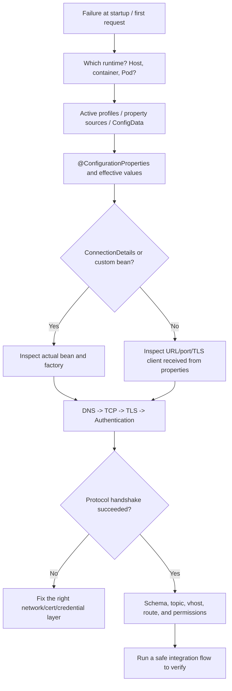
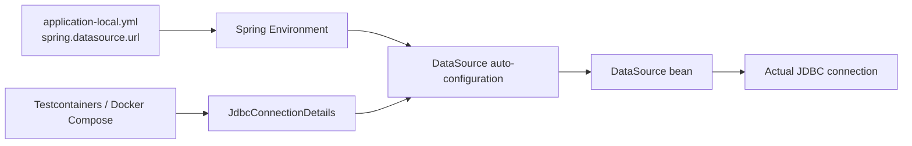
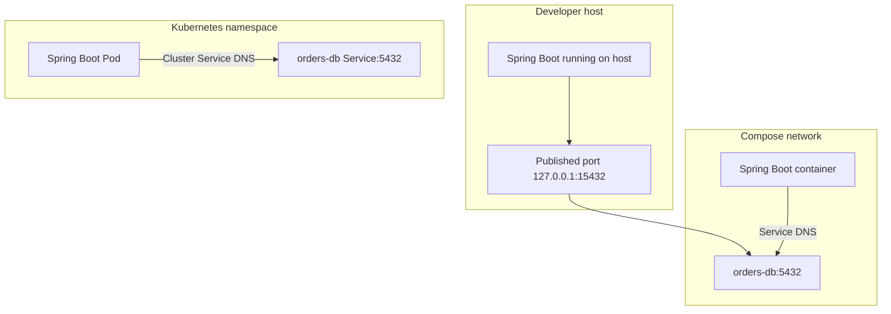

# Verifying Effective Configuration and Diagnosing Initial Connectivity

## 1. The problem: configuration exists, yet you are unsure what the app actually uses

In a Spring Boot application integrating multiple systems, you commonly have PostgreSQL for transactional data, Redis for caching, RabbitMQ or Kafka for messaging, plus HTTP/SOAP clients for external services. Each connection has its own address, port, credentials, TLS, timeouts, pool, and retry policy.

When the application starts up, a `Connection refused`, `UnknownHostException`, `SSLHandshakeException`, or "authentication failed" error can originate at completely different layers. Conversely, **an application that starts cleanly is not necessarily connected to the right target**: a `DataSource` may silently hit a local database when the team thinks it uses Testcontainers; an HTTP client might still point to a production URL; Kafka may reach the bootstrap broker yet fail to reach the brokers advertised in metadata.

This lesson, **"Verifying Effective Configuration and Diagnosing Initial Connectivity,"** belongs to the **Connection Configuration** chapter of the `SPRING_BOOT_INTEGRATION` module. Its goal is tracing configuration from source to live client bean, verifying connectivity layer by layer, and proving that HTTP, database, cache, broker, or Spring Integration adapter flows satisfy their contracts.

**Principle:** never jump to conclusions from one YAML property, one open TCP port, or a single health check. Distinguish **effective property**, **effective client configuration**, **network connectivity**, and **business readiness**.

## 2. Four verification levels that must not be conflated

| Level | Question | Appropriate evidence |
| --- | --- | --- |
| **Property source & value** | Which profile is Spring Boot running? Did the value come from YAML, env, CLI, or ConfigData? | `Environment`, origin, `@ConfigurationProperties` binding |
| **Actual client/bean** | Which host/transport are `DataSource`, `RedisConnectionFactory`, `RabbitTemplate`, and `RestClient` actually using? | Auto-configuration conditions, bean/`ConnectionDetails`, client-specific config |
| **Protocol connectivity** | Do DNS, TCP, TLS, authentication, and the protocol succeed? | Probes from the app's actual runtime; safe queries or protocol handshakes |
| **Business outcome** | Does the DB have the right schema, does the message route to the right queue, and does HTTP honor the contract without duplicate side effects? | Integration tests, migration checks, broker confirms/acks, target state |

For example, `SELECT 1` succeeding does not prove the database has the right schema or write privileges on target tables. Kafka's bootstrap server accepting TCP does not prove the client can reach advertised broker endpoints. RabbitMQ's `ConnectionFactory` initializing does not prove the vhost and queues are valid. HTTP 200 does not prove the JSON/SOAP payload matches the contract.

To diagnose systematically, always record **which level PASSED** and **which level remains unverified**, avoiding premature "connectivity OK" claims.

## 3. Diagnostic map from configuration to business logic



There are two main failure branches:

1. **Missing configuration or bean:** missing driver, missing property, un-scanned configuration, unmatched condition, or ambiguous beans. Fix classpath, profiles, and wiring first.
2. **Bean exists, yet cannot connect or hits the wrong target:** hostname, port, TLS, credentials, pool, topology, or business resources. Diagnose from the exact location where the Java process runs.

Before verifying you are pointed at the right database, **never run write migrations or table-drop commands** just to test connectivity.

## 4. Spring Boot reads configuration from multiple sources

Common sources include `application.yml`, `application-{profile}.yml`, external config files outside the JAR, resources loaded via `spring.config.import`, environment variables, Java system properties, and command-line arguments. Platforms such as Kubernetes or config servers can add additional sources via their respective mechanisms.

Shared configuration example:

```yaml
# application.yml
spring:
  application:
    name: order-integration

integration:
  partner:
    base-url: https://sandbox.partner.example.test
    connect-timeout: 3s
    read-timeout: 10s
```

Local profile:

```yaml
# application-local.yml
integration:
  partner:
    base-url: http://127.0.0.1:18080
```

Launch command:

```bash
java -jar integration-service.jar \
  --spring.profiles.active=local \
  --integration.partner.read-timeout=5s
```

When `local` is active, the partner URL comes from `application-local.yml`, and `read-timeout` comes from the CLI if no higher-precedence source overrides it. However, Spring Boot's full precedence rules also involve ConfigData ordering, property sources, profiles, and launch mechanics; **do not guess the winning source from filenames alone**.

### 4.1. Verify active profiles in the failing process

`SPRING_PROFILES_ACTIVE=local` exported in one terminal does not automatically carry into an IDE launch, a service manager, or an already-running Pod. Profile groups, active/included profiles, and `spring.config.activate.on-profile` also alter which documents load.

Verify the actual active profiles and effective property sources. If staging fails while logs report the `local` profile, fix deployment/profile activation before debugging database hostnames.

### 4.2. Environment variables and relaxed binding

Spring Boot applies relaxed binding for `@ConfigurationProperties`; for example, `integration.partner.connect-timeout` can be set via an environment variable following Boot's canonical naming rules, such as `INTEGRATION_PARTNER_CONNECTTIMEOUT`. Do not assume all underscore placements or acronyms bind identically across every context.

`${ENV_VAR}` placeholders inside YAML expand when that property source is active. Enforce validation and clear startup errors if a required variable is missing, instead of falling back to dangerous endpoints or passwords.

## 5. Inspecting properties with @ConfigurationProperties

Instead of scattering `@Value` across HTTP adapters, group related settings into a typed bean:

```java
package com.example.integration.config;

import java.net.URI;
import java.time.Duration;
import org.springframework.boot.context.properties.ConfigurationProperties;

@ConfigurationProperties(prefix = "integration.partner")
public record PartnerConnectionProperties(
        URI baseUrl,
        Duration connectTimeout,
        Duration readTimeout,
        boolean enabled) {}
```

Enable scanning (Spring Boot 3.x example):

```java
import org.springframework.boot.autoconfigure.SpringBootApplication;
import org.springframework.boot.context.properties.ConfigurationPropertiesScan;

@SpringBootApplication
@ConfigurationPropertiesScan
public class IntegrationApplication {
    public static void main(String[] args) {
        org.springframework.boot.SpringApplication.run(
                IntegrationApplication.class, args);
    }
}
```

In real projects, add `@Validated`, `@NotNull`, positive `Duration` checks, and URI scheme/host allowlists appropriate to the environment. Failing fast when a critical endpoint is missing is far safer than defaulting to production or an unintended service.

Inject via constructors so each adapter receives its own configuration; never mutate a global properties object to swap `baseUrl` per HTTP request.

### 5.1. Inspecting configuration provenance without logging secrets

`Environment.getProperty(...)` shows the effective raw value; `@ConfigurationProperties` shows whether the binder parsed strings into `URI`/`Duration`/`boolean` properly. Still, diagnostics must never dump `System.getenv()` or print full config objects.

Emit only **safe fields**: logical adapter name, active profile, source name, scheme, controlled hostname, port, timeouts, and check outcomes. Never print passwords, access tokens, JDBC URLs with secret query parameters, truststore passwords, or customer data.

## 6. ConnectionDetails can override host/port from YAML

Spring Boot 3.x introduces `ConnectionDetails` for several auto-configurations. With Docker Compose support or Testcontainers `@ServiceConnection`, Boot supplies host, port, and credentials from the container runtime to configure `DataSource`, `RedisConnectionFactory`, `RabbitConnectionFactory`, or matching clients.



This creates a common diagnostic surprise: `spring.datasource.url` in YAML still says `localhost:5432`, while Testcontainers exposes PostgreSQL on a random host port. Because `DataSource` auto-configuration uses `JdbcConnectionDetails`, the app connects cleanly without using the URL written in YAML.

Conversely, a `DataSource` or HTTP client **manually instantiated with `new`** by application code may ignore `ConnectionDetails` even when that bean exists.

Therefore, answer two separate questions:

1. Which properties does `Environment` see?
2. How was the actual client bean injected by the service constructed: auto-configuration, `ConnectionDetails`, `@ConfigurationProperties`, or a custom bean?

Never treat answer (1) as proof of answer (2).

## 7. Actuator aids investigation, yet must be strictly secured

Spring Boot Actuator exposes config and auto-configuration diagnostics. Useful endpoints include:

| Endpoint | Helps investigate | Limitation |
| --- | --- | --- |
| `/actuator/health` | Status of active health indicators | `UP` does not prove end-to-end business completion |
| `/actuator/env` | Property sources and origin metadata | Does not show which property every custom client bean actually uses |
| `/actuator/configprops` | Bound `@ConfigurationProperties` beans | Does not cover custom beans bypassing the binder |
| `/actuator/conditions` | Why auto-configurations matched or backed off | Not a TCP/TLS test |
| `/actuator/beans` | Bean classes, dependencies, and presence | Does not prove connection to the right server |
| `/actuator/metrics` | Pool/client/flow metrics when metered | Depends on enabled instrumentation |

Example **strictly for local or controlled diagnostic environments**:

```yaml
management:
  endpoints:
    web:
      exposure:
        include: health,info,env,configprops,conditions,beans,metrics
  endpoint:
    env:
      show-values: never
    configprops:
      show-values: never
```

Hiding values is one defense layer, yet **bean names, property source paths, conditions, and endpoints** still disclose internal structure. Never expose these diagnostic endpoints to the public Internet. In production, expose only what is needed behind authentication, authorization, network policies, and auditing—and secure non-web transports (such as JMX) if enabled.

When a `DataSource` bean is missing, inspect `conditions` to tell whether a driver, starter, or property is missing, or a custom bean caused a back-off. Do not debug firewalls before the bean even exists.

## 8. Local-only diagnostic probes without leaking sensitive data

An `ApplicationRunner` can verify that `DataSource` opens a real connection:

```java
import java.sql.Connection;
import javax.sql.DataSource;
import org.springframework.boot.ApplicationRunner;
import org.springframework.context.annotation.Bean;
import org.springframework.context.annotation.Configuration;
import org.springframework.context.annotation.Profile;

@Configuration(proxyBeanMethods = false)
@Profile("local")
public class LocalDatabaseProbeConfiguration {

    @Bean
    ApplicationRunner localDatabaseProbe(DataSource dataSource) {
        return args -> {
            try (Connection connection = dataSource.getConnection()) {
                boolean valid = connection.isValid(2);
                String product = connection.getMetaData()
                        .getDatabaseProductName();
                System.out.println(
                        "Local database probe: product=" + product
                        + ", valid=" + valid);
            }
        };
    }
}
```

This illustrates probing the **actual `DataSource` bean**. In production, use proper health indicators and metrics instead of printing config diagnostics or forcing extra startup queries. When a dependency may be temporarily down and degraded startup is allowed, avoid letting an `ApplicationRunner` throw and crash the whole app.

With PostgreSQL, a read-only probe confirms the active database and schema:

```sql
SELECT current_database(), current_schema();
```

Only after confirming the exact target database and permissions should migrations or business operations write data. Never execute DDL against a database solely because `SELECT 1` succeeded.

## 9. Network topology: localhost means different things in Docker and Kubernetes

`localhost` or `127.0.0.1` is always scoped to **the process's network namespace**. Inside a Docker container, `localhost` is the application container itself—not the adjacent PostgreSQL container and not your laptop.

| Where the JVM runs | Typical DB address | What to avoid |
| --- | --- | --- |
| IDE on host; Compose publishes `15432:5432` | `127.0.0.1:15432` | `orders-db:5432` if the host does not resolve Compose names |
| App container on same Compose network | `orders-db:5432` | `localhost:15432`, which points to the app container itself |
| Pod in Kubernetes namespace `integration` | Service DNS like `orders-db.integration.svc.cluster.local:5432` | A port-forward address that only exists on a developer's laptop |
| Host process using Testcontainers | Mapped host/port from Testcontainers or `ConnectionDetails` | Hard-coding `localhost:5432` when ports are dynamic |
| Remote Docker/CI | Runtime-assigned Docker host endpoint | Assuming Docker host is always `localhost` |

Visualizing the paths:



Always test DNS, TCP, and TLS from **the exact runtime experiencing the failure**. `curl` succeeding from your laptop does not prove a deployment Pod can reach that endpoint, especially behind VPNs, proxies, service meshes, or `NetworkPolicy` rules.

## 10. Diagnosing in order: DNS → TCP → TLS → auth → protocol

### 10.1. DNS

`UnknownHostException` typically indicates the resolver cannot map the hostname to an IP address. Verify service names, namespaces, networks, DNS search domains, and runtime topology.

Linux examples:

```bash
nslookup orders-db
getent hosts orders-db
```

Windows PowerShell example:

```powershell
Resolve-DnsName orders-db
```

Run these commands only in authorized environments. `getent` is not available on every OS. DNS resolution proves only name lookup, not that a service is listening on the target port.

### 10.2. TCP sockets

On Linux:

```bash
nc -vz orders-db 5432
```

On PowerShell:

```powershell
Test-NetConnection orders-db -Port 5432
```

`Connection refused` typically means nothing is listening on that port, the mapped port is wrong, or an endpoint actively rejected the connection. Timeouts point to routing, firewalls, `NetworkPolicy`, overload, or an unresponsive host. These are diagnostic leads, **not strict one-to-one causes**.

An open TCP port does not guarantee PostgreSQL is behind it. If a PostgreSQL client points to a Redis port by mistake, TCP connects yet the protocol handshake still fails.

### 10.3. TLS

For HTTPS:

```bash
curl --verbose --connect-timeout 3 \
    https://sandbox.partner.example.test/health
```

For a generic TLS endpoint:

```bash
openssl s_client -connect broker.example.test:5671 \
    -servername broker.example.test
```

Inspect the certificate chain, hostname/SANs, truststore, expiration dates, TLS protocols/ciphers, and client certificates for mTLS. When hitting `SSLHandshakeException` or `PKIX path building failed`, **never disable hostname or certificate verification in production** to make errors disappear.

### 10.4. Authentication and authorization

HTTP 401/403, PostgreSQL authentication failures, Redis `NOAUTH`/`NOPERM`, or RabbitMQ `ACCESS_REFUSED` show that connectivity reached authentication or authorization. Raising timeouts rarely fixes bad passwords or missing roles.

Verify the exact secret reference and process identity, least-privilege grants on databases/schemas, Redis keys/commands, RabbitMQ vhosts/exchanges/queues, or Kafka topics/groups. Never log tokens or passwords to "prove" what value is being sent.

### 10.5. Protocol and business contract

Once TLS and auth pass, verify protocol compatibility: JDBC driver, Redis serialization/cluster mode, Kafka metadata, RabbitMQ topology, HTTP status/content-type, or SOAP 1.1/1.2 + JAXB. Only then check migrations/schemas, retries, transactions, and idempotency.

## 11. PostgreSQL and HikariCP: diagnosing the exact DataSource in use

Example configuration when **not overridden by `ConnectionDetails`**:

```yaml
spring:
  datasource:
    url: jdbc:postgresql://127.0.0.1:15432/orders_dev
    username: orders_dev
    password: ${DEV_DB_PASSWORD}
    hikari:
      maximum-pool-size: 8
      connection-timeout: 3s
      validation-timeout: 2s
```

Distinguish four aspects:

- **New connections:** host, port, driver, TLS, credentials, and database name.
- **Borrowing from the pool:** Hikari's `connection-timeout` limits waiting on the pool; it does not replace socket, read, or query timeouts.
- **Migrations:** Flyway/Liquibase may connect and fail before business services start.
- **Business privileges:** a user may pass `SELECT 1` yet lack `INSERT`/`UPDATE` rights or access to the target schema.

| Error | What to check |
| --- | --- |
| `Failed to determine a suitable driver class` | JDBC driver/classpath, URL format, or auto-configuration |
| `Connection refused` | DB not listening, wrong mapped port, or wrong endpoint |
| `password authentication failed` | User/secret, target server, or persistent volume initialized with older credentials |
| `database does not exist` | DB name, connect permissions, or init script/volume state |
| `too many connections` | Sum of pools across all instances exceeds DB budget |
| `HikariPool ... Connection is not available` | Pool exhaustion, connection leaks, slow queries, or overloaded DB |
| Flyway checksum/schema error | Migration history mismatch, wrong datasource/schema, or edited old migration |
| `permission denied for table` | Connection succeeds, yet the role lacks table privileges |

Important gotcha: changing `POSTGRES_PASSWORD` in Docker Compose does not update the password of an already-initialized database stored in a persistent volume. Do not wipe volumes blindly; first confirm it is disposable local data following team procedures.

Once the right `DataSource` is confirmed, run a small dev/fixture transaction to check unique constraints, rollbacks, and read/write grants. Against production data, stick to read-only probes under full auditing.

## 12. Redis: more than host and port

Spring Boot 3.x example:

```yaml
spring:
  data:
    redis:
      host: 127.0.0.1
      port: 16379
      timeout: 3s
      connect-timeout: 2s
```

When using dev services, `RedisConnectionDetails` may supply a different host/port. With Redis Sentinel or Cluster, `PING` succeeding on one node does not prove every slot redirect or failover route works.

Failure categories:

| Symptom | Diagnostic direction |
| --- | --- |
| Connection refused | Redis process/port, container port mapping, network |
| Timeout | Overloaded Redis, pool limits, firewall, routing, or socket timeout |
| `NOAUTH`/`WRONGPASS` | Credentials / ACL user |
| `NOPERM` | Command or key-pattern ACL permissions |
| TLS error | Client/server TLS mismatch or trust/certificate issue |
| Cache deserialization error | Serializer/codec/schema version mismatch |
| Keys expiring unexpectedly | TTL and cache refresh timing |

Cache verification should test a full data round-trip and TTL inside an isolated dev namespace, not merely `PING`. Never run `FLUSHALL` on a shared Redis instance as a diagnostic step.

## 13. RabbitMQ: broker connection vs. message routing

Example RabbitMQ AMQP address on the host with Compose mapping `15672:5672`:

```yaml
spring:
  rabbitmq:
    host: 127.0.0.1
    port: 15672
    username: orders_dev
    password: ${DEV_MQ_PASSWORD}
    virtual-host: /
    connection-timeout: 5s
```

**Port `15672` in this snippet is a host port mapped to AMQP port `5672`**, not the RabbitMQ Management UI. Many Compose setups expose 15672 for Management and 5672 for AMQP. Always check actual `ports` mappings rather than guessing by port number.

Three verification levels:

1. **Broker connection:** host/port, TLS, username, password, and virtual host.
2. **Topology:** exchanges, queues, routing keys, bindings, DLXs, and permissions.
3. **Delivery semantics:** publisher confirms/returns, consumer acks, retries, prefetch, and DLQs.

`RabbitTemplate.convertAndSend(...)` throwing no exception does not prove the message routed into the target queue. A producer can publish cleanly to an exchange yet drop unroutable messages if no binding matches. Verify publisher confirms/returns (when enabled), queue topology, and consumer receipt/ack.

When the broker returns `ACCESS_REFUSED`, distinguish bad username/password from vhost or resource permissions; adding retries will never fix missing user permissions.

## 14. Kafka: bootstrap succeeds, yet advertised brokers are unreachable

Example:

```yaml
spring:
  kafka:
    bootstrap-servers: 127.0.0.1:19092
    consumer:
      group-id: order-projection
      auto-offset-reset: earliest
```

Kafka clients connect to bootstrap servers to fetch metadata, then connect directly to the broker addresses returned in `advertised.listeners`. With Kafka in Docker, a frequent pitfall is exposing a bootstrap port to the host while metadata advertises `kafka:9092`; a JVM running on the host cannot resolve the Docker network hostname `kafka`.

When producers or consumers hit metadata timeouts, check:

- Do the bootstrap addresses match where the app runs (**host vs. container**)?
- Which hosts/ports do brokers advertise for that listener?
- Does the client have DNS and TCP routes to every partition leader returned in metadata?
- Which security protocol (`PLAINTEXT`/`SSL`/`SASL`), mechanism, and truststore are in use?
- Does the topic exist, and does the principal hold ACLs for the topic and consumer group?
- Do serializers/deserializers, Schema Registry URLs, and schema versions match?
- Does the consumer group have valid offsets (noting offsets never fix network/auth errors)?

`TimeoutException` does not automatically mean the broker is down. Do not just bump timeouts or switch `auto-offset-reset`; prove the client fetches metadata and successfully publishes/consumes a test event on a test topic.

## 15. HTTP, SOAP, and custom clients: properties might sit unused

Suppose two partners are configured:

```yaml
integration:
  erp:
    base-url: https://sandbox.erp.example.test/api
    connect-timeout: 3s
    read-timeout: 8s
  accounting:
    base-url: https://sandbox.accounting.example.test/ws
    connect-timeout: 2s
    read-timeout: 20s
```

These properties are **application-defined**; Spring Boot does not create `RestClient` or `WebServiceTemplate` beans from them automatically. If a client is constructed manually with a hard-coded URL or the wrong `@Qualifier`, bound configs still have no effect.

A `RestClient` bean with its own endpoint:

```java
import org.springframework.beans.factory.annotation.Qualifier;
import org.springframework.context.annotation.Bean;
import org.springframework.context.annotation.Configuration;
import org.springframework.web.client.RestClient;

@Configuration(proxyBeanMethods = false)
public class ErpClientConfiguration {

    @Bean("erpRestClient")
    RestClient erpRestClient(
            RestClient.Builder builder, ErpProperties properties) {
        return builder.clone()
                .baseUrl(properties.baseUrl().toString())
                .build();
    }
}
```

`ErpProperties` is a project `@ConfigurationProperties` record that must be declared and registered. This snippet sets only the base URL; **timeouts are not configured here yet**. Connect/read/response timeouts must be applied on the actual request factory/HTTP client implementation compatible with your Spring Framework version, not assumed merely because `connect-timeout` appears in YAML.

With `WebClient`, HTTP connectors and Reactor Netty expose their own timeout APIs. With `WebServiceTemplate`, verify the message sender, SOAP envelope version, `SOAPAction`, JAXB marshalling, TLS, and WS-Security. Tag metrics with logical adapter names such as `erp` or `accounting` instead of logging full URIs containing query tokens.

Separate HTTP failures cleanly:

- **DNS/TCP/TLS:** request never reached the right server.
- **401/403:** server received the request, yet authentication/authorization failed.
- **404:** wrong path or API version.
- **429/503:** potentially transient, requiring bounded retries with backoff.
- **HTTP 200 with invalid body:** contract/parser/schema failure, not a business success.
- **Timeout after sending:** remote state may have committed; use an idempotency key or reconcile before retrying side effects.

## 16. Kubernetes, Docker Compose, and Testcontainers: differing config sources

### 16.1. Docker Compose

Reference commands when operating with proper permissions:

```bash
docker compose -f compose.dev.yaml config
docker compose -f compose.dev.yaml ps
docker compose -f compose.dev.yaml port orders-db 5432
docker compose -f compose.dev.yaml logs --tail 100 orders-db
```

`docker compose config` prints interpolated secrets, so never paste raw output into public issues. For custom internal container images, Spring Boot Compose support may require the appropriate `org.springframework.boot.service-connection` label to synthesize connection details. "Container running" does not prove Spring Boot recognized the service and built the client bean.

### 16.2. Testcontainers

Containers publish dynamic ports. With `@ServiceConnection`, Spring Boot reads connection details directly without hard-coding `spring.datasource.url`. Manually building connections to `localhost:5432` instead of using `getHost()`/`getMappedPort()` at the right lifecycle phase risks connecting to a local DB installed on the host.

### 16.3. Kubernetes

Inside a Pod, verify namespace/Service/EndpointSlice, DNS, `NetworkPolicy`, Secret/ConfigMap, service mesh, proxies, and the configuration of **the actual running Pod**. Updating a ConfigMap does not automatically update environment variables inside existing Pods; perform a rolling restart per policy to load updated values.

Illustrative commands:

```bash
kubectl -n integration get pods
kubectl -n integration get services
kubectl -n integration logs deployment/order-integration --tail=100
```

Never request cluster-admin just to check a hostname. Logs and describe output can expose internal details and must be handled securely.

## 17. Startup success does not prove all dependencies connected

Clients open physical connections at different times:

- HikariCP, Flyway, or Liquibase may connect at startup.
- Redis client beans may initialize before the first Redis command runs.
- HTTP `RestClient` beans construct without sending any requests.
- RabbitMQ listeners typically connect at listener container startup, while `RabbitTemplate` connects when publishing.
- Kafka producers and consumers fetch metadata according to their lifecycle and active operations.

Therefore distinguish:

**Liveness** reflects whether the process itself is alive; avoid failing liveness on temporary partner HTTP outages, which causes cascading Pod restarts. **Readiness** reflects whether the instance can accept assigned traffic, potentially depending on databases, brokers, or policy. **Business readiness** reflects whether a specific workflow (e.g., invoicing via ERP) can complete.

A service that accepts commands and writes to an outbox may remain ready even when ERP is temporarily down; a service querying DB on every request has stricter readiness requirements. Never wire every external dependency into liveness without analyzing the blast radius.

## 18. Multi-layer timeouts do not substitute for one another

| Limit | Where it is configured | Does not replace |
| --- | --- | --- |
| DNS resolution | Resolver / runtime | Business processing duration |
| TCP connect | Socket/HTTP/JDBC/broker client | TLS handshake or read timeout |
| TLS handshake | TLS client / transport | Auth or certificate validation |
| Pool acquisition | Hikari / HTTP pool | Network timeout for a new connection |
| HTTP response/read | HTTP transport | Possibility of committed remote side effects |
| JDBC query | JDBC driver / DB | Pool wait timeout |
| Kafka/Rabbit publish ack | Broker client | Whether the business consumer finished processing |
| Spring Integration gateway reply | Gateway message flow | Canceling running handlers or rolling back DB |
| Overall deadline | Adapter/service logic | Does not appear automatically just from a YAML key |

A custom property:

```yaml
integration:
  partner:
    overall-deadline: 10s
```

does nothing unless application code binds and enforces it. Account for retry budgets, circuit breakers, queued requests, and real dependency latencies. Timeouts set too high starve threads and pools; timeouts set too low create frequent "unknown" outcomes and duplicate retries.

## 19. Security: diagnosing thoroughly without leaking secrets

Never log:

- Full `System.getenv()` or `Environment` dumps.
- JDBC URLs with passwords, Redis URIs with credentials, or Kafka SASL configs.
- HTTP `Authorization`, OAuth tokens, SOAP WS-Security headers, or client private keys.
- Error payloads containing PII, account numbers, or customer records.
- Actuator `env`/`configprops` on public endpoints.

Instead, emit structured logs with non-sensitive fields:

```text
dependency=orders-db
environment=staging
client=jdbc
phase=tls-handshake
outcome=FAILED
errorCode=CERTIFICATE_HOSTNAME_MISMATCH
correlationId=diag-419
```

Never disable TLS verification or fall back to admin/root accounts as a lasting fix. When inspecting secrets is unavoidable, use authorized admin tooling with auditing and keep real values out of terminal history and tickets.

For metric labels, use bounded adapter names and error categories; never use raw URLs, payloads, event IDs, or dynamic hostnames with unbounded cardinality.

## 20. Quick failure lookup table

| Symptom | Priority layer | First verification step |
| --- | --- | --- |
| `Could not resolve placeholder` | Property source/binding | Active profiles, env/CLI, ConfigData imports |
| `No bean of type DataSource` | Auto-config/DI | Driver/starter, conditions, custom beans |
| `UnknownHostException` | DNS / runtime network | Resolve from the app container/Pod/host |
| `Connection refused` | TCP / listener | Port mappings and server process |
| `SocketTimeoutException` | Connect/read/network/backend | Separate connect timeout from response timeout |
| `SSLHandshakeException` | TLS | CA chain, SAN/hostname, truststore, mTLS |
| HTTP 401/403 | Authentication/authorization | Token/identity/scopes for that exact endpoint |
| HTTP 404 | Path / API contract | Base URL, context path, API version |
| PostgreSQL auth failed | DB credentials | Secret and active server/volume |
| `HikariPool ... not available` | Pool / DB load | Pool metrics, connection leaks, slow queries |
| Redis `NOAUTH`/`NOPERM` | ACLs | Username/password and command permissions |
| RabbitMQ `ACCESS_REFUSED` | Vhost / ACLs | Vhost, user, resource permissions |
| Kafka metadata timeout | Advertised listeners / TLS / SASL | Broker metadata and host reachability |
| SOAP Fault | XML / WSDL / business logic | `SOAPAction`, namespace, binding, fault code |
| Migration failed | Schema / version / DB identity | Confirm the right datasource before editing migrations |

A "retry exhausted" error is often a **symptom**, not the root cause. Trace back to the initial failing exception using correlation IDs, attempt counts, and the first failed boundary.

## 21. Initial connectivity troubleshooting runbook

### Step 1 — Capture the context

Record environment, app version, active profiles, timestamp, failing adapter, runtime topology, redacted stack trace, and recent changes to config, images, secrets, or certificates. Distinguish startup failures from first-use failures.

### Step 2 — Verify effective configuration

Use `Environment`/`@ConfigurationProperties`/secured Actuator to see which property source won. Fix missing properties or wrong profiles first. Never change YAML, CLI, and env vars simultaneously without tracking precedence.

### Step 3 — Confirm beans and connection details

Inspect `DataSource`/client beans, `@Qualifier` wiring, custom configs, and `ConnectionDetails`. With multiple databases or HTTP clients, verify **which service injects which bean**, not just that the beans exist.

### Step 4 — Trace the network path

```text
Spring Boot process
  -> hostname / DNS
  -> IP + network route
  -> TCP port
  -> TLS endpoint
  -> authenticated protocol service
```

Check from the right runtime. In Docker/Kubernetes, distinguish host ports, container ports, Service DNS, and network boundaries.

### Step 5 — Verify the protocol safely

Run read-only queries for DBs, Redis commands in a dev namespace, RabbitMQ topology/permission checks, Kafka topic metadata, or safe HTTP/SOAP contract tests. Never run destructive commands or migrations on an unverified DB.

### Step 6 — Verify business impact

A working connection may still lack permissions or hit the wrong schema/topic. Run a small end-to-end test with a correlation/request ID; check DB rows, cache entries, broker acks/confirms, HTTP responses, and downstream side effects. Verify deduplication/idempotency on retries.

### Step 7 — Fix one root cause

Correct the exact hostname, route, truststore, secret reference, ACL, dependency, or profile; re-run the failing check. Record before/after results and add a regression test to prevent recurrence.

### Step 8 — Close with evidence

Confirm healthy startup/readiness, a deterministic test flow outcome, zero connection-leak or retry-storm warnings, and zero secrets in logs. Update the runbook and environment configuration docs.

## 22. Scenario: works in the IDE, fails after Docker packaging

Suppose `order-integration` accepts REST commands, persists to PostgreSQL, publishes to RabbitMQ, caches in Redis, and calls an ERP API.

Initially running directly on a laptop, Docker Compose exposes PostgreSQL on host port 15432, so the app connects to `127.0.0.1:15432`. Once the app moves into a container on the Compose network, the old URL fails with `Connection refused` because `localhost` inside the app container no longer reaches the laptop or DB container.

Diagnostic steps:

1. Recognize the JVM now runs inside the container's network namespace.
2. Check Compose DNS `orders-db` and container port 5432; update the container profile or use service connection support.
3. Verify `current_database()`/`current_schema()` via the `DataSource` bean before permitting migrations.
4. When RabbitMQ reports `ACCESS_REFUSED`, stop debugging PostgreSQL and inspect user/vhost and queue/exchange permissions.
5. When ERP returns HTTP 401, check the environment endpoint and token audience/scopes—networking already succeeded up to auth.
6. Run a test event `OrderAccepted(requestId=req-701)` and confirm one DB write, RabbitMQ ack, valid Redis entry, and expected ERP mock response.
7. Add host vs. container mapping and profile binding checks to CI/local checklists.

Raising timeouts across all connections will never fix a wrong hostname, missing vhost permission, or invalid token. Layer-by-layer isolation speeds up diagnosis and prevents data-corrupting guesswork.

## 23. Test matrix to prevent recurring config errors

| Scenario | What to prove |
| --- | --- |
| `local` profile | URLs target mock/dev services only, never production |
| `staging` profile | Staging env/secrets, DNS, and TLS apply cleanly |
| Missing required property | Binding/validation fails fast without risky fallbacks |
| Wrong environment variable | Tests catch unexpected effective values |
| Testcontainers with dynamic host ports | Clients use the right `ConnectionDetails` |
| Docker Compose custom image | Service connection labels/types match |
| Docker host vs. container | DNS/port mappings tested in both runtimes |
| DB connected, wrong schema | Migration/schema validation fails clearly |
| Redis ACL denied | Classified as auth/permission, not retried as network outage |
| Unbound RabbitMQ queue | Publish/routing verified with live tests |
| Wrong Kafka advertised listener | Tests catch failures beyond initial bootstrap metadata |
| Invalid TLS certificate | Handshake fails safely without disabling verification |
| HTTP API 404/401/503 | Distinguishes path/auth/transient errors and retry budgets |
| DB committed, ack/response lost | Idempotency prevents duplicate side effects |
| Pool exhausted | Metrics and timeouts pinpoint the true bottleneck |

Combine binding unit tests, `@SpringBootTest` checks for beans and conditions, and integration tests using Testcontainers or real test infrastructure. Asserting only `Environment.getProperty(...)` does not prove the client used that property. Require a **round-trip to the real test endpoint and an assertion on the outcome**.

## 24. Common misconceptions

| Misconception | Reality |
| --- | --- |
| "The URL is in `application.yml`, so the client uses it." | Profiles, env vars, CLI, `ConnectionDetails`, or custom beans can override it |
| "`/actuator/env` shows this value, so `DataSource` definitely uses it." | Auto-configuration may use `JdbcConnectionDetails` instead |
| "`localhost` always means my laptop." | Inside containers/Pods, it means the current network namespace |
| "DNS resolves, so DB connectivity works." | TCP, TLS, authentication, and protocol still remain |
| "Broker TCP port is open, so messages are routed." | Vhosts, topics, bindings, confirms, and acks still matter |
| "Application started means all HTTP APIs are reachable." | Many clients connect lazily on the first request |
| "HTTP timeout means the server did not execute the action." | The server may have committed even though the client missed the response |
| "Increasing timeouts fixes authentication failed." | Credential/permission errors must be fixed at the auth layer |
| "Health `UP` proves data is synchronized cleanly." | Only reflects configured health indicators |
| "Dumping the entire env is the fastest way to debug." | Leaks secrets and PII—unacceptable |

## 25. Initial diagnostics checklist

- [ ] Confirmed runtime environment (host/VM/Docker/Kubernetes) and actual active profiles.
- [ ] Verified effective property sources, ConfigData, and env/CLI overrides without logging secrets.
- [ ] `@ConfigurationProperties` validates required endpoints and timeouts.
- [ ] Distinguished effective properties from `ConnectionDetails` and actual client beans.
- [ ] With multiple clients of the same type, verified `@Qualifier` wiring and ownership.
- [ ] Tested DNS, TCP, TLS, authentication, and protocol from the Java process's exact runtime.
- [ ] Verified host ports, container ports, or Kubernetes Service DNS addresses.
- [ ] Never disabled TLS verification or used admin credentials as a workaround.
- [ ] Verified JDBC DB/schema/migrations; Redis ACL/TTL; RabbitMQ topology; Kafka metadata/ACLs; HTTP/SOAP contracts.
- [ ] Tuned timeouts, pools, retries, circuit breakers, and health/readiness to real requirements.
- [ ] Secured diagnostic/Actuator endpoints and scrubbed secrets.
- [ ] Executed a small integration flow and verified real target state/acks.
- [ ] Added tests preventing misconfiguration across profile/deploy/image changes.
- [ ] Documented context, hypotheses, verification steps, and resolution in a runbook.

**Conclusion:** diagnosing connectivity in Spring Boot Integration must begin by verifying the configuration **the runtime actually uses**, then checking the network in order DNS → TCP → TLS → authentication → protocol, and finally verifying business outcomes. This evidence-based method avoids fixing the wrong layer, prevents secret leaks, stops cross-environment mistakes, and keeps HTTP, database, cache, broker, and Spring Integration flows operating reliably.
