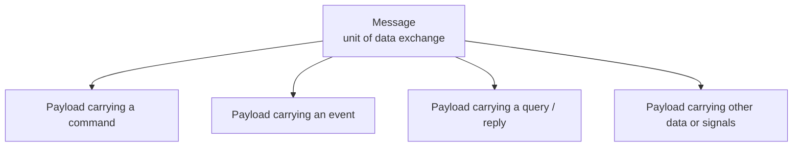
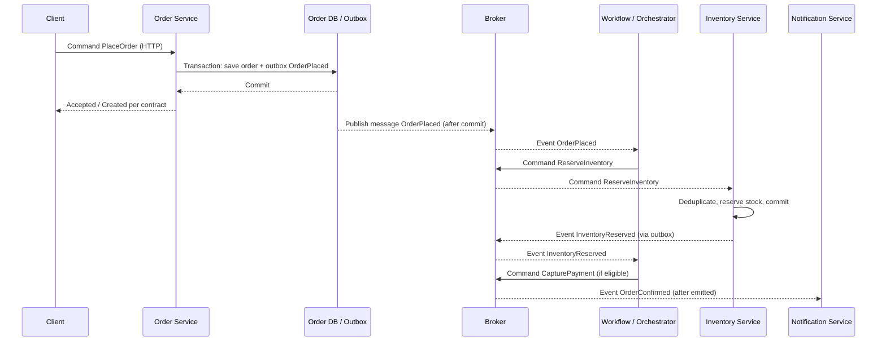
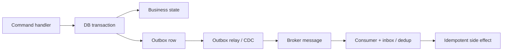

# Distinguishing Between Command, Event, and Message in System Communication

> **Chapter:** Messaging Platforms  
> **Module:** SPRING_BOOT_INTEGRATION — system integration with Spring Boot via HTTP clients, databases, caches, message brokers, and Spring Integration adapters.

## 1. Why Do We Need to Distinguish These Three Concepts?

In an e-commerce system, an application might send a request to **reserve inventory**, announce that an **order has been created**, or transfer a **data packet** from one service to another via Kafka or RabbitMQ. All three can be represented as JSON and travel through the same message broker, yet they carry very different meanings.

- **Command:** one party **requests** the responsible party to perform an action, e.g., `ReserveInventory` — “Please reserve 2 items for this order.”
- **Event:** one party **publishes a fact that has already happened**, e.g., `InventoryReserved` — “Two items have been successfully reserved.”
- **Message:** the unit of data **sent, received, or exchanged** over a communication channel. Commands and events can be packaged into messages; a message can also carry a query, reply, control signal, or other data.

Making the right distinction helps the development team determine who owns the business logic, whether the receiver is required to process it, when an event can be published, how errors/retries should be handled, and what commitments must be made to integrated systems.

### Learning Objectives

After this lesson, you will be able to:

1. Distinguish between command, event, and message by **meaning**, **responsibility**, **point of origin**, and **expected reaction**.
2. Inspect a Spring Boot integration flow to choose the appropriate communication model.
3. Design payload and metadata contracts for versioning, correlation, idempotency, and operational observability.
4. Explain why the broker, queue, topic, and Spring's `Message<T>` do not by themselves determine whether a message is a command or an event.
5. Identify common pitfalls with database transactions, duplicate delivery, processing order, and consistency across systems.

## 2. Exact Definitions

### 2.1. Command: Requesting an Action

**A command expresses intent**: “Please perform X.” A valid command typically specifies the action, required data, responsible party, and an identifier for tracking or duplicate handling.

Examples:

- `CreateOrder`: request to create an order.
- `ReserveInventory`: request to reserve stock.
- `ChargePayment`: request to collect payment.
- `CancelShipment`: request to cancel a shipment.

A command can be **accepted, rejected, expired, failed, or succeeded**. Sending a command does not prove the action succeeded. Even if the broker acknowledges “message received,” that is not yet a business confirmation.

Typically, a command has **one logical business owner**. That owner may run multiple replicas to scale, but all replicas must coordinate as one group handling the same responsibility. If multiple independent services all receive `ChargePayment` and each charges money, the protocol is wrong.

A command can be transmitted over synchronous HTTP or asynchronously via a broker. **A command is not required to go through a queue.**

### 2.2. Event: Announcing a Fact That Has Already Occurred

**An event describes something that has happened** and is usually named in the past tense:

- `OrderPlaced`: an order has been created/placed.
- `InventoryReserved`: inventory has been reserved.
- `PaymentCaptured`: payment has been captured.
- `ShipmentCancelled`: a shipment has been cancelled.

An event is usually emitted by the system that **owns the state** after the actual state transition has succeeded. The producer does not need to know all consumers in advance; multiple consumers can independently decide how to react: update a cache, send an email, write analytics logs, or trigger a new workflow.

An event is **not a disguised command**. If an event is named `UserRegistered` yet the receiver is forced to create an account immediately and no actual registration event has happened, the contract is misusing semantics.

There are two common scopes:

- **Domain event:** represents something meaningful within a bounded context, e.g., `OrderConfirmed` in the orders domain. It may be used internally only.
- **Integration event:** an event intentionally published to external systems with a relatively stable contract, version compatibility, and data reviewed for privacy.

It is not necessary to put an entire domain object or JPA entity into an integration event.

### 2.3. Message: The Unit of Data Exchange

**A message is the form of communication**. A message usually consists of a **payload** and **headers/metadata**. The payload can contain a command, event, query, reply, a batch of data, or a system signal.

In Spring, `org.springframework.messaging.Message<T>` has two basic parts:

- `getPayload()`: the data object.
- `getHeaders()`: metadata such as ID, timestamp, content type, and custom headers.

A Kafka record, RabbitMQ delivery, or HTTP request is also a unit of transmitted data, but the metadata model and acknowledgment behavior of each technology differ. Do not equate Spring's `Message<T>` with a Kafka record or a database object.

**Relationship among them:**



A command or event can be serialized and packaged into a message for sending. The same business event is sometimes transmitted multiple times by different physical messages during retries or replays; therefore, you must distinguish between the **event ID** and the **delivery/message ID**.

## 3. Core Comparison Table

| Criterion | Command | Event | Message |
|---|---|---|---|
| Primary question | “What should be done?” | “What happened?” | “What unit of data is being exchanged?” |
| Nature | Intent/request for an action | Fact that has already occurred | Structure and vehicle carrying data |
| Naming convention | Imperative verb: `ReserveInventory` | Past-tense verb: `InventoryReserved` | Per transport contract: `payload`, `headers` |
| Responsibility | Has one logical business owner | Producer publishes; consumer chooses how to react | Depends on content type and protocol |
| Receiver | Usually has a well-defined logical target | Can have 0, 1, or many subscribers | Any receiver per the transport mechanism |
| Feedback/failure | Must define success, rejection, timeout, and retry handling | Does not “undo” the fact just because one consumer fails | ACK/NACK/retry only indicate transport/processing status |
| Relationship to state | Desires a state change | Records a state/fact that already changed | Carries no state semantics on its own |
| Example | `CapturePayment` | `PaymentCaptured` | Kafka record containing `PaymentCaptured` |

**Key rule:** naming and contract semantics matter more than topic names. A record on an `events` topic can still be a poorly designed command; a message on a queue can be an event.

### 3.1. Command Does Not Mean Request–Reply

A command can be sent over HTTP and receive an immediate result:

```http
POST /inventory/reservations
Content-Type: application/json

{"commandId":"cmd-101","orderId":"ord-42","sku":"SKU-9","quantity":2}
```

HTTP may return `202 Accepted` when the system only **accepts** the request for later processing; `200 OK` or `201 Created` must be tied to a specific contract. An HTTP timeout does not prove the command was not executed.

A command can also travel through Kafka/RabbitMQ without a synchronous response. When you need to know the outcome, you can use a reply message, query status by command ID, or publish a success/failure event. **Events reflect actual outcomes; an ACK from a broker only confirms at the transport layer.**

### 3.2. Event Does Not Mean Publish–Subscribe

Events are often a good fit for pub/sub, but they can still be delivered over a queue or an HTTP webhook. Conversely, a message published to multiple subscriber groups is not necessarily an event: if its content asks all receivers to do the same job, it might be multiple independent commands bundled together.

## 4. Practical Scenario: Placing an Order, Reserving Inventory, and Capturing Payment

Suppose a system has `Order Service`, `Inventory Service`, `Payment Service`, and `Notification Service`.

1. The client sends a `PlaceOrder` command over HTTP to Order Service.
2. Order Service validates the request and saves a `PENDING` order and an `OrderPlaced` event into the outbox within the same database transaction.
3. An outbox publisher process sends a message containing `OrderPlaced` to the broker.
4. A workflow coordinator (or Order Service) sends a `ReserveInventory` command to **Inventory Service**, the proper owner of inventory reservation.
5. Inventory Service processes the command, updates stock data, and then publishes an `InventoryReserved` or `InventoryReservationRejected` event.
6. The workflow receives the result event and decides to send a `CapturePayment` command, confirm the order, or perform compensation.
7. Notification Service can subscribe to `OrderConfirmed` to send an email, without Order Service needing to know details of the email system.



The diagram shows causal relationships, not a guarantee that all steps complete instantaneously. The outbox producer and subsequent steps require separate retries, status checks, and monitoring. In practice, `OrderConfirmed` is only emitted after business confirmation conditions are truly satisfied, **not immediately after `InventoryReserved` if payment is still pending**.

### 4.1. Who Is Allowed to Issue a Command?

A service should only send a command to the party that **owns the action**. For example, Order Service does not directly update Inventory Service's stock table. It sends `ReserveInventory` or reacts to events according to the agreed workflow.

### 4.2. Who Is Allowed to Emit an Event?

The service that owns a fact publishes the event about that fact. Inventory Service emits `InventoryReserved`; Order Service emits `OrderConfirmed` when the order is actually confirmed. An event should not express an outcome that the producer does not know for certain.

### 4.3. Choreography vs. Orchestration

- **Choreography:** services react to each other's events; suited for flows with few steps and simple relationships. You must manage reaction chains and avoid hard-to-observe loops.
- **Orchestration:** a coordinator component holds workflow state and issues commands to action owners; suited when there are many steps, timeouts, and compensations.

The two approaches are not mutually exclusive: an orchestrator can **consume events and issue commands**. The decision depends on workflow complexity, observability, and service independence.

## 5. Designing Command, Event, and Envelope Contracts

A payload needs a clear name, minimal sufficient data, and a contract version. Beyond the payload, a message needs metadata for tracing and duplicate handling.

### 5.1. Command Example

```json
{
  "messageId": "msg-501",
  "kind": "command",
  "type": "inventory.reserve.v1",
  "schemaVersion": 1,
  "createdAt": "2026-11-20T02:30:00Z",
  "correlationId": "order-flow-42",
  "causationId": "evt-401",
  "target": "inventory-service",
  "payload": {
    "commandId": "cmd-501",
    "orderId": "ord-42",
    "sku": "SKU-9",
    "quantity": 2,
    "idempotencyKey": "reserve:ord-42:SKU-9"
  }
}
```

- `commandId` identifies **a business request**, so it stays stable when retrying the same request. A genuinely new request needs a new ID.
- `target` describes the logical owner, without forcing the message to be sent directly to a single specific process.
- `correlationId` links steps across a business flow. `causationId` points to the message/event that triggered the current action; the two concepts are distinct.
- `idempotencyKey` allows the receiver to detect that the same command has already been applied. Do not arbitrarily generate a new key on every transport retry.

### 5.2. Event Example

```json
{
  "messageId": "msg-601",
  "kind": "event",
  "type": "inventory.reserved.v1",
  "schemaVersion": 1,
  "occurredAt": "2026-11-20T02:30:02Z",
  "correlationId": "order-flow-42",
  "causationId": "cmd-501",
  "producer": "inventory-service",
  "subject": "order/ord-42",
  "payload": {
    "eventId": "evt-601",
    "orderId": "ord-42",
    "reservationId": "res-77",
    "sku": "SKU-9",
    "reservedQuantity": 2
  }
}
```

`eventId` represents **an event that occurred** and must remain unchanged when republishing the same event. A republish mechanism may create a new delivery/message ID, but should not turn the same event into multiple distinct business events. `occurredAt` indicates when the event took place, which is not the same as when a consumer receives it or when the broker writes the message.

**The JSON examples above are illustrative contracts only**, not a mandatory envelope standard of Kafka, RabbitMQ, or Spring Integration. In practice, metadata may reside in broker headers rather than the JSON body; standardize encoding, naming, timestamp format, which content is signed/authenticated, and metadata mapping before integrating.

### 5.3. Message ID, Command ID, Event ID: Do Not Use Interchangeably

| ID | Represents | Common Usage |
|---|---|---|
| `messageId` / delivery ID | One message packaging/exchange instance per contract | Transport logging and observability; may change on resend |
| `commandId` | One requested intent to process | Command idempotency, status lookup |
| `eventId` | One unique business event | Consumer deduplication, replay, and audit |
| `correlationId` | One cross-service business process/transaction | Distributed tracing, log correlation, and incident investigation |
| `causationId` | The message/action that directly led to the result | Causal chain analysis |
| `aggregateId` / `orderId` | Business entity | Partition key, data association, relative ordering |

Not every system uses all fields. What matters is defining **stable and unique semantics** for each field used. Do not use correlation ID as a deduplication key for all events of an entire workflow because many valid events can share the same correlation ID.

## 6. Direct Connection to Spring Boot and Spring Integration

### 6.1. Spring Message Carries Content, Not Semantics

`org.springframework.messaging.Message<T>` only describes a payload and headers. Business types are defined by the application, such as a command record:

```java
public record ReserveInventoryCommand(
    String commandId,
    String orderId,
    String sku,
    int quantity
) {}
```

Packaging a command into a Spring message:

```java
import org.springframework.messaging.Message;
import org.springframework.messaging.support.MessageBuilder;

ReserveInventoryCommand command =
    new ReserveInventoryCommand("cmd-501", "ord-42", "SKU-9", 2);

Message<ReserveInventoryCommand> message = MessageBuilder
    .withPayload(command)
    .setHeader("kind", "command")
    .setHeader("type", "inventory.reserve.v1")
    .setHeader("correlationId", "order-flow-42")
    .build();
```

`MessageBuilder` creates an in-application object; merely constructing `Message<?>` **has not sent anything** to Kafka/RabbitMQ. To transmit over the network, you need a configured `MessageChannel`, Spring Integration adapter, Spring Kafka, Spring AMQP, or another appropriate mechanism.

In Spring Integration:

- `MessageChannel` represents an in-application exchange channel.
- `MessageHandler`/service activator processes messages.
- Router selects channels based on headers or payload.
- Gateway/adapter connects internal flows with HTTP, JMS, AMQP, Kafka, or other sources depending on the adapter and supported version.

For example, `DirectChannel` can hand a message to a handler in the same process, **without automatically guaranteeing durability, retries, or at-least-once delivery**. Those depend on the specific channel, adapter, transport, transaction, and configuration.

### 6.2. Command Handler Illustration with Spring Kafka

Assuming the payload has been decoded into a Java record by a compatible serializer/deserializer configuration:

```java
import org.springframework.kafka.annotation.KafkaListener;
import org.springframework.stereotype.Component;

@Component
public class InventoryCommandConsumer {
    private final InventoryService inventoryService;

    public InventoryCommandConsumer(InventoryService inventoryService) {
        this.inventoryService = inventoryService;
    }

    @KafkaListener(
        topics = "inventory.commands.v1",
        groupId = "inventory-service"
    )
    public void onReserve(ReserveInventoryCommand command) {
        // reserveOnce must deduplicate commandId and update inventory
        // within an appropriate DB transaction.
        inventoryService.reserveOnce(
            command.commandId(),
            command.orderId(),
            command.sku(),
            command.quantity()
        );
    }
}
```

This is an **illustrative pattern of consumer responsibility**, not a complete runnable configuration. To run in practice, you must declare broker connections, serialization, error handlers, retry/DLT, schemas, transactions, and result-publishing behavior. `reserveOnce` is a business method implemented by the application, not a built-in Spring API.

Kafka distributes records within the same partition across members of **one consumer group** according to its mechanism; if multiple independent groups subscribe to the command topic, each group may receive a copy. To maintain a single logical owner, you must design topics, groups, and access permissions consistently with the command contract. Do not assume “Kafka guarantees a command is processed only once.”

### 6.3. Event Consumers Can Have Multiple Independent Groups

```java
import org.springframework.kafka.annotation.KafkaListener;
import org.springframework.stereotype.Component;

public record OrderConfirmedEvent(
    String eventId,
    String orderId,
    String customerId
) {}

@Component
public class NotificationEventConsumer {
    private final NotificationService notificationService;

    public NotificationEventConsumer(NotificationService notificationService) {
        this.notificationService = notificationService;
    }

    @KafkaListener(
        topics = "orders.events.v1",
        groupId = "notification-service"
    )
    public void onConfirmed(OrderConfirmedEvent event) {
        notificationService.notifyOnce(event.eventId(), event.orderId());
    }
}
```

Another group (e.g., analytics) can receive the same event without conflicting with the notification group's responsibilities. Both need idempotency mechanisms suited to their own side effects.

The snippet assumes the topic/consumer is routed to **the right event type**; if a topic contains multiple event types, the consumer must classify via headers/type discriminator or an appropriate deserializer/routing mechanism. You cannot assume every record in a topic is an `OrderConfirmedEvent`.

### 6.4. Where Do HTTP Clients, Databases, and Caches Fit?

- **HTTP client (WebClient/RestClient):** can send commands/requests or receive webhooks reporting events; the HTTP protocol does not itself distinguish business semantics.
- **Database:** holds state and transaction boundaries; a successful write is the basis for publishing an event.
- **Cache:** a consumer can receive `ProductPriceChanged` to refresh or invalidate a cache, while still handling delays, duplicates, and errors per policy.
- **Broker:** handles transport/routing/persistence of messages depending on the technology, but does not replace the business owner.
- **Spring Integration adapter:** connects endpoints and transforms/routes messages; adapters do not automatically create valid command/event contracts.

## 7. Queue, Topic, Routing Key, and Consumer Group

Message broker technologies have different models. You must keep **routing** separate from **semantics**.

| Component | Key Point to Understand | Usage Example |
|---|---|---|
| Queue / competing consumers | Multiple workers can share processing messages from one queue; exact mechanics depend on the broker | Workers jointly processing `ReserveInventory` under one owner |
| Pub/sub / fan-out | Multiple logical subscribers can receive the same event | Notification and Analytics receiving `OrderConfirmed` |
| Kafka topic + consumer group | Each group tracks an independent read position; each partition at a given time is typically assigned to one group member | Inventory group handles commands; independent groups consume events |
| RabbitMQ exchange + queue + binding | Exchange routes messages by exchange type/routing key/binding; different queues can receive copies | Fan-out events to multiple queues; commands to the owner's queue |

**There is no universal rule that “command = queue, event = topic” across all brokers.** The choice depends on ownership model, fan-out, ordering, retention, replay, throughput, security, and acknowledgment semantics.

Topic/queue names can suggest intent (`inventory.commands.v1`, `orders.events.v1`), but the **contract** must accurately describe the producer, receivers, schema, and error handling.

## 8. Delivery, ACK, and Idempotency

### 8.1. A Message Can Be Processed More Than Once

In distributed systems, a producer may not know whether the broker wrote a message if the connection drops. A consumer may process and commit to its database yet crash before acknowledging/committing the offset. After restart, the same message may be redelivered.

Common delivery guarantees:

- **At-most-once:** messages may be lost, avoiding redelivery under certain configurations.
- **At-least-once:** attempts redelivery when unacknowledged, so consumers must tolerate **duplicates**.
- **Scoped exactly-once:** some brokers/transactions support it within a well-defined scope; **it does not automatically guarantee** that external side effects like HTTP calls, payment charges, or writes to another database occur only once.

A command may need to be reprocessed without triggering duplicate actions; the same applies to event consumers. For example, receiving `PaymentCaptured` twice must not issue two refund requests just because a message was redelivered.

### 8.2. Business-Level Idempotency

For a `ReserveInventory` command, the receiver records the `commandId` or idempotency key in the same transaction as the inventory change. If the key has already been processed successfully, the consumer returns the prior state or skips the duplicate effect, per the contract.

An illustrative tracking table:

```sql
CREATE TABLE processed_messages (
    consumer_name VARCHAR(120) NOT NULL,
    business_message_id VARCHAR(160) NOT NULL,
    processed_at TIMESTAMPTZ NOT NULL DEFAULT NOW(),
    PRIMARY KEY (consumer_name, business_message_id)
);
```

Workflow within **a single transaction on the same database**:

1. Attempt to insert (`consumer_name`, `commandId` or `eventId`) protected by a unique constraint.
2. If it already exists, skip the **duplicate side effect** according to the stored result.
3. If the key is new, execute the required business updates and commit.
4. ACK the message **after** the business transaction succeeds, matching the consumer's mechanism.

If the business step fails, both the processed marker and the business update must roll back together; if the marker is saved first and remains committed when the transaction fails, a retry could be wrongly skipped. For side effects outside the database (sending email/HTTP), a deduplication table alone does not guarantee the external effect happens only once; you need target-side idempotency, an outbox, or a compensation workflow.

### 8.3. Command Failures Differ from Event Consumer Failures

- **Command business rejection:** insufficient stock, invalid account, expired request. You need a meaningful outcome such as `InventoryReservationRejected`, command status, or an error reply per contract. Do not infinitely retry a deterministic data error.
- **Command transient error:** temporary database/network outage. Retry with backoff and a retry limit while preserving the command ID.
- **Event consumer failure:** an event that happened remains a fact. The consumer needs retries, dead-lettering, or a reprocessing workflow; do not ask the producer to “retract” an event just because one subscriber failed to update its cache.

## 9. Database Transactions, Outbox, and Inbox

Successfully sending a command/event to a broker and committing a database transaction **do not naturally belong to a single atomic transaction**.

Faulty example:

```text
1. UPDATE orders SET status = 'CONFIRMED'
2. COMMIT
3. publish OrderConfirmed
```

If the process crashes after step 2 and before step 3, the database has confirmed the order while the event may be lost. Reversing the order to publish before commit creates the opposite risk: consumers receive an event about uncommitted state that later rolls back.

### Transactional Outbox

Within a single database transaction, write the **business update** and the **outbox record** together. A relay reads the outbox, publishes to the broker, and updates the publication status. The relay may republish when unsure whether the broker received the message, so consumers must still deduplicate.



An inbox/dedup at the consumer supports safe reprocessing. An outbox does not by itself solve ordering across all aggregates, atomicity across multiple databases, or external side effects. For long command/event chains, you need workflow state design (saga), timeouts, compensation, and reconciliation.

**Point of distinction:** an outbox record is data staged for **publishing a message**; an event inside reflects a fact that occurred. An outbox table does not turn every record into an “event”; in some designs, an outbox can also hold commands to be sent after commit.

## 10. Event Ordering, Time, and Replay

- **Ordering:** many brokers only guarantee ordering within a partition/queue under specific conditions. With Kafka, choose a stable aggregate key such as `orderId` if events for one order must land in the same partition. Do not assume global ordering across all orders.
- **Out-of-order:** `OrderConfirmed` may reach a consumer before another event if they traverse different topics, relays, groups, or network paths. Consumers need versions, per-aggregate sequence numbers, or reconciliation logic when data arrives out of expectation.
- **Replay:** long-retained events can be replayed to rebuild projections, but consumers that send emails, charge payments, or call external APIs must not re-execute unintended side effects. Distinguish rebuildable projections from actions affecting the real world.
- **Clock:** `occurredAt` helps observability, but service clocks are not a reliable basis for absolute ordering. Use aggregate versions/sequences when the contract requires sequence control.
- **Retention:** Kafka can retain logs by time/size; many queue systems remove messages upon completion and ACK. Do not assume replay capability across every broker.

## 11. Versioning and Contract Compatibility

Commands and integration events are **contracts between systems**. Producers and consumers are not necessarily deployed simultaneously.

Practical principles:

1. Include a clear `type` and `schemaVersion` or an agreed version-registry mechanism.
2. Compatible changes such as **adding optional fields** tend to be lower risk than renaming/removing fields or changing the semantics of existing fields; compatibility also depends on schema/serialization rules.
3. If a breaking contract change is necessary, create a new version and plan a migration, using temporary dual publish/consume when needed.
4. Do not couple event payloads to internal JPA/entity classes; publish only fields needed by consumers.
5. Do not put passwords, tokens, unnecessary PII, card details, or sensitive data into messages/logs; apply appropriate ACLs, encryption, and retention policies.
6. For commands, clearly specify preconditions, deadlines, expected version (if using optimistic concurrency), and behavior on duplicate command delivery.
7. For events, clearly specify **when the event is considered to have occurred**, source of truth, field meanings, and how consumers detect stale vs. newer versions.

Distinguish **event notification** (simply signaling “changed, query the source”) from **event-carried state transfer** (carrying enough data to update projections). Notification reduces attached data but adds HTTP/database lookups; state transfer reduces synchronous dependencies but increases contract maintenance and late-event handling responsibilities.

## 12. Observability: Tracing from Command to Event

Each step needs adequate information to investigate “received but not processed,” “processed but no event emitted,” or “consumer processed twice.”

| Metric / Signal | Meaning |
|---|---|
| Command accepted/rejected/expired | Distinguishes acceptance, rejection, and business outcome |
| Producer publish success/failure | Message publication status; not equivalent to business outcome |
| Consumer lag, retry, dead-letter | Backlog level and timely processing health |
| Outbox age and pending record count | Ability to propagate committed facts to the broker |
| Duplicate-detection count | Degree of duplication from retries/replays or producers |
| Handler processing latency, error category | Latency and actual failure causes |
| `correlationId`, `causationId`, trace/span | Links the request–command–event–subscriber chain |

In Spring Boot, you can use Actuator/Micrometer and centralized tracing systems. Whether trace context propagates automatically across brokers or Spring Integration adapters **depends on versions, instrumentation, and configuration**; verify it in practice. Logs should capture useful IDs and statuses while avoiding logging full payloads containing sensitive data.

## 13. Testing Contracts and Integration Flows

| Test Case | Result to Verify |
|---|---|
| Receive valid `ReserveInventory` | Handler updates inventory properly and publishes result after commit |
| Command rejected due to out-of-stock | No unauthorized inventory change; rejection outcome matches contract |
| Producer resends same `commandId` | Inventory is not reserved twice |
| Consumer receives same `eventId` again | Side effect is not repeated, or reaches the same desired state |
| Consumer crashes after DB commit, before ACK | Safe retry with no lost progress |
| DB commits, broker temporarily down | Outbox retains data and resumes publishing when broker recovers |
| Receive old/new schema versions | Deserializer/consumer operates per compatibility contract |
| Out-of-order events, replay | Projection handles version/sequence or reconciles properly |
| Two independent subscribers receive same event | Each group handles its own task without affecting the other's ACK |
| Broker down / consumer lag rises | Retries, alerts, timeouts, and dead-lettering follow defined thresholds |

Combine **unit tests for command handler logic**, **contract tests for schema/version**, **integration tests using production-equivalent brokers/databases** (e.g., appropriate Testcontainers), plus retry, crash, and concurrent duplicate tests. Do not merely assert calls to `KafkaTemplate.send()` or `MessageChannel.send()`; verify business state and consequences when messages are replayed.

## 14. Common Misconceptions That Cause Bugs

| Misconception | Correct Understanding |
|---|---|
| “Sending an event means asking another service to do work.” | Events announce facts; use a command when asking an owner to execute work. |
| “Once a command is sent, it's done.” | Broker ACK and application business completion are two distinct points in time. |
| “A message can only be an event.” | A message is a transport unit; it can carry a command, event, query, reply, or other data. |
| “Kafka topic = event, RabbitMQ queue = command.” | Routing mechanisms do not determine payload semantics. |
| “`@KafkaListener` processes exactly once.” | Delivery/rebalance/retry can cause duplicates; proper idempotency and transaction scoping are required. |
| “If a consumer fails, the event didn't happen.” | The producer may have already committed the fact; consumer failures must be handled independently. |
| “`@Transactional` covers both DB and any broker.” | The DB/broker boundary requires an outbox or explicitly designed coordination. |
| “Same correlation ID means duplicate event.” | Correlation ID ties steps of the same flow; deduplication must rely on the proper event/command ID. |
| “Sharing one JSON across everyone forever is convenient.” | Public contracts require versioning, privacy controls, and avoiding exposing internal structures. |

## 15. How to Choose for a New Integration Requirement

When designing a Spring Boot endpoint, handler, or adapter, answer in order:

1. **Do we want a party to do something, or do we want to announce something that already happened?** If an owned action is needed, use a command; if a fact has committed and needs broadcasting, use an event.
2. **Who owns the state and who decides success?** Never let a broker or secondary subscriber decide on behalf of the business owner.
3. **Do one or multiple independent subscribers need the information?** Design routing, consumer groups, and queues/topics accordingly; do not infer semantics solely from the broker.
4. **How do we distinguish acceptance from completion?** Define ACK, outcomes, timeouts, command status, and response events if needed.
5. **What if messages are duplicated, delayed, or out of order?** Ensure command/event IDs, deduplication, schema versions, ordering keys, or reconciliation steps.
6. **What if the database commits but the broker fails?** Use an outbox or equivalent reliable mechanism; clearly define transaction boundaries.
7. **Is it observable and testable?** Establish correlation/causation IDs, metrics, logs, traces, and failure injection cases.

### Quick Self-Check

**Scenario A:** `Billing Service` sends `ChargeCustomer` to `Payment Service`. This is a **command** because it asks an owner to execute an action that can succeed or be rejected.

**Scenario B:** `Payment Service` completes charging and emits `PaymentCaptured` for Order/Accounting/Notification. This is an **event** because it publishes a fact; consumers independently decide their reactions.

**Scenario C:** A Kafka record contains `PaymentCaptured` with key `paymentId` and header `correlationId`. This is a **transport-level message** whose payload carries an event. The key and header aid partitioning/tracing without changing the event's nature.

**Scenario D:** Client POSTs `/orders`, the service returns `202 Accepted`, and enqueues `PlaceOrder`. The HTTP response only confirms receipt of the command per contract; **OrderPlaced** should only be published after the order is actually created.

The core takeaway of **Messaging Platforms** in `SPRING_BOOT_INTEGRATION`: **a command describes an intent to execute, an event records a fact that occurred, and a message is the vehicle carrying the content**. When combining Spring Boot, HTTP, databases, caches, brokers, and Spring Integration, this boundary enables sound contracts, consistent transactions, controlled duplicate handling, and end-to-end observability across the entire integration flow.
