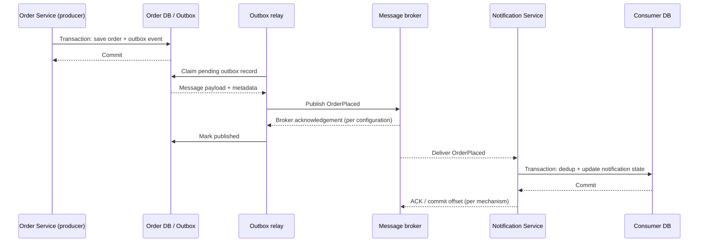
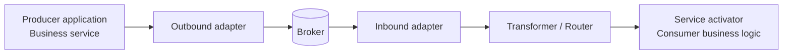
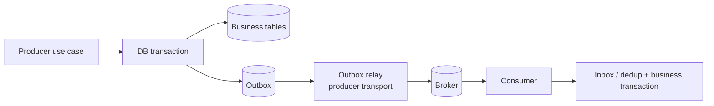
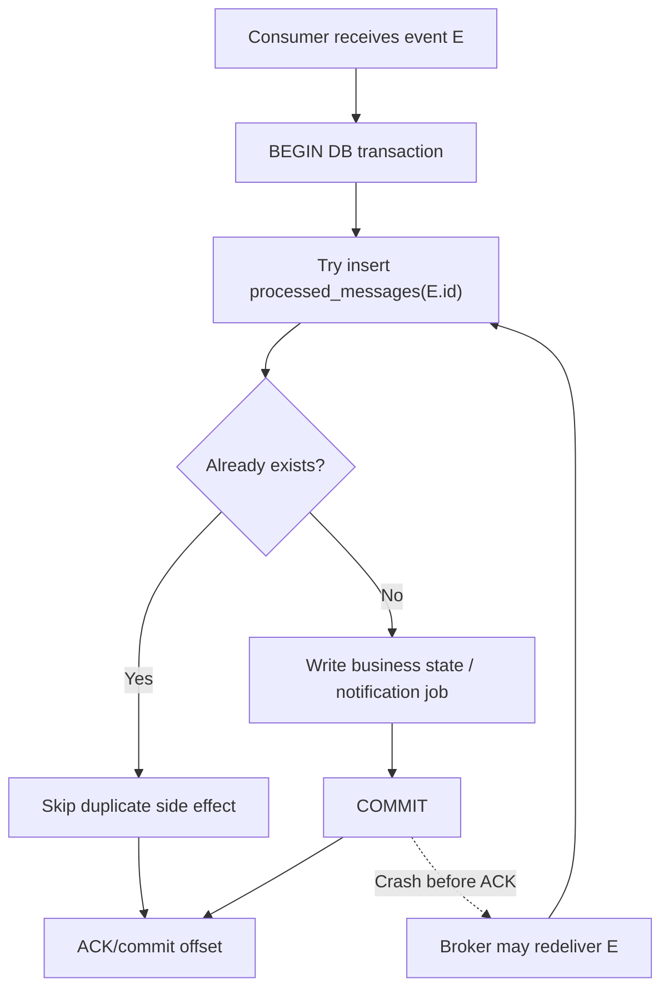

# Producer, Broker, Consumer, and Each Component's Responsibilities

> **Chapter:** Messaging Platforms  
> **Module:** `SPRING_BOOT_INTEGRATION` — organizing system integration in Spring Boot via HTTP clients, databases, caches, message brokers, and Spring Integration adapters. The lesson focuses on configuration, data contracts, transactions, errors, duplicate prevention, testing, and observability of message flows.

## 1. Why Must the Three Roles Be Clearly Separated?

An order is successfully placed on a website. The order service needs to notify inventory, notification, and analytics systems that the order has been created. Instead of calling each party over HTTP sequentially and waiting for all responses, the service can publish a message through a message broker. The remaining systems consume it at their own processing pace.

In this model there are three roles:

- **Producer:** creates a contract-compliant message, chooses where to send it, and is responsible for handling the publish result.
- **Broker (intermediary infrastructure):** receives, routes, stores, and delivers messages according to the capabilities and configuration of the technology used.
- **Consumer:** reads the message, validates and applies the business action, handles errors/duplicates, and acknowledges progress to the broker.

These three roles are decoupled so the sender does not need to know every implementation detail of the receivers. However, **decoupling does not mean automatically reliable**. A producer may not know if the broker persisted a message when a connection drops; a broker may redeliver messages; a consumer may write to its database successfully and crash before ACKing. Contracts, state, idempotency, and observability still must be designed.

### Learning Objectives

After this lesson, you will be able to:

1. State the specific responsibilities of producer, broker, and consumer, along with what each component does **not** guarantee.
2. Distinguish producer acknowledgment, broker recording, and business outcome at the consumer.
3. Design a message envelope with event/command ID, schema version, correlation ID, and partition/routing key.
4. Configure and demonstrate producers/consumers using Spring Boot and Spring Kafka; understand differences with RabbitMQ and Spring Integration adapters.
5. Organize transactions, outbox/inbox, retries, dead-lettering, and idempotency in integration flows.
6. Test failure gaps across databases, HTTP, brokers, and consumers.

## 2. Overview of a Message's Lifecycle



The diagram shows **three distinct success milestones**:

1. **Producer business state committed:** the order is created and the outbox record is saved. Does not mean the message has reached the broker.
2. **Broker acknowledges receipt/persistence of the message:** the acknowledgment level depends on the broker and configuration, e.g., Kafka `acks` or RabbitMQ publisher confirms. Does not mean the consumer has processed it.
3. **Consumer completes business work and acknowledges progress:** e.g., saved the notification to its database and then committed the offset or ACKed. Does not mean all other consumers have finished as well.

When not using an outbox, a producer may publish directly to the broker. In that case, you must clearly understand the gap between the database transaction and the publish operation.

### 2.1. Message, Command, and Event Are Not Synonymous

A **Message** is the unit transported: payload and metadata. It can contain:

- **Command:** requests an owner to execute an action, e.g., `ReserveInventory`.
- **Event:** announces a fact that happened, e.g., `OrderPlaced` or `InventoryReserved`.
- **Query/reply** or other synchronization data.

Producer, broker, and consumer are **roles in the communication pipeline**; command and event are **the business semantics of the content**. A Kafka record with payload `ReserveInventory` is still a message carrying a command, even though it sits on a topic. A RabbitMQ delivery containing `OrderPlaced` can still be a message carrying an event, even though it goes through a queue.

## 3. Producer: Creating Messages and Owning Publication

The producer is the component that initiates sending. In Spring Boot, a producer can be a service calling `KafkaTemplate`, `RabbitTemplate`, `JmsTemplate`, or a Spring Integration outbound adapter. With the outbox pattern, the relay publishing messages is also the **producer at the broker boundary**, even though the business event was created earlier by another service.

### 3.1. What Must the Producer Do?

| Responsibility | Explanation | Verification Question |
|---|---|---|
| Determine publish timing | Events are published only after the fact has occurred; commands must carry clear intent | Has `OrderPlaced` actually been committed? |
| Build data contract | Correct `type`, `schemaVersion`, required fields, content type | Can older consumer versions understand the payload? |
| Generate stable IDs | `eventId`/`commandId` stays unchanged when retrying the same business work | Will resending be treated as a new job? |
| Set address and key | Deliberately choose topic/exchange/queue, key/routing key | Do messages for the same order need relative ordering? |
| Serialize and protect data | JSON/Avro/Protobuf per contract; exclude unnecessary secrets/PII | Is the data safe for retention/replay? |
| Handle publish result | Observe success/failure/timeout; bound retries | Did the broker receive it, or did the producer merely issue a request? |
| Recover on uncertain outcome | Have an outbox or idempotent operation for safe republication | What if the publish response is lost after the broker persisted it? |
| Observe | Log `messageId`, `eventId`, `correlationId`, metrics, and latency | Can we locate where a message is stuck? |

### 3.2. Producer Acknowledgment Differs from Consumer Acknowledgment

Suppose a producer receives a successful result from `KafkaTemplate.send(...)`. That confirms the send was handled by the broker per client settings—it does **not** confirm Notification Service has sent the email. Similarly, RabbitMQ publisher confirms prove the broker acknowledged the publish per broker mechanics; consumer acknowledgment is a separate mechanism.

Model clearly what your API returns:

- `202 Accepted` can express that the request has been recorded for later processing, provided the application genuinely has an appropriate accepted state.
- `201 Created` might only mean a business record was created.
- “Broker publish OK” is not equivalent to “receiver's transaction committed.”

Never return “Email sent successfully” immediately when the producer has only just published an event requesting an email to be sent.

### 3.3. Producer Must Protect Idempotency on Retries

Suppose a producer emits `OrderPlaced` with `eventId = evt-42`. If a network timeout occurs after the broker wrote the message, the application may **not know for sure** whether publishing succeeded. On retry, it must continue using the same `eventId`, even though the broker may receive two physical messages. Consumers use the event ID to prevent duplicate effects.

A broker's **idempotent producer** is a different optimization from **business idempotency**. For instance, Kafka producer idempotence helps prevent duplicate writes within a specific producer scope and session, but does not by itself prevent an application from generating two new business events or replaying an outbox record from a different producer session.

## 4. Broker: Transport, Routing, and Storage Intermediary

A broker is infrastructure that accepts messages from producers and provides them to consumers according to the technology's model: topics/partitions/logs in Kafka, exchanges/queues/bindings in RabbitMQ, or destinations in a JMS provider.

### 4.1. What Is the Broker Typically Responsible For?

- **Ingestion and routing:** accepts publish requests; determines targets based on topic, partition, exchange, routing key, or subscriptions.
- **Storage/buffering:** holds data per persistence policies, retention, queue durability, and resource limits.
- **Delivery:** delivers messages to consumers; manages partition assignments, subscriptions, or deliveries.
- **Consumption progress:** tracks or supports storing offsets/acknowledgments per broker mechanisms.
- **Load handling:** enforces throughput limits, queue lengths, disk capacity, flow control, and quotas.
- **Security and operations:** authentication, authorization, TLS, monitoring, and resilience per cluster configuration.

These responsibilities do **not** include enforcing rules like “only ship orders that are paid” or guaranteeing that an external HTTP side effect happens strictly once. Those belong to the producer/consumer applications and integration contracts.

### 4.2. Brokers Do Not Share Identical Semantics

| Aspect | Apache Kafka | RabbitMQ (common AMQP 0-9-1) |
|---|---|---|
| Organizational unit | Topic composed of partitions; records appended to a log | Producer publishes to an exchange; exchange routes to queues via bindings |
| Reading model | Consumers read by offset; records retained per retention policy | Consumers receive deliveries from a queue; messages are normally removed after processing and ACK per policy |
| Consumer groups | Members of the same group share partition assignments | Multiple consumers on the same queue typically compete for deliveries |
| Fan-out | Multiple independent groups read the same topic | Bind multiple queues to an exchange so each queue receives appropriate copies |
| Replay | Can re-read records still within retention via offsets | Standard queues do not provide a replay log like Kafka; other mechanisms must be designed separately |
| Ordering | Ordered within a single partition log | Depends on queue, consumer count, prefetch, redelivery, and specific conditions |
| Failure/continuation | Offset commit, retry topics/DLT per application | ACK/NACK, requeue, TTL/DLX/DLQ per configuration |
| Durable delivery | Depends on replication, ISR, producer ack, and cluster config | Depends on durable queue/type, persistent messages, publisher confirms, and broker config |

The table describes two common models and does not imply every Kafka/RabbitMQ deployment always has durability, HA, or exactly-once enabled out of the box. For example, in Kafka, `acks=all` must be paired with proper replication and `min.insync.replicas`; a topic with a single replica does not provide the same fault tolerance as a replicated cluster.

**JMS** is a Java messaging API/specification, not a specific broker. Spring JMS connects to a JMS provider, and ACK/persistence/transaction characteristics depend on the provider and configuration.

### 4.3. A Broker Is Not a Business Database

Kafka keeps a log with retention, while a RabbitMQ queue keeps messages per its lifecycle/conditions. Even when messages are persisted, a broker **does not replace** the order status table, payment ledger, or application source of truth. Kafka can serve as the event store of a purposely designed event-sourced architecture, but that is an architectural decision requiring projections, schemas, replay, and operational procedures—not the default for every topic.

## 5. Consumer: Turning Messages into Business Outcomes

The consumer is the component that receives/reads messages and decides how to react. In Spring Boot, a consumer can be a `@KafkaListener`, `@RabbitListener`, JMS listener, or Spring Integration inbound adapter.

### 5.1. Consumer Responsibilities

| Step | What to Do | If Skipped |
|---|---|---|
| Decode and validate contract | Check serializer, content type, schema version, fields, processing permissions | May execute invalid data or loop endlessly on decode errors |
| Identify business message identity | Extract `eventId`/`commandId` and aggregate key | Difficult to detect duplicates or enforce ordering |
| Deduplicate | Unique constraint/inbox/dedup by consumer and message ID | Retries may send emails, reserve stock, or charge money twice |
| Apply business logic | Write DB, call services, refresh cache within proper transactions/boundaries | ACKing before an actual outcome exists |
| Classify errors | Retryable, non-retryable, poison message, uncertain-outcome timeout | Infinite retries or lost messages |
| Acknowledge progress | ACK/commit offset after meeting completion criteria | Crashes may cause unexpected lost or duplicated work |
| Observe | Logs, metrics, traces, lag/queue depth, retries, DLT/DLQ | Cannot pinpoint bottlenecks |

**A logical consumer can run across multiple replicas.** With Kafka, members of the same group typically divide partitions among themselves—that does not mean each record is processed strictly once. With RabbitMQ, multiple workers on the same queue receive distinct deliveries, yet redelivery can occur if a worker dies before ACKing.

### 5.2. Consumers Must Distinguish Business Errors from Technical Errors

For example, `ReserveInventory`:

- Insufficient stock is a **business outcome**: record the rejection and publish `InventoryReservationRejected` if required by the contract; do not endlessly retry with the same data.
- A database timeout is a **recoverable technical error**: retry with backoff when the operation is idempotent.
- Unparseable JSON is a **contract error**: route to controlled quarantine/dead-letter storage instead of calling the business service.
- Partner call timing out after the partner may have processed it is an **uncertain outcome**: reconcile or use an idempotency key when retrying.

### 5.3. ACK/Offset Differs from Database Transactions

A common scenario:

```text
Consumer receives event E
→ UPDATE notification_status in database
→ COMMIT succeeds
→ Consumer crashes before ACK/offset commit
→ Broker redelivers E
```

If the consumer lacks deduplication, the effect of E may be executed twice. Committing the DB and ACKing the broker are typically **two operations in two separate systems**. A broker's transaction mechanism does not automatically make side effects on PostgreSQL/HTTP exactly-once.

Pragmatic rule: **apply business logic idempotently, then acknowledge progress per the configured consumer mechanism**. Do not treat listener invocation as proof of completed processing.

## 6. What Must a Message Contract Contain?

An illustrative message envelope for an order event:

```json
{
  "messageId": "msg-1042",
  "kind": "event",
  "type": "order.placed.v1",
  "schemaVersion": 1,
  "occurredAt": "2026-11-20T03:15:00Z",
  "producer": "order-service",
  "correlationId": "checkout-flow-88",
  "causationId": "cmd-place-88",
  "aggregateId": "order-88",
  "payload": {
    "eventId": "evt-order-88",
    "orderId": "order-88",
    "customerId": "customer-12",
    "totalAmount": "125.50",
    "currency": "USD"
  }
}
```

This is an **example contract**; there is no requirement that every broker or Spring application use this exact JSON. Metadata can live in broker headers rather than the body.

| Field | Meaning | Note |
|---|---|---|
| `type` and `schemaVersion` | Identifies content and version | Consumers must have a compatibility policy |
| `eventId` / `commandId` | Business action/event identity | Remains stable across retries of the same event/command |
| `messageId` | Envelope/message identity per contract | May change across a republish; do not arbitrarily substitute for event ID |
| `aggregateId` / `orderId` | Business entity identity | Can serve as Kafka partition key when per-aggregate order is needed |
| `correlationId` | Links steps within the same workflow | Multiple valid messages may share one correlation ID |
| `causationId` | Trace of the action/event that directly triggered this one | Useful when investigating event chains |
| `occurredAt` | Time the event happened | Not equivalent to when the broker wrote or consumer received it |
| `producer` | Declared emitting source | Does not replace transport-level authentication |

Do not include card details, passwords, access tokens, or unnecessary PII in payloads/logs. Data in long-retention topics or dead-letter stores may persist longer than expected if retention is not configured properly.

### 6.1. Partition Key and Routing Key Serve Different Purposes

- **Kafka key:** commonly used to select the partition. If multiple events for the same order must preserve log order, a stable key like `orderId` helps route them to the same partition under a consistent partitioner. There is no global ordering across all partitions.
- **RabbitMQ routing key:** used together with exchange type and bindings to decide target queues. It is **not equivalent** to a Kafka partition key. With a fan-out exchange, the routing key may not participate in routing decisions the way direct/topic exchanges do.

Setting keys is a choice in the **transport contract** that must align with business design, rather than picking arbitrarily when calling a template.

## 7. Spring Boot Configuration and Dependencies by Technology

Spring Boot provides starters/auto-configuration, externalized configuration, and common beans; specialized libraries implement the APIs. Boot **does not automatically create durable topics, business retries, or an outbox** simply because a dependency was added.

### 7.1. Gradle Example for Kafka

```gradle
dependencies {
    implementation("org.springframework.boot:spring-boot-starter-web")
    implementation("org.springframework.kafka:spring-kafka")
    implementation("org.springframework.boot:spring-boot-starter-actuator")

    // If the consumer stores inbox/outbox via JPA:
    implementation("org.springframework.boot:spring-boot-starter-data-jpa")
    runtimeOnly("org.postgresql:postgresql")

    testImplementation("org.springframework.boot:spring-boot-starter-test")
    testImplementation("org.springframework.kafka:spring-kafka-test")
}
```

Gradle Groovy DSL syntax; assumes dependency versions are managed by the project's current Spring Boot BOM/dependency management. Depending on the Spring Boot version, starter names and support details may vary; the example uses the Spring Kafka module directly for illustration.

### 7.2. application.yml for Kafka with String JSON

```yaml
spring:
  kafka:
    bootstrap-servers: ${KAFKA_BOOTSTRAP_SERVERS:localhost:9092}
    producer:
      key-serializer: org.apache.kafka.common.serialization.StringSerializer
      value-serializer: org.apache.kafka.common.serialization.StringSerializer
      acks: all
      properties:
        enable.idempotence: true
    consumer:
      key-deserializer: org.apache.kafka.common.serialization.StringDeserializer
      value-deserializer: org.apache.kafka.common.serialization.StringDeserializer
      enable-auto-commit: false
      auto-offset-reset: earliest
    listener:
      ack-mode: record
```

This example configuration uses JSON payloads serialized as `String`. It **does not configure broker clusters, topic replication, TLS/SASL, retry/DLT, or database transactions**. `ack-mode: record` means the listener container records offsets per record after the listener processes successfully per container mechanics (with auto-commit disabled); you cannot infer that external side effects outside Kafka have been committed atomically.

`auto-offset-reset: earliest` is only consulted when a consumer group **has no valid committed offset**—it does not cause a consumer to re-read the entire log on every startup. In production, choose policies matching your data semantics and recovery procedures.

## 8. Spring Kafka Producer Example: Publishing an Event

Suppose the application creates an event record:

```java
public record OrderPlacedEvent(
    String eventId,
    String orderId,
    String customerId,
    int schemaVersion
) {}
```

The producer uses `KafkaTemplate<String, String>` and Jackson to convert the event into JSON:

```java
import com.fasterxml.jackson.core.JsonProcessingException;
import com.fasterxml.jackson.databind.ObjectMapper;
import java.util.concurrent.CompletableFuture;
import org.springframework.kafka.core.KafkaTemplate;
import org.springframework.kafka.support.SendResult;
import org.springframework.stereotype.Service;

@Service
public class OrderEventPublisher {
    private final KafkaTemplate<String, String> kafkaTemplate;
    private final ObjectMapper objectMapper;

    public OrderEventPublisher(KafkaTemplate<String, String> kafkaTemplate,
                               ObjectMapper objectMapper) {
        this.kafkaTemplate = kafkaTemplate;
        this.objectMapper = objectMapper;
    }

    public CompletableFuture<SendResult<String, String>> publish(
            OrderPlacedEvent event) {

        try {
            String json = objectMapper.writeValueAsString(event);
            return kafkaTemplate.send(
                "orders.events.v1",
                event.orderId(), // key: same order typically lands in the same partition
                json
            );
        } catch (JsonProcessingException e) {
            return CompletableFuture.failedFuture(e);
        }
    }
}
```

The example uses modern Spring Kafka's `CompletableFuture` API. Real applications must verify the Spring Kafka version and that template/serializer beans are auto-configured properly. This producer **only publishes the message**; it neither writes an outbox nor guarantees the event was committed in a DB.

The caller must observe the future and classify errors:

```java
publisher.publish(event).whenComplete((result, error) -> {
    if (error != null) {
        // Log/metric, update outbox to retry per policy.
        recordPublishFailure(event.eventId(), error);
    } else {
        // Only a publish confirmation per broker/client settings.
        recordPublishAck(event.eventId(), result.getRecordMetadata().offset());
    }
});
```

`recordPublishFailure` and `recordPublishAck` are illustrative methods defined by the project. When using an outbox relay, marking `PUBLISHED` must be **durably persisted**, with retry handling and safe record claiming across multiple instances. An isolated in-memory callback does not replace an outbox mechanism.

### 8.1. Ensuring the Producer Does Not Report Success Too Early

An anti-pattern:

```java
kafkaTemplate.send("orders.events.v1", orderId, json);
return ResponseEntity.ok("Notification sent successfully");
```

The `send` call is asynchronous; the response above both ignores possible publish failures and falsely claims the notification was sent. If an endpoint only accepts a request, the HTTP contract should clearly express the corresponding **success milestone** and provide a job ID/status if needed.

## 9. Spring Kafka Consumer Example: Business-Level Single Processing

The consumer reads JSON from the topic and passes it to a service handling the data:

```java
import com.fasterxml.jackson.core.JsonProcessingException;
import com.fasterxml.jackson.databind.ObjectMapper;
import org.springframework.kafka.annotation.KafkaListener;
import org.springframework.stereotype.Component;

@Component
public class NotificationEventConsumer {
    private final ObjectMapper objectMapper;
    private final NotificationService notificationService;

    public NotificationEventConsumer(ObjectMapper objectMapper,
                                     NotificationService notificationService) {
        this.objectMapper = objectMapper;
        this.notificationService = notificationService;
    }

    @KafkaListener(
        topics = "orders.events.v1",
        groupId = "notification-service"
    )
    public void onMessage(String json) throws JsonProcessingException {
        OrderPlacedEvent event =
            objectMapper.readValue(json, OrderPlacedEvent.class);

        if (event.schemaVersion() != 1) {
            throw new IllegalArgumentException("Unsupported schema version");
        }

        notificationService.recordOnce(event);
    }
}
```

Key points:

- `NotificationService.recordOnce(...)` is a **project-implemented** service that must be idempotent and only complete after the required DB transaction has committed.
- Parse/schema exceptions should not be retried infinitely; configure a classifying error handler, dead-letter topic/quarantine, and alerts per contract.
- With `ack-mode: record` from the earlier configuration example, the listener container handles offsets per its configuration after the listener returns normally. This does **not** create an atomic transaction with PostgreSQL.
- If a topic contains multiple event types, you must classify `type` before parsing into `OrderPlacedEvent`. The code snippet assumes the topic contains only the corresponding event schema.
- When a consumer performs side effects outside the database (sending email/HTTP), you need idempotency at the target system or a saved job/outbox; saving `eventId` alone before making an HTTP call cannot by itself guarantee exactly-once.

### 9.1. Designing recordOnce with a Database

A dedicated deduplication table for the consumer:

```sql
CREATE TABLE processed_messages (
    consumer_name VARCHAR(120) NOT NULL,
    event_id VARCHAR(160) NOT NULL,
    processed_at TIMESTAMPTZ NOT NULL DEFAULT CURRENT_TIMESTAMP,
    PRIMARY KEY (consumer_name, event_id)
);
```

For a consumer using PostgreSQL, within **one database transaction** you can:

1. Try inserting `(consumer_name, event_id)` using an operation safe under a unique constraint.
2. If the key already exists because it was processed successfully, skip the duplicate side effect.
3. If the key is new, update the projection or insert a notification job **within the same transaction**.
4. Commit, then let the listener confirm the offset per policy. If the DB fails, roll back both deduplication and business work so the next delivery gets a chance to process.

On PostgreSQL, `INSERT ... ON CONFLICT DO NOTHING` can distinguish a new insert from a duplicate. If the side effect calls an external API, a transactional outbox for outbound jobs or target-side idempotency keys helps narrow the DB–HTTP gap.

Do not use a workflow-wide `correlationId` as the deduplication key, because multiple valid events for the same order may share that ID.

## 10. Comparison with RabbitMQ Producer and Consumer

A Spring Boot application can also use Spring AMQP. A producer example using `RabbitTemplate` sends to a preconfigured exchange/routing key:

```java
import org.springframework.amqp.rabbit.core.RabbitTemplate;
import org.springframework.stereotype.Service;

@Service
public class RabbitOrderPublisher {
    private final RabbitTemplate rabbitTemplate;

    public RabbitOrderPublisher(RabbitTemplate rabbitTemplate) {
        this.rabbitTemplate = rabbitTemplate;
    }

    public void publishJson(String eventId, String json) {
        rabbitTemplate.convertAndSend(
            "orders.events.exchange",
            "order.placed",
            json,
            message -> {
                message.getMessageProperties().setMessageId(eventId);
                return message;
            }
        );
    }
}
```

This example uses a `String` payload; RabbitMQ exchanges, queues, bindings, content types/serializers, persistent delivery, and publisher confirms must be configured for real infrastructure. `messageId` is set to a stable event ID per the illustrative contract; distinguish event ID from order ID so multiple valid events for the same order are not mistaken for duplicates.

Queue consumer:

```java
import org.springframework.amqp.rabbit.annotation.RabbitListener;
import org.springframework.stereotype.Component;

@Component
public class RabbitOrderConsumer {
    private final NotificationMessageHandler handler;

    public RabbitOrderConsumer(NotificationMessageHandler handler) {
        this.handler = handler;
    }

    @RabbitListener(queues = "notification.orders.queue")
    public void onMessage(String json) {
        handler.handle(json);
    }
}
```

`NotificationMessageHandler` is a custom application component. With Spring AMQP, ACK/NACK/requeue/dead-letter behavior depends on listener container configuration and error handlers. If container auto-ack mode is used, it does not mean **processing is complete** the moment the consumer method begins; verify how the container ACKs when a listener succeeds and how exceptions are handled.

To deliver an event to multiple independent groups, RabbitMQ can bind **multiple queues** to an appropriate exchange. If two consumers read from **the same queue**, they typically share deliveries rather than each always receiving its own copy.

## 11. Where Does Spring Integration Fit Among the Three Roles?

Spring Integration provides a way to compose message steps into flows using `Message<?>`, `MessageChannel`, gateways, routers, transformers, filters, service activators, and inbound/outbound adapters.



Corresponding parts:

- **Producer:** service creating content and outbound adapter/template publishing it.
- **Broker:** independent Kafka/RabbitMQ/JMS provider; not an in-memory `MessageChannel`.
- **Consumer:** inbound adapter receiving, transformer/router validating contract, service activator invoking the use case.

Spring Integration's `DirectChannel` typically dispatches synchronously in the same process; `ExecutorChannel` can hand off to an executor; `QueueChannel` can buffer in memory. These channels **do not themselves replace a durable broker** or guarantee a single transaction across all endpoints. Durability, ACK, and retry behaviors must be defined at the specific adapter and transport.

Message transformation flows are an advantage of Spring Integration when integrating multiple endpoints, though if you only have one Kafka listener calling a single service, a direct `@KafkaListener` may be simpler.

## 12. Transactional Outbox and Inbox Connect Responsibilities

A classic producer bug:

```text
1. UPDATE orders ... (DB commit)
2. publish OrderPlaced to broker
```

If the process dies between the two steps, DB state changes while downstream never receives the event. Sending to the broker before commit can produce an event about state that rolls back.

**Transactional outbox** closes this gap by writing **business state + outbox record** in **the same database transaction**. A separate relay sends the record to the broker, tracks the publish result, and retries if needed.



| Gap | Appropriate Mechanism |
|---|---|
| DB committed but not yet published | Outbox stores publish intent so the relay can continue |
| Broker wrote it but relay lost the ACK | Relay can republish with the **same event ID** |
| Consumer committed DB but has not ACKed | Inbox/dedup ensures redelivery does not duplicate side effects |
| Consumer called HTTP and timed out with unknown outcome | Target-side idempotency key, task state, or reconciliation |
| A flow spans multiple independent systems | Saga/orchestration, progress state, and compensation when needed |

Outbox/inbox do not by themselves guarantee exactly-once across databases, brokers, and partner APIs; they are mechanisms to turn **at-least-once delivery** into safer business processing.

### 12.1. Why Not ACK Immediately After Scheduling @Async?

Suppose `@KafkaListener` receives a message, invokes `@Async` for later processing, and returns normally; the container may commit the offset before the worker finishes. If the process dies after ACK but before the worker completes, the task can be lost. To decouple processing, **persist the work to durable storage before acknowledging**, or use an appropriate tested consumer/transaction/ACK model.

## 13. Delivery Semantics, Ordering, and Replay

### 13.1. At-most-once, At-least-once, and Exactly-once

| Delivery Level | Practical Meaning | Additional Requirements |
|---|---|---|
| **At-most-once** | May lose messages while avoiding certain forms of redelivery | Suitable only when the business tolerates data loss |
| **At-least-once** | May redeliver to prevent loss when unacknowledged | Idempotent consumer, stable event ID |
| **Scoped exactly-once** | Broker or framework can support atomicity along a defined processing path | Must specify exact scope; do not extrapolate external HTTP/DB as exactly-once |

A producer's `send` succeeding does not guarantee downstream completed, just as a consumer ACK does not guarantee an email reached the user's inbox. **The definition of success must come from the business contract.**

### 13.2. Scoped Ordering

- Kafka guarantees record order within **one partition**. Keying by `orderId` generally places events of the same order in the same partition; events of two different orders have no global ordering.
- RabbitMQ generally processes order per queue, yet multiple consumers, priorities, redelivery, and requeuing can alter observed completion order. Do not assume all deliveries finish in publish order.
- Consumers should consider `aggregateVersion` or sequence numbers if stale/late events must be discarded. Timestamps from different systems are insufficient to prove global order.

### 13.3. Replay and Schema Changes

Replaying events can be useful to rebuild read models/projections. However, you should **not** automatically resend emails, charge money, or call shipment-creation APIs merely because of a replay unless those side effects are designed to be idempotent.

When incrementing schema versions, producers and consumers are not deployed simultaneously. You must determine:

1. Are added fields optional or compatibility-breaking?
2. How do older consumers handle unknown fields and newer versions?
3. Do you need dual publish, dual consume, or schema conversion during migration?
4. Can messages in dead-letter storage or old retention windows still be read after deploying new code?

## 14. Retries, Dead-Lettering, and Overload Limits

### 14.1. Retries Need a Budget

Infinite retries can allow a poison message to occupy resources forever. When designing error handling policies:

- Classify errors into **retryable** and **non-retryable**; parse/schema errors usually require quarantine rather than endless immediate retries.
- Use backoff, jitter, and attempt limits; respect business deadlines.
- Preserve **the same event/command ID** when retrying the same job.
- Maintain dead-letter storage and a reprocessing workflow with clear ownership.
- Bound concurrency/prefetch/partition assignments according to downstream DB/HTTP capacity.

Kafka can use retry topics/DLT or an appropriate error handler; RabbitMQ has TTL, dead-letter exchanges/queues, and requeue mechanisms. There is no single default across all Spring Kafka, AMQP versions, and topologies.

### 14.2. Forms of Overload

| Symptom | Where Could It Be? | What to Check |
|---|---|---|
| Producer sends slowly | Broker, network, producer buffer | Publish latency, retries, acks, quotas, buffer exhaustion |
| Queue backlog rises | Broker and consumer | Ingress/egress rates, queue depth, unacked count, prefetch |
| Kafka consumer lag rises | Consumer group/partitions or downstream processing | Processing throughput, partition count, rebalances, DB/HTTP latency |
| High consumer CPU | Deserialization, transformation, business logic | Profiles, payload size, concurrency |
| Database connection exhaustion | Consumer or producer service | Transactions holding connections, pool size, lock waits |
| Dead-letter count rises | Contract/schema or business error | Error categories, message samples, recent deployments |
| Final event never arrived | Outbox relay, routing, or consumer | Pending age, routing key, offset/ACK, retry state |

Not every bottleneck is solved by adding more consumers: Kafka cannot assign more consumers in the same group than existing partitions such that each member gets its own partition; databases and partners also have limits. With RabbitMQ, adding consumers can increase DB contention and unacked counts, requiring measured tuning of prefetch/concurrency.

## 15. Security and Observability Across All Three Components

### 15.1. Security

Producers and consumers must authenticate with the broker per configuration (TLS/SASL/ACL or appropriate mechanism). Grant producers permission only to required destinations, and consumers permission only to required groups/queues. Enforce retention policies and protect dead-letter storage because messages may contain sensitive data.

**Broker permissions do not equal business permissions**: the fact that a service is allowed to publish to a topic does not mean its messages are automatically trusted to transfer money or alter access rights. Consumers must validate sources, schemas, and business rules according to topology trust boundaries.

### 15.2. Recommended Metrics

| Role | Metrics / Logs / Tracing | Question Answered |
|---|---|---|
| Producer | Publish attempt/success/failure, latency, outbox pending age | Were events created and how far did publishing get? |
| Broker | Throughput, retention/disk, ISR/replication, queue depth, unacked, quota | Is the broker buffering or congested somewhere? |
| Consumer | Lag, processing latency, retries, dedup, failure reasons, DLT count | Was business logic applied, and which event is stuck? |
| End-to-end | `correlationId`, `eventId`, trace/span, timestamps | Where is time spent between steps? |

Spring Boot Actuator, Micrometer, and Kafka/AMQP instrumentation can provide metrics/traces depending on dependencies and configuration; business metrics such as “inventory updated successfully” must be defined by the application. Do not assume every adapter automatically propagates tracing context across brokers without verifying with actual traces.

Logs should include source/destination, group, event ID, correlation ID, and processing outcome. Avoid logging full payloads containing secrets or tokens for tracing purposes.

## 16. Testing Producer, Broker, and Consumer Responsibilities

A sound testing strategy must cover **every boundary** and crash scenarios, not just assert that `KafkaTemplate.send(...)` was called.

| Scenario | Outcome to Assert |
|---|---|
| Producer serializes new event | Payload/schema/headers/partition key conform to contract |
| Producer publish fails | Failure is recorded; outbox stays pending or retries appropriately |
| Broker confirms publish | Only records publish status; does not falsely record consumer completed |
| Consumer receives valid event | Business transaction succeeds, then progress is ACKed/committed |
| Broker redelivers same event | Consumer deduplicates without duplicating effects |
| Consumer dies after DB commit before ACK | Event is redelivered and processed safely |
| DB commits then relay dies before publish | Outbox still holds record to continue publishing |
| Relay finishes publish but loses confirm | May republish same event ID; downstream does not duplicate side effects |
| Malformed schema message | Routed to DLT/quarantine per policy, with metrics/alerts |
| Two events for same aggregate arrive out of order | Version/sequence enables proper handling or reconciliation |
| Consumer lag/queue depth increases | System detects backlog and controls load |
| Multiple consumer groups/subscriptions | Fan-out and independent responsibilities match topology |
| Partner HTTP times out after receiving command | Idempotency/reconciliation prevents duplicate side effects |

Use unit tests for contracts/logic, contract tests for schemas, and integration tests against corresponding brokers and databases (e.g., Testcontainers or real integration environments). Use controlled failure injection to reproduce lost confirms, rebalances, crashes, and network outages. Pure mock tests cannot verify retention, unique constraints, transactions, or real ACK mechanics.

### 16.1. Diagram for Testing a Consumer Crash Scenario



For example, verify in tests that the `processed_messages` step and business data write belong to **one transaction** on the same database. If the processed marker commits separately before business work completes, retries can be wrongly discarded.

## 17. Common Misconceptions

| Misconception | Correct Understanding |
|---|---|
| “Once the producer sends, the consumer has processed it.” | Publish ack only proves status per broker/client; the consumer is a separate step. |
| “The broker automatically handles business logic or business deduplication.” | Brokers transport messages; business idempotency belongs to the application. |
| “Topic is for events, queue is for commands.” | Command/event is semantics; topic/queue is a transport mechanism. |
| “Consumer groups always guarantee exactly-once.” | Retries/rebalances/ACKs can cause duplicate processing; deduplication is needed. |
| “`acks=all` means messages are never lost.” | Durability also depends on replication/ISR, storage, configuration, and failure modes. |
| “RabbitMQ publish succeeded means the message reached the right queue.” | Must account for exchange/binding/mandatory returns/publisher confirms and configuration. |
| “DB commit and broker ACK are a single transaction.” | By default, they are two distinct boundaries. |
| “Every new Kafka consumer increases throughput.” | Depends on partition count, group, and downstream capacity. |
| “A failing message can be retried infinitely.” | Poison messages cause stalls; classification and DLT/quarantine are needed. |
| “A Spring Integration channel is a durable broker.” | Many channels operate in-process; durability depends on adapters/transports/configuration. |
| “Replaying events causes no side effects.” | Replay can repeat emails/HTTP calls/payments if consumers are not idempotent. |

## 18. Checklist for Designing a New Messaging Flow

Before taking a flow to production, answer sequentially:

1. **Who is the producer, creating a command or an event?** Have you defined when the fact occurred or the action was requested?
2. **What is in the message contract?** Are type/schema version, event/command ID, correlation ID, size limits, and sensitive-data policies covered?
3. **Which broker and topology?** Kafka topic/partition/group, or RabbitMQ exchange/queue/binding? Are permissions, retention, durability, and HA adequate?
4. **What is the publish success milestone?** Does the producer await/observe broker acknowledgment and handle lost confirms?
5. **Is there a gap from database to broker?** Is a transactional outbox needed so events are not lost after commit?
6. **What does the consumer actually do?** Are business success criteria, transactions, and post-processing responses defined?
7. **What if the message arrives more than once?** Are there stable idempotency keys, unique constraints, and per-consumer deduplication?
8. **What if the message arrives late or out of order?** Are there partition keys/aggregate versions and a reconciliation plan?
9. **What if errors persist?** Are there retry budgets, backoff, DLT/DLQ, alerts, and a reprocessing procedure?
10. **What happens as load grows?** Have concurrency, connection pools, quotas, and backlog metrics been bounded?
11. **Can failure modes be tested?** Including crashes at DB–broker–consumer boundaries and replays?
12. **Is it observable across systems?** Are appropriate message/event IDs, correlation IDs, metrics, and traces in place?

### Quick Self-Check

**Question 1:** Order Service committed an order and sent a Kafka event, but never received a publish response. Can you conclude the broker has not stored the event?  
**Answer:** No. Check outbox/producer state and allow republishing with the same event ID; consumers must be idempotent.

**Question 2:** Notification Service wrote to its DB successfully, then crashed before committing the offset. Can it receive the event again after restart?  
**Answer:** Yes. Deduplication or idempotent side effects are required.

**Question 3:** Two services each want to receive every event from Kafka. Should they use the same consumer group?  
**Answer:** Typically no; use independent groups so each group maintains its own reading progress. Two instances in the same group normally cooperate to share partitions.

**Question 4:** Why does placing three RabbitMQ consumers on one queue not fan out to three systems?  
**Answer:** They normally compete for deliveries from the single queue. For independent groups to each receive copies, multiple properly bound queues are required.

**Question 5:** When a producer receives a broker ACK, can you tell the user the email has been sent?  
**Answer:** No, unless the application actually has business confirmation from the email-sending step; broker acknowledgment is only a transport milestone.

---

In the **Messaging Platforms** chapter of `SPRING_BOOT_INTEGRATION`, remember: **the producer is responsible for creating and emitting valid messages; the broker is responsible for accepting, storing/routing, and delivering per configuration; the consumer is responsible for validating, applying business logic, and acknowledging progress**. Spring Boot and libraries like Spring Kafka, Spring AMQP, or Spring Integration provide APIs/adapters, while **contracts, transactions, idempotency, retries, cross-system reliability, and observability** must be designed at the proper boundaries.
