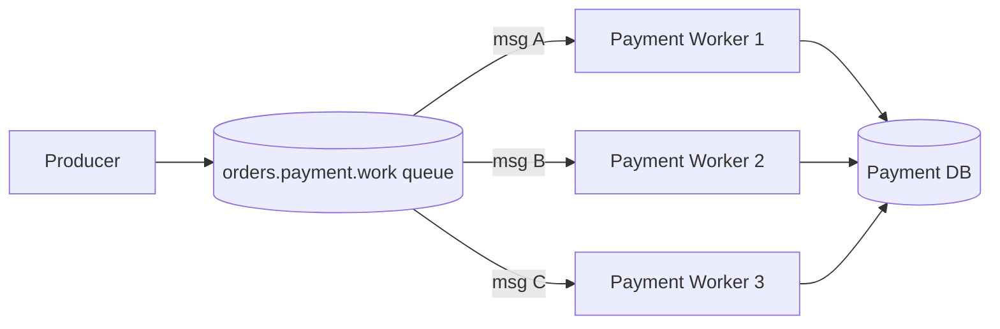
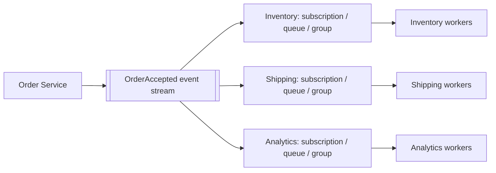
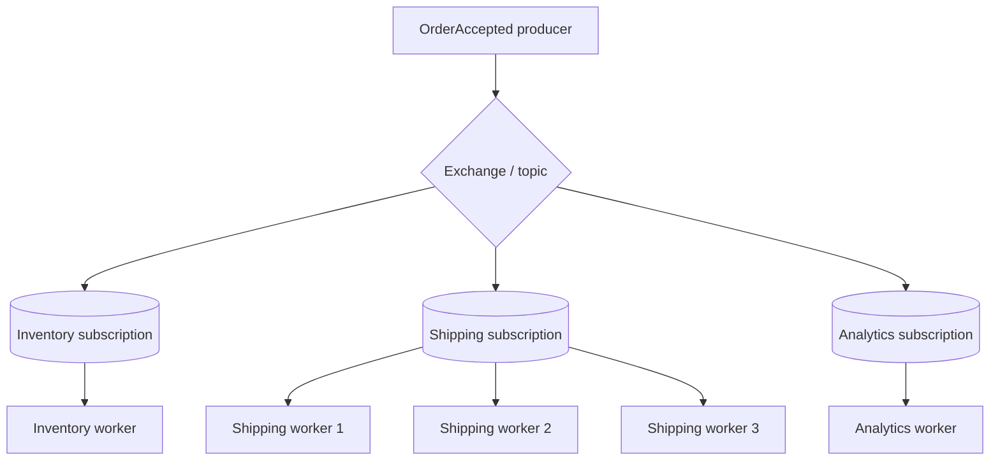
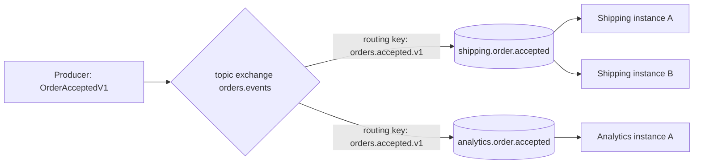
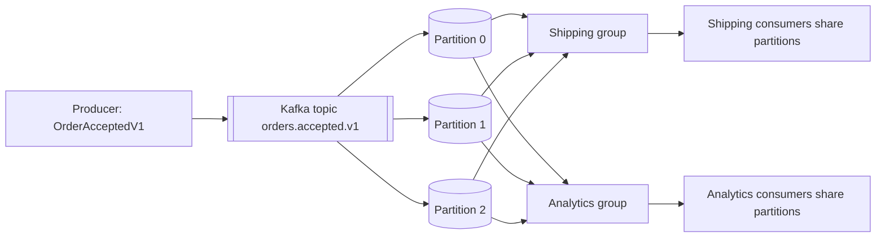
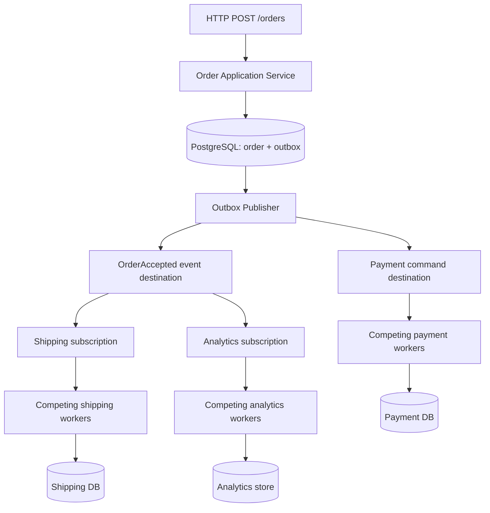
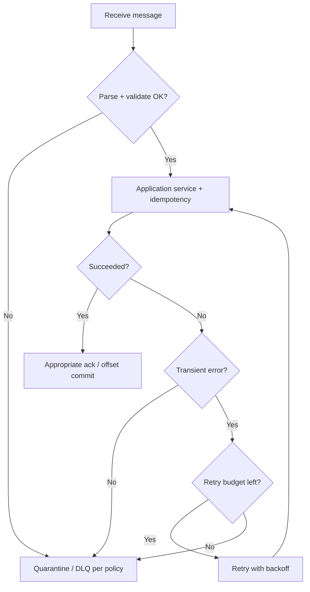
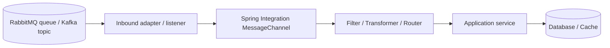

# Queue, Topic, Subscription, and the Work-Sharing Model

In **SPRING_BOOT_INTEGRATION**, Spring Boot can exchange data via HTTP clients, databases, caches, message brokers, and Spring Integration adapters. When a flow requires asynchronous processing, the first question is not whether to pick Kafka or RabbitMQ, but rather: **must a message be processed by exactly one worker in a group, or by multiple independent groups?** The answer determines how you design **queues**, **topics**, **subscriptions**, and the **work-sharing** (*competing consumers / work queue*) model.

For example: when a customer places an order, a **calculate shipping fee** request may only need one worker to process it; however, an **order accepted** event may need to be delivered independently to inventory, shipping, and analytics systems. If all three groups mistakenly share one queue, only one group can receive each message; if a new subscription is arbitrarily created for each instance, a single business effect may be executed multiple times.

This lesson belongs to the **Messaging Platforms** chapter. We will separate conceptual terminology from the actual mechanics of **RabbitMQ/AMQP, Kafka, JMS, and MQTT**, and then connect them to Spring Boot configuration, data contracts, transactions, retries, idempotency, testing, and operational observability. Java examples mainly target **Spring Boot 3.x, Java 17+, and the Spring AMQP/Spring Kafka libraries** whose versions are managed by the Boot BOM; verify actual APIs if using a different library generation.

## 1. Learning Objectives

After this lesson, you will be able to:

1. Distinguish between **point-to-point/work queue**, **publish–subscribe**, **subscription**, **consumer group**, and **competing consumers**.
2. Explain how RabbitMQ **exchange → binding → queue → consumer** differs from Kafka **topic → partition → consumer group**.
3. Design flows for **one command, one processing group** and **one event, multiple independent processing groups**.
4. Reason about concurrency, ordering, backlog, ack/redelivery, and replay capabilities per platform without over-assuming.
5. Configure the required Spring Boot components and recognize what Boot **does not create automatically**.
6. Design JSON/event contracts, retry/DLQ, idempotency, transactional outbox, testing, and observability for real-world messaging systems.

## 2. What Does a Message Consist Of?

A message in a broker typically contains a **payload** and **metadata**. The exact format depends on the platform, but an order event can be described as follows:

```json
{
  "eventId": "evt-ord-1024",
  "eventType": "OrderAccepted",
  "schemaVersion": 1,
  "orderId": "ORD-1024",
  "occurredAt": "2026-11-21T10:30:00Z"
}
```

| Field / Metadata | Role | Notes |
| --- | --- | --- |
| `eventId` | Identifies a **logical event** stably across retries/replays | Do not regenerate on every resend from outbox; use as deduplication key when appropriate. |
| `eventType` and `schemaVersion` | Selects the corresponding decoder/contract | Do not arbitrarily rely on the producer's Java class name. |
| `orderId` | Business key; can serve as Kafka partition key | Do not equate `orderId` with `eventId`: multiple events can belong to one order. |
| `occurredAt` | Timestamp when the event occurred per contract | Standardize timezone/ISO-8601; differs from when the broker received the message. |
| Correlation/trace ID | Traces across HTTP, database, producer, and consumer | Propagate safe metadata only; do not log credentials or personal data. |
| Routing key/topic/queue | Specifies or influences message routing | Transport metadata; does not replace event type and schema version. |

**Command** and **event** are not equivalent. `ProcessPaymentCommand` requests an action; `OrderAcceptedEvent` announces an event that already happened. A command typically has **one processing owner**; an event can have **multiple interested groups**. A queue can carry an event and a topic can carry a command, though you should choose a topology that makes the intent and desired reliability clear to readers.

## 3. Queue: Sharing Work Within One Group

**Work queue / point-to-point** is a model where messages are placed into a shared queue and multiple workers **compete** to pull work from that queue. In a normal delivery, **one message is delivered to one consumer in the group**; if a consumer fails or does not ack, the broker may redeliver it to another consumer depending on the protocol and configuration.



This is **load sharing within one function**, not broadcasting a copy to every worker. If 100 requests are sent to the same queue with four consumers, each consumer receives **a portion** of the work; the exact split depends on prefetch, busyness, processing time, and broker distribution—**there is no guarantee of exactly 25 messages per consumer**.

Properties that must be defined:

- **Durability:** does the queue survive broker restarts; are messages published as persistent; is replication/quorum configured? Calling something a “queue” does not automatically ensure data survives every failure.
- **Ack:** when the broker is permitted to remove a delivery from the active set; failures before/after ack can lead to redelivery or lost effects.
- **Consumption capacity:** consumer count, prefetch, thread limits, and downstream resources.
- **Ordering:** multiple workers may finish out of delivery order; never promise global processing order just because a queue is FIFO in simple cases.
- **Overload:** backlog grows when producer rate exceeds consumer rate; monitor message age, queue depth, and actual throughput.

Practical example: “Each order must record only one shipping-fee calculation request.” Multiple instances of **the same fee-calculation service** consume from one work queue to scale capacity. Those instances must not have separate subscriptions that cause each instance to receive a copy of the command.

## 4. Topic and Publish–Subscribe: Multiple Groups Receiving the Same Event

**Publish–subscribe** addresses the problem of **one event, multiple independent consumers**. A producer publishes `OrderAcceptedEventV1`. Inventory reserves stock, shipping schedules delivery, and analytics updates dashboards. Each group needs **independent progress**: a failing shipping group should not block inventory from continuing to receive events when the infrastructure supports independent delivery.



**Topic** means different things across brokers:

- In **JMS**, a topic is a publish–subscribe destination; subscribers receive messages according to the configured subscription mechanism.
- In **Kafka**, a topic is a **persisted partitioned log**; each consumer group tracks its own reading progress, creating a pub/sub effect across groups.
- In **RabbitMQ**, the term **topic exchange** denotes a **routing mechanism matching dot-separated routing-key patterns to queues**. Consumers do not read directly from an exchange; consumers still read from a **queue**.
- In **MQTT**, a topic is a hierarchical string channel/name; clients subscribe using topic filters. Shared subscriptions are an additional mechanism, not the default behavior of every topic.

Therefore, you cannot conclude **topic = broadcast to every process**. What matters is: how many **independent subscriptions/queues/groups** exist, and how many **competing consumers** belong to each subscription/group.

### 4.1. A Subscription Is a Logical Concern, Not Necessarily a TCP Connection

A subscription typically describes “the set of messages one group wants to receive,” possibly with a name, filter, progress state, and durability policy. Across systems:

| Platform | Independent Receiving Unit | Work Sharing Across Instances in the Same Group |
| --- | --- | --- |
| RabbitMQ | A **queue** bound to the appropriate exchange | Consumers reading **the same queue** compete for deliveries. |
| Kafka | A **consumer group** reading topic/partitions | Instances using **the same `group.id`** share partitions. |
| JMS topic | Subscription (non-durable/durable; shared when supported) | Only a shared subscription lets multiple consumers share work. |
| MQTT | Per-client/session subscription; shared subscription if broker supports it | Multiple clients using the same shared group name split matching messages. |

Simply adding a new instance does not mean creating a new subscription. If the goal is to **scale the same workload**, instances must share the same logical receiving unit; if the goal is to **add an independent function**, create a new logical receiving unit.

## 5. Two Delivery Levels That Must Be Kept Separate

In many systems, publish–subscribe and competing consumers are combined:

1. **Fan-out across groups:** the same event goes to inventory, shipping, and analytics.
2. **Work sharing within each group:** three shipping instances compete to process work for the **shipping group**, rather than receiving three copies of the same message just because of horizontal scaling.



The diagram uses the generic term “subscription,” which in implementation must map accurately to **queue/binding** in RabbitMQ or **group/partition** in Kafka. Do not misread an abstract topology diagram and accidentally spin up the wrong consumer setup.

### 5.1. Asking the Right Questions Before Choosing a Model

| Question | If the answer is… | Suggested Design |
| --- | --- | --- |
| Does one message need to be processed by multiple functions? | **No**, only one function owns it | One work queue or one consumer group for that function. |
| Must multiple functions independently receive the same event? | **Yes** | Multiple queues bound to an exchange, or multiple groups on the same Kafka topic. |
| Are multiple instances replicas of the same service? | **Yes** | Share the same queue/group; do not create an independent destination/subscription per instance. |
| Is historical replay required? | **Yes** | A platform with suitable retention/offsets (e.g., Kafka), or a dedicated storage/replay design. |
| Is per-entity ordering required? | **Yes** | Kafka key/partition or per-key serialization, bounded concurrency, and idempotency design. |
| Is the message just a real-time signal that can be missed? | **Yes** | Non-durable pub/sub may be considered if the contract tolerates lost messages. |

There is no single rule that “Kafka is always better than queues” or “RabbitMQ is always simpler than topics.” Choose based on the number of independent consumers, durability, retention/replay, ordering, throughput, operations, and system-wide constraints.

## 6. Queue, Topic, and Subscription Do Not Guarantee Exactly-Once Delivery

Three separate questions must be distinguished:

1. **Routing:** which messages are delivered to which destinations/subscriptions?
2. **Delivery:** can the broker deliver a message **zero times, once, or multiple times** under failures, ack behavior, or retention?
3. **Business effect:** will business logic create two transactions, charge twice, or send two emails even if a message is redelivered?

| Guarantee Type | Explanation | Risk |
| --- | --- | --- |
| **At-most-once** | May lose deliveries, but does not attempt redelivery under the chosen mechanism | Data loss if the consumer dies after the message was already marked handled. |
| **At-least-once** | Attempts redelivery until an appropriate completion signal is recorded | Consumers may receive duplicates; idempotency design is mandatory. |
| **Narrowly scoped exactly-once** | A platform/mechanism can guarantee outcomes within a defined boundary (e.g., properly configured Kafka-to-Kafka transactions) | Does not automatically include databases, HTTP, filesystems, or external side effects. |

**An ACK or offset commit does not mean business effects have completed** if the application acknowledges before committing the DB or completing partner calls. Conversely, the DB may commit successfully and the consumer may crash before acking; the message will be redelivered. Hence business keys/inbox/outbox tables and transaction boundaries matter more than assuming a queue or topic “guarantees exactly once.”

## 7. RabbitMQ/AMQP: Exchanges Route, Queues Hold Work, Consumers Process

In RabbitMQ using AMQP 0-9-1, producers normally publish messages to an **exchange**, and the broker uses **bindings** and **routing keys** to place messages into one or more queues. **Consumers consume from queues; they do not subscribe directly to an exchange.**

| RabbitMQ Component | Function | Example |
| --- | --- | --- |
| `direct exchange` | Routes by exact match between routing key and binding key | `payment.requested` → `orders.payment.work` |
| `topic exchange` | Matches dot-delimited routing key patterns with `*` and `#` | `orders.accepted.v1`, binding `orders.*.v1` |
| `fanout exchange` | Delivers to every queue bound to the exchange, ignoring routing key | One event sent to inventory and analytics queues |
| `queue` | Holds deliveries and serves one or more consumers | `shipping.order.accepted` |
| `binding` | Connects an exchange to a queue with routing rules | Bind `orders.events` to two separate queues |
| `ack/nack/reject` | Acknowledges, requests redelivery, or discards a delivery per policy | Handler succeeds → ack; permanent error → DLQ |

**A RabbitMQ `topic exchange` is not a “Kafka topic.”** It is a **router**; to create two independent subscriptions you need **two distinct queues** bound to the appropriate exchange. If two services consume from **the same queue**, they **share work** instead of receiving two copies.



In this topology, the event is **routed into each matching queue**, and then two shipping instances compete for deliveries from **one shipping queue**. Scaling shipping instances does not make analytics receive extra events; adding a **new analytics queue** is what changes the number of independent copies.

### 7.1. Spring Boot AMQP Starter and Connection Configuration

To use RabbitMQ directly from Spring Boot 3.x, add:

```xml
<dependency>
    <groupId>org.springframework.boot</groupId>
    <artifactId>spring-boot-starter-amqp</artifactId>
</dependency>
```

If the application also uses Spring Integration Java DSL for message endpoints, add `spring-boot-starter-integration` and **`spring-integration-amqp`** when an AMQP adapter is genuinely needed in the flow. Not every RabbitMQ application needs Spring Integration: Spring AMQP's `RabbitTemplate` and `@RabbitListener` suffice for many use cases.

Example `application.yml`:

```yaml
spring:
  rabbitmq:
    host: ${RABBITMQ_HOST:localhost}
    port: 5672
    username: ${RABBITMQ_USER}
    password: ${RABBITMQ_PASSWORD}
    publisher-confirm-type: correlated
    publisher-returns: true
    template:
      mandatory: true
    listener:
      simple:
        concurrency: 2
        max-concurrency: 4
        prefetch: 10
```

This is an illustrative configuration: credentials must come from environment variables/secret managers; add appropriate settings for TLS/vhosts and multi-node clusters. `concurrency`, `max-concurrency`, and `prefetch` are starting points for load testing, not “optimal settings” for every queue. If you want different concurrency limits for payment and analytics, configure separate listener factories or override per listener according to your API version.

When dependencies and properties are present, **Spring Boot can auto-configure** `CachingConnectionFactory`, `RabbitTemplate`, listener container factories, and related infrastructure. **Boot does not automatically create exchanges, queues, bindings, or business handlers** based on names we imagine. The topology and listener beans below are explicitly declared by the application.

### 7.2. Declaring a Command Queue and Two Event Subscriptions

Suppose we want two paths:

- **Command `payment.requested`:** only **one worker** in the payment group processes each delivery from `orders.payment.work`.
- **Event `orders.accepted.v1`:** both shipping and analytics have independent queues, while each queue can scale across multiple workers.

```java
import org.springframework.amqp.core.Binding;
import org.springframework.amqp.core.BindingBuilder;
import org.springframework.amqp.core.DirectExchange;
import org.springframework.amqp.core.Queue;
import org.springframework.amqp.core.QueueBuilder;
import org.springframework.amqp.core.TopicExchange;
import org.springframework.beans.factory.annotation.Qualifier;
import org.springframework.context.annotation.Bean;
import org.springframework.context.annotation.Configuration;

@Configuration(proxyBeanMethods = false)
public class OrderMessagingTopology {

    @Bean("ordersCommandsExchange")
    DirectExchange commandsExchange() {
        return new DirectExchange("orders.commands", true, false);
    }

    @Bean("paymentWorkQueue")
    Queue paymentWorkQueue() {
        return QueueBuilder.durable("orders.payment.work")
                .deadLetterExchange("orders.commands.dlx")
                .deadLetterRoutingKey("payment.failed")
                .build();
    }

    @Bean
    Binding paymentCommandBinding(
            @Qualifier("paymentWorkQueue") Queue queue,
            @Qualifier("ordersCommandsExchange") DirectExchange exchange) {
        return BindingBuilder.bind(queue)
                .to(exchange).with("payment.requested");
    }

    @Bean("commandsDeadLetterExchange")
    DirectExchange commandsDlx() {
        return new DirectExchange("orders.commands.dlx", true, false);
    }

    @Bean("paymentDeadLetterQueue")
    Queue paymentDlq() {
        return QueueBuilder.durable("orders.payment.dlq").build();
    }

    @Bean
    Binding paymentDeadLetterBinding(
            @Qualifier("paymentDeadLetterQueue") Queue queue,
            @Qualifier("commandsDeadLetterExchange") DirectExchange exchange) {
        return BindingBuilder.bind(queue)
                .to(exchange).with("payment.failed");
    }

    @Bean("ordersEventsExchange")
    TopicExchange eventsExchange() {
        return new TopicExchange("orders.events", true, false);
    }

    @Bean("shippingEventsQueue")
    Queue shippingQueue() {
        return QueueBuilder.durable("shipping.order.accepted").build();
    }

    @Bean("analyticsEventsQueue")
    Queue analyticsQueue() {
        return QueueBuilder.durable("analytics.order.accepted").build();
    }

    @Bean
    Binding shippingBinding(
            @Qualifier("shippingEventsQueue") Queue queue,
            @Qualifier("ordersEventsExchange") TopicExchange exchange) {
        return BindingBuilder.bind(queue)
                .to(exchange).with("orders.accepted.v1");
    }

    @Bean
    Binding analyticsBinding(
            @Qualifier("analyticsEventsQueue") Queue queue,
            @Qualifier("ordersEventsExchange") TopicExchange exchange) {
        return BindingBuilder.bind(queue)
                .to(exchange).with("orders.accepted.v1");
    }
}
```

Naming queues after the **consuming function** helps distinguish long-lived subscriptions from running instances. `shipping.order.accepted` should not include a pod/hostname ID in its name if the goal is simply to scale the same worker group.

The example uses **queue arguments** to declare a dead-letter exchange for payment to illustrate topology. In production, RabbitMQ generally recommends operations-managed **policies** for DLX/TTL attributes rather than hardcoding everything via `x-arguments` in code. When using a DLQ, design retry limits, error classification, alerts, and a replay procedure so the DLQ does not become an indefinite graveyard for errors.

`QueueBuilder.durable(...)` defines a durable queue, yet message durability also depends on message persistence, queue type, publisher confirms, and broker/replication configuration. **A durable queue does not mean zero message loss in all scenarios.**

### 7.3. DTOs, JSON Converter, and Listeners

```java
import java.math.BigDecimal;
import java.time.Instant;

public record PaymentRequestedV1(
        String requestId,
        String orderId,
        BigDecimal amountCents
) {}

public record OrderAcceptedV1(
        String eventId,
        int schemaVersion,
        String orderId,
        Instant occurredAt
) {}
```

When using JSON payloads with Jackson 2 / corresponding Spring AMQP:

```java
import com.fasterxml.jackson.databind.ObjectMapper;
import org.springframework.amqp.support.converter.Jackson2JsonMessageConverter;
import org.springframework.amqp.support.converter.MessageConverter;
import org.springframework.context.annotation.Bean;
import org.springframework.context.annotation.Configuration;

@Configuration(proxyBeanMethods = false)
public class AmqpJsonConfiguration {
    @Bean
    MessageConverter rabbitMessageConverter(ObjectMapper mapper) {
        return new Jackson2JsonMessageConverter(mapper);
    }
}
```

Spring Boot can use this converter bean to configure the default template/listener factory when corresponding conditions are met. **Test actual wire payloads** and consumer type inference; never assume clients in other systems share the same Java type headers or Jackson modules. For Java 17 records and `Instant`, the mapper must support records and an appropriate `JavaTimeModule`.

```java
import org.springframework.amqp.rabbit.annotation.RabbitListener;
import org.springframework.stereotype.Component;

@Component
public class OrderRabbitConsumers {
    private final PaymentApplicationService payments;
    private final ShippingApplicationService shipping;
    private final AnalyticsApplicationService analytics;

    public OrderRabbitConsumers(
            PaymentApplicationService payments,
            ShippingApplicationService shipping,
            AnalyticsApplicationService analytics) {
        this.payments = payments;
        this.shipping = shipping;
        this.analytics = analytics;
    }

    @RabbitListener(queues = "orders.payment.work")
    public void processPayment(PaymentRequestedV1 command) {
        payments.processOnce(command);
    }

    @RabbitListener(queues = "shipping.order.accepted")
    public void updateShipping(OrderAcceptedV1 event) {
        shipping.applyOnce(event);
    }

    @RabbitListener(queues = "analytics.order.accepted")
    public void updateAnalytics(OrderAcceptedV1 event) {
        analytics.applyOnce(event);
    }
}
```

`PaymentApplicationService`, `ShippingApplicationService`, and `AnalyticsApplicationService` are **application-implemented** services; `processOnce`/`applyOnce` must enforce transaction control and idempotency. With Spring AMQP's default `AUTO` acknowledgment mode on the listener container, the container typically acks after the listener returns normally; exceptions pass to error handling and requeue/reject per configuration. **`AUTO` here is not RabbitMQ's `autoAck=true`**; test the policy with your container version.

The listeners and topology illustrate routing paths; production applications must also configure error policies for **every queue**. For instance, shipping/analytics queues also need a dead-letter strategy if permanent errors are rejected. Do not enable `default-requeue-rejected=false` globally while only creating a DLX for payment and assuming errors on other queues are safely retained.

### 7.4. Publishing Events and Understanding Publisher Confirm Limits

```java
import org.springframework.amqp.rabbit.core.RabbitTemplate;
import org.springframework.stereotype.Component;

@Component
public class OrderAcceptedPublisher {
    private final RabbitTemplate rabbit;

    public OrderAcceptedPublisher(RabbitTemplate rabbit) {
        this.rabbit = rabbit;
    }

    public void publish(OrderAcceptedV1 event) {
        rabbit.convertAndSend(
                "orders.events",
                "orders.accepted.v1",
                event,
                message -> {
                    message.getMessageProperties().setMessageId(event.eventId());
                    return message;
                });
    }
}
```

`publisher-confirm-type: correlated` and `publisher-returns: true` help observe whether the broker accepted the publish or failed to route a message, but the application must register and **handle confirm/return results**; `convertAndSend` returning normally does not prove consumers succeeded. If DB state and events must not diverge, use a **transactional outbox** instead of assuming publisher confirms can roll back a DB commit.

## 8. Kafka: Topics Are Partitioned Logs, Consumer Groups Are Work-Sharing Units

Kafka uses **topics** to store records across **partitions**. Records are not deleted from a topic as soon as one consumer finishes processing; data is kept or removed according to **retention/compaction policies**. Each **consumer group** tracks its own offsets per partition, enabling multiple groups to read the same topic independently.



Within one consumer group, at a steady point in time, **each partition is assigned to only one consumer member of that group**. If a topic has three partitions and the shipping group has five consumers, at most **three consumers** in the group receive partition assignments; two consumers may sit idle. Each distinct group has its own consumers/offsets and can therefore read the same records.

| Kafka Concept | Meaning |
| --- | --- |
| Topic | Named stream of records, retained per config and split into partitions. |
| Partition | Unit of storage and offset-ordered reads; also the unit of work assignment within a group. |
| Offset | Record position within a partition; offset order is meaningful only within that partition. |
| Consumer group | Consumers that **share partitions** and processing progress for one function. |
| `group.id` | Group identity determining whether instances compete or read independently. |
| Message key | Typically influences partition selection; identical keys generally land in the same partition when topology/partitioning is stable. |
| Committed offset | Reading progress recorded by the group; does **not delete** records from the Kafka log. |

**Two rules to remember:**

- To add replicas of shipping service: replicas use **the same `group.id=shipping-service`**.
- To let analytics read the same event independently: use a distinct **`group.id=analytics-service`** different from shipping.

If you accidentally set `group.id` per hostname or pod ID for each shipping instance, the instances become **independent groups**, potentially reading every event on the topic and duplicating business effects. Conversely, if shipping and analytics accidentally share **the same group ID**, they split partitions instead of **each receiving all events**.

### 8.1. Spring Boot and Spring Kafka

With Spring Boot 3.x, add the Spring Kafka dependency managed by the Boot BOM:

```xml
<dependency>
    <groupId>org.springframework.kafka</groupId>
    <artifactId>spring-kafka</artifactId>
</dependency>
```

Example configuration for String JSON payloads (event classes/JSON contracts must be controlled separately):

```yaml
spring:
  kafka:
    bootstrap-servers: ${KAFKA_BOOTSTRAP_SERVERS:localhost:9092}
    producer:
      key-serializer: org.apache.kafka.common.serialization.StringSerializer
      value-serializer: org.apache.kafka.common.serialization.StringSerializer
    consumer:
      key-deserializer: org.apache.kafka.common.serialization.StringDeserializer
      value-deserializer: org.apache.kafka.common.serialization.StringDeserializer
      enable-auto-commit: false
      auto-offset-reset: earliest
    listener:
      ack-mode: record
      concurrency: 3
```

When classpath/properties and auto-configuration align, Boot can create producer/consumer factories, `KafkaTemplate`, and listener container infrastructure. **Boot does not automatically define business topics, per-function groups, or event handlers.** In production, topics, partition counts, retention, ACLs, and replication are typically managed via Infrastructure as Code or controlled operational procedures.

`auto-offset-reset: earliest` applies only when the group **has no valid committed offset** for a partition in that scenario; it does not mean every restart replays from the beginning. For intentional replay, use a new group or a proper offset-reset procedure that controls re-execution of side effects.

Example of two independent logical consumers on the same topic with **different groups**:

```java
import com.fasterxml.jackson.core.JsonProcessingException;
import com.fasterxml.jackson.databind.ObjectMapper;
import org.apache.kafka.clients.consumer.ConsumerRecord;
import org.springframework.kafka.annotation.KafkaListener;
import org.springframework.stereotype.Component;

@Component
public class OrderKafkaConsumers {
    private final ObjectMapper mapper;
    private final ShippingApplicationService shipping;
    private final AnalyticsApplicationService analytics;

    public OrderKafkaConsumers(
            ObjectMapper mapper,
            ShippingApplicationService shipping,
            AnalyticsApplicationService analytics) {
        this.mapper = mapper;
        this.shipping = shipping;
        this.analytics = analytics;
    }

    @KafkaListener(
            topics = "orders.accepted.v1",
            groupId = "shipping-service")
    public void ship(ConsumerRecord<String, String> record)
            throws JsonProcessingException {
        OrderAcceptedV1 event =
                mapper.readValue(record.value(), OrderAcceptedV1.class);
        shipping.applyOnce(event);
    }

    @KafkaListener(
            topics = "orders.accepted.v1",
            groupId = "analytics-service")
    public void analyze(ConsumerRecord<String, String> record)
            throws JsonProcessingException {
        OrderAcceptedV1 event =
                mapper.readValue(record.value(), OrderAcceptedV1.class);
        analytics.applyOnce(event);
    }
}
```

The snippet places both groups in one application **for illustration**. In reality, shipping and analytics are typically separate services, each implementing only its own consumer. Each group tracks independent offsets. `ack-mode: record` specifies how the container commits offsets under that configuration; an exception from a handler may trigger retry/seek/rebalance per the configured error handler. **Do not assume an exception automatically routes to a dead-letter topic:** you must explicitly configure retries, `DefaultErrorHandler`, a recoverer/DLT, and a redelivery policy.

An example producer sending JSON keyed by order ID:

```java
import com.fasterxml.jackson.core.JsonProcessingException;
import com.fasterxml.jackson.databind.ObjectMapper;
import java.util.concurrent.CompletableFuture;
import org.springframework.kafka.core.KafkaTemplate;
import org.springframework.kafka.support.SendResult;
import org.springframework.stereotype.Component;

@Component
public class OrderKafkaPublisher {
    private final KafkaTemplate<String, String> kafka;
    private final ObjectMapper mapper;

    public OrderKafkaPublisher(
            KafkaTemplate<String, String> kafka,
            ObjectMapper mapper) {
        this.kafka = kafka;
        this.mapper = mapper;
    }

    public CompletableFuture<SendResult<String, String>> publish(
            OrderAcceptedV1 event) throws JsonProcessingException {
        String json = mapper.writeValueAsString(event);
        return kafka.send("orders.accepted.v1", event.orderId(), json);
    }
}
```

`KafkaTemplate.send(...)` returns a future for the producer result. It does not open a transaction spanning PostgreSQL, does not prove shipping/analytics completed, and a timeout waiting on the future does not prove the broker failed to receive the record. With an outbox, the event ID and JSON payload must remain stable across republications.

### 8.2. Ordering and Load Sharing by Partition

Kafka preserves **record order by offset within each partition**, and provides no global order across all partitions. If events sharing an `orderId` must stay in sequence, producers typically use `orderId` as the key to route them to the same partition. However:

- If partition count or partitioner logic changes, a key may map to a different partition; partition-scaling plans must account for ordering during transitions.
- If multiple producers emit with the same key concurrently, desired business order must still be defined and enforced; log arrival order does not automatically match DB transaction commit order.
- If a listener hands work off to an async executor or calls downstream in parallel, **completion order** can differ from read order; bound concurrency per entity when the contract requires it.
- During rebalances, retries, or replays, the same record may be processed again. Offsets and ordering **do not replace idempotency**.

Increasing consumers to 20 when a topic only has 4 partitions **cannot make that group process 20 partitions in parallel**. Measure throughput/lag, handler cost, partition count, and downstream DB/HTTP resources instead of blindly adding threads to mask a bottleneck.

## 9. JMS, MQTT, and Subscription Variants

### 9.1. JMS: Point-to-Point Queues and Publish–Subscribe Topics

JMS/Jakarta Messaging defines two primary destination models:

- **Queue:** multiple consumers compete for messages in one queue per JMS provider behavior; suitable for commands/work distribution.
- **Topic:** each subscription can receive matching messages while active. A **non-durable** subscription generally does not retain messages while no subscription is active; a **durable subscription** allows retaining undelivered messages per broker rules while the subscriber is offline.

Under JMS 2.0, **shared subscriptions** and **shared durable subscriptions** allow multiple consumers to share work within one logical subscription instead of creating separate durable subscriptions. Subscription names, client identities, and sharing/durability must be configured properly for the **JMS provider** and Spring JMS listener container. Do not assume multiple `@JmsListener` endpoints on a topic compete like a queue if configured as independent subscriptions.

Spring Boot can auto-configure certain JMS components when a specific driver/starter and `ConnectionFactory` are present; the application must still declare destinations, domain type, subscription name, client ID/ack/transactions, and listeners. For **JMS topics**, check `pubSubDomain` rather than simply renaming a queue string to a topic.

### 9.2. MQTT: Topic Filters and Shared Subscriptions

MQTT uses hierarchical topics, e.g., `factory/line-1/temperature`. Clients subscribe using topic filters like `factory/+/temperature`. Where supported by the broker and MQTT version, shared subscriptions commonly use the syntax:

```text
$share/telemetry-workers/factory/+/temperature
```

Clients using the same **shared group** can split matching messages across the group, whereas standard subscriptions by different clients normally cause each client to receive messages for its own subscription. **QoS 0/1/2** and session persistence handle MQTT-level delivery properties within their scope; they do not equate to an end-to-end exactly-once business transaction with a database.

MQTT brokers vary in shared subscriptions, retained messages, session expiry, and consumer distribution. Consult actual broker documentation. Spring Integration offers `spring-integration-mqtt` to build message flows with appropriate adapters, though adding the dependency does not automatically declare topic filters or groups.

### 9.3. Redis Pub/Sub Is Not a Durable Queue

Redis **Pub/Sub** delivers messages to currently connected subscribers; the basic mechanism **does not store a backlog** for replay like a Kafka topic or durable broker queue. An offline subscriber can miss messages. Redis Streams is a separate structure with consumer groups and pending entries, requiring its own retention/ack/claim design.

Do not use plain Redis Pub/Sub as the source of truth for payment commands that cannot be lost simply because the application already uses Redis as a cache. **The name “publish–subscribe” does not guarantee durability or retries across platforms.**

### 9.4. Quick Mapping to Cloud Platforms

| Platform | Deliver to Multiple Functions | Share Work Within One Function |
| --- | --- | --- |
| AWS SNS + SQS | SNS topic fans out to **multiple SQS queues** | Multiple workers poll **one SQS queue** |
| Google Cloud Pub/Sub | One topic with **multiple independent subscriptions** | Multiple subscriber clients use **the same subscription** |
| Azure Service Bus | Topic with **multiple independent subscriptions** | Multiple receivers process **the same queue/subscription** |
| Kafka | Topic with **multiple consumer groups** | Consumers in **the same group** share partitions |
| RabbitMQ | Exchange bound to **multiple queues** | Consumers on **the same queue** compete for messages |

Cloud services may add FIFO, ordering keys, provider-defined **scoped** exactly-once delivery, DLQs, filters, and custom retention. Do not transfer an assumption from one platform to another solely because both use the word “subscription.”

## 10. Choose Topology from Business Needs, Not Product Names

| Requirement | Work Queue / Competing Consumers | Pub/Sub with Multiple Subscriptions/Groups |
| --- | --- | --- |
| Only one function must process each command | Very well suited | Can cause duplicate effects if too many groups are created. |
| Multiple independent functions need the same event | Insufficient if only one queue exists | Well suited: one logical receiving unit per function. |
| Scaling a single service with replicas | Add consumers on the **same queue/group** | Still share within each group; do not add subscriptions just to scale. |
| Historical data replay required | Depends on infrastructure and separate history store | Kafka retention/offsets help, though storage still has retention limits. |
| Per-entity ordered processing required | Bound concurrency / choose per-key strategy | Kafka partition key or another suitable serialization mechanism. |
| Workers face diverse error types | DLQ, retries, lease/ack required | Each subscription/group also needs its own error policy. |

**Easy-to-remember design rule:** **one business function = one independent logical receiving unit; multiple instances of that function = share that receiving unit.** Check exceptions where a single function genuinely needs multiple pipelines/priorities or distinct filters, but treat that as an explicit business decision rather than an accidental deployment artifact.

## 11. End-to-End Design: Payment Command and Order-Accepted Event

Suppose `Order API` receives an order creation request over HTTP, writes to PostgreSQL, and publishes messages. There are two types of work:

1. **`PaymentRequestedV1`**: a command for the **payment group** to perform a controlled action; multiple payment workers share the work.
2. **`OrderAcceptedV1`**: an event for **shipping and analytics** to process independently, each with its own backlog and processing state.



The model above **does not require publishing every command and event during the HTTP call itself**. The transaction can record the outbox rows to emit; a publisher transports them independently. Order states must be clearly defined: “accepted,” “awaiting payment,” and “paid” are distinct state transitions—never infer `OrderAccepted` means payment finished. In this example, emitting both command and event is valid only when business rules define the corresponding timing.

### 11.1. Commands and Events Have Different Contracts

| Command: `PaymentRequestedV1` | Event: `OrderAcceptedV1` |
| --- | --- |
| Requests one function to execute an action | Announces an event that has been recorded |
| May require a reply/completion status or processing deadline | Independent consumers choose how to react per their needs |
| Logical target is typically the payment group | Logical targets include multiple groups: shipping, analytics, audit... |
| Deduplication key is typically `requestId`/business operation ID | Deduplication key is typically a stable `eventId` |
| If consumer cannot process, needs retry/DLQ/investigation flow | Each consumer has its own retry/DLQ/progress |

For example, analytics can reprocess historical events to rebuild reports; doing so must **never** accidentally replay a customer-charging command. Separating commands from events and isolating subscriptions per function enforces this boundary.

### 11.2. Each Consumer Must Protect Its Own Side Effects

A work-sharing queue or Kafka group distributes work, yet **does not replace unique constraints/transactions**. With PostgreSQL, you can design an inbox table keyed by **logical consumer name + eventId**:

```sql
CREATE TABLE consumer_inbox (
    consumer_name VARCHAR(100) NOT NULL,
    event_id      VARCHAR(160) NOT NULL,
    processed_at  TIMESTAMPTZ NOT NULL DEFAULT NOW(),
    PRIMARY KEY (consumer_name, event_id)
);

CREATE TABLE shipping_job (
    order_id VARCHAR(160) PRIMARY KEY,
    state    VARCHAR(30) NOT NULL
);
```

The **`(consumer_name, event_id)`** primary key matters: processing an event in shipping must **not** prevent analytics from processing the same event ID. Sharing a single `processed_event(event_id PRIMARY KEY)` across all functions in the same database would cause the second group to treat the event as a duplicate and skip it.

Example idempotent application service for shipping:

```java
import org.springframework.jdbc.core.JdbcTemplate;
import org.springframework.stereotype.Service;
import org.springframework.transaction.annotation.Transactional;

@Service
public class ShippingApplicationService {
    private final JdbcTemplate jdbc;

    public ShippingApplicationService(JdbcTemplate jdbc) {
        this.jdbc = jdbc;
    }

    @Transactional
    public void applyOnce(OrderAcceptedV1 event) {
        if (event.schemaVersion() != 1
                || event.eventId() == null || event.eventId().isBlank()
                || event.orderId() == null || event.orderId().isBlank()) {
            throw new IllegalArgumentException("Invalid order event");
        }

        int claimed = jdbc.update("""
                INSERT INTO consumer_inbox (consumer_name, event_id)
                VALUES (?, ?)
                ON CONFLICT (consumer_name, event_id) DO NOTHING
                """, "shipping-service", event.eventId());

        if (claimed == 0) {
            return; // Logical event was already processed successfully.
        }

        jdbc.update("""
                INSERT INTO shipping_job (order_id, state)
                VALUES (?, 'REQUESTED')
                ON CONFLICT (order_id) DO NOTHING
                """, event.orderId());
    }
}
```

Both writes share the same Spring/JDBC transaction. If creating the shipping job throws an exception and the transaction rolls back, the inbox marker also rolls back so redelivery can process it. The listener invokes the method through a Spring-managed bean/proxy; self-invoking a `@Transactional` method within the same instance may bypass the transaction proxy.

**Limitations of the example:** if the same `eventId` is resent with a **different** `orderId`, ID-only logic ignores the conflict. In production, store a fingerprint/contract fields and compare them, routing to quarantine or raising a conflict when the same ID has differing content. If `shipping_job` itself updates across multiple events, define transitions/versions and guard against out-of-order processing rather than only using `INSERT ... ON CONFLICT DO NOTHING`.

### 11.3. Transactional Outbox on the Producer Side

Suppose an HTTP request inserts an order into PostgreSQL and then calls a Kafka/RabbitMQ publisher **in the same method**:

```text
INSERT order -> COMMIT DB -> PUBLISH event
```

If the process crashes after DB commit but before publishing, the event is lost. Conversely, publishing successfully and then having the DB transaction roll back produces a “phantom” event. Place the publish intent in an **outbox inside the same DB transaction**:

```text
BEGIN
  INSERT order
  INSERT outbox(event_id, event_type, schema_version, payload_json)
COMMIT

Outbox publisher:
  SELECT pending outbox
  SEND broker
  MARK published per confirm policy
```

The publisher may crash **after the broker receives the event but before marking it sent**; on restart it will republish. Therefore, consumers still need inbox/idempotency. Storing a **versioned JSON payload** at transaction time prevents retries from accidentally changing format when newer code is deployed.

## 12. Ordering and Concurrency: Fast Work Sharing Is Not Always Business-Correct

Splitting work across workers increases throughput but can violate ordering assumptions.

For example, `OrderCreated` followed by `OrderCancelled` for the same order:

- If the two events are processed concurrently by two RabbitMQ consumers, `OrderCancelled` may finish before `OrderCreated` even if the broker initially dispatched them in order.
- With Kafka, using `orderId` as the key routes records for that order to the same partition under stable topology/partitioning, yet if the handler offloads work to a parallel executor, completion order can still flip.
- During retries, an older event can arrive after a newer one; use versions, state machines, or controlled transition rules.

| Requirement | Common Solution | Trade-Off |
| --- | --- | --- |
| Different orders processed in parallel | Partition by `orderId`, or multiple queues/workers with idempotency | High concurrency; must manage hot keys. |
| All events for one order processed sequentially | Same Kafka key/partition, avoid async reordering; or per-key actor/lock | A hot key can become a bottleneck. |
| Strict global order across the entire system | Single sequential stream or specialized ordering mechanism | Severely limits scale and throughput. |
| Out-of-order processing permitted | Version/sequence numbers and ignore/buffer/reconcile logic | More complex, but more flexible on retry/replay. |
| Independent jobs needing no ordering | Competing consumers with tuned concurrency | Easy to scale, but still requires idempotency. |

### Prefetch, Partitions, and Resource Limits

RabbitMQ `prefetch` specifies how many unacknowledged deliveries may be in flight to a consumer per broker/container semantics; high prefetch can boost throughput but also lets a slow consumer hoard messages, hurting fairness and increasing RAM usage. Kafka `max.poll.records`, partition counts, consumer concurrency, and poll intervals play distinct roles; they cannot all be reduced to “thread count.”

**Overall processing speed** is capped by the slowest dependency: DB pool, partner HTTP service, JSON parsing CPU, broker speed, or external rate limits. Scaling from 4 to 40 consumers when PostgreSQL only has 10 connections can spike wait times and cascade failures.

An operational strategy must align:

1. Consumer count/concurrency and prefetch/batch size.
2. DB/HTTP pool sizes, timeouts, and max in-flight limits.
3. Backpressure/rate limiting when downstream slows down.
4. Processing latency, queue message age / consumer lag.
5. Scaling policies driven by real workload metrics, not CPU alone.

## 13. Retry, DLQ, and Poison Message Handling Per Group

A message can fail due to a **transient fault** (lost DB connection, slow broker) or a **permanent fault** (unsupported schema version, malformed JSON, unfulfillable business rule). Retrying all errors infinitely allows one failing message to pin a queue/partition, grow backlog, or create a tight requeue loop.



| Component | Policy to Design |
| --- | --- |
| **Retry** | Max attempts, backoff with jitter where appropriate, deadline, and side-effect check before resending. |
| **Dead-letter/quarantine** | Storage for unprocessable messages; includes error metadata, event ID, version, and timestamp. |
| **Replay/redrive** | Controlled replay tool/process that avoids duplicating business effects. |
| **Ack/offset** | Mark complete only per processing contract; never swallow exceptions and ack by mistake. |
| **Poison payload** | Separate JSON/schema errors from transient errors; avoid unbounded retries. |
| **Per-subscription isolation** | Shipping failure must not block analytics progress when independent queues/groups are configured. |

RabbitMQ provides dead-letter exchanges/queues and requeue/reject mechanics; configuration must avoid infinite DLX loops and ensure proper routing. Kafka typically requires an **application-configured** error handler + dead-letter topic/recoverer; a failing record can stall a partition unless skipped/recovered safely. JMS and cloud brokers have their own redelivery/DLQ mechanisms; verify retry limits and ack/transaction ordering per provider.

**A DLQ does not fix broken data.** If the producer changed JSON schema and old consumers cannot decode it, fix the contract or upgrade consumers before redriving. If an event already caused a side effect in step 1 and failed in step 2, retries must be **idempotent across all steps** or use checkpoints/compensation.

## 14. Spring Integration: Internal Channels Differ from Broker Queues/Topics

Spring Integration wraps data in **`Message<?>`** and coordinates processing through **`MessageChannel`**, filters, transformers, routers, gateways, and adapters. Common channels like `DirectChannel` or `QueueChannel` may run **in-process** and **do not replace** durable queues or Kafka topics.



**Two common approaches:**

1. Use Spring AMQP `@RabbitListener` or Spring Kafka `@KafkaListener` calling services directly. Suited for short flows with few steps.
2. Use `spring-integration-amqp` or `spring-integration-kafka` to feed broker messages into an `IntegrationFlow`. Suited when multiple filter/transform/route steps or multi-source pipeline unification is needed.

With Spring Boot, `spring-boot-starter-integration` conditionally provides Spring Integration infrastructure; protocol adapter modules provide specific endpoints. **No `IntegrationFlow` or inbound adapter automatically subscribes to a topic just because the starter was added.**

Example internal flow handling an event:

```java
import org.springframework.context.annotation.Bean;
import org.springframework.context.annotation.Configuration;
import org.springframework.integration.dsl.IntegrationFlow;

@Configuration(proxyBeanMethods = false)
public class ShippingMessageFlow {

    @Bean
    IntegrationFlow shippingOrderAcceptedFlow(
            ShippingApplicationService shipping) {
        return IntegrationFlow.from("shipping.events.input")
                .handle(OrderAcceptedV1.class, (event, headers) -> {
                    shipping.applyOnce(event);
                    return null;
                })
                .get();
    }
}
```

The code above **does not read from RabbitMQ/Kafka yet**. It only defines a processing flow for messages arriving on channel `shipping.events.input`. To receive from a broker, add an inbound adapter/gateway or listener forwarding valid events to the channel. If a Spring AMQP listener invokes an internal messaging gateway:

```java
import org.springframework.integration.annotation.MessagingGateway;

@MessagingGateway(defaultRequestChannel = "shipping.events.input")
public interface ShippingEventGateway {
    void accept(OrderAcceptedV1 event);
}
```

The gateway interface must be registered in the Spring context, e.g., via `@IntegrationComponentScan` on an appropriate configuration class. The RabbitMQ listener calls `shippingEventGateway.accept(event)` after deserialization. When the channel uses a **synchronous** path and the handler throws, the exception can propagate back to the listener so the container handles ack/requeue per configuration. If switched to an `ExecutorChannel` or async queue, the listener can return **before business processing completes**, risking acking the broker while the handler is still running.

This is a **reliability decision**, not merely a performance tweak. When decoupling threads, explicitly design what counts as “durable intake,” how errors are reported, and how replay works. In-memory channels are insufficient to promise the broker that a message was safely processed after the listener returns.

## 15. Data Contracts and Security at the Message Boundary

Every message crossing a broker is a **contract with receivers**, not a raw dump of a JPA entity or an arbitrary copy of an HTTP response.

### 15.1. Versioning and Compatibility

Suppose `OrderAcceptedV1` is shared by analytics and shipping; when the producer needs to add `currency` or change `status` meaning, the two consumers may upgrade at different times. Define:

- Where `eventType` and `schemaVersion` or schema ID live, and who owns the schema;
- Whether new fields are **required or optional**, defaults, and impact on older consumers;
- Which compatibility rules apply to Jackson JSON, Avro/Protobuf, or other formats;
- How **unsupported event versions** are handled: reject, route to an appropriate queue, or quarantine;
- Whether historical events/pending outbox rows remain readable after deployment.

Renaming a Java record or changing Jackson naming strategy must not silently alter the JSON wire format. When strict consumers fail on unknown fields, adding fields can break older consumers. With Kafka retention/replay and DLQ redrive, historical data can reappear long after producer code has changed.

### 15.2. Metadata, Multi-Tenancy, and Access Control

- **ACLs:** publishers only have write permission to allowed exchanges/topics; each consumer only has read permission to required queues/topics. Namespaces and group IDs do not replace broker authentication/authorization.
- **Tenant isolation:** if multiple tenants share a topic/queue, validate tenant context in payloads and services and apply tenant-scoped keys/idempotency where appropriate; do not trust an unverified client-supplied header.
- **Sensitive payloads:** avoid exposing payment details, tokens, or personal data to analytics merely because analytics subscribes to `OrderAccepted`. Emit minimal tailored events per audience if needed.
- **Message size:** enforce payload limits, timeouts, JSON depth, and schema validation to prevent poison messages or OOMs.
- **Tracing:** propagate correlation/trace IDs via permitted metadata, without logging payloads containing credentials by default.

The fact that a queue is durable and a Kafka consumer group can read messages **does not prove those consumers are authorized to view that data**. Deciding what data is published belongs to contract design and business authorization.

## 16. Testing Queues, Topics, and Subscriptions Against Real Behavior

### 16.1. Three Testing Tiers

| Tier | Scope | Example |
| --- | --- | --- |
| **Unit test** | Handler logic, DTO mappers, validation, business rules, and idempotency decisions | Reprocessed event returns duplicate outcome; unknown schema version is rejected. |
| **Integration test** | Real broker, serializers, queues/topics, bindings, groups, acks, transactions, and retries | RabbitMQ Testcontainers: two queues receive the same event; Kafka: two groups read the same topic. |
| **End-to-end test** | Journey from HTTP/API or outbox through broker and consumers to recorded final outcomes | Create order → outbox → event → shipping job + analytics record. |

Mocking `RabbitTemplate` or `KafkaTemplate` does not prove topology, routing keys, or group IDs are right. Use **RabbitMQContainer** or **KafkaContainer** / matching Testcontainers setups for your version to test against real brokers, while calling a test E2E only when the full defined journey executes.

### 16.2. Minimum Tests for the Work-Sharing Model

| Scenario | Test Action | Key Assertion |
| --- | --- | --- |
| **Competing consumers** | Send multiple commands to **one queue** with multiple workers | Each command produces one business effect; do not assert which specific worker received which message. |
| **RabbitMQ fan-out** | Bind two queues (shipping/analytics) to the same exchange and publish an event | **Each queue** receives the matching message; multiple workers on one queue do not double the effect. |
| **Kafka group independence** | Two distinct group IDs subscribe to the same topic | Each group reads records according to its own offsets/retention. |
| **Kafka same-group sharing** | Multiple consumers in the same group on a multi-partition topic | Each partition has one owner within the group at steady state; do not assume all consumers stay busy. |
| **Routing mismatch** | Publish a routing key matching no binding | Verify publisher return/unroutable policy; do not pretend publish success means target receipt. |
| **Ack/restart** | Consumer commits DB but crashes before ack/offset commit | Message can be redelivered; inbox prevents duplicate writes. |
| **Poison message** | Send malformed JSON / unknown schema version | Bounded retries, message reaches DLQ/quarantine per policy. |
| **Replay** | Reset offsets or use a new consumer group within retention | Consumer re-reads history; business state remains idempotent. |
| **Ordering** | Send multiple events for the same `orderId` across sequences | State machine is not corrupted; ordering is preserved within promised scope. |
| **Backpressure** | Intentionally slow down downstream DB/HTTP | Backlog/lag grows in a controlled way without retry storms or pool exhaustion. |

When testing RabbitMQ fan-out, prevent live production listeners from draining messages before your test inspects the queues; either **assert final side effects of each listener**, or use a dedicated test profile that tests routing with business listeners intentionally disabled. When testing Kafka, isolate topics/groups/offsets/IDs per test; a group retaining committed offsets from an earlier run can skew results.

For asynchronous processing, use **deadline-bounded polling conditions** (e.g., Awaitility checking DB or consumer state) rather than `Thread.sleep(5000)`. Never assert “each of two replicas handled exactly 50%,” because broker distribution depends on timing and worker state; assert **business invariants**: each job took effect once and all independent groups received the right events.

### 16.3. Testing Failures at Exact Boundaries

Points to simulate:

1. Producer writes DB, then process crashes before publishing.
2. Broker receives publish, then producer loses confirm/response.
3. Consumer commits DB, then crashes before ack/offset commit.
4. Consumer parses JSON successfully, then downstream HTTP times out after partner may have committed.
5. Multiple workers receive the same `eventId` after rebalance/requeue.
6. Shipping stops for an extended period; analytics keeps advancing, and shipping catches up upon recovery within platform retention limits.

These tests should verify **real transactions and real data** instead of only counting mocked method invocations. Testing with PostgreSQL/Testcontainers validates unique constraints/rollbacks; testing with brokers validates technology-specific delivery/ack mechanics.

## 17. Observing Each Group, Not Just Broker Liveness

A broker can report healthy while a subscription has been stalled for hours. Measure both **ingress** and **per-group consumption progress**:

| Signal | Meaning |
| --- | --- |
| RabbitMQ ready/unacked messages per queue | Which queue is backing up; how many deliveries consumers hold unacked. |
| Kafka consumer lag per topic/group/partition | Which group is falling behind the log. |
| Oldest message age | True business delay, often more critical than queue depth alone. |
| Processing latency per handler | Which DB/HTTP or serialization step consumes time. |
| Retry, reject, DLQ/DLT, and replay counts | Whether poison messages, transient faults, or abnormal retry loops exist. |
| Active consumers, rebalances, and reconnects | Actual active consumers, connection errors, or partition reassignment churn. |
| Inbox duplicate counts and DB unique conflicts | Whether redeliveries are occurring and idempotency is working. |
| Outbox pending/age and publish confirm failures | Whether the producer is stuck before events reach the broker. |

Spring Boot Actuator/Micrometer, broker admin tools, and tracing can provide part of these metrics depending on dependencies and configuration. Applications should add business metrics like `shipping_jobs_created_total`, `payment_commands_rejected_total`, and `order_events_duplicate_total` to separate **broker delivery** from **business processing**.

Do not put `orderId`, `eventId`, or `customerId` into high-cardinality metric labels; keep correlation IDs in access-controlled logs/traces. A good dashboard should answer: **shipping is lagging, but is analytics running normally?** That directly verifies subscription independence.

## 18. Common Misunderstandings

**“With a topic, every instance receives the same message.”** Not generally true. In Kafka, instances in the same group split partitions; in RabbitMQ, consumers on one queue compete; MQTT shared subscriptions also split work.

**“A RabbitMQ topic exchange is the same as a Kafka topic.”** No. A topic exchange is a router to queues; a Kafka topic is a partitioned log with retention and offsets.

**“I want to scale shipping, so I'll create another queue/subscription called shipping-2.”** Usually wrong. If those are replicas of the same function, they must consume from **the same queue/group**, or you risk duplicate business effects.

**“Two different services share one group ID to save resources.”** In Kafka, they will **split partitions** rather than each service receiving every event. Each independent function needs its own group.

**“Enabling durable queues guarantees zero message loss and exactly once.”** No. You also need publisher confirms/routing policies, appropriate persistence/replication, accurate acks, and idempotent side effects.

**“Once acked, the business transaction definitely completed.”** Not if acked too early or if a handler swallowed exceptions; verify commits and ack/offset mechanics.

**“Committing a Kafka offset deletes the message from the topic.”** No. Retention/compaction governs how long data stays; offsets track a group's read progress.

**“Adding more consumers always scales throughput linearly.”** No. Kafka is capped by partitions in the group, RabbitMQ by downstream/prefetch/queue/CPU, and both by DB pools/HTTP capacity.

**“Redis Pub/Sub is suitable for work that must never be lost.”** Not with basic pub/sub; if durability and replay are needed, choose an appropriate persistent store.

**“Adding `spring-boot-starter-integration` gives you Kafka/Rabbit consumers automatically.”** No. The starter provides core infrastructure; adapters and business subscriptions must be explicitly declared.

## 19. Pre-Deployment Checklist for Messaging Topology

Before creating queues/topics/subscriptions, answer:

1. **Command or event?** Who owns processing, who only observes, and when is completion defined?
2. **How many independent groups?** Does each function have its own queue/group/subscription; do replicas share a single receiving unit?
3. **Broker semantics?** Are RabbitMQ exchanges/bindings/queues, Kafka topics/partitions/groups, JMS topics/shared subscriptions, or MQTT shared groups mapped accurately?
4. **Retention/durability?** What are the policies for broker crashes, offline consumers, historical replay, and message expiration?
5. **Concurrency and ordering?** Are partition counts/prefetch/consumers sized appropriately, and is per-entity ordering needed?
6. **Ack/commit?** Does delivery acknowledgment occur before or after business transaction commit; how are failures between the two resolved?
7. **Retry/DLQ?** Are transient faults, schema poison, requeue loops, dead-lettering, and redrive procedures defined per group?
8. **Idempotency and outbox/inbox?** Are stable business/event keys, per-consumer uniqueness, DB transactions, and event publication protected against crashes/retries?
9. **DTOs and permissions:** Are event type/schema versions, validation, sensitive data, ACLs, and tenant isolation enforced for the right receivers?
10. **Spring Boot wiring:** Which starters/drivers/adapters does Boot auto-configure, which topology and handlers does the app declare, and are environment properties/secrets accurate?
11. **Real tests:** Have routing/fan-out, same-group competition, redelivery, rollbacks, replay, concurrency, and offline consumers been tested against real brokers?
12. **Observability:** Do you monitor queue/group backlog/lag, message age, DLQ rates, duplicate counts, outbox age, and business completion metrics?

**Key takeaway:** **queues/work sharing** let multiple workers of **one function** split work; **publish–subscribe** lets **multiple functions** receive the same event; **subscriptions/consumer groups/queues** are how each platform models a logical receiving unit. In Spring Boot, design topology and contracts accurately before choosing starters or adapters. Messages can be redelivered after failures, so **transactions, idempotency, bounded retries, testing, and observability** are what deliver end-to-end reliability from HTTP to databases, caches, and brokers.
