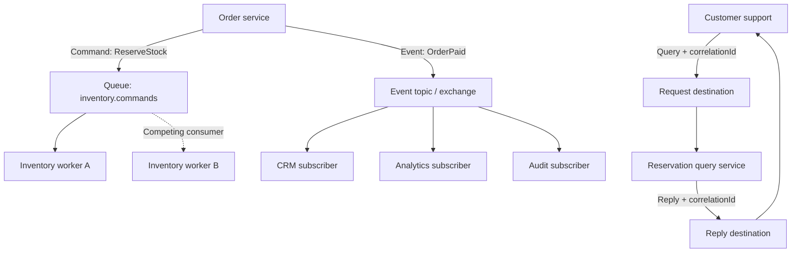
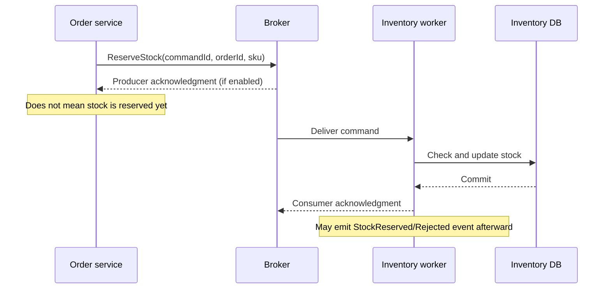
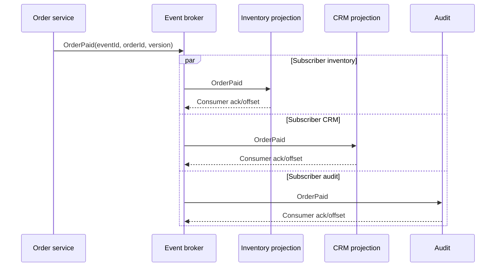
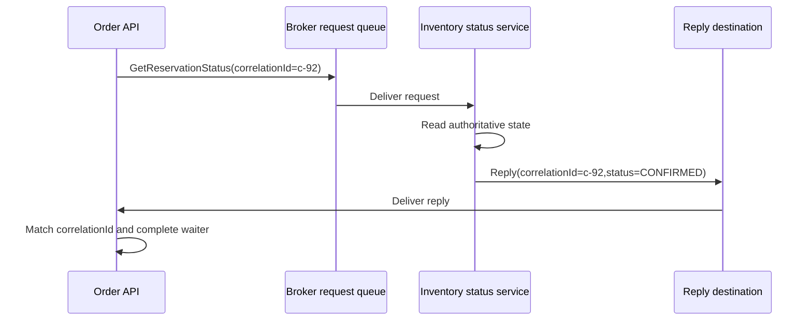
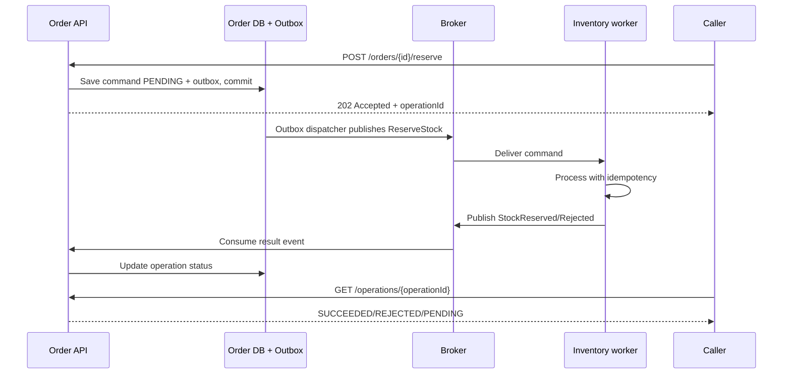
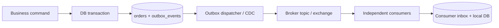
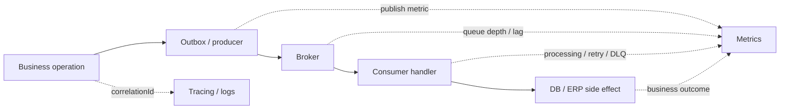

# One-Way, Publish-Subscribe, and Request-Reply Communication

## 1. Why Must You Choose the Right Communication Pattern When Integrating Systems?

A Spring Boot application may receive an HTTP request, write an order to PostgreSQL, look up Redis, send a command to an ERP, publish events for inventory and accounting systems, and then handle responses coming back from Kafka or RabbitMQ. Those steps do not share the same requirements for **destination, timing of results, and reliability**. Picking the wrong communication pattern introduces unnecessary latency, duplicate processing, lost work, or overly tight coupling between services.

Within the **SPRING_BOOT_INTEGRATION** module, the **Messaging Platforms** chapter asks: **when should you use one-way communication, when publish-subscribe, and when request-reply?** You must not only distinguish the patterns, but also understand data contracts, transactions, acknowledgments, retries, idempotency, testing, and observability in real integration flows.

Our running example is an order management platform:

1. `Order API` receives a payment request and writes the new state to the database.
2. The system needs to **send a command to reserve inventory** to the single service responsible for doing so.
3. The system needs to **announce the order was paid** to inventory, CRM, reporting, and audit.
4. A customer support screen occasionally needs to **query reservation status immediately** and wait for a time-bounded result.

These requirements correspond to three distinct patterns. The fact that all can use a message broker does not mean all should share the same exchange/topic type, consumer group, or error policy.

After this lesson, you will be able to:

- Explain **one-way**, **publish-subscribe**, and **request-reply** in terms of data direction, receiver count, and reply expectations.
- Distinguish **command**, **event**, **query**, and **reply**, including the difference between producer acknowledgment and business processing outcome.
- Map these patterns onto Kafka, RabbitMQ/AMQP, JMS, and Spring Integration.
- Design correlation IDs, reply destinations, deadlines, retries, DLQs, idempotency, and outboxes.
- Write basic Spring Boot producers/consumers and identify the limitations of each example.
- Test and monitor correctness when messages are redelivered, delayed, or out of order.

## 2. Same Messaging Infrastructure, Three Very Different Contracts

| Pattern | Who Knows the Receiver? | Desired Number of Processing Parties | Waits for Business Reply? | Example |
|---|---|---|---|---|
| **One-way / fire-and-forget** | Usually identifies a specific function/destination. | One logical assignee; multiple workers may compete. | **No** within the same call. | Sending `ReserveStock` to inventory's command queue. |
| **Publish-subscribe (pub/sub)** | Publisher does not need to know each subscriber. | Multiple independent subscribers receive the logical event. | **No** reply expected by the publisher. | Emitting `OrderPaid` so CRM, inventory, and audit react. |
| **Request-reply** | Knows the queried service/operation or equivalent routing. | One logical party processes the request and returns a result. | **Yes**, typically with a timeout/deadline. | `GetReservationStatus` returning `CONFIRMED` or `PENDING`. |

One-way and pub/sub are both typically **non-reply-waiting** communication, yet they differ in distribution model: **one command for one processing function** versus **one event for multiple independent consumer groups**.

Do not equate “no reply expected” with “no acknowledgment”: the producer may still await **broker receipt/storage confirmation**, and the consumer may still **ack after processing**, yet neither signal is a business reply.

### 2.1. Overview Diagram



Each branch has its own requirements for routing, durability, ordering, failure handling, and monitoring.

## 3. Distinguish Command, Event, and Query Before Picking a Broker

In messaging integration, a message's **business meaning** drives most of the architecture:

| Message | Expresses | Responsible Party | Example |
|---|---|---|---|
| **Command** | “Perform action X.” | One logical owner/handler. | `ReserveStock`, `SendInvoice`. |
| **Event** | “Fact X happened.” | Unlimited subscribers; each decides its reaction. | `OrderPaid`, `StockReserved`. |
| **Query/request** | “Provide status/information X.” | An authoritative service returning data. | `GetReservationStatus`. |
| **Reply/response** | “Result corresponding to request Y.” | Waiting caller or workflow storing the result. | `ReservationStatusReply`. |

Sending a command to a topic where three consumer groups all execute `ChargePayment` can cause **three charges** if independent groups each run the command. Conversely, sending an `OrderPaid` event to a single queue with three competing consumers delivers each message to only **one of the three workers**, leaving CRM and reporting out of sync.

**Rule:** name commands with action verbs directed at an executor; name events after things that happened, usually in the past tense. Naming does not replace broker configuration, but it aids contract reviews and prevents semantic confusion.

### 3.1. Message Envelope with Identity and Versioning

A real-world event needs more than business payload fields:

```json
{
  "eventId": "evt-683c",
  "eventType": "OrderPaid",
  "schemaVersion": 2,
  "aggregateId": "ord-1042",
  "aggregateVersion": 7,
  "occurredAt": "2026-11-21T03:00:00Z",
  "correlationId": "flow-8e21",
  "causationId": "cmd-7519",
  "data": {
    "orderId": "ord-1042",
    "paymentReference": "pay-5931"
  }
}
```

- `eventId` identifies **a single event** for deduplication/idempotency.
- `aggregateId`/`aggregateVersion` aid routing, partitioning, and out-of-order event resolution.
- `schemaVersion` supports evolving data contracts when producers/consumers run different versions.
- `correlationId` ties a workflow together; `causationId` identifies the operation that caused the event.
- `occurredAt` is when the business recorded the event, **not** when the broker delivered it.

IDs and payload values above are illustrative. Never put tokens, passwords, card numbers, or unnecessary personal data into events. Correlation IDs are helpful in logs/traces, yet **should not be used as metric tags** due to high cardinality.

## 4. One-Way: Sending Messages Without Waiting for a Business Result

In one-way communication, the producer sends a command/event to a destination and continues its flow. The producer may need confirmation that the broker **accepted** the message, but it does not wait in the same call for the handler to return a `ReservationResult`.



Depending on the broker and client, `send` may return a Future/Publisher or block up to an acknowledgment level. That only proves one stage of delivery, not that downstream ERP/DB updates succeeded.

### 4.1. When Is It Appropriate?

- Work can be processed asynchronously: sending emails, syncing data, generating reports.
- Producer and consumer need decoupling in throughput or availability.
- Processing requests can be durably queued and retried.
- An API returns **202 Accepted** after **durably saving the processing intent**; actual outcomes are checked via a status API or event.

If a user must know immediately whether a balance was debited or stock reserved, one-way may still work if the UX supports `PENDING`, but never return `COMPLETED` simply because the broker accepted the message.

### 4.2. Spring AMQP Example: Sending a Command to RabbitMQ

Spring Boot 3.x can use `spring-boot-starter-amqp`. Example of a durable routing setup:

```java
import org.springframework.amqp.core.Binding;
import org.springframework.amqp.core.BindingBuilder;
import org.springframework.amqp.core.Queue;
import org.springframework.amqp.core.QueueBuilder;
import org.springframework.amqp.core.TopicExchange;
import org.springframework.context.annotation.Bean;
import org.springframework.context.annotation.Configuration;

@Configuration(proxyBeanMethods = false)
class InventoryCommandTopology {

    @Bean
    TopicExchange orderCommandsExchange() {
        return new TopicExchange("orders.commands", true, false);
    }

    @Bean
    Queue reserveStockQueue() {
        return QueueBuilder.durable("inventory.reserve.commands").build();
    }

    @Bean
    Binding reserveStockBinding(
            Queue reserveStockQueue, TopicExchange orderCommandsExchange) {
        return BindingBuilder.bind(reserveStockQueue)
                .to(orderCommandsExchange)
                .with("inventory.reserve");
    }
}
```

Publisher:

```java
import org.springframework.amqp.rabbit.core.RabbitTemplate;
import org.springframework.stereotype.Component;

public record ReserveStockCommand(
        String commandId, String orderId, String sku, int quantity) {}

@Component
class InventoryCommandPublisher {

    private final RabbitTemplate rabbit;

    InventoryCommandPublisher(RabbitTemplate rabbit) {
        this.rabbit = rabbit;
    }

    void submit(ReserveStockCommand command) {
        rabbit.convertAndSend(
                "orders.commands", "inventory.reserve", command);
    }
}
```

Consumer:

```java
import org.springframework.amqp.rabbit.annotation.RabbitListener;
import org.springframework.stereotype.Component;

@Component
class InventoryCommandHandler {

    private final InventoryService inventory;

    InventoryCommandHandler(InventoryService inventory) {
        this.inventory = inventory;
    }

    @RabbitListener(queues = "inventory.reserve.commands")
    public void handle(ReserveStockCommand command) {
        inventory.reserveIdempotently(
                command.commandId(), command.orderId(),
                command.sku(), command.quantity());
    }
}
```

`InventoryService` is an application-defined business service. The example assumes producer and listener **have compatible message converters configured** for `ReserveStockCommand` (e.g., JSON with controlled type mapping); never assume arbitrary Java objects serialize/deserialize cleanly across every converter.

**A durable queue alone is not enough to prevent message loss.** Consider exchange/queue durability, persistent message delivery, publisher confirms, mandatory routing returns, broker replication, consumer acks, and actual topology. `convertAndSend(...)` returning normally does not prove the message was durably stored or that the handler succeeded.

## 5. One-Way Has No Reply, Yet Has Multiple Acknowledgment Levels

A command can pass through these milestones:

| Milestone | Meaning | What Does It Not Prove? |
|---|---|---|
| **Accepted into publisher memory** | Client library accepted the send call. | Not necessarily sent to the broker yet. |
| **Broker acknowledgment/confirm** | Broker responded per protocol settings. | Not necessarily routed to a queue or processed by a consumer. |
| **Consumer delivery** | A consumer received the message. | Not necessarily committed to the DB yet. |
| **Consumer ack/offset commit** | Client marked message handled per app/container policy. | Not automatically atomic with DB/ERP side effects. |
| **Business completion event** | Owner system announces `StockReserved`. | Event must be emitted reliably based on actual commit/state. |

In RabbitMQ, **publisher confirms** and **consumer acknowledgments** are distinct mechanisms; publisher returns also address cases where an exchange cannot route a message when `mandatory` is enabled. In Kafka, producer acknowledgment and consumer offset commit are likewise separate operations.

**API design:** `202 Accepted` should correspond to a durable acceptance milestone defined in the contract; never return “reservation succeeded” right after calling `execute(...)` or placing a task in an in-JVM queue.

## 6. Publish-Subscribe: One Event for Multiple Interested Parties

Pub/sub represents an event that already happened and decouples the publisher from the number of subscribers. For example, `OrderPaid` is a recorded fact; inventory can fulfill shipping, CRM updates history, reporting adds revenue, and audit stores a trail.



The publisher does not call three APIs sequentially or wait for all responses. Adding a fourth subscriber ideally requires no changes to the publisher. Still, you must manage **schema versions**, retention, ACLs, traffic growth, and each subscriber's responsibilities.

### 6.1. Pub/Sub Does Not Mean Every Instance Processes the Same Message

This distinction is critical:

- **RabbitMQ:** each queue bound to an exchange per routing receives a logical copy; **multiple consumers on the same queue** compete to process messages rather than all receiving them.
- **Kafka:** each **consumer group** reads the event stream at its own offset; consumers **within the same group** share partitions rather than every instance reading every record.
- **JMS:** queues represent point-to-point; topics represent publish-subscribe per provider/subscription semantics. With durable or shared subscriptions, account for lifecycle and subscriber grouping.
- **Spring Integration:** `PublishSubscribeChannel` broadcasts messages to subscribers within an application flow, but does not itself provide broker-grade durability.

A misconfigured group/queue can cause a business function to receive too few or too many messages.

## 7. Pub/Sub on RabbitMQ: Exchanges and Separate Queues

RabbitMQ uses exchanges to route messages to queues. With a topic exchange:

- Publisher sends events to exchange `orders.events` with routing key `order.paid`.
- Queue `inventory.order-events` binds that key.
- Queue `crm.order-events` also binds that key.
- Both subscriber groups receive and ack independently.

```java
import org.springframework.amqp.core.*;
import org.springframework.context.annotation.Bean;
import org.springframework.context.annotation.Configuration;

@Configuration(proxyBeanMethods = false)
class OrderEventTopology {

    @Bean
    TopicExchange ordersEventsExchange() {
        return new TopicExchange("orders.events", true, false);
    }

    @Bean
    Queue inventoryEventsQueue() {
        return QueueBuilder.durable("inventory.order-events").build();
    }

    @Bean
    Queue crmEventsQueue() {
        return QueueBuilder.durable("crm.order-events").build();
    }

    @Bean
    Binding inventoryEventsBinding(
            TopicExchange ordersEventsExchange,
            Queue inventoryEventsQueue) {
        return BindingBuilder.bind(inventoryEventsQueue)
                .to(ordersEventsExchange)
                .with("order.paid");
    }

    @Bean
    Binding crmEventsBinding(
            TopicExchange ordersEventsExchange,
            Queue crmEventsQueue) {
        return BindingBuilder.bind(crmEventsQueue)
                .to(ordersEventsExchange)
                .with("order.paid");
    }
}
```

`TopicExchange` supports pattern-based routing such as `order.*` or `order.#`. If all queues must receive every routing key, `FanoutExchange` is a better fit. Never mix command queues with event subscriber queues so competing consumers are not confused with fan-out.

Publisher:

```java
public record OrderPaid(
        String eventId, String orderId,
        long version, String paymentReference) {}

rabbitTemplate.convertAndSend(
        "orders.events", "order.paid", orderPaid);
```

Listeners in **two services** (or two independent beans) read from different queues:

```java
@RabbitListener(queues = "inventory.order-events")
public void onInventoryEvent(OrderPaid event) {
    inventoryProjection.applyOnce(event);
}

@RabbitListener(queues = "crm.order-events")
public void onCrmEvent(OrderPaid event) {
    crmProjection.applyOnce(event);
}
```

Services/fields in the snippet are application-supplied; message converters and JSON contracts must be configured and tested against real brokers.

### 7.1. One Queue with Three Replicas Is Not Three Subscribers

If three inventory pods all listen to `inventory.order-events`, the broker distributes messages across those three pods via competing consumers. That is **scaling out one logical subscriber**, not giving each pod the full stream. If CRM also needs events, give it its own queue/subscription.

## 8. Pub/Sub on Kafka: Topics, Partitions, and Consumer Groups

Kafka stores records in **topics** divided into **partitions**. Producers pick keys/partitions; each consumer group maintains independent read positions. One topic `orders.events` can serve:

- Group `inventory-projection`.
- Group `crm-projection`.
- Group `audit-projection`.

Within group `inventory-projection` across multiple consumer instances, each partition is normally assigned to one consumer at a time by the group coordinator. Partition count, assignment strategy, rebalances, and client version affect concurrency/ordering.

Spring Kafka 3.x example matching the corresponding Spring Boot 3.x generation:

```java
import java.util.concurrent.CompletableFuture;
import org.springframework.kafka.core.KafkaTemplate;
import org.springframework.kafka.support.SendResult;
import org.springframework.stereotype.Component;

@Component
class OrderEventKafkaPublisher {

    private final KafkaTemplate<String, OrderPaid> kafka;

    OrderEventKafkaPublisher(KafkaTemplate<String, OrderPaid> kafka) {
        this.kafka = kafka;
    }

    CompletableFuture<SendResult<String, OrderPaid>> publish(
            OrderPaid event) {
        return kafka.send(
                "orders.events", event.orderId(), event);
    }
}
```

`KafkaTemplate<String, OrderPaid>` requires corresponding producer serializers and broker config. For JSON, configure serializers/deserializers, class/schema mappings, and controlled trusted packages; calling `send` does not teach Kafka how to encode a Java record on the wire.

Example of two **consumer groups**:

```java
@KafkaListener(
    topics = "orders.events",
    groupId = "inventory-projection")
public void inventoryProjection(OrderPaid event) {
    inventory.applyOnce(event);
}

@KafkaListener(
    topics = "orders.events",
    groupId = "crm-projection")
public void crmProjection(OrderPaid event) {
    crm.applyOnce(event);
}
```

The snippet illustrates two logical handlers with hypothetical bean/service dependencies; production requires JSON conversion, container error handlers, and offset/ack policies.

### 8.1. Keys and Ordering

Sending `orderId` as the record key generally routes events for the same order into the same partition within a topic when the partitioner/topology is stable, preserving log order **within that partition**. Kafka does **not** provide a total order across multi-partition topics.

Even when partition records are ordered, asynchronous application processing, executor handoffs, retries, or merging multiple topics can cause **side effects to commit out of order**. Use `aggregateVersion` or optimistic locking when state must not move backward.

### 8.2. Replay and Retention Differ from RabbitMQ Queues

Kafka retains logs by time/size/compaction per topic, so a consumer group can re-read retained data based on offsets and policy. Traditional RabbitMQ queues remove messages after ack; replay requires a dedicated design rather than assuming it from the word “pub/sub.” Choose technologies based on retention/replay, routing, latency, and operations rather than pattern labels.

## 9. Publish-Subscribe in Spring Integration

Spring Integration brings a similar pattern into **message channels**. `PublishSubscribeChannel` allows a message to be sent to multiple subscribers within the same integration flow.

Java DSL example, where `auditService` and `searchService` are application-defined services:

```java
import org.springframework.context.annotation.Bean;
import org.springframework.integration.dsl.IntegrationFlow;

@Bean
IntegrationFlow localOrderFanOut() {
    return IntegrationFlow.from("orderEventsInput")
        .publishSubscribeChannel(spec -> spec
            .subscribe(flow -> flow.handle("auditService", "append"))
            .subscribe(flow -> flow.handle("searchService", "project")))
        .get();
}
```

**Version-specific API note:** in modern Spring Integration releases, the static DSL entrypoint is `IntegrationFlow.from(...)`; `IntegrationFlows` has evolved/been deprecated across library generations. This snippet uses `IntegrationFlow.from(...)` solely to illustrate fan-out structure; declare channel/service beans and Spring Integration dependencies appropriately.

With default synchronous execution, a slow subscriber can block the caller and delay the remaining subscribers. Configuring an executor introduces thread/transaction boundaries and requires checking how exceptions/acks behave. An in-memory `PublishSubscribeChannel` does not replace a durable broker event log or outbox.

### 9.1. Distinguishing Publish-Subscribe from Competing Channels

In a default Spring Integration `DirectChannel`, each message is dispatched to **one** subscribed handler per its load-balancing strategy; `PublishSubscribeChannel` broadcasts to **multiple** handlers. If the task is an owned command, do not use a pub/sub channel merely to run workers in parallel.

## 10. Request-Reply: Messaging Where the Caller Needs an Answer

Request-reply simulates two-way interaction over messaging infrastructure. The caller sends a request with a **correlation ID**; the responder processes it and sends a reply to a **reply destination** (queue/topic/channel) or a framework/broker-supported direct reply-to mechanism. The caller matches the reply to the pending request and bounds waiting time.



Even though transport uses a broker, the caller still **waits**; if waiting synchronously on an HTTP thread, latency and timeouts resemble HTTP RPC plus queue wait and broker hops. Request-reply **does not automatically provide temporal decoupling**.

### 10.1. Components of a Request-Reply Contract

| Component | Purpose |
|---|---|
| `requestId`/`correlationId` | Correlates a reply to a specific request. |
| Reply destination or `replyTo` | Tells the responder where to send the result. |
| Deadline / reply timeout | Bounds how long the caller waits before dropping the waiter. |
| Business status | `FOUND`, `NOT_FOUND`, `PENDING`, `REJECTED` per contract. |
| Error reply contract | Distinguishes business errors from transport/timeout failures. |
| Request version / schema | Prevents producer and responder payload mismatches. |
| Idempotency key (if side effects exist) | Prevents rerunning a mutation when a request is retried. |
| Orphan/late reply handling | Handles replies arriving after the caller already timed out. |

**A reply timeout does not prove the responder never ran.** The reply could be lost, delayed in a queue, the responder may have updated the DB before replying, or the caller stopped waiting. For commands with side effects, this is an **UNKNOWN** state requiring lookup/reconciliation.

## 11. Request-Reply with RabbitMQ and `RabbitTemplate`

Spring AMQP offers `RabbitTemplate.convertSendAndReceive(...)`, letting a caller send a request and await a reply using RabbitMQ and template configuration. The listener receives the request and **returns** an object so the framework sends the reply per metadata when the reply path is configured properly.

Example request queue topology:

```java
import org.springframework.amqp.core.*;
import org.springframework.context.annotation.Bean;
import org.springframework.context.annotation.Configuration;

@Configuration(proxyBeanMethods = false)
class ReservationRpcTopology {

    @Bean
    TopicExchange reservationRpcExchange() {
        return new TopicExchange("reservation.rpc", true, false);
    }

    @Bean
    Queue reservationStatusQueue() {
        return QueueBuilder.durable("reservation.status.requests").build();
    }

    @Bean
    Binding reservationStatusBinding(
            Queue reservationStatusQueue,
            TopicExchange reservationRpcExchange) {
        return BindingBuilder.bind(reservationStatusQueue)
                .to(reservationRpcExchange)
                .with("reservation.status");
    }
}
```

Request/reply DTOs:

```java
public record ReservationStatusQuery(
        String requestId, String reservationId) {}

public record ReservationStatusReply(
        String requestId, String reservationId,
        String status, String errorCode) {}
```

Responder:

```java
import org.springframework.amqp.rabbit.annotation.RabbitListener;
import org.springframework.stereotype.Component;

@Component
class ReservationQueryResponder {

    private final ReservationQueryService service;

    ReservationQueryResponder(ReservationQueryService service) {
        this.service = service;
    }

    @RabbitListener(queues = "reservation.status.requests")
    public ReservationStatusReply handle(ReservationStatusQuery query) {
        return service.lookup(query);
    }
}
```

Caller:

```java
import org.springframework.amqp.rabbit.core.RabbitTemplate;
import org.springframework.stereotype.Component;

@Component
class ReservationQueryClient {

    private final RabbitTemplate rabbit;

    ReservationQueryClient(RabbitTemplate rabbit) {
        this.rabbit = rabbit;
    }

    ReservationStatusReply findStatus(ReservationStatusQuery query) {
        Object raw = rabbit.convertSendAndReceive(
                "reservation.rpc", "reservation.status", query);

        if (!(raw instanceof ReservationStatusReply reply)) {
            throw new IllegalStateException(
                    "No valid reservation-status reply");
        }
        return reply;
    }
}
```

This is an **architectural example**, assuming `spring-boot-starter-amqp`, compatible JSON converter/type mapping on caller and responder, and a `ReservationQueryService` bean. In production, do not throw generic `IllegalStateException` for all timeouts/errors: distinguish **no reply**, decode errors, broker failures, and negative business results using standardized exceptions/DTOs.

Sample timeout setting (verify exact property binding for your Spring Boot version):

```yaml
spring:
  rabbitmq:
    template:
      reply-timeout: 2s
```

`reply-timeout` bounds how long `RabbitTemplate` waits for a reply; it does **not** automatically cancel a running handler. RabbitMQ request-reply commonly uses **direct reply-to** when supported; depending on version/config, fixed reply queues or separate containers may be used. Do not assume a manually created reply queue is mandatory for every call.

### 11.1. Correlation and Late Results

The framework can manage internal request correlation when using `RabbitTemplate.convertSendAndReceive`, yet the application should still include a business `requestId` for reconciliation. When a reply arrives after timeout, the caller no longer has a matching waiter; log/metric late/orphan replies appropriately without mistakenly applying them to another request.

If a request has side effects, use `requestId`/idempotency key to check status after a timeout. Never generate a new key on retries of the same business intent.

## 12. Kafka Request-Reply: Possible, But Requires Careful Trade-Offs

Kafka can implement request-reply using a **request topic + reply topic** and correlation headers. Spring Kafka provides `ReplyingKafkaTemplate` for suitable cases; configuring reply consumers/containers and correlation remains the application's responsibility.

Diagram:

```text
Client --[request topic: reservation-queries]--> Responder
Client <--[reply topic: reservation-replies]---- Responder
               correlationId + reply partition/routing
```

Challenges compared to HTTP/Rabbit RPC:

- Must plan reply topics, partitions, group IDs, and routing replies back to the right caller instance.
- Callers may restart, scale out, or rebalance while waiting for a reply.
- Kafka log retention/offsets do not persist an in-memory “awaiting Future” across restarts.
- Late and duplicate replies must be identified via correlation.
- Adds batching/commit/consumer poll latency compared to direct request-response connections.

**Do not choose Kafka request-reply just because the app already uses Kafka.** If you need fast queries with tight SLOs and the target service is directly reachable, HTTP/gRPC may be clearer. If you want durable async communication for a long workflow, **command + result event** plus a status resource is usually preferable to holding a thread waiting on a reply.

## 13. Spring Integration Request-Reply and Reply Channels

Spring Integration offers `MessageChannel`, `MessagingTemplate`, and gateways to structure request-reply. A request can carry a `replyChannel` header; the handler sends the reply to that channel. Depending on the flow, the reply may return in the same JVM or travel via adapters/brokers.

Conceptual example:

```java
import org.springframework.messaging.Message;
import org.springframework.messaging.support.MessageBuilder;
import org.springframework.integration.core.MessagingTemplate;

Message<String> request = MessageBuilder
        .withPayload("reservation-123")
        .setHeader("correlationId", "corr-123")
        .build();

MessagingTemplate template = new MessagingTemplate();
template.setReceiveTimeout(1500);
Message<?> reply = template.sendAndReceive(
        requestChannel, request);
```

`requestChannel` is an application-defined `MessageChannel`; this illustrates the concept and needs proper beans/imports. `sendAndReceive` requires a flow that genuinely produces a reply; if a handler consumes one-way without replying, the caller receives `null`/times out per template policy.

**Do not confuse channel send/receive timeouts with downstream HTTP client network timeouts.** A Spring Integration gateway does not guarantee durable request/reply if its underlying channels are in-memory.

### 13.1. In-JVM `replyChannel` Differs from Broker `replyTo`

The `replyChannel` header can reference a message channel inside the Spring context; it is not automatically a RabbitMQ queue/Kafka topic reachable from another process. When crossing broker adapters, define explicit header/address mappings and security checks. Never blindly serialize a Java channel object into a wire contract.

## 14. Request-Reply Does Not Fit Every Long-Running Workflow

Suppose `ReserveStock` takes 30 seconds in an ERP, sometimes stretching to minutes. Holding an HTTP thread or broker RPC waiter that entire time:

- Ties up resources and inflates API p95/p99 latency.
- Easily times out under load spikes or broker disruptions.
- Leaves replies orphaned if the caller restarts.
- Leaves the caller unsure whether to retry if the side effect completes after timeout.

An alternative design:



This puts **business completion** into events/status resources that survive restarts, rather than holding waiters in RAM. It still requires outbox, consumer idempotency, DLQ, and reconciliation, yet workflow duration no longer hinges on a single request-reply timeout.

## 15. Comparing Platforms Across the Three Patterns

| Platform | One-Way / Competing Consumers | Publish-Subscribe | Request-Reply |
|---|---|---|---|
| **RabbitMQ/AMQP** | Send command to queue via exchange; multiple workers compete. | Exchange routes events to multiple separate queues. | `RabbitTemplate` RPC / direct reply-to / reply queues. |
| **Kafka** | Command topic with one owner consumer group; partitions distribute load. | Independent consumer groups read the same topic. | Request/reply topics + `ReplyingKafkaTemplate` or event-based workflow. |
| **JMS provider** | Queue + message listener. | Topic + durable/shared subscriptions per provider. | `JMSReplyTo`/`JMSCorrelationID`, request/reply client pattern. |
| **Spring Integration** | `DirectChannel`/`ExecutorChannel`/`QueueChannel` and handlers. | `PublishSubscribeChannel` and multiple subscribers. | Gateways, `replyChannel`, `MessagingTemplate`. |
| **HTTP/gRPC** | HTTP 202 + durable task to become async. | Not natively pub/sub; requires event stream/broker/webhooks. | Direct request-response, often simpler for fast queries. |

There is no absolute rule that “Kafka is pub/sub while RabbitMQ is only queues”: both can implement multiple patterns, yet **routing, storage, retention, acknowledgment, and operations differ**.

**Version feature note:** Spring Boot 3.x pulls compatible Spring Kafka/Spring AMQP/Spring Integration generations via its BOM; methods/APIs and default error handling can change across versions. Verify your exact release rather than copying legacy-version code verbatim into new projects.

## 16. Ack, Retry, and Delivery Semantics: Needed by All Three Patterns

Messaging does not automatically guarantee an exactly-once business effect. Three basic levels:

| Semantics | Approximate Meaning | Risk |
|---|---|---|
| **At-most-once** | Does not attempt redelivery once a certain milestone is recorded. | Messages can be lost on crashes before processing finishes. |
| **At-least-once** | May redeliver until completed per ack/offset policy. | **Duplicate** processing can occur. |
| **Exactly-once** | Some brokers/transactional workflows offer bounded guarantees on record/offset processing. | Does not automatically cover DBs, ERP HTTP calls, or side effects outside the broker. |

Typical failure sequence:

1. Consumer writes PostgreSQL, **DB commit succeeds**.
2. Process crashes before RabbitMQ ack or Kafka offset commit.
3. Broker redelivers the message.
4. Without idempotency in the handler, records or side effects can be duplicated.

### 16.1. Acknowledgments Should Follow a Durable Milestone

For commands that must run to completion, ack after the DB transaction/applicable side effects finish. To ack early and free the broker consumer, first **persist the work to a durable inbox/job table** before acking; submitting to an in-RAM `TaskExecutor` is insufficient.

Spring Kafka and RabbitMQ offer various ack modes, error handlers, batch/prefetch controls, and transaction integrations. Do not assume a listener method returning normally means the DB committed: that depends on transaction boundaries and container configuration.

### 16.2. Retry by Error Category, Never Loop Infinitely

| Failure | Usually Reasonable Policy |
|---|---|
| Incompatible JSON/schema | Do not hot-retry; route to DLQ/quarantine and alert on contract mismatch. |
| Validation/business rejection | Record rejection outcome; do not retry if input data hasn't changed. |
| Transient Redis timeout / DB deadlock | Bounded retry with backoff when the operation is safe. |
| ERP HTTP 429/503 | Respect quotas, backoff/jitter, and deadlines. |
| Read timeout after ERP write | **UNKNOWN**; requires idempotency/status lookup. |
| Request-reply timeout | Do not conclude responder didn't run; do not arbitrarily resend write commands. |
| Consumer crash after DB commit before ack | Redelivery must be handled safely via idempotency. |

Avoid stacking retries across three layers (broker → service → HTTP client), multiplying attempts exponentially. Designate one primary retry owner, an overall attempt budget, and clear stop/DLQ criteria.

## 17. Inbox, Idempotency, and Outbox Bridge Boundaries

### 17.1. Consumer Inbox or Processed-Events Table

A common strategy stores `eventId` alongside the business update in **one DB transaction**, relying on a unique constraint against duplicates:

```sql
CREATE TABLE consumed_events (
    consumer_name VARCHAR(100) NOT NULL,
    event_id VARCHAR(100) NOT NULL,
    processed_at TIMESTAMPTZ NOT NULL DEFAULT now(),
    PRIMARY KEY (consumer_name, event_id)
);
```

A business transaction can try inserting the marker first, apply domain updates/outbox writes, and commit. On duplicate events, the unique constraint/`ON CONFLICT DO NOTHING` lets the handler skip repeating side effects. Verify that **marker insertion and business updates commit together**; if the marker commits first and business logic rolls back, redeliveries would be wrongly skipped.

If multiple logical subscribers process the same event, the key must include `consumer_name` or equivalent. Never use global deduplication that makes a CRM subscriber see an event as already “consumed” by inventory.

### 17.2. Transactional Outbox for Producers

The dual-write problem:

```text
BEGIN transaction
  UPDATE orders SET status='PAID'
COMMIT
publish OrderPaid -> broker error
=> DB says PAID, subscribers never receive the event
```

Outbox pattern:



Write business state **and the outbox row inside the same local DB transaction**. After commit, a dispatcher/CDC emits events and marks them published per policy. The dispatcher may emit duplicates if publishing succeeds yet updating the outbox row fails; consumers must be idempotent.

### 17.3. Exactly-Once Must State Its Scope

A Kafka transactional producer can coordinate writes and offsets **within Kafka** when configured properly. It does not automatically roll back a PostgreSQL transaction or a `POST /erp/payments` call. Across resources outside the broker, you typically design **effectively-once** at the business level using unique business IDs, idempotency keys, outbox/inbox, and reconciliation.

## 18. Ordering, Partitioning, and Concurrency

A `ReserveStock` command can tolerate parallel processing per SKU, whereas two events `OrderPaid(version=7)` and `OrderRefunded(version=8)` for the same order must never revert a projection to an older state.

| Factor | Impact |
|---|---|
| Kafka partition key | Determines whether events for the same aggregate are likely to share a partition. |
| Consumer group/partition assignment | Bounds per-group consumer concurrency. |
| RabbitMQ queue + multiple consumers/prefetch | Can finish out of publish order; requeues/retries can invert effects. |
| Spring Integration `ExecutorChannel` | Hands handlers to executors, potentially altering completion order. |
| DB version / optimistic locking | Can reject updates from stale events. |
| Retry/DLQ/replay | Late records can still be processed after newer events. |

If business logic demands monotonic versions, use a conditional update:

```sql
UPDATE order_projection
SET status = :status, version = :incoming_version
WHERE order_id = :order_id
  AND version < :incoming_version;
```

This is an **illustrative logic pattern**; ensure the row exists or handle concurrent inserts/upserts with proper locks/unique constraints. If a consumer receives version 9 before 8, policy may discard 8, buffer/wait, or rebuild from source of truth per contract. Never infer business order from arrival timestamps.

## 19. Request-Reply: Timeouts, Correlation, and Backpressure Require Explicit Design

Broker RPC consumes at least two resource pools: request queue/consumers **and** caller waiters. As request volume grows:

- Request queues grow → replies slow down.
- Callers hold more threads/Futures → higher memory and connection load.
- Timeouts → orphan replies and retry storms.
- Failing consumer messages retried for too long → caller already timed out while server keeps working.

### 19.1. Define End-to-End Deadlines

```text
caller deadline
  -> serialize/send
  -> broker enqueue + queue wait
  -> handler processing + DB/ERP
  -> reply publish
  -> reply queue + delivery
  -> caller deserialize/match correlation
```

A 2-second reply timeout must fit inside the **inbound HTTP budget** and actual wait times. If a caller already spent 800 ms on the DB against a 1-second API deadline, do not start a 2-second broker RPC. When frameworks propagate deadlines, responders should inspect them before executing side effects.

### 19.2. Do Not Use Request-Reply as a Distributed Lock

Two requests with the same business ID can be sent concurrently and receive two replies. Correlation IDs only **match responses**, without providing mutual exclusion or idempotency. If the responder writes data, it still needs unique constraints/business keys/transactions.

### 19.3. Technical Outcomes Differ from Business Outcomes

- **Technical timeout:** no reply received within deadline; processing state unknown.
- **Business `NOT_FOUND`:** responder ran and returned a valid negative result.
- **Business `REJECTED`:** responder evaluated and rejected the request.
- **Broker publish failure:** request may not have been dispatched; classify based on confirm milestones.
- **Deserializer error:** reply arrived, but caller cannot understand the schema.

Never catch all of these as `null` and conclude “order does not exist.”

## 20. Choose Patterns by Need Instead of Available Libraries

A quick decision matrix:

| Question | If Yes | Direction |
|---|---|---|
| Is **one owner** needed to execute a command? | Yes. | One-way command to owner queue/consumer group. |
| Do **multiple independent apps** need the same fact? | Yes. | Pub/sub events with independent subscriptions/groups. |
| Does the caller truly need an **immediate answer** within a tight deadline? | Yes. | Request-reply or direct HTTP/gRPC depending on topology. |
| Can work take minutes/hours or must it survive restarts? | Yes. | Durable command + status/events; avoid holding long RPC waiters. |
| Are event replay/stream processing needed? | Yes. | Consider Kafka logs/retention/compaction and consumer groups. |
| Are flexible routing and queue-based work distribution needed? | Yes. | Consider RabbitMQ exchanges/queues or an appropriate JMS provider. |
| Must DB side effects and events stay commit-consistent? | Yes. | Outbox, inbox/idempotency regardless of pattern. |

**Do not turn everything into pub/sub** just to “reduce coupling”: an owned command still needs a clear executor, dead-consumer detection, and completion criteria. **Do not turn everything into request-reply** just to make code look like function calls: doing so brings temporal coupling, timeouts, orphan replies, and resource pressure.

## 21. Observability: Measure Both Broker and Business State

Instrumentation must answer “where is the message, how far was it processed, is it retrying?”:

| Metric / Trace | One-Way | Pub/Sub | Request-Reply |
|---|---|---|---|
| Publish success/failure/confirm | Required. | Required. | Required for both request and reply. |
| Queue depth, oldest message age | Required when queue-based. | Per queue/group. | Both request and reply backlogs. |
| Kafka consumer lag | For the owner group. | For **each** subscriber group. | If RPC is built on topics. |
| Handler processing duration/outcome | Required. | Per subscriber/operation. | Required along with reply latency. |
| Retries, redeliveries, DLQ/quarantine | Required. | Per subscriber. | Also track orphan/late replies. |
| End-to-end business latency | From command accepted to completed. | From event commit to projection updated. | From send to reply or timeout. |
| Correlation/trace propagation | Per workflow ID. | Via message headers/event envelope. | Must link request and reply spans. |

Spring Boot Actuator, Micrometer Observation/Tracing, and messaging libraries can instrument producers/consumers depending on versions and configuration. **Never assume all broker metrics appear automatically** upon adding Actuator. Kafka lag, Rabbit queue depth, publish confirms, consumer acks, and application business states require distinct telemetry sources.



### 21.1. Cardinality and Security

- Do not put `eventId`, `orderId`, correlation IDs, tenant accounts, tokens, or full payloads into **metric labels**.
- Use bounded labels: standardized `topic`/`queue`, `consumerGroup`, `operation`, `outcome`, `errorType`.
- Correlation IDs belong in access-controlled traces/logs with redaction and proper retention.
- Never log raw headers containing `Authorization` or customer data; enforce broker TLS, ACLs, authentication, schema validation, and payload limits.
- Never allow unauthenticated publishers to specify arbitrary reply destinations that could leak sensitive data/trigger internal SSRF via responders.

## 22. Testing All Three Patterns with Spring Boot

A test that only mocks `KafkaTemplate.send(...)` or `RabbitTemplate.convertAndSend(...)` verifies a method call, not routing, acknowledgments, serialization, or consumer transactions.

Use three layers:

1. **Unit tests:** command/event mapping, error classification, deadlines, idempotency keys, correlation/reply parsing.
2. **Contract tests:** JSON/Avro/Protobuf schemas, compatibility, event versions, headers, error replies.
3. **Integration tests with real brokers:** Testcontainers Kafka/RabbitMQ, topic/exchange/queue topology, redelivery, DB commits, outbox, and correlation.

### 22.1. Mandatory Test Matrix

| Scenario | What to Prove |
|---|---|
| One-way command sent to queue | Only the logical owner handler runs; competing handlers do not duplicate side effects. |
| Producer receives confirm | Test separates confirm/routing from business completion. |
| Command redelivered after crash | Inbox/idempotency blocks duplicate updates. |
| Pub/sub event with 2 subscribers | Both groups/queues receive and process independently. |
| Multiple instances in same group/queue | Load splits across instances rather than multiplying to every instance. |
| Out-of-order events | Projection does not revert to older versions. |
| Consumer JSON/schema failure | Proper retry/DLQ/quarantine without infinite poison loops. |
| Request-reply success | Correct correlation matching and valid response schema. |
| Concurrent requests | Replies for two correlation IDs never mix. |
| Lost or late reply | Bounded timeout, no leaked waiters, late replies handled safely. |
| Responder writes then caller times out | Retries/lookups use idempotency keys without duplicating side effects. |
| DB commits + broker publish fails | Outbox retains record; dispatcher can republish. |
| DB commits + consumer ack fails | Message redelivered, yet business effect happens only once. |
| Broker/network outage | Producer/consumer classify errors and apply backpressure. |

### 22.2. Testcontainers and Final-State Assertions

With Kafka or RabbitMQ, run real containers and configure Spring Boot tests via `@ServiceConnection` where supported by your container/factory version, or `@DynamicPropertySource` when needed. Wait until consumers/subscriptions are ready before publishing instead of guessing with `Thread.sleep(...)`.

For example, a pub/sub test should:

1. Create isolated topics/queues/subscriber groups for the test.
2. Emit an `OrderPaid(eventId=E1)`.
3. Poll the DB with a deadline until both inventory and CRM projections record `E1`.
4. Resend the same `E1` and verify each projection applies its side effect only once.
5. Fail one subscriber and verify the other still succeeds while the failing subscriber follows retry/DLQ policy.

That validates genuine **independent fan-out**, rather than merely checking that `send()` returned normally.

### 22.3. Testing Request-Reply with Bounded Waits

Use a test responder returning distinct replies per request ID, send multiple concurrent requests, and assert correlations never cross. Simulate a silent/failing responder and verify the caller times out cleanly, cleans up waiters, and increments a `reply_timeout` metric. Verify that a reply arriving after timeout does not accidentally complete a newer request.

If tests put `@Transactional` on the test method, check whether it hides `AFTER_COMMIT`/outbox behavior. Tests of real side effects need real committed transactions, unique keys, and clean teardown.

## 23. Troubleshooting: From Symptoms to Communication Design

| Symptom | Common Root Cause | What to Check |
|---|---|---|
| Inventory receives `OrderPaid`, CRM does not | Two subscribers accidentally share the **same Rabbit queue** or Kafka group. | Split subscriptions/groups by function. |
| One command executed by three systems | Published a command as an event to three independent subscribers. | Route to a single owner and add idempotency. |
| Producer logs “sent” but no worker runs | Unrouted queue, unconfirmed publish, missing consumer, or missing permissions. | Check exchanges/bindings/mandatory returns, Kafka partitions/topics/ACLs. |
| Worker processed it yet keeps receiving it | Ack/offset did not commit after business DB commit. | Design inbox/unique keys and ack policies. |
| Queue depth / consumer lag spikes | Slow handler, DB/ERP bottleneck, retry storm. | Check processing latency, pools, DLQs, quotas. |
| Events arrive out of order | Partition key, prefetch, concurrency/retries/replay. | Check aggregate versions and conditional updates. |
| RPC reply times out even though responder finished | Wrong reply routing/correlation, reply queue backlog, caller timeout. | Check headers, reply destinations, waiter lifecycle, and latency. |
| Two RPC requests swap replies | Duplicate correlation IDs or broken reply multiplexing. | Use unique request IDs and atomic matching. |
| HTTP threads exhausted during broker RPC | Synchronous reply waits too long without deadlines/backpressure. | Reduce waiters; switch to async status workflows or direct HTTP for fast queries. |
| One subscriber stuck in infinite poison loop | Unbounded retries, incompatible schema. | DLQ/quarantine and contract validation. |
| DB updated yet event never emitted | Non-atomic dual-write to DB and broker. | Outbox/CDC; check dispatcher backlog. |
| Kafka transactions enabled yet ERP duplicates writes | Exactly-once is bounded; ERP is an external side effect. | Business idempotency and reconciliation. |

### 23.1. Runbook When Messaging Fails

1. Identify the **pattern and business contract** first: command, event, or request.
2. Trace producer publish acknowledgments, broker topology, and routing.
3. Inspect consumer groups/queues, instance counts, partition assignments, queue depth/lag.
4. Inspect DB transactions, idempotency keys, ack/offset order, and outbox rows.
5. Classify failures: deserialization, business rejection, transport timeout, dependency exhaustion.
6. Inspect retries/DLQs/quarantine; do not blindly replay everything if commands carry unclear side effects.
7. For request-reply, check reply correlation, deadlines, waiters, and late replies.
8. Replay/recover only after verifying policies prevent duplicates and effects are monitored.

## 24. Anti-Patterns to Avoid

1. **Confusing producer acknowledgment with business completion.**
2. **Using one queue for multiple independent subscribers and expecting every party to receive every event.**
3. **Using multiple Kafka consumer groups for a side-effecting command without an owner/idempotency.**
4. **Using request-reply for workflows taking minutes**, holding thousands of waiters.
5. **Retrying write commands after timeouts without an idempotency key or reconciliation.**
6. **Acking the broker right after queuing work in JVM RAM**, before durable persistence.
7. **Believing Kafka transactions cover PostgreSQL or ERP HTTP calls.**
8. **Emitting events after DB commit with a bare publish call and no recovery mechanism.**
9. **Updating projections by arrival time while ignoring aggregate versions.**
10. **Failing to version schemas**, breaking older consumers when fields/types change.
11. **Putting event IDs or order IDs into metric tags**, causing cardinality explosions.
12. **Letting the DLQ become an unmonitored permanent dumping ground**, silently stalling workflows.
13. **Sharing the same consumer group ID across independent logical subscribers**, breaking fan-out.
14. **Omitting request-reply timeouts**, letting callers wait infinitely or beyond SLOs.
15. **Treating a Spring Integration in-memory channel like a durable queue.**
16. **Assuming broker delivery order means DB side effects commit in the same order.**

## 25. Implementation Checklist

- [ ] Identified whether each message is a **command, event, query, or reply** per contract.
- [ ] Chose one-way / pub-sub / request-reply based on owner count, subscriber count, and deadlines.
- [ ] For RabbitMQ, separated exchanges/bindings, command queues, and per-subscriber event queues.
- [ ] For Kafka, configured topics, partition keys, and per-function consumer groups.
- [ ] For JMS, chose queue/topic and subscription durability/sharing semantics suited to the provider.
- [ ] For Spring Integration, verified which channels dispatch to one vs. multiple subscribers and whether they are durable.
- [ ] Included schema version, event/message ID, business key, correlation/causation, and occurrence time.
- [ ] Aligned producer confirms/acks and consumer ack/offset commits with **durable** milestones.
- [ ] Added an outbox when business DB commits must guarantee event publication.
- [ ] Added inbox/unique constraints/idempotency for consumers subject to redelivery.
- [ ] Designed retries, backoff, jitter, quotas, DLQ/quarantine, and replay policies.
- [ ] For replies, enforced request correlation, reply destinations, deadlines, error reply contracts, and late-reply cleanup.
- [ ] Avoided replacing status resources with request-reply for long workflows or unclear side effects.
- [ ] Verified ordering/concurrency via aggregate versions, partitioning, and conditional updates.
- [ ] Secured broker TLS/auth/ACLs, payload sizes, and data minimization.
- [ ] Exposed metrics for publish/lag/queue depth/processing/retries/DLQ and business completion latency.
- [ ] Excluded per-event/per-user IDs from metric labels.
- [ ] Covered duplicates, out-of-order delivery, timeouts, broker outages, and DB commit/ack gaps in unit/contract/integration tests.
- [ ] Established runbooks for backlogs, poison messages, orphan replies, and reconciliation.

## 26. Summary

**One-way** sends a command or notification without the caller awaiting a business result; **publish-subscribe** delivers an event to multiple independent consumer groups; **request-reply** expects a response correlated to a request, requiring correlation, reply destinations, and timeouts. All three patterns can be built with Kafka, RabbitMQ, JMS, or Spring Integration, yet **routing, retention, acks, and failure semantics** follow each underlying platform.

In **SPRING_BOOT_INTEGRATION**, picking the right pattern is only step one. A reliable integration flow must define **source of truth, contracts/versions, transaction boundaries, producer/consumer acknowledgments, retries, idempotency, outboxes, deadlines, testing, and observability**. When the producer knows clearly what “accepted” means, the consumer knows clearly what “completed” means, and the system recovers cleanly from timeouts/crashes, messaging decouples services without sacrificing business correctness.
