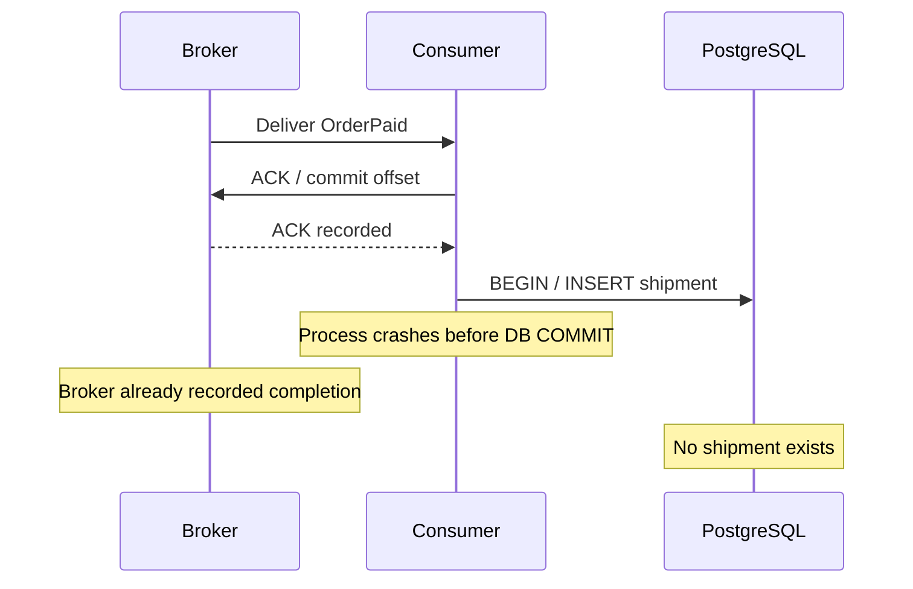
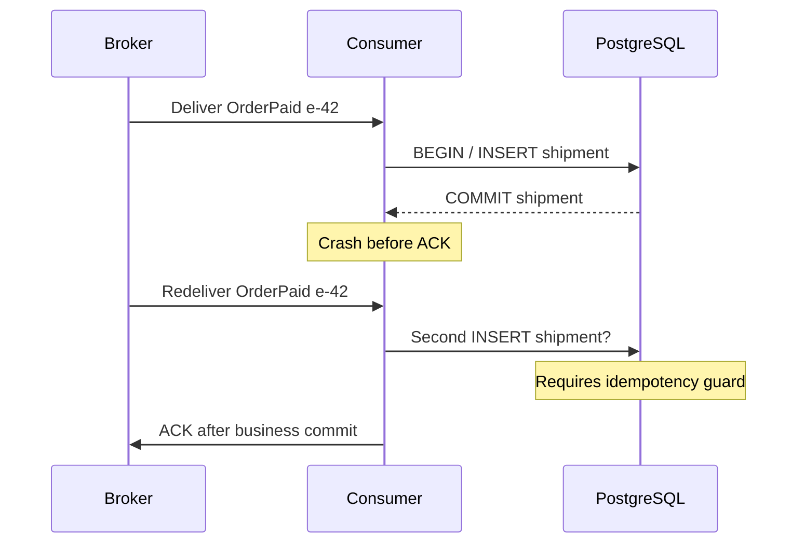
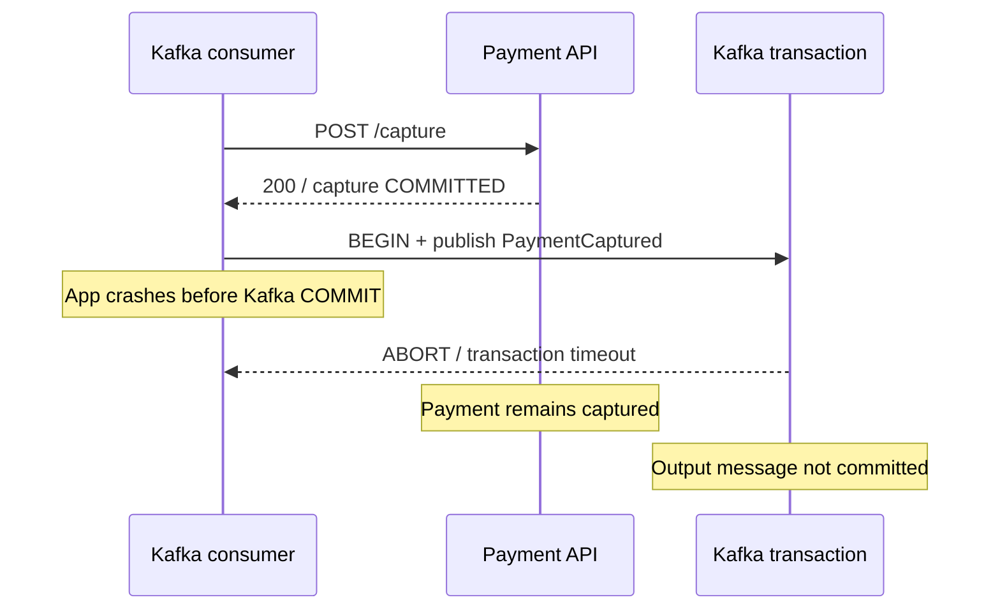
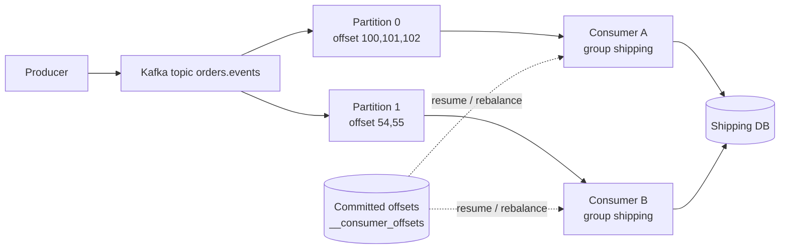
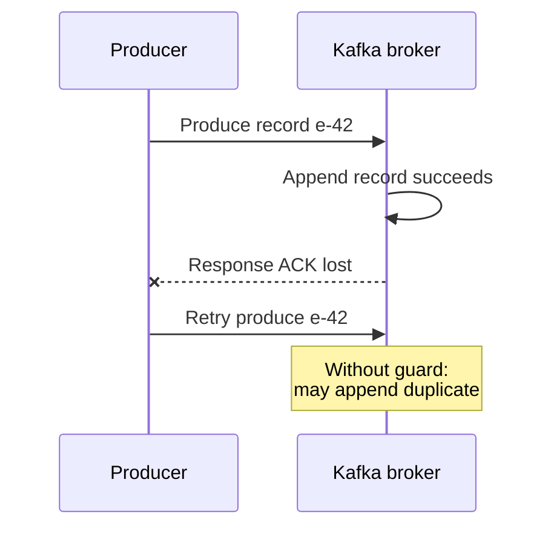
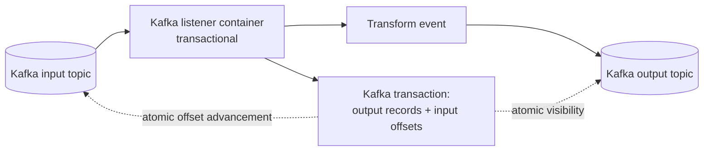
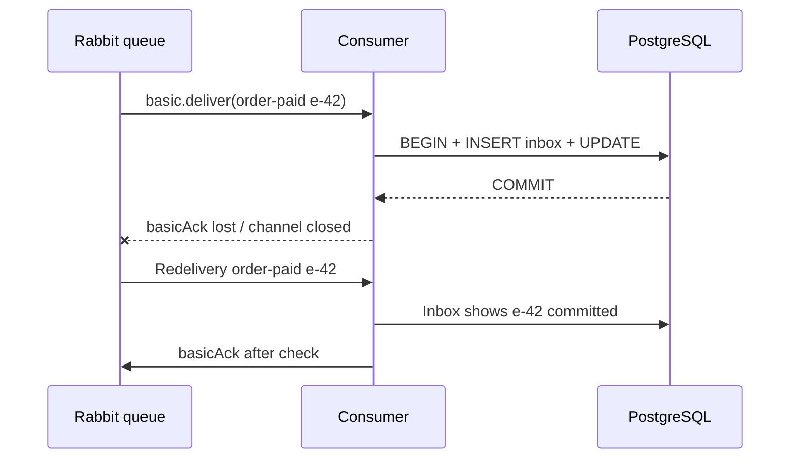
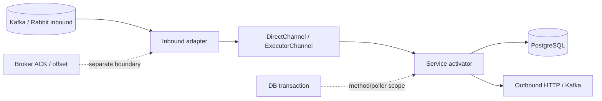
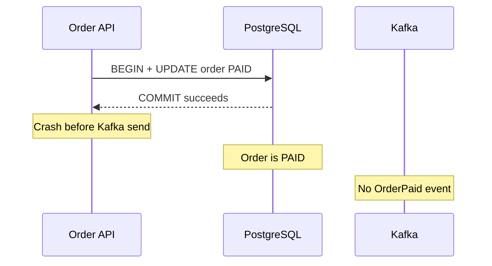
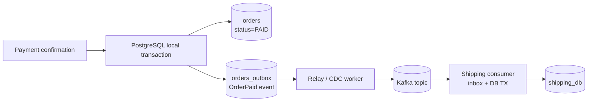

# At-Most-Once, At-Least-Once, and the Limits of Exactly-Once

## 1. Why Can a Message Be Lost or Processed Multiple Times?

Suppose `order-service` updates an order's status in PostgreSQL and emits `OrderPaid` to Kafka; `shipping-service` receives the message to create a shipment. In normal operation, an event is emitted once, the consumer processes it once, and the result looks right. Yet if the process crashes right at commit time or loses a broker response, an event can **go unsent**, **be redelivered**, or **create a shipment without the consumer knowing it completed**.

```text
Payment service             Message broker             Shipping service
      |                            |                            |
      |-------- OrderPaid -------->|                            |
      |                            |-------- OrderPaid -------->|
      |                            |                  INSERT shipment
      |                            |                  COMMIT database
      |                            |<--- Lost ACK -------X      |
      |                            |-------- OrderPaid -------->|
      |                            |           reprocess the same event?
```

When an ACK is lost, the broker cannot guess whether the handler committed to its database. It must make a choice: **redeliver** to avoid dropping work, or **do not redeliver** to avoid duplication. From this come three delivery semantics:

- **At-most-once:** messages may be lost, yet are not intentionally redelivered once marked handled.
- **At-least-once:** prioritizes never dropping messages; redelivery and duplicate processing may occur.
- **Exactly-once:** claims an effect occurs once **within a strictly defined scope**; does not automatically ensure every database, HTTP endpoint, and broker commits atomically together.

This lesson, **“At-Most-Once, At-Least-Once, and the Limits of Exactly-Once”**, belongs to the **Messaging Platforms** chapter of `SPRING_BOOT_INTEGRATION`. We examine these guarantees when integrating Spring Boot with HTTP clients, PostgreSQL, Kafka, RabbitMQ/JMS, Redis, and Spring Integration—emphasizing event contracts, transactions, errors, idempotency, testing, and system observability.

**Objectives:**

1. Distinguish *delivery*, *processing*, and *business side effects* instead of vaguely claiming “processed exactly once.”
2. Pinpoint the corresponding failure windows of at-most-once and at-least-once.
3. Understand Kafka idempotent producers, producer transactions, offset transactions, and the scope of Kafka exactly-once semantics.
4. Understand RabbitMQ acknowledgments, publisher confirms, redelivery, and local channel transactions; distinguish them from JDBC commits.
5. Use Spring Boot/Spring Kafka to build an at-least-once consumer with **idempotent database effects** via an inbox and unique constraints.
6. Use a transactional outbox when events must not be lost after a database commit.
7. Design retries, DLT/parking, ordering, idempotency TTLs, version guards, and crash recovery.
8. Test each failure window with real brokers/databases and monitor duplicates and backlogs.

> **Applicable versions:** Examples are based on Java 17+, Spring Boot 3.x, Spring Kafka 3.x, compatible Kafka brokers, Spring AMQP, PostgreSQL, and Spring Framework 6.x. If using Spring Boot 4.x, Spring Kafka 4.x, or other broker/driver versions, verify corresponding configuration and APIs. Several snippets are standalone alternatives or sketches as noted; do not combine every snippet into one application without deciding the business workflow first.

## 2. Three Layers of “Once”

When someone says “messages are processed exactly once,” ask **once at which layer**:

| Layer | Observation | Guarantee That Cannot Be Inferred |
| --- | --- | --- |
| **Producer → broker** | Is a record appended to the topic/queue once across producer retries? | Consumer runs only once; database commits only once. |
| **Broker → consumer** | How many times can a message be delivered/redelivered? | One delivery equals one successful DB transaction. |
| **Consumer → business state** | How many times do orders, ledgers, shipments, emails, or HTTP calls apply side effects? | Committed broker offset/ACK proves all side effects succeeded. |
| **Multi-system chain** | Did one logical command complete all steps? | A Kafka transaction automatically spans PostgreSQL, Redis, and an HTTP provider. |

A message can be delivered by the broker **twice** and invoke the consumer **twice**, yet if the business database enforces a unique ledger, **only one shipment is created**. That is **at-least-once delivery + idempotent consumer**, not proof that the broker never redelivers.

Conversely, a broker might deliver once while the handler spawns two threads calling two APIs for the same side effect: **at-most-once delivery does not automatically create an exactly-once effect**.

### 2.1. Distinguishing Identifiers

```text
HTTP request ID          : identifies one request/trace
Business command ID      : identifies one logical business request
Event ID                 : identifies one emitted event
Kafka record identity    : topic + partition + offset
Rabbit delivery tag      : delivery sequence number on a channel
Aggregate ID / version   : entity + mutation version
Side-effect key          : charge / reservation / shipment ID at provider
```

Never mix up identifiers:

- Kafka `offset` identifies position inside **one partition**, yet a record republished after a crash can carry a **different offset** for the same logical event.
- Rabbit delivery tags are scoped to a **channel**, not a durable business event ID.
- One logical command can emit multiple valid events; do not rely solely on `orderId` to deduplicate all lifecycle events of an order.
- Event IDs must stay stable when a relay resends the same outbox row; generating a new UUID on every retry prevents consumers from spotting business duplicates.

### 2.2. Lost Messages vs. Failed Processing

An event is **lost** if it leaves every recovery path while business logic still needs it. An event sent to a DLT/parking store has **not succeeded yet**, but is **not lost** if the DLT is durable with retention, an owner, and a replay workflow.

An event stuck retrying endlessly on a partition may not be lost either, yet it can drive the entire flow's **liveness** to zero. Thus measure both *safety* (never creating wrong side effects) and *liveness* (work advancing to completion).

## 3. At-Most-Once: Acknowledging Receipt Before Processing

At-most-once is typically simulated by **committing offsets/acking before executing side effects**. If the process dies after ACK but before DB commit, the broker considers the record finished and does not redeliver it under normal retry mechanics.



**Result:** no shipment exists even though the consumer once received `OrderPaid`.

| Characteristic | At-Most-Once |
| --- | --- |
| Priority | Minimizing redelivery. |
| Cost | Has a window for dropping work. |
| Appropriate when | Data is droppable: sampled telemetry, non-critical cache hints, best-effort metrics. |
| Inappropriate when | Payments, shipment creation, accounting ledgers, or mandatory state updates. |
| Issue to manage | ACKing before processing cannot prove business success. |

**Kafka note:** in Kafka consumers, “at-most-once” is a pattern of offset/commit timing relative to processing—there is no universal `delivery.guarantee=at-most-once` property across Spring Kafka listeners. When committing early, remember committed offsets normally point to **the next offset**; an off-by-one bug can skip records.

**RabbitMQ note:** calling manual `basicAck` before DB writes creates a similar loss window. `autoAck=true` (broker-level fire-and-forget) can also mark messages delivered before the application safely handles them. Never confuse a framework's `AUTO` acknowledgment mode with at-most-once guarantees over all side effects.

### 3.1. Why Does “No Retries” Not Automatically Equal At-Most-Once?

Even if the application disables explicit retries, a broker can still redeliver when a connection/channel closes before ACK or when a consumer group rebalances before offset commit. Watch the **actual acknowledgment point**. Choosing at-most-once means deliberately accepting data-loss risk; turning off retries alone does not produce a clean guarantee.

## 4. At-Least-Once: Process First, ACK Afterward

At-least-once prioritizes recoverability by ACKing/committing offsets only after processing succeeds. If the process dies after DB commit yet before ACK, the broker can redeliver the event.



A broker can deliver the same logical message multiple times because:

- The consumer finished, yet the ACK was lost.
- The consumer crashed after DB commit but before offset commit.
- A visibility timeout/lease expired (on lease-based queues).
- A rebalance reassigned uncommitted records to another consumer.
- A producer retry or outbox relay republished the same event at a **different broker position**.
- An operator replayed a DLT, reset offsets, or backfilled historical messages.

**At-least-once is usually the practical default when events must not be lost, yet it only holds when paired with persistence, retry/replay, and proper ack policies.** If TTL/retention expires before the consumer catches up, the broker cannot retain the event forever either.

### 4.1. Committing the Database Before ACK Is Necessary, Not Sufficient

```text
Consume event e-42
    -> BEGIN PostgreSQL
    -> UPDATE order_projection
    -> COMMIT PostgreSQL
    -> broker ACK / offset commit
```

This closes the *lost-work* hole from early acking. However, crashing after DB commit and before ACK still triggers **duplicate delivery**. Therefore, add **idempotent business effects** rather than merely moving the `acknowledge()` call.

### 4.2. Successful Delivery Does Not Equal Successful Business State

```text
Broker delivery OK
JSON decode OK
Listener method returned OK
Asynchronous DB task still pending
Broker ACK recorded
DB task later failed
```

If a listener returns normally before asynchronous work is durably confirmed, the broker can ack unfinished work. With reactive `Mono`/`Flux`, compose/subscribe cleanly at the boundary so the container considers work complete only after critical side effects commit. With imperative local transactions, place ACK **after the service call has committed**, not inside the transaction method before commit.

## 5. Exactly-Once: Always State the Scope and Definition

The term exactly-once is often misread as “every event produces a single business effect under all circumstances.” In distributed systems, that requires pinning down transaction scope, identity, persistence, and observability.

A provable form within Kafka is:

> In a properly configured **consume-transform-produce** flow using Kafka transactions, output records and consumer offsets can be committed atomically **within Kafka**; downstream `read_committed` consumers see only committed transactions.

It does **not** mean:

- A JDBC database joins the Kafka producer transaction.
- An HTTP Payment API or Warehouse reservation rolls back if Kafka aborts.
- Redis cache writes or object storage uploads commit atomically with Kafka.
- A Java consumer callback runs only once.
- An operator cannot replay a business command under a new event ID.
- Every webhook/email or external API creates only one side effect.

### 5.1. Three Claims That Must Be Distinguished

| Claim | Achievable Scope | What Cannot Be Inferred |
| --- | --- | --- |
| **Kafka producer idempotence** | Broker deduplicates certain writes from **retries within the same producer session/sequence**. | Eliminates duplicates from outbox relays after restarts. |
| **Kafka transaction / EOS** | Atomic commit of Kafka output records and offsets (when framework is configured properly). | Atomic commit with PostgreSQL, HTTP, or Redis. |
| **Exactly-once business effect** | One logical effect per stable command/event ID, guarded by unique constraints/transactions or provider idempotency contracts. | Message delivered or handler invoked only once. |

A business effect can be **effectively once** within a controlled boundary using stable event IDs, inboxes, DB unique constraints, and atomic transactions. State the conditions for that specific effect; for side effects outside the DB, extend idempotency to providers/compensation/reconciliation.

### 5.2. Minimal Example Proving the Limit



Kafka exactly-once cannot undo the capture at the provider. Retrying `POST /capture` requires a provider idempotency key and payment status lookup to avoid double charging.

## 6. Comparing the Guarantees Side by Side

| Property | At-Most-Once | At-Least-Once | Kafka Exactly-Once (Within Kafka) |
| --- | --- | --- | --- |
| Can messages be lost in a crash window? | **Yes**, if ACKed early. | Designed for retry/replay while durably stored. | Subject to retention/operational caveats; atomic visibility within Kafka TX. |
| Can messages be redelivered? | Normally no under standard post-ACK retry. | **Yes**. | Consumer work can re-run; Kafka output/offsets commit atomically in proper flows. |
| Can handler code run more than once? | Possible via implementation bugs or other triggers. | **Yes**, must plan for it. | **Yes** on transaction abort/retry. |
| External JDBC/HTTP effect once only? | No. | No, unless idempotency is added. | **Not automatically guaranteed.** |
| Core mechanism | ACK/offset before processing. | Durable processing before ACK, tolerate duplicates. | Producer ID + sequence, transaction coordinator, transactional offsets, `read_committed`. |
| Cost / complexity | Low, but carries data-loss risk. | Suits most business flows. | Higher; depends on producer/consumer/TX config and broker operations. |

**Selection rule:** Prefer starting with **at-least-once delivery + idempotent handlers** for business events. Accept at-most-once only for droppable data. Use Kafka EOS when you need atomic Kafka-to-Kafka processing, never using the phrase “exactly-once” to mask missing transactions across DBs, brokers, and HTTP.

## 7. Kafka: Records, Partitions, Offsets, and Consumer Groups

Kafka stores records in **partition logs**. Within each topic-partition, records carry offsets and are read in log order. Consumers in the same group receive partition assignments; the group stores committed offsets marking where to resume after a consumer restarts or rebalances.



**Distinguish position from business completion:**

- A consumer polling offset 100 does not mean the business database committed.
- A consumer that processed record 100 without committing offset 101 can receive offset 100 again.
- Kafka committed offsets live in the broker; they do not verify whether shipments, emails, payments, or Redis side effects succeeded.
- One group splits work among members; records do not broadcast to **every pod in the same group**.
- One topic can serve multiple independent consumer groups: `shipping` and `analytics` each read records at their own offsets.

### 7.1. Keys and Ordering

If changes to an order must be processed in order, producers should choose a **stable aggregate-based Kafka record key** such as `tenantId:orderId`, routing records for one key to the same partition under a consistent partitioning strategy/partition count.

```text
Key tenant-a:order-42:
  OrderCreated(version=1)
  OrderPaid(version=2)
  OrderShipped(version=3)
```

This does **not** create global ordering across partitions. Increasing partition counts or changing partitioners can route keys differently than before, so transition ordering must be planned. A consumer using high-concurrency `flatMap` can also finish DB writes **out of order** even when polling records in order.

### 7.2. Retention and Replay

Kafka retention depends on broker/topic settings and disk capacity; committing an offset does not delete records immediately. You can replay via a new group or seeking/resetting offsets while records remain. Once retention expires, missing events cannot be recovered from Kafka logs without another store (transactional outbox, DB snapshots, archives).

Thus “at-least-once” must pair with **producer/queue durability + lag/retention-horizon monitoring**. A consumer offline for 20 days on a 7-day retention topic cannot expect the broker to redeliver purged data.

## 8. Kafka Producer: Idempotence and Acknowledgments

### 8.1. Producer Retries Can Create Duplicate Records



Kafka's **idempotent producer** uses producer identity, epochs, and per-partition sequence numbers so the broker recognizes retries that could duplicate writes within supported bounds. Kafka clients/brokers also enforce settings for acknowledgments, in-flight requests, retries, and cluster durability. With producer idempotence enabled and configured properly, retries within a producer session are deduplicated.

**Critical limitation:** if the app restarts and an outbox relay calls `send(...)` again for the same logical event, that may be a new producer session and Kafka still appends **a new record at a new offset**. Kafka producer idempotence does not inspect `eventId` inside your payload as a business uniqueness key.

### 8.2. Spring Boot Producer Configuration

With Spring Boot 3.x, the dependency is typically:

```xml
<dependency>
    <groupId>org.springframework.kafka</groupId>
    <artifactId>spring-kafka</artifactId>
</dependency>
```

Example:

```yaml
spring:
  kafka:
    bootstrap-servers: ${KAFKA_BOOTSTRAP_SERVERS:localhost:9092}
    producer:
      key-serializer: org.apache.kafka.common.serialization.StringSerializer
      value-serializer: org.apache.kafka.common.serialization.StringSerializer
      acks: all
      retries: 5
      properties:
        enable.idempotence: true
        max.in.flight.requests.per.connection: 5
        delivery.timeout.ms: 120000
```

These numbers are **examples**, not universal recommendations for every SLA/broker. Modern Kafka clients default to idempotence when settings do not conflict, yet explicitly setting `enable.idempotence=true` makes intent clear in reviews. `acks=all` is only effective with proper replication and `min.insync.replicas`; losing a leader under unsafe replication settings still weakens guarantees.

**Distinctions:**

- `send(...)` returning a future **does not mean** the broker appended/acked successfully.
- Producer callback/future completion reflects what the client observed; response timeouts can still leave an **unknown outcome**.
- `acks=all` does not guarantee consumers processed the record.
- `enable.idempotence` does not prevent two business events with different event IDs from being created.

### 8.3. Producer Acknowledgments Must Tie to Real Outcomes

Simple publisher example:

```java
// OrderEventPublisher.java
package com.example.messaging;

import java.util.concurrent.CompletableFuture;
import org.springframework.kafka.core.KafkaTemplate;
import org.springframework.kafka.support.SendResult;
import org.springframework.stereotype.Component;

@Component
public class OrderEventPublisher {
    private final KafkaTemplate<String, String> kafka;

    public OrderEventPublisher(
        KafkaTemplate<String, String> kafka
    ) {
        this.kafka = kafka;
    }

    public CompletableFuture<SendResult<String, String>>
        publish(String aggregateKey, String eventJson) {
        return kafka.send(
            "orders.events.v1", aggregateKey, eventJson
        );
    }
}
```

Callers must **observe completion** of the future before concluding the broker confirmed publication, and enforce workflow timeouts/deadlines. Never call `publish(...)` and immediately mark an outbox row `published=true` while the future is still pending.

### 8.4. Define Event ID, Key, and Schema Version

A minimal event contract:

```json
{
  "eventId": "evt-order-42-paid-v2",
  "eventType": "OrderPaid",
  "schemaVersion": 1,
  "tenantId": "tenant-a",
  "orderId": "order-42",
  "version": 2,
  "status": "PAID",
  "occurredAt": "2026-11-21T03:10:00Z"
}
```

`eventId` identifies the logical event across relays/restarts; `tenantId + orderId` serves as the Kafka key for per-aggregate ordering; `version` lets consumers discard stale states or spot version gaps. `occurredAt` is the business timestamp from the emitter, not a strict cross-producer ordering guarantee.

## 9. Kafka Transactions and Broker-Scoped Exactly-Once Semantics

Kafka transactions can group multiple producer records into one transaction. In a proper consume-process-produce protocol, Kafka can commit **output records and offsets** in the same transaction. Downstream consumers configured with `isolation.level=read_committed` will not see records from aborted transactions.

### 9.1. Producer-Only Transactions

```yaml
spring:
  kafka:
    producer:
      transaction-id-prefix: ${KAFKA_TX_PREFIX:orders-publisher-}
```

With Spring Boot/Spring Kafka 3.x and a transactional producer factory, auto-configuration can create a `KafkaTransactionManager` when `transaction-id-prefix` is supplied. Across multiple instances, **transactional IDs must not collide among active producers**; design prefixes per deployment/process identity or Spring Kafka's transaction ID management. If two producers share a transactional ID, fencing stops one producer; that is a consistency safeguard, not an error to retry endlessly.

```java
// Kafka-only transaction example.
import org.springframework.kafka.core.KafkaTemplate;

public void publishTwoEvents(
    KafkaTemplate<String, String> template
) {
    template.executeInTransaction(operations -> {
        operations.send(
            "orders.events.v1",
            "tenant-a:order-42",
            "{\"eventId\":\"e1\",\"eventType\":\"OrderPaid\"}"
        );
        operations.send(
            "orders.events.v1",
            "tenant-a:order-42",
            "{\"eventId\":\"e2\",\"eventType\":\"OrderConfirmed\"}"
        );
        return null;
    });
}
```

Within this Kafka producer transaction, both records commit or abort together; `read_committed` consumers do not see aborted records. Yet it **does not** roll back a database update or HTTP call executed before or after the Kafka block.

### 9.2. Consume-Transform-Produce with Offsets in One Kafka Transaction



A proper configuration requires:

1. A transactional `ProducerFactory` with non-colliding transactional IDs.
2. A listener container wired with `KafkaTransactionManager` so processing begins a Kafka transaction.
3. Output records sent inside the **container's transaction**; input record offsets enlisted in the transaction per Spring Kafka mechanics.
4. Critical exceptions allowed to **propagate out of processing** so the transaction aborts; catching and returning normally can cause the framework to commit despite business failure.
5. Downstream consumers configured with `isolation.level=read_committed` to ignore aborted/uncommitted outputs.
6. Suitable error handlers/recovery when transactions abort, re-seek, and replay.

This provides a useful guarantee **within Kafka logs**, yet user code can still re-execute on aborts. If the listener called an HTTP payment endpoint or INSERTed into PostgreSQL outside the Kafka transaction, those side effects are **not** automatically undone.

### 9.3. Transactional Kafka Is Not JTA/XA with JDBC

```text
BEGIN PostgreSQL
  UPDATE orders
COMMIT PostgreSQL    <-- succeeds

BEGIN Kafka transaction
  SEND OrderPaid
COMMIT Kafka         <-- fails
```

Result: the orders database changed, yet the event failed to publish as intended. Reversing the commit order creates the inverse window: the Kafka event becomes visible before the DB commits. Spring Kafka offers synchronization/transaction chaining in certain flows, yet **ordering two local commits does not create an atomic distributed 2PC**.

The standard solution is a **transactional outbox**: write the order and event intent in **the same PostgreSQL transaction**, then relay to Kafka with retries and reconciliation.

### 9.4. Kafka EOS Does Not Mean “One Java Invocation”

If a Kafka transaction aborts due to producer fencing, timeout, or consumer rebalance, the framework can reprocess the input. The handler runs more than once, while **uncommitted output records** never become committed Kafka records for `read_committed` downstream readers. That is the distinction between **exactly-once output semantics** and **exactly-once code execution**.

### 9.5. Consumer Isolation Levels and Compatibility Notes

```yaml
spring:
  kafka:
    consumer:
      properties:
        isolation.level: read_committed
```

`read_committed` governs visibility of transactional Kafka records and how consumers advance past aborted/open transactions. It does **not** deduplicate application events published across two separate committed transactions; a duplicate `eventId` must still be handled at the business layer. If a topic does not use transactions, `read_committed` adds no new guarantees to those records.

## 10. Spring Boot At-Least-Once Consumer: ACK After Local DB Commit

Example building a Kafka consumer that updates a PostgreSQL read model. We combine **at-least-once delivery** and an **idempotency inbox** so the same event never mutates business state twice.

### 10.1. Dependencies

```xml
<!-- Spring Boot parent/BOM manages compatible versions -->
<dependency>
    <groupId>org.springframework.kafka</groupId>
    <artifactId>spring-kafka</artifactId>
</dependency>
<dependency>
    <groupId>org.springframework.boot</groupId>
    <artifactId>spring-boot-starter-jdbc</artifactId>
</dependency>
<dependency>
    <groupId>org.postgresql</groupId>
    <artifactId>postgresql</artifactId>
    <scope>runtime</scope>
</dependency>
<dependency>
    <groupId>org.springframework.boot</groupId>
    <artifactId>spring-boot-starter-test</artifactId>
    <scope>test</scope>
</dependency>
<dependency>
    <groupId>org.springframework.kafka</groupId>
    <artifactId>spring-kafka-test</artifactId>
    <scope>test</scope>
</dependency>
```

### 10.2. application.yml

```yaml
spring:
  datasource:
    url: ${JDBC_URL:jdbc:postgresql://localhost:5432/orders_projection}
    username: ${DB_USERNAME:orders_app}
    password: ${DB_PASSWORD}
  kafka:
    bootstrap-servers: ${KAFKA_BOOTSTRAP_SERVERS:localhost:9092}
    consumer:
      group-id: orders-projection
      key-deserializer: org.apache.kafka.common.serialization.StringDeserializer
      value-deserializer: org.apache.kafka.common.serialization.StringDeserializer
      properties:
        enable.auto-commit: false
        isolation.level: read_committed
    listener:
      ack-mode: manual_immediate
      concurrency: 3
```

This snippet uses manual acknowledgment to demonstrate **DB commit → ACK** ordering. In setups using a Kafka transaction coordinator / container EOS, acknowledgment configuration differs; **do not** mix this manual ack snippet with a transactional listener container expecting both to work automatically.

`concurrency: 3` spins up concurrent listener containers/threads suitable when the topic has enough partitions; if the topic has fewer partitions, higher concurrency will not parallelize beyond partition count. Consider connection pool size and per-aggregate ordering.

### 10.3. Read Model and Inbox Tables

```sql
CREATE TABLE order_projection (
    tenant_id          VARCHAR(80) NOT NULL,
    order_id           VARCHAR(100) NOT NULL,
    status             VARCHAR(30) NOT NULL,
    last_event_version BIGINT NOT NULL DEFAULT 0,
    updated_at         TIMESTAMPTZ NOT NULL DEFAULT CURRENT_TIMESTAMP,
    PRIMARY KEY (tenant_id, order_id),
    CHECK (last_event_version >= 0)
);

CREATE TABLE processed_events (
    consumer_name VARCHAR(80) NOT NULL,
    event_id      VARCHAR(160) NOT NULL,
    processed_at  TIMESTAMPTZ NOT NULL DEFAULT CURRENT_TIMESTAMP,
    PRIMARY KEY (consumer_name, event_id)
);

-- Fixture: read model already created from OrderCreated version=1.
INSERT INTO order_projection(
    tenant_id, order_id, status, last_event_version
) VALUES ('tenant-a', 'order-42', 'PENDING', 1);
```

**Rule:** the inbox marker and business state UPDATE must execute within the **same local PostgreSQL transaction**. If the marker commits first and the UPDATE fails, subsequent redeliveries would be misclassified as duplicates and skipped; if the UPDATE commits first without the marker, crashes can duplicate side effects.

### 10.4. Event DTO and Validation

```java
// OrderPaidEvent.java
package com.example.messaging;

public record OrderPaidEvent(
    String eventId,
    String tenantId,
    String orderId,
    long version,
    String status
) {}
```

This example handles **absolute state** `status=PAID` for an aggregate version, not deltas like `balance += amount`. Non-commutative deltas require stricter ordering and version-gap handling.

### 10.5. Business Handler Transactionally Deduplicates

```java
// OrderProjectionWriter.java
package com.example.messaging;

import org.springframework.jdbc.core.JdbcTemplate;
import org.springframework.stereotype.Service;
import org.springframework.transaction.annotation.Transactional;

@Service
public class OrderProjectionWriter {
    private final JdbcTemplate jdbc;

    public OrderProjectionWriter(JdbcTemplate jdbc) {
        this.jdbc = jdbc;
    }

    @Transactional(transactionManager = "transactionManager")
    public void apply(OrderPaidEvent event) {
        if (event.eventId() == null || event.eventId().isBlank()
            || event.tenantId() == null || event.tenantId().isBlank()
            || event.orderId() == null || event.orderId().isBlank()
            || event.version() <= 0
            || !"PAID".equals(event.status())) {
            throw new InvalidEventContractException(
                "Invalid OrderPaid event"
            );
        }

        int first = jdbc.update("""
            INSERT INTO processed_events (consumer_name, event_id)
            VALUES ('orders-projection', ?)
            ON CONFLICT (consumer_name, event_id) DO NOTHING
            """, event.eventId());

        if (first == 0) {
            // Same consumer already committed this eventId earlier.
            return;
        }

        int updated = jdbc.update("""
            UPDATE order_projection
            SET status = 'PAID',
                last_event_version = ?,
                updated_at = CURRENT_TIMESTAMP
            WHERE tenant_id = ?
              AND order_id = ?
              AND last_event_version < ?
            """,
            event.version(),
            event.tenantId(),
            event.orderId(),
            event.version()
        );

        if (updated == 0) {
            // For absolute-state events, an older version may already
            // have been superseded; missing aggregate is an error.
            Integer existing = jdbc.queryForObject("""
                SELECT COUNT(*)
                FROM order_projection
                WHERE tenant_id = ? AND order_id = ?
                """, Integer.class,
                event.tenantId(), event.orderId());

            if (existing == null || existing == 0) {
                throw new MissingOrderProjectionException(
                    event.orderId()
                );
            }
        }
    }
}
```

```java
// InvalidEventContractException.java
package com.example.messaging;

public class InvalidEventContractException
    extends RuntimeException {
    public InvalidEventContractException(String message) {
        super(message);
    }
}

// MissingOrderProjectionException.java — separate file.
package com.example.messaging;

public class MissingOrderProjectionException
    extends RuntimeException {
    public MissingOrderProjectionException(String orderId) {
        super("Projection missing for " + orderId);
    }
}
```

**Note on manager naming:** this example has a single PostgreSQL datasource, so Spring Boot typically creates a `transactionManager` bean; verify the bean name in your project. With multiple datasources, specify `@Transactional(transactionManager="ordersTxManager")` and ensure `JdbcTemplate` uses the **same datasource** managed by that manager. Never assume one manager automatically spans multiple connections.

**Why is inserting the marker before the UPDATE still safe?** If the `UPDATE` or validation throws, the transaction rolls back the marker too. If the event committed earlier, the unique constraint blocks duplicate effects. If two consumers race to insert the same event ID, PostgreSQL resolves contention at the unique index/transaction boundary; never do `SELECT exists` followed by `INSERT` without an atomic constraint.

**Code limitations:** when `UPDATE` affects 0 rows because the projection already stands at a higher version, the example treats the older absolute-state event as superseded. For **irreversible state transitions**, validate that the higher-version state is valid; for *delta events* or strict all-version processing, detect gaps/strict order instead of silently ignoring. Furthermore, if the same `eventId` arrives with a different payload, an ID-only inbox treats it as a duplicate; production systems should store/verify payload fingerprints/schemas to catch misused event IDs.

### 10.6. Listener Calls Writer Through a Bean, Then ACKs

```java
// OrderProjectionListener.java
package com.example.messaging;

import com.fasterxml.jackson.databind.ObjectMapper;
import org.apache.kafka.clients.consumer.ConsumerRecord;
import org.springframework.kafka.annotation.KafkaListener;
import org.springframework.kafka.support.Acknowledgment;
import org.springframework.stereotype.Component;

@Component
public class OrderProjectionListener {
    private final ObjectMapper mapper;
    private final OrderProjectionWriter writer;

    public OrderProjectionListener(
        ObjectMapper mapper,
        OrderProjectionWriter writer
    ) {
        this.mapper = mapper;
        this.writer = writer;
    }

    @KafkaListener(
        topics = "orders.events.v1",
        groupId = "orders-projection"
    )
    public void onMessage(
        ConsumerRecord<String, String> record,
        Acknowledgment ack
    ) throws Exception {
        OrderPaidEvent event = mapper.readValue(
            record.value(), OrderPaidEvent.class
        );

        // Must return normally AFTER the DB transaction commits.
        writer.apply(event);

        // ACK/offset handling is managed by the listener container.
        ack.acknowledge();
    }
}
```

**Important boundaries:**

1. The listener does **not** carry a database `@Transactional` annotation on `onMessage` itself.
2. It calls another Spring bean `OrderProjectionWriter.apply(...)` through its proxy.
3. The local DB transaction begins, writes the marker and projection, and **commits when `apply` completes**.
4. Only afterward does the listener invoke `ack.acknowledge()`.
5. If the DB rolls back or throws, `ack` is not called and the error handler/container can retry/seek/recover per configuration.

Putting `@Transactional` directly on the listener method and calling `ack.acknowledge()` **before the method returns** risks ACKing before the transaction interceptor commits the DB—creating a data-loss window if commit fails. Isolating the DB transaction in a separate service makes boundaries clearer and easier to test.

**Additional ACK note:** `Acknowledgment.acknowledge()` signals the listener container; Kafka offset commits can run synchronously or asynchronously and still face network/rebalance failures. Do not treat `acknowledge()` returning as proof of exactly-once business execution; if offsets fail to commit before a crash, redelivery still occurs, and the inbox handles it cleanly.

### 10.7. When a Spring Kafka Listener Encounters Malformed Data

Malformed JSON or incompatible schemas can throw before `writer.apply`. Repeatedly failing on the same record creates a **poison pill** that stalls the partition if retried infinitely. Configure `DefaultErrorHandler`, non-retryable exceptions, DLT or owned parking, and thoroughly test post-recovery ack/offset policies. Never “catch every Exception and ACK” merely to drive consumer lag to 0.

## 11. Kafka Retries and DLT: Do Not Accidentally Turn At-Least-Once into Lost Work

With Spring Kafka 3.x, `DefaultErrorHandler` can retry eligible errors and route events to a dead-letter topic once attempts exhaust.

### 11.1. Error Handler with Bounded Retries

```java
// KafkaErrorHandlingConfiguration.java
package com.example.messaging;

import org.springframework.context.annotation.Bean;
import org.springframework.context.annotation.Configuration;
import org.springframework.kafka.listener.DefaultErrorHandler;
import org.springframework.kafka.listener.DeadLetterPublishingRecoverer;
import org.springframework.util.backoff.FixedBackOff;

@Configuration(proxyBeanMethods = false)
public class KafkaErrorHandlingConfiguration {
    @Bean
    DefaultErrorHandler defaultKafkaErrorHandler(
        DeadLetterPublishingRecoverer recoverer
    ) {
        DefaultErrorHandler handler = new DefaultErrorHandler(
            recoverer,
            new FixedBackOff(500L, 2L)
        );
        handler.addNotRetryableExceptions(
            InvalidEventContractException.class
        );
        return handler;
    }
}
```

In this example, `FixedBackOff(500, 2)` performs **two retries after the initial attempt**. `DeadLetterPublishingRecoverer` must be configured/declared with a compatible Kafka producer, serializer, and target DLT such as `orders.events.v1-dlt`; **never** assume auto-configuration always supplies the right recoverer. When deserializers fail before listener invocation, use `ErrorHandlingDeserializer` or equivalent error handling so poisoned bytes have a recovery path.

**Important manual-ack note:** handler recovery, consumer offset commit, and broker confirmation of the DLT publish are **three distinct actions**. Spring Kafka exposes settings like `ackAfterHandle`, `commitRecovered`, container ack modes, and transaction integration; test DLT flows against a real broker rather than assuming offsets commit atomically with DLT writes. If DLT publishing fails, policy must keep the record retryable rather than silently skipping it.

### 11.2. Retry Topics and Ordering Impact

Spring Kafka supports non-blocking retry topics via `@RetryableTopic` in compatible versions/configurations. They are helpful for long delays without blocking listener threads, at the cost of a trade-off:

```text
Main topic partition:
  OrderPaid(order-42, version=2) -> fails -> delayed retry topic
  OrderShipped(order-42, version=3) -> may be processed first

Retry topic:
  OrderPaid(order-42, version=2) -> arrives late
```

If a handler sets absolute state with a version guard, a late older event can be safely ignored per contract. If the event is a delta (e.g., `inventory -= quantity`), skipping or reordering corrupts state. You then need version-gap buffers, partition pause/seek, per-aggregate durable parking, or an appropriate state machine.

### 11.3. Never Retry Poison Records Infinitely

| Failure Type | Suggested Policy |
| --- | --- |
| PostgreSQL deadlock rolled back | Retry a fresh transaction with bounded backoff/jitter. |
| Redis temporarily down, but business DB committed | Do not re-run the entire business effect without a dedup guard; retry cache invalidation separately. |
| Malformed JSON / unknown schema version | Park/DLT/quarantine; alert contract owner. |
| Dependency returns 503 on an idempotent command | Bounded retry with stable key; if prolonged, move to durable work. |
| External payment timeout after sending request | `UNKNOWN_OUTCOME`; inquire by provider ID/key before deciding to retry. |
| Kafka producer fenced | Investigate transactional ID ownership; do not infinitely retry on the same faulty instance. |

### 11.4. DLT Does Not Mean “Processed Successfully”

Moving a record to a DLT only means it is **held for recovery**. Acknowledge the source only after durable storage into the DLT/parking store is confirmed per policy. A DLT requires an owner, oldest-age metrics, retention, DLQ triage, schema-aware tooling, and idempotency checks during replay.

## 12. RabbitMQ: Delivery Acknowledgments, Prefetch, and Redelivery

RabbitMQ uses queues to distribute messages to consumers. A queue can hold **durable messages** when exchange/queue/message persistence are properly configured; the broker also offers queue types such as classic and quorum with distinct durability/failover trade-offs.

**Manual ACK** is central to at-least-once:



### 12.1. ACK, NACK, Reject, Requeue

| Command / Mechanism | Meaning | Risk / Trade-Off |
| --- | --- | --- |
| `basicAck(deliveryTag, false)` | Acknowledges the message on the channel. | ACKing before DB commit can lose business work. |
| `basicNack(tag, false, true)` | NACKs and requests requeue. | Can trigger a hot redelivery loop on poison messages. |
| `basicReject(tag, false)` | Rejects without requeue; typically routes to DLX if configured. | Without a valid DLX, the message may be discarded. |
| `basicNack(tag, false, false)` | NACKs without requeue. | Needs DLX/parking so errors do not become lost data. |
| Channel/connection closed before ACK | Unacked messages may be returned to the queue by the broker. | Duplicate delivery after DB commit. |
| Prefetch > 1 | Multiple unacked messages held by the consumer. | Crashes/rebalances can cause burst redeliveries. |

**A delivery tag is scoped strictly to the channel that received the message**; never persist it as a business deduplication key. Likewise, do not treat Rabbit's `redelivered=true/false` flag as proof of whether business side effects committed—it only reports broker-observed delivery state.

### 12.2. Spring AMQP Manual Ack Configuration

Spring Boot 3.x example:

```xml
<dependency>
    <groupId>org.springframework.boot</groupId>
    <artifactId>spring-boot-starter-amqp</artifactId>
</dependency>
```

```yaml
spring:
  rabbitmq:
    host: ${RABBIT_HOST:localhost}
    port: ${RABBIT_PORT:5672}
    username: ${RABBIT_USER:orders_consumer}
    password: ${RABBIT_PASSWORD}
    listener:
      simple:
        acknowledge-mode: manual
        prefetch: 20
        concurrency: 2
        max-concurrency: 4
```

These prefetch/concurrency numbers are examples only. In production, TLS, vhosts, ACLs, connection recovery, queue policies, message TTL, DLX, and retry parameters must match broker topology. Manual ack mode does **not** tell Spring when PostgreSQL committed; the application must place the ACK at the right boundary.

### 12.3. Listener ACKs After Writer Transaction

```java
// RabbitOrderListener.java
package com.example.messaging;

import com.fasterxml.jackson.databind.ObjectMapper;
import com.rabbitmq.client.Channel;
import org.springframework.amqp.core.Message;
import org.springframework.amqp.rabbit.annotation.RabbitListener;
import org.springframework.stereotype.Component;

@Component
public class RabbitOrderListener {
    private final ObjectMapper mapper;
    private final OrderProjectionWriter writer;

    public RabbitOrderListener(
        ObjectMapper mapper,
        OrderProjectionWriter writer
    ) {
        this.mapper = mapper;
        this.writer = writer;
    }

    @RabbitListener(queues = "orders.paid.q")
    public void onMessage(
        Message message, Channel channel
    ) throws Exception {
        OrderPaidEvent event = mapper.readValue(
            message.getBody(), OrderPaidEvent.class
        );

        // DB transaction commits before writer.apply returns.
        writer.apply(event);

        long deliveryTag =
            message.getMessageProperties().getDeliveryTag();
        channel.basicAck(deliveryTag, false);
    }
}
```

This example reuses `OrderProjectionWriter` and the `processed_events` schema from section 10; in practice, a Rabbit consumer and a Kafka consumer may use **distinct `consumer_name`s** or deliberately share a dedup scope. Run only one path unless deliberately coordinated to avoid unintended dual processing across platforms.

**On the failure path:** the listener throws before ACKing. In manual acknowledgment mode, how the container handles exceptions, requeuing, and rejections depends on `SimpleRabbitListenerContainerFactory`, error handlers, `defaultRequeueRejected`, retry advice, and framework version. Configure a single clear **negative acknowledgment owner** instead of both calling `basicNack` manually and letting the container reject again. Use bounded retries/delayed queues for transient errors, and route permanent failures to DLX/parking. Do not treat this snippet as a complete retry/DLX policy.

### 12.4. Publisher Confirms Differ from Consumer ACKs

A publisher sending `OrderPaid` to RabbitMQ needs to know whether the broker received the publish and whether it routed to an intended queue. Spring AMQP exposes publisher confirms/returns (when configured) to increase certainty:

```yaml
spring:
  rabbitmq:
    publisher-confirm-type: correlated
    publisher-returns: true
    template:
      mandatory: true
```

- **Publisher confirms** signal the broker handled the publish per broker/queue-type semantics; they do not mean a consumer created a shipment.
- **Publisher returns** catch unroutable mandatory messages; confirm ACKs and returns can be distinct signals.
- Durable exchanges/queues and persistent delivery must align with crash-durability requirements; publisher confirms cannot fix broken routing topology.
- If the publisher loses a confirm response, it may republish; consumers must still handle duplicates.

**RabbitMQ channel transactions** (`txSelect/txCommit` or equivalent abstractions) do not pull PostgreSQL into a distributed transaction. Local Rabbit transactions and local JDBC transactions can diverge on commit.

## 13. JMS: Acknowledgments and Transacted Sessions

With JMS providers, semantics depend on acknowledgment modes, session transactions, listener containers, and redelivery policies:

| Mode / Mechanism | Notes |
| --- | --- |
| `AUTO_ACKNOWLEDGE` | Ack timing follows JMS/session/container rules; does not automatically cover JDBC side effects. |
| `CLIENT_ACKNOWLEDGE` | Application/client triggers ack, though JMS acknowledgment is session/provider-scoped; verify redelivery behavior. |
| Transacted JMS session | Message receive/ack can commit/roll back inside a **local JMS transaction**. |
| `JmsTransactionManager` | Spring local JMS transaction management; does not automatically create XA with JDBC. |
| `JtaTransactionManager` with XA | Can coordinate XA-capable JMS + XA-capable databases through a real coordinator, with operational cost and prerequisites. |

A JMS local transaction keeps receives/produces within the supported scope of that JMS session, yet cannot automatically roll back an HTTP Payment API or a Redis `SET`.

**Never infer end-to-end exactly once from an API named “transaction.”** Specify transaction participants, commit ordering, response/ACK failure windows, and coordinator recovery logs if using XA.

## 14. Spring Integration: Where Do ACK and Transaction Boundaries Sit?

Spring Integration consists of inbound channel adapters, gateways, pollers, channels, service activators, and outbound adapters. A flow may look like:



### 14.1. DirectChannel, ExecutorChannel, and QueueChannel

- `DirectChannel` normally dispatches synchronously on the sender's thread, so Spring transaction context can flow across **synchronous** handlers when configuration and datasource match.
- `ExecutorChannel` hands execution to another executor/thread; ThreadLocal-bound imperative transaction state **does not automatically cross over**.
- `QueueChannel` defaults to an in-JVM buffer, **not a durable broker**; successful enqueuing does not mean DB commit or crash survival.
- A poller transaction can finish as soon as a message is enqueued for async processing; never ACK a broker simply for enqueuing onto an in-memory channel when durability is required.

### 14.2. Retry Advice Does Not Replace an Inbox

`RequestHandlerRetryAdvice` in Spring Integration can retry a handler via `RetryTemplate`. If the handler already committed the DB yet failed before returning, the retry advice can re-invoke it. A `RetryTemplate` does not protect side effects by itself; use event/command IDs and an atomic inbox.

When recovery advice routes messages to `errorChannel` or a DLT, ensure **durable parking succeeds before ACKing**. An in-memory `errorChannel` cannot claim zero message loss across crashes.

### 14.3. File Adapters and Non-Broker Sources

Reading a file and moving/deleting the source file poses the exact same ACK problem:

```text
Move file to "processed" before DB commit
   -> process crashes
   -> DB has no record, yet file is considered done

DB commit before moving file to "processed"
   -> process crashes
   -> file remains in inbox directory, can be read again
```

Design idempotency around source file IDs/checksums/business rows, temp filenames/atomic renames, and reconciliation. A Spring JDBC transaction manager will not roll back a completed file rename.

### 14.4. The Universal Nature of Integration Adapters

Every adapter has an **acknowledgment point** or **checkpoint**: Kafka offset, Rabbit ACK, JMS session commit, JDBC poller claim, file rename, remote HTTP status. If the checkpoint precedes durable business state, there is a loss window. If the checkpoint follows durable commit, there is a duplicate window. Prefer **replayable + idempotent** designs over assuming atomic simultaneity between distinct source and target systems.

## 15. Transactional Outbox: Never Lose Publish Intent After DB Commit

A common producer failure window:



Reversing the order to publish to Kafka before DB commit lets consumers read uncommitted data or leaves an event dangling if the DB rolls back. Two sequential local transactions **lack atomicity**.

**Transactional outbox** records the event intent in **the same database transaction** as the business write:



If the orders transaction commits, the outbox row commits too; if it rolls back, neither exists. A relay can resume after crashes. Yet the relay can publish duplicates if the broker ACKs and the worker dies before marking the event `published`. Thus outboxes generally provide **at-least-once publication**, paired with **consumer inbox/idempotency**.

### 15.1. Orders and Outbox Schema

```sql
CREATE TABLE orders (
    tenant_id    VARCHAR(80) NOT NULL,
    order_id     VARCHAR(100) NOT NULL,
    status       VARCHAR(30) NOT NULL,
    version      BIGINT NOT NULL DEFAULT 0,
    updated_at   TIMESTAMPTZ NOT NULL DEFAULT CURRENT_TIMESTAMP,
    PRIMARY KEY (tenant_id, order_id)
);

CREATE TABLE orders_outbox (
    event_id       VARCHAR(160) PRIMARY KEY,
    tenant_id      VARCHAR(80) NOT NULL,
    aggregate_id   VARCHAR(100) NOT NULL,
    aggregate_ver  BIGINT NOT NULL,
    event_type     VARCHAR(80) NOT NULL,
    schema_version INTEGER NOT NULL,
    payload_json   TEXT NOT NULL,
    published      BOOLEAN NOT NULL DEFAULT FALSE,
    created_at     TIMESTAMPTZ NOT NULL DEFAULT CURRENT_TIMESTAMP,
    published_at   TIMESTAMPTZ
);

CREATE INDEX idx_orders_outbox_pending
    ON orders_outbox (published, created_at);
```

Each `event_id` identifies one **logical event** across retries. Across event types and aggregate versions, IDs can be generated deterministically or as a UUID created **once when inserting the outbox row** and persisted durably. **Never generate a fresh event ID inside each relay retry**.

### 15.2. Writing Order and Outbox in One Transaction

```java
// OrderPaymentWriter.java
package com.example.messaging;

import org.springframework.jdbc.core.JdbcTemplate;
import org.springframework.stereotype.Service;
import org.springframework.transaction.annotation.Transactional;

@Service
public class OrderPaymentWriter {
    private final JdbcTemplate jdbc;
    private final OrderEventJsonSerializer serializer;

    public OrderPaymentWriter(
        JdbcTemplate jdbc,
        OrderEventJsonSerializer serializer
    ) {
        this.jdbc = jdbc;
        this.serializer = serializer;
    }

    @Transactional(transactionManager = "transactionManager")
    public void markPaid(
        String tenantId, String orderId, long expectedVersion
    ) {
        int changed = jdbc.update("""
            UPDATE orders
            SET status = 'PAID',
                version = version + 1,
                updated_at = CURRENT_TIMESTAMP
            WHERE tenant_id = ?
              AND order_id = ?
              AND version = ?
              AND status = 'PENDING'
            """, tenantId, orderId, expectedVersion);

        if (changed != 1) {
            throw new OrderTransitionConflictException(orderId);
        }

        long newVersion = expectedVersion + 1;
        String eventId = "order-paid:"
            + tenantId + ":" + orderId + ":v" + newVersion;

        OrderPaidEvent event = new OrderPaidEvent(
            eventId, tenantId, orderId, newVersion, "PAID"
        );

        jdbc.update("""
            INSERT INTO orders_outbox (
                event_id, tenant_id, aggregate_id,
                aggregate_ver, event_type, schema_version,
                payload_json
            )
            VALUES (?, ?, ?, ?, 'OrderPaid', 1, ?)
            """,
            eventId,
            tenantId,
            orderId,
            newVersion,
            serializer.toJson(event)
        );
    }
}
```

```java
// OrderEventJsonSerializer.java
package com.example.messaging;

public interface OrderEventJsonSerializer {
    String toJson(OrderPaidEvent event);
}

// OrderTransitionConflictException.java — separate file.
package com.example.messaging;

public class OrderTransitionConflictException
    extends RuntimeException {
    public OrderTransitionConflictException(String orderId) {
        super("Order transition/version conflict: " + orderId);
    }
}
```

`OrderEventJsonSerializer` is an application-provided adapter, e.g., using Jackson `ObjectMapper` with controlled schemas/versions; it is not a built-in Spring API. In real projects, place each `public` class/interface in its own file.

If the outbox INSERT fails, Spring rolls back the order UPDATE too because both use **the same JdbcTemplate/DataSource and local transaction**. With multiple datasources, verify the manager matches the right DB; an outbox in a different database is not protected by the local orders transaction.

**Retry note:** if an API call times out after `markPaid` commits, a caller retrying with the old `expectedVersion` hits a conflict. It can read order state and observe the command succeeded; to replay the exact response on retry, back the API with a command ID/idempotency ledger rather than arbitrarily mutating `expectedVersion` to “retry.”

### 15.3. Relay Must Never Mark Published Before Broker ACK

A relay performs:

```text
1. Poll/claim outbox rows where published=false
2. Publish Kafka record with:
     key     = tenantId + ":" + aggregateId
     value   = payload_json containing stable eventId
3. Await Kafka broker acknowledgment
4. Mark outbox row published=true in the database
5. Archive/cleanup per retention policy
```

What to avoid:

```java
// WRONG: KafkaTemplate.send(...) returns a pending future.
kafkaTemplate.send(topic, key, payload);
jdbc.update("UPDATE orders_outbox SET published=true WHERE ...");
```

If the send future fails after the UPDATE, the event is marked published without ever reaching the broker. Observe future completion and commit/ack failures, with proper retry/lease logic. Even when awaiting broker ACK properly, the relay can crash **after ACK but before DB UPDATE**; that duplication window must be accepted and handled by consumers.

### 15.4. Claiming, Concurrent Relays, and Retry State

If two relay pods simultaneously read `published=false`, both can emit duplicates. Use claiming/leasing or CDC:

- PostgreSQL `FOR UPDATE SKIP LOCKED` inside a **short** transaction to claim rows.
- `claimed_by`, `lease_until`, `attempt_count`, and status columns so another worker can reclaim expired leases.
- Fencing / compare-and-set when marking published so an expired-lease worker cannot overwrite a newer worker's state.
- Never keep a PostgreSQL transaction open across long Kafka network timeouts; keep claims short and handle ack/marking separately.
- Monitor pending count, oldest pending age, attempts, duplicates/replays, and poison payloads.

**Ordering complication:** Two events for the same aggregate (versions 2 and 3) can be relayed concurrently, so Kafka output does not automatically preserve business order. For strict order, the relay needs per-aggregate sequencing/partitioning or consumers need version-gap handling. An outbox guarantees **event intent commits alongside DB writes**, not automatic cross-worker dispatch order.

### 15.5. Relay Crash Matrix

| Crash Window | Orders DB | Outbox | Kafka | Reaction |
| --- | --- | --- | --- | --- |
| Before orders DB commit | Rolled back. | No committed row. | Not published. | Business command can retry safely per contract. |
| After DB commit, before relay poll | Committed. | Pending. | No record yet. | Worker continues on restart. |
| After relay claim, before send | Committed. | Claimed/leased. | Nothing yet. | Lease expires, another worker retries. |
| Kafka appended, ACK lost | Committed. | Not published. | May already exist. | Retry with **same event ID**; consumer deduplicates. |
| Kafka ACKed, before mark published | Committed. | Not published. | Event exists. | Replay may create a duplicate record. |
| Mark published finished | Committed. | Published. | Event ACKed. | Monitor consumer lag/processing separately. |

**Conclusion:** Transactional outbox eliminates the “DB committed but event intent vanished” gap; it does **not** turn producer ↔ Kafka ↔ consumer DB into a global exactly-once transaction.

## 16. Idempotent Consumer: One Business Effect Despite Multiple Deliveries

This is the second piece alongside the outbox. Distinguish:

- **Delivery dedup:** an event with the same `eventId` is received again, though business processing may not have succeeded yet.
- **Business dedup:** an effect already committed for `eventId`/command ID/unique business key; replays return no-op or the stored result.
- **State ordering:** event version 3 arrives before version 2; may need buffering/parking rather than treating every out-of-order event as a duplicate.

### 16.1. Why Is `SELECT exists` Followed by `INSERT` Unsafe?

```text
Consumer A: SELECT processed_events WHERE event_id=e42 -> none
Consumer B: SELECT processed_events WHERE event_id=e42 -> none
Consumer A: INSERT shipment
Consumer B: INSERT shipment
Consumer A: INSERT marker
Consumer B: INSERT marker -> duplicate marker error, yet side effect already ran?
```

If all steps sit inside **one transaction**, the duplicate marker constraint rolls back B; yet if shipment creation was an already-committed HTTP call or another autocommitted table, the effect can still happen twice.

Better pattern for **local DB side effects**:

```sql
BEGIN;

INSERT INTO processed_events (consumer_name, event_id)
VALUES ('shipping', 'evt-42')
ON CONFLICT (consumer_name, event_id) DO NOTHING;

-- If INSERT affected 1 row, run INSERT/UPDATE shipment
-- in the SAME transaction. If 0, handle as replay.

COMMIT;
```

Check the **affected row count** rather than inserting blindly and always running the business effect. Under concurrency, unique indexes + transaction semantics provide atomic claiming. If inserting the marker succeeds yet the business effect throws, rolling back the marker allows future retries.

### 16.2. Stable eventId and Payload Fingerprints

If the same `eventId=e42` arrives with altered `amount` or `orderId`, silently treating it as a duplicate masks data corruption. A production inbox can store:

```sql
CREATE TABLE consumer_inbox (
    consumer_name VARCHAR(80) NOT NULL,
    event_id      VARCHAR(160) NOT NULL,
    payload_hash  CHAR(64) NOT NULL,
    processed_at  TIMESTAMPTZ NOT NULL DEFAULT CURRENT_TIMESTAMP,
    PRIMARY KEY (consumer_name, event_id)
);
```

When an event already exists, compare a canonical payload fingerprint (or schema version + business command semantics). **Same ID / different payload** must raise a contract violation/quarantine, never return fake success. Hashing does not replace authorization or tenant checks.

A fingerprint should:

1. Canonicalize meaningful business fields (independent of JSON whitespace/key order).
2. Define which transport metadata fields are allowed to vary.
3. Version the schema/canonicalization so releases compute matching hashes.
4. Control the hash algorithm and storage; never use Java `Object.hashCode()`.

### 16.3. What If the Side Effect Is an HTTP Payment?

An inbox marker protects only the **consumer's database transaction**. If a handler does:

```text
BEGIN consumer DB
  INSERT inbox marker
  POST /payments/capture
  provider COMMITs charge
  consumer process crashes before DB commit
```

the marker rolls back while the payment remains captured. A redelivery calling payment again could double-charge. You need a provider-side idempotency key preserved across retries/restarts, status inquiry by payment intent/charge ID, and durable workflow state `PAYMENT_UNKNOWN` when outcomes are ambiguous.

**Never hold a PostgreSQL transaction open across a slow HTTP payment call** to pretend the gap is closed: it holds locks/connections long and still provides no distributed atomicity. It is generally better to commit local state/outbox, have a worker call the provider, and record outcomes/idempotency ledgers step by step.

### 16.4. Redis SET/DEL and File Operations Are Side Effects Too

If a consumer updates Redis cache and the DB rolls back, the cache turns stale; if the DB commits and Redis DEL fails, old cache entries linger. Handle Redis caches via after-commit invalidation/outboxes and TTLs; never confuse the idempotency of `DEL key` with exactly-once business effects.

If a consumer moves files, uploads to object storage, or sends emails, none of those roll back with JDBC. Use stable business keys alongside state machines/compensation or provider idempotency contracts.

### 16.5. Inbox Retention Must Exceed the Replay Window

If `processed_events` retains rows for only 24 hours while Kafka topics/DLTs can replay after 30 days, event `e-42` returning after marker cleanup can cause duplicate effects.

Mitigations:

- Retain inbox markers long enough to cover **all** retries, retention, backfills, and manual replay horizons.
- Enforce durable unique **business effect keys** on target tables, e.g., `shipment.order_id UNIQUE`, when business rules strictly allow one shipment per order.
- Separate short-lived inbox optimizations from durable ledgers guarding payment/financial side effects.
- When retention/privacy rules mandate pruning history, explicitly define how old replays reconcile and what duplicate windows remain acceptable.

## 17. Ordering, Retries, and Poison Messages Alter Business Outcomes

A system that “never duplicates events” can still produce **wrong results** if it processes events out of order:

```text
InventoryChanged(SKU-42, version=10, absoluteQuantity=12)
InventoryChanged(SKU-42, version=11, absoluteQuantity=9)

Arriving at consumer in order:
  v11 first -> sets quantity=9
  v10 later -> sets quantity=12 (WRONG without version guard)
```

### 17.1. Absolute State vs. Delta Events

| Event Type | Can Handle Out-of-Order via Version Guard? | Notes |
| --- | --- | --- |
| Set absolute status/quantity with version | Stale lower versions can be ignored in many read models. | Must ensure no mandatory intermediate business transition was skipped. |
| Delta `InventoryDecreased(quantity=2)` | Must **not blindly drop** older events. | Must process once each, in proper sequence or under commutativity contracts. |
| PaymentCaptured(eventId, amount) | Can deduplicate by event ID/charge ID, yet never treat two distinct charge IDs as one. | Reconcile against provider ledger. |
| CustomerProfileUpdated snapshot | Last-write-wins by version may be acceptable. | Version must originate from authority, never arbitrary client clocks. |

### 17.2. Version Gap Detection

For events that cannot be skipped:

```sql
-- Expected next version is last_event_version + 1.
UPDATE aggregate_projection
SET state_value = ?,
    last_event_version = ?
WHERE aggregate_id = ?
  AND last_event_version = ?;
```

If the expected version does not match, do not ACK as success. Park the event pending the missing earlier event, reload a snapshot from source authority, or trigger reconciliation—avoiding infinite hot retries that pin the partition.

### 17.3. Kafka Topic Repartitioning and Concurrency

Kafka guarantees order only **within one topic-partition log**. Application behaviors that can break ordering include:

- Events for the same aggregate landing in different partitions due to unstable keys/partitioners.
- Multiple producers emitting events for the same aggregate without a single sequence authority.
- Consumers spawning async tasks and ACKing before each task completes.
- Retry topics moving failing records elsewhere while newer events overtake them.
- Concurrent DB writes lacking version checks.

Key partitions by aggregate and enforce version/sequence validation. When changing partition counts, plan routing/backfill/dual-write windows; **never** treat record keys as a global distributed lock.

## 18. Testing At-Least-Once + Inbox Against Real PostgreSQL

A unit test invoking a handler twice with a mocked repository proves the dedup branch exists, yet **does not prove unique indexes/transactions hold under concurrency**. Use Testcontainers PostgreSQL or a real test database with the exact schema.

### 18.1. Test Dependencies

```xml
<dependency>
    <groupId>org.testcontainers</groupId>
    <artifactId>postgresql</artifactId>
    <scope>test</scope>
</dependency>
<dependency>
    <groupId>org.testcontainers</groupId>
    <artifactId>junit-jupiter</artifactId>
    <scope>test</scope>
</dependency>
```

Testcontainers Java 1.x/2.x may adjust artifact/package APIs; pick versions matching your BOM/CI environment. The snippets below follow familiar Testcontainers 1.x APIs.

### 18.2. Integration Test: Redelivery Does Not Duplicate Effects

```java
// OrderProjectionWriterTest.java
package com.example.messaging;

import static org.junit.jupiter.api.Assertions.*;

import org.junit.jupiter.api.BeforeEach;
import org.junit.jupiter.api.Test;
import org.springframework.beans.factory.annotation.Autowired;
import org.springframework.boot.test.context.SpringBootTest;
import org.springframework.jdbc.core.JdbcTemplate;
import org.springframework.test.context.DynamicPropertyRegistry;
import org.springframework.test.context.DynamicPropertySource;
import org.testcontainers.containers.PostgreSQLContainer;
import org.testcontainers.junit.jupiter.Container;
import org.testcontainers.junit.jupiter.Testcontainers;

@SpringBootTest(properties = {
    "spring.kafka.listener.auto-startup=false"
})
@Testcontainers
class OrderProjectionWriterTest {

    @Container
    static final PostgreSQLContainer<?> postgres =
        new PostgreSQLContainer<>("postgres:16-alpine");

    @DynamicPropertySource
    static void dataSourceProperties(
        DynamicPropertyRegistry registry
    ) {
        registry.add(
            "spring.datasource.url",
            postgres::getJdbcUrl
        );
        registry.add(
            "spring.datasource.username",
            postgres::getUsername
        );
        registry.add(
            "spring.datasource.password",
            postgres::getPassword
        );
    }

    @Autowired JdbcTemplate jdbc;
    @Autowired OrderProjectionWriter writer;

    @BeforeEach
    void prepare() {
        // Test fixture illustration only. Real projects use migrations.
        jdbc.execute("""
            CREATE TABLE IF NOT EXISTS order_projection (
              tenant_id VARCHAR(80) NOT NULL,
              order_id VARCHAR(100) NOT NULL,
              status VARCHAR(30) NOT NULL,
              last_event_version BIGINT NOT NULL DEFAULT 0,
              updated_at TIMESTAMPTZ NOT NULL
                DEFAULT CURRENT_TIMESTAMP,
              PRIMARY KEY (tenant_id, order_id)
            )
            """);
        jdbc.execute("""
            CREATE TABLE IF NOT EXISTS processed_events (
              consumer_name VARCHAR(80) NOT NULL,
              event_id VARCHAR(160) NOT NULL,
              processed_at TIMESTAMPTZ NOT NULL
                DEFAULT CURRENT_TIMESTAMP,
              PRIMARY KEY (consumer_name, event_id)
            )
            """);
        jdbc.update("DELETE FROM processed_events");
        jdbc.update("DELETE FROM order_projection");
        jdbc.update("""
            INSERT INTO order_projection(
                tenant_id, order_id, status, last_event_version
            ) VALUES ('tenant-a','order-42','PENDING',1)
            """);
    }

    @Test
    void duplicateDeliveryHasOneCommittedBusinessEffect() {
        OrderPaidEvent event = new OrderPaidEvent(
            "evt-order-42-paid-v2",
            "tenant-a",
            "order-42",
            2,
            "PAID"
        );

        writer.apply(event); // Delivery #1
        writer.apply(event); // Redelivery after ACK loss

        Integer inboxCount = jdbc.queryForObject("""
            SELECT COUNT(*) FROM processed_events
            WHERE consumer_name='orders-projection'
              AND event_id=?
            """, Integer.class, event.eventId());

        Long version = jdbc.queryForObject("""
            SELECT last_event_version FROM order_projection
            WHERE tenant_id='tenant-a' AND order_id='order-42'
            """, Long.class);

        assertEquals(1, inboxCount);
        assertEquals(2L, version);
    }

    @Test
    void failedBusinessUpdateDoesNotCommitInbox() {
        OrderPaidEvent missing = new OrderPaidEvent(
            "evt-missing-v2",
            "tenant-a",
            "order-not-yet-created",
            2,
            "PAID"
        );

        assertThrows(MissingOrderProjectionException.class,
            () -> writer.apply(missing)
        );

        Integer inboxCount = jdbc.queryForObject("""
            SELECT COUNT(*) FROM processed_events
            WHERE consumer_name='orders-projection'
              AND event_id='evt-missing-v2'
            """, Integer.class);

        assertEquals(0, inboxCount);
    }
}
```

**Conditions for a valid test:**

- A Spring Boot application class/component scan includes `OrderProjectionWriter` and a transaction manager matching the datasource.
- Kafka listeners have auto-startup disabled so DB tests do not require a broker; test real Kafka in another layer.
- Do not annotate test methods with `@Transactional`, as an uncommitted outer test transaction can mask service transaction boundaries at assertion time.
- Run production migrations cleanly; test DDL does not replace schema management.
- If app startup runs other Kafka health checks or custom listeners, use test profiles/conditional beans.

### 18.3. Concurrent Duplicates Need Dedicated Testing

Two consumer threads/pods can process the same event ID simultaneously. Write a barrier-synchronized test:

```text
Thread A: start -> INSERT inbox e42 -> UPDATE projection
Thread B: start -> INSERT inbox e42 (waits on unique lock if needed)
A: COMMIT
B: ON CONFLICT DO NOTHING (row count = 0)
Assert:
  processed_events = 1
  projection version = 2
  no duplicate side effects
```

If B's unique insert hits a lock timeout/deadlock during a concurrency test, the consumer must classify it as transient to retry a fresh transaction—never catch and fake-ACK success. Tests must exercise real PostgreSQL rather than mock DAOs that cannot simulate unique constraints and row locks.

## 19. Testing Real Brokers and Crash Windows

At the system level, run Kafka/Rabbit broker tests (Testcontainers or staging clusters) alongside PostgreSQL rather than only testing a Java method.

### 19.1. Kafka: Kill Process After DB Commit, Before ACK

Scenario:

1. Publish an `OrderPaid(eventId=e-42)` to Kafka.
2. Consumer reads the record, writes inbox + read model, and **commits PostgreSQL**.
3. Use a fault-injection hook to crash the process **before `ack.acknowledge()`**.
4. Restart the consumer in the same group; the broker redelivers the record if the offset wasn't committed.
5. Assert one inbox row, exact read model version, and only one business effect.
6. Assert eventual offset progress after redelivery/ACK.

This is the single most valuable test for **at-least-once delivery + idempotent effect**. A single random run will not trigger every race; use deterministically controlled checkpoints.

### 19.2. Kafka: Producer ACK Lost After Record Appended

Place a proxy/network fault between producer and broker to drop the ACK after append:

```text
Producer -> broker appends event e42
Broker ACK -> dropped on the network
Producer retries / publisher relay restarts
Broker may contain:
  - one record after idempotent retry within the same producer session
  - two records after a fresh application-level republish
```

Assert downstream applies only one business effect per `eventId`. Never use `topic+partition+offset` as the business deduplication key for application republishes.

### 19.3. Kafka: Transactional Output Visibility

For transactional producers:

1. Publish records inside a Kafka transaction, then **abort**.
2. A `read_committed` consumer must not see aborted records as committed records.
3. Publish and commit another transaction; consumers see committed records.
4. If using a `read_uncommitted` consumer, verify the difference where supported by the broker.
5. In a transactional consume-transform-produce listener, fail between callback and commit; assert outputs are not duplicate-committed and offsets are reprocessed per Kafka transaction protocol.

**Never use this test to claim PostgreSQL side effects are exactly-once.** Test external DBs/HTTP separately.

### 19.4. RabbitMQ: Lost ACK and DLX

1. Publish a persistent event to a durable/quorum queue per test config.
2. Consumer COMMITs DB, then closes the channel before `basicAck`.
3. Rabbit redelivers the message; inspect the redelivery signal if applicable.
4. Inbox prevents duplicate INSERT/UPDATE; consumer ACKs after verification.
5. For a malformed event, execute bounded retries and route to DLX/parking per config.
6. Verify the message remains retrievable in the DLQ and is not silently dropped when DLX/queue configuration is missing.

### 19.5. Replay After Dedup Marker Expiration

Re-inject a previously processed event after a long period. If inbox markers were pruned, tests must prove a durable business uniqueness constraint/ledger still prevents duplicate effects, or reconciliation catches out-of-retention events. If neither holds, adjust retention and replay rules.

### 19.6. Kafka Manual ACK + Transaction Tests

Specifically verify the execution sequence:

```text
Listener receives
 -> writer.apply begins DB transaction
 -> DB COMMIT confirmed
 -> writer.apply returns
 -> ack.acknowledge called
 -> container attempts offset commit
```

If `writer.apply` rolls back or throws, ACK must not be called on the happy path. If the listener catches and returns, ensure it does so only after durable parking/recovery per contract. When using a transactional Kafka producer container, test its specific acknowledgment semantics rather than extrapolating from manual-ack examples.

## 20. Failure Matrix: Which Outcomes Can Occur?

| Failure Window | Producer / Broker | Consumer DB | Risk and Recovery |
| --- | --- | --- | --- |
| API DB commits before publish, then crashes | No event emitted. | Not run. | Use transactional outbox. |
| Outbox INSERT fails in DB transaction | Event not committed. | Not run. | Roll back business write; safe to retry command. |
| Relay marks published before Kafka ACK | Broker may not have received it. | Not run. | **Lost event intent**; mark only after ACK. |
| Kafka appends, ACK lost | Broker has the event. | Uncertain. | Retry may duplicate; stable event ID + inbox. |
| Kafka transaction aborts | Transactional output records not committed. | External DB may already have committed. | Kafka replay; external dedup/reconcile. |
| Consumer ACKs before DB commit, then crashes | Broker marks record done. | Rolled back / uncommitted. | At-most-once loss; avoid for critical events. |
| Consumer DB commits, ACK incomplete | Record may redeliver. | Committed. | Inbox / unique effect. |
| Consumer DB commits, crashes before offset commit | Record can redeliver. | Committed. | At-least-once; handle duplicate idempotently. |
| Rabbit queue lacks DLX, NACK requeue=false | Message may be dropped. | Not processed. | Configure durable DLX/parking; test routing. |
| Poison event hot-retried infinitely | Partition/queue stalls. | No progress. | Bounded retries, DLT/quarantine, alert. |
| Event v3 arrives before v2 | Broker still delivered both. | May update out of order. | Version gap / ordering policy. |
| Inbox marker commits while business DB update does not | Marker exists, effect missing. | Broken atomicity. | Write both in the same DB transaction. |
| HTTP Payment side effect, response lost | Provider may have committed. | Consumer unsure. | Idempotency key + inquiry / UNKNOWN_OUTCOME. |
| DLT replayed after 30 days, inbox keeps 1 day | Event looks brand new. | May duplicate. | Aligned retention or durable business ledger. |

### 20.1. Three Quick Diagnostic Questions

1. **Has the source data committed?** (Database/outbox row/source event)
2. **What did the broker record?** (Topic record/offset, queue unacked/DLQ, publisher confirm/transaction status)
3. **Has the final business effect committed?** (Inbox/ledger/provider side-effect ID)

Never collapse all three answers into one boolean `processed=true`. A workflow may sit in `DB_COMMITTED_EVENT_PENDING`, `EVENT_PUBLISHED_CONSUMER_PENDING`, or `REMOTE_EFFECT_UNKNOWN`. Each requires a different recovery action.

## 21. Observability: Measuring Delivery, Replay, and Business Effects

| Metric / Signal | Common Source | Question Answered |
| --- | --- | --- |
| Kafka consumer lag per group/topic/partition | Broker/consumer metrics | Are consumers keeping up with logs before retention expires? |
| Last committed offset, last processed event | Consumer instrumentation | Are acks/offsets outrunning business commits? |
| Kafka producer send errors/retries/latency | Kafka client/Micrometer | Is the broker degraded or are publish retries spiking? |
| Kafka transactional abort/fencing count | Client logs/metrics | Is the EOS path aborting frequently? |
| Rabbit ready/unacked/redelivered messages | RabbitMQ broker metrics | Are queue backlogs or unacked windows growing? |
| Rabbit publisher returns/negative confirms | Spring AMQP publisher instrumentation | Are routing or persistence failing? |
| Outbox pending count and oldest age | Database custom metrics | Are event intents stalling? |
| Outbox published/attempts/lease expiration | Relay custom metrics | Is the relay crashing or republishing often? |
| Inbox duplicate-prevented count | Consumer business metrics | How many redeliveries were safely deduplicated? |
| Event version-gap / stale rejected | Consumer business metrics | Are events arriving out of order or missing snapshots? |
| DLT/parking count and oldest age | Broker + consumer tooling | Are poison/broken-contract records sitting unhandled? |
| Saga UNKNOWN_OUTCOME / reconciliation age | Workflow DB | How long have uncertain remote effects lingered? |
| Business effect counts by stable IDs | Database/provider reports | Are any duplicate shipments or payments slipping through? |

Spring Boot Actuator/Micrometer and Kafka/Rabbit broker exporters supply part of these metrics, yet **inbox duplicates**, **partial commits**, and **outbox oldest-unpublished-age** usually need custom instrumentation.

### 21.1. Metric Labels Must Be Bounded

Good:

```text
service=shipping
consumerGroup=shipping-v1
topic=orders.events.v1
outcome=duplicate_prevented
errorCategory=DB_DEADLOCK
```

Never put individual `orderId`/`eventId`/payment IDs into metric tags due to unbounded cardinality and data exposure. Put those IDs in structured logs/traces with access control, redaction, sampling, and proper retention. Never log full payloads containing PII/secrets or headers containing tokens.

### 21.2. Alerts Must Reflect Data-Loss Risk

Conceptual rule examples:

```text
outbox_oldest_unpublished_age_seconds > freshness_slo
AND outbox_pending_count > 0

kafka_consumer_lag_time_estimate > retention_remaining

dead_letter_oldest_unresolved_age > operator_response_slo

inbox_duplicate_prevented_rate spikes suddenly
```

These are **not complete PromQL expressions**, but design-level alert conditions. Actual thresholds must reflect API/event contracts. Kafka lag in **record count** is not directly time: estimating retention risk requires event timestamps, throughput, and broker retention policies.

### 21.3. Consumer Lag Dropping to 0 Does Not Prove Correctness

A consumer could ACK every message while skipping DB writes, driving lag to 0 while business data goes missing. Reconcile **source-of-truth counts/states** against read models/side-effect ledgers and outbox/inbox metrics. A green dashboard showing only Kafka offsets is not proof of business correctness.

## 22. Runbook When Message Loss or Duplicate Processing Is Suspected

**Symptom:** customer paid, yet no shipment appeared—or two shipments appeared for one payment event.

1. **Locate logical command and event IDs:** pull `tenantId`, `orderId`, `commandId`, `eventId`, and aggregate version from authoritative sources. Never search solely by Kafka offset.
2. **Verify source DB:** did `PAID` actually commit, or did the API time out while the transaction rolled back?
3. **Check outbox row:** was the event intent inserted in the same DB transaction, and is it pending/leased or published?
4. **Check broker publish:** Kafka topic/partition/offset or Rabbit publisher confirms/returns; if an ACK was lost, expect possible duplicates.
5. **Check consumer group:** committed offsets, current assignments/rebalances, consumer lag, Rabbit unacked/ready/requeue counts, and DLT.
6. **Check inbox/ledger:** did the event ID commit? Does the final side effect have a business unique key or external provider ID?
7. **If published yet unprocessed by consumer:** inspect poison records, schema compatibility, retries, DLT, version gaps, and connection errors.
8. **If duplicated:** distinguish duplicate **delivery**, **handler invocation**, or **business effect**. One inbox row alongside two charges at the payment provider is a different bug from two records in Kafka.
9. **If event is missing:** safely replay the outbox row/archived event while keeping the original event ID/payload; never arbitrarily invent a new business command.
10. **If HTTP effect is UNKNOWN:** query by provider command/charge ID before retrying POST; never mark `FAILED_NOT_EXECUTED` without evidence.
11. **If replaying DLT:** verify inbox retention, business ledgers, and ordering; never broadly reset offsets into unbounded replays.
12. **Post-recovery:** add fault-injection tests, tune alerts, conduct an RCA on ACK/commit ordering, and verify data consistency across projections.

**Never** “fix” an incident by deleting `processed_events`, resetting all group offsets, or purging a DLT to clear errors before inspecting business ledgers. Those actions destroy deduplication protection and break event ordering. Every replay/compensation requires an audit trail and clear owner.

### 22.1. When the Event Sits in the DLT

```text
DLT message observed
  -> inspect schema/validation/business state
  -> check if same eventId already has an inbox marker
  -> verify whether replay is safe
  -> republish with same eventId & aggregate key
  -> monitor commit/ACK, version guard, and outcome
  -> mark parking task resolved
```

If the original message was an **order-sensitive delta event**, replaying after newer events have already applied can corrupt state. You may need to rebuild the read model from a snapshot/event log or reconcile against the source of truth instead of reapplying stale deltas.

### 22.2. When Should You Not Replay?

Do not auto-replay when:

- A business command triggered a non-idempotent external side effect with unknown outcome.
- The event payload was edited while keeping the same event ID, violating fingerprint integrity.
- Inbox/business unique markers have expired retention and no longer-lived ledger exists.
- The event depends on a state transition that is no longer valid.
- Provider contracts/credentials/tenant scopes changed and pose cross-tenant write risks.

Rather than pushing the message repeatedly, transition to `REQUIRES_RECONCILIATION` so an operator can verify the source of truth and provider side effects.

## 23. Common Mistakes

| Mistake | Why It Is Dangerous | Fix |
| --- | --- | --- |
| Claiming “Kafka exactly-once” means HTTP payments are exactly-once too | Kafka TX does not manage HTTP providers. | Provider idempotency keys/inquiries and durable workflows. |
| Confusing producer idempotence with business event deduplication | App republish after restart creates a new record. | Stable event ID + inbox. |
| Using only Kafka offsets as dedup keys | Republished events get new offsets. | Business event ID / command ID / aggregate key. |
| ACKing before DB commit | Crash leaves message marked complete without DB effect. | Commit DB before ACK or durable parking. |
| ACKing inside `@Transactional` listener before method returns | DB transaction may not have committed yet. | Separate transactional writer bean; ACK after call returns. |
| Treating consumer DB commit + crash before ACK as a broker bug | This is expected redelivery under at-least-once. | Idempotent consumers and tests. |
| Guarding duplicates only with `SELECT exists` | Two consumers can both see “not found.” | Unique constraint / atomic claim + transaction. |
| Committing inbox marker before business update | Crash leaves marker without effect, skipping redeliveries. | Same local DB transaction. |
| Keeping inbox in Redis with a 5-minute TTL | Replay a day later duplicates effects. | Durable DB ledger / retention matching replay horizon. |
| Treating same event ID with different payload as no-op | Hides schema/producer bugs, risks wrong amounts/tenants. | Fingerprint check and quarantine. |
| Outbox relay marks published right after `KafkaTemplate.send()` | Future hasn't ACKed; events can vanish. | Observe broker ACK before marking. |
| Claiming outbox makes producer publish exactly-once | Crash between Kafka ACK and outbox mark resends. | At-least-once publish + consumer dedup. |
| Choosing `@RetryableTopic` for strictly ordered delta events without gap handling | Event v3 can overtake event v2. | Version/partition sequencing, parking, rebuilds. |
| Using Rabbit `autoAck` for critical payment commands | ACK may precede DB commit. | Manual ACK after durable success. |
| Infinite Rabbit NACK requeues on poison events | Hot loops and backlogs. | Bounded retries, DLX/parking, alerts. |
| Treating Rabbit publisher confirm as consumer completion | Confirm is broker publish, not business ACK. | Consumer-side inbox/ledger. |
| Using Rabbit delivery tag as event ID | Tags are channel-scoped only. | Stable event ID in payload/headers. |
| Treating Kafka consumer group as broadcast to every pod | Group members split partitions. | Distinct groups or broadcast topology per goal. |
| Scaling Kafka listener concurrency infinitely | Cannot exceed partitions; pressures DB pools. | Tune to partition count and downstream capacity. |
| Omitting `read_committed` when wanting to ignore aborted Kafka records | Consumers may see uncommitted records depending on isolation level. | Configure proper consumer isolation. |
| Assuming `read_committed` deduplicates two committed records with the same eventId | Both committed records remain visible. | Inbox idempotency. |
| Calling Kafka EOS + JDBC a JTA/XA transaction | Kafka transactions do not enlist JDBC automatically. | Outbox or XA when participants truly support it. |
| Retrying full HTTP payment after timeout | Provider may already have captured. | Stable key + inquiry / UNKNOWN_OUTCOME. |
| Leaving DLT messages without owner or retention | Backlogged items may expire and vanish. | Durable parking / alerts / runbooks / replay. |
| Calling `Flux.subscribe()` and ACKing listener immediately | Side effects run outside ACK boundary. | Compose completion and proper transactions. |
| Relying on `consumer lag=0` to prove no events were lost | Consumer may mis-ACK or skip DB work. | Reconcile source/outbox/inbox/business state. |

## 24. Messaging Platform Design Checklist

1. **Define logical units:** command ID, event ID, aggregate ID/version, side-effect ID, and tenant scope.
2. **State guarantees per hop:** producer→broker, broker→consumer, consumer→DB, consumer→HTTP/Redis; never apply one blanket label.
3. **Select delivery semantics:** at-most-once only when loss is acceptable; at-least-once for durable processing; Kafka EOS when Kafka-to-Kafka transaction scope fits.
4. **Producer:** broker acknowledgments, retries, idempotence, partition keys, schema versions, unique transactional IDs, and unknown send outcomes.
5. **Source DB → broker:** when business updates require emitting event intents, use a transactional outbox inside the same local DB transaction.
6. **Consumer:** commit business DB + inbox marker atomically; ACK/commit offset after durable completion.
7. **Multi-resource side effects:** HTTP provider idempotency keys/status inquiries; post-commit/outbox Redis invalidation; file/object storage checkpoints.
8. **Ordering:** aggregate versions/sequences, partition keys, concurrency, retry-topic/DLT trade-offs, gap handling.
9. **Retries:** classify transient/permanent/unknown, backoff+jitter, retry budgets, and owned DLT/parking.
10. **Retention:** Kafka topics, Rabbit DLX, outboxes, inboxes, provider idempotency keys, and archive horizons must align with manual replay policies.
11. **Security:** producer/consumer ACLs, TLS, tenant validation, schema deserialization allowlists, no logging of sensitive payloads.
12. **Testing:** crash after DB commit before ACK, lost broker ACKs, publisher replays, concurrent duplicate deliveries, poison events, ordering gaps, retention expiry.
13. **Observability:** outbox oldest age, consumer lag, duplicates prevented, Kafka transaction aborts, Rabbit unacked, unresolved DLT, and business reconciliation.
14. **Runbooks:** clearly state who authorizes replays, when inquiry/compensation is needed, how duplicates are prevented, and how source-of-truth reconciliation runs.

## 25. Hands-On Exercises

### Exercise A — Three Ways to Place ACK

Assume message `OrderPaid(e-42)` updates `shipping_db`. Draw sequence diagrams for three approaches:

1. ACK before DB transaction.
2. ACK after DB transaction without an inbox.
3. ACK after DB transaction with an inbox and unique business key.

For each approach, inject a crash at three points: before DB BEGIN, after DB COMMIT, and before broker ACK. Record the result (**lost / possible duplicate / single effect**) and the limits of that claim.

### Exercise B — Is Kafka Producer Idempotence Enough?

Create an outbox row `eventId=e42` and a relay:

1. Publish successfully to Kafka.
2. Crash before marking the outbox row published.
3. Restart the relay with a new producer session and republish.
4. Observe that the Kafka topic can hold two records at different offsets sharing the same event ID.
5. Let an idempotent consumer read both and assert only one business effect occurs.

Explain why enabling `enable.idempotence=true` does not replace a consumer inbox.

### Exercise C — Kafka Transactions and Databases

Build a consume-transform-produce application using Kafka transactions. Verify with a `read_committed` consumer that output records from an aborted transaction do not appear as committed output. Then add a PostgreSQL INSERT *outside the Kafka transaction*, intentionally abort Kafka, and observe that the database does not automatically roll back. Write a clear conclusion about the **scope** of exactly-once.

### Exercise D — RabbitMQ Redelivery

Create a Rabbit durable/quorum queue with manual ACK. Have the consumer:

1. Receive an event and commit PostgreSQL together with an inbox marker.
2. Close the channel before `basicAck`.
3. Let the broker redeliver the event.
4. Assert one inbox row, one business effect, and ACK after redelivery.
5. Send a malformed event and verify DLX/parking prevents data loss.

### Exercise E — Ordering, Snapshots, and Replay

Emit three events with aggregate versions 1, 2, and 3; deliberately force version 2 into a retry topic so version 3 arrives first. Try two consumer styles: *absolute state* and *delta state*. Design version-gap/parking handling for delta events and measure differences in freshness, correctness, and consumer lag.

### Exercise F — Retention and Operations

Suppose a Kafka topic retains 7 days, DLT retains 30 days, inbox retains 24 hours, and a payment provider retains idempotency keys for 48 hours. Evaluate what happens when an operator replays an event after 20 days. Propose a revised policy covering durable ledgers, reconciliation, DLQ handling, and restrictions on which commands may be auto-replayed.

## 26. Self-Check Questions

1. How does at-most-once differ from at-least-once in ACK timing?
2. Why can at-least-once redeliver the same event after a successful database commit?
3. Does Kafka producer idempotence eliminate duplicate outbox republishes after a process restart? Why?
4. When a consumer ACKs before DB commit, what risk does a crash create?
5. Is a Kafka offset a durable business event ID?
6. Within what scope do Kafka transactions combine output records and input offsets?
7. Why does `isolation.level=read_committed` not automatically deduplicate two committed records with the same event ID?
8. Why can a Kafka transaction not roll back an already-committed HTTP payment?
9. What can go wrong when a listener has `@Transactional` on its own method and calls `ack.acknowledge()` inside its body?
10. Why must the inbox marker and business UPDATE share the same local transaction?
11. What race risk arises when two consumers check `SELECT exists` and then INSERT? Which DB mechanism fixes it?
12. Why does an outbox prevent losing event intent without guaranteeing each record is published only once?
13. If a relay publishes to Kafka and crashes before marking published, how should the consumer behave?
14. Does a Rabbit publisher confirm guarantee the consumer created a shipment?
15. Can a Rabbit delivery tag serve as a multi-day business deduplication key?
16. When a Rabbit message is NACKed with `requeue=false` without a configured DLX, what is the risk?
17. Do `REQUIRES_NEW` or two separate transaction managers automatically form XA/2PC between PostgreSQL and a broker?
18. Does a message landing in a DLT mean business processing succeeded?
19. Why can Kafka retry topics break event ordering for the same aggregate?
20. If an event is `balance -= amount`, can you ignore an older version just because you already saw a higher version?
21. Why can Kafka lag of 0 still coexist with missing database records?
22. How must inbox retention relate to retry, backfill, DLT, and manual replay horizons?
23. If an HTTP POST committed yet its response was lost, why is retrying with a new idempotency key dangerous?
24. Does a Kafka consumer group split records among members or broadcast to every pod?
25. Which failure windows must be tested before claiming a consumer performs “effectively once business updates”?

## 27. References

- [Apache Kafka — Documentation](https://kafka.apache.org/documentation/): producers, consumer groups, offsets, replication, transactions, and delivery semantics.
- [Apache Kafka — Producer Configuration](https://kafka.apache.org/documentation/#producerconfigs): `acks`, retries, idempotence, transactional IDs, and producer batching.
- [Apache Kafka — Consumer Configuration](https://kafka.apache.org/documentation/#consumerconfigs): groups, offset commits, isolation levels, and poll behavior.
- [Spring for Apache Kafka — Reference](https://docs.spring.io/spring-kafka/reference/): Spring Boot listeners, consumer error handling, and transactional integration.
- [Spring for Apache Kafka — Transactions](https://docs.spring.io/spring-kafka/reference/kafka/transactions.html): `KafkaTransactionManager`, listener transaction scope, and Kafka transaction configuration.
- [Spring for Apache Kafka — Exactly Once Semantics](https://docs.spring.io/spring-kafka/reference/kafka/exactly-once.html): scope of EOS when processing records and producing Kafka output.
- [Spring for Apache Kafka — Error Handling](https://docs.spring.io/spring-kafka/reference/kafka/annotation-error-handling.html): `DefaultErrorHandler`, recoverers, and listener failures.
- [Spring for Apache Kafka — Non-Blocking Retries](https://docs.spring.io/spring-kafka/reference/retrytopic.html): retry topics, DLT, and ordering trade-offs.
- [RabbitMQ — Consumer Acknowledgements and Publisher Confirms](https://www.rabbitmq.com/docs/confirms): ACK, NACK, publisher confirms, and recovery.
- [RabbitMQ — Reliability Guide](https://www.rabbitmq.com/docs/reliability): persistence, reconnection, duplicates, and broker failure modes.
- [RabbitMQ — Quorum Queues](https://www.rabbitmq.com/docs/quorum-queues): durability and replication semantics of the queue type.
- [Spring AMQP — Listener Container](https://docs.spring.io/spring-amqp/reference/amqp/receiving-messages/async-consumer.html): manual acknowledgments, error handling, and concurrency.
- [Spring AMQP — Publisher Confirms and Returns](https://docs.spring.io/spring-amqp/reference/amqp/template.html): correlated confirms/returns and routing.
- [Spring Framework — Declarative Transaction Management](https://docs.spring.io/spring-framework/reference/data-access/transaction/declarative.html): local transaction boundaries, proxies, and rollback.
- [Spring Integration — Transactions](https://docs.spring.io/spring-integration/reference/transactions.html): poller/handler transaction boundaries.
- [Spring Integration — Channels](https://docs.spring.io/spring-integration/reference/channel.html): DirectChannel, ExecutorChannel, and QueueChannel.
- [Testcontainers — Kafka](https://java.testcontainers.org/modules/kafka/): integration testing brokers and producers/consumers.
- [Testcontainers — PostgreSQL](https://java.testcontainers.org/modules/databases/postgres/): testing local DB transactions, unique constraints, and inboxes.
- [CloudEvents — Specification](https://cloudevents.io/): standardizing event metadata/identity when designing event contracts; this spec does not itself guarantee exactly-once.
